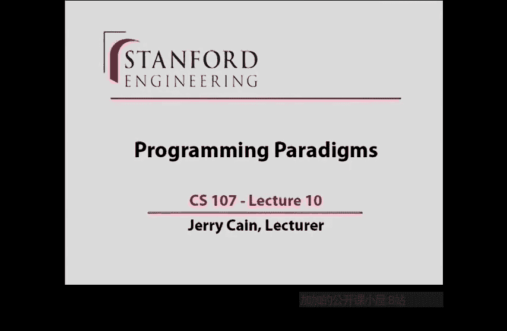
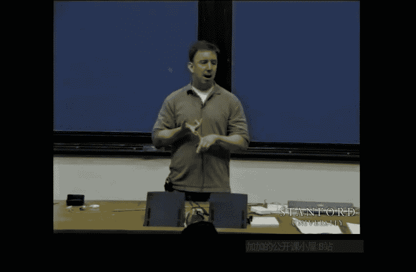
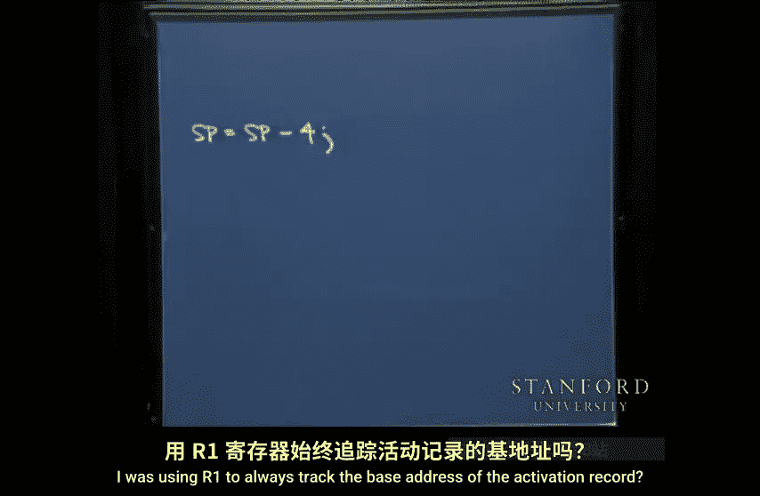

# 斯坦福大学【中英⚡编程范式｜CS107 Programming Paradigms】 p10 P10 -BV1aJ1EBHEoN_p10-

Yeah。🎼，🎼，🎼，This presentation is delivered by the Stanford Center for Professional Development。

Everyone， welcome。 I have a good slew of handouts for you today。

 Sorry about the lines on the photocopies。 It's the photocopi here。

 It's not me putting this really annoying background image behind all the text。

 it's chapters 3 and4 of this computer architecture series of handouts that I'm giving you I'm going to spend today and easily rest of Friday talking about all this stuff I go through plenty of examples。

 You also get your fourth assignment today。 I'm gonna make it next do next Thursday evening。

 I will tell you now that this is the one that surprises everybody a little bit。

 Its certainly doable。 But there are aspects of using the vector and hashet that always take a few people by surprise。

 particularly how you store dynamically allocated seastrs in these vectors and hashets。

 if you just make one key mistake then you can actually waste an hour or two trying to figure out why it's not working。

 even though it's compiling。 So be sensitive to the fact that you might want to just read the handout and maybe get the first 25% of。

😊，Assignment done because immediately you have to start dealing with these seastrs。

 and once you figure out how to store seastrs in these things。 you do much。

 much better and it goes much more smoothly after that Now I'm going to do something this week that I won't do very often。

 but I'm going to have another discussion section this Friday at 215。

 Now I'm just inventing the time and I know I can't check with everybody in the class as to whether it's convenient or not。

 So I just had to schedule it。 We're going videotape it。 we're going put it online。

 The discussion section just happens to come at a kind of crappy time in the assignment cycle。

 It's like two days before the assignments do It's not a disaster for the assignments that we've had so far。

 but I really want to show you some examples using the vector and the hashet in a structured discussion section and I want to do it more than two days before the assignment deadline。

 So this Friday at 215。 if you want to attend live by all means do it skilling 191。

 It's just this week we will have discussion section next Tuesday as well。

 I just have this one I want to insert into the sequence just so you have a little bit more practice before。

You really tackle the assignment this weekend， which is when I know most of you will start。Okay。

 I want to continue with this cogen thing。 I want to get the piece of chalk。That I'm going to use。

And I want to talk a little bit more realistically about what activation records look like。

 I have kind of blown off the parameters and where they reside in these activation records。

 I've only dealt with local variables， but all of the functions I've invented have had no parameters passed in。

 I did that because I just wanted to simplify things。

 So there's a couple of confessions I have to make about how I slightly misled you on Monday just to make things easier。

If you have this as a function prototype。And you'll be able to infer structure based on this small example。

 I think。 I'll just call it fo。And I will pass in。An ant's called Bar。And an its star。Called Baaz。

And internally， I'll declare some variables。A car star， I'm sorry， a car array， I'll call it。Snk。

 I have no idea what these words are， I'm just making them up。And then let's say a short star。

Called why。And I don't care about the code at the moment。

 because I just want to show you what the activation record would look like。 Now， obviously。

 it shouldn't surprise you that this and this and this and this are all packed somewhere close to each other in memory。

And in the examples I gave you on Monday， I only had stuff like this。

The way these are laid out relative to one another。Does not change。I would have。

A character array of four bytes， this would be this thing called Sk。

There's a word I've never used before， but here it is。

The four characters would be packed in a static array that resides inside the activation record Below that。

 I don't have a short。 I have an address to a short that is called why。Now， you may ask。

 what about these things， These things are certainly close。

 Let me just draw the picture and explain why it looks the way it does。嗯。

There is this reserved 4 B figure that sits right there that has nothing to do with parameters or local variables。

 But on top of that。There's going to be bar and on top of that。

There's going to be this thing called bassaz。Okay， and this right here。

Is the full 20 byte activation record that makes up or that accompanies any call to the F function right here？

Now， I put bar below Bas。 Is that arbitrary。 The answer is it is not arbitrary。 Now。

 I can't really gracefully explain why this goes below that and why basically parameters are laid down from high to low address from right to left。

 In other words， the zero parameter here is always below all of the other ones。

 And the first is stacked on top of that And the second is stacked on top of that。

Give me 40 minutes of more lecture。 and I'll be able to explain why that has to be the case in a language like CNC plus plus。

These right here are actually stacked in the order they appear。

 All of these appear at lower addresses than these。

This right here is something I'll be able to discuss a little bit more in about 15 minutes。

That is the space that sits in between parameters and local variables。 It actually has information。

About the function that。Called us。Okay。Obviously， foo is invoked from the main function or from some other function。

 or maybe even foo itself。 if it turns out to be recursive。

We're going to need to lay down a little piece of popcorn right there。About what where。

 where in the code base， we actually found this called a F， Okay， and when the function exits。

 it relies on this value right there， which I'm also going to call a saved PC。

 It's what the PC value would have been had some function called not interrupted the stream of instructions。

 Do you understand what I mean， when I say that。Okay。

 but don't worry about how that's manipulated yet。 Just understand that it's there and I'll be more sensitive to using it in a few minutes。

So that is the activation record layout for an arbitrary function。What I want to do now。

Is talk about how something like that is constructed because a function like foo is called。Now。

 I think food is a kind of a weird looking function， but I'm going to go with it。Int Maine。

I'm not going to concern myself that the parameters actually allieded and will。It。Arg C。Car star。

Star。A the V。And I'm going to declare one local variable。I is equal to Ill it equal to4。

And I'm going to call foo。Of I。An am percent。Okay， and then I'll just return zero。At the end。

Recall back to last Friday when I framed everything in terms of triangles and hexagons。

 I want to be a little bit more scientific than that。 And I want to explain。How。We go from this。

Where this is Arc C。And this is R V。 And this is set point to something like 2。

 And this is point set up to  point2。An array of car stars。Okay。

I want to figure out how we go from that， actually， technically this。I'll call it a saved PC here。

When I generate code for this right here， eventually after have to generate code for the function call。

 you actually generate code to basically allocate space for all the local variables。

Only Ma's implementation knows how many local variables are needed in order to accomplish what it's trying to accomplish。

 So by protocol， the very first thing a function does。

 A C function does is it makes space for its local variables。

Main is called with a partial activation record。 It has to complete the full activation record by doing something like this。

 S P。Is equal to SP minus4。Now， remember， on Monday。

 I was using R1 to always track the base address of the activation record。

Okay， well， R1 is actually supposed to be a general purpose register。

There's actually a dedicated registered。 We just call it S P。 It's short for stack pointer。 Okay。

 and that is always the thing that is truly pointing to the lowest address in the stack that's relevant to execution。

When。Name gets called SP is pointing right there。The allocation of the creation of this variable right here。

 it actually compiles to an instruction to demote。