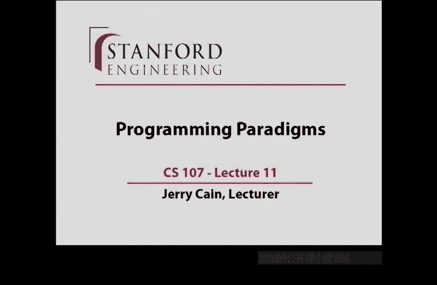
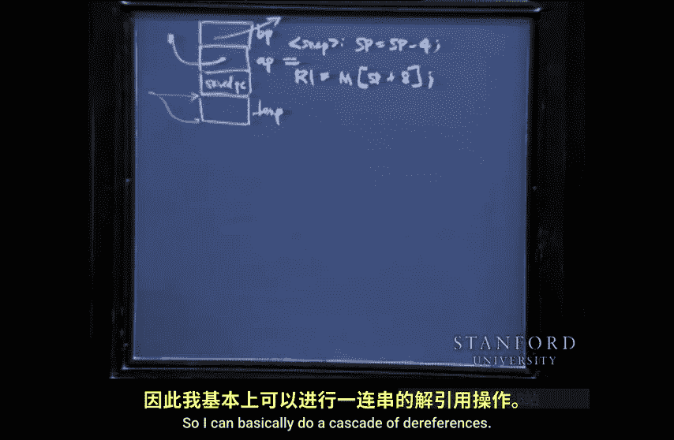

# 斯坦福大学【中英⚡编程范式｜CS107 Programming Paradigms】 p11 P11 ) -BV1aJ1EBHEoN_p11-

。🎼，🎼，This presentation is delivered by the Stanford Center for Professional Development。

Hey everyone， welcome。 I actually have one hand of free today and Ryan just walked in with it。

 So he's gonna be passing it around to the people who are in the room。 remember。

 we have a special discussion section today at I'm forgeting what time it is I 115 check whatever I said on Wednesday。

 what did I say215 I don't know why I'm forget215 to 35 and scaling 191 We're having a special discussion section just this one week because I want some example problems to sit in front of you and for you to think about them more than two days before the next assignment deadline。

 which is why I'm having it today。 it's gonna be videota I'm going actually callP after lecture today and try and make sure they post it by 5 o'clock today So it's around for the weekend online so you can watch it but I've already I think pretty well advertise the assignment 4。

 I think to be kind of the biggest surprise in terms of workload and difficulty for most students So that's why I'm advertising it now to be something you want to start on sooner than later because if you start next Thursday。

 it's very likely you will not finish on time。😊，ry and take a stab at of a little bit ahead of time this time。

When I left to last time I had shown you two examples of how function column return works in general。

 but specifically in our assembly language。 So what I want to do is I want to do one specific example actually much even simpler than the last example I did。

 because I want to make a transition from C cogen to C plus plus cogen and show you just how similar the two languages ultimately end up looking like when they compile to compile to assembly code so。

Let's deal with this scenario。嗯，Avoid function。 I just want to say foo。

And I'll concern myself with the。Allocation of two local variables。I'll set x equal to 11。

 I'll set y equal to 17。 and then I'm going to call this swap function。

This time I'm interested in writing swap to show you what the assembly code looks like。

 and I think you'll be surprised to see how the pointer version of swap and the reference version of swap look exactly the same。

 but the way I'm writing it right now， this is PRC code。Actually。

 you call C plus plus code for that matter。 And then that's all I want to do。 I just want to you。

 you to understand how code for this would be generated。 I don't have any parameters whatsoever。

 So I would expect。嗯。The stack pointer。Right there to have the safe PC。

Associated with whatever function happens to be calling fo right here。

 There's a call fo instruction in someone else's assembly stream。

 and that safe PC is the address of the instruction that comes directly after that。

 That's the trail of popcorn I was talking about on Wednesday。The first thing that will happen。

Is that this thing will actually make space for its two locals。

 I actually like getting in the habit of。Kind of taking care of my deallocation call。Right away。

That makes sense to people okay as soon as I write that。

 I just want to remember so I don't forget to put it on the page to put the balancing SP change at the bottom of the stream。

 Now I'll consider myself with this right here。This brings this down。To introduce those eight bytes。

 x is above y。So this instruction right there translates to M of S plus 4。Is equal to 11。

Then M of SP。Is equal to 17。 And then virtually all of the rest。

Is associated with the work that's necessary to set up and react to set up a function call and react to its return。

 Okay， so what I want to do here is I want to evaluate a percent of X and a percent of y。

The fact that there was an 11 here， whoops。And 11th there and a 17 is really immaterial to the evaluation of these。

 these two things right here。 This， given that setup right there， is synonymous with PC plus 4。

 This is synonymous with PC。 Okay， I want to put those values in registers。R1 is equal to SP。

 I'm sorry that's right。SP。Part2 is equal to SP plus4。This is ampersand of y。 This is Ampersand of x。

I want to further decrement。The stack pointer by -8。

 the fact that this is -8 is just a coincidence with that being -8。

There happened to be two4 byte parameters being passed here。 There were two4 byte，24 by locals。

 local to fo。Once I've done that。I've decremented this。Yeah。By four more bytes。

 that marks the bottom of the full activation record。

 I'm now building a partial activation record for the swap function。

 I want to lay this as a figure right there。 This as a figure right there。 This first parameter。

 the0th parameter actually goes at the bottom。So I want to do this M of SPP。

 what's just changed is equal to R2。M of SP。Plus 4 is equal to R1。Okay。

 that basically gets this right here。To point to that and this， to point to that。 So when。

We go ahead and call。This swap function。We're just inferring its prototype to take two inch stars。

 It just sees this。 technicalically， it has the addresses。

 the locations of the two inch it's going to be dealing with。

But it doesn't technically know that they're right above it on the stack frame。

 It actually just has the addresses on their little houses that happen to be just down the lock。

 okay。This right here， all it has to do is basically clean up the parameters when the call swap function happens。

 PC is pointing right there。 It can， by protocol， assume that that's where the safe PC is left。

 I'm sorry the stack pointer is left。When it jumps back to this instruction。

 because the return at the end of the swap is responsible for bringing it all the way back up here just by protocol。

 Does that make sense， Okay， so all I need to do。Fill in the space。This balances that。

 That balances that you could coalesce these to one statement if you wanted to。

 I just don't see a compelling reason to。 And then since there's nothing being done with the new values of X and Y。

 I can just return。Okay， does that make sense to people。As far as the code for swap is concerned。嗯。

This is a。Avoid。Swamp。I'll write it to be in star specific。啊。呃，AP。Fute star。BP。8。1amp。

Is equal to asterisk A。 There's actually a little bit of work here at the assembly code level。

I know you've seen this implementation probably 40 times in the last two quarters。

 but there's some value in actually seeing it one final time。

And for me to generate assembly code for it。It starts executing with the assumption。

That SP is pointing to。A saved PC。In this particular example。

 it happens to be that address right there。 That's the safety piece。

This is internally referred to as AP， BP， it's not like the words AP and BP are written on the hardware。

 but there's just the code is generated in such a way that AP is always synonymous at the moment with SP+4 and BPP is synonymous with SP plus 8。

 okay。😡，At the moment the the stack pointer points right there。

I have to make space for my one local variable。That happens because I do this。

I'll make it clear that this is associated with。The label swap that we actually call or jump to。

That brings this down here。This is locally referred to as temp in the code。

 This is the space that corresponds to temp in the activation record。

 The offsets of A P and BP actually shift a little bit。 Now， this is at address S P plus 8。

 S P plus 12。I have to rely on these things pointing to real data。

 I don't need to know where that data is to write， the correct assembly code。I need to evaluate A P。

 and then what A P points to。So， as part of。Initializing that right there。

 I have to load into a register。M of SP。Plus，8。Do you understand that it lifts this bit pattern right there and places it in a register。

 So I can basically do a cascade of de referenceences。 Does that make sense to people。

Okay， now I have AP in a register。