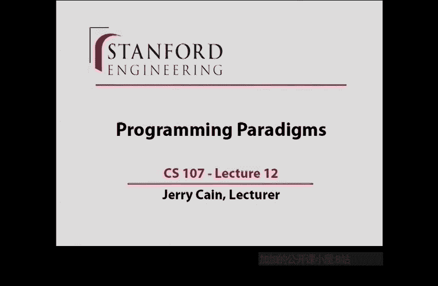
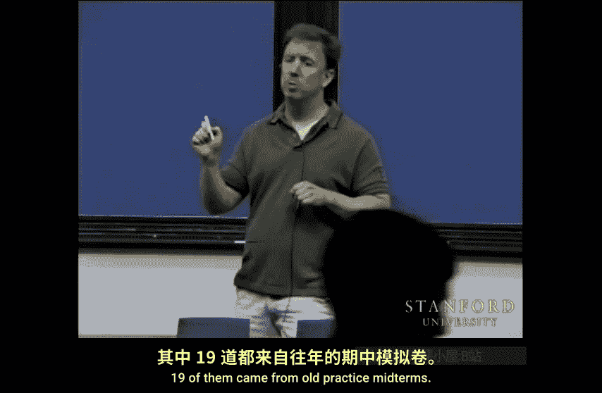
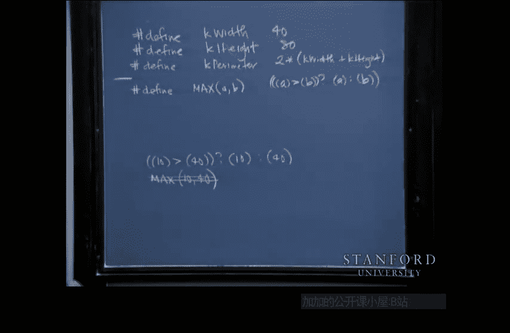

# 斯坦福大学【中英⚡编程范式｜CS107 Programming Paradigms】 p12 P12 ) -BV1aJ1EBHEoN_p12-

Okay。🎼，🎼，This presentation is delivered by the Stanford Center for Professional Development。

Hey everyone， welcome I actually have two handouts for you today to post it online and we'll distribute them to the lecture just right now as I'm starting one of them is tomorrows section handout。

 it really its focus is pretty much on the assembly code generation I was talking about last Monday。

 Wednesday and Friday the second of the two handouts is As 5。

 I was going to hand it on Wednesday And I said， you know what I'll hand it a little bit earlier because。

I just want to afford everybody the flexibility to work on these problems when they have time。

 You don't have to hand anything in for assignment 5。 It is a written problem set。

 There are no programming exercises whatsoever。 It's just lots and lots of practice with this cogeneration stuff that we're doing in section tomorrow but you'll also certainly see C codegen on the midterm next Wednesday evening So the only deadline I'm really imposing on assignment5 is that you actually do the problems make sure your answers are consistent with mine and I say it that way because itt doesn't have to be exact on an instruction by instruction basis。

 but you have to just make sure that your code dereferences things the right number of times and loads things the right number of times in order to feel comfortable with that material because it definitely will appear on the midterm I give next Wednesday evening at 7 PMm。

 okay I don't know where the midterm is gonna to be at I'll probably figure that out in the next two days this Wednesday I will certainly give out a practice midterm and a practice solution。

So that you have some fodder to play with over the next course of the next week。

 but all of the section handout problems if there were 20 problems on those section handouts。

 19 of them came from old practice midterms so definitely make sure you understand those you're welcome to bring in any lecture notes any of your assignment printouts。

 whatever you want to bring in you can bring in textbooks。

 I don't see the value of it since everything that you're really responsible for has been covered either in lecture or in a handout so that's that I know assignment 4 is due this Thursday I think people have started it and they are true believers when I say that it is probably the most difficult of the you've seen all quarter so start that soon if for no other reason than just doing a small component of it tonight so you know what you're up against with this Thursday deadline okay。

When I left you last time I had just started to talk about the C preprocessor。

 I want to talk about preprocessing versus compilation versus linking you're used to from one at least one06 memories。

 it all being the same thing。 You clicked command R or you did a drop down and you you clicked build and all of a sudden this double clickable app was created。

That's because it does these three things in sequence behind the scenes。

 And it doesn't very clearly advertise whether or not something in pre processing or compilation or linking broke down。

 You don't necessarily know the difference。 So I want to focus on the differences and tell you what each phase is responsible for。

 And when I left you last time。I had just。Introduced。The notion of a pound to。

And I advertised it quite clearly as something that was no more sophisticated than。Glorified。

Search and replace of this token with that text right there。If I do this， okay height。Wopps。

And I say that this is 80。 Then anywhere K width and K height appear beyond these two lines。

 It actually substitutes this for that and this for that。

 The only exception is it won't do that in string constants。

 but it'll even do it in future pound defined。 So if I were2。Do something like this K perimeter。

And I equated it with。Kay went。Plus， K height。Then this would not only substitute anything down here。

 but it really would replace that with a 40。 And this right there would be replaced with an 80。

 So by the time you got around to the definition of K parametermeter。

 it would see this not as this token stream， but it two times open peren 40 plus 60 40 plus 80 closed per。

 Okay， it doesn't evaluate it。 It doesn't even recognize that their integers。

 It just looks at as blank text， but the substitution of this there and this there is exactly what you do want。

Poundeffins are really nothing more than glorious search and replace。 We use them in C。

 pure C to consolidate what otherwise magic numbers and magic string constants and attach meaningful names to them。

 What you may not know about pound offins。😊，Is that you can define an extension to the pound of fine。

And you can actually pass arguments to pound of fundss， as if they're functions。

They're not called functions。 They're called macros。 So I could do something like this。Max function。

Hei。B， as long as there's no space between that parent and the final character of the token right there。

 it's clearly understood to be a little bit more than just a pound to constant。

 It's a pound defined fine expression that's parameterized on whatever A and B adopt in context when they' used later on。

 Okay， so if you want some quick and dirty way to find the larger of two numbers。

 you could substitute it with this。And just to be clear about order of operations and evaluation of everything。

 you'll usually see an intense number of parentheses。Put around these things。

Just so that there's actually no ambiguity as to how things should be evaluated if this thing is just plopped in context somewhere later on。

 Okay， and order of operations might otherwise confuse things。

 You'll actually see an example of that in a second。Anywhere you see this later on。

You wouldn't type it in this way， but just pretend that you did。If I。

 for whatever reason needed to tell me that 40 was， in fact， greater than 10。

When I see this in code later on， it really will go and find the max symbol。

 And it will every place that there was an A， it will place a 10。 every place theres a B。

 it will place a 40。 So this would。During preproces， be replaced by。嗯。10 greater than 40。If true 10。

 otherwise，40。 And even though that's an obtuse way of identifying that 40 is greater than 10。

 that is the textual substitution you would get in response to that， okay。

So it's like a pound to fine。 It's this quick and dirty way to inline functionality that's otherwise complicated with something that's a little bit more readable。

 You could， of course， go with a function， but。You know already know from the assembly code you saw last week regarding function column return that a lot of time is spent setting up parameters writing the parameters there。

 jumping into the function， and then after it's all over jumping back and cleaning up the parameters。

 It's not that much work。 it may be 10 assembly code instructions。

 But this is the type of thing that would expand it like three or four assembly code instructions。

 So the entire function of the entire effort of determining a maximum number using just traditional function column return would spend 70% of its time or something about that percentage。

 just calling and returning from the function。 Do you understand what I mean， when I say that。

 Okay using this pound to thing， this is this very efficient way of jamming in an expansion of this。

 every place M X with two parameters is actually used。

 Now it doesn't actually require that A and B be integers。 I mean， of course。

 we know to look at them that they should be integers。 But if I were to do this。

Get rid of that if I were to be senseless。And do something like this。

This would eventually cause problems。But as far as preprocessing is concerned。

 all it would do would be doing all it would do here is do templized search and replace。

 would use this every place there's an A there， you'd see a 40。2 and every place there's a B。

 you'd see a hello as a string constant and only during compilation when it reads the expansion of this as if we typed it in that way。

 Well let's say you know what， I don't like you comparing doubles to car stars。

 Okay using a greater than sign。 Okay， so you would get an error eventually。

 but you wouldn't get it via a preprocessor。 you understand what I mean when I say that。

Considered good or bad style to do something like that。 Well， something like this。 I actually don't。

 I don't see the problem with this as long as you have been doing it for more than a few days。

 I mean， it's I'll show you an example of。2 pound pound to find macros that we used in assignment 3。

 one of which you didn't even know you were using。 And the other one is in my solution。 Okay。

 this is obviously hacked just to introduce a point that preprocessing is still just text and replace。

 And that at leads to problems later on， it might be might be tracked and flagged in compilation or it might be flagged when you get a sec fault at 4 in the morning。

 Okay， you just don't know。 There was a question here。Do you receive on this max function？

The question is do you receive anything， it doesn't receive in the sense of a return value。

 but this is an expression that evaluates to either the result of evaluating A or evaluating B。

 so this one before I crossed it out， this would evaluate to the number 40。

