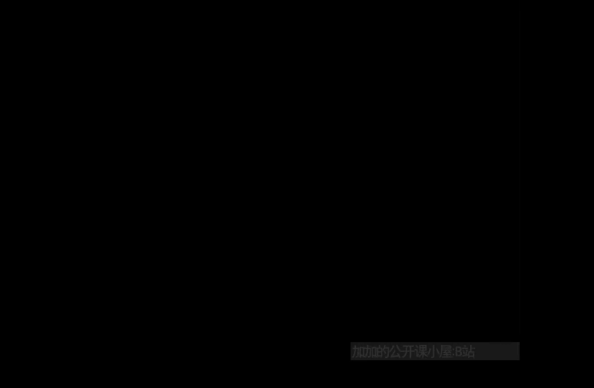
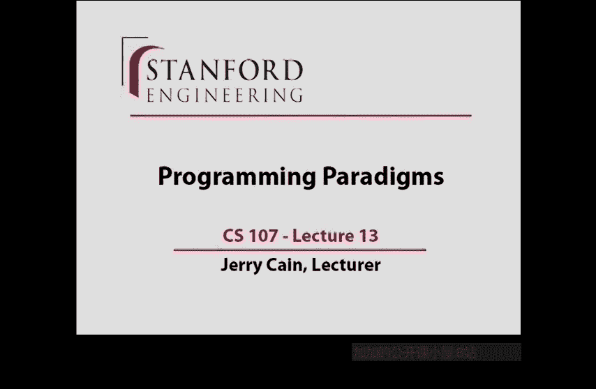
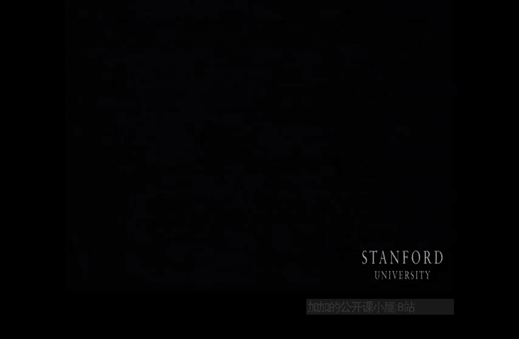
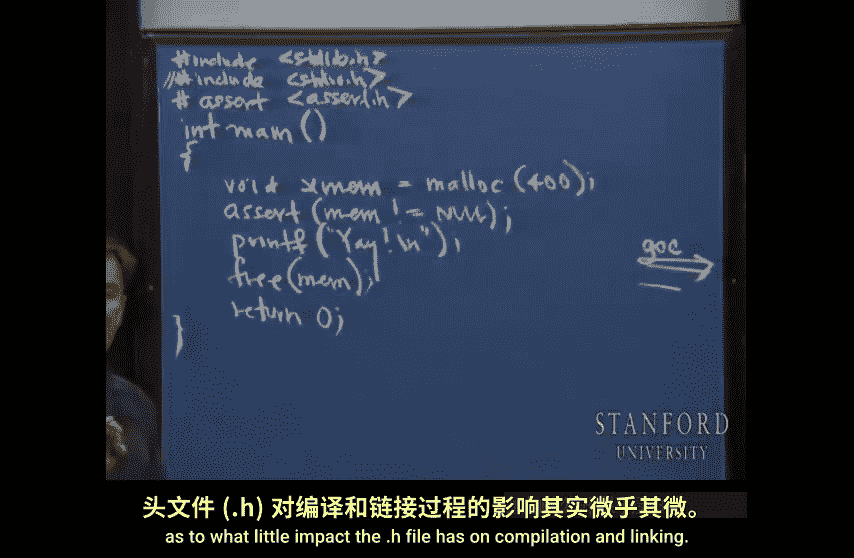

# 斯坦福大学【中英⚡编程范式｜CS107 Programming Paradigms】 p13 P13 ) -BV1aJ1EBHEoN_p13-

。🎼，This presentation is delivered by the Stanford Center for Professional Development。

There we go Hey everyone welcome I have two hands for today one practice midterm and it's cousin the practice solution I have I haven't written our midterm yet。

 but i'll get to that this weekend I'm typically。Very good about imitating the structure of the pra term。

 but I never promise that I will。 if I come up with some new idea that I think is fair to test some material。

 then I go for it。 Okay， but all of those problems。

On the pra midterm are drawn from previous midterms over the past three years。

 it's a little longer just a hair longer than you're likely to see， typically it's two。

 three or four questions depending on how intense any one question is。

 this one has five on it with some short answers。My recommendation， if you can do this。

 it's difficult to， but if you can take the practice midterm some during some three hour block and just write it up in full and then grade your own work。

 that's a much better way than just saying looking at the midterm looking at the solution， saying。

 oh yeah， that's exactly what I would have done because it isn't。

Okay so try and write out the solutions and then you'll have to invest some energy in deciding what types of errors are significant what types of errors are not I can tell you right now that we're very concerned with the asterisks and the ampersands and the arrows and the dots and the cast ultimately the questions are really just hopefully interesting backstory and vehicles for us testing all of that stuff and I don't care about the four loops I don't care about the plus pluses unless it's point arithmetic okay I really care about the asterisks and the double carstar cast and things like that so don't think that they're going to be viewed as minor errors they're not because a car star cast is very different from a carstar star cast you well cast it to be a struck triple star it's just as wrong if it's not correct so concern yourself with those things the midterm is a week from tonight it is in hewlett200 that's probably one of the largest lecture halls on campus it's not in this building obviously it's across the street So there's that you can take it anytime on Wednesday during。

Some3 hour block that fits in between 9 am and 5 p。

m if you can't make it that night you can't start it during lecture hour if it's best for you to skip lecture hour that's fine at all you can make it that night it just makes everybody's life easier because otherwise somebody has to be around to make sure we can answer your questions we will be around there's no doubt about it but don't take it earlier just because it's convenient for you please try and take it at night if you at all can。

There's something else I updated the website yesterday but it didn't make an announcement because another website wasn't updated yet。

 but immediately after lecture on Friday， a friend and colleague of mine。

 colleague is such a snotty word， a co-er of mine at Facebook is giving a technology talk actually as it turns out the same room where your midterm is so you can practice and get a feel for the room on Friday by going at noon I saw him give the talk about three months ago and at the time I was watching him give it。

 I said this is exactly the type of material type of talk that helps motivate the beginning four weeks of CS107 he won't talk specifically in terms of reallic and malic and free and vectors and hasets but when he talks about the system that's in place to store the billions and billions of photos that they have and they need to grant laser fast access to any particular photo that might need to be served up that's an incredibly difficult infrastructure problem and it relies on this very clever indexing scheme in order to go and find。

A photo somewhere on one of the I can't say the numbers and number of servers where photos reside and it has to do that quickly and so it's actually concerned with things like minimizing the number of discreads and things like that and so very little of it is beyond the scope of what you've learned in the first few weeks of 107 we're also giving you pizza and soda so if you feel like you're sacrificing lunch then you're not really because we're going to be giving you food if you're all interested in going to that please RSVP by visiting 107 which leads you to the ACM website just RSVP so that we know to get you some pizza it's not televised unfortunately so you actually have to attend something live if you want to go see this and we can't televis it for I think obvious reasons。

Okay， so there's that。 When I left you on Monday， today's Wednesday， when I left you on Monday。

 I was five minutes into an example that I want to use to illustrate how compilation and linking work。

 and I'm going to actually frame it specifically in terms of GCC。This was the program I wrote。啊，in。

Maame。I really don't care about those arguments， but I do care about this Vo star。Memory。

 I'll just write me this time， is equal to Malic。Of 400。I want to assert。

In the style that we're used to， mem is not equal to null。I want to print。Yeahay。Backslash M。

I want to dispose of the memory。And I want to return。0ero。

I'm only allowed to call Malik and free without running into any issues if I go ahead and pound include。

StTD。LB。th。There's a D right there。I only can call printf。Cleanly。

If I included that right there and the certain macro is available to me。嗯。By this header file。

This is the entire program， save for the implementation of MAC and printnt App and free。

 which resides in standard C libraries， if I compile this。😡，And I just do GCC。

 whatever this file is named。It can be made to generate two things。

 it can be made to generate a dotdo filee。And it can be further made to generate an executable。

Based on the way this is set up right here， you wouldn't be surprised that there's a call to Malck instruction somewhere inside there。

 that there's a call。To printer。That there is a call。

To the free function that eventually there's an RV is equal to zero。And there's a return。

There's actually an SP is equal to SP minus4 up top。

 there's the corresponding SP is equal to SP plus4 right there。

 those things should be make sense to you because you know what happens in response to local variable declarations and return values and function calls okay that makes sense to people。

If I were to compiled this， even though it's not a very interesting program， I compile it。

 it generates this assembly code。This is just compilation， this is linking by default。

Even if you just have one。0 file。What linking really is is it's the blending and merging。

Of this dotO file and any other ones you have， but in this case we only have one the doO file with all the standard libraries and the standard dotO files that come with the compiler。

 the standard compilers have the dotO code for Prif and MalC andP and things like that。

It basically does what is necessary and stackt all of them on top of one another to build one big executable。

 it usually splices out everything that's not touched and not needed。

 but it includes the code for any function that might come up during execution。

 it has to be able to jump anywhere possible while a program is running。😡。

Because this is set up the way it is， it'll compile and cleanly， it'll run， it'll print yaea。

 as side effects without really making too much noise， it'll allocate a buffer of 400 bytes。

 make sure that it succeeded， and then free it and returns zero。

 it's just this very quick program to really print yaea。

 but to also exercise malikin free and confirm that those things are working。😡，Okay。

What I want to do is I want to see what happens if I comment out this right there。

 let's give you some insight as to how little， what little impact the dotH file has on compilation and linking。

If you were to say that this would generate compiler errors。😡。

Because it doesn't know about this printf function， you would be right for some compilers。

As a result of commenting that line out there， you know enough to know that the translation unit that's built during preprocessing won't make any mention whatsoever of print。

Okay。When time comes to actually check to see whether or not print is being called correctly。

 it doesn't have the information it normally has okay most compilers many compilers would be like。

 well， what are you doing， I've never heard of this function。

 I don't like calling functions that I don't see prototypes for and some might issue in error GCC does not。

😡，We'll talk about printeth in a little bit a little bit more， but。

If during compilation it sees what appears to be a function call。

 what it'll do is it'll just infer the prototype based on the call， does that make sense to people？😡。

