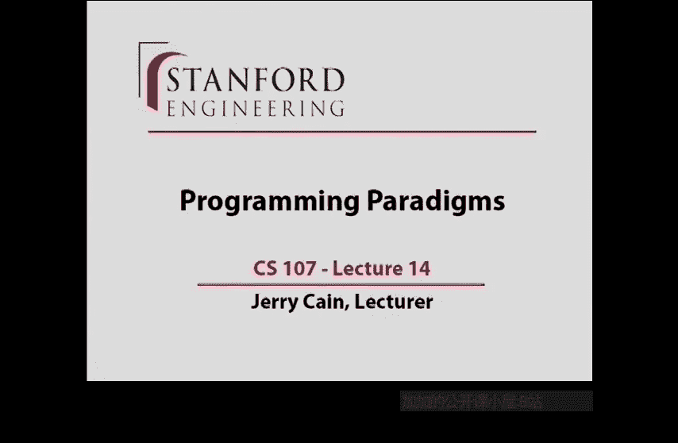
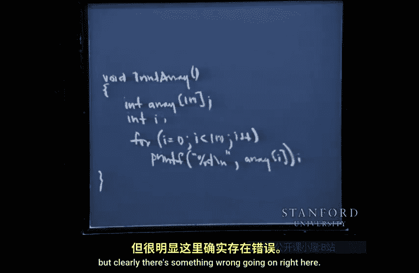

# 斯坦福大学【中英⚡编程范式｜CS107 Programming Paradigms】 p14 P14 ) -BV1aJ1EBHEoN_p14-

🎼，🎼，This presentation is delivered by the Stanford Center for Professional Development。

He， we're on， Hey about how about that。 Hey everyone， welcome。

 I don't have any hand it's for you today。 I actually want to finish up the implementation section of the course I think I'll get through it today。

 I'll make it a point to finish it today come Monday we're going to start talking about multithread and I'll even preface that a little bit today provided they don't run out of time remember that your midterm is Wednesday evening over in Hewlett 200 the largest room in this end of campus 7 to 10 pm it's open note open book you can bring printouts of every programs。

 whatever you need just plan on taking the exam in 3R period it's designed to be more than enough time for the midterm okay there's also the technology talk right after this class right here over in Hewlett 201 so you can go visit Hewlett 200 to see what room it's like for the exam but in 201 there'll be a technology talk from 12 to 1 o'clock okay。

I left you last time with this example。But I got several questions。About。Howil it worked。

 which probably means that I rushed through it in the last five minutes of class。

 which is probably true。We had something like this whos。Where I declared。An int array。Of length4。

An int I to serve as a for loop index， and then I'm just going to go do this。I don't care。That the。

A ray hasn't been initialized。 I want to go ahead。And do this right here。Okay。

 and then just return and the statement you probably do remember from Wednesday is that given our memory model that this would prompt the program to run forever now why is that the case？

Based on this local variable set， we're dealing with this as an activation record。One， two， three。

 this is the array。As far as that for loop is concerned， it's just one too small。

 This is the I variable。 It goes through， and it demotes all of these variables。By4。

 what values were there before， We have no idea， but it will certainly take whatever values happen to reside there and demote them by 4。

 Okay， unfortunately， because the test is wrong， it goes up。

And it demootetes this numerically by4 as well。 Now， that4 isn't so much a4 as it is。

 it isn't so much a negative 4 Delta as it is a negative one instruction Delta。

 because you know that this is the safe PC in our model。

This was supposed to be pointing somewhere in the coat segment to the line。That called。

The F function。This is planted down there in response to that assembly code statement。

Does that sit well with everybody。Okay。When you do this， you inadvertently。

Tell the safe PC that it wasn't pointing to this instruction， but that it should back up 4 Bs。

 which happens to be this nice round number as far as assembly code instructions are concerned and to stop pointing there。

And to point there instead。 So when this as a function returns， it jumps back to this right here。

Okay， and it executes the call having no memory whatsoever that it called fo like 14 or 15 assembly code instructions ago。

 Okay does that make sense to people So this is this very welldiguised form of recursion。

 You won't be able to emulate this on the solareris boxes or on the pods or the myths because their memory model is a little bit more sophisticated than ours。

 They don't put the safe PC right next to this right here okay but。Nonetheless。

That is this like probably the fifth example of infinite recursion we've seen in the last two days。

 okay， let me show you another program。This is no infinite recursion in this one。

I want to write a simple main program。Int main， I don't care about the parameters。

I want to do this want to。Let's just say。嗯。Declare。And。Andit。Aorray。Now。

 I'm not declaring any local variables whatsoever。 Okay。

 and so you should already be a little bit suspicious as about what that type of function should do。

 But imagine a CS 106A programmer in like week 4 learning C instead of Java and they just don't have a arrays and parameter passing down。

 So they have this right here。And then afterwards， they have this thing called print。All right。

And that is it。Okay， now unless there's global variables involved， there's no legitimate。

 even though we don't like globals， it still would be a legitimate way to communicate function information between function calls。

 but suppose there's no globals either。The program doesn't think they need globals because they do this。

 void。Declare。And。And that。Horay。And they just declare an array。Of length 100。

They declare the four lit variable eye。 They're not going to overrun the bounds this time。

 They're going to get it right。And they're going to set a ray of I。Equal to I。Okay。

So that's a beautiful little coatnipp。 It It does very little outside the scope for it does very little outside the scope of the declare in an in array function。

But for whatever reason， they've decided that they wanted to clear this array。

 locally update it to be accounting array， and then leave， okay。Them。

They come back and they want to print out that array。And。This is not that uncommon。

When we taught in C， they think as long as they name the array， the exact same thing。

That all of a sudden there's a relationship。Set up between that array and this one。

 as if the word array has now been reserved throughout the entire program。And。They do this。

And then they do this for I is equal to 0。 They get the four loop bounds right again。

 That's not the issue。Printf。Percent D。Backs slash and array。やばい。And they come in。

During office hours， because there's some part of the program beyond print array that's not working properly。

 But then A T A looks at this。 or I look at this and say， oh， well， this is wrong right here。

 And they're like， no， that's working fine。 It's actually down here。 Well。

 it may be something that's wrong down here as well。 But clearly。

 there's something wrong going on right here。 However， they make the argument， Well， it's working。

And the answer is， it is working as far as they're concerned。

 because that manages to print out 0 through 1009 I'm sorry，0 through 99， inclusive。Okay。

 you all probably have some sense as to why that's happening。

 Try explaining that someone who's never programmed before。 Okay。

 this right here built an activation record of 104 B goes down。

 and it lays down the counting array in the first 100 of I'm sorry， the top 100 of the 101 slots。

 Okay， returns。It calls a function over there that has exactly the same image for its activation record。

 So it goes down and embraces the same 404 bys。 This is me embracing 404 by。

 Okay and and it happens to print over the footprint of this function right here。 Okay。

 it's not like when this thing return to cleared out all of those bits and said。

 we got to scramble this。 so it doesn't look like an accounting array。

 It doesn't take the time to do that。 So basically what happens is if this is the top of the activation record and this is the bottom of the activation record。

 S P is descended once。This is filled up with happy information。 Okay。

 comes back up after the first call returns， comes back to the same exact point。

 the happy face is still there。 Okay， We print over it。Okay。

And it happens to be revisiting the same exact memory with the same exact activation record。

 so it prints everything out exactly the same Okay makes sense。

 Now there are some advanced uses of this where it really does help to do this a lot of times not in sequential code like we're used to。

 but about 11 years ago， I had had to rely on this little feature when I was writing a driver for a sound card and you had to actually execute little snippets of code with each interrupt with each hardware interrupt。

And so a lot of times you had relatively little to do in one little heartbeat of an interrupt and you had a lot to do the next one。

 in fact， you had so much to do that you weren't sure you' were going to have time for it consistently so a lot of times you would prepare stuff ahead of time and put it in exactly the right space so you knew where it was the next time without having to actually generate it Do you understand what I mean when I say that。

Okay， so if you write it， you almost think of this as this abusive。

 perverse way of dealing with a global variable， Okay。

 and you're setting up parameters for code that。