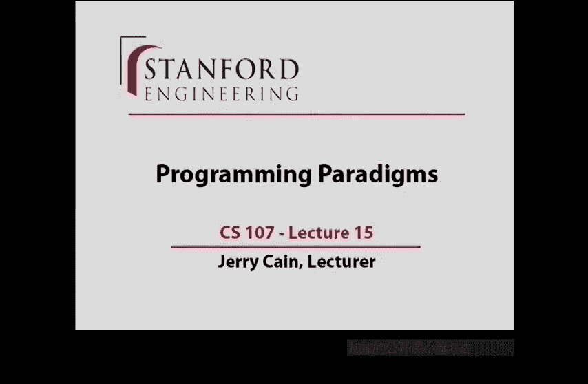
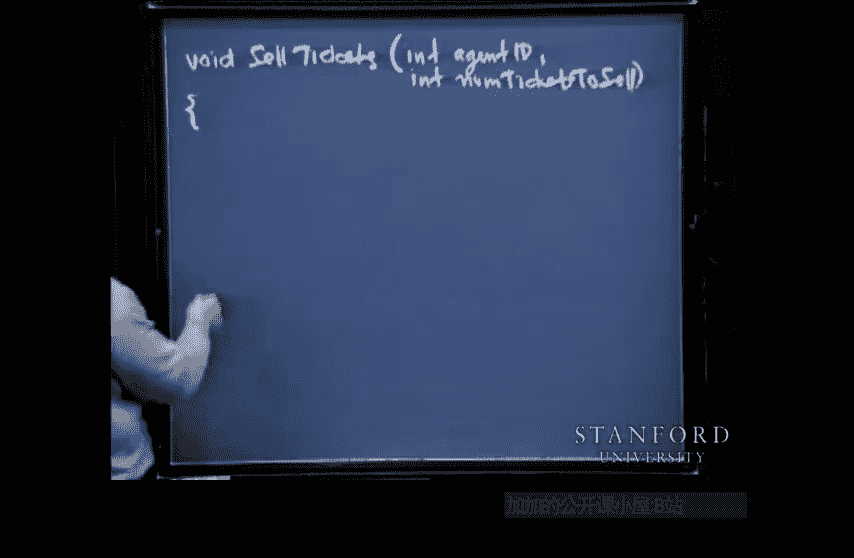

# 斯坦福大学【中英⚡编程范式｜CS107 Programming Paradigms】 p15 P15 ) -BV1aJ1EBHEoN_p15-

。🎼，🎼，This presentation is delivered by the Stanford Center for Professional Development。

Hey， welcome I have three handouts for you today。 I put them up on the board because they're not in sequence I went back and used the number for assignment 5 that it gave out last week a week ago today so people who are watching on TV make sure you go back and get solution to hand out 19。

 I think that's what it is。 I me just check it is indeed And so there's like all of these handouts in the last week that have corresponding solutions sets so make sure you actually download the solutions as well so you can compare your answers to mine and make sure that they're in sync with one another。

 you know you have the midterm on Wednesday evening at 7 o'clock to 10 o'clock inwl 200 huge room over there plenty of space well of Melbour rooms it'll be a great place to hang out for three hours and I want to be clear that I am certainly covering cogeneration you've seen that on the sample exams that I gave out last week。

 I am not going to include cogenerations for C+ plus features no true references and no object orientation。

 no methods So pointers that's fun。Anything related to asterisks is that's real C and I've emphasized that in the early part of the cogeneration。

 but references and methods， cogeneration for that it's not testable in the midterm。

 you will certainly see it on the final I always know exactly what type of question I put on the final for that stuff。

 but you will not see it this Wednesday I also promise to not have any preprocessor or linker or compiler stuff I went through that kind of as a transition from C figuring out how to build executables out of the C language but I'm not going to test that material because I have tested it in the past and it just never goes well because it's so esoteric and we don't have any kind of real problems to exercise the material so people just didn't do well so I just stopped testing it。

When I left you last time， I had written this farscically simple program that was supposed to model the selling of 150 airline tickets on a single flight。

 And so let me repeat that。And point out why it's problematic。

And how we're going to move away from it。I went ahead and did something like this。

I've wrote it a little bit differently last time， but I'll write it。Like this。

No tickets is equal to 150。And all I want to do is I want to in this brute force for loop。

I'll write agent。Is equal to one。嗯。Agent。Less than or equal to numb agents。Agent。Plus。I went ahead。

And I called this function called sell ticketsickets。And I'm going to frame it in terms of。

The agent ID。And the a little bit about numb tickets。Dive， numb agents。

So that is parameterized in terms of these two values right here and ostensibly each ticket agent knows that he or she has to sell that many tickets as part of his or her function call。

 and then that's it， just return zero。To satisfy the compiler。Okay。

 we're not going to allow anything to go wrong in this simple program。

 The implementation of sell tickets。It's not going to be rocket science。

I'm going to write it a little bit differently than I would traditionally write it because I actually I'm paying forward to the way we're going to change the example to in a second。

Boid。So。Tickets。int。Agent。I D。Youute。Ntic。It' a sell。And even though it's a little weird。

 let me not use a for loop。 Let me use a while loop。While it is the case。

That numb tickets。To sell。Is greater than0。Go ahead。And do。Prntf。Egypt。Percent D。Cells。A ticket。Oops。

Agent。Number。And then nu tickets to sell。Minus minus。Finally， my arm is tired。

 but I'm going to keep on writing Prince F。Agent。Percent D。All done。Agent numb。

This arm's going to be bigger than the other one by the end of the lecture，There we go。

From a code standpoint， it's moreronically simple。 I'm not trying to revisit four loops and Wi loops。

 What I'm more interested in doing is figuring out why this as a program as a simulation is all really not all that good in the sense that it's not really modeling what would truly happen。

The way this is set up。 and I'm speaking like this is new material， but it's not。

 it's clearly going to be sequential。 And ticketet agent1 is going to sell all of his or her 15 tickets before anything happens with ticketet agent 2。

 So you know that the printout of this。Would have 1 hundred 60 lines，16 lines per ticket agent。 Okay。

 I'm sorry，0 Yeah，16 lines per ticket agent， but they would be sorted all ticket agent number one。

 followed by an all done comment。 That's the 16th。 Okay， does that make sense to people， okay。

And there， I'm sorry，1，65 because of theres 15 agents going on here。 I'm sorry。

 now there's 10 agents。 So， so 1，60， I'm just confused。

But everything's going to be all about agent number one before it's agent number two。

 before it's agent number three， et cetera。I really don't like that。 Okay。

 this is a fairly compelling example where if we're really trying to model the simulation of the simulation of an actual airline ticketing room that you'd want to see all of these ticket agents running simultaneously and working。

 not competing， but working collaboratively to sell all 150 tickets at the same time。

 I'm going to simplify the problem a little bit and let all of them just work to sell 15 tickets。

 knowing that because of the way the code is written that if everybody sells their 15 tickets。😊。

All 150 tickets will be sold。But this will do it sequentially。 I don't want to do it sequentially。

 What I want to do is I want to set it up so that all of these ticket agents follow the same function。

 followll the same recipe for selling tickets， but they all seemingly run at the same time。Okay。Now。

 in order to do that， we have to use。A thread package。

A package or a library that we've written here at CS107 LandN in order to do that。

 it turns out that while C and C++ are standard， thread packages and libraries to help support the type of thing I want to do here are not standard across platforms and to the extent that they're standardized in Uniix and Linux flavors。

It's actually very difficult to use It's likequirky syntax。

 it's like worse than like C++ iterators in terms of syntax。

 just so we actually packaged and layered some stuff on top of the thread libraries that are available for Uni and Linux and slightly easier thing to deal with。

 I'm just going to write the functions to show you how this stuff works and you can kind of init meaning as to what these functions are supposed to be doing for us。

Now， when I talk about a thread， I mentioned this briefly on Friday。

 thread is really short for single thread of execution。 So when I I'm talking about a thread。

 I'm talking about some function that's running， presumably in the company of other threads at the same time。

I want to set this up。So that each of the 15 ticket agents operate like dogs at a racetrack。

 and I really want to lift the gate， and it's not so much a race with each other as it is just a race of the finish line。

 but all 15 of these dogs， all 15 of these threads are going to be interesting in following whatever recipe it takes to complete complete the function and when all of them finish。

 you know that all of the work has been accomplished okay。

So what I'm going to do is I'm going to leave this function as is。 This isn't going to change。

 at least not for the short term。嗯。And I'm going to go with a different for loop here。

What slightly longer code block here。After I。Frame the simulation in terms of the number of tickets。

 the number of ticket agents， I'm going to call this function。And knit。Bread。Package。

I'm going to pass in a false， I'll explain with that as in a second。

You know how in CS 106 and 10 VM 106X， you called a knit graphics to bring up the graphics window or you call a knit boggle graphics or whatever you have this one static routine you call up front to kind of set everything up。

If you want to use the thread library。On our system。

 you actually have to tell the executable that you're going to be doing that。

 This is just an initialization routine that has to always be in place before you call any other function in this library I'm teaching you right here。

Okay。