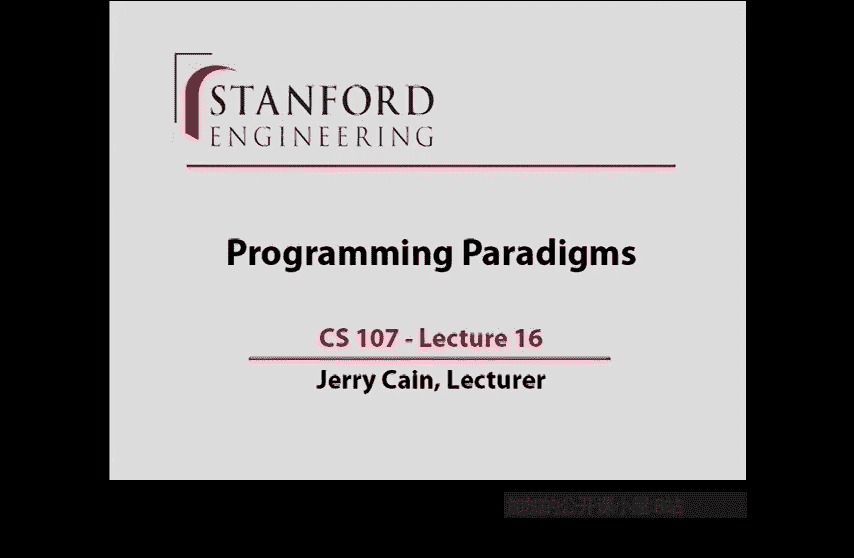
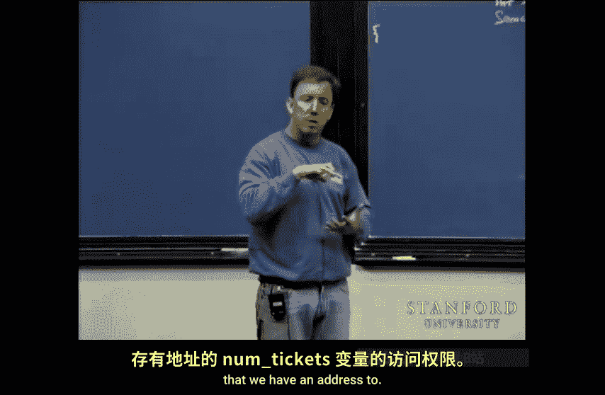

# 斯坦福大学【中英⚡编程范式｜CS107 Programming Paradigms】 p16 P16 ) -BV1aJ1EBHEoN_p16-

Okay。🎼，🎼，This presentation is delivered by the Stanford Center for Professional Development。

Hey everyone， welcome。 I don't have any handouts for you today。

 You have plenty of handouts from Monday that we still have topen the next few few lectures on。

You're not getting an assignment today so you have this grace period from tonight at 10 pm until Friday where you have no responsibility for 107 whatsoever。

 but remember the exam is this evening at 7 o'clock， it's in Hewlett 200。

 which is this huge auditorium in the building across beyond the fountain from Gates。

I'm going to send an email out after lecture， but just in case SPD students。

A watching this before to the exam tonight。 I'm planning on posting the exam as a handout at 701 PMm tonight and then remote students just download it self aminister。

 call in if they have questions and then fax it in when they're done。

 they don't need a proctor I don't need any of that business。

 I just assume people are well suited to just sit by themselves and take an exam without somebody of authority hanging over their shoulder。

 and then SePD students actually have the option to take it tomorrow morning as well。

 and I actually prefer that scPD students take it because if there's a disaster during the exam tonight people in the room can be dealt with immediately。

 whereas it's very difficult to propagate that information outward So I actually prefer scPD students to take it tomorrow and then fax it in sometime before5 o'clock tomorrow so we can grade them I'm going to try and get the graded exams back to you and available by Sunday evening I can't promise that I actually have not dealt with the class this large in a long time So we're dealing with I know it looks likes this cozy little family here but it's not。

 It's actually 200。And 30 some people。 and it's been a while since I've had to manage a grading effort that involve that many people。

 It's also complicated by the fact that I'm out of town this weekend。 So my Ts are grading it。

 and it might be difficult for them to get you the exams back by Sunday evening。

 But we'll do our best to make sure that that happens okay when I left you last time。

 I had focused specifically on the first multithreaded example where we had to introduce this notion of a semapho in order to control access to what we call a critical region。

 So if you remember last time。The threaded function。

 the one is the recipe that 10 different dogs follow while they're trying to get their work done。

 It looked like this。Sell tickets。Took an int。Agent。It took an instar。Called numb tickets。

And non tickets P。 And then it also took this semapho。I call Locke。Just to review。

 since this was kind of a fleeting comment in the last 10 minutes of Monday's lecture， the Semapho。

It is more or less like a basically a let's say， a synchronized。Counter。Variable。

 that's always greater than or equal to0。Okay。And so if I construct a semapho。

Around the number one and I levy a semaphore weight call against that semaphore。This as a function。

 figures out how to autoomically reduce this one。Two is zero。Okay。

 and so this is basically equivalent to the minus minus。

 but it does the minus minus in such a way that it actually fully commits to。

 to the demotiontion of the number2 one that's one that's one lower than it。 Okay。

 semapho signal on the same exact sepho。Would actually bring this back up to a one。Okay。

 if this were followed by a semapho weight call。Followed by another Senopho wake call。

Then something more interesting happens where this。One right here decrements the one down to a0。

This one right here would have a very hard time。Because semaphores， at least in our library。

 this isn't the case in all systems， but our semaphores are not allowed to go negative。

So when you do a sum of4 weight against a zero variable。Then this thread actually says， oh。

 I can't decrement that。 at least not now。 I need somebody else in another thread to actually plus。

 plus this so that I could actually pass through a minus minus without making the number negative。

Does that make sense to people okay so programmatically the implementation of semaphore weight is in touch with the thread library and so it actually when it detectses zero behind the scenes。

 it immediately says okay， I can't make any progress right now it pulls itself off the processor it records itself as something that's called blocked and it puts it in this queue of threads that are not allowed to make progress until some other thread signals a semapho they're waiting on because that's it well with everybody。

Okay。This is not constrained to go between  one and 0。

 It can This can be set to either be 0 or 1 or 5 or 10。 The only example we've seen so far。

Is where the semaphore that's coming in is initialized to surround the one because we really want to function not so much as one as we want it to function as a true。

 And it's basically a light switch that goes on and off on and on and on and off。 and it's used。

 and we use semapho weight and semopho signal against that semaphore to protect other protect access to the the numb tickets variable that we have't addressed to。

 So in a nutshell。

While it's the case， that true is true。I want this right here。To be marked as a critical region。

 what that means is that I want to be able to do surgery on that numb tickets variable without anyone else bothering me。

😔，Okay， and the way you do that is to do a semapho or spell it out here。Semaphore weight。On the lock。

You do the check。To see whether or not。Numb tickets。Of p is equal to 0。 and if so。

You don't do the surgery。Okay， on the end， somebody else has done it 100 times already。

 and there's no more， no reason to do it again。 Otherwise， you want to go through。And do this。

That's true surgery on what functions as a global variable。

 at least from the perspective of all the threads running this。

 and then you want to release the lock。You might do some printing printing here。Okay， you might。嗯。

Sleep for a little bit。Down here， there was an extra centnophore。Signal call。Against the lock。

To accommodate the scenario where the person who breaks out of the while loop does so after securing the lock。

 So they actually have to release the lock kind of as they go outside the bathroom window was the analogy I used on Monday。

 okay。This is considered to be a， I'm sorry。 This right here is considered to be a critical region。

 It's supposed to be something that when they're inside there。

 they cannot have any other threads during their time slices mucking around with this type of stuff。

 okay。As an arbitrary thread actually gets here， given that this thing was initialized to one and because there's every single semaphore weight call balanced by a semapho signal。

 it's going to toggle up and down between0 and1 when a thread gets here。

 there's one of two scenarios， it's staring at a one and so it actually successfully does the minus minus it is allowed to pass in here and do the work or the thread blocks on this。

Now you may say， well， how would that happen？A thread could potentially block on this if there's a zero。

 if another thread saw a one here decremented to a0， made partial progress through this。

 but the time slice ended before it got to the signal call， does that make sense to people？Yes， no。

Okay， just because a thread owns a lock doesn't mean that it can't be pulled off the processor。

It might acquire the lock， get two third of the way through this final instruction here， okay。

And then be pulled off the processor so that other threads can actually say， oh。

 maybe I can make some progress， but if they get this far。

 they'll still seeing a zero because the thread that owns the lock hasn't released it yet。

 Okay so as other threads hit this se4 weight call and this surrounds a zero。

 they are pulled off the processor。 That's kind of what you want。

 if they can't do any meaningful work。 You want the thread manager to say you can't do any meaningful work。

 I'm not going to let you even use your full time slice。

 and eventually it'll get back to the only threads that can do work。

 which in particular would be the one that owns the lock right here。Okay， does that make sense？Okay。

 so there's that right there。 You typically try to keep the critical regions as small as possible。

 If you're going to lock down access to code， you don't want to make it arbitrarily long。

 That's basically like saying， I want to do all the work in the world。

 So I'm just going to acquire a lock。 And I'm going to run this triple4 loop。 Okay。

 you only do that if you have to because it's a critical region。 This printf in particular。

If it's just logging information， it might not be imperative that you actually print to the console。

