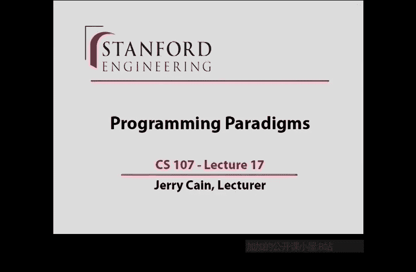
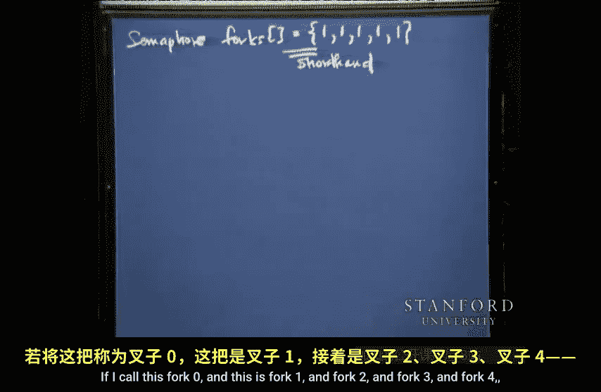
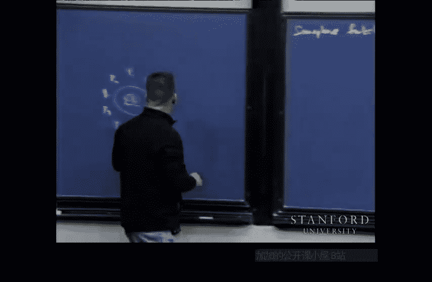
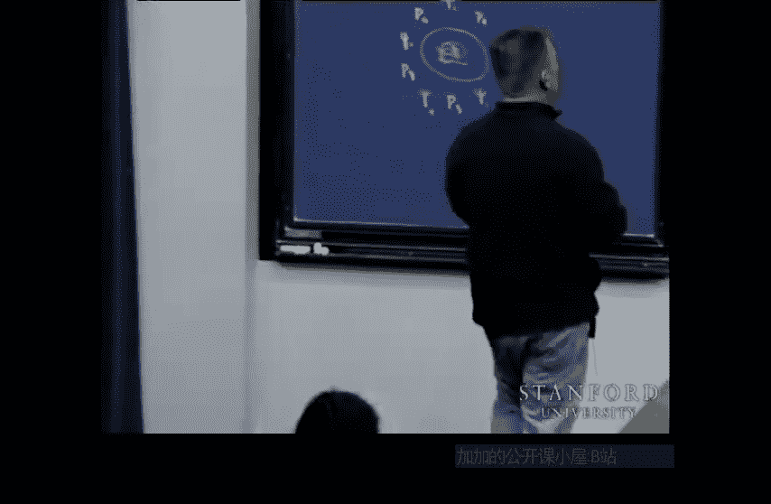

# 斯坦福大学【中英⚡编程范式｜CS107 Programming Paradigms】 p17 P17 ) -BV1aJ1EBHEoN_p17-

あ。🎼，🎼，This presentation is delivered by the Stanford Center for Professional Development。

I have a one handout for you today。 I expected to have two。

 but we have photocopi or drama this morning， so I haven't photocopied your assignment yet。

 I'll post it as a handout after class today。 you have plenty of time to do that。

 I'm not gonna to make this do until two Mondays from now。

 So it's not like you're in any immediate rush to get started on it。

 So that's why I wasn't stressing about it but nonetheless the assignment will formally go out today and you'll have two weekends to do it。

 It's actually not too bad。 It' certainly involve some of the new threading stuff。

 You're revisiting assignment for you're implanting some thread directives to make a lot of stuff that was running sequentially before and you felt the pain of that sequential execution before。

 make it so that lots of things run in parallel and things run really， really quickly， really。

 really beautiful。 It's very impressive。 It's a good end result once you actually get that thing up and coded。

When I left you on Wednesday， you were all stressed because you had a midterm in seven hours。

 but I was just getting through the diners philosopher， the dining philosopher's example。

 Let me review the picture。The idea is that there is food。

Big point of spagheti at the center of a table。 And there are。

I'll be less caricature about at this time。 There are four philosophers。I'll put P 0 there。

 sitting in a circle。 and there are actually。What looked like pitchforks， but just regular forks。

In between each of them and。Each of those philosophers is designed to run in his own thread。

 and they follow the recipe。 that is。They think they eat， they think they eat， They think they eat。

 and then they think again。 and then they exit as a thread。 That is their day。 In fact。

 that it's in their entire life because they only live for one day。 Okay， so I sent this up。

As a global resource， because that's the way the handout deals with it。嗯。

I will emphasize again that the way I'm writing this， this is shorthand。

All I'm really saying here is this is a gesture to the fact that I have five global semaphoes in an array of length 5 that are all initialized to one。

 There really are some semaphore new calls that are involved to build that thing up。

 but I don't want to focus on that other than just mentioning it。Each one of those ones。

Basically represents the availability of a resource。

 If I call this fork 0 and this is fork1 and fork 2 and fork 3 and fork 4。

 when this particular semaphore is locked up in a synchronized manner at a one。

I know that this particular fork is available， and that is of interest to philosopher1 and philosopher2 because both of those have to contend or contend rather for that fork in order to pass into the eating phase of the threat。

 okay。

So without concerning yourself with the deadlock scenario that was outlined last time。

 this is basically。The thread I want them to follow。

 each philosopher knows their subscript or their ID D number。

 and that influences which forks they grab or they try to grab。And so。If， where did F come from？

Int I is equal to0。 I less than3 I plus plus。I want each philosopher to grab fork to the right。

 fork to the left。That grabbing happens via a two semaphore weight calls。Against forks。Of Id。

 I messed that up last time。 I wrote I forks of I D。And then forks。Of ID plus one。

 but we want to mod it by five just so it wraps around and let's there we go。Okay。

 and as long as they pass through those and return from those two sepho weight calls in sequence。

They're allowed to eat。This is after they think for a while。Okay。嗯。And， after that happens。

 Do they eat for a while， they send a for signal these things。

 I don't really care about the order in which they。Bre them。

It doesn't really impact execution in an interesting way。Forks。Of IB plus one。Mod 5 and that。

And that is more or less what they do。 There's an isolated think。After the last meal。

And then they return。And。I did my little choreography last time where in principle。

 because each of these five threads may be running in round robin fashion， they probably will be。

 Each one might get to the point where they grab the right fork。

There are enough through this call that they've effectively acquired the fork because the one has gone down to the zero。

 but they get swapped out sometime between the actual demomotion there and the time they actually demote the one to a zero inside。

Does that make sense？So it's possible。I don't want to say it's unlikely。I don't want。

 it's actually unlikely unless you force it to happen。 But actually。

 I don't want to say that because it's possible。 It's a problem if。

All five threads could be swapped out right here。And all be experiencing mutual deadlock。

Because they're all depending on the philosopher to his or her left to be releasing that the fork that is there right。

 but your left fork。Okay， does that make sense？嗯。Normally， what you do。

 put all your semicollonons in。 but normally what you do。

Is you implant the minimum amount of work to remove the possibility of deadlock。

We made some observations in the final 10 minutes of lecture on Monday or Wednesday， rather。

Where we know because of。5 div2 is2 that at most four forks can be held while philosophers are eating。

 Okay so we could recognize that there are and most two philosophers going to be able to eat at any one time。

 So we could actually put something on a generalized counter。Right there and right there。

And actually。Force each philosopher to become one of the blessed two that's allowed to go ahead and grab forks。

 Does that make sense to people， okay。So what I did。As I did this semapho。A single senophore。

 numb' allowed。To eat。啊。And I could initialize it to two。Let me get rid of these arrows。

And I could sneak in。A call right here where I say， please wait。For me to be one of the two。

That is allowed to eat。Okay。It's something of a critical region。

 It's not the same type of critical region we saw before。

 Critical region normally means at most one because there are concurrency。

 there are race condition possibilities。 This is a different type of critical region。 In fact。

 most people wouldn't call a critical region， but I'll call it that。

 But we only want two threads to be somewhere between here and this part right here。 Okay。

 because if we have any more than that， then we're nearing the scenario what we might have deadlock。

 Okay， does that make sense to people。So let them go ahead， grab forks， eat。Release the two forks。

 And when they're done saying， basically， I have left the table。

So that means I should signal all the other threads or all the other philosophers that might be waiting。

For permission to grab forks。And do a final se4 signal call right there。Okay， does that make sense？

Now， if you put two there， I would completely understand why you did that。I personally。

Even though I recognize that there are most two， there are most two threads allowed to be in here。

 Okay， or what way we've actually programmed it up。

 that most two philosophers will really be calling the eat function。My preference。

Just because I'm a purist about it is that this be a four instead。Okay， now， a really terrible value。

Would be5。By five philosophers， then basically， the semaphore weight is just this gratuitous semaphore that everyone has to consume。

 But there will always be one there。 The reason the four works。

I's because as long as somebody's prevented from grabbing either fork。

 then there's at least one philosopher thread that's capable of grabbing two forks。

 maybe the other three are blocked， but it's always the case that exactly at least one philosopher will be able to grab two forks that makes sense to people that's the minimum amount of of a。

