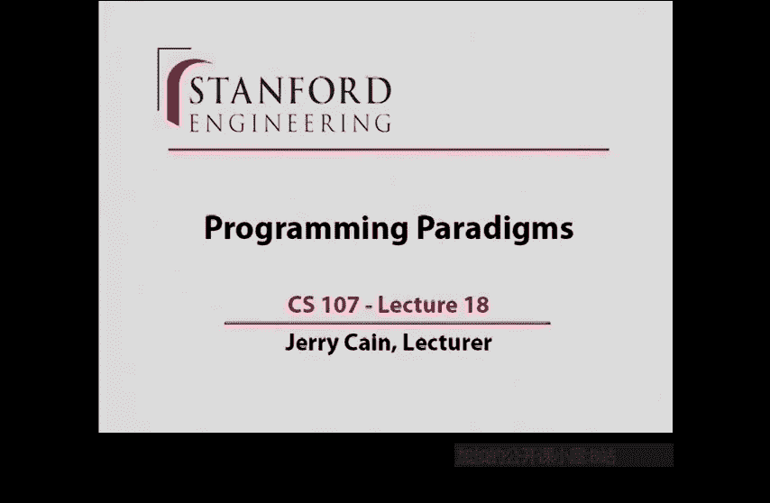
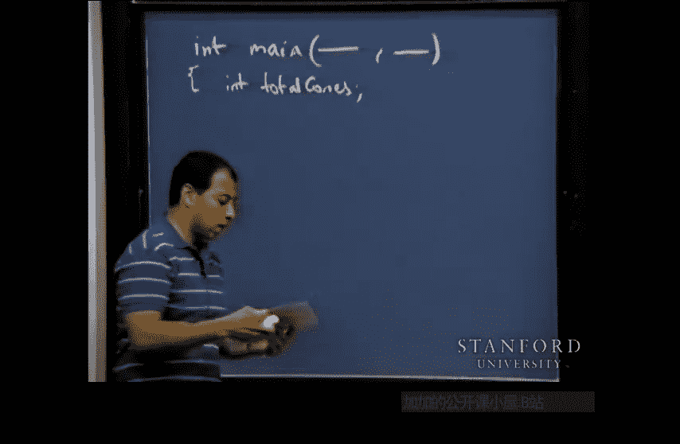

# 斯坦福大学【中英⚡编程范式｜CS107 Programming Paradigms】 p18 P18 ) -BV1aJ1EBHEoN_p18-

🎼。🎼，This presentation is delivered by the Stanford Center for Professional Development。

Right， everyone， Jenny is out of town today， so I'll be giving the lecture and we have two handouts today。

 two very small handouts， actually the section handout and its solution for tomorrow。😊。

So I believe last Friday Je started the ice cream store simulation problem。

 this is a really huge problem， it's probably bigger than any single synchronization or threading problem that you saw so far in the lectures and it's the merge of two or three final exam problems so it's pretty involved so we'll try to go through it Alzheimically as clear as possible but feel free to ask me any questions if you want。

All right， so let me just。Start from where we left off last week。

 So we were talking about the ice cream store， and we have four players。

 basically in the ice cream store。 We have the cacheier。Which is。

They are basically to handle the the billing issues。 And we have the customers。

We basically have 10 customers。And each customer of。

 each customer is gonna ask for a random number of cones of ice cream cones from one to 4， so。

The least we could have is 10 cones and the maximum is 40 cones and every single customer。

 because he doesn't want to wait for every single cone to be done sequentially。

 Then he's gonna fire off a clerk or dispatch a clerk for every single ice cream cone that he wants。

 And so we will have clerks。That are making ice cream cones we have。10 to 40 of those。

But the thing is， every single clerk， before really giving the ice cream to the customer。

 it has to ask for the manager's inspection to get an approval for the quo heid。

 So the clerks have to get the manager's approval。And the manager， there is only a single manager。

 only a single cash here。 And if the manager disapproves of the cone。

 then the clerk basically has to re the cone and ask again for for the manager inspection。呃。

The manager， he doesn't like to have two clerks in his office at one time。So basically。

 we can't have more than one clerk contacting the manager at some point。At the same time。

 So this actually starts， you can start to see the communication that is going between those guys。

 We definitely can see that we have clerk threads， right， because every customer。

 every single customer would potentially ask for 1，2 or 3，4 clerks。 At the same time。

 we have 10 customers that are running in parallel。 It's not only a single customer at a time。😊。

So we have threads here。 We have threads here。 We have a threat for the cashier。

 a threat for the manager， a total of probably 52。Possible with friends。ok。

You can see the communication going between the cachet and the customer。

 You don't expect any communication between the cacheier and the clerk or the manager， right。

You can you can see communication between the customers and the clerks。

 depending on how many clerks he he fires off。 And you can see definitely a communication between the clerk and the manager。

😊，Right。So you want to start thinking about what are the constructs that you would need in order to maintain synchronization issues。

Between all of those players in the game， okay。So let's start thinking。

 Ill just try to brainstorm about it， and then we can look at the code。The thing is。

 the customer comes in。😡，And he wants one to four ice cream cones， and he will fire clerks。

After he gets all his cones， he will go to the cashier， right？😊。

But he cannot go to the cachet until all the clerks give him back his ice cream cones。

So now you can study see like this kind of one to end communication that we talked about， right。

 You can see that this guy is gonna request n clerks。

 and he has to wait for the close to get the job done before he can go to the cashier。 right。

 You can also see the communication between the clerk and the manager。😊。

So no two clears can go to the manager at the time。

 which means that there should be this kind of lock around the manager's office， right？

And so only one clerk can access the manager's office at the same time。

 the manager will be waiting all the time because he has to wait for all the ice cream codes to be done for all the customers before he can go home。

😊，So the manager would be in kind of a loop just waiting to be requested for an inspection。

And once he finishes the inspections， he gets back to the result of the clerk and he keeps waiting again until all of potentially 40 cones are done and inspected。

😊，Makes sense。So the clerk will basically have to request from the manager who's waiting。

 So there' is the manager waiting for the clerk to request。

There is also the clerk waiting for the manager to finish his inspection， right。

 So we have this kind of binaryny rendezvous again thing going on in here。有其人。Now。

 there is another constraint on the customers going to the cachet at the end。

 So the customers are waiting for their cones。 And after they get their cones。

 they just go to the cachechet and align。And this line has to be maintained in a fightful order。

 so first in， first out。Alright。And we have to also think about that。

 How are we going to ensure that the customer that arrives first at the cashier gets 3D。

 served first and leaves first。All right。You will see again the kind of binary or rendezvous thing between the customer。

 each customer and the cashier， because the cashier has to be waiting all the time for a customer to request a service or basically a customer to show up online line。

And after a customer shows up in line， he would be waiting for the cashier。

To finish handling his bill and give and let him go basically。Right。

So any question on how the setup is for the problem？Alright， so let let's start by the main function。

 Let's see what happens in the main。Okay， let me write the in here。Let's have it here。

All right so we have。The mean function。I'm going to write this arguments。But it。

 it basically has to maintain it。The totalta number of cones， right？

The main function is basically responsible for spawning all the threads that we need。

Well see that the， the， the， the， the customers are responsible for spawning the clerks threads。

 But other than that， everything gets spawned in the in the main function。

 So the main function is gonna basically get the total number of cones。

 which is required to spawn the manager because the manager needs to know how many cones there is because he can't leave until he's done with all the cones。

Right。So。

We do the enormous stuff， we in the threat package。And we。Set up。

Some semimaphos that I would introduce right away。But just bear with me until I get to this point。

And then we basically spaed all the customers。 So for in， I is equal to 0。 I is less than 10。

I plus plus。What we want to do is we want to get a random number of cones for every single customer。

And then spawn the customer。And add this number of cons of the total cons that are in here。

So I need to initialize this to zero。So we have an int。Num cones。Is equal to。A function。

 random integer。That gives me back a number of cones between 1 and 4。

This function is in the more concurrency handout。 so I don' I'm not gonna repeat it。U。Now。

 once we have the number of cones for a customer， then we can just start spoilwning the customer because all the customer needs to know is how many cones he's gonna to order。

 right。Makes sense。So we've got to thread new。Debug name。The customer function。

And this customer is going to take one argument。Which is the number of cones。Alright。

 after doing that， we have to add this number of cons to the total cones because we will need to pass this total number to the manager eventually。

 right， so。Dotal cones。Plus， equal。那么 good。Now， this is going to be done。For all 10 customers。

And this way， we spa all the 10 customers that we have in our simulation。Now。

 we need to model the cashier。So we have a thread new。あ。Vi cash share。

And we don't give him any parameters。And we also spawn a manager。So we thread new。The manager。

And we pass to the band of the total the number of coins， which is a single parameter。Right。

Now we're done with that， we just run all the threads。

