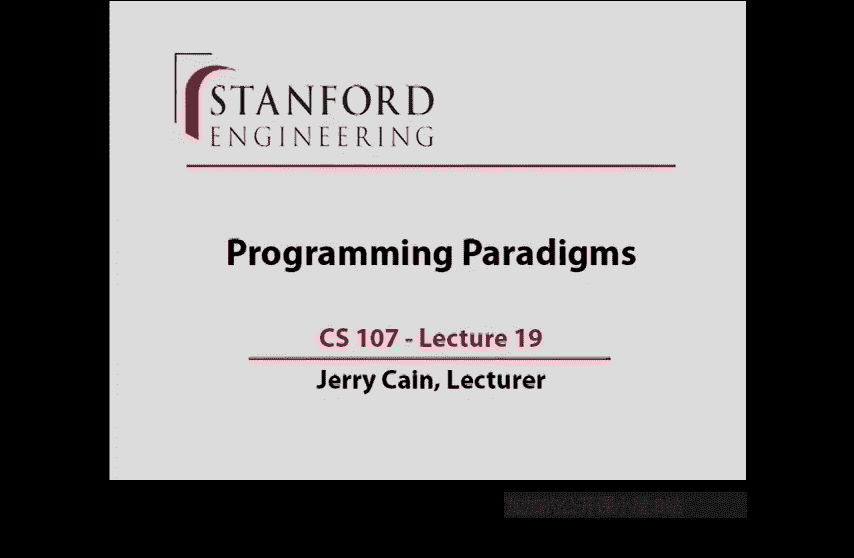
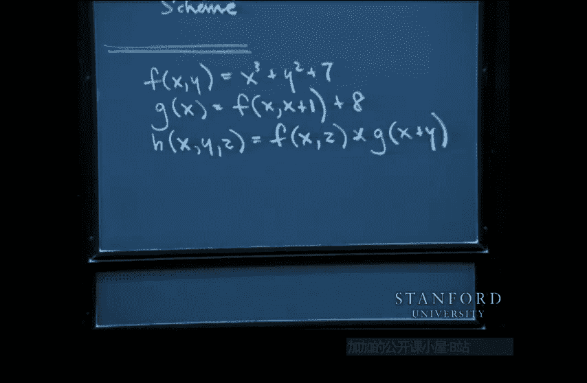

# 斯坦福大学【中英⚡编程范式｜CS107 Programming Paradigms】 p19 P19 ) -BV1aJ1EBHEoN_p19-

🎼，🎼，This presentation is delivered by the Stanford Center for Professional Development。

Hey， everyone， welcome。 I have a glorious set of handouts for you today。 I have a midterm solution。

 and I have the first two handouts and a stream of a few handouts I'm going to be giving you on our next paradigm and our next programming language。

 You'll see that I do have the midterm solution in there。 I actually distribute that。😊，Obviously。

 so you can check your answers。 but also so that we're somewhat transparent in how we actually grade these things。

 turns out that these things amount to like 25% of your grade。

 So Id like you to know what criteria we're using to consistently grade everybody so that if you see something that is so clearly wrong in terms of the way we graded it。

 you can confirm that by looking at the grading criteria and then coming to me if you have problems。

 usually when there's a one point error that's not listed specifically on the criteria。

 that doesn't mean I'm gonna to give it back to you。

 it means you made a mistake that we didn't anticipate anybody making we didn't put it on the criteria。

 But if you have a total of five points taken off for a problem out of 10。

 And it's not clear why you have that many points taken off， that's a different scenario。

 And so consult the answer key。 And if there really is disparity， come and talk to me about it。

 you should come to talk to me about it if if you're worried about there being a grading discrepancy because the thing does just end up counting a lot。

 So don't feel shy about coming back and asking for clarity as to why we took points off that we did。

So what I want to do today。Is I want to introduce a new programming language。

 and I want to first illustrate a new paradigm， one that you've certainly not seen before unless you've coded in other classes at Stanford or coded prior to Stanford。

 We have spent a lot of time。Talking about。These two paradigms， imperative。

You'll also hear me call it procedural。They're not necessarily the same paradigm。

 but the language we're using to illustrate both of them is the same。 We focus on C。

As the representative of those two paradigms， we also have。嗯。The object。Oriented。Param。

 we use C plus plus and even though we know that C and C plus plus ultimately translate to the same type of assembly language that you kind of think about the problem differently or we think about our solution to the problem differently when we take a pure C approach versus a pure C plus plus approach The reason this is called imperative procedural is that they're focused around the verbs that come up in the paragraph description of a solution。

 think about what a main function looks like in a typical C program。

 you declare all your data and then you make a series of calls to these very high levell functions like initialize。

 do it， terminate and then return zero or something like that， you understand what I mean。

 when I say that， okay， so the first thing you see associated with any C statement is usually or very often the name of a function that gets invoked to kind of take take control of 10% of the program or some small percent of the program。

Just to get something done。As far as object oriented is concerned。You're used to something like this。

 I'll write the C equivalent in a second， but。C plus plus over here， you declare vector V。

 you do something like vector new。Where you pass in the data and a few other parameters。

You do things like vector insert。Ampersand of V and vector。Sort。Of Ampersand V。

With additional arguments， those aren't prototypes。

 that just means I don't feel like spelleling up the rest of the call in C++。嗯。We declare a vector。

Maybe of ints。Called V and you do something like v。 pushback。Of four。

 or maybe you do something like v。 erase。Of V dot begin。To remove the front element。

 I know you haven't dealt with that specifically。 Don't worry about the fact that you't haven't necessarily used all those methods。

 But clearly， in this example right here， you're looking at the verbs first。

 Okay it is oriented around the procedure。 So I'll just go ahead and say that it is a procedure oriented。

 Where right here， you declare this object up front。

 And the first thing that comes up in the statement of any particular it comes up in any one particular statement。

 usually the first thing you look at as is the piece of data that's being manipulated。 in this case。

 V is the data。 It's also called an object。Because this is upfront。

 it looks like each statement is oriented around the object。

 which is why it's called object oriented， as opposed to procedurally oriented。 Okay。

 does that make sense。So you may think， well， I don't understand how I could possibly program in any different manner。

 Well， even sequential versus concurrent programming， there's a little bit of a paradigm shift。

 you have to think a little bit differently about the problems that are going to come up when you're program a threading environment versus a not thread a nonthing environment。

 usually when this is a little bit of a caricature。 But this is really how I feel。

 whenever you're coding up a normal program， like programs1 through  four。

 You have this very linear way of thinking。 You have this series of tasks you want to get through。

 And it's almost like you're inside the computer， like typing things out one by one。

 But when you're programming you're in assignment 6。

Its at least not all of it has to do with like execution logic。

 A lot of the hard stuff is like figuring out how all the threads are going to interact。

 And so you're thinking about multiple things at a time。

 and I'm actually like standing up a little bit more because I actually think with the back of my head when I'm programming concurrently because I'm trying to imagine all of these different scenarios of threat interaction that I have to worry about that have nothing to do with code I actually have to see all these little players in like some cloud thought cloud and how they might be interacting in how race conditions might come into being and so concurrent programming and multithreading is its own paradigm that isn't really tied to any one particular language object orientation isn't tied to C plus+ anymore more than it's tied to Java or Python or any other OO language you might know and even though C is probably the only procedural language you've really dealt with there's forre on there's pastcal those things really do exist not because a lot of people are writing new code in them。

 but there are legacy systems from 20 years ago that still exist and even if they're not adding features。

To that code base， they're certainly maintaining it and fixing bugs that crop up， things like that。

 The amount of。Energy that was invested in fixing cobal code bases back in like the final three months of 1999 was outrageous because everyone was totally petrified of the Y 2 K threat that because we weren't storing years with enough information that everything was going go back and jump back to like year 0 or 1900 however。

 they actually started。 It turned out to not be as nearly as big of a problem as they thought it was going to be。

 but everybody was working in a procedural language called cobal for a good amount of 1999。

 not everybody， but a good number of companies were okay。

What I want to do now is I want to stop talking about procedural and objectorient for a while and go back to sequential programming for the most part。

And start talking about what the functional paradigm is。Now。

 functional and procedural sounds similar。 but procedure， if you're a purist about the definition。

 it is a block of code that gets called where you're not concerned about a return value。 Okay。

 does that make sense to people。 Like you have to think about a procedure as a function that has void as a return value。

 When I talk about functional， I'm talking about procedures and functions again。

 but I really am oriented around the return value。 Okay， We're gonna study a language。

 I think it's very fun language to learn called scheme。

There are aspects of scheme that are interesting。 I want you to invest a little bit more energy in understanding the paradigm than the language because the paradigm is features of the paradigm are the more interesting takeaway points from a class like this。

 If you're not going to program and scheme again， which probably will be 90% of you。 But nonetheless。

 the functional paradigm is。Very much oriented around the return value of functions。

 So let me just do an aside right here。And just think of pure algebra， Nothing sophisticated， but。

If you have a function， like。This， right there。Don't even think about code。

 Just think mathematical function。 That looks like it's the name of some function that takes two real numbers or two complex numbers or whatever。

 two pieces of data。 And in traditional math， you know that it just returns or evaluates to something。

 Okay， so it may be the case that in a mathematical setting， it's x cubed plus y squared plus 7。

 okay。And in the pure math setting， you know exactly how to evaluate that If it stops being parameterized on on X and Y。

 and you actually pass in 5 and 11， okay。If I do something like this。嗯。

Then you know exactly what I mean when I write that down。 Okay。

 it turns out that the definition of G of x involves the definition of x。

 where it takes its one parameter and splits it out into two parameter So it can call F。

 And then it incidentally adds8 to whatever's return there。 Does that make sense， Okay。

 And if I go so far as to do this。Maybe it's the case that H。Of X， Y， and Z is actually equal to F。

Of x and z times G of x plus y。And that's just the associations that are in place。 Okay， now。

 this isn't legal code。 This is just math。What a。

What the functional paradigm approach does is it。