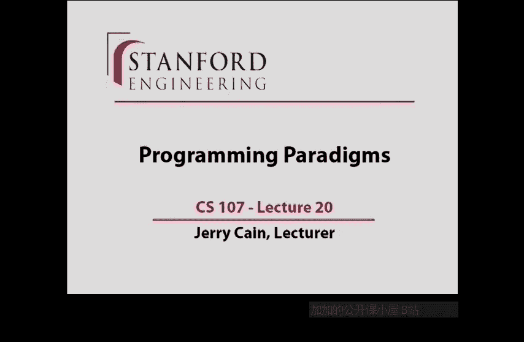
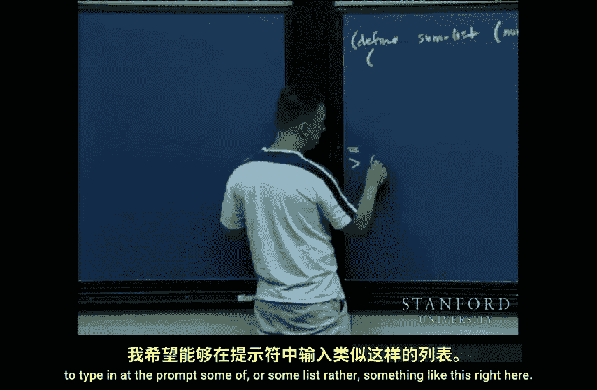
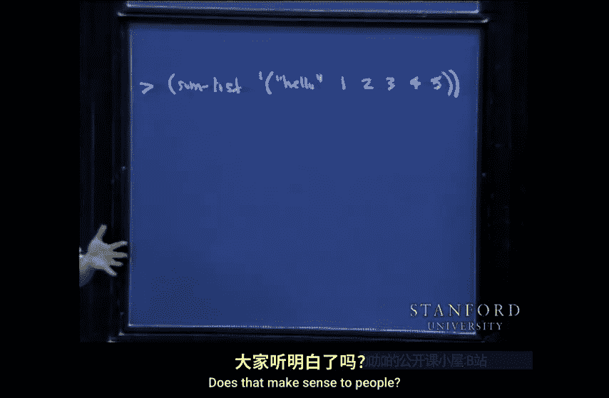
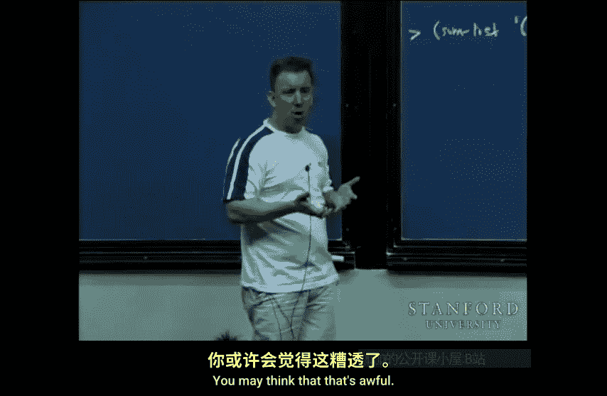
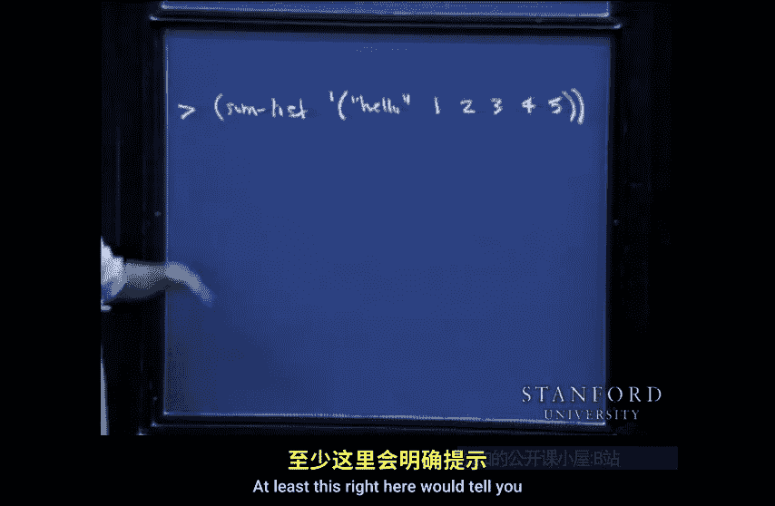
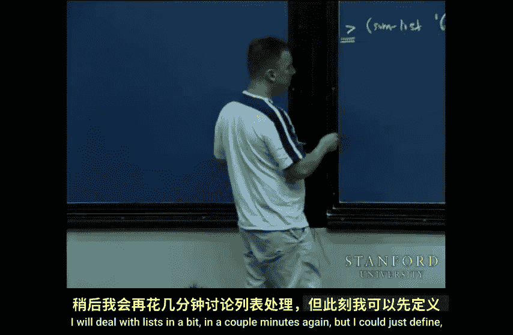
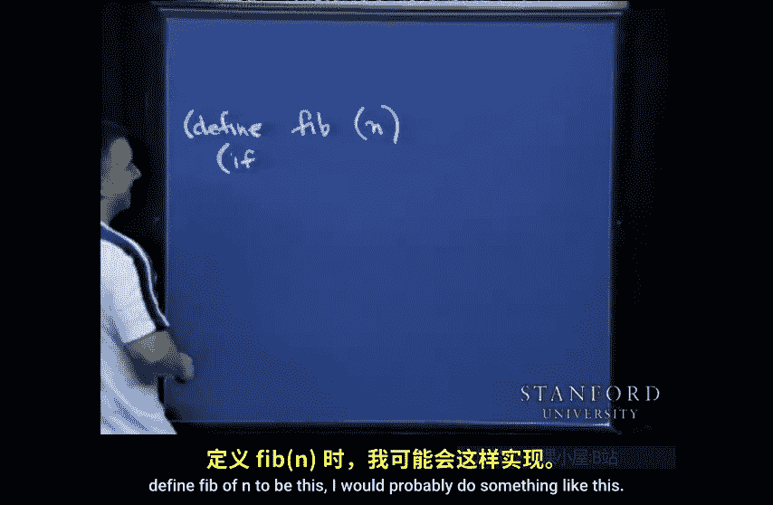

# 斯坦福大学【中英⚡编程范式｜CS107 Programming Paradigms】 p20 P20 ) -BV1aJ1EBHEoN_p20-

🎼，🎼，🎼，This presentation is delivered by the Stanford Center for Professional Development。

Oh， Oh， everyone。 I don't have any hands for。 I still have enough material from the Wednesday Sandouts。

 keep you busy for the next。Year if you want， but certainly what the lecture was。

When I left you last time， I had just introduced primarily。 I mean。

 I've talked about car cutter and cons and all the little different different atomic operations I want to deal with。

 Bob， But I give you an example of our first car cutter recursion problem。 I had implemented this。

Some。I'm going to call some list this time。And I will do， b，Just call it numb West。Okay， and。

I want to， even though there is actually exposed iteration in scheme。

 I Im w to just pretend that it's not available to us。

 I want to take this purely functional and recursive approach to everything we implement for the most part。

 anyway。 And so if I want to。Be able to type in at the prompt。Some of or some list， rather。

Something like this right here。I would like it to come back with of 15。Okay。

 if I want to go ahead and do something like this。啊。I wanted to come back with a0。

 And so what I'm going to exploit here is， I think something that's pretty conceptually obvious to everyone is that the sum of this entire list is gonna be one plus whatever the sum of this sum of this list is。

 I'm going to exploit the fact that Qar is available to me， it's very， very fast。

 to just kind of recurse on the tail of the list。 So the implementation is this right here。

 If it is the case that no。😊，Of numb list。Passes， or comes back with a true。

 then it evaluates this expression。 Then this if evaluates to 0 and the overall sum list expression evaluates to 0。

 Otherwise， I'd like to return。The sum of the car of the numb list。Whatever that turns out to be。

Okay， and add it to。The result of some listing。The cutter。Of the numbers list。Okay， there's that。

 that ends the plus， that ends the if， and that ends the define。Okay。Does that make sense to people。

Okay， there are a couple points to make about this that that are not obvious。 These two things。

 I think if you trust the implementation and you just get really。

 really good at leap of faith and recursive programming when you're programming and scheme and Lsp。

 These are probably going to work。 I mean， I'm sorry。

 you can look at these and just expect that this and that are the intended answers。

 And if you trace through the recursion and you use the leap of faith。

 you will be able to confirm that。 What I want to point out here is that what's interesting about scheme。

😊，Is it if you were to do this？At the the command prompt， you were to type in。A request to some list。

And you did this。Let's say that I did。Hello。One， two， three， four， five。Just like that right there。

It is going to fail。 It should fail pretty much in any language unless plus is overloaded to mean something when。

 when it's sitting between a string and an integer。

 But it is interesting to know how much progress it's going to make before it actually errors out and says。

 no， I can't do this for you。 It is very literal in its following of the recursive recipe。

Because it fails。This note test right here， it doesn't return to zero。It calls car of numblist。

 and it prepares this hello to eventually be levied against this with a plus sign。

 But before it can actually evaluate the plus expression right here， it has to fully commit。

To the recursive evaluation of this thing right here。 Okay， so it's gonna do all of this work。

 And I'm kind of I'm putting a bad PR spin on it， but I don't want you to think about it that way。

 It's actually gonna go and assemble this 15 recursively。

 it's going bring the lift up the 15 as the evaluation of the recursive call。

 And it's going to at that moment， do a plus of hello against the 15。

 and only then afterward's assembled the 15 will'll say， oh well。

 I can't do that it'll issue an error。 Okay does that make sense to people。

 The reason of' highlighting that is because underscores the fact that there is absolutely zero comp time element with regard to type checking。

 The type of compiling that goes on here。 And when you talk about compiling。

 it's almost always a fancier word for translation。

 And that makes sense in the context of CNC plus plus Anything that's considered to be compilation in schemeche or list is nothing beyond just parsing and making sure that the parentheses match and the double quotes are matched and things like that。

 Does that make sense。😊。

After it's been digested and and a linked list has been built in memory to store this thing。

 it evaluates it。 and you're basically executing the program。 Okay。

 so it's at runtime that tight mis matches are actually detected。

 And while the code is running doesn't say， well， that won't work out。

 You may think that that's awful。

But。Think about the equivalent of in C of a heterogeneous list。 It would have to involve void stars。

 Okay， if you're going to really support that kind of heterogeneity。 And at runtime。

 It would also error out， but it would error out in a much more mysterious way with those Se fault or those bus errors。

 Okay， at least this right here would tell you that there's a tight mismatch between the string hello and the 15。

 It might not actually have the real values， but it might say plus doesn't work when。

 when sitting in between a string and an integer。 Okay， does that make sense to people。

呃。Because because scheme is a runtime language。 It actually preserves type information about all of the data for the lifetime of this hello。

 The hellello sits in memory， and it's part of a small data structure that is tagged with something of an enumerated type saying this thing is a string。

 You have a little bit of a hint of that from a section problem that went out in week2。

 The first real discussion section where I had people couldcateten out all all the strings that were in a scheme list。

 Okay， the nodes in those lists are the things that really kind of back these types of data structures。

 and they really are tagged with list or integer or double or float or bullolean or a string and things like that。

 Okay， does that make sense to people。😊，Okay， so there's that。Let me。

Just be a little bit more brute force in my recursion here。 It doesn't。

 You don't always have to deal with lists。 I will deal with lists in in a couple minutes。

Again， but I could just define。Fibonacci。1 m。Okay。To be this。

 just introduce a couple other predicates。 I could ask whether or not N comes in a 0。

There's a built to called zero question mark。 The question mark is legal part of the syntax。

 just like it is part of a N null。 I's supposed to stare right you and say there's a question being asked about the data that's an argument。

 And if that's the case， you just go ahead。And return  zero。Okay。Otherwise。You can do this。嗯。

In which case， you can return one。Okay， and otherwise， you can commit to the sum。Of whatever you get。

By calling Fib。Against。And -1。And fib。Of M-2 that ends the plus。 that ends the F。

 that ends the first F。 that ends the define。Okay， it's kind of comical with all parentheses。

 but it's much easier to do in an editor where you actually have parentheses balancing。Okay。

 I'm gonna rewrite this because I actually started writing this thinking in factorial。

 And I forgot that I had two base cases。 So I just kind of gracefully went through it。

 like this is what I intended。 But I actually would not。😊。

I probably wouldn't cascade my base cases like that。 Okay。

 you can actually assemble base cases using or。 I showed you how to do it with and before。

 Let me rewrite this。Define。Of then to be this， I would probably do something like this。

 If it's the case that。

Let's say。Or。You could do zero question mark An， or you could do something like that。

But I just want some symmetry in the base cases like that。 And I would just return N。 And actually。

 Im， yeah， that's right。0 and1。This right there is what gets evaluated as an expression。

 If this right here passes， otherwise， I'd want to return。Fib of n-1， or I'm sorry。 this is not。

 These are That's right。 N-1。嗯。And Fb。Of n-2。That ends the plus。

