# 斯坦福大学【中英⚡编程范式｜CS107 Programming Paradigms】 p21 P21 ) -BV1aJ1EBHEoN_p21-

🎼，🎼，This presentation is delivered by the Stanford Center for Professional Development。

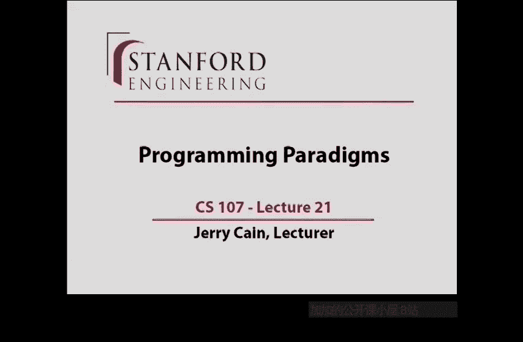

Hey， Ron， we're online。 I have a good number of panelouts for you today。 They're all going out。

 They've been posted since yesterday。😊，2 scheme handouts for material that I just briefly touched on in the last five minutes of last Friday and today and Wednesday and Friday is still probably will be covering scheme。

 Your next assignment goes out today。 It's not due for a while。

 I'm not making it due until the Wednesday evening after the weekend。

History has shown that the hardest part about this entire assignment is getting the first of the eight or so functions you have to write written because that means you have to get used to Kaa。

 which is the development environment and getting used to all of the parentheses and understanding how to test your code and things like that。

 after you get that working than the assignment is actually。

 I think on the easier side as far as one of7 assignments go。

 But recognize that the first function for a lot of people is actually a lot of work。

 it's not unheard of for some people to spend like an hour to 90 minutes on just the first function。

 which is like  seven lines of code。 And then after that， it's just smooth sail。

 but they have to iron out all the rough patches where the first function。 and then it gets easier。

 Okay we will have discussion section tomorrow，Examples in the section handout for tomorrow are being passed out right now。

 It's actually a pretty difficult set of problems。 Theyre old final exam questions that I've given in the past quarters。

 But nonetheless， it's good material for understanding all the little quirks and neat things about scheme。

 So I'll let you work with those tomorrow with Ben Newman and who'll be teaching it。

 What I thought I'd do is I thought I'd introduce you a little bit more formally to the development environment and show you how that's going to contribute to your assignment 7 experience。

 Okay， so let me bring this down。嗯。Create some mood lighting。

And let's see where we are with regard to。Getting everything to fit on the screen， please， please。

 please， please， please that it fit on the screen。I don't know what that's about right there。

 a little mushroom， it's a microphone， I think。嗯。

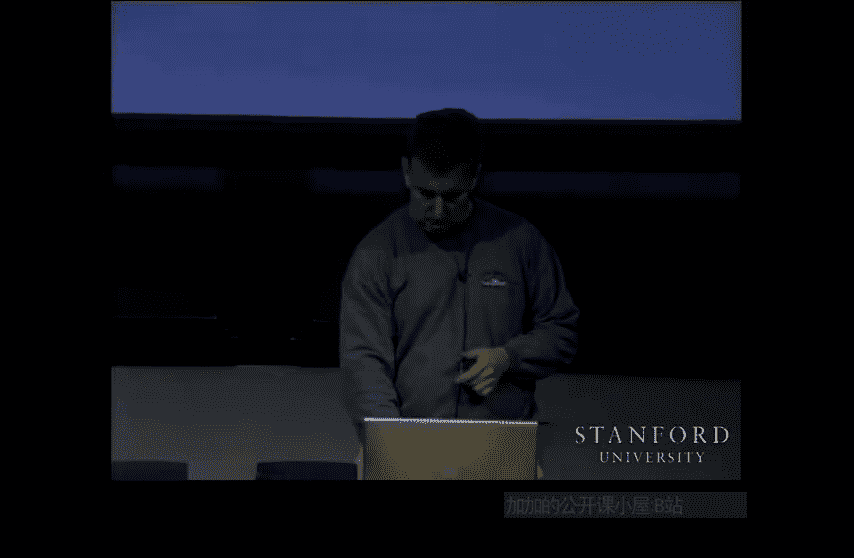

嗯。There we go。 Okay， so let's look get make sure that this fits on the screen。

 I'm not sure what people。

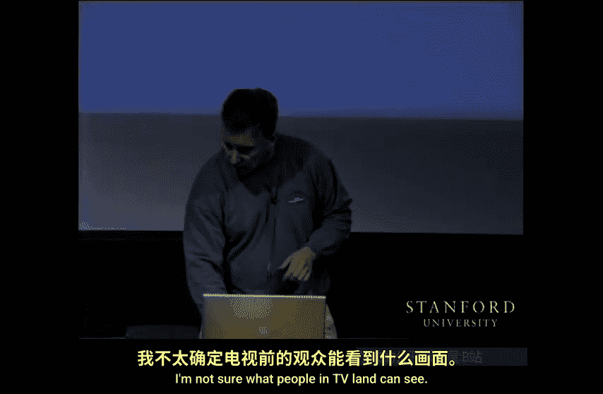

And TV land can see。 it looks like they can see my entire computer screen。

 but it's projecting larger up there for some reason。 But as far as I can tell。 we're working on it。

This is you driving， right？嗯。It's actually not a disaster， if you just want to。Weeaave it。Yeah。

 138's good。That's me ups top me。We'll figure it out。Okay， remember see that in the room。

 See L I see is jury at the bottom。 So on the。Elaine's it on the pods where I I've tested。

 it also work on the myths as well。 If you want， you can deal with the sche environment like I introduced last week。

 where you can type in for and have it confirm that it's4。 you can type in hello。

And have it confirm that it's really hello。 If you want to do things that are meaningful from a mathematical standpoint。

You can do that and come back with 21。 So this is the shell like environment where you happen to be dealing with the scheme language。

 Now， I don't want to imply that somehow programming and scheme is all command line driven。

 It's not normally what you will do。You'll spell quick correctly。Oops， sorry， exit。啊，那么。Do this。

 me actually， this is。Huge。😔，嗯。Oops。There we go okay。That's a little too small for the screen now。

 hold on a second。It's going to have to be this。Okay， good enough。

What I want to do is I want to split this。 I want to bring this and open up a shell down below。

 and I'll play with Kaa right here in the lower half。

But what I'm going to do up here is I'm going to prepare a little code snippet the one I finished with on Friday where I would define in place this thing if you recall。

 I called it sorted， and I said it was capable of sorting a sequence。

 but in the end I said we're going to deal with schemes equivalent of a function pointer。

 which we call a function object in scheme and the intent here is that I'm defining this two argument scheme function that takes the list and I'm not committing to a data type I want it to be heterogeneous by specification。

 but I don't care whether it's a string list or a list list or an in list or what have you。

 and then I pass in this thing that knows how to compare pairs of elements that reside in that list。

And this is what I wrote last time。I wrote eitherith it's the case that this list is so small that it can't help。

But be sorted。Or it's the case that this cP went levied against。The core of the sequence。

And the cutter。I'm sorry of the cutter of the sequence。Is that fitting on a screen？Yes， good。

And it's the case that， at the same time， sorted。Cutter of sequence。

With the same comparison function， kind of just works out recursively。Okay。

 so I can bring this down so you can see it。And that's what I left you with on Friday。

 Does that make sense。 How's that turning out on the screen。

 I think that actually looks okay on the screen。 So TV people on TV land shouldn't be yelling at me。

Okay。嗯。I'm going to save this file， and there is a command in Kawa。

 This is actually common in most scheme interpreters， where you can load。A code file。

In the past we've prepared dotC and doCC files ahead of time and then go into a shell and actually type make to build the executable。

 What we do now is we actually prepare our scheme functions in a file that's suffixed byCM for scheme。

 and then we actually load them into the interpreter using this load command that I'm doing down here。

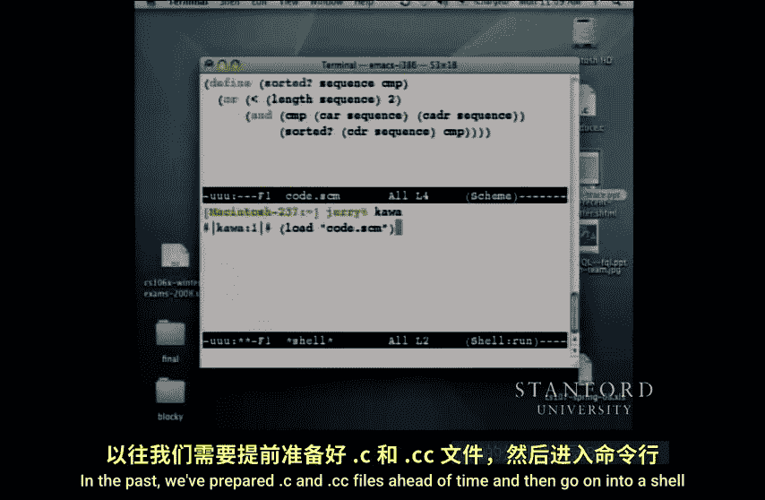

Does that make sense to people。Yes， no。

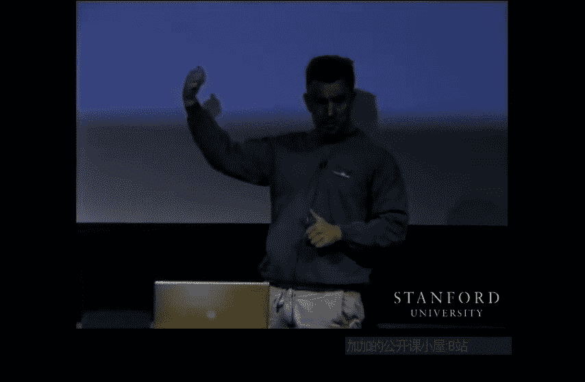

Okay， so if this all works out， do that。 And then I can type in， is it the case that。This list。

Is sorted according to that predicate right there。 And hopefully it comes back with a true。

 And it does the green， the green tea。 Okay， if I do this。And。I jump all over the place。

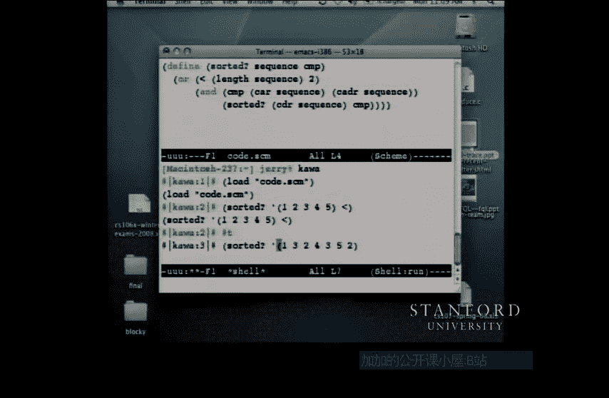

And I ask whether or not it respects the great M and equal to predicate。

It should come back with a false and it does。Okay。Makes sense to people。 Okay。

 so that's the overarching idea as to how you interact with the scheme development environment。

 I give you a dot SM file for the where my assignment that's going out today。

 It has tons of code that's already defined in there。 But you're gonna go through this。

 this update the scheme file， save and then type load in a parallel Kaa shell。 Okay。

 just to kind of bring in whatever code you've most recently written。 Okay。

 does that make sense to everybody。 Okay， very good。 So there's that I will put this to bed。

 I may come back to it。😊。

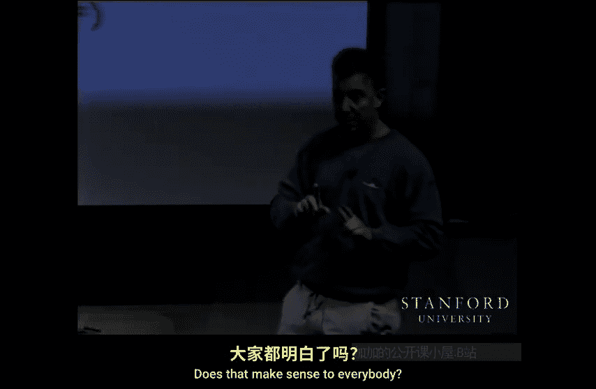

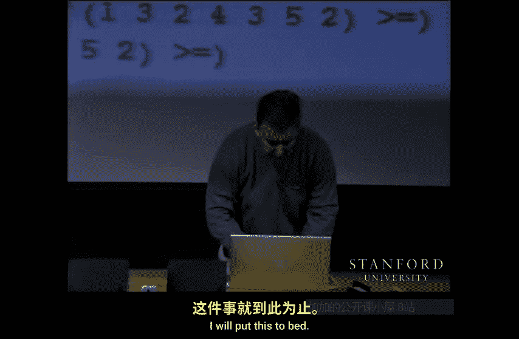

It's fine。 but I want to write code on the board because I think it's nice to create the code than to have it prepared ahead of time。

嗯。There is this one。Iiom from C plus plus with iterators and from assignment 3 with vector map that I want to see the equivalent of in。

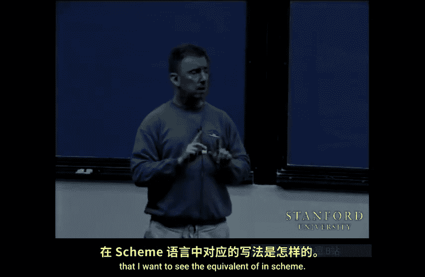

in scheme。Do you understand that？

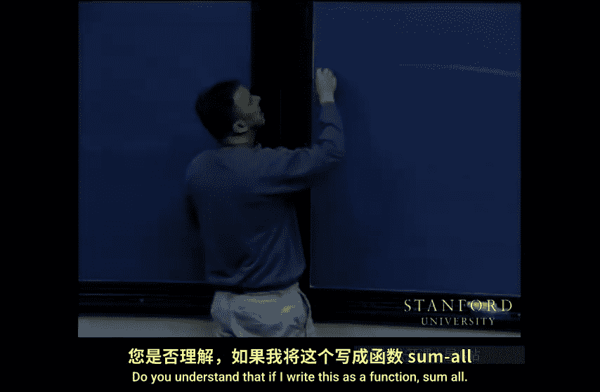

If I write this as a function。Some all。嗯。Actually， I don't want to do that。 I'm sorry。

 let's say that's some。Let's say double。哦。And I give it this list。And without writing code。

 I think it's pretty clear that the output of this。Should just be two， four， six， eight。

If I have an other function。Called increment oil。And I type in this right here。

 I expect it to spit out。Two， three， four， five。Okay。

 do you understand how those are algorithmically similar？

They both visit every single element in the list using car codeter recursion。 O。

 They both apply some functionality。

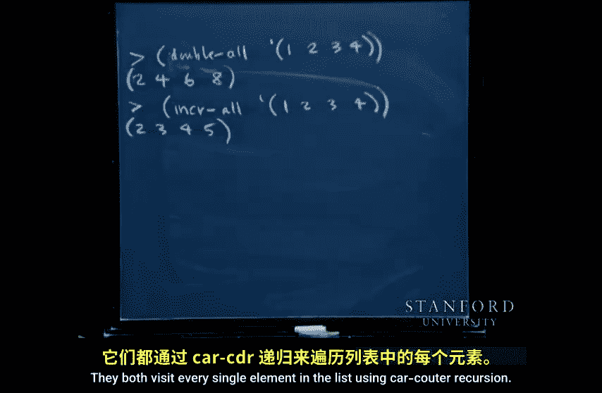