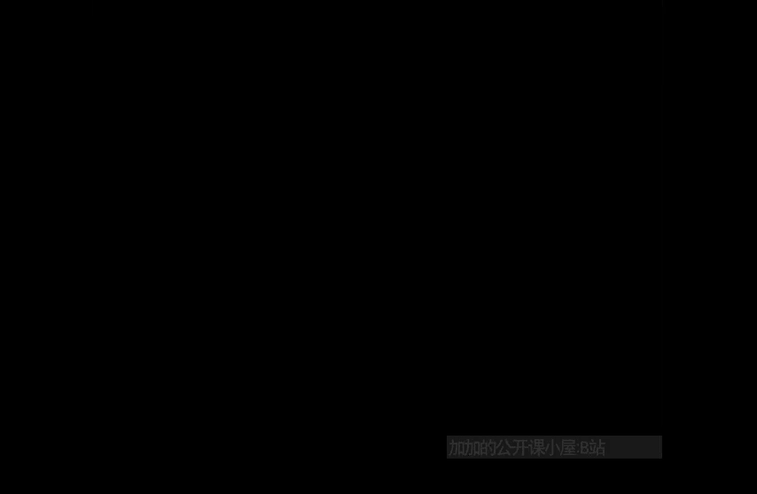
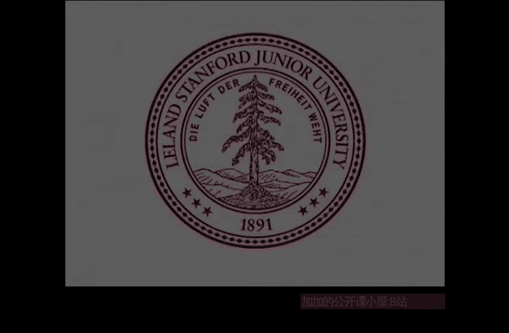
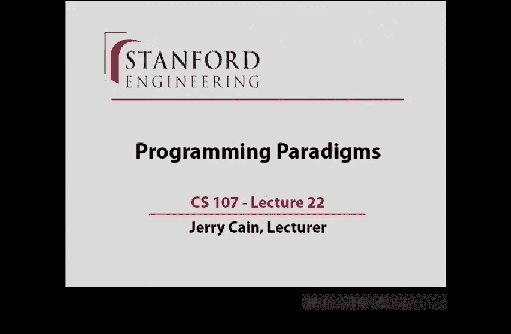
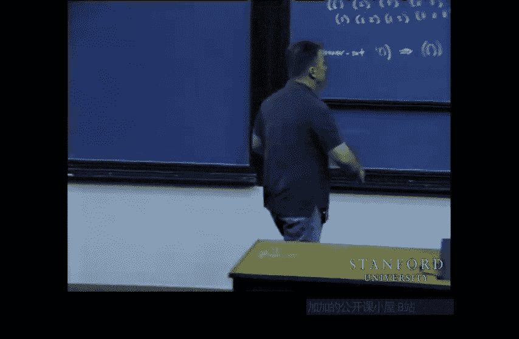
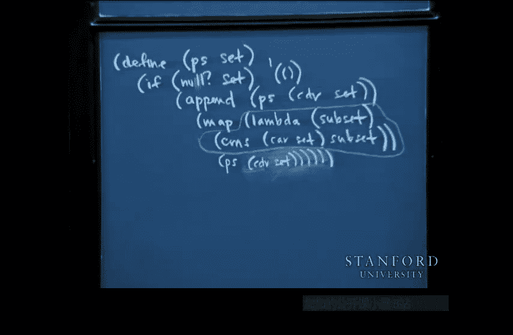

# 斯坦福大学【中英⚡编程范式｜CS107 Programming Paradigms】 p22 P22 ) -BV1aJ1EBHEoN_p22-

🎼，🎼。

This presentation is delivered by the Stanford Center for Professional Development。

Hey everyone， welcome I have no handouts for you today。

 I have several handouts in the past days that I have not finished yet and in fact。

 if there's one handout that I consider to be the advanced scheme handout probably handout 32 I'm going to go through two of those three problems that are in there right now you saw some sophisticated scheme examples in yesterday's section handout I want to do a few more today in particular I want to get this lambmbda function idea down and out in some significant examples I only went through a very trivial example of how Lambda gets used last time but I really want to do some complex dense recursive scheme functional programming using map and Lamb is today The first one I want to do。

嗯。It's actually more of a discrete math problem than it is a scheme problem。

 but we're going to drive the problem using scheme。

It deals with a notion of what is called a power set。 and those in 10。

3 A and 103 B over the past year are very familiar with the power set。

 But the loose definition of a power set。Is that it is a set that contains all of。A set subsets。

 So if we talk about the original set， just 1，2，3。 But you know what。

 I'm not going to draw it that way because we're not going to draw it that way in scheme。The set 1，2。

3。Okay。嗯。If I want to list every single subset of 1，2，3。

 I have to basically enumerate all the subsets such that either one can be excluded or included。

 Two can be excluded or included。 There's two options for the presence or absence of every single element。

 So for this particular。Set right there。 There are going to be a total of 8 subsets。

 So the actual grouping it won't necessarily be in this order。

 but I somehow want my power set function。To be able to eat and digest this as a list and synthesize something like this。

Now， the order will be a little bit different， but I will do it this way to。3。

 I'm not sure this is the best order， but there's a method to my madness here。

 Do you understand how those four， they're all technically subsets of this thing right here。

 There's no element in any one of those four sets that I've enumerated that contains an element that isn't there。

 So technically， they're all subsets， including the empty set， okay。🤧嗯。Here are the other ones。

And that's the full power set expressed using just scheme scheme lists。Okay。

 now the reason I drew it this way is I'm， I'm trying to make it clear what recursive structure I'm going to exploit by my implementation。

We all agree。But those are all the subsets that exclude the one。 Okay， does that make sense。

These are all the subsets that include the one。And I've ordered them in such a way that there's a clear and just pictorial。

 but there's a clear one to one relationship between one subset and the one below it。

Each one of these four things right there is identical。To those。

 except that a one has been prepened as the English word cons as the scheme word to the front of the list。

Does that make sense to people？Okay。So it's almost as if I want to recursively generate。

This right here。I want to recursively generate it again。Oh。But the second 1。

 I want to cons a one onto the front of it。 Basically。

 I want to map some function over this list right here that knows how to cons a one onto the front of it。

Does that sit well with everybody。 And then I want to append this list that has no ones whatsoever to the list that has all ones in it。

Okay。As far as the。嗯。I'll draw it this way。The power set。Of the empty list is concerned。

 You may think that this generates the empty list。That's technically not true。

 that would speak that there are absolutely no subsets of the empty set， and that's not true。

 Technically， the empty set is its own subset。 Okay， it's not， it's called an improper subset。

 but it's technically a subset。So I expect my power set function。When given this right here。

To return that。 Okay， so it's a singleton that has its its own element， the empty set。 Okay。

 I always expect the length of these list lists to be a perfect power of two。

 So I have two to the zeroth for this one right here。 That's the length，2 to the8。

 as the as this right here。Okay。It's very clever。 It's very dense。 I'm going to write this twice。

 The first time I'm gonna be careless in making the same recursive call twice， okay。But。

嗯。If I want to go ahead and define。I'm just going to call it P。Not postscript。

 It's called short for power set。 And I'm just going to give。Name the variable set。

 That's not a keyword。 Well pretend it's not a keyword in any any scheme dial like。

 I don't think it's in an hours， but just pretend that I can use set as a variable name without interfering with the name of some built in function。

 I just want to do a simple base case check right up front。If it's the case。That I have the null set。

 It's like the language is working in our favor。 It's awesome。啊。

Then according to this specification right here， I want that to prompt the entire thing to evaluate to that as a constant。

 okay。That technically is incorrect。 Okay， that would try and that would go in and pull out the empty list and assume it's bound to functionality because of the place it's occupying in the list。

But by putting the quote in front， that suppresses evaluation。Okay。Makes sense。Otherwise。

 what needs to happen？Is that I have to somehow encode。

The appending of this right here to the appending of that right there。

 This right here is just the power set of the cutter of the set。 Forget that the one is in there。

 Take a leap of faith。 What is power set of 2，3 supposed to generate， It's supposed to generate that。

Okay。It's just best to get this on the board and to just show you explain why the code is correct。

I do want to append。Two things， okay。I certainly want to generate those two lists and then concatenate them。

 The first 1 I get by pure leap of faith of calling power set of kudter。Of the set。

 And you're just assuming why you're writing this， of course。

 that the P function works while you're writing it。 That's just the leap of faith principle。

 The second thing is actually a little bit more involved。

The second half of the entire power set is certainly related to the recursive call。

 but we somehow have to visit every single subset in the recursively generated power set。

And cons the missing element onto the front。 It was correct。

 We were correct to omit the car from anything that had to do with this power set right here。

 This is the first 50% that's all about excluding the one or the car of the original set。

I want to append this to more or less the same thing。嗯。I'll call it subset。More icons。

The car of the set。Onto the front of the subset。No， that is。Not over with。And let me just do b P。

Opset。That ends the map， that ends the pen。 that ends the if， that ends the define。

Let me do you a favor and make it clear what function is being mapped over this power set。 I'm sorry。

 that's not power set of set。 It is that was。It's closed， not quite right， clear。Opset。

H the map append， if define。This is the on the fly function。Then， I told you。About on Monday。Okay。

 it is interesting because I really am defining it as part of the execution of power set and its implementation is framed。

 This is the first time we've formally seen this as part of a language。

It's implementation。Is framed in terms of not only this inner variableable。

 but the value of a local variable in the outer scope。Okay， does that make sense？Okay。

 put a question in the back。Pencil， okay， so I'm mapping。This is a function。

Over whatever the recursively generated power set is。Okay。

 this accommodates the issue or deals with the issue that the one or the car is excluded from the recursively generated power set。

 But it says， you know what， I'm going to visit every single subset if I actually apply some functionality to every single thing in the recursal。

