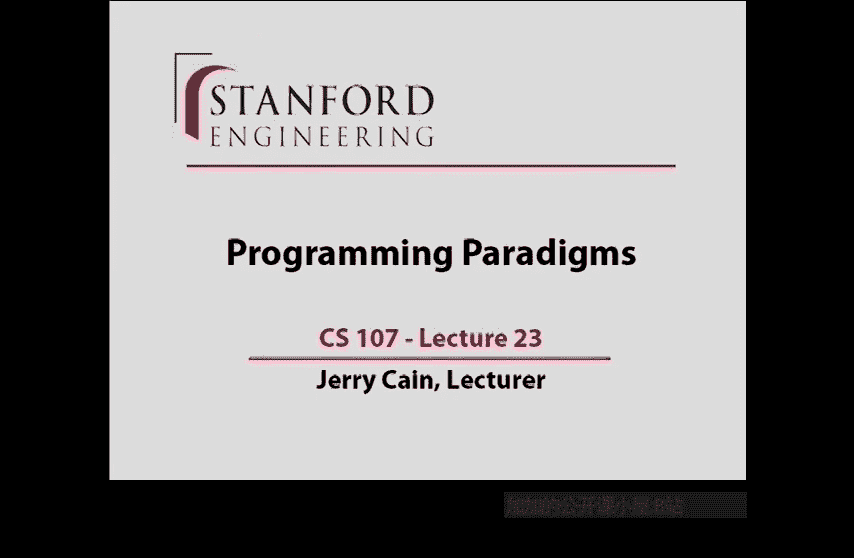

# 斯坦福大学【中英⚡编程范式｜CS107 Programming Paradigms】 p23 P23 ) -BV1aJ1EBHEoN_p23-

🎼，🎼，This presentation is delivered by the Stanford Center for Professional Development。

Hey everyone， welcome I don't have any handouts for you today。 a couple of clarifications。

 A I goofed and I made made the assignment due on some non-existent day next week。

 it is due Wednesday evening which is the 28th， not the 29th lets you ample amount of time to actually get the assignment done so I'm not worry that people are going be all of a sudden flustered but it was always intended to be due Wednesday night I think even said Wednesday in class I'm sure I did but otherwise that is due Wednesday evening。

 you will have one more assignment going out on Wednesday it'll be just a single problem and a language will probably start next Wednesday if not in the last 10 minutes of the day next Wednesday or I start talking about Python Once I get to the scheme segment we're going to transition in lighten a little bit and we're not going to be so concerned about trying to master all these new features of languages because I don't want to say we've covered all of paradigms that's not true but we've covered a good number of paradigms and when I teach Python next I'm going really just highlight and。

Individual things in the language that will get you up and running very quickly and point out where it's imperative and where it's object oriented and where it's functional。

 Okay， so that's what we'll do throughout the the rest of the quarter。

 I'll probably introduce you to a few of the languages that I happen to know just so you can see them and really just trust that just because you don't know them that it's actually pretty easy to learn them。

Today I want to focus on scheme， I probably will not keep you the entire time。

 I have two things I want to do。And then I will probably just let you go and go on this virtual five day weekend。

 Okay， when I left you last time， I was spending a lot of energy。😊，Talking about the memory model。

 and I just want to review that for five minutes so that you understand exactly how you could very easily implement a scheme interpreter when you type this in。

This is really an instruction to just go ahead。To just go ahead and synthesize a linked list behind the scenes and equate it with the address of the leading node。

 So I drew it very carefully last time， but this is going to be returned in response to typing that in an hitting enter。

 and then some print functionality is levied against this address behind the scenes。

 and it arrives at。嗯。Something loosely。Drawn like this right here， and I drew it。

As if there were a n object。And I drew this a little bit differently last time。 But conceptually。

 that's what's there。 And the fridgedge function can actually figure out either because it's overloaded by strong type or can actually look at this thing and determine that it's that it's a list node。

It can use that to figure out whether or not it's printing a standalone number or a standalone string or an open per before it actually prints the leading list and things like that。

 okay。When you。Do something like this。I've downplayed this， let's just call it SEQ。

Then very much of the same thing happens。Something like this would be constructed on behalf of that statement right there。

 And because the defined statement is one of the few things we've learned， In fact。

 it's really the only thing we've learned that has a side effect。

 It would associate in some global symbol table。 this thing called SI Q。

And would be associated and just put as an entry in some kind of global map so that any time you reference S E Q and they note that it's not a local variable。

 it looks in this global map to figure out what data is associated with it。 Okay。

 is that sit well with everybody。Okay， so。Let me just make it clear how。

How lists are shared and that because we don't allow lists to be updated。

 the aliasing problem is never dangerous like it is in C。If I go ahead and I ask for the car。Of SQ。

Well， it evaluates to this thing right there。 and the car is just basically a request to return whatever that is。

 And it levies a print statement against that arrow or the base of that arrow。

 It detects that it's an integer type It has nothing to do with lists。

 So it just prints a standalone one。 When I do this。Cutter of the sequence。

It's just a request to go and grab that。Okay，W whichch itself is a list。

 just like the leading list is。 it just happens to have fewer nodes involved。

 So that's why it prints out。2，3。Okay。The cons instructions are more interesting。

If I do something like this。Cons， and I'll do this one， two， three， and I'll cons it onto the front。

Of the list of4， five，6。I will be exhaustive in the drawing here。

 What happens is this as synthesized？Poins to and no。's how I draw it with a four。And5。Ander six。

Okay。This is also synthesized。Points to another nu Okay， and then。As this is a structure。

And the leading arrows of these。just the product of the evaluation and the construction of those two lists right there。

 And then the con statement is actually just a request to build a new one of these。

To put the address of the first thing there， whether it's a one or a list。

Put the address of the second thing right there。 And so when the address of this。

Is produced by the evaluation of the entire statement。

It does have a side effect of constructing this node right here。 Okay。

 it prints out this for pretty obvious reasons。 It prints out。The the car。

 which happens to be a list。 so that's why I prints that way。

 And then it prints out the cutter in the form。Of a list like that。Okay。

Does that make sense to people？Okay， question。ThePer points to a list and not to。Well。

 the the cur is supposed to always， at least in in our subset of scheme。

 it always points to a list now that actually isn't true in real scheme。

 you can actually construct what are called dotted pairs。I don't。 there's no reason to do this。

 I'm only telling you because you asked， but if you wanted to do something like this。

That would break the list paradigm that I've been pushing for the last three days。

 turns out that that is legal， okay。This would produce。What's called a dotted pair。

 And the dot is in there to emphasize the fact that the five isn't part of a list that is a standalone element。

 It's， it's actually an integer that's in the cutter field。 Okay， without this。

It means that the cutter has a list which points to5。 I'm not saying that this isn't important。

 It's just that I'm only talking about scheme for six five lectures， not 12。

 Some of the data structures that do exist in scheme that I'm not talking about。

 they have the notion of associative maps。 it actually they actually store everything。

 all of their pairs behind the scenes as dotted pairs。 and if。

This is incidentally the values are lists， then the actual serialization or the printing of it would look like a normal list。

 But if you map integers to integers， then you'd have all of these types of things being stored by the map。

 Okay， does that make sense。 schemeche actually has has vectors。

 which are really the equivalent of arrays， and it actually also has these things called maps。 Okay。

 which used a little bit of hashing behind the scenes， okay。Makes sense。Okay， awesome。So let me just。

Emphasize a few things。 I want to construct this list two different ways。Okay。

 I'm going to do it one the obvious way。Right here， cons。One， two onto the front of one， two。

And this as an example， is actually pretty much coincident with whatever's happening up there。

 but I want to draw the memory diagram out just to emphasize how the memory diagram changes when I write this a second way。

I would have this point to。This right here。Which points do。嗯。Oops， that's right。Would point to a one。

 would point to a two。 and this would point to an independent list。With a one。er too。 sorry， I mean。

 it mu that， but it just kind of happened。Okay， but you get there actually are four linked list。

 I'm sorry， there's five linked list nodes combined， okay。Do you understand that this right here。

 but this trickier？Here's the one。Here's the two， and there's the mill。

If I serialize and print out what？