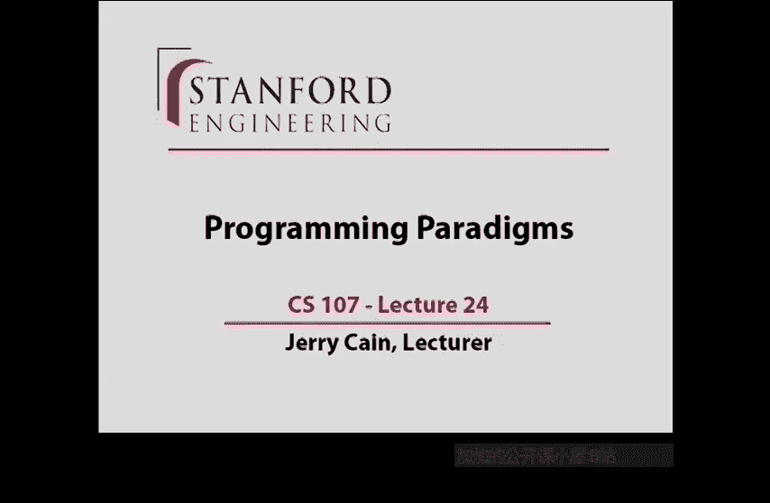
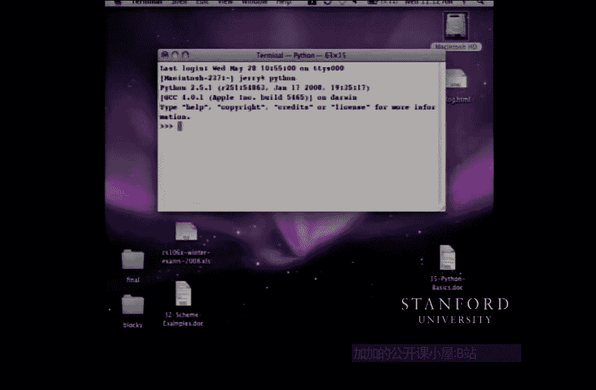

# 斯坦福大学【中英⚡编程范式｜CS107 Programming Paradigms】 p24 P24 ) -BV1aJ1EBHEoN_p24-

Okay。🎼，🎼，This presentation is delivered by the Stanford Center for Professional Development。

He everyone， welcome， I have two handouts for you today。

You all know that assignment 7 is due this evening 1159。

 it is the last assignment that will issue a letter grade on like assignment1。

 assignment 8 is intended to be this kind of like transition type of thing we're transitioning out of the course。

 I'm not planning on putting Python or anything related to Python on the final exam I'm just trying to fill out the course with a new interesting language it's topical it's certainly represents a paradigm。

 but I'm just trying to get in the habit of not forcing lots of material in the last few weeks or last few lectures to come up with a clean endpoint which was probably I'll call last Friday as far as testable material but still fill out the quarter with an interesting assignment The assignment that's due a week from today I'm sorry a week from tomorrow I'm giving Thursday evening next week It's this very short Python assignment that's just intended to get you used to the framework。

 It's not going to teach you everything about the language It's really just taking a program that works and making it work a little bit differently just so you're forced to do with Python。

And its integers and its bulloleans and its tests and the ability to define functions and classes and things like that。

So as far as how the rest of the quarter will work out， I will definitely lecture today and Friday。

 I probably will lecture Monday because I don't think I'm gonna to get through all the Python material as to whether or not I lecture next Wednesday。

 I think we'll just depend on how quickly I get through the Python material that I want to introduce to you。

 but I'm not trying to race as much material as possible into the course because I know you all have a lot of other things going on fortunately 107 does not have a lot of stuff going on in the next week。

 after you get the scheme assignment done。 then you're really just in a situation where you can start setting for the final I'll have a practice I'm sorry I final probably out next Monday。

 practice solution as well the midterm is scheduled for June 9th you can take it either 830 or 330 on June 9 I have room set up。

 I forget where they are。 I'll put that on the practice practice exams。Okay。

 so this thing called Python。嗯。Ys， let's spell it right。嗯。

There are two overarching features that I want to emphasize， it is。

 as opposed to anything you've seen before， the scheme you could argue is a little bit like this。

 but C and C++ and Java are certainly not is that is an example of what's called a scripting language。

嗯m。Okay， and then as far as that， we can call that a paradigm。 It is also。Impered it。

It is also object oriented。It is also functional or it has functional components。In the language。

 just like scheme does。 and I'll show you an example， hopefully today。

 either today or beginning of Friday， where you actually see the equivalent of map okay and in Python and you're all intimately familiar with the notion of map right now。

 you've seen vector map and you've seen iterators and things like that in C++ and you certainly know map from scheme。

 there really are lambdas in Python。 there's also the map function there is the notion of an evaluate statement just like there is in scheme。

 So I put these up here。 kind of remind you that imperative is the C language。

 it's this assignment oriented function oriented type of language。 I'm sorry。

 procedure oriented type of language object oriented。 you're very familiar with that。

 everything centered around the data and we call objects or classes and functional as an example of a paradigm which scheme adheres to。

I would say that Python is object oriented like C++ is。

 a lot of people program in C++ not so much as C++ programmers。

 but as C programmers that like to use objects。Does that makes sense。

 And they still have this very sequential way of thinking and they organize data in terms of classes as opposed tostructs。

 I actually， I get the impression based on what little python programming I've done and what a good amount of python code I've seen is that it really is the case that people program imperatively。

 they rarely subscribe to the functional or object orient paradigms。

 They usually go with this imperative approach where they have a series of tasks that need to be done one up to the other。

 and they just get them done in bullet point format。

 and subscribe more to the C like or Pacal or they just the imperative approach of actually accumulating data piecemeal until you actually have a result at the end。

 They may incidentally use objects， certainly those that are part of the library set that come with Python。

 They may like to use Lambdas and they see an opportunity to use some functional paradigm approach to solve some subset of the problem。

 they might do that。 I really think of it as this where it just happens to have these features。

itThat's consistent with the fact that it's a scripting language。

The best analogy I can think of outside of programming for scripting analogy is if you actually ever go see a play。

 And for whatever reason， there's like a casting emergency and somebody who normally plays the part and has their lines memorized isn't available。

 So somebody has to actually fill in the part。 and they have to hold the script in their hand。 Okay。

 I have seen that a couple times。 They have to go to the motions。

 they have to do everything perfectly。 But they actually are reading their instruction sets while they do it。

 Okay， do you understand what I mean when I say that， Okay。

 just think about like a dress rehearsal for a play where you still have a script in hand。

 I think of a python script or any kind of shell script for that matter as being very much like that。

 It's this very what you see is what you get。 It digests。😊。

Function definitions and it digest individual statements as they read them and as they read them。

 the side effects of their execution are actually realized while the script is running。 Okay。

 so it's like scheme in that regard。 We normally prepare all our functions and put them in a dotM file ahead of time and then load them and then run the result that still has a scripting field to it。

 But the emphasis is on the functional paradigm with Python and a lot of things pel。

 a lot of things that are designed to be run a script to batch processes together to get some large set of tasks done。

 I actually see that I see Python doing that more than anything else。

 I don't see many games written in Python。 I don't see many compilers written in Python。

 although I do see some servers written Python。 a couple of I don't want to say the names because I'm not actually sure of them。

 but there is this。Set of companies right now that are setting up services。

 not these companies specifically， but companies like Twitter and friendendfeed that are all trying to like basically broadcast information。

 Some of them， I'm not sure which ones I think of one， but I don't want to say it and be wrong。

 are actually writing all of their server and services in Python normally those things have been written in Java or N C plus plus Python has a very rich set of networking libraries and natural support for STP and HTP and Hps and all of these networking protocols that are very common today with all of these distributed systems that are set up to provide these types of services And I know Python is contributing to that。

 So there really is some large scale software that's being written in Python beyond the scripting set that I'm going focus on today okay。

As far as other buzzword that describe Python， it is dynamic。 Scheme is also dynamic。

 CN C plus plus are not at all。 Okay， they have a huge compile time element。

 and there's very little type information at runtime scheme and Python。

 both maintain type information about every single piece of data that exists in the runtime。

 And you can actually query the data type if you want to。 Okay， that makes sense。 Okay。It is。

 it's really interesting to code in Python because it feels very much like C and C plus plus and Java in the way that you just do block structures and if statements and while loops and things like that。

 But there's a downplay on the emphasis of curly braces and parentheses， okay。😊。

There's the block structure is actually decided not by curly braces or by parentheses。

 but by white space and tabs。 And it's the most frustrating thing to get used to the first day programming a Python because you just naturally open put in curly braces。

 And then you realize you do that， you're like， it's not gonna work。

 So when I show you our first show you the first Python function。 I want to write。

 You'll see just that it's just about text with very little delimiters。

 There's double quotes and things like that。 But there's no curly braces。

 There's very few parentheses。It's really just very strange to look at the very first time you see it。

 But then you just get used to it after you program in it for a while。

 So what I thought I'd do is I'd take the scheme approach to introducing Python and just show you the Python environment。

 how you can actually talk to Python and get it to announce like tell you what sum of the first four integers are and what happens when you type in a string constant and how Booleans work and things like that。

 Just so you get used to the syntax。 And so have an understanding of what things look like。

 And I will do that first。😊，嗯。Go on the screen。 I'll try and get as much of this to fit。

On the screen is possible。Okay， that's not bad at all。

Okay， so I launched Python， much like we launched Kaa， okay。

