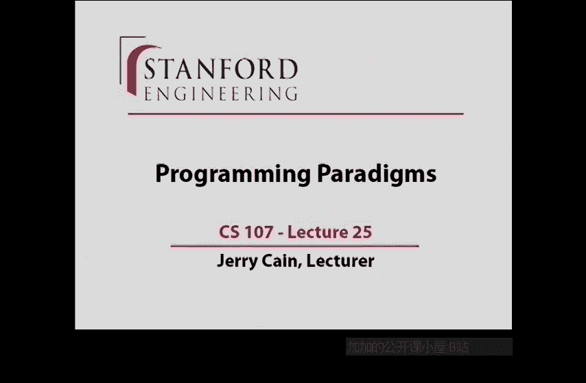

# 斯坦福大学【中英⚡编程范式｜CS107 Programming Paradigms】 p25 P25 ) -BV1aJ1EBHEoN_p25-

Yeah。🎼，🎼，This presentation is delivered by the Stanford Center for Professional Development。

I have one handout for you today。 I'm actually， I don't expect to get to the material today。

 but I don't see the disadvantage of giving it to you in case you're bored over the weekend and nothing else do。

 you can read about XML and Python and networking。 What I want to do today is I want to focus a little bit more on dictionaries and show you an example where dictionaries actually contribute to a meaningful program I'm going to rewrite RG from assignment1 in Python。

 We're gonna do it in laughably little space。 I'm going to be able to illustrate a very small program that has the imperative objectoriented and the functional paradigm all in it。

 I'll illustrate Lambdas that they actually exist in Python。

 and it's really just a matter of coming up knowing the different syntax。

 the Python way of doing what you did in scheme a week and a half ago or just I guess until last night or two nights ago。

 read。😊，I also want to show talk a little bit about objects and classes in Python。

 talk about the object model， it's very interesting to look at it because when you learn about objects and object orientation and in a class like 107。

 where you look under the hood to figure out how these things are implemented。

 you can very easily get the impression like I did for years to be honest。

 that all objects and everything's implemented exactly the same way in all languages。

 and it's just not the case。 So I will talk about that a little bit today。嗯。

With regard to dictionaries， I mentioned on， I guess it was Monday。 What's today。 Wednesday。 sorry。

 Wednesday， that dictionaries are a central data structure in Python。

 They are basically a very simple syntax layer over what is very well understood to be a hash table。

 The keys can be anything that are hashable。 They don't even have to be heterogeneous。

 You can have some integers and some strings Azure keys and the things that they map to the values。

 they can be of any type whatsoever。 and they don't have to be consistently the same type over the dictionary。

 It is very amorphous， very heterogeneous just like scheme is with its data structures。

 You can put anything in the list。 you can mix up data types。

 you can do the same thing with Python structures。 Okay， What I want to do is I want to。

Emphasize the fact that as opposed to C and C plus plus where you don't have a clear way to textually initialize a data structure。

 Like， think about what a C plus plus map or a C vector from assignment 3 looks like after you've populated it with。

 say 20 values。 It actually depends on the binary representation of the data。 Okay。

 and there's no way to say C plus plus vector of ints is equal to 1，2，3，4，5。 Okay。

 you don't have object literals in C or C plus plus or for that for that matter， Java either。 Okay。

 you can have a array litals in Java in a way that you can in C and C plus plus。

 but the real sophisticated containers， there's no way to actually specify container constants。

 That's not the case with Python。The first of three or four pieces of the RG example。

 I won't write out a full grammar。 But what I'm basically doing here is I'm coming up with a file format for a random settings generated grammar。

 You were familiar with this。 I know it's been eight weeks ago。

 But you remember that it had involve some angle brackets for nonters and things that were terminals were just normal strings。

 If I do this。Grammar。I'm actually writing Python code。Now， I will make it clearly a dictionary。

 I'm going to have a grammar that is just a gesture to what the full grammar could be like。

 but my grammar is going to be expressed as a dictionary literal， where the keys。

Are structured this way。And they map to。Arays， which are called lists in Python。 Okay。

 or at least the way I use in my column lists， lists of expansions。 And for a start。

 I'm only gonna have one expansion。So here's the list。It happens to be a list of length 1。

 And that item is itself a list。And I'm going to do it this way。 It's not a very sexy sentence。

 It's just a placeholder， this。Object。Whoops。啊。Is here。If I had a second or third option。

 they would have been common to limited lists。 I'm not going have that But this one。

 I'm just gonna have one option。Just so you see the structure in a small example。

But I will let object。Map 2。A couple of options。 It can map to the standalone thing， like computer。

I'll let it map to。I don't know。Car。This assignment。

I'm not interested inmatic grammatically meaningful sentences。

Interested in getting the grammar on the board。 I think this is complicated enough。

You look at this and you may think that there's really no other sensible way to do this。

 but realize that kind of like you have in scheme， that you are allowed to represent the data in object serialized object form and that this actually gets grammar to be an in-memory dictionary where it has two keys and each one maps to a list of lists where this one happens to be a list of length1。

 and this happens to be a list of length3。Does that make sense？

I'm being fastidious about the white spacing just because I'm careful about it in the handout as well。

嗯。What I want to do is I basically want to conceptually expand the start symbol。 Okay。

 to generate a random sentence。 And knowing that it's going to select this。

 I'm going want to expand this as as a terminal。 I'm gonna want to expand what's in there。

 I'm gonna want to expand what's in there。 This and this are actually simple。

 It's just supposed to print。 This is supposed to recursively do exactly the same thing as if object is the start symbol。

 Okay， and it should actually expand to whatever it's supposed to expand to。 Okay。

 does that make sense。Forget about the libraries。 Let me just invent function names。

 They happen to be the real function names for generating random numbers and things like that。Okay。

If I。Assume that grammar is a global variable。 Just assume it's a global variable。

 We'll correct that in a little bit。 just because we're dealing with Python doesn't mean we should just be lazy about globals。

 But just to illustrate all three paradigms at once right now， I wanted to define this function。

Death expand。And I'm just going to call it symbol。Now， you know， I do one of two different things。

 depending on。Depending on whether or not the symbol。

 which I'm just gonna assume is being cast in is either a terminal or non terminal。

 And if it's a non terminal， that it's definitely in my grammar， if it's the case。That symbol。

Starts with。This string， which is incidentally。The best way to represent a character。

 if that's the case。Then what I want to do is recognize that I don't want to print the non terminal。

 I want to select one of its productions。 Okay， I'm sorry。

 one of its definitions from its definition set randomly。 and then。

Basically expand in order all of the terms that make up the list。Okay， that makes sense to people。

So Im going to do is this。Definitions。Is equal to the global grammar。Of。This thing that I'm assuming。

 really in the grammar。And no semicolon。Okay， that brings in。This or this entire thing。Now。

 there's a built in。Which I'm going to just do this。 I'm going to say， I'll just say expansion。

Is equal to there's a built in function。Called choice。Which takes a list。

It actually takes either an integer or a list。 I'm going to give it a list。

Choice is basically the get random function in Python is a built in。If it's given an integer。

 it gives you a number between 0 and that integer exclusive， just with random probability。

 equalqu distribution。 If it gives you a list， it selects any one of the elements from the list with equal probability。

 That's kind of what I want。 I wanted to choose。This， this or this， with probability  one， third。

 I wanted to choose that with probability1。 That's exactly what this line is going to do right here。

Okay。Now。On assignment1， when you did it using C+ plus， you did not necessarily use recursion。

 You probably use the iterator to just visit everything。

 But if you're thinking in terms of scheme and how it dealt with lists。

 we didn't use iteration there。 We didn't know about mapping technically when we did assignment1。

But on behalf of something like this， if I understand that expanding this space will just print this space and expanding space is here。

 period， we'll just print that after I get the else clause up here， okay。

And I can also recursively expand that。I can do。