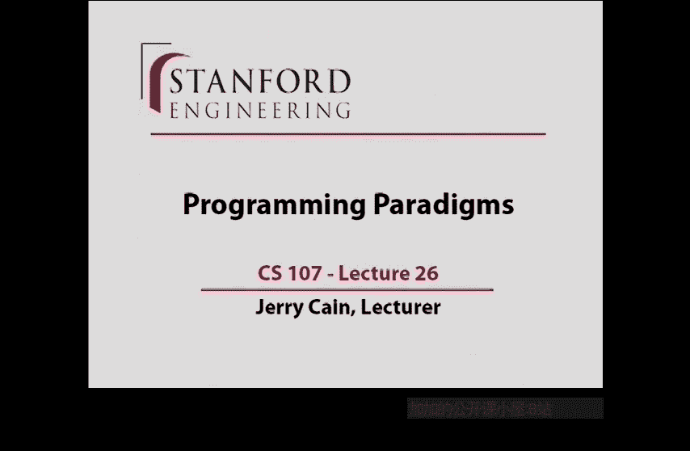
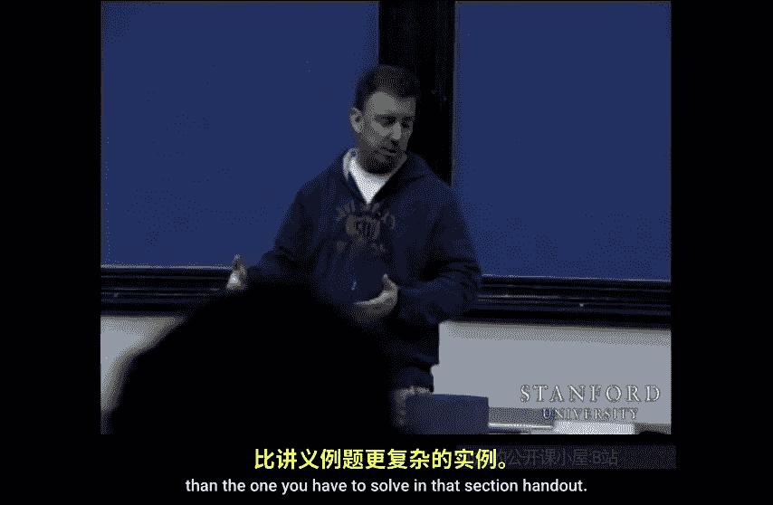
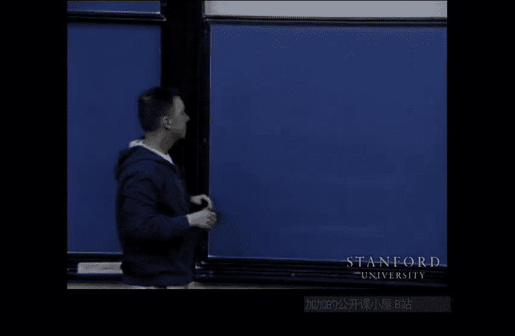
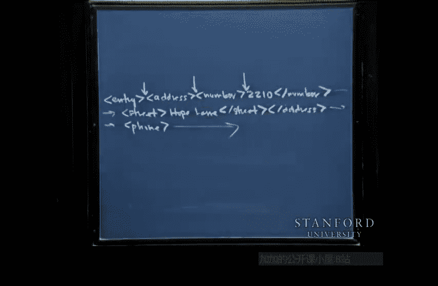
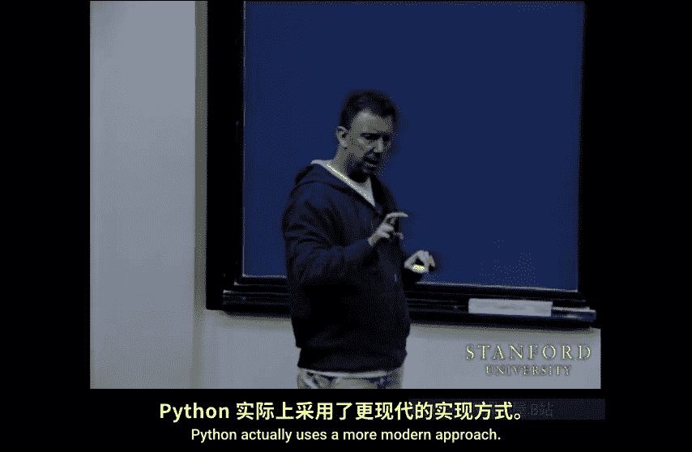
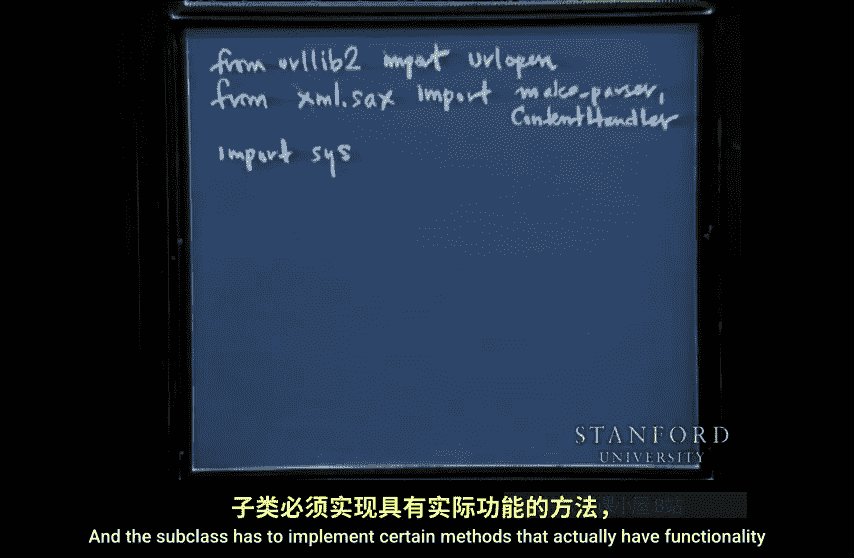
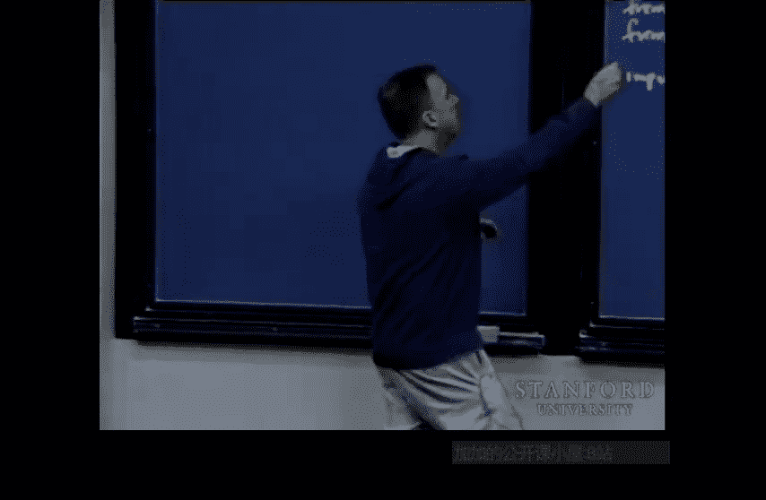
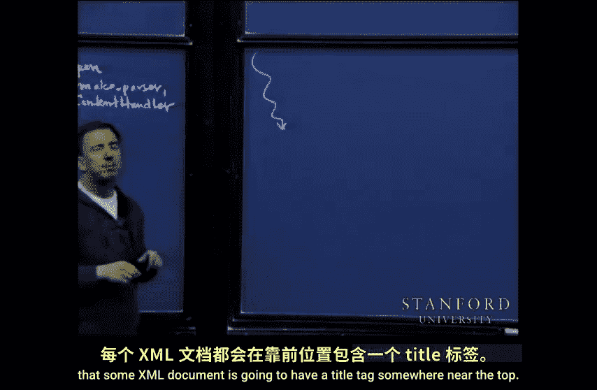

# 斯坦福大学【中英⚡编程范式｜CS107 Programming Paradigms】 p26 P26 ) -BV1aJ1EBHEoN_p26-

Yeah。🎼，🎼，This presentation is delivered by the Stanford Center for Professional Development。

Hey everyone， welcome。 I actually have In spite of what it looks like。

 I have three handouts for you today， but we had some photocopi drama。

 And so I handed out the practice midterm already and we have two more handouts。

 the solution to the practice set of problems。 And also tomorrow's discussion section handout。

 I know a lot of you have 107 is falling off the radar because you know the assignment isn't too bad and the pythons on the final exam。

 But this memorization， which is discussed in the assignment 8 handout is central to you getting the problem done nicely。

 And if you have any trouble with that， then you're gonna gonna to go to discussion section tomorrow。

 because we do an even more difficult example than the one you have to solve in that section handout。

 We also do a little bit XMl processing and data processing using Some of the built in functionality from Python than I'm going to go over today。

 It's cool。 I think it's a cool little section handout。 It's pretty lightweight But nonetheless。

 go discussion section tomorrow。 if you have any more curiosity about Python。

 I'm really regretting not having more time for Python because I think it's such a fun little language。

😊。

But we've already learned all the paradigms that I want to go over。

 So we're just looking at Python as a representative of all three of them。

 As far as the final exam is concerned。 Remember， it's a week from today， I can't say it enough。

 but there's no Python on the final。 But everything up to the last lecture of scheme through the entire quarter is fair game。

 I certainly will emphasize material not covered on the midterm。

 But given that the the midterm is worth。What percentages it is and the finals worth a little bit more。

 I really try to make it so that all of the C material that was emphasized in the first half of the class really contributes about half as much。

 or I'm sorry， equal weight as all the post pure C stuff。 Okay。

 so expect to see one very simple C question， a codegen question that focuses on C plus plus and references the stuff I did not emphasize on the midterm。

 and then scheme concurrency， etcter。 Okay， No， etc cea。 scheme and concurrency。😊，Okay， yep。でし。Oh。

 I'm sorry。 cogen。 So， yes， certainly yeah。U。What I want， oh I'm sorry。

 There's a morning offering 830。 It's in Dinglepeiel Audorium。

 You're gonna have so much room there because only about 25% of you are gonna come to that time。

 And then the afternoon one is in Hela 200， which is where I believe your midterm was。 Okay。

 what I want to do today is I want to talk about the more modern practices in dealing with X M L processing。

 It I think X M L is kind of neat。 It's not exactly a new technology。

 although it's not exactly young either。All of you have some exposure to XML processing because you had to do at least a little bit of it or understand a little bit of it for assignments4 and 6。

 And when you got to assignment 6， you really did real XMl processing because you were forced to deal with the exppat parser this open source effort that happened to be installed on all of our machines here and you use the Xat parser to get all the titles out of there and all the documents and all the URLs and things like that。

 What I want to do today is I want to show you two different XML parsing models as they're supported by Python one of the takeaway points is that is opposed to C andC plus plus Java and Python because we're talking about Python both have built in functionality for dealing with Internet connectivity and in particular。

 XML processing CncC plus plus and their specifications were laid down to rest for the most part well before the internet came all savvy and well before XML really had a presence in the。

Community， Java and Python are much younger languages。 Theyre kind of equal age with XM L。

 And so all of them kind of came X M L and Python grew up together。

 They actually is built in support for X M L processing in Python。

 I want to use XM L processing as our first gesture to Internet programming to see why Internet programming is so much easier。

 or at least more gracefully supported by the Python language。 Okay。

 so let me just put a dummy fragment of X M L up on the board。😊，Let me do let me write it this way。

 I will write it as。

En。And I will say， let's say address。Let me say number。22，10。Number。And then continuing。

 but emphasizing the fact that this is all one big stream of text， street。啊，头。Lne。

 this is where I grew up， suburban New Jersey and close tag。This right there。

 And then you get the gist， and I'll just end。The address part of it。And then， finally。

Just open up another tag and then let you your imagination run wild I it what my phone number was。

Okay， the reason I'm drawing it this way is because this is more or less how the text came to you for assignment 4 and assignment6 purposes。

 Okay， and the reason I'm doing this as opposed to drawing it as this hyperstructured text tree。

 which I actually will draw it that way in a minute for a different reason。

 this emphasizes the fact that even though there is structure and a hierarchy to the X M L。

That the XML parser we're familiar with from assignment 6 and assignment 4。

 actually was a streambased par parser， which means that it doesn't store it in memory or I'm sorry。

 It stores only a constant subset of the entire text stream in memory at any one moment and as it gets enough text because it sees the end of a star tag or the end of a end of an end tag or it sees some character data either the end of a stream of it or up to some maximum number of characters。

 You know that it fired little events that we installed into the XML parsel Okay so。Right there。

And right there。And right there。

All of those arrows point to the place in a character stream where you would have seen some kind of start element tag handler invoked。

 Okay， and right here。You would have seen some character data handler invoked on your behalf。

 right here。You would have seen an end tag handler invoked， okay， and。

The streambased paring that we did that you did or you saw done for you for assignment 6 is the opposite of functional programming。

 It relies on state and side effect。 Okay， to keep track of where you are。

 And you know that when you read something like this。

 that you're probably inside and address and an entry tag， okay。

 just based on the context of the individual example。 And as you leave the number。

 you know that you probably very recently read in an actual number as a text element。 okay。

What Python does， because it's object oriented and C from assignments 4 and C was not and 4 and 6 was not。

Python actually uses a more modern approach。 I think it's a lot more graceful。😊。

Where。Vya two packages。From there's actually a package called U Lib。It's old。

 and compared to the other package that's been more。

That has more modern support for more URL functionality， the Snazzy name for it is URL Lib 2。

I'm going to go ahead。And import this function called URL open。

 It is basically the equivalent of F open， but you。

 you give it not the path to a file name on your on your hard disk， but you give it a URL。

 And you just pray because I don't care about error checking at the moment that it actually points to a real document somewhere。

 okay。From。啊。X，M L。That。SA X。Import。These two functions。Make parser。And then a class。

 which I'm going to talk about。Called content Panler。And then I'm also going to import。SYS。

 all of it because I want to be able to print to standard out。URL open iss equivalent of that open。

 Okay， it just works beautifully。 It's， it's a much more graceful implementation of URL connection。

 Okay， you connection class that you're familiar with from the two middle assignments of the course。

😊，Make parser right here is what's called a factory function。

 It just promises to hand you back an X M L parser that。Response to a certain number of methods。

This content handler is actually an interface。其 me。Is an interface for。

 or it's a base class that has to be subclassed。And the subclass has to implement certain methods that actually have functionality associated with them so that it knows what to do when it reads a start tag and it reads an n tag and it reads character data。

 Okay， does that makes sense， okay。

So。Here is the gist of what I want。My X M L parsing thing to do。 I'm really going to deal with。

The understanding that。Some X， M L document。

嗯。I's going to have a title tag。Somewhere near the top。This happens to be the title of the。

