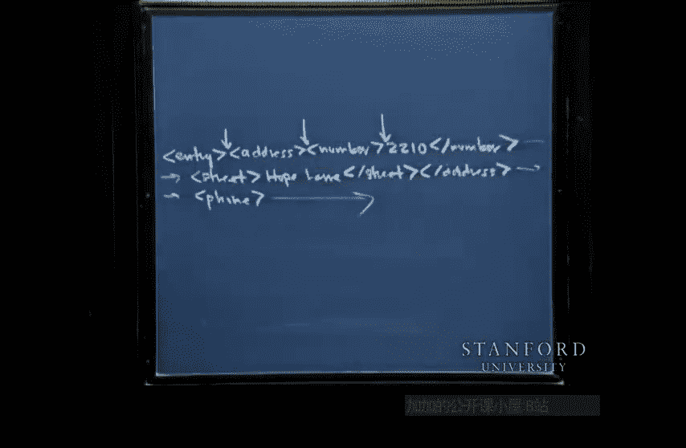
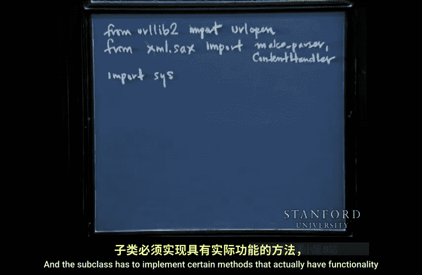
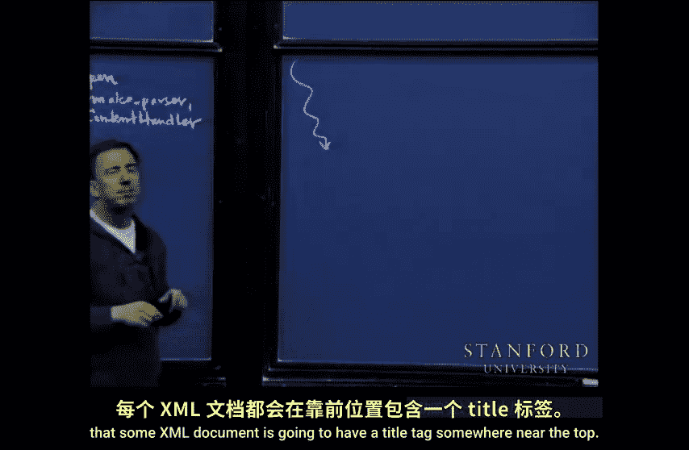

# 编程范式：第26讲：Python中的XML处理


在本节课中，我们将学习如何使用Python进行XML处理。我们将探讨两种不同的XML解析模型，并了解Python如何利用其内置功能简化网络编程和数据处理。课程将涵盖从基本的XML结构到使用Python库进行解析的完整流程。

---

## 概述

XML（可扩展标记语言）是一种用于存储和传输数据的标记语言。在之前的作业中，你可能已经接触过XML处理，例如使用expat解析器。Python作为一种现代语言，内置了对XML处理的支持，这使得网络编程和数据解析变得更加简单和优雅。


---

## XML的基本结构

XML文档由标签和内容组成，形成一种树状结构。例如，一个简单的地址信息可以表示为：

```xml
<address>
    <number>2210</number>
    <street>Lane</street>
</address>
```

这种结构化的文本可以通过解析器转换为程序可读的数据。

---

## 流式解析模型

在之前的作业中，我们使用了流式解析模型。这种模型逐字符读取XML文档，并在遇到特定事件（如开始标签、结束标签或字符数据）时触发相应的处理函数。例如：

- 遇到 `<address>` 标签时，触发开始标签处理函数。
- 遇到 `2210` 字符数据时，触发字符数据处理函数。
- 遇到 `</address>` 标签时，触发结束标签处理函数。

这种解析方式依赖于状态和副作用，与函数式编程的理念相反。

---


## Python中的XML解析

Python提供了更现代的XML解析方式。它通过内置的 `urllib` 和 `xml.sax` 库简化了网络连接和XML处理。以下是使用Python进行XML解析的基本步骤：

### 导入必要的库

首先，我们需要导入相关的库：

```python
from urllib.request import urlopen
from xml.sax import make_parser, ContentHandler
import sys
```



- `urlopen` 函数用于打开URL，类似于文件操作的 `open` 函数。
- `make_parser` 是一个工厂函数，用于创建XML解析器。
- `ContentHandler` 是一个基类，需要子类化并实现特定方法以处理XML事件。

### 创建解析器

接下来，我们创建一个解析器并设置内容处理器：


```python
parser = make_parser()
handler = MyContentHandler()
parser.setContentHandler(handler)
```

### 解析XML文档

最后，我们使用解析器处理XML文档：

```python
url = "http://example.com/data.xml"
data = urlopen(url)
parser.parse(data)
```

通过这种方式，Python可以优雅地处理XML文档，而无需手动管理状态和副作用。

---




## 总结



本节课中，我们一起学习了XML的基本结构、流式解析模型以及Python中的XML处理方式。Python通过内置的库简化了网络编程和XML解析，使得数据处理变得更加高效和直观。希望这些知识能帮助你在未来的项目中更好地处理XML数据。