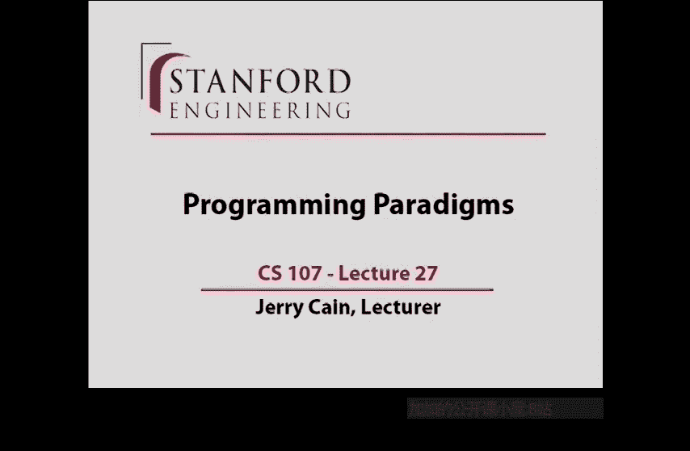
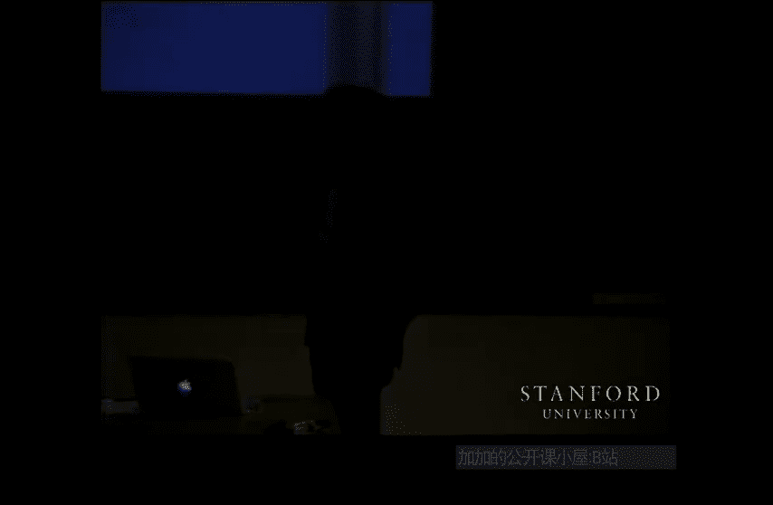
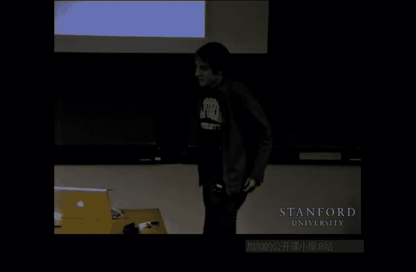
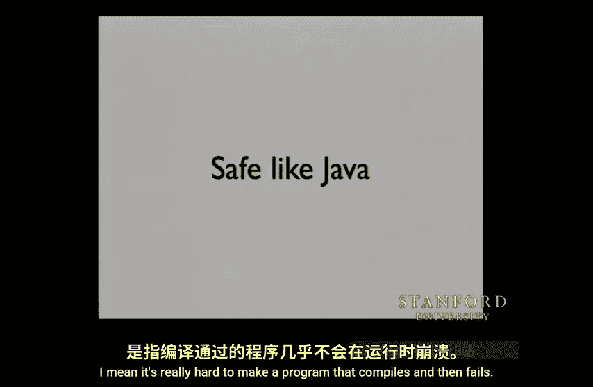
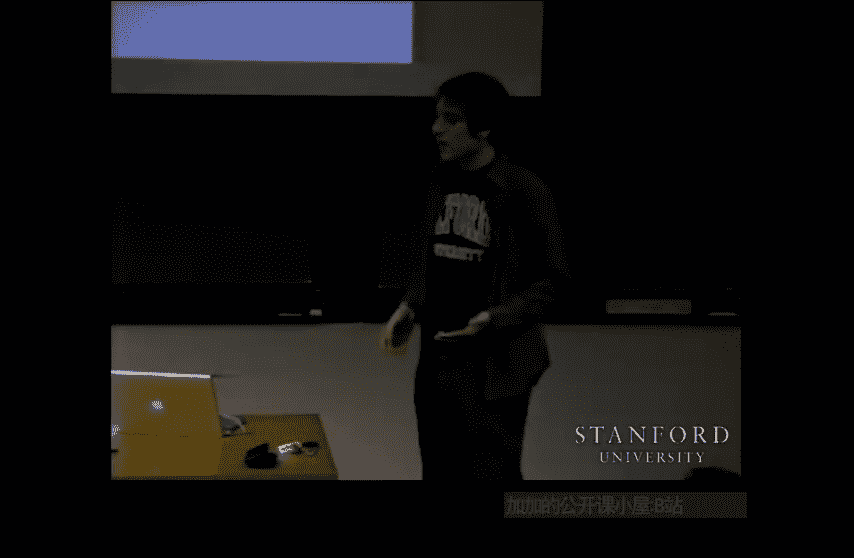
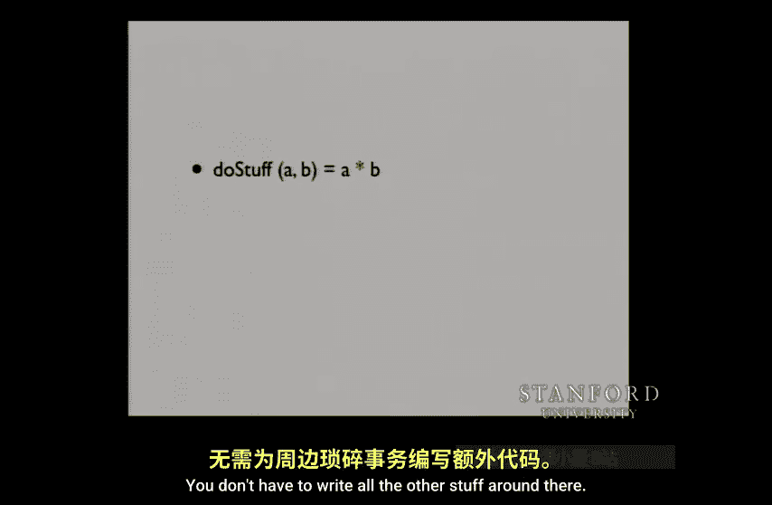

# 斯坦福大学【中英⚡编程范式｜CS107 Programming Paradigms】 p27 P27 ) -BV1aJ1EBHEoN_p27-

Yeah。🎼，🎼，This presentation is delivered by the Stanford Center for Professional Development。

Hey， everyone， welcome。 I don't have any handouts for you today。

 You should pretty much be done with all the handouts。

 Yesterdays section solution hasn't been posted on the Web yet， but Ryan will do that now and。

And the next time you're going to see me will be Monday morning at 830 or Monday afternoon at 330。

 remember you can take the final at either time， you don't have to tell me ahead of time which time you're planning on taking it。

 you can only take it once but。I will post the exam as a handout at 330 that afternoon。

 So SCPD students who are watching me right now。 just plan on downloading it。

 I need I'm a little bit more flexible on when you take the exam because I know you work。

 but I need the exam facts back back from you faxed in by Tuesday at5 we're gonna to crank on grading that Tuesday night okay you have an assignment due tomorrow night you can use as many late days as you want to I mean it was designed so that you weren't supposed to use five late days on it。

 but if you have five late days and you want to consume them and hand it in after the final exam it's on a problem because we're not gonna be able to grade grade that until after the file anyway you should definitely get if you haven't an assignment4 back yet then let me know because you should have gotten this back。

 I've seen all the grades fly through my email assignment  six as being graded right now I told my Ts they have to have that back That's a seashell。

They have to have the assignments to you by the weekend so you can make sure that you understand threading to the extent that I'm going to test it。

 assignment 7， I actually don't think you're going to get back by the final。

 but that was the scheme assignment historically if there are 200 of you in the class195 if you get A or a minuses on that because you all get it working and it's this new language so we actually have I don't to say if we have low standards but we just don't press you on style that much if you've got that working。

 you're probably fine。 So you're not gonna to be surprised by anything in terms of your feedback on that assignment。

Okay， so I left you with enough Python to get the assignment done what I。

Did is I invited a coworkerer of mine from Facebook who is who is responsible for that noise。 No。

 I invited a coworkerer of mine。 He's actually kind of my boss for the first six or seven weeks of of the time I was there。

 And he is a programming language enthiast as well。

 He knows two languages called Haskell and M L that I don't know as much about。

 And I asked him to speak about one of them called Haskell。

 so I'm just gonna hand it over to him and let him kind of present a language to you that you would not have otherwise seen。

 had I been the only one teaching the class。 Okay， so let us do a little bit of a microphone switch right here。

 This is Sasha Rush。😊，And I will do this。Ill let him talk。嗯。怎么。🤧嗯咳。

Okay， so I'm going to talk today about Haskell， which is kind of like。

Kind of like an at garde programming language， it's not something you'll see in a lot of companies using these days。

If you want to get a job， you should be like a really good C programmer。

 if you want to program like the future， you should learn a lot of Haskell。

 think of it as like the Schchoenberg of programming languages。诶。

So。Here's a little history of Hake， it comes from the same family of like Lisp and scheme。

 it's a functional language， which means setting variables is discouraged。

 using functions all the time for everything is really how you get stuff done。

There's things like map that you'll be used to from scheme。

 but there's like a million less parentheses， so that's really good。

Then that kind of went down to these languages called M。 And there's a language called Ocael。

 which is like a modern version of M。 that's pretty popular。These languages took scheme。

And kind of merged it with C in an interesting way in that they're statically typed。

 so you have like integers that are actually integers and if you try to like use an integer with a string it'll fail。

 that's really nice because you add a lot of like speed to the program。

 but it's really annoying in like C because。You have to type integer everywhere。

 so the kind of brilliant idea behind ML is you write code that looks like Python code。

 but it figures out the types for you， and so it'll throw an error。

 but you don't have to put any of the definitions down。

It's like pretty amazing that this brilliant idea that was invented like 30 years ago isn't used today。

 but I think more and more it'll become like pretty standard。

 latest version of like C sharpp and future versions of JavaScripts will possibly have this kind of stuff in them。

So then this language came out called Miranda， which was like a proprietary language。

 but it had this really neat idea that we'll talk about a little bit later。

 which is that it had this thing called lazy evaluation。

In lazy evaluation you won't see in pretty much any language but Haskell。

 the reason that is because all the researchers working on this problem got together and they said。

 hey， let's make kind of an open source version of Miranda that's lazy and is standard and we can all work on together so it's a really good thing if you want researchers to like look at your language。

 don't make it proprietary。嗯。This all came together in Haskell 98。

 which as per the name came out in 2003。嗯。AndThat's kind of like the current kind of modern version of Haskell since it came out in 2003。

 it's been incredibly popular with like a small group of like pretty dedicated people and they've been kind of working on it pretty hardcore for the last five years and it's getting to the point now where it's like really good。

Okay， so houseke school is pretty neat。嗯。So it's safe like Java， so when I say safe。

 I mean it's really hard to make a program that compiles and then fails。

So this is like really knowing about a language like Python is that you're constantly running your programs。

 they're constantly failing， you're constantly writing them again。

 it's really nice particularly for applications that matter things that like aren't websites。

 that the program that you compile， you know it's not going to fail for like dumb reason that you like left something in。

So what does this mean， Well， this means that if you try to like add a string and like an integer。

 it's going to like fail。嗯。The little colon syntax is kind of like the cons operator in scheme。

 it means like put this at the start of a list。So if you try to put a string in a list with numbers。

 it's also going to fail。So this again is different than scheme because scheme is not static type。

 scheme will let you put kind of anything in a list and hasco if you have a list。

 it has to all be the same kind of type of thing。Okay， so it's like Java， but safer。

 There are a lot of kind of funny issues in Java。 Here's one of them。

 So I have an object called temp， and I set it to null。

 and then I try to run this method that I like no should be an object。

 Like it's been guaranteed for me to be an object， but it can fail because temp was null。😊。

So like this is like a pretty common thing that most people are used to in auditarian languages。

 but it's like this huge issue。 like there's all these possible runtime errors that you're not protecting for。

Here's another one， so we had this guy named Object。I a sorry named Tt， that was an object。

 and I'm trying to cast it to become a string， which is okay in Java， you're allowed to。

 I think it's called downcast， you're allowed to move from one guy to its child。

And it has this huge possibility of failing because in this case， it's not a string。

 You can't pretend it's a string。Okay， it's expressive like scheme。 So like I said before。

 So you have this like map function。So the kind of square brackets are a list。

 it's kind of a list literal， it's similar to list literals in Python。

And you can run kind of anonymous functions over it， so this function maps adding one to a list。

And you get back a list with all the numbers， plus one。Here's another example。

 this is a sort by function， sort by takes a comparison function and does a sort with that function。

 So this one here just sorts a list by the standard ordering。Okay， it's fast like C。

 It's not as fast as C， but it's getting there。 It's kind of like on the the order of magnitude。

And here are like some stats。 This is like not the way to think about speed of languages。

 but it gives us like an easy way to look at it。 So this is from like the computer language benchmark game online。

Just to give you an idea。The big difference is that。Types not only guarantee like safety。

 they also allow you to make a language pretty fast。

 you know when you see a plus sign that you're going to be adding like two integers and not going to have to check for this failure case。

 and that makes the language look a lot faster。Okay， most importantly， it's pretty fun。

 When I say fun， I mean， like， if you want to like do a multiplication function。

 you just do a multiplication function。 You don't have to like。😊。

Write all the other stuff around there。you。