# 【全集】斯坦福大学 CS253 网络安全 中英字幕 1080P p01 Lecture 1 - 什么是网络安全？HTML 和 JavaScript 复习 -BV1RemEBZEEM_p1-

So welcome to Web Security if you're here for Math 104 and that's over there。

 this is web security as you can tell by amazing graphics that have been up here。

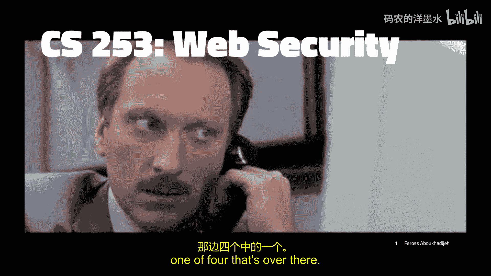

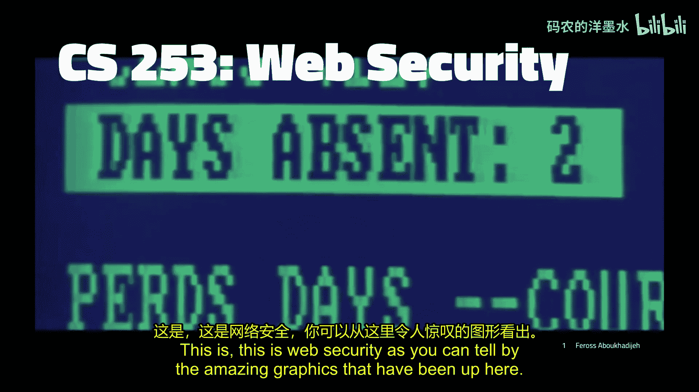

Um so。I'm for us， I'm going to be the instructor for the class。And Esther are you here。

 I don't see Esther， so that TA will be here shortly， hopefully and you can all meet her。

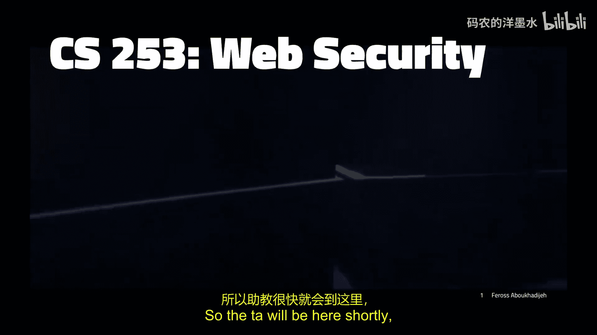

But yeah， we'll go ahead and get started。So just first some administrative stuff。

So bookite is right there。And we' we're going to have five to six assignments in the course and they're going to be mostly programming assignments。

 though there may be oh there's Esther， hi， Esther， say hi everybody。So that's her TA。So yeah。

 yeah we're both really excited about the material in this class。

 so we're hoping to share our enthusiasm it with you guys and yeah it's going to be great yeah。

 to the administrative stuff。Five to six assignments。

 most of them are going to be programming assignments。

 and there's going to be maybe one written assignment with questions。Yeah。

 I think that's what we're going aim for。And you can go ahead and take a look at assignment zero。

 it's going to come out tonight and see what it's going to kind of be like。

We're going to have seven to eight guest lectures， which is about a third of the lectures in this class。

Part of the reason why we're doing that is this is a new class so it's。

Easing the burden on me and creating all the material in one way。 But furthermore， its。

 it's about getting industry people to come in and share like cutting edge of Web security stuff with you all。

 So we have a bunch of exciting speakers lined up。 There's a few that are already on the site that you can take a look at。

😊，One of the speakers is with the Brave web browser。

 which is a privacy oriented web browser and he's going to be coming in and talking about anti fingerprinting。

 which is basically the idea is how can you make a browser that is impervious to being like。

Well we' get into fingerprinting， but basically the idea is you want to make it so that when you actually clear your cookies in your browser that you're actually sort of completely you have a fresh profile and an advertiser or somebody can't follow you around。

 even though you've done that。 So we're going to talk about that。

 Another one of the guest speakers is a pair coming from the Google Chrome team。

I're not going to talk about some of the security work the Chrome team is doing and we have a bunch of other really cool people。

 someone from GitHub security and a couple more that are still being finalized right now。

 but it's going to be really cool。So we're gonna use piazza for questions。

 And since this is a new class， it would be really awesome if any of you have feedback to share that with me。

 And there's a form on the website where you can submit anonymous feedback。😊，Yeah。

 so about assignment 0。 So the idea behind this is it's just a way to get a feel for whether you have the like requisite sort of HTMLm and jascript knowledge that you're gonna to need for the class。

 So there's not a prere on any kind of security for this class。

 So this can be your first security class。 That's totally fine if it's not your first security class。

 Don't worry， there's still gonna be a lot for you to learn completely new stuff that's different from something you might have taken like C S 155 intro to security class because in that class。

 there's only time for about three weeks of web security material。

 And this is gonna be know whole whole class is just web security。😊，But so with the sign0。

 there's gonna to be these three workshops that you're gonna have to do。

 They are like little interactive terminal workshops where you basically saw little exercises that each take a couple minutes to do。

 And the first one's on HTML， the second one's on JavaScript and then the third one's on no JS。

 And so I expect for most of you， the first two will be relatively easy。

 And so it shouldn't take more than maybe an hour or so if if you've recently taken like CS142。

 the web class。 but if you're a little rusty， that's okay。

 just work your way through the workshop exercises。

 and then you know it shouldn't be too bad if you can make it through that。

And I expect that the node JS stuff will be new to probably most people in here。

 who's used node JS like extensively before before this。Kind of okay， yeah。

 So it you might have used it。 but like there's a bunch of sort of stuff I don't think most people have touched。

 So， so the exercise will go through all that。 And this is kind of what it looks like。

 It's really cool。 So it's a little terminal。 If you run a little program in your terminal and it hops up like die activities and you select one。

 And then you kind of basically have to write a file that matches what the test is expecting。

 And then it's sort of evaluates it for you。 It's， it's really fun。 I I。

 enjoyed going through these when I was learning。😊，嗯。Cool， any questions about any of that。Okay。Cool。

So a little bit of background about the course。So this was originally a class called CS 241 securecu web programming that was offered back in 2011。

 so I was an undergrad， I was class of 2012， and I took this class in in。

 I guess it was my wait a minute， 2011， that have been my， I want to say it was my sophomore year。

 spring quarter。And it was taught by Danbony and John Mitchell。And it was really great。

 It was my favorite class， it was so awesome。My first security class。

 and I was super hyped about all the material。 the guest speakers were amazing。

 and it really gave a sense for like。😊，The fact that this stuff is approachable and you can。

 especially because it's the web。 it's relatively easy to just sort of get your hands dirty and try things out。

 know， like start sending requests to a site and see what happens。

 you know like play around with with various APIs and see what you can do。

 And so I hope hope that that's something that you can all take away from this class。

 the feeling that you can actually go out and maybe look for vulnerabilities and see what you can find。

And。Yeah， so anyway when I came back to Stanford to finish my master's。

 I was like why is this class not offered anymore and I went and talk to Dan and John and they were like。

 well well oh Dan said we're doing blockchain now this quarter so。

I'm like web security is more important than blockchain。

 I mean blockchain is cool I take that class too but mean come on if you don't have security then you don't have anything so anyway。

 Web security everyone thinks their own class and their own subject is the most important。

 but web security is actually the most important。😊，Anyway， so that's what this class is。

 This is sort of bringing the class back。 Why is the number different？

 Some other random class took 241 in the intervening years。 So we got a new number。

But yeah it's originally that class。So I wanted to start。

By just sharing a few stories of stuff that like after I took this class， what I was able to do and。

I think， I think that I will just emphasize the idea that， you know。

 security is this fun thing where you can， you can anyone can do it and， you know， and， and， and。

Once you have the security mindset， which is really what the main goal of this course is to have you all leaving with this idea of what is the security mindset when you're writing code when you're looking at stuff？

So we're going to just go through a couple of things that just some stories about a couple of cool little things that I was able to do after I took this class。

 and while I was in the class， I was learning web development。

And one of the APIs I encountered was this thing called local storage。

 How many people have heard of local storage。Okay， it it's what it sounds likes not it's not a crazy API。

 It lets you store like a string basically in the user's browser， and it can be up to 5 meby。

 But while because I was concurrently enrolled in this web security class while I like encountered this。

 I noticed that the API supposedly had a limit of 5 meby。

 you could work around it and basically fill up the user's browser。

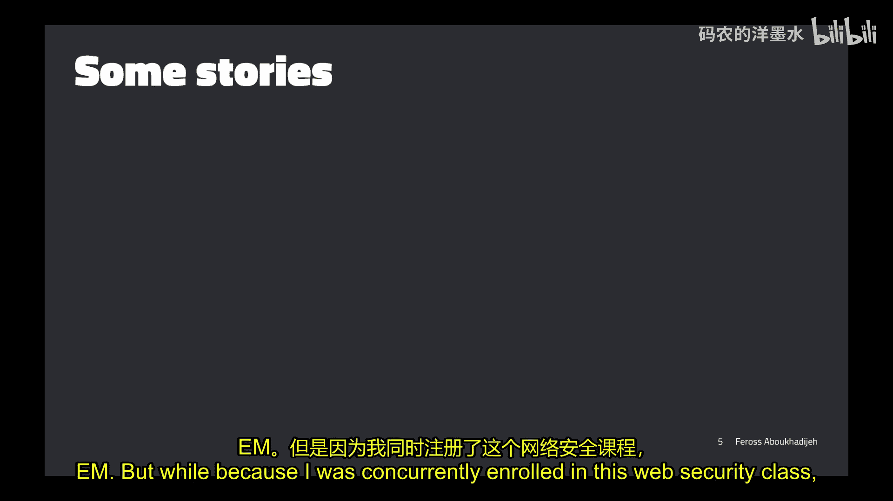

And yeah， I mean， just， if you sit on this tab here。

 your whole computer will just run out of space and then you us。

Crash or whatever you'll run out of Ram because it'll they'll start swapping。

 So this is the thing that I just literally as a sophomore。 you know， ran into it and like， oh， okay。

 I have this security mindset。 Like this doesn't seem like it's a good idea。

's how do do how do you do it。 Yeah， yeah， great question。 So So every site can store 5 MB。

 But sites are defined by in this case， like a subd is considered a completely separate site。

 And subdins are completely free to generate like anybody can if you buy a domain for $10 a year。

 you can generate an infinite number of subds like 1 do 2 dot whatever。

 And and each of those is given 5 MB。 So you just sit there and you create these little iframes And you just tell them hey。

 store 5 or store 5 and you fill the users hardware with cats。 I mean， so。😊。

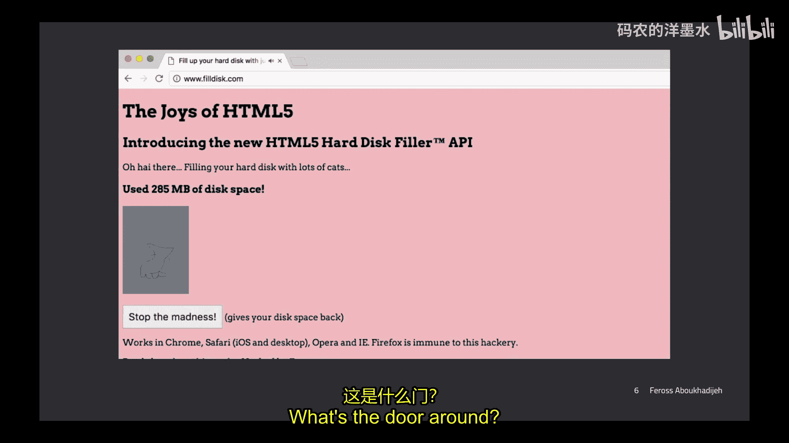

Clearly， there was an oversight in the design of the API。This is fixed now in all the major browsers。

 but at the time when I found it everybody except Firefox was vulnerable to this。

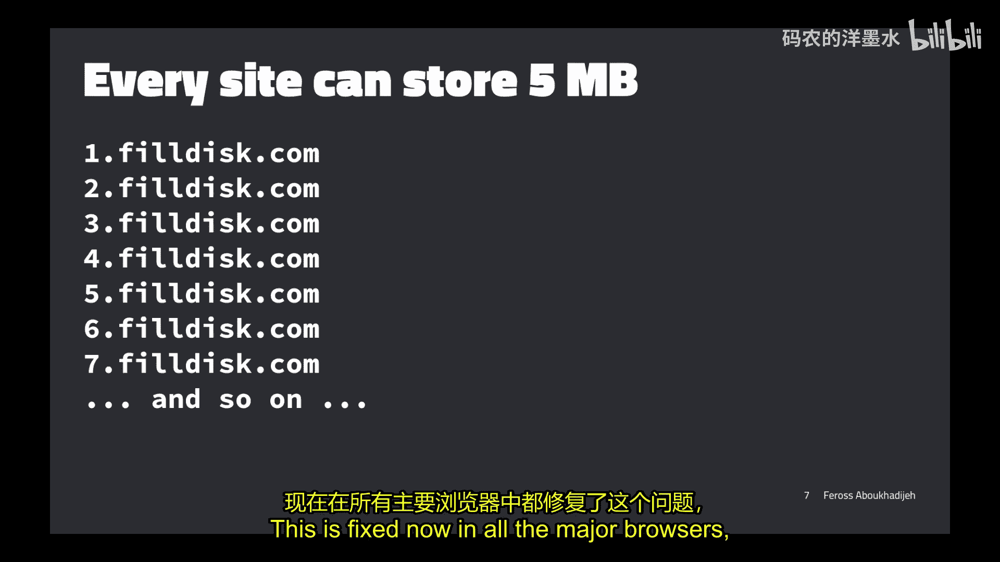

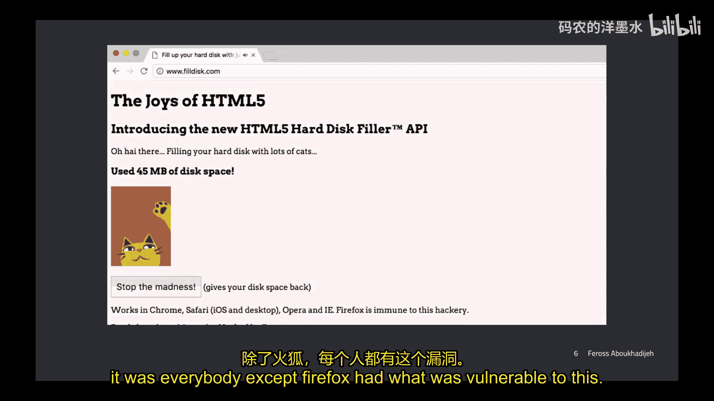

Yeah， so I mean， just like a little thing like that。 But you know， the web is this evolving thing。

 and there's mistakes that people make。 and you can be， you know。

 you could potentially find something like this。 Another one that was really fun was this is a clickjacking attack。

 So what the user is doing here is they're just， they think they're playing a game where they're just clicking on this little button。

😊。

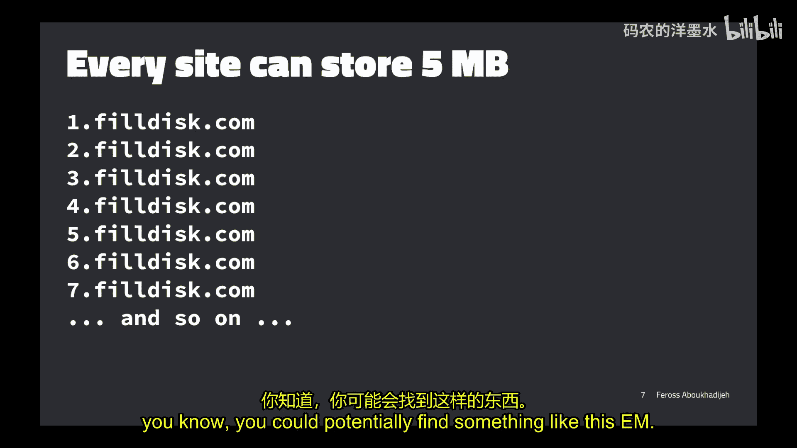

That's moving around。 But what's actually going on is there's an invisible window that's positioned directly under antheer's mouse。

 And as they as they move around， eventually they click， and that's me as a sophomore in Frosoco。

 So if pardon pardon how it look。 But yeah， this is I was in the class anyway。 And yeah。

 you get the idea the user's camera was was was turned on。

 And they didn't see any kind of prompt for that or any kind of know。

 nothing to do with any permission is hidden there in invisible window。

 So you're gonna learn about clickjacking attacks。 You're gonna learn how to defend against clickjacking attacks in this class。

😊，So any questions about any of this？

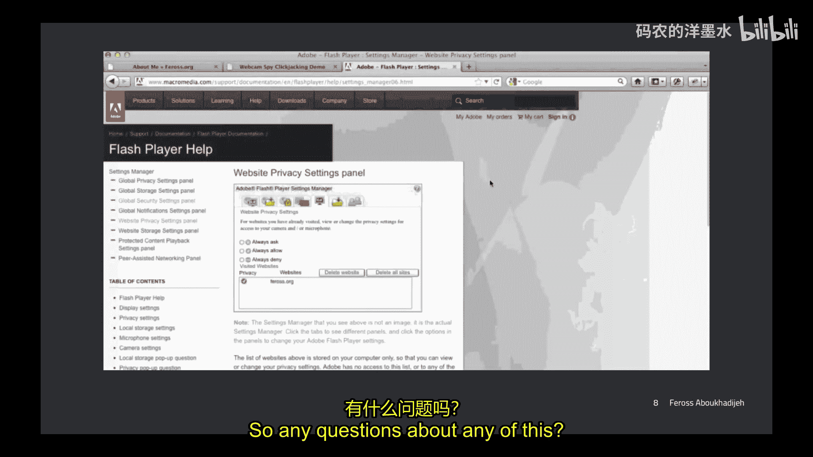

So yeah， So the attacker mindset。 that's， that's that's goal number one of the class。

 This is a mindset that will serve you all in your career。 I。

 I firmly believe that if you're not thinking about。😊。

You're not thinking like an attacker while you're writing code that that code probably has problems。

 It probably has vulnerabilities。And if you're not thinking about like security when you're designing a system。

 like architecting whole the way that the whole system is going to work。

 then the system's probably insecure at architectural level as well。

So you need to be constantly asking yourself like when you're writing code or when you're designing stuff。

 how could somebody break this？And so we're going to talk about that in this class。Now。

 hand in hand with the attacker mindset is the defender mindset。

I would hope that most of us would want to defend systems more than break them。

 but maybe that's not true。But this goes hand to hand。 And， you know。

 you can't really the goal is is is if you're trying to defend something。

 you can't defend it if you don't know how to attack it。 So we have to talk about attacks。

 We have to know what attackers are doing， what attackers are thinking。

 what techniques are the attackers using。So yeah， I mean， does anyone know。

 is it harder to attack or harder to defend？不算业外。Because it's easier to respond。when talking。Yeah。

 and and and do you know， is it possible to like look at your code and figure out if it's。

 if it's secure。It's hard because you have a lot of money。Yeah， and the attacker knows。

 like as soon as they find something， I found， know， I found something there it is。 you know。

 and a defender， you can look at your code all day long。

 and there could still be something hidden in there。

 It could be a bug in something that you're relying on or， know。

 something that you're not seeing right now。 So it's much， much easier to be an attacker。😊，Yeah。

 and yeah， welcome to the real world。 It's not， It's not possible to to know that your code is secure。

 unfortunately， but we have to somehow live in that world。

 And so we're gonna talk about techniques for， for how to like， you know。L in the real world。

 basically。But I want to mention really quickly， this extra credit policy that I'm really excited about。

 So anyone who finds a security vulnerability in something during the quarter will get extra credit。

 And I'm just one to 50 points it could be it will be depending on what like what kind of thing you find。

 but。😊，The reason why I'm doing this is just because I think it will。I think it'll be really fun。

 And I want to see what people come up with。 But please， please。

 please don't do anything that will get me in trouble or get you in trouble。

 So it doesn't have to be anything。😊，Any website in this class？

Yeah it can be literally anything I mean don't so if you get your friend to set up a really insecure website and then you go and find a bug in it。

 like I'm not going to count that but。Yeah， and I' reserving the like 50 points。

 the highest end is like like some incredible， you know， it has to be like， you know， I don't know。

It has to be extremely mind blowing like something that， you know。

 is gonna be in the news or something。 So it's， it's gonna range a lot。 you know。

 depending what you find。 But， but so if you're， if you're。

 you're unsure about what responsible disclosure is。

 I would recommend that you go the Stanford bug bounty program website and just take a look at what Stanford's requirements are for if you find a bug in a Stanford website。

 what kind of process they want you to go through to report that and just。😊，You can see like。

 you know。Ba basic ground rules you don't like try to attack something in a way that's gonna gonna destroy it or don't try to delete data。

 And And if you're unsure about anything， come come come talk to me。

 But you can take a look at that just for a rough idea。 And again， this is completely optional。

 Don't， don't feel like you have to do this。 It's totally possible， to get an A plus in the class。

 know， without doing this。 This is just。You know， just throwing it out there in case anyone wants to do it because I'd love to see whatever you come up with and I think it'll make the class more fun if you just have that in the back of your mind like whenever you're looking at something。

 you know， is there a problem in this and so this could be any like Stanford Stanford website。

Or even like you know， when we're looking at Web APIs。

 if you find a way that Web API could be used in a surprising way that that wasn't intended to be used。

 that would count as well。So any questions about this？Okay， cool， great。Cool。

 so today we're just going to do like a general overview of web security。

 and then we're going to start in depth on the technical material next time。

So let's talk a little bit about why we're here， like why is this class？

Why do we talk about web security， what's the reason and in general， why is computer security hard？

So， we have。We have a ton of code that's out there that's buggy。 And a lot of these， you know。

 think about like your own programs that you've written。

 Some of the bugs that you you have aren't even security related。

 It's just it's just hard to make a program that does what it's supposed to do， right， I mean。

 that's just a general thing that's hard。But， you know。

 even if you get the the functionality perfect and you think like， oh， this， this is perfect。

 It's doing everything correctly。 There's no， there's no edge cases I haven't thought of。

 And you know， in other words， it always outputs the correct answer， right。

 You still could have a security issue， right， Your program could be perfect from a functionality point of view。

 but completely insecure， right， So it's a kind of a different way of thinking so。😊。

And so there's just all this code that is buggy in ways that create security issues。嗯。Yeah， and then。

 of course， there's social engineering。 Who knows what social engineering is。Yeah。

It's where you like they pose to be someone of。An organization and。In you're not supposed to。 Yeah。

 Yeah， so you can like， you know， call up somebody and say， hey， like， I'm such and such。

 please give me you know， whatever password or whatever。 And that's actually。

 so surprisingly effective。 It's， it's absurd。Yeah， was I was at Defcon like a few years ago。

 and there was a guy who was in like a telephone booth on stage。

 and he was just calling up companies。 This was like this was like a thing that they did there。

 this guy was calling up companies And pretending he was， know。

 an employee there and started getting somebody to read over the phone。

 like Social Security numbers of employees。 He was just doing this on stage to like show everybody like how easy this is。

 Yeah， I don't know whether that was legal or not。 But that was always going on at Defcon anyway。

 But yeah， it's really easy。 And then， of course， there's there's just like a ton of ways to make money from vulnerabilities from information thats stolen via vulnerabilities。

 there's yeah， there's just a lot of money to be had。 And because of that。

 you get this incentive for people to come and look for this stuff。😊。

Not everyone is going to be doing it for the joy like you all are。

So there's literally people whose whole job is like they wake up in the morning and they're like。

 I got to find vulnerabilities in something because like otherwise I， I'm not gonna eat， you know。

 and they just their job。 That's their job。 They just like look for bugs。Yeah。So yeah。

 so there's a marketplace for these vulabilities。Does anyone know the difference between vulnerability and an exploit。

 Does anyone know difference。Whatこ。So。Mn。Yeah。The actual blood。You person next。Exactly。

 I said vulnerability is like， I found this problem。 I can like。

 I can get the website to do something weird， but it's not the code that actually makes it do something deliciousic just like takes over the server or or or。

 you know， runs the attacker' code。 It it's sort of like。

It's like here's a place to maybe take a closer look， but it's not sort of deployable yet。

 And so if you find vulnerabilities， that's like one thing。

 but then there's then there's like a different group of people who takes those and then sort of weaponizes them and then actually sort of take over machines And then once you have people who have taken over machines and you have like a different group of people who will be like I'll buy taking over machines because I know how to make money from those and then they'll start to do things with those machines。

 right。So these are all different marketplaces。嗯。Yeah， so does anyone know， like。

 what would you do with the machine once you've taken it over。What are some things， yeah。ButYeah so。

So what would you do with your button in？It's of machine that weve replaced。Okay。

 so you can take off， take off line a machine of maybe like your competitor or something。

 Or maybe if you don't wantna turn in your homework。

 you can just take down the site and then everyone gets an extension or something。 don't do that。

 But yeah， that's， that's the idea。 Anything else。 What what else could you do， Yeah。😊，Right， yeah。

 okay。What was it my crypto， Yeah， that's a very 2019 thing to do。Totally。

 you had one attack other machines， attack other machines。 Yeah， like if you know， yeah。

 if you know of some some other vulnerabilities， why not like just try looking at scanning the whole Internet and seeing if you can。

 if you can attack those as well。 Yeah， that's right。 You can install a key logger。😊，Yeah， exactly。

 Yep。 Yep。 And again， there， there's like different marketplaces where so some people specialize in stealing credit card numbers and other people specialize in actually maybe making you know。

 physical cards that have that information on them。

 And then some other person specializes in actually figuring out how to go to the， you know，😊。

Either it's an ATM card going to the ATM machine and actually taking cash out or going to businesses and using the card and there's just all these different sort of markets for this stuff。

 Yeah， it' it's it's it's crazy。Cool， any other ones？Yeah， since spam since spam， yeah。

 that' that's that's a good one。 Yeah， since spam， yeah。

 if you can use someone else's IP address to send this spam。

 it's more likely to go through if it's like a legitimate if you hack a web server of a legitimate company and then you're using that to send emails and it's gonna to appear to be more legitimate。

Turn on their camera， cord them， and then blackmail them。Yeah， yeah， that's right。

 yeah that's a pretty dark one， but yeah， yeah。😊，Yep， true。So these are yeah。

 some of you mentioned some of these already， this spa。

Dial of service to attack competitors or to see rannsom is one that is actually surprisingly common where somebody will basically send so much traffic to someone's website that the website will go down and then they'll say pay us as much and we'll bring your site back up。

You know， the person's losing money presumably during the time that their site is down and so they're no。

'Going to pay the ransom。嗯。Yeah， one we didn't mention was So if you take over。

 So these are all interesting there's all different kinds of angles here。 So some of them。

 some of these attacks are targeting like a client machine。

 So someone who's like a user going to a site and on their browser and and， and。

The attack would be targeting the computers that they're actually on。Other ones are， you know。

 you're attacking the web server itself and they kind of get different things depending on the target。

 So if you're， by the way， if I'm saying you， I'm not talking about you guys。Okay。

 so talking about some theoretical attacker that's not you。 So so if you， if you attack a server。

 one of the things you can do is basically make everybody who visits that site。

 get nowhere on the computer， so。😊，You know， obviously。

You can't just depend you have to know like some， some vulnerable。

 some some vulnerability that exists in the Web browser that they're using。 But， you know， if you。

 if you attack some popular site and you have like millions of people coming to it。

 and some percentage of those people are going be running like an old version of of ios or an old version of Android that's gonna have a v browser where the vulnerability is known by everybody。

 right， And so you can， you can affect a lot of machines that way。 just by taking over one server。

And then there's， of course there's data theft， someone mentioned that already。

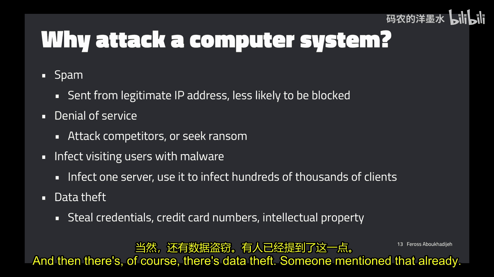

So。This is some stats on different kinds of data that's stolen in data theft attacks。

 you can see here， by the way， these numbers are is not like。

12l people lost impression isn in the millions。So and this is just in California。

 so there's is quite a lot of data thefts happening right now。So yeah。

 we're going to talk in the business class about how to make sure that your server is not vulnerable to an attack that would lead to this kind of information being stolen。

Yeah， you can see it's like all kinds of stuff， social Security number， payment card。

Health insurance stuff， driver's license。Yep。And then these are the sort of more recent trends。

 kinds of attacks that are happening nowadays。Yeah， ransomware is interesting because。

In the past when people got on your computer， there wasn't such an easy way to just directly monetize。

 I mean， they couldn't。It was had to figure out something something to do with that like CPU time or。

 you know that that bandwidth that was a lot harder than just directly saying。

 pay $600 to get your files back。 so and this has all been enabled by cryptocurrencies。So， so yeah。

 this is is a big one。 And then， of course， there's all these political attacks nowadays like the。

You know the DNC hack and all kinds of stuff like that。酷ol。questions about any of this？Cool。Cool。

 so now let's talk about web security specifically。When we say Web security。

 it's a kind of nebulous term。 It can mean a lot of different things。

 So I'm going just break down a few different ways what we mean when we say Web security。

 So one of them is， by the way， this thing， same margin policy。 We're going talk about this。

 This is probably the most important concept in all Web security。 It is the。

Model of web security for the web。 So we're this is a big one we're gonna talk about。

 But so one idea is like， okay， so we need to be able to have a browser where we can isolate sites from each other。

 So if I'm on know Wikipedia。 and I'm reading some article。

 And I have a tab open to my bank in the same browser I don't want Wikipedia to be able to access the information that's in that page and that seems like common to us now。

 but that that is。You know， that is a thing that had to be engineered。 I mean。

 this is a single program and it has data from these different sources and we're running code from each of these sites。

 I Wikipedia is running code on a computer。 It's running in this sort of process。

 So the fact that it can't just get all this stuff from make America is that is a thing that had to be designed。

 And so this is so this is sort of one definition of web security。

 It's from the browser's angle like the browsers enforcing certain rules about how sites can interact with each other。

Another way that you see sites interacting with each other in a browser context is in a sort of mash up way where we have content from one source。

 So in this case， this is an ad network that's serving some some ad here on stack overflow and we don't want。

The code that the ad is running to be able to do anything to the content that's outside of it， right？

So。Again， this is similar to the two tab situation because the code that's running in both of these contexts should not be allowed to interact with the other context。

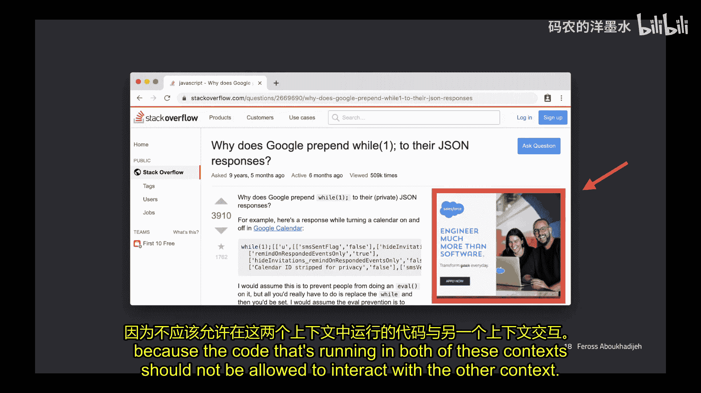

嗯。There's another definition。 so that was focusing on the browser side。

 Another way we can look at this is from the server angle。 So say you're writing as a web server。

RightWhat does web security mean to you as a person writing a web server。

 Well you don't want somebody to be able to attack your server and to take it over to make it do something that it's not supposed to do So you have some set of rules of like things that you want your server to allow clients to do and you want to make sure that。

You know， a client can't come along and just do something thats that's not on this like list of things you want to allow。

 The thing that makes that difficult is that you don't control。The client， I mean。

So you can what this， by way， does somebody， does， Does someone want to say what， what。

 what do I mean when I say client， What am I talking about here， clientient and server。Yeah， yeah。

 so the client is the code running in the browser。 It's like the javascript that's in the page and it's。

 it can sort of make these requests to the server， right， so。You might think like， okay。

 I'm making this site like I'm in control of what the client can do， right。

 I don't want the client to be able to if If I't want the client to be able to do something。

 I'm just not gonna make a button there that lets them do that thing。 right。

 The thing is that you're not you're not in control this client that's running on the user's machine。

 They can modify it。 can make it do whatever they want。 They can in particular。

 they can even generate an H TTP request to the server that a normal browser never even send like they can just they can write write script that talks to your server。

 And you have to basically factor that in when you're making decisions on the server side。

 right So this is an example， know just random hl request。 But this is you might say。

 well I'm not gonna make a button that lets this request get sent to my server。

 But someone can still send that request to your server， So that that's one angle to think about。嗯。

Does that make sense， everybody。Okay。So another angle is client app the security。

That's like the code that's running inside of the user's browser。

 We need to make sure that a user who's using that can't be attacked by， you know， code that's。

Let's say embedded in the URL， right， Like， say I click a link。 And I think， oh I'm going to Google。

 You know， great， a safe link。 I'll click it。 But if there's something in that URL that changes the way that the app behaves once it's loaded up in my browser and and makes it do something。

 You know， I don't want to do。 that's Doy that。 right。

 So common thing you'll see there is this thing we'll talk about later called called crosslight scripting。

 it's where you can basically trick。😊，A web app to run code that is not supposed to run。

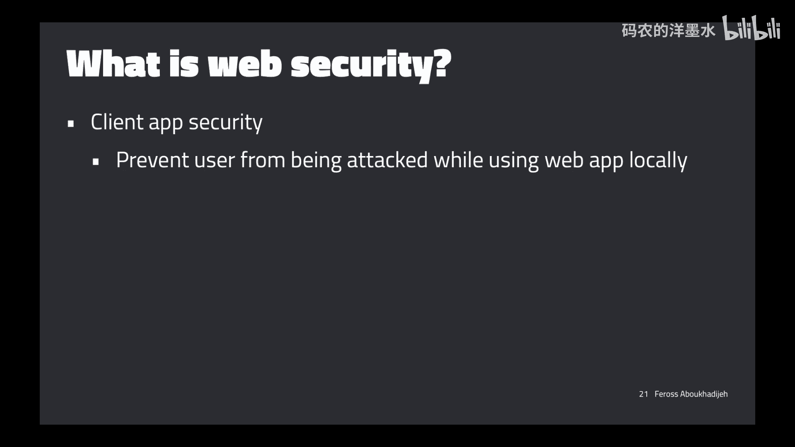

So one one example of this that I thought was pretty funny was this was like a a place where the server was pretty secure。

 So McDonald's had had a had a， I guess this is just their website where you could go and I guess learn about McDonald's products or something。

 but yeah， anyway， so maybe low low importance context there。 But。😊，Anyway，There was。

 there was a way to basically get the McDonald's site to just send your password to the attacker just by like visiting the site。

 right this is is obviously not good。The thing is like， you might think， well， you know。

I would never visit， you know， a length that an attacker sent me， right。

But it's really easy to get somebody to visit the URL。 I mean， you just have to say like。You know。

 there are cats behind this link， and some people click it， right。

 There's even easier ways than that。 There's， there's ways with zero interaction。 You can， you know。

 just I frame a page and then。That makes the browser just load that page up。

 And you can do that where when're on a separate site。

 And so there's there's just like lots of ways to get， or you can do a pop up。

 you can pop up this site， right， So getting the user to actually go to to a malicious URL is pretty easy。

 So we want to make sure that there's no way that some form formulation of like of the URL can cause cause the users browser to like run code that we dont want it to run。

😊，Does that make sense？Cool。

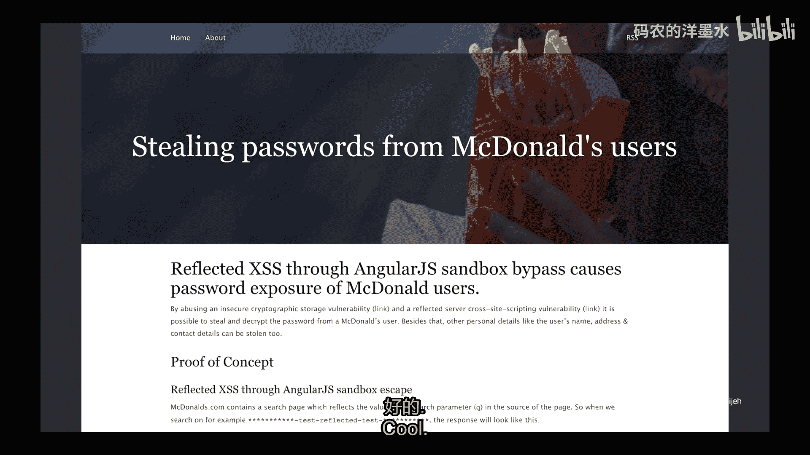

This was another another version of that attack that happened similar same category of attack crossstate scripting。

 What happened here was。It was。Somebody figured out a way to。Basically post some code into。

WordPresspress database。 And then when when the page got rendered。

 this code would be included and would it would execute。 and in particular。

 what they figured out how to do was if the user that was logged in to the WordPress site was an admin。

 then this code would create a new admin user。And because that person wasn' an admin。

 they were allowed to create a new admin user and that admin user had like a very secure username password。

 so this attacker just went around and sort of you know try logging into like every Wordpress site they found using these credentials and they could get into a ton of peoples a ton of people's Word installations。

😊。

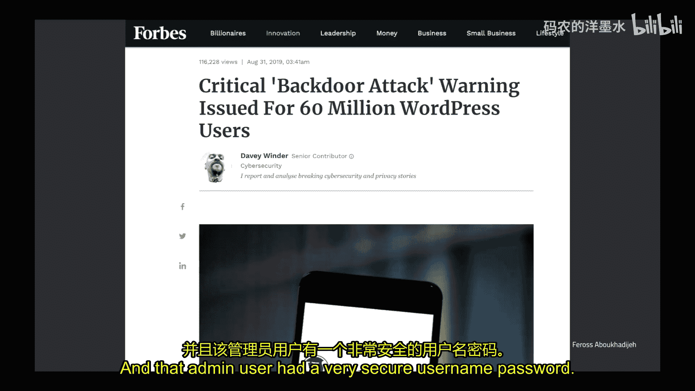

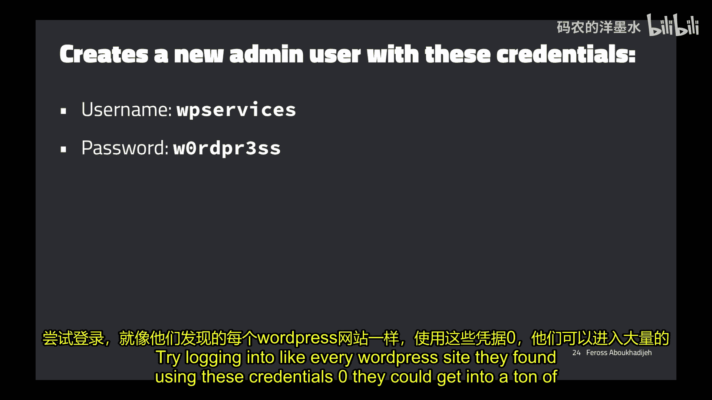

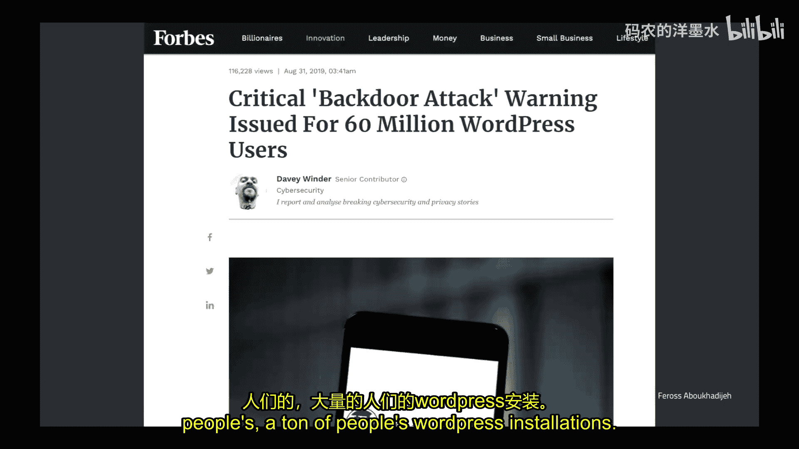

Yeah， that's a pretty nasty one。That was actually pretty recent， too。And then and then the last。

 the last thing I think we can we can last way we can think about Web security is as like sort of from the user's perspective。

 So protecting user user rights。 So there's， there's obviously the social engineering stuff we talked about。

 So is it possible to design a system that even in the presence of social engineering is secure。

 Like even if I tell you my password over the phone， right？ you can't happen， right？ I mean。

 that that's two factor off is one way to do that。But yeah。

 that's a good question I'll always ask is， how can we make this secure even in the presence of social engineering？

And then。You know， in the web there there's this huge industry of tracking people and building up data profiles on them so。

 you might think， well， okay， web security means as a web user。

 I don't want that to happen to me when I'm browsing around the web。And by the way。

 you might think like， you know， oh， I would never you know I would never fall for a social engineering attack。

 and like I have all my browser settings configured really well。 So you know， this doesn't affect me。

 but technical technically literate people fall for this kind of stuff all the time。 by the way。

 I never want to see a headline like this with any of you guys。 please， yeah。

 so this is some some undergrad at a German university。😊。

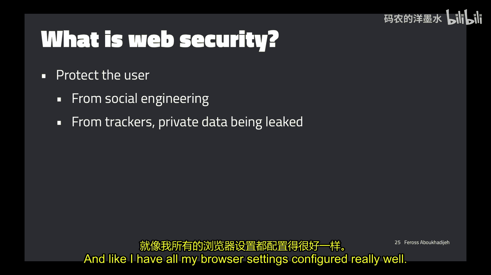

And。He did kind of。He didn't do anything like actively malicious， but it was a little dubious。

 He registered a bunch of。Package names on different like open source。Package registries。

 basically places where developers post their code right And the names were were sort of vaguely similar to popular packages。

 And what he did was all all the code did was it would just send a little ping to his to his server and say like。

 hey， I just ran。 but it wouldn't do anything else。

 And you just wanted to see like how many people would typo know and install his package by mistake。

 So this is called typo squatting。's when when you basically register a name that's similar to to something that's really。

 really， really popular。 And it turns out if it's really popular。

 And some number people are just gonna typo it。 and you're gonna just get installs just just by luck。

 basically。 And yeah， question。 actually curious。😊，Do you ever like？

Did you ever get punishment for doing this？H。That's the real question you want to have answered。 No。

 you know， I don't know。 I think that it was。People wrote articles about how it was dubious and like how it was not like a good thing for him to have done。

 But I don't think he actually harmed any systems。 So I would guess he didn't。

 I guess nothing happened to him。I mean。Yeah， yeah I don't know， though。 we， we should look it up。

 But the thing that was like particularly sketchy about this attack was that he。

 he noted that a couple of the domains that pink， ped back to him were dot mill。😊，Triminlitary。 So。

 so so his code was like running in production， like with like admin privileges on a couple of like US government military servers。

 which is， you know， yeah， that's the part where it gets a little sketch。 But yeah。

 and then he reported that the code ran about 45000 times in total on 17000 different domains。😊。

Dins I think so I think what's going on here is it's like JavaScript code that was installed and then deployed and running on like a server and production or shipped to a user's browser。

 And so 17，000 different websites ran the code at some point and p to server。Yeah。

 because code did what it was supposed to as well， like in addition to paying his server。

When they installed it， they thought that they had the real one。And thing。I would guess that if， if。

 if didn't do the functionality of the thing that it was supposed to do。

 then they would catch it right away。 So my guess is like， if I were doing this， what I would what。

If one were to do this， but one would do is。Yeah， install the actual one。

 and then just export that as the functionality of your package and then just also paying right。

 Yeah， and then they probably won't notice would it。Because as a user。

 you have a responsibility to know what you're installing and where it's from。

So why should he receive punishment？command that right。韩 mean。I like your attitude。 No， no， I think。

 I think that makes sense。 I mean， I， I I definitely think people should be auditing the code that they're running on their computer。

 I mean， the we're gonna talk about this in a later lecture， but。😊，The I mean。

 the current state of like the open source ecosystem is。

 is that the default sort of state of things is when you go to install some popular package like say react。

 That's the thing everybody uses for building their the front end of their website。

 You go NPM install react and it pulls down code from like 1000 different people。 I'm not joking。

 right， like it's it's。I mean， it's not possible。 It's not humanly possible to actually audit all of that。

 And that's part of the problem is like， you can say， oh， you know， they should audit it。

 It's their fault。 like at the same time。 It's like people want to get their job done。

 and they just want to move on with things。 And so it'， it's a weird。嗯。Yeah， it's just。

 it's just hard。 It's a hard problem。 You can't audit every line of code。

 So much of that code is changing。 It's in flux。 But yeah， I mean， ideally。

 you would sit down and you'd look at everything and。

 and make sure that it's not obviously malicious。 But even then。

 you're not gonna to be able to catch everything because I mean。

 there could be an accidental bug where， you know， there's a bug in there that the developer didn't even intend to put in there。

 Like they're not even being malicious。 They just made a mistake and。

You're going to try and catch that too when you're auditing it， you know what I mean。

 So there's just all kinds of things that come up。Yeah。

 but one of the things NPM the JavaScriptscript package manager did in response to this exact attack is what they now do is if you try to register a package。

 they'll look at names of sort of they'll permute the name by like a letter and all the different positions and just see if there's something that's really popular that's named that。

 and then I'll just deny you the ability to register anything vaguely similar to something popular。

 that's like one thing you can do。But yeah， there's still ways around that we'll talk about。

Other stuff that's happened。Yeah any other comments or questions on this？Web security。没。Cool， yeah。

 so we were talking about， oh yeah， we're talking about like protecting the user from trackers。

 So this is， this is a cool project that I forget him made this， but。😊。

It's a Chrome extension you can install that just sort of sits there and watches what domains your browser connects to and the cool part is it highlights the ones that you directly visited yourself and then the ones that you've sort of domains that information has been sent to just by the fact that you visited a particular site and so you can see this insane web that appears even though users just visit like Arch Technica Huffington Post。

 you goinging boing and a few other sites but and they end up having all this different all different domains being contacted and you can see the connections between them and these。

Gives a hint and taste it at the sort of tracking that that's pervasive online these days。So yeah。

 there's ways to protect against this that browsers are deploying。 now。

 we're going to talk about those different approaches。

 but it's kind of a hard problem because the web was designed from the very beginning with certain like。

Tecical decisions that just people didn't expect that that this would be the world we live in later。

 How many of you have taken a networking class。Okay。

 so there's similar things in networking where the internet was designed in a sort of more naive era when。

Only academics are using it right， and so there's these consequences that we face because of that。

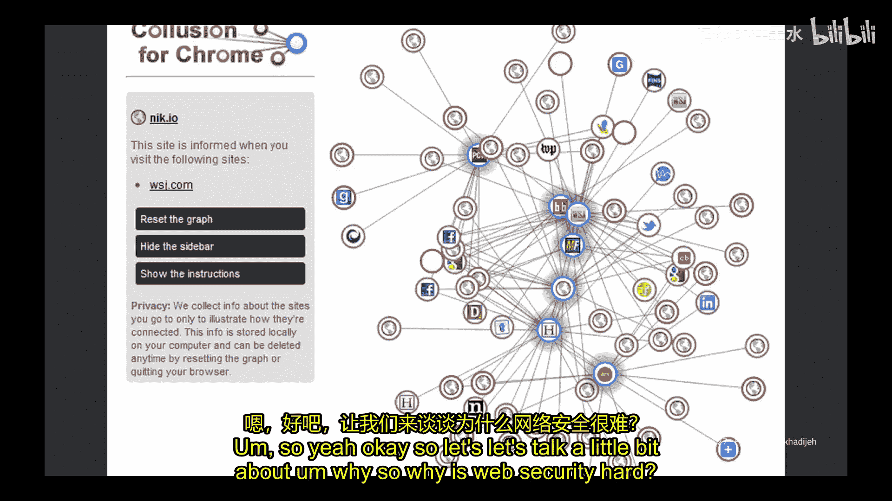

So yeah， okay， so let's talk a little bit about why why is Web security hard we touched on a little bit few few of the reasons。

 but there's there's just， there's， I mean it's a really hard problem like fundamentally browsers are like trying to create this world where you can take code from a random person and just blindly run it on your computer and have nothing bad happen。

Like， that is just an ambitious goal。 I think， And you know。

 you're not inspecting the code to make sure that it's not malicious。

 You're not doing any kind of checks。 you're just running it， right， And so that's that's。

 that's the problem。 that's one reason why it's hard。 We're trying to run untrusted code securely。😊。

But also， we have， like I mentioned before， different sites interacting with each other in the same user context。

We also have。A lot of lowle features。 people want websites to be able to do more， right？

 And so because of that， there's all these APIs that are getting added to allow access to the camera access to the microphone。

 access to low level features on a system like For example， you can run code on a GPU right。

 a website can literally just say， I want to run code on your graphics card right now。

 And we have to do that securely。 it's hard。 It's a really ambitious goal。

 There's also this desire for high performance。So we get lower and lower level APIs。

And these APIs weren't designed from first principles。

 so it's not like some smart people sat down today and said how would we design like a secure web browser this has evolved over time and when the web was first created it was complete it had completely different goals。

 it was for showing people textual documents。It's a completely different goal now。

 now we're trying to make it a web like like like an application platform， basically， right。

We want to be able to run apps on it。 And so the fact that， I mean。

 this is the fact that we were able to evolve the purpose of the web so much is kind of crazy。

 it's sort that it even works， frankly。And the other thing that the web has to do that makes makes the problem really hard that none of the other sort of platforms that are out there。

 ios Android Mac windows have to deal with is the web has has very strict backwards compatibility requirements。

 it's not possible to make changes that break old websites。

 It's just not a thing that any browser wants to do and it's just not a thing that no one will go there if you suggest like oh。

 we would we can make everything better if we just deleted this really annoying feature。

 you will you will not have any luck convincing the browser vendors to do that。

 They just don't want to go there because say that your Firefox， and you decide。

 you know we agree with you。 We're gonna delete that feature。

 Now a bunch of websites break what are the users who are are going to those site going dore going there with Firefox。

 They're gonna， Firefox is broken。 It works in Chrome。 and then they're gonna lose users。

 So it's that's one reason But the other reason is just it's not possible to go and fix all these old sites。

 There's just so many sites from the past。like archival in a sense they're human history that we can't just break them and so I mean this is one of the coolest things about the web is you can go and view sites that were created in the 90s and they still work right but this makes it really hard to have good security。

Yeah， it's difficult， so yeah， this is the model， don't break the web。

 you'll hear this in any discussion if you try and propose anything。

 people will say don't break the web。So yeah， so anyway this leads to a world where we have just a lot of yeah a tangle of technologies that's the way to put it。

 I love this quote， modernern web applications are built on a tangle of technologies that have been developed over time and then haphazardly pieced together every piece of the web application stack from HTTP requests to browserside scripts comes with important yet subtle security consequences to keep users safe is essential for developers confidently navigate this landscape。

So yeah。Weiyan。We have a completely different model for what we want the web to do than we did when it was created。

I mean， another example of that is HTTPS。So we used to think that we needed to use secure connection to the server only for transmitting information like credit card numbers。

 But that is completely different now。 What， What changed， Does anyone know。哼。Yeah呀。Fire sheet。不知道。

There's the browser plugin， and then on the local network。

 it would like get all the cookies that present in clear text on the local network。

And you could literally like get a list to all the Facebook accounts and like your friends in the same room。

You could like push it。 Yeah That was very powerful。 Yeah， Yeah。

 so that that that's the idea that like everybody who's near you。

 who's on the same network as you who's sitting at the same coffee shop as you can see see your traffic if it's not encrypted。

 right， So you don't want them to be able to see what's transiting across the wire there。

 there's another really big thing that happened。😊，It made us change our。Our， our our idea of。

Whether to use HTTP or HTPS。Because I know this snow incident didn't really have to do with this。😔。

I think that， yeah， I think that was a really big deal。 Yeah， ever since the Snowden revelations。

 we learned that that there are governments that are just slurping up everything that they can that's going across the Internet。

 And so the the。If you can look I'll show this probably in another lecture。

 but you can look at the adoption of HTTPS over time and right around that and you just start to see this dramatic rise of sites adopting H TTPS and you see the browsers pushing sites to do this more and more you've probably noticed now like your browser will actually just tell you a site is not secure if it's not H TTPS and you probably see that all the time now。

So of trying to harass website owners into， into adding H T T P S。 And， but yeah， I mean。

 that that was a really big one。 Also， there's just all kinds of sketch stuff that happens if you don't。

Enncrypt your traffic completely， we'll talk about more of those。So I already kind mentioned this。

 yeah， the browser has an impossible task。 it seems has to allow。Literally known malicious。

Actors to download code on your computer， spawn processes。

 open sockets to any server that it wants to open them to。

 connect to even potentially other users browsers， display media in any format。

 run code on your GPU and then save and read data from your file system and has to do this securely。

😊，So it's very ambitious。And。Talks a little bit about this already， but the。

There's this idea of this。Division between what people want the Web to be。

So there's some people who think that it should just be a simple document viewer and they want sort of like less ja and less features in the browser and then there's this a competing pressure to sort of make the browser basically into an operating system and to put everything into it and to let a site do pretty much anything at once but still safely do still safely do that and obviously the more you go in this direction toward making it an app platform harder it is to defend against certain things。

And we're going to talk about a bunch of things like that。 But just as one example。You know。

 the more， just the more the more features you have。

 the more different interactions are going be they're going to be between these APIs and the more potential bugs are going to be。

 you know。As you have this combinatorial explosion of different ways you can use these APIs together。

 basically。So。Yeah。But。It's okay。Everything's okay。 The web is actually pretty robust。

 despite like all these negative things I've been telling you about。

It is probably the most attacked platform out there。And it's， it's。

 it might not have like a clean design， but it's evolved all these security measures over time that。

Collectively make the web pretty robust。And this is a good quote I like that talks about this。

 This guy， Ellia Gigoric， is really bad as。 He is like。engngineer at Google。

 and goes it's all too easy to criticize， lament and create paranoid scenarios about the unsound security foundations of the web。

 but the truth is all of that criticism is true and yet the web has proven to be an incredibly robust platform。

So， so yeah， it's possible to build really secure stuff。 It's just maybe not the way that your。

 your site will end up if you don't think about security while you're building it。

 And that's what this class is for。 So we're gonna learn to architect。Secure systems。Patterns。

 concepts， you know and。We're going to talk about all that stuff。And we're going to talk about。

How to make it so that even if one of these things fails。

 your site is still safe so you know we need to have multiple like backups basically so that you can let something you something can go wrong here。

 there was an unknown bug you didn't know about but you're still okay right that's very important。

Cool， so yeah， just a overview of the different things we're gonna hit。

 So we're gonna the first part of the course is gonna be all all about the browser's security model and the same origin policy。

 which， as I mentioned， is the most important security concept for， for Web security。

 And then we're gonna go into ways to attack the client。 So that's the user browser。

 And then ways to attack the server。 And then we're gonna talk about how to do secure authentication。

 really important concept。 And actually， after that。

 we're gonna have the guy from Github Github security come in and talk about。😊。

How Github is doing authentication with like you know。

 biometrics and stuff like that to increase account security even further。 And then。

 then after the TL S stuff。 So this is this is this is H TDPS。 So how we do secure you know。

 secure connections and after that， there's going to be a guest lecture from from。

Emily and Chris from Google Chrome Security team about how they're making TLS really secure in Chrome。

And then then lastly， we're going to have a bunch of stuff on how to like how to write secure code。

Cool。Holding on time。30 more minutes。Okay， so we have time for this。 So yeah。

 any questions about any of this so far， anything about the course or。Anything we've talked about。

 Yeah， is it a final exam or Yeah， there's gonna be a final exam that's worth 25% of total grade。

 there's no midterm。I think it's like determined based on when the class is at。

 I don't know if I top my head。Bailan。You can look it up。

Does a class count as an elective say elective？Yeah， it does count as a CS left yeah。

 you conclude it on your as far as I know you conclude include it on your program sheet。For that。

 yeah。I think any ECS course numbered over 100 is allowed of BS selective。Cool， so。

 so if there's no other other questions， I'll just get a little bit into the stuff I I was going to do next time on。

Just like a review of web technologies。So。So yeah， I'll talk about just a quick review of HTMLML。

 How many people here know this， I don't wantanna。Bor anybody， but in which you know。Okay， everybody。

 Yeah， Okay， cool。 Yeah， pretty much everybody。 So yeah， just really quick review of that。😊。

So we want to be able to make documents that look。You know。

Foratted in some way and we might start with the text plain text like this。

 but obviously if we we try to try to give this to the browser it's not going to know what is a heading。

 what is a bulleted list， blah， blah， blah。 So we introduce these tags we surround text with a particular tag to say this text means this。

 So in this case we have a heading we have paragraph and then。Who knows what UL is？Anyone know， yeah。

Unordered list， yeah， yeah， what's the ordered list？Oh well， okay， okay， good， good good。

 and then LI was that？List item， Okay， cool cool， so we're all on the same page。 so yeah。

 this is basically going to make a list， you run that in the browser。

 you get the beautiful amazing document that we about apparently about penguin diets。😊。

That we have here。And then we have， you know， the sort of。Context that you put these tags into。

 this is just the sort of stuff you have to put into every page that gives information about the meta of the document。

Cool， this shouldn't surprise anybody。So now we're do a quick review of URLs。

 so URLs have a bunch of different parts， the most important parts， I guess they're all important。

 honestly。So yeah， we have the scheme which is the sort of protocol we're using。

 the host name is basically the domain name of the survey that we're connecting to。

 we have a port number。Now， a path used to be literally like a path to a file on the server's file system that the user wanted to request Now。

 oftentimes these days the server is completely dynamic and this path can be anything。

 this is basically just the sort of the name of the request that you're making basically and the server can just do whatever it once but oftentimes it still does point to a real file if that name that's possible too and then the query part this is。

Pretty much only use when you have a dynamic。Sver endpoint because you want to these are just parameters that can sort of configure the type of of request that's being made and the way that this works is you always start with the question mark and then everything that comes after this is just it's key equals value and then ands separate additional keys。

 So again key equals value and if you had anymore more it would just be ans all the way through ands all the way between all all the different key value pairs。

Yeah， does anyone know what you do if you have an ampersand that you need to put in the key name or the value name？

Escape it。 Yeah， right， exactly。 So theres there's a type of escaping that we'll talk about that helps us sort of disambiguate in those situations。

 But that is one of the core problems of Web security is just is's this distinguishing between what is part of like sort of the command that you're issuing and what is user input。

 and you'll see that all the time and a lot of that tax we talk about but。

AndThere's just a little hint at that。 And then then the fragment。

 this is a little bit rarer who knows what this is。啊。So it can used like anchor you to a。全不到。Yeah。

 so if you have some point in the document that's that's labeled with this name here。

 then then this will jump them to that part of the page。 Ex。 Y， y。

 there's actually a new spec that's being considered right now。 that's really cool。 It lets you。

It lets you。 So so so what's the problem with these。

 The problem is the author of the page has to have thought in advance about potential points in the page that you might want to send people to。

 So if you're on a page and you want to link somebody to a part of it and there's not one of these。

Anchors in the Hm L， Then you can't link them to that part of the page， right。

 You have to tell them like， oh， scroll down two third of the way， right。

 There's actually a really cool moose spec where you can， you can include。

Forgeing what the character is， but you include some character after the the hash symbol。

 and then you include a string， and then it sort of basically control Fs for that string in the page and just scrolls them down to it。

 That's not as robust， but it's it's kind of a cool new thing。 but yeah。Cool。

 any questions about URLs？Sorry I know it's kind of basic。

 but I want to make sure everyone's on the same page。Cool， so then in HTML。

 there's different ways to actually specify URLs。So we have。

The basic way you just include the full URL inside， this is a link here。

 I'm going to include the full URL。But then there's a relative URL which is going to be based on the page that we're currently on。

So say， say I have this URL and I'm on， I'm currently So I say I clicked on this link right here。

 right， So I'm on this URL now I'm on the the 2019， you know， news slash 2019。

 And then I see this link here， right， If I click this， where am I gonna go。Anybody know。

 so I want to call you but I want someone new to。嗯。😊，算。That's correct， yes。

 it's basically just whatever sort of page you're currently on。

 it will append that to the end account。Yeah， I won' to get too much into the wes here。

 but yeah that's basically right it's like you're currently in this folder and then you want to go to this so you sort of just tack that out and that's right。

 yeah， if there had been something after this slash here。

Then you know what happened in that situation， so say this was we were on 2019 slash October。

And I clicked on the September， like， what happened then。啊。Wai。There's no slot October。

So the interesting thing there is that yeah，' it's a good thought。

 but the trailing slash actually matters in that situation。 It's really annoying。

 but basically if you were on slash October and then you go to September， it's gonna to say。

 oh well sort in this folder， the 2019 folder and we'll just take it will take the October part off and replace it with September but if you added a trailing slash now you're fully in that folder and it won't do that it doesn't make sense。

 don't worry too much about it。😊，But yeah。So this is the URL that's sort of the same as。

And then there's one other way to do it， which is called an absolute URL。

 this one you sort of start the link with a slash and only know what that does？

What gets you to the domain name slash events。Use the whole path and then replace it。Yeah。

 it's very similar to what would happen if you were in your terminal and you did that。

 it's going to take you up all the way to the root。

 where I I have a pointer somewhere here I can use the points easier。

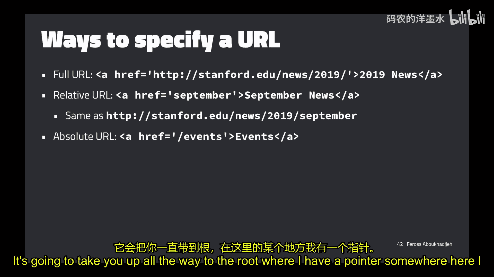

Oh wow， okay。Nope， it's not work other it is cool， that's cool， nice， that's awesome yeah。

 so basically。

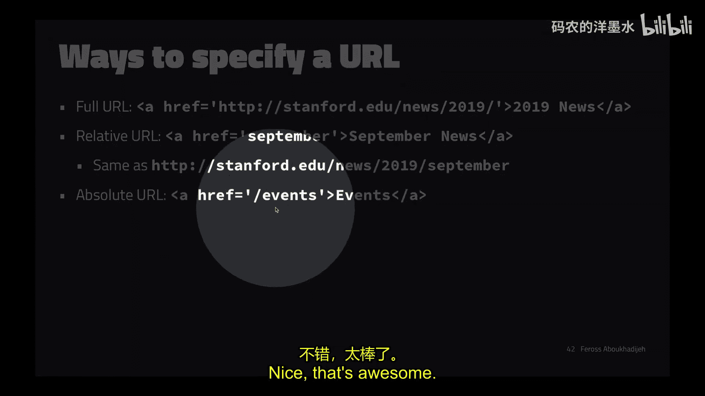

不认。Oh yeah， it's really weird。 it uses a gyroscope， so it's somehow it like knows as I move。

 it's not actually pointing to anything。 it's just really weird anyway。😊。

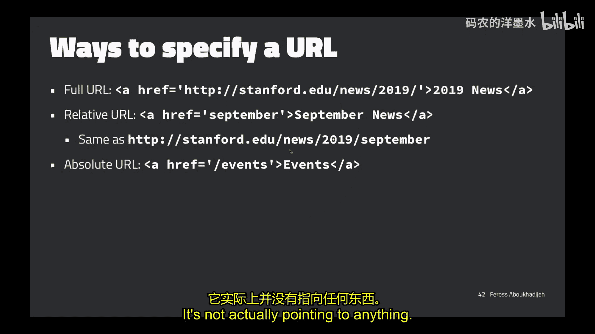

Here we go， yeah， so we were were got this slash here so what we're going to do as we go to the。

Root of the site here and we add slash events on so we'll go to。

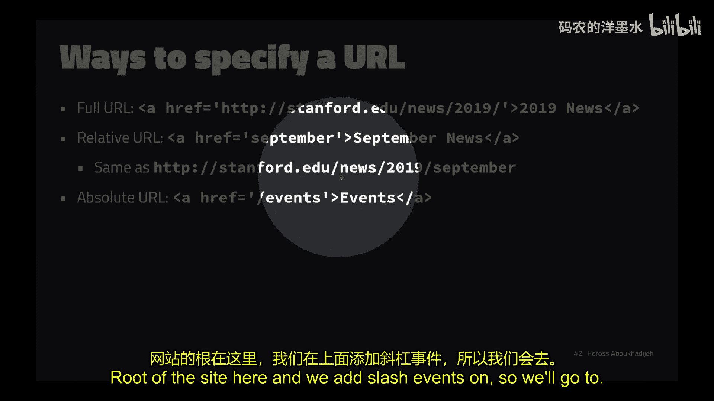

Same for E slash events。Cool， and then there's one。

 I guess one last way that that you can do it is is a fragment URL。 So this is。

 this is just gonna tack on the the fragment， the part of the page you want to scroll to。

 basically onto the current URL that you're on。 and it'll scroll to to to an element on the page that is that is。

 labeled in this way here。😊。

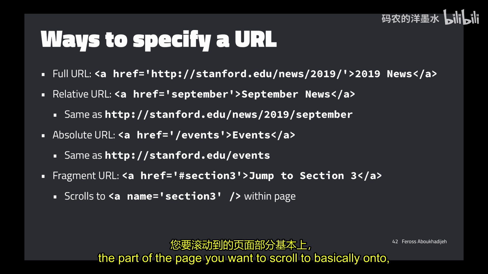

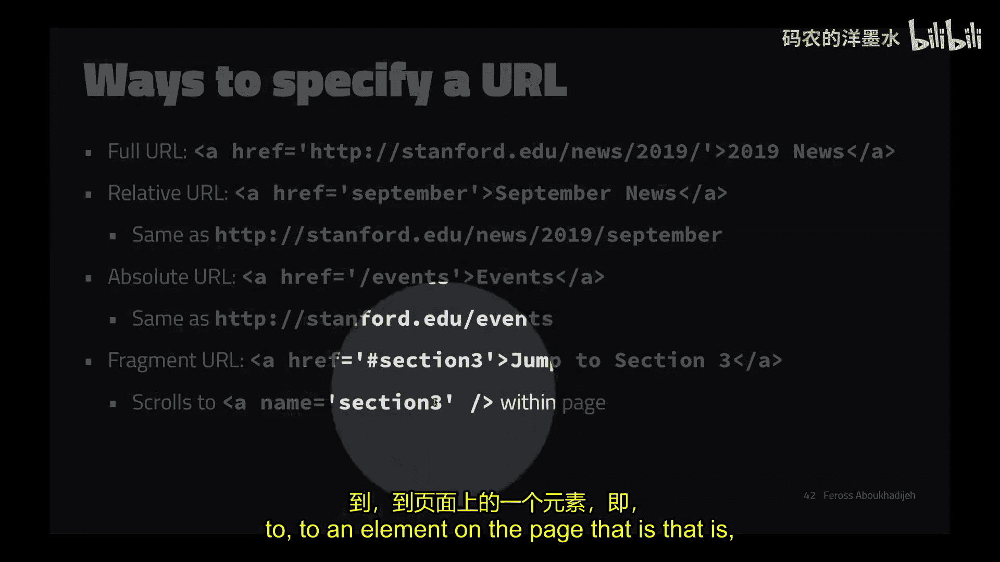

Cool。AndSo there's a bunch of HTML tags， image， video audio， canvas。

 in particular the ones we're going to spend a lot of time talking about in this class are link style and script because these are where sort of all the attacks are they all involve these tags and we're going to talk a lot about just。

Some of the decisions that were made when these tags were introduced and how we're still living with the consequences today and how we sort of have to contort ourselves around those decisions in order to make our stuff secure today。

 it's very interesting， but that's again like one of the consequences of the fact that the web is just we can't break backwards compatibility with old websites。

But yeah， so with Lincoln style， we just quickly how those work， those are for CSS。

 so you can include an external CSS file with the link tag。And for inline CSS。

 we use the style tag and we just put our CSS directly into the page， just like that。Any questions？

Cool， and then for， for jascript， for that one， I don't know why it's not consistent with C S。

 but we don't use link for that。 We use script。 And then， and we， we can。

 we can reference external external stuff with source。 And then in line。

 we just sort of paste the the ja and there like that。😊。

I guess one of the nice things with it being like this is you can find out if there's JavaScript by。

If there's a script tag， you know must be JavaScript。Anyway， yeah。Cool。Cool。

 so now just a couple of words。 that's everything on on HTML。 Now。

 I'm going to talk a little bit about ja and。And then I think that I didn't think will be good so。

So a lot of you might have a lot of opinions about JavaScript already。

Who here who did have a negative opinion of JavaScript， raise your， it's okay， I won't be mad。

 oh my God。Is that why you all took this class because you wanted more reasons to hate JavaScript？

Well I have to admit， I'm a fan of JavaScript， I actually think it's great。

I think so bear with me for a second。One of the things that makes it great is is。

 I think it's very fun because it's very immediate like can you can just you can get a lot。

 I guess this is true of any scripting language， but you can just sort of start to play with stuff in a way that's really nice。

And one of its I guess， strength and weaknesses is its flexibility in the early days。

 JavaScriptscript was an absolutely terrible language and the flexibility that it had actually let people work around the terribleness because you could extend a bunch of the built ins and you could sort of make up for the deficiencies of the language。

 it was really nice。 but nowadays， as JavaScriptvascript has improved and starts it starts to actually have a lot of features we want。

 the flexibility leads to potential for like。😊，I don't know。

 just sort of it too much flexibility isn't good because it removes the sum it it。

It it gives you sort of more things you have to worry about。 you。

 you have to you have to like assume， for example， I'll give you an example。

 There's there's a thing in javascript called undefined， who's heard of undefined。Okay。

 hopefully most people， it's like null or something like that。's but in Java script。

 you can actually say undefined equals true。I'm serious。

 And then anywhere someone's checking to see if something's undeed， You know。

 it'll now be a truthy value。 like that， that shouldn't be allowed。

 That's a little too much flexibility。 but that's the kind of flexibility where， you know。

the trade off was made。 Let's make things flexible because I mean。

 you probably know the story about B and I can have a language is made in 10 days and It if people know that。

 but basically the language is made in 10 days， you can kind of tell。 but but because of that。

 like one of the best decisions that was made was you know we don't know we're probably making tons of mistakes when we're making the language because we only have 10 days So let's throw in some flexibility so we can make up for the mistakes later。

 was that was the one bit of wisdom that was that was put in in the early days that really made it have longevity that it's had。

 in my opinion。And then， of course，' it's preinstalled on every device in the world。

 everybody has a browser and especially on desktop。

 everybody has the dev environment built in because you can just right click。

 inspect any page and Bm， you have dev toolsol。 you have a console。 And that' that's kind of cool。😊。

Cool。Now let's talk about。No JS。NoGS is basically JavaScriptscript on the command line。

Why does it have to be a different thing， Why is it called No J S， Why is it not just javascript。

 the reason is that that Javavascript was intended to be a language that runs in the browser。

But at some point， some people came along and realized。Well。

 if we could just use this as an arbitrary scripting language to let us write any kind of scripts we want。

 similar to how we would do with Python， that' would be pretty cool and。Unfortunately。

 because it was a web language， it didn't have a bunch of faculties that a scripting language should have。

 like being able to read files or write files， or make， make socket connections and stuff like that。

 And so nuist had to come along and ad。Functionality that a good scripting language would need。

 so it added things like file system， HTP， DNS， sockets and stuff like that。

 and also added a module system so we could require code from other places because that wasn't part of JavaScript。

And， and also support for binary data。 because before， for that existed， you。

 you literally had to do everything with strings。 And it's not really very easy for， for。Here。

 we're trying to work with video data or some kind of other data。

 You don't want to be dealing with everything as a string。 But as JavaScriptscript has improved。

 we actually need less and less of these things that node added in because JavaScriptscript has become better language。

So， so that's what note is。 Any questions about that。I apologies if this is too much review。

 but I promise we're going to get to the really exciting stuff soon。Next class。Okay。

So one thing I want to dispel really quickly is。Like。

 I think part of the reason jascript has such a bad rap is because people lump all of the different ways they've experienced javascript and intent into one bucket and then blame blame it on jascript。

 And like like I said， I agree， I agree with most of the criticism it is kind of a bad language in a lot of ways。

 But I don't want it to be blamed for things that are not its fault。

 So one thing to do is to disambiguate where the different APIpis that we're using come from。

 So theres there's a language spec for ja， which is。You know。

 a bunch of features that are included in the language itself。

But then when JavaScript gets embedded in a browser。The browser provides a bunch of additional APIs。

 right， So how many people know what the document object model is or the dom。Right， okay， so the。

 all those APIs are not part of jascript。 Those are provided by the browser。 The reason why is if。

 you know， if we're using jascript on the command line， we don't need a dom。 We don't。

 There's no page to manipulate， right。So that all comes from the browser。And honestly。

 that's where most of the bad APIs are。 They're from the Da。

s and then there's a bunch of stuff that's provided by node if you're using node JS。

So like something like array， right？Is built into JavaScript itself。

Something like document create element。 that's a Dom API。 So that'll be coming from the browser。

 And then if you're node JS， you have this nice read file API。

 which lets you just read a file out of the user's hard drive。

 which obviously that doesn't belong in the browser right So just something to keep in mind when you're seeing ja APIs to know where they're coming from。

 they're not these are not really jascripts。Yeah。Cool， so。

The last thing I want to talk about is that。The browser has a lot of。

Crusty old APIs because it's such an amalgamation of， of old old crap。 And in a lot of ways。

 But but some of it has been removed。 And one of the things I just want to show you guys to excite you a little bit。

 I whip something up before class， I made did anyone know what these APIs do。

 they're kind of obvious based on the names。 But some of you want to say like。

 what is window open do。😊，Yeah。It opens a brand new window which a desire you。Yeah， right。

 yeah so it's basically a pop up， that's the pop up API in blamelam pop ups on that。

And then move to and resize， I guess are also kind of self explan let you move a window around and resize a window。

 And you might think in 2019， a browser should not be able to do this anymore， but you'd be wrong。

A browser can。And I'm going to show you。An demo that I made before class that I think is pretty hilarious。

Let's see。

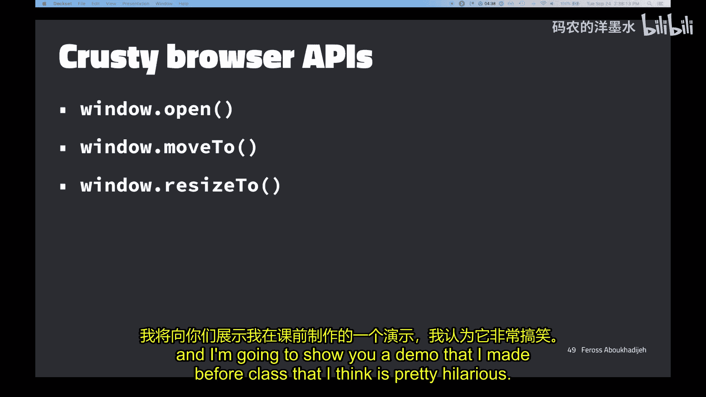

K。So。Its the kind of one you can have with the browser because it's。Okay。Should I do it。Come on。

 I should， right？life life life is too short to not click the link or not do the do the thing， right。

 So okay， let's do it。 So hold on space bar。 Oh wait， no， no， no， what's not working。

 What's going on。 What's going on。 Hol on。Oh， let me me let me start off。

 I think it might be because I need to， I don't have multiple screen support。 Okay， hold on。

W too mirroring。Oh。I promise it's not supposed to do that。 it's cool than that。Here go okay。Now。

 we do。Restar it。Okay。

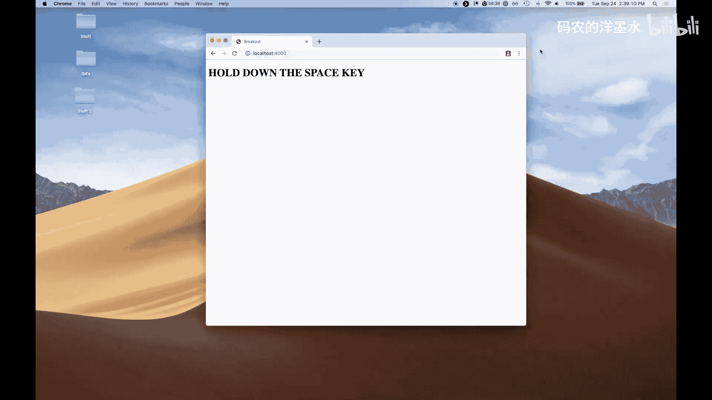

Okay。So hold on space key。Okay， so it's setting up the game。Now I。

The cool part is cool part is notice my mouse is not even holding the window by its title bar。

 it's literally just falling my mouse around。It's moving itself to stay centered on the mouse。Yeah。呵。

Yeah。So yeah， that's the web。Yeah。What was that Can we this to yeah。

 I'll post the code if you want to look at it。 Yeah it's honestly。

 want to make if you want to like use the code and make variations on this to make your own games and stuff。

 that would be super cool。😊，Anyway， but yeah， so this is cool。

 I guess I have a bug where it sticks to the top So want to six a bug right there。😊，There we go。

 I win， okay， cool anyway。Yeah。😊，Cool， so yeah， that's that's something you can do。 But yeah。

 the web is full of this kind of stuff。Honestly， it's， that's why it's fun。

 That's one of the reasons why it's fun。 in my opinion。 But yeah， anyway， I think that's。

 that's basically it。😊，Com back next Thursday for more on， we're going to do cookies， sessions， HTTP。

 and if we have time， we'll get to the same origin policy。Cool， thanks。

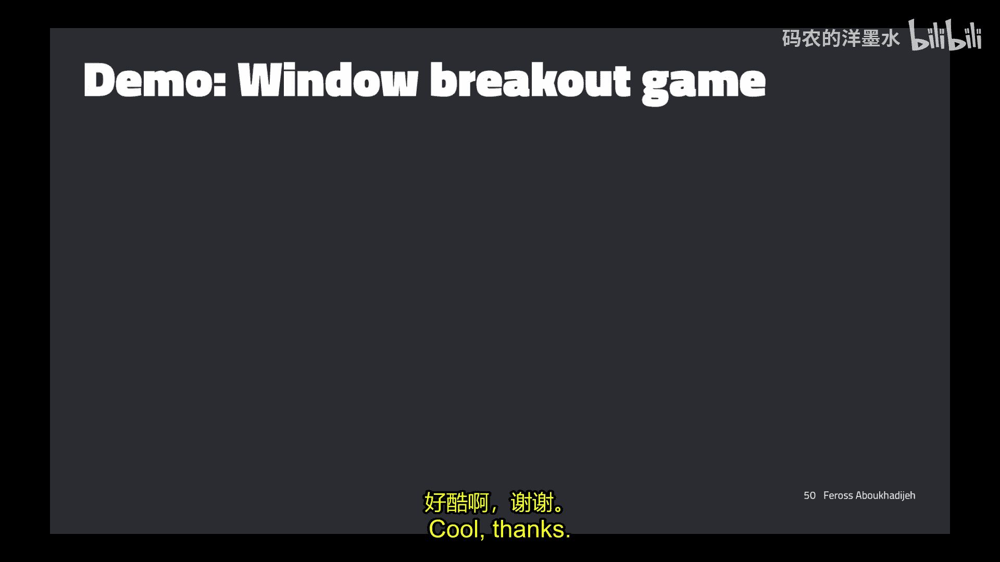