# 【全集】斯坦福大学 CS253 网络安全 中英字幕 1080P p02 Lecture 2 - HTTP、Cookies、会话 -BV1RemEBZEEM_p2-

Welcome to CS253 Web Security Le2， Today we're going to talk about DNS， HTTP and cookies。

So first some quick admin stuff， so assignment zero is out。

 you can go ahead and access that on the website。And I decided to drop one of the assignments in the class。

 so we're going to have a total of five assignments。That includes assignment zero。

 so after you finish assignment zero， there's four other assignments。

And office hours this week are going to be for me today at three to five in Gates 323 and Esther's having her office hours on Friday from one to three in Huang basementsement。

So let's start with considering what happens when you type a URL into your browser and press enterter。

So this is actually a really common interview question that is often asked at internships in Silicon Valley。

 but it's also a good way for us to start to think about。

What actually goes on in the browser and what this will set us up nicely for thinking of attacks on this process？

In the future。So。When you type a URL in a presenter。

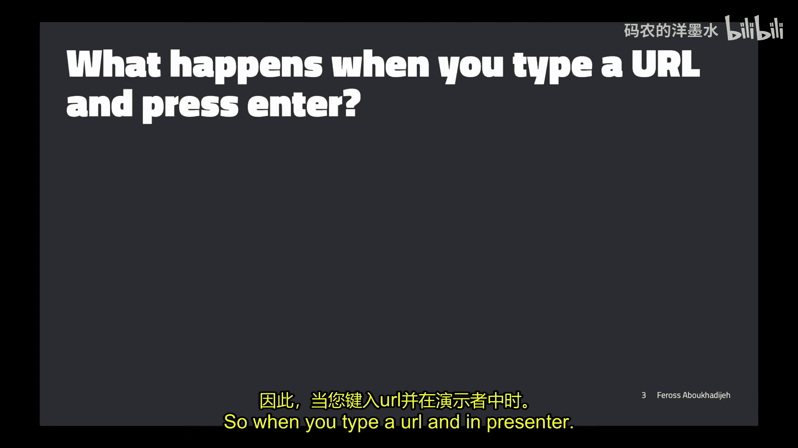

This can happen。But。

But know but really what actually happens is the first step is a DNS query。

 so the DNS system is a system that translates user friendly。Domain names into IP addresses。

 so IP addresses are the way we address all nodes that are connected on the internet and a domain is a friendly human readable string that we like to type into our browsers and so we need to do this translation step as the very first step because the browser doesn't know which server to contact until it does this translation。

So we'll go ahead and walk through that process so we understand what exactly goes on so at a very high level your browser makes a request to some server which we call the DNS server and the DNS server gets this message from the client and it's in the form of a query so the client is asking a question and the question is what is the IP address for a particular domain and this case Stanford IDDU and the server is going to respond with the IP address for that domain。

So that's the high level， but what is that DN server actually doing？

So this is a more detailed view of the process， so the client is going to we start off by sending that same query for Stanford。

edduu to the DNS server， but we're labeling this DNS recursive Rer now because。

What the DNS server does is it actually does a bunch of work on the behalf of the client when it receives this query。

 and we're going to take a look at what it's actually doing。嗯。The recursive Rer。

Is going to take on the responsibility of looking up the IP address for Stanford。

edu and doing whatever work is necessary to do that and then it's going to get the answer and send it back to the client。

And this process might take multiple steps and that's what we call it a recursive resolver。

 so this server is going to actually continually make queries to various other servers until it gets the final answer that it's going to give to the client。

Right， so anyway， there's these root name servers and these are hard coded into every DNS resolver and they're run by different organizations。

And so our acursive resolver is going go and ask that root name server for Stanford EDU。

 It doesn't know the answer because again， like this is this is a problem。

 there's just a problem with scale here。 like a single server can't keep the records for every single possible domain in the world。

 But what it does is it delegates authority to another name server that's responsible for just a sort of subset of of the names。

 in this case， the EDs are all managed by a different name server。

Now the recursive resolver is going to just go and ask the same question to the EDU name server and again。

 the EduU name server is also not able to handle a listing of all this stuff and so it's going to respond with。

 we'll go and ask the Stanford EDu name server and we go one level again and this name server fortunately can actually respond and this is what's called the authoritative name server it actually knows the answer to our question and it will respond with Stanfords IT address。

😊，Cool， pretty straightforward。What's worth learninging here。

 This is sometimes called the TLD name server because it's responsible for the whole top level domain of EDU。

And。So anything else I want to mention about this。IThat's it， any questions？

How many people have seen this before， maybe okay。Yeah， cool。

So now we have at least a partial initial answer to the question。

 what happens when we type the URL and so we do we talk to this recursive DNS resolver。

 it's going to go and talk to the root name server， rootot name server responds。

 then we follow up the recursive Rer follows up with the TLD name server。

 which responds and then we go again until we hit the Stanford server which finally can respond with the IP address。

Cool， so now's throw an H TP into the picture。 So this is what it's gonna look like。 So， you know。

 we're not done when we get the I address of the server。 Now we actually have to connect to it。

 So now when we get the I， we now know， this is the server we need to talk to。

 And I guess I changed the I address here。 But this is the Stanford I address and。😊，Once we know it。

 we're going to make an H request to it and get back a response。Cool。Now， given this picture。

 can anybody tell me。Can you think of any kind of an attack， maybe on this this architecture。

 if you were trying to attack a visitor who's visiting Stanford EDU。

 what's something you might do could be anything。嗯。Somehow。そそ。The computer would think about this。

Yep， totally。Yeah， that's right。 Yeah and you should be connecting to the wrong server in that situation that particular attack is actually quite easy to do because these queries are in plain text。

 So anybody who's any sort of device on the internet between you and that recursive resolver can insert itself in there and when it sees that you're making this query。

 it can just decide to not pass that query onward to the next note in the network and it could just itselfre to you and then you'll go ahead and connect to the wrong server that's totally right but you had another idea I was thinking you can attack the。

😊，This particular HDP response。Like modify it insert search。Yeah， that's totally possible。 Yeah。

 so that' do you know the defense consent？Okay， anyone else want to multi that Yeah T T。 Yeah。

 so we're gonna have a lecture on Tl。 but basically Tls is an encryption。

 It's when you see Https in your browser。 And what that gives us is a couple of properties that are really important one is integrity。

 which means that the response can't be modified if it's modified then the client will be able to tell And the other one is authenticity。

 which ensures that we're talking to server that we think we're talking to。

 So if anybody were to try to insert themselves in there like you suggested and send back a different response。

 we wouldn' have trusted that uses signatures， which if you want to learn more about you should take 255。

 which is an amazing class。 But yeah， so so yeah， we can interfere in in the HDP process or in the DNS process totally are both both valid things with Https of course。

 like I said， will be able to detect that somebody has sent us to the wrong server But one thing that's interesting is。

😊，Let's see here so yeah if you're。If you've inserted yourself in here and actually have a picture of it。

 oh no， it's it later。Yeah we'll' get to that in a sec so just to review some of the stuff we talked about so right。

 so you can change the DNS records of the target domain and point it to your own IP address and now when visitors go to the site they're going to be directed to the attackers web server。

And the motivations for this are like now you can basically load anything you want。

 and the user is gonna potentially think that that's the original site。

 so that's called phishing and you can collect users' passwords or whatever you want to do。

 there's also money making things like there's these jascript crypto miners which are pretty hilarious basically it' a bit of jascript code。

 you can someone put into a web page and it's gonna actually try and mine like typically I've seen it they mine narrow for whatever reason。

 I think because it's easier to mine not on CPUs。 I think that's the reason。

 but anyway it's pretty hilarious because you might get on a laptop just not very suited for mining cryptocurrency。

 but the attacker doesn't care because even if they can make like5 cents and burn $3 of your electricity in order to do so that's still five cents of profit for them。

 So that's kind of a pretty hilarious vector or attack that we see in the world and then of course。

 you can just like change the site subtly including including ads in the page or something like that。

😊，It's another revenue source。Yeah， so how do you actually go about doing this？Here's a couple of。

 of， of different places you can， you can affect DN S。 So one is directly on the， on the user system。

 So if you have malware on your machine， the malware can go in and just change your local DNS settings so that it's gonna。

Basically route a domain to a different destination than it should。

 You can you can actually just do this yourself on your own computer if any of you have ever modified the Etsy hosts file before。

's a way to basically say whenever I do a DNS lookup on my computer。

 I don't care what the true answer is， I want to hard code in this I address as the answer。

 which can sometimes be really useful if you're testing like trying to test your website and you want to just say like okay。

 always point it to my own computer when I type in my domain name or something like that。

 But malware can go ahead and change that。 And' that's really not good。

You can have the DNIS Rer itself get hacked and typically you're using the DNS Rer that comes from your Internet service provider。

 so in case here at Stanford it's just Stanford has like an IT team that provides this for us if that server were to get hacked。

 it could just start giving out wrong answers to everybody and our browser is going go to that wrong I address。

You can also have hacked routers and then the DNS name server itself。

 So that's the actual the thing that's responsible for let's say Stanford。

 EDu if that things hacked and is just going to give out the wrong IP address， that's another issue。

And then lastly， you might have a company that you're paying to provide this DNS name service for you。

 and if your account there gets hack somebody can go in and of course change stuff。

 so this is a little bit the flow in that situation， so you have a hack Diness resolver。

You have the request goes to it。 it responds with the incorrect IP address。

 and then your browser just connects to the malicious server。There you go。

We mentioned HTPS S might help us here。 So how might HTPS help us here。Anyone have ideas yet。あさ成し。はさ。

sir。嗯。That's correct， yeah， so to repeat， I mean， if your browser is expecting to get back a certificate that says。

 we'll talk about this stuff later， we're getting a little ahead of ourselves here by getting into the details of HTPPS。

 but I think it's okay。So， so if there's a way that this server could where the browser expects the server to prove itself to the client before it trusts it and before it sort of gives you the lock in your browser。

 basically， then we would be able to know this happened the interesting like。

Kind of wrench that gets thrown in here is that there are services like Lets encryptrypt which provide free certificates to anyone who can prove that they are in control of a domain right And so if the attacker is able to make it so that when lets encrypt encryptpt or any provider who's gonna to issue these certificates。

 they can make it so that when they go and check like what is the server that Stanford E is pointing to and they get back this wrong answer。

 then that provider is going to now connect to the wrong server and it's going to issue this challenge to the server it says prove that you want me to actually issue a certificate right now and the attacker will say。

 yeah， of course， issue the certificate。 Give me that please。

 and now they have a certificate that they can provide in this response that will make your browser trusted。

 So this is actually really bad。 even HttPS it's normally used can't help you at all here。

 So it's really bad。😊，Yeah，Does that make sense， everybody。Any questions？So when you say。

It what happened？It's an actual certificate。By company。Yeah， so we'll have a whole lecture on this。

 so I apologize for getting a little ahead of myself here with this， but。But basically。

 the way to think about it is there's a company which if it can prove。

 if you can prove to the company that you're in control of a domain name， right。

 then they're willing to say， okay， we proved like we're convinced that you own this domain So what we're gonna to give you is basically a file。

 it's just a text file that's a certificate that you can now the person who owns that domain can now attach to all the basically attach something to the response that they give to everybody and。

Now the client can know for sure that the person who sent this response is in control of the private key that goes with that certificate。

 and so basically they're the person who's actually running the server in question。

And so that's important because you know on the internet all these requests and responses are getting jumped around over many nodes and a lot of these nodes are controlled by completely different entities than the client or the server。

 they're just random companies or government agencies in some cases have can affect those nodes and they can modify those requests or like we were saying before insert searchs themselves in and send a different response。

 And so if they don't know the private key that goes with that certificate。

 then they won't be able to do that right。That's kind of the idea。 Does that make more sense。 Okay。

 yeah， we'll have a whole lecture on it。 cool， In fact， I'm trying to get。

 trying to get Dan Bonet to give that lecture because I think he'll do a really good job of that。

 But yeah， he maybe be one of our guest speakers。 We'll see， he's really busy。😊。

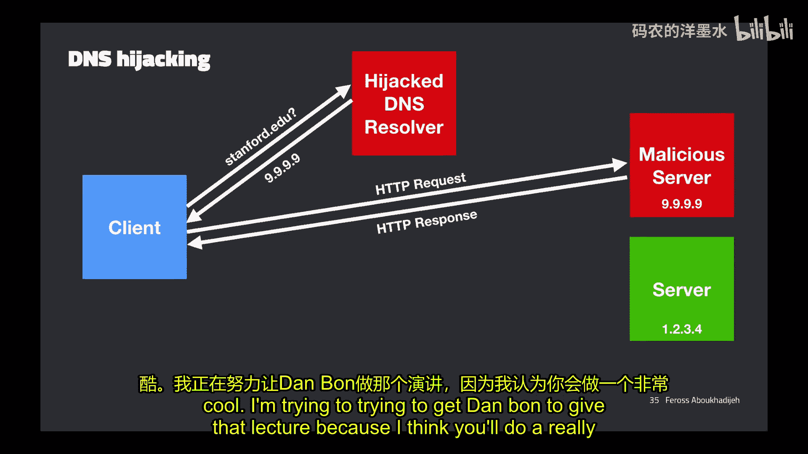

But yeah， okay， so， so just some some stuff in the news about this。 So a ton of education。

 like a ton ton of universities and and schools and stuff are affected by these kinds of attacks。

 And mainly it's to steal people's personal information。 So if you。

 if you can convince if you can trick like an administrator to。

 to go to a different site and log in there and you can get their credentials and steal everybodys everybody's socials and their payment information and stuff like that。

 And a lot of schools don't have like。😊，Don't invest in their IT infrastructure because they're not funded very well in some cases it's like one person who's responsible for a whole school district or something like that and so there's just like lots of misconfigurations and weak passwords and people just haven't tried to very hard to secure this stuff so yeah it's a huge huge number of attacks another place where you see this。

Is Internet service providers will actually do DNS hijacking。

 So you' you're moving your head up and down here。 Have you seen this before in the wild。 Yeah。

 I've sitting a along with like back in the day with like those browser toolbar。

 They would like hijack like。😊，Domas that wouldn't have， I guess。

 that wouldt be valid to point to their own search pages like So has。 Yeah。

 that's exactly what this is here。 So so to repeat what's going on here is that if you type in a domain that isn't valid。

 So it's like it should just return a browser error page to you like there's no actual server there。

 there's no record to find what these companies are doing is they're saying well。Well。

 why don't we just show you a page that's like more useful than an error page。

 right an error page is just like， you know， not gonna help you。

 but we can show you a nice useful search page with lots of nice。

 I guess those are yeah sponsored by， sponsored by， so on and so forth。 So it's it's like。Yeah。

 it's going to make them more money the bad thing with this is that。In this case。

 this is actually for a domain that exists。😊，Whi is a webcom called questionable content and they injected themselves in there anyway so their implementation is buggy so it's just a bad idea like this is like the kind of thing that an attacker is doing you don't expect your err service provider to be doing this to you but yeah you can and actually TOle does do this to you I have Tmobil and you can turn this off if you think if you go to the bottom or there it is why am I here you can tell them like stop this。

😊，But anyway， yeah， it's especially bad Comcast also does it as well。Yeah。Cool， so。

So yeah but in the case of， in the case of the IP doing it， one thing that's nice is they're not。

 at least they're not going and registering certificates for the domains that they're that they're hijacking。

 they're they're just they're sort of they're just responding with these， these error pages。

 if they were to try to do this to a site that was actually H T TPS right。

 they wouldn't be able to provide that certificate to prove that they are the true owner of the domain。

 right。😊，In this case， I think this is HTQP， you can see if they're in the URL。

 so that's why they're able to return a page and then the browser trusts that。Cool。

 any questions about this？Cool， so okay。So yeah， let's talk about now about just a few of the privacy things that come up。

 So we talked about security of GenS， but privacy is also a big deal。

 So we talked about how the queries are in plain text。

 And if you' if you're the server that's sitting there， that recursive resolver。

 just wants to like log every request that you're making to it。

 they can do that and they can produce these lists of domains that you've looked at basically and these companies。

 these internet service providers have been known to sell these lists so they'll say like。

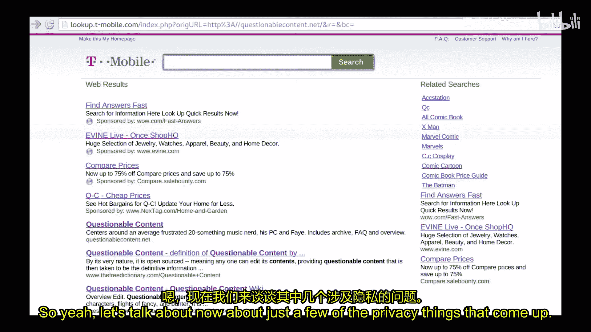

You know， the。This subscriber， this internet subscriber frequents these domains and that's obviously not something that you probably expect to happen or expect a company that you're paying to be doing。

 but this is possible because of the way the protocol is designed and the fact that those queries are in plain text So just personal trick you can do if you don't want this to happen is you can just set your DNS settings on your computer to a different company that you have to trust again。

 but at least certain companies have posted privacy policies that say that they don't sell your stuff。

 in particular this service right here， it's really easy to remember it's 1。1。1。

1 got that I address that's the Cloudflare service which provides DNS that doesn't they say sell your DNS queries to companies。

I think on Android they you can also。Oh。Is that。And接你们。Even if they aren't E provider， Yes， yes， yes。

 I was about able to mention that next。 Yeah， so what you're referring to is I think there's this there's this this sort of enhancement to DN S that's brand new that is is being developed at the moment called DN S over H T T P S。

 the idea there is。😊，We want to。呃。Enncrypt our DNS query itself so that people who are observing that query can't actually see it。

So in this situation here。Going back a second to the way So I was suggesting that we all use Cloudflare as an example as our DNS provider。

 we're sending these queries They're still in plain text， right， the difference is now。

 like now Cloudflare， when it gets this query， it's going to not save a copy of it and sell it to somebody。

 It's gonna send back the answer to us。 But but this communication is completely in the clear here。

 It's plain text。 So again， our ISP if they wanted to， could say， oh， well。

 you're not sending your DNS queries to us。 But what we see you're sending them to Cloudflare And we can we can just see the query。

 So we're gonna go ahead and still save that information anyway。

 that's the problem we're trying to work around here。

 So the solution to that is this thing that is called DNS over H T TPS。😊。

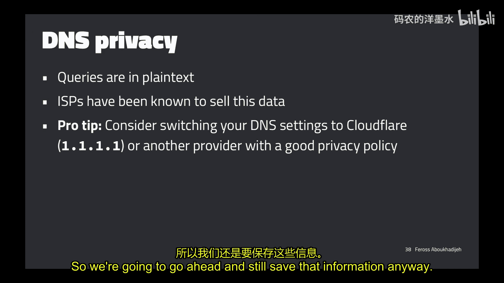

And the idea there is let's just make a connection that's secure。 that's encrypted。

 And then we'll send our a query and get a response over that。

 And that sort sort of solves this problem。 And Firefs just made this the default。

 So that's really nice。 It's not， it's not getting Chrome or any other browsers。

 though some of them are starting to test it out。 But Yeah， this is really cool。

 And the reason why this is particularly cool is that。😊。

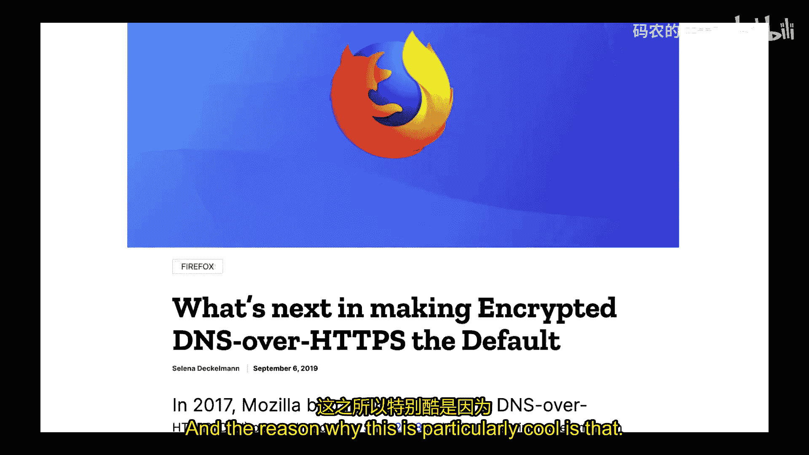

Even if you change your own operating systems settings to use this provider here。

 you end up the query still goes over unencrypted， so you want really DNS over HTPS for your whole computer but Mac OS and Windows don't support that so the next best thing you can do is just have the browser do it until that's supported。

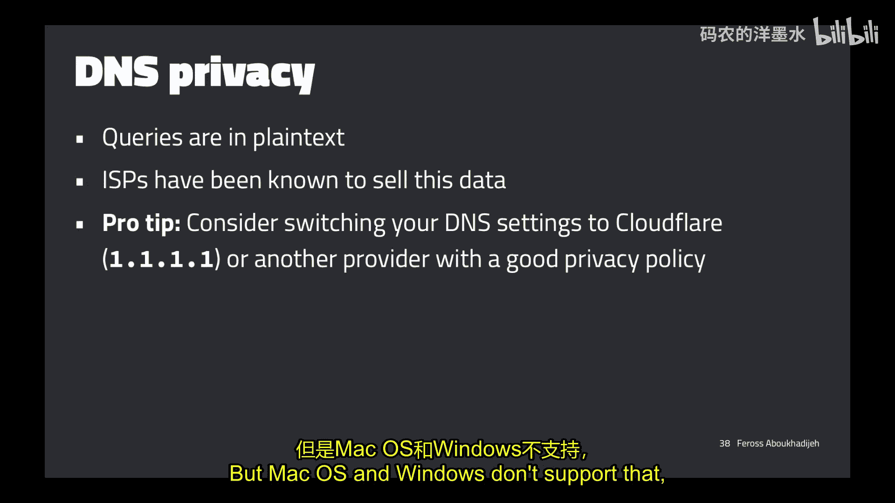

Cool。Somebody had a question I was just wondering more exactly。Every service。Yeah。

 they're a company that provides CN services， so they basically take your site's content and can put on servers all around the world so it's faster。

 and then they just sort of provide a bunch of these other ad on things like DNS。

 And it's a good question like how do they provide this for free。

 It seems like there must be some game going on there I would I don't know。

 just do your own research and see， But I think they're legit， they seem good。😊，But yeah，TP。Yeah。

 I believe it does。 Yeah。 So， I think the reason why my estimate is because DNS is UDP based。 Yeah。

 this is the using TCP。 That's right。😊，But it's kind of different。If I trust people in my network。

 they' not anybody else。Wai。What's the option like for？My route， if I just want my route。Yeahす知。嗯。

Yeah， you can do that。 Yeah， you， you can set up your router to actually do the of H TPS S。

 and then everybody who's after your router won't be able to see it。

 But then your local network will it'll be whatever people are using。 So you might。😊。

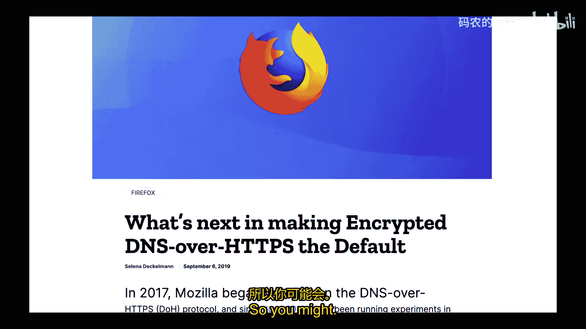

Reveal to them yeah。Cool， coolol。 so now let's let's look at our new picture。

 So what happens when we type in a URL。 let's get back to that question。 I mean。

 And so let's focus specifically on the H T TP part again。 So we have now we have our I address。

 know we know who we're trying to talk to。 our browser makes the request to that server and it gets back a response So something you've all seen or done before。

 But we're going to just make a request here here I'll make this bigger to Twitter and we can just see that's an H T TP request that we send and we just got back a response Is that big for everybody to see。

 So that's're just making an H TP request there if we want to actually view that。

 we should probably save it to。😊。

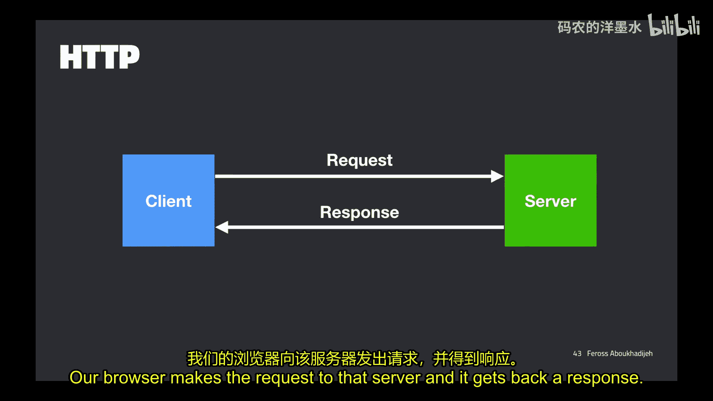

A file。Here we go， save it to an HTML file， and now we can open that up。

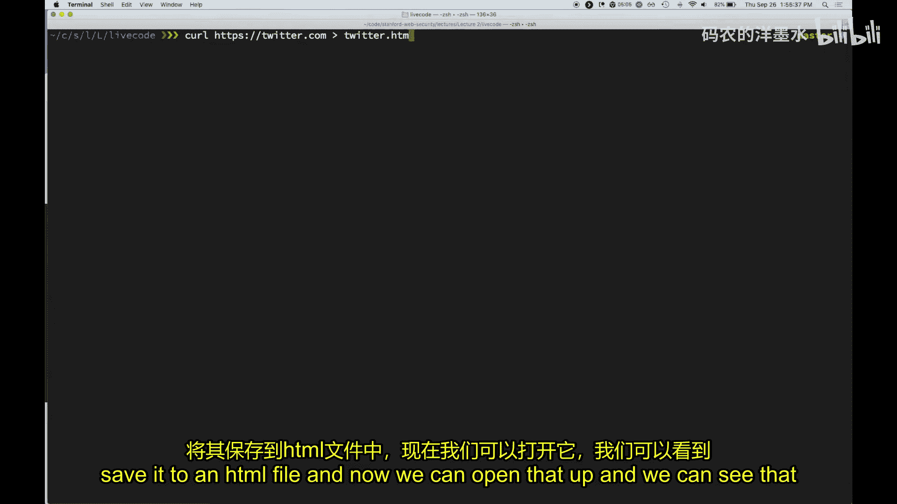

And we can see that we actually did， that's what we downloaded。

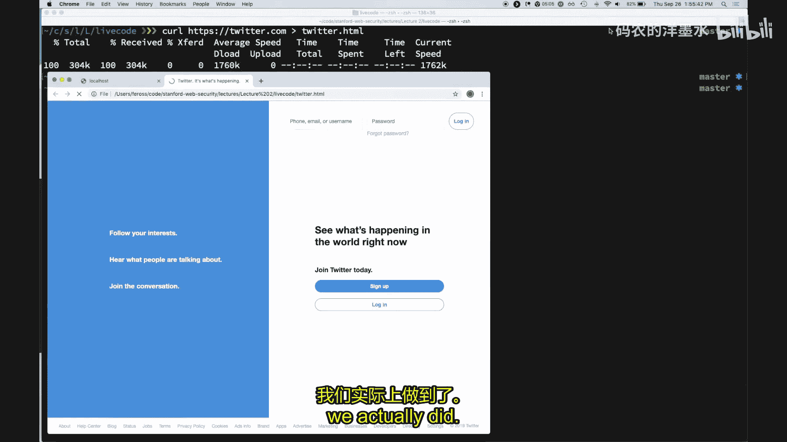

And we can see the URL there is off of my file system here。

That's pretty cool so yeah HTTP requests nice and simple so that's what's actually getting sent over the wire so that's just some text and there's just a couple things to point out the first line is the thing that actually explains the request and the file we're trying the resource we're trying to request and then we have these headers which are just key values that are underneath it。

😊。

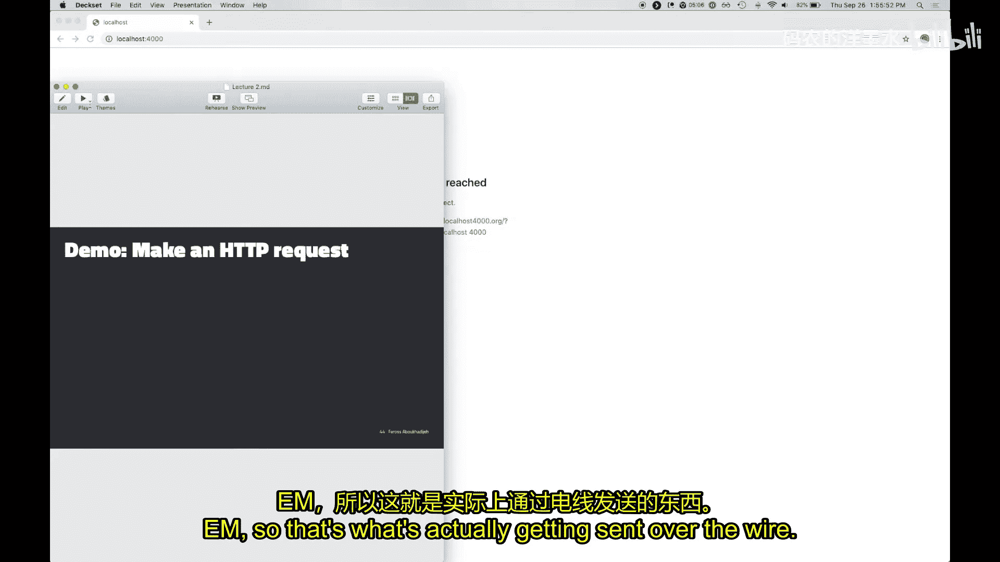

So the first bit is called the method。 The method is often gonna to be get。

 but there's also a few other types post put delete forgetting any there's a few others。

 I think and then we request a path and then we say what protocol version we're using。

 It's usually just gonna to be 1。1。 there are newer versions of H TTP like 2 and there's even three which is brand new。

 which is crazy because two just came out before that we had we had one and 1。

1 for like 15 or 20 years and now all of a sudden we have HttP2 and then a couple years after that three So the pace is picking up but。

😊，The good news is almost everything still supports HTTP 1。1。

 which is the version that is like most widely deployed。

 and this is a really nice version because it's all plain texts that you can just type these requests out in textual form they're very easy to read that's not the case for the later versions。

嗯。Cool， and then once we send this to the server， the server is gonna send this back a response。

 and our response is gonna be a file that we actually want to to view。 In this case。

 it's this H T L here that I've cut off。 but it's， it's also gonna to be preended with some information。

 some metadata。😊，And yeah， so let's talk a little bit about the， Yeah。

 So this is just the first line。 So again， just confirming that it's speaking the same protocol。

 And then there's this thing called a status code。 This is probably your view for for all of you because you've you've all hopefully taken web class。

 but。But we have these status codes and these messages。Yeah。

 so so let's talk a little bit about H TP。 Why Why is it cool， So we have the client server model。

 We have a client asks know asks for a request from a server， and the server applies。

 It's nice and simple。 And like I mentioned， you have this simple textual protocol。 So it's very。

 it's very easy to read。 And the headers are really cool because they enable HDP to be extensible。

 So you can add new features without having to， know。

 give everybody to agree on on a new addition to the protocol。

 You just sort of add a new key in value。 And if the server doesn't understand it。

 It just ignores it， right。😊，That's pretty cool。And it's also stateless。

Two requests that you make one after the other have no relation to each other。

And and last thing is it's technically transport protocol agnostic。

 what that means is basically that you can do HTTP over any kind of communication channel that you have。

 doesn doesn't have to be TCP， although TCP is what we typically use because that gives us like a reliable connection between two nodes on the internet。

Cool， so any questions about this， yeah。そ the？Re beenして。Like up to theservroton course。

Did they have a server？I don't know。 That doesn't expect stateless。Yeah， that's right。

 So if you wanted to， could could you could make your requests。

 you could make the order matter or something。 You could have a server， which is like， okay。

 every 10 visitor is going win a free prize or something and I'm going to count the requests。

 And then of course， now now there's some state that the server is keeping。

 But the way I would think about it is that you're building that sort of on top of the HTP protocol。

 The protocol itself isn't keeping any state。 So if you just say。😊，Give me HtDP。

 you're not going to have any kind of state that's being kept by the server。

 it's all sort of discarded。 And if you want to like。Serve on top of that。 keep state you can。Yeah。

 that's a great question， though， because， I mean， like typically when we interact with Web services。

 there's some state。 I mean， you know， when when I click a link。

 when I log into a website and then I I start clicking links， those later links that I click。

 I'm still logged in， right， So clearly clearly the server remembered something about me so that I could continue to view different pages and still be logged in。

😊，J， we'll talk about that at the end here and that's cookies。不。Oh yeah， so iss a for that？Yeah。

 so HDP is stateless。We implement stay on top。Cool。

 so just this is probably again a little bit more review。

 but we have these different categories of status codes。

 so everything in 200 is what you're going to see a lot of that's basically the service saying that your request that you made succeeded。

Anything in 300 means that we're redirecting the server redirecting you to another destination。

400 means that you messed up， and then 500 means that the server messed up。

that's way you think about it。So yeah， just a few highlights of the most important status code that you'll see。

 something fun。Just a less censored version of your last slide I saw。Oh really。Oh。

 is it like U F Jefferson？I I've seen that same way。Yeah。Anyway。

So yeah there's two main types of successes， so 200 is the most common but there's this other one called 206 which is given in response to a range request so you can make a request for a partial subset of a resource and then the server can say okay I'll give you I'll slice that part of the file off for you and give that to you can anyone think like why that's useful。

Where would that be used。sounds like this is it。Part so to give you。ts you don't get the whole thing。

 Yeah， that's right。 So say you want to seek to the middle of like a video or a song。

 and you just click in the middle before the browsers actually downloaded the whole video file。

 It would be nice if the browser could say like I know I want this file starting at byte offset know1000 or something And then it can make that request the server and the server can respond。

 say okay， there's the piece that you asked for So you can you don't have to wait for the whole file to download sequentially that's really useful。

 that's called a range request。Yeah， and。Yeah， and 2 of6。

 the reason why we do  two of6 responses there is because say that you make a range request to a server and the server doesn't actually understand range requests because remember I mentioned you can add these headers and this server might not know what the header means。

 It might be like a simpler server。 if a server doesn't understand this range header that you tacked on to your request。

 it will just want to want to do with it。 So itll just respond with 200。 Here's the whole file。

 and then your browser needs to be able to know， oh okay I was not expecting a 200。

 I was expecting a 2 of 6。 So this is clearly like a server that doesn't know what I asked it。

 and you need to sort of adjust your behavior according to that。Cool。

 so some 300 ones so there there's 301， 302， which basically are just a typical standard redirect to another URL。

The difference between them is that if you do a 301， actually， Does anyone know the difference。

 I mean， it says it there， But， but what is the actual behavior difference。

When your browser gets a 301 versus when it gets a 302， what is it going to do differently？I mean。

 can you just maybe？It's okay， could just guess。Yeah in the back I would guess that the next time you requested the cost rate。

Yeah， that's right。 So it won't even won't even bother checking the original URL。

 So if you like reload the page or you yeah it's basically doing a saving an association。

 like when I see this URL just don't don't even ask the server。

 the server told me it's permanently at this other place。 I don't have to But if it's temporary。

 it's gonna it's gonna ask it again because it could be that now it's in a different place And every time you ask it。

 it's gonna give you a different place So actually I implement it some random functionality on a website that that I have And if you do a 301。

 it doesn't work because so what you want is every time the user goes to slash random。

 you want to send them to a random page of the website if you do a 301 then any time they click random。

 it's gonna just take them to the first one that they got sent to So that's that's an important difference for that for that kind of functionality。

😊，Cool， yeah， and then the 304， this one is this is used when the browser has cache to resource and it wants to tell the server。

Hey， this is this is a file that I already have， but this is the version of it that I have。

 And like tell me if only to only respond if it's changed so you can make this sort of conditional request where you say。

 you know， so you're either gonna get back at 200， which means。

The request has indeed changed and the server is giving it to you or if you have the current latest version。

 then it will respond with a 304 and say it hasn't been modified since you last got it。

 you do have the latest version and it won't actually send it down to the browser。

 which just saves some time bandwidth for us。Any questions about these？Yeah。

When of that very time goes like。You make a query you get start。再去备。Like get。Yeah， so how you。

 so in the actual request， you're going to add in a header。

 we're going to actually get to that in say， you add in a header that says this is the version I have。

And then the server can sort of see that and it can go and check has it changed since you you can actually say like you can even do it by date。

 you can literally say the version I have was given to me at this time and then the server will only respond to you if it's been changed since that time。

 right？So you do have to change the request that you make if you don't include that it's always going to just give you a 200。

It's there。Kuo。Cool okay， and then the errors。 So these are just different variations of that the client gave you gave the server a bad request。

 It might be that you don't have permission to access it or。

Or you know you don't have the right password or something。 And then 4 or4， we've all seen that。

 That's just that the URL is wrong。But the important。Thing。

Think about these is is that it's the client that made the mistake， right？ So if the server。

 if the server makes the mistake， you're gonna get a 500。

 And so this is like sort of the server telling you like I I I don't know there's some kind of like uncut exception。

 for example， you give back a 500 in that situation these last three are interesting because they they have to do with proxy servers。

 So let's see。Yeah， the thing I'll say about that is just that it's often common in the you know。

 real world to configure a whole swarm of servers， like a whole bunch of them。

 And then you want to have them all appear to the user as one server。

 And the way you do that is by by having a server sit in between actually have a picture of it。

 I think somewhere here。 there it is。 Yeah， So yeah。

 so you can have a situation where back here you have potentially hundreds of different servers。

 This is how big web server scale。 And then the user doesn't know about like which particular server they're talking to。

 but they send a request to。To the main server and that server proxies through the request to a backend server。

 right？You can imagine a lot can go wrong at this stage here right so what if the server that the proxy sends the request to is down。

 how long should this proxy wait for a response right？

What if there's all kinds of different ways this can fail。 if yeah。

 so it could be that the server is online， but it' it's behaving poorly。 So it's like really slow。

 right And maybe we want to configure the proxy so that it has a timeout where it will just give up after a while because it doesn't want to waste one of its connections on this never ending request。

 So there's all kinds of ways it can fail。 And that's why we get those different codes there。

 So that gateway is the server is down service on available means it's temporarily down or overloaded。

 and then time out is it took too long Basically there's a bunch more of these， but。So。

 so why do we have these special codes， code numbers。 What， what's the point， Like。

 why can we just put a message。In the response that says what went wrong。

 why are we also adding a number？To the response so it's easier for programmers to like code how to deal with these different things a kind of standard。

So that one server says server is a proxy。Whatever another person says that， but with synonyms。

 you don't have to do natural language processing。Exactly exactly yeah。

 so like if I see that I got a 404， I won't try that again like it's the resources is not there if I get a 500。

 maybe I'll try that again， the server had an exception。

 I don't know maybe maybe it'll work later right but yeah the errors tell you different things。😊。

Cool， yeah， and then these proxies were used for a lot of different situations。

 The one we just talked about is this one right here where it sits in front of many servers。

 But you can also have a proxy who's taken 1 10 in here before。1，10。 Okay， yeah， so yeah。

 I know you all know about proxies。 but the kind of proxy you did in 110 is a client side proxy。

 So that was a server that sort of。😊，It does the exact same thing we saw there。

 but this proxy is not run a company that owns all these servers back here。

s rather it's run by it's a program on your computer or maybe it's run by your employer so your employer can filter out certain types of website so that you can't get distracted at work or whatever。

Yeah。Lea it at that。So okay， so back to HTP requests。Yeah， so I want to talk about headers now。

 so we have a couple here the host in the user agent。

 but the general format is it's a name and then a colon and then a value， that's how it works。So。

These let the client in the server pass additional information that's not actually part of the response。

And it's basically a map of keys and values， and like I said before。

 it's really cool because it lets you just sort of throw in additional headers in there without getting all the browsers and everybody to agree on changing HtKP。

So just a few highlights of useful ones that you're going to run into that you should know the first one is hosts that's the one we saw before。

 that was the one that was right there saying hostexle。

 Tom that one's really important most servers won't even respond to you if you don't include that so that's just the name of the server that you're trying to talk to。

And then there's user agent。 that is the name of your browser and operating system。

 so that lets the server know who is who's a calling basically at the server。

 This is actually really useful for detecting like when someone is when a visitor is a search engine。

 So like for example， when Google requests a website it'll say I'm Googlebot。

 it's actually what's called Googlebot。 And then the server can know， okay。

 let's Google crawling my website， I can see they're visiting that URL and URL and that URL and。

And that's pretty interesting。 you can just if you ever have a server。

 you can just look at those requests coming through and it's fascinating to see the different user agents that are visiting your site。

 know you can can really there's lots of random startups that have like really weird names that are like trying to build Google competitors and you can see them crawling your website trying to download pages you can see when someone's using curl like I just did right and you can actually sometimes use this to block requests that are that looked malicious or someone's misbehaving know。

😊，The other day， someone was。Running a thing called like sight slurper。

 trying to download like whole one of my websites entirely， just slurping all the pages down。

 And I I just said， okay， if user Regs includes site slurper， like， no。But yeah， anyway。

 there's some stuff you could do now obviously but they can control that user agent header。

 so it's not that good of a defense， but it's something at least if they're that obvious。嗯。Yeah。

 okay， and then refer is cool because that tells you basically the page that a user was on before they requested this page。

 right？So that's really interesting that's how you can figure out like how a visitor got to your website。

 who linked them there basically and you can see how many people are coming to your site from that other destination and then like obviously notice I mentioned here it's misspelled so the time when they were making this the spell checker on like Unix or whatever system the person had didn't have either this spelling or the other spelling in it at all like it just didn't know about the word refer。

 so the person just spelled it wrong and then from then on everybody was like we could change it。

 but then we all have to change all of our code。I'll just leave it。So now if you read about HTTP。

 like all the specs and everything just haven it misspelled。

 that's just what it is in in the HTTP world， that's how its spelled。Yeah。我在。😊。

That' someone said something anyway， but yeah， so it's like。

Sometimes it's just not worth it's just not worth the cost， the pain。 you know。

 just for some aesthetic thing。 And that's actually the story of the Web，Honestly。

 is like any time they can make a decision to like do things right or do things like。Easiest。

They choose easiest， right？It's better for compatibility。

 it's better for not breaking old websites and stuff like that。Yeah。

 so there's good arguments for it， but yeah， it's also kind of gross。😊，Okay。

 and then and it's cookies。 So we're gonna talk about this if we have time。 hopefully， yeah。

 so cookie is basically， it's a it's a header that you attach to your request。

 And it's basically you just。the server gives it to you in a response。

 and then the idea is once you've gotten that， you just tack it on to every request you make in the future right so we'll see the corresponding one that goes with this。

 So there's a header that the server can give you that's called set cookie。 And then some value。

 And then when you get that you basically save that on your machine。

 And then any time you go to that same server again。

 your browser will just tack it onto the request and say this is what you gave me before。

 Here's the cookie。Okay， and that's how you stay logged in。

 The server gives you some kind of a token， and then you tack that onto your requests。

 And then the server is like， okay， that's you， right。And then range I mentioned that before。

 so that's how you subset a request。And then there's a whole bunch more here， you know。

 you can control the cache， you can say only give me a response if it's been modified since this date when I got it before。

You can control the underlying TCP sockets that's kind of crazy。

 you can say like when this request is finished and I've gotten the response。

 don't actually close the connection to the server。

 keep it open because I might send more requests over that connection that's a performance thing and then you can also say like what kinds of response you can accept so you might say like I only want HTML back please or if you want you can Gzip the response which will compress it and you can tell the server like I understand how to unGzip it so feel free to G zipip it you can also say I want the language a particular language back and it it'll change the pa based on that。

So cool。 I'm going to show just。

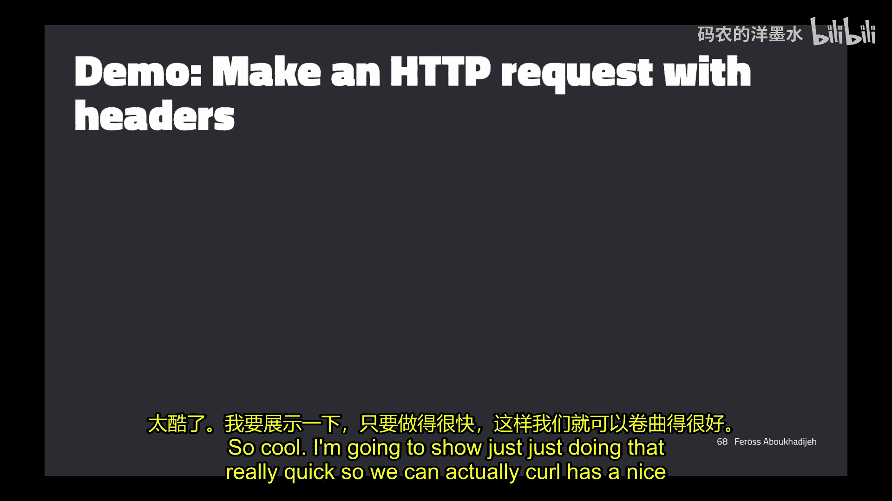

Just doing that really quick so we can actually just curl has a nice way of doing that。

 you just say curl， you say curl。Twitter do。Can't type Twitter， oh my gosh， okay， Twitter。com。

And then we say header， we can say accept language。

And let' let's try to get back a Spanish response So if I do that the problem is there's all these tags like all the trending hashtags are here。

 so like blind King or something but what I want to do is I want to just filter this out and just look for a particular phrase that I happen to know is in there called JavaScriptscript and I can also add silent here to get rid of the。

The output with the downloading。 So now if we do that。

 we just get this little part here that's telling you who knows Spanish isn't want to translate this for us。

 What does this say， say。Detect that JavaScriptscript is。Disactivated。Browser。Okay。

 so it's giving them a link click to go to old Twitter that doesn't need JavaScript。Cool。

Soops now if I change this to like。AR for Arabic， we'll get some cool Arabic script。 Yeah。

 and mean you can just put anything there。 But yeah， that's kind of cool。

 it's just that easy to attach headers。😊。

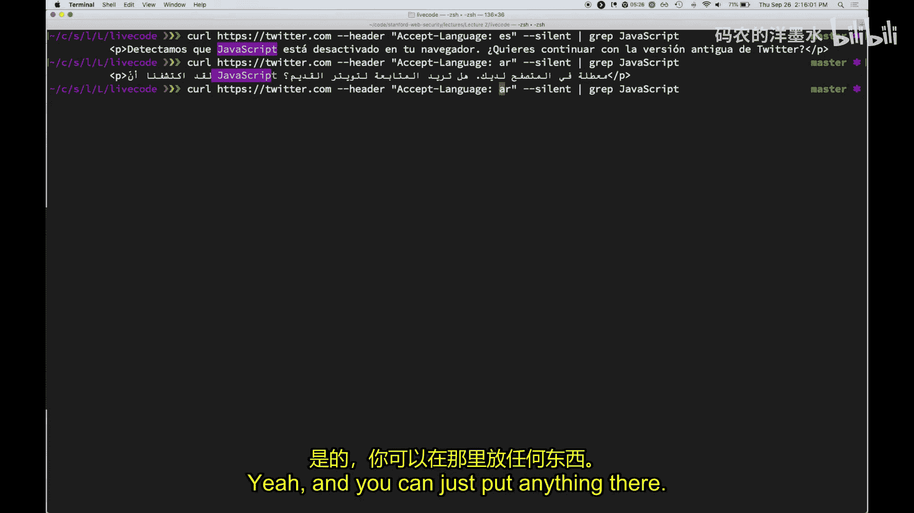

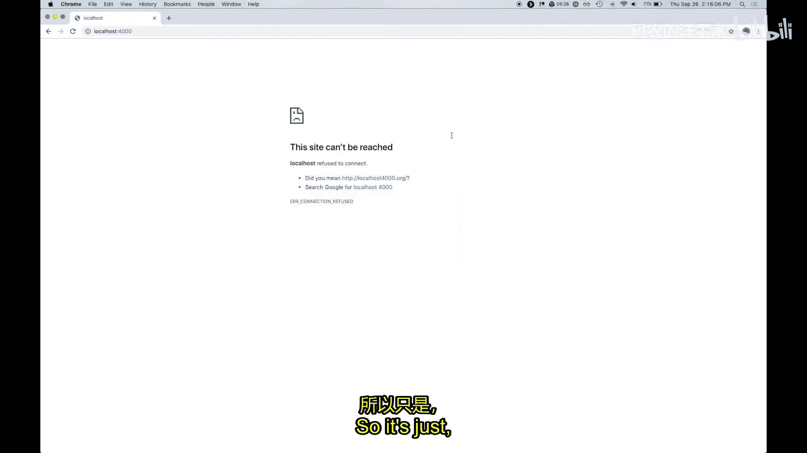

Cool。Cool， now let's talk about the response headers。

 So the server can tell you a bunch of useful things in the response。 One thing。 So so here's。

 here's a few we'll go over。 So date is just when the response is coming back。

 Last modified is like when the file was last changed according to the server。

 you can use that in your。😊，In your future requests to say only give me if it if it's changed since then。

 and then again， you can control caching behavior so you can say like please never cache this。

 that might be something you would want to say if it's some information that you don't want to be saved onto the user's machine and then expires is a way of saying please delete it from your cache after this date because I know that I'm gonna have a new version then so just don't save it after that date。

There is interesting so。Let's see， so very who hadnt even seen variant before like or know what it is。

It's really interesting。So can you think of any problems with caching stuff， like， say。Okay。

 so say that。Say that I visit Twitter， right， and I am I set my language to Spanish and。

 and Twitter sends down like a。Page， and they say， like， go ahead and cache this for a day。

 Like we know it's not gonna change the site will be faster。 So just keep cash for a day。

 And then I log out and somebody else uses my browser and logs in and they they have Arabic as their language set And now they make a request for that page issue there is that now that request might match that page that's already in my cache that is。

 is in Spanish right， And they're making the exact same request。 They're requesting。

 say the home page， right， And so。How does the browser know that it shouldn't reuse that cached version that's in Spanish for the Arabic。

Page request， right？That's what the very headers for。 So what would you do， Well How would you。

 How would you use the very header to。To fix things。Anyone think， how you do that？嗯。

Is that cluttered。Yeah， so you say here which headers are。How let's say how have word。 Basically。

 yeah， which headers affect the response。 that's what it says here。

 So you'd say like basically if so when you save this， when you save this and cache it。

 remember to look at the listed headers that are in here and save that along with it and。

Next time you make a request， compare and see if the headers aren't exactly the same。

 then you need to not use the cache version right。DoesThat make sense？Yeah， cool。Cool。

 and then then set cookie。 that just lets you set a cookie。 So， you know。

 the value is the cookie that the the browser saves。

 And we'll talk about more about that in a second。 And then we have location。

 So that's useful If you're giving back a 300 response and you're gonna tell the user to go somewhere。

 you do that by setting the location header。 So when you get back a 300。😊。

The client looks at the location， and then it goes to that destination。

And then these are all this sort of corresponding。Ones that match the things in their requests。

 so if you said I want HTML， the server can respond and say， confirm， here's HTML。

 or if you said I want Gps。Reponse， it confirmed you， okay， here you go， here's a Jesus response。

 so you should make sure you know use this to basically figure out what to do with the response。Cool。

😊，Diving in here， this is just sort of the protocol stack。

So I'll just expand the names there so everythings on is built on top of IP。

 that's just the way we connect to computers to each other。 Oh yeah。Yes。😊，Its怎么？Wired。

Yeah so they're not required I mean you could write your own HTTP client in fact。

 like we might do that like in a future assignment and you can just do whatever you want yeah。

 you don't have to follow it there's no enforcement of this this is just sort of。Yeah。

 the server is telling you if you want correct behavior basically， you should do this。Kol。Yeah。

 so anyway， the the important point here in this diagram is just to know that H T TP is built on top of the stack of other protocols。

 So the first step is you have to know the IP you're trying to talk to。

 And that's what we use DNS for。 And once we figured out the IP address， we， we open a connection。

 use TCP for。For actually ensuring reliable and ordered delivery of our messages and then this one here TLS this is encryption。

 so we're going to talk about that later but note this is optional right you don't need to actually use TLS and then HP is what you actually send over this socket that you created with TCP and then HP is typically used to transfer website stuff so that's HTMLl CSS and JavaScript。

 although you can transfer anything with it， but typically that's what we're sending to our browsers。

Cool， so what I want to show you now is just really a fun demo。

 It's basically what we're gonna do here。 I have the stuff up here。 Basically。

 we're just gonna make an H TP client like from scratch。 So it's not magic。

 It's really not that crazy thing to do。 You just make a socket to a server。 You know。

 the server's I address， right， You connect to it， and then you just send this text over it。

 and then you get back this response。 And it's it's not magic。 So so it it's kind of cool。

 So this is what we're gonna do。😊，This might be useful to you， if you're。

You're not definitely with node。This is a package that we're going to just import and what it lets us do is create TCP sockets。

So we use it by doing Ne dot。Creates connection。And it's going to take in an object。

 host is the IP address， or if we want to be lazy， we can just put in the domain name and it will do the DNS step for us。

 so I'll put in example。com here。And the port I'm going to put in is does anyone know the port Im supposed to put in here？

Yeah， so 80 is just it's the port phrase each TtP。That's just what it is。Yeah。

 so we're going to connect to port 80 of example。com， so then this thing gives me back a socket。😊。

And I'm going to take the socket and I'm going to write something into it。

So let's write in a request。So I'll define a request here。

And I'm going to use this weird string syntax that you may not have seen before。

 but this is called a template string， and we're not even going to use any of the templating features that gives us we're just going to use it because it lets us do multiline strings so I can use new lines in my string。

So I'm going to type here， get slash， that's the homep page， I'm going to get the homep page。

And I need to include a host header。Otherwise， the server won't know what we're asking and then I'm going to add an extra new one here。

 so I'm going to do one， two new liness。 That's how the server knows that I'm finished with the request and there's no more headers coming right。

Cool。There's something wrong with this， though。Did anyone see something wrong with the way I've defined this string？

喂。Is new line wear？The beginning， yeah， there's a new line here。 I hit enter here。 So really。

 I should do that。 but I'm just gonna be fancy， and I'm gonna just cut off the first new line。

 That way， I can keep my requests like that。 Now I also note note， I can't tab。

 I can't tab here either because that those tabs are gonna be included in there。 So it's kind of。

 it's kind of weird。 Look weird， but there we go。 that's， that's a request。 Okay。

 now how do I get the answer out。 So。The easiest way is。

 so this is this object that it's that this object here socket is something called a node stream。

 So this is an object which will over time， emit data that it's received from。

From the server that it's talking to。 So everyone see what's going here， The right call。

 What we're doing here is we're sending data across the socket to the server。

 And now to actually read the data out， what we could do is we could like listen to do'll just do it this way。

 We'll， we'll pipe。 And what we do is we have to tell a destination where we want the response to go。

And we can just do standard out。 that's the easiest thing to do。

 So what we're saying is just print what you get from the server out just like that cool。

 so now it's run this。ItWas it called HTTP request？Cool， oh， no。

The chunk argument must be one of type string or buffer received type object。

Does anyone see what I did wrong here？I wrote the string and then I piped it to stand it up。Hm。I out。

 write request。

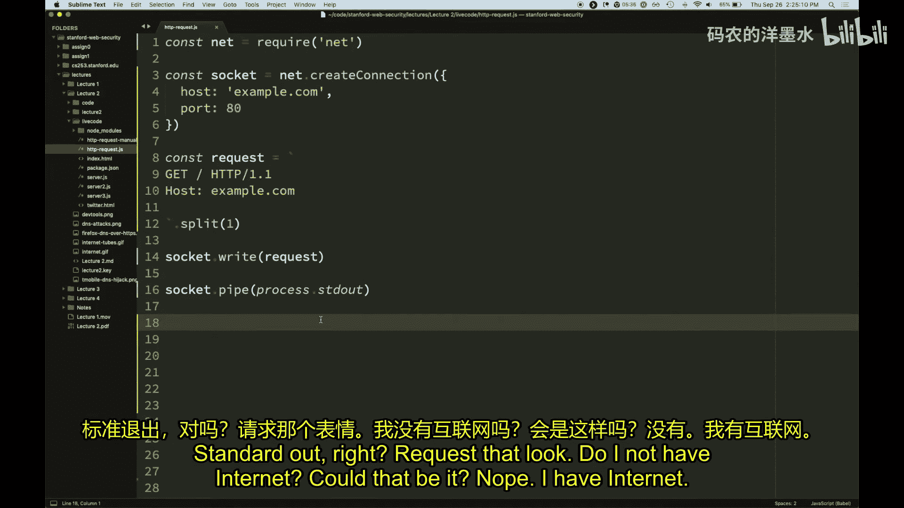

look do I not have internet， could that be it？

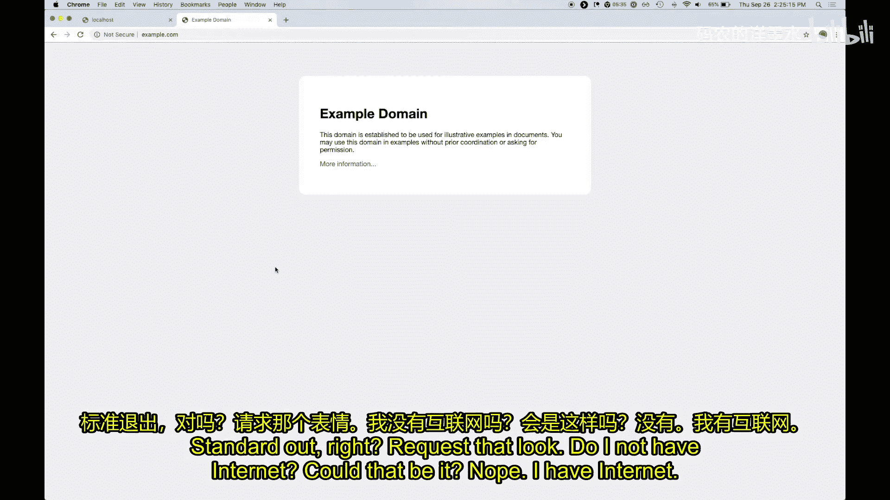

Don'拍 in来。嗯。Oh yeah， let's look at the area。 Yeah， on handle error。

 the chunk argument must be one of type string。Or buffer received type object。

That is some kind of a extreme error。 Why would I。What what does Oh， sorry， I meant slice。 Sorry。

 I use the wrong function。 Thank you。 Yeah， I wanted to slice off the。 Yeah， sorry， Good catch。

 who who caught that。😊，I appreciate it。 Yeah， thank you。 Yeah， cool。 So now let's try it。 no。

 not that command。 This command。 Okay， cool， So what did we get back。 We got back， notice。

 we got back the first line， which tells us that our response that was 200 It was successful。

 got a bunch of headers。 And then we got a new line and a new line。

 And that delims the the headers and the body。 And then this is our body right here。

 This is our response。 It's H TM L。 cool。😊，Does know why， know why it's hanging， though， Like。

 why hasn't it， Most scripts will end when you。When there， there's nothing left to do， right。

Why ishy is it hung？Sockets still open， yeah I didn't close it yeah so I could close it if I wanted to but or the server could have told me to close it if it added that connection closed then actually I don't know if node will read that and close it for you or if you have to do it。

 but anyway， yeah it's not getting closed so that's the issue。Cool。

One thing I want to point out is like， if I remove this host header， what's going to happen？

You'd think the server would know what to do， right， Like， I connected。

 I literally connected to the server with the socket。 I sent it this request saying。

 give me the homep page， right， Why wouldn't it just give me the homepage， for example， do com。

Like it's the example。com server， right， shouldn shouldn't it know？Different domains。

And they just served it。Yeah， that's right。 So that so just Turkey it's possible that one I address is hosting many domains。

 right， In fact， that's very common， right， You might have a server that can serve your。

 your blog and then this other side project thing you're doing and whatever。

 you might have 4 or5 sites all in one server， they all have the same I address。

 So if you don't tell the server what。Host you're interested in。 typicallyyp it'll just air。

 It might also just pick one and send you back a random one。 but look I think in this case。

 what's going to happen is it will just tell us it's unhappy with us see it'll give us a 400 batter quest and 400 means it was our fault。

So yeah， we'll add that in there。Cool， so and then so just one thing I want to point out too。

 is if we want to not rely on on this module to do the DNS lookup for us。

 I think it becomes even clear why we need hosts。 So if I were to do DNS， you know。

 require the DNS package here， we can do DNS do lookup on example com。And that will give us。

 has everyone seen this syntax before？This is basically me defining a function。

And these these are arguments。 and this is the body of the function。

 So I'm saying is look up example do com。 tell me if there's an error。

 And so I'll do if there is an error， I'm just gonna。Crash the whole process。Honestly。

 it's better than ignoring it。At least you know there was an error and then what do I want to do here so I want to take this is the IP address so what I want to do is actually use that in here I need to actually copy all this code and paste it in here。

There we go。 So oops， wow， I have some really weird shortcuts。 Okay， so yeah。

 so what we're gonna do is look up this exempt block com。 we' gonna get back an I address。

 and then we're gonna connect to that I address。 This is an I address。 and then。😊。

Now hopefully it's a little clear why we also have to tell it like what domain we're interested in here。

 so let's see if this code actually works。No。Oh， I put in a different file， Right。

 sorry I've been just doing it in the same file。 That's fine。 Yeah， we'll do that。你这个个。

The socket pipe。 Oh， thank you。Cool。That's interesting。Oh yeah。 Now there's spaces here。 Yeah。

 I just I mentioned that you can't have spaces there。 Yeah， so that's the problem。 That's nice。

 That's a nice problem to have， okay。😊，There we go， cool， got my response again。So that's cool， yeah。

 so you connect with an IP and then you tell at the domain you're interested in any questions about this？

Cool， yeah。 So HP is not magical。 It's pretty， it's pretty cool。 And。

 and it's really nice how you can just， you can just play this stuff with node。

 It's pretty low level。 You can just jump in there and do this stuff。😊，Any questions？Very going。Okay。

 so。

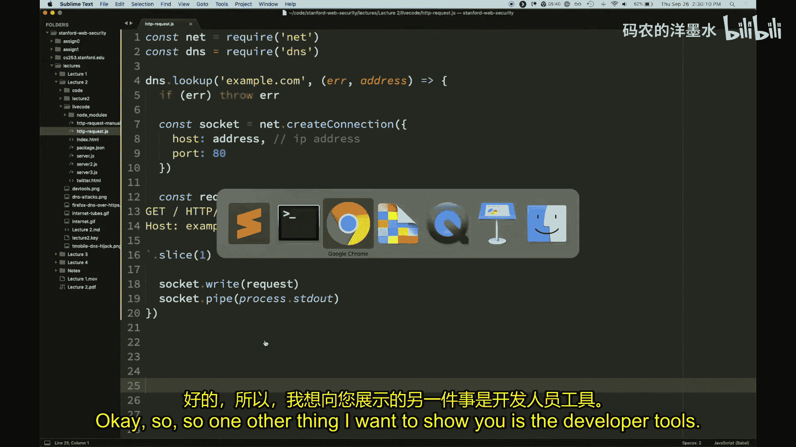

So one other thing I want to show you is the developer tools。

 This is obviously a really handy thing to know about。 So you can， on any page。

 you can right click inspect and pull this up。 and we you can go to this network tab and we can just see the same exact thing we just saw。

 So if I refresh this， we'll see。That。We got these we sent these headers and we got back know these other headers here in response。

 So this is just something to know that you can do this。

 It's really useful it's gonna be useful in the next assignment。

 You can just jump in and look exactly what what request the browser is making。

 So one thing I want to do here is I want to go to like a slightly more complicated website than example co Look if I go to Twitter here really quick notgged in I I okay good So if I go to Twitter you'll notice that this first request here was was made to Twitter do com got back at 200。

 And then a bunch of these other requests were made afterwards right Why did that happen。

Could you like this code in this wire page？Asking for more resources from other places like ads and stuff。

 Yeah， exactly。 So the browser doesn't just make the one request to ask for。 It gets back to H。

 And then that contains within it more requests for sub resourcess And so that's gonna happen。

 And there's this sort of a bunch of round trips that can happen right So it's really important actually for site performance that you sort of minimize the number of round trips。

 But there's gonna be at least at least like two because you're gonna request the Hml。

 And then you're gonna get a whole bunch of stuff like images and CS files and jascript files that're gonna have to follow up with。

 So yeah， just know that。

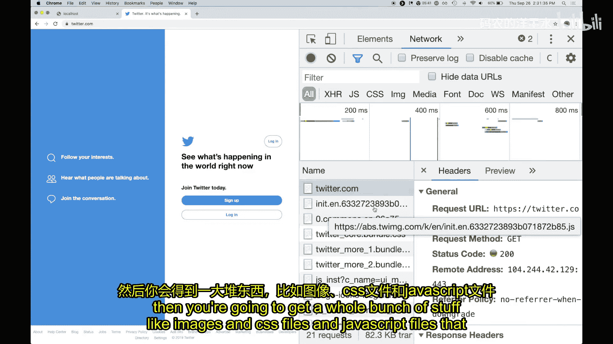

Yeah， so。So yeah， we can review now。 what do we know about happens when when you type a URL and press enter。

 So the first step is the DNS lookup， we're condensing it down into one line here because we know there's the whole recursive part that it has to do。

You open a socket to an IP on port 80， you send your request and you get back your response and then you display the response。

 except we just said we don't do that， right？Because the response is going to be just。One HTML page。

 and we know there's all these other resources。 So we actually have to do follow up requestquests。

 So that's what so this is what the full picture looks like。 We weread the response。

We parse the HTML to figure out what it contains， and we construct the dom。

 which is the document object model， which is all the nodes that make up the page。

 And then we render the page based on this initial dom。 It might be missing some information。

 It might be missing some images。 So there might be placeholders and things like that。

 But then we look at all the missing resources and we we set fire out a bunch of requests for those。

 And then we just keep repeating that。 we wait for the because the responses from those might generate more requests。

 and we just need to keep waiting until they're all done。 And then as they come back。

 we continue to render them into the page。 That's the full process。

And so there's like a full picture here of how that all works， so there's your DNS recursive step。

 you get back your IP of your server。😊，You now know which server to contact。

 so you send your request to the server and you get back your HTML for the first page。

And then now you've discovered a whole bunch of additional resources that you need in order to render the page。

So you fire off requests for those in this case， let's just say there's a CSS and a CSS file in a logo and then you get back responses for those at some point in the future and hot pink is a real color in CSS it actually is。

There's a whole bunch of like。Names of CSS colors， which are just like really wild。 Yeah。

 just like like completely random names。 It's pretty fun to look through the list。😊，Okay， cool。

We have like 15 minutes left before we go on to cookies。

 is there any questions about anything H TTP related or DNS related？Okay。

 so we're not going to have time to get too much into cookies。

 but I'm going to give you a little preview and we're going to get into the rest of it next time。

But so so cookies， the cookies is really cool。 So they let you do， like I mentioned before。

 they let you do authentication and like login and stuff like that。

 And there's all kinds of ways to attack cookies that are really fun and exciting。😊，So。

So this is how the server sets a cookie。 It includes the set cookie header。

 and then there's this key value thing with an equals between it。

 You can set whatever cookies you want that you want the browser or basically remember and tell you going forward。

 So you can use it for things like preferences the user has。

 Maybe you want to remember the user ask you to give give them a dark theme on the website or whatever。

 And this will just get sent by the client。 Now， every single request to the same server is gonna get this is gonna get tacked on to that to that request。

 So So let's actually。😊，Let's actually look at this。So。We're going to actually implement a server。

And C has worked。 So， so the first thing I want to actually do is I'm gonna make an H T file for a web a page that we're gonna serve to our。

 to our user。 We're gonna do here is we're gonna implement basically a login system using cookies。

 So you can see how to do that。 Hopefully， we have time to do it。😊，I can code fast。

 I think we can do it。Okay， so this page is going to just be it's going to be pretty simple。

 it's just going to say。Oh yeah， and we need to have， we need to have a thing that we're building。

 So what kind of aside side is this。 Let's make it a bank。 Okay， this is a bank login。

 So I better do good here。 Okay， so we're gonna say log in to your bank account。All right。

And so we're going to make a form。The form is going to post its response to a URL when the user。

Submits it。And let' let's say we're going to make a login endpoint。

 so this is just going to be a URL that will log the user in。Cool， so now in the form。

 let's put an input for the username。Just like that and we'll put another input in for password。Now。

 one thing that we can do with the password is we can make the type of the form actually password so that the letters they type show up as circles。

Unless you guys don't want to do that， you want to see my password， but we can do that okay。Okay， so。

Let's label these。This is not the nicest way to label these， there's a nicer way。

 but we'll just we need to go fast so you know ship it。Do it live。Een startup， you know？

This is a lean bank。Alright， so we have a submit button here for that actually logs these user in。

 and we named it login。 Okay， so let's see what this looks like。 I'm just gonna。😊。

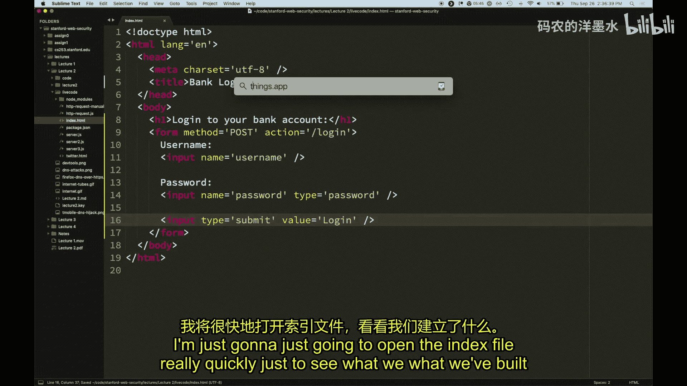

Just going open the index file really quickly just to see what we what we built。 Beai。 ship it。

 It's good enough to ship， right， I love it。 Okay， alright。

 so now now it's actually make the server component。 So to do that， I'm going use。

 see we could use the H TDP module， which is built into node。 It's just a little bit low level。😊。

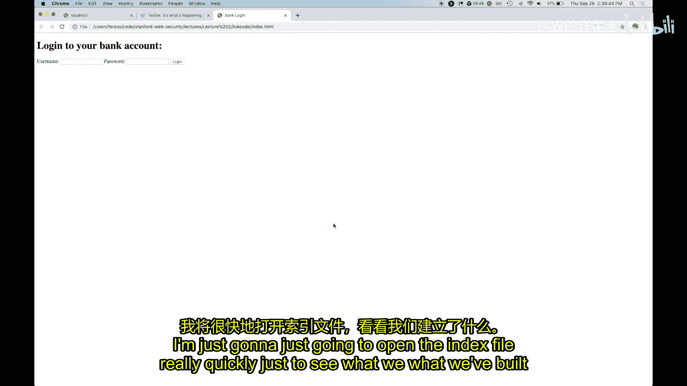

You know， I know we just influence our own H TTP server with TCP sockets。

 but let' let's say we want to go a little faster here。

 So we're gonna Ill use this package called Express。 This is just a a little sort of。

Light weight set of additions onto the node HTTP package that makes things like dealing with cookies slightly easier than having to make the headers ourselves and stuff like that。

 But it's really not。 there's not too much magic going on here。

So the idea with with Express is we need to。 we're basically going to make a server。

 And you do that by just instantiating。An instance of Express and then you actually have to tell it what port to listen on so we'll just say like start listening on port 4000 and now we have we've just made an HTP server Great let's let's test it out and see if it works。

 So the way we do that is we need to make what's called a route。

This is basically just a fancy like it's， you have a bunch of switch cases and you're saying if the URL that the user is visiting matches this right here。

 then I want this function to run。Okay。So I can add a bunch of these I could say later on we know we were going to need a login one right。

 because we want the user to be able to go to login。But there's one thing I need to add here。

 which is didn't we say we were going to post to login， not get？So we have to change this to post。

 so the server is going to say if somebody makes a post request and it matches slash login。

 then go ahead and run this function here to respond to them okay。

Now we need to talk about what is Re and res。So rec is the request and rest is going to be our response。

So with Re， we can learn things like what is the URL the users on。

 although I guess that's kind of obvious because it matched this。

 but you can also look up like other things about the request like the headers， for example。

 that's on there， stuff like that。Okay， so let's do。Let's see。 What do we need to do here。

 What I want to do is I want to load the home page。 So let's， let's import this thing called F S。

This is the file system module and I'm going to import a function called createate Readstream This is one of those streams like we had from before and what what's cool about this is I can actually so what this is going to do is open up a file called open up the index that HTML file and I'm going to send it。

Out to the response。So the only reason why we're doing this is what I could do here is I couldops。

 what I could do here is I could just open up this file and read it in to like a string。

And then I could write it out over the socket。 And that would work totally fine。

 The reason why I'm doing this is because this is just a slightly better way to do it。

 It means that what I'm doing instead is as I read pieces of it out。

 I send them across the socket as soon as I get them。 And so if this were say like a  one gig file。

 a ginormous file， right， I wouldn't want to like tell the user like， hey， please wait。

 I'm like reading this into memory using using using up a gigab Ram and then start to like proceed to send it to them once I've done that。

 So it's just easier to send it along as you go。 And that's what this is doing。

 It's typing it to the to the response object。😊，一。The curly braces you。This one， Oh， okay。

 So this is the equivalent of me writing this。 It's equivalent of me writing。That， so I'm saying。

 I'm basically saying get require F S and then pull this property off of it and then make it available。

 It's literally the same as this line。 Does that make sense to everybody。It's just a fancy。

 a little bit fancy。可对呢。So I'll leave this here。 I'll comment it out so you can see that。

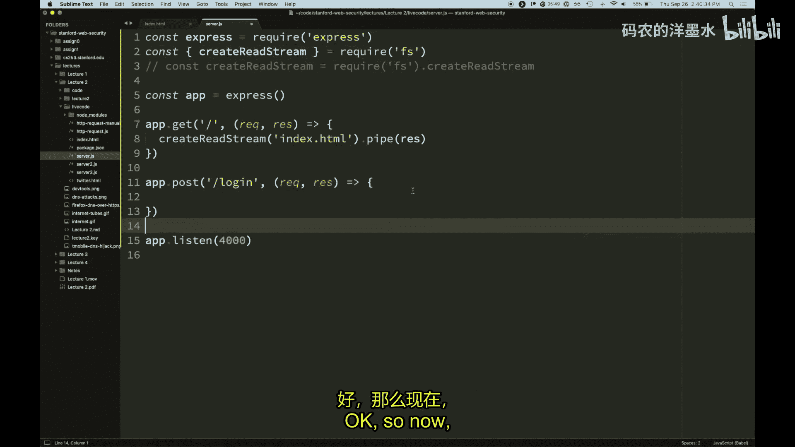

Okay， so now we should have a home page， so let me save this and let's actually start up the server。

 so I'll do node server。

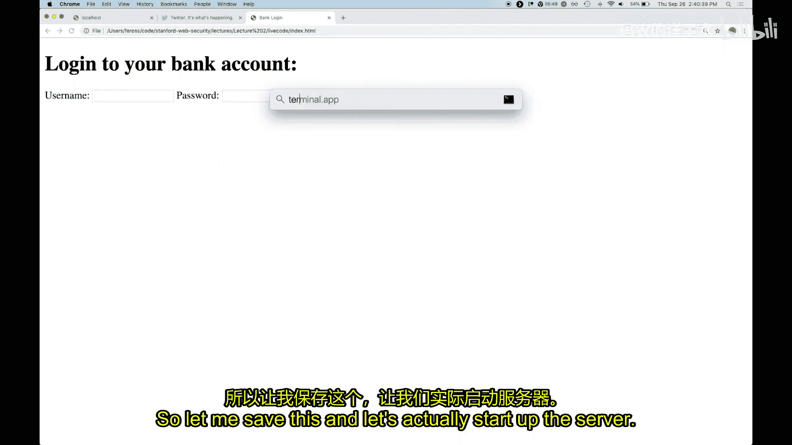

I could do server。 JS。 Yeah， so now if I go to my browser on port 4000。

 I should actually have a real server serving me the same pages before， okay。

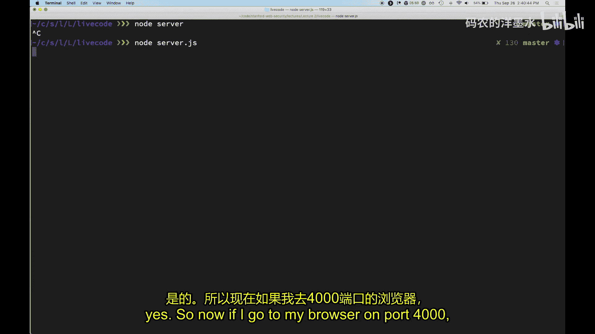

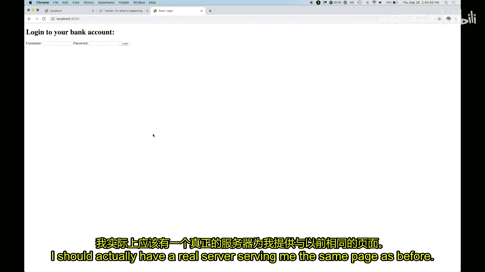

Cool。Now， what should we do？Well， we need to implement the login endpoint， right。

 Let's try to do that。 So let's， first of all， let's。We're going need to do one thing。 So。

 so I want to make it slightly easier to read in this this this whatever I submit here。

 So let's actually see what happens when I type in user here。 I'll type in Alice and passwordword。

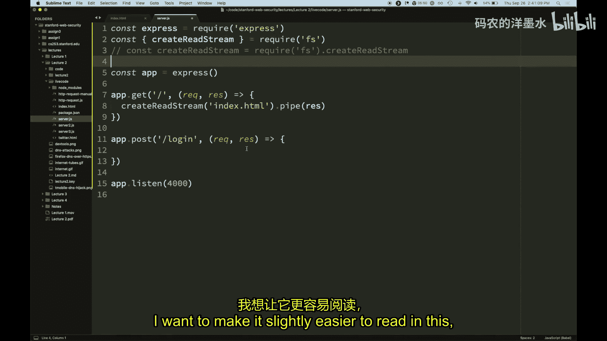

So if I log in。h， I should have done that before I， Okay， let me refresh， and I'll do it again。

 Alice password。So what happened here is I posted。Oh。This is hard to see， Let me。

Close some things here。Okay。So can everyone see？What I did so I posted to this URL and the form data is right here。

 It's this username and Alice got posted。 Now， unfortunately， it's not nicely formatted like this。

 It's more like this。That's what I actually got sent to the server。 Does everyone see that。

That's a little bit annoying， I don't want to parse that myself。

 we could but why so to to make it slightly easier。

 I'm going to import this thing called body parser。

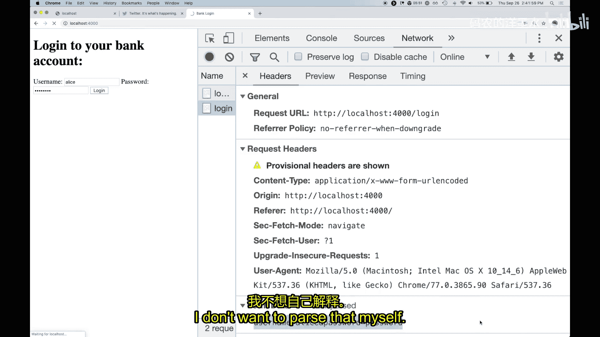

This is part of express that is shipped as a separate module。

 and so all what I do now is up here I'm going to tell Express to use the body parser。So。But's。

And there's just one option I'm going to pass here so it doesn't yelt me。

 It's not really important what that does。 but now what I can do is in here。

 I can actually let's console log out request body。

 So now there's this magical body property that got added to the request that's going to be a nice object with the key and value username password that the user posted to that URL。

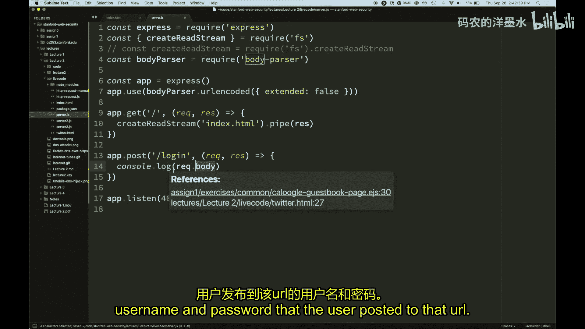

Okay， so now if I go back to my browser and I actually， I need to restart the server too。

 So one trick I'm going to do here is I'm going to use this thing called nodedemon。

 which will automatically restart the server anytime any files change in the folder that I'm currently in。

 So if we run that。

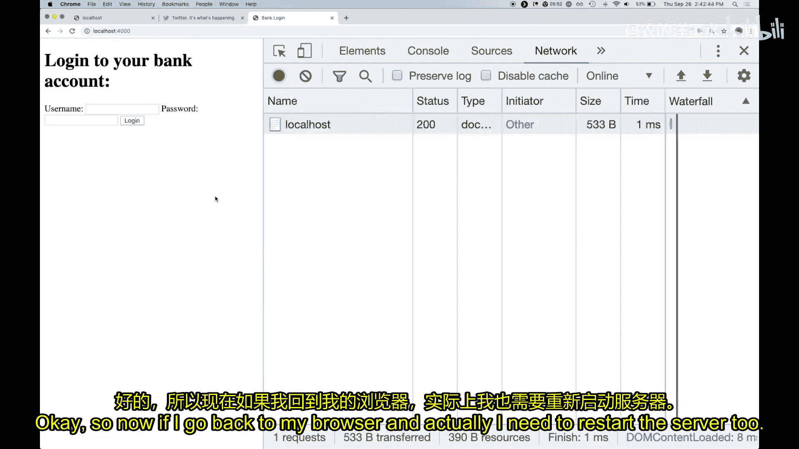

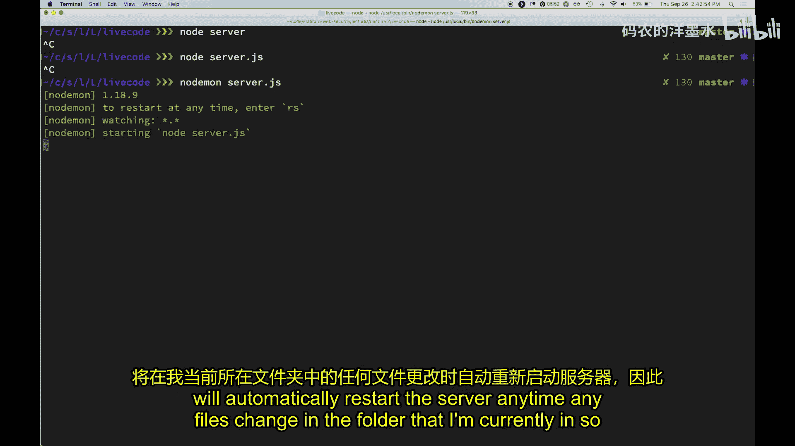

Now the server should have started up， and now I can go ahead and try that again。 so I'll type Alice。

And。I'm not going to tell you why I'm typing for my password， Okay。

 so that looks like it's submitted， oh okay。

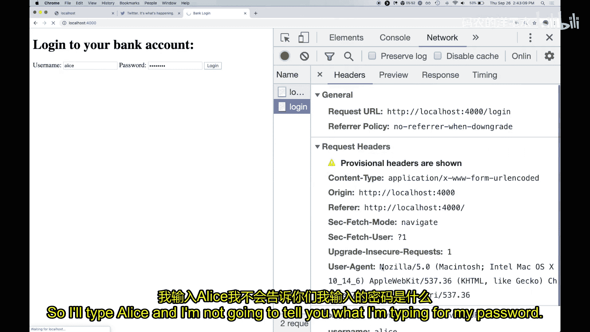

Dang it。Gotta be careful。 Okay， so， so now we can see here what happened is it printed out。

I guess that was from before when I reloaded the page or something。

 I don't know why that got printed， but this is what actually the request body is。

Right so now I have this nice object that can just get the username and password。

 so what should I do with this？Well one thing we can do is we can- let's make a user database。

So this is really fancy technology， it's called Object DB。So here's my database of users。Okay。

 what should Bob's password be， what's your favorite week password？Hundre2，2， hundred2， okay。Yes。

 yeah， that's a good one too。 Okay， so now we have two users now what I'm going to do is when the user goes to log in。

 I'm going to。Get the username off of the body。And I'm going to say， okay。

 so that's the user you're trying to log in as okay。

 what's their actual password well I look that up in the user's object。And now I know， okay。

 the user， they're trying to log in and what the real password is， and then I'm going to say。

If the request body's password matches。Password that it's supposed to match。

Then I'm going to on the response， add a header actually how about instead of doing that。

 I use the cookie functions it'll do for us。 it'll add the set cookie header。

 Now all I have to do is give it a cookie name and a cookie value。

 So what should we set here as the cookie name and value。Let's do something really， really naive。

At first。3。ふと他。But if we did signed in， then we wouldn't know who was signed in， right。

 username and the user。What was that？TheT signing。Yeah， yeah。

 so let's just call it username for simplicity and then that'll be and then it'll make it be the user's username that they're logged in as how about that okay？

嗯。So， so now now let's also let's respond with something。 Let's tell them， you know。

 if they logged in successfully， let's tell them， you know， nice otherwise。Let's tell them fail。Okay。

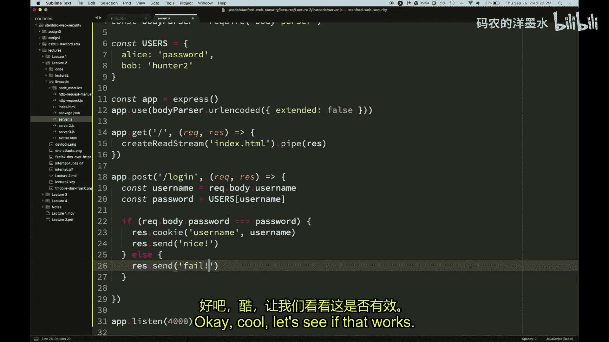

Cool， let's let's see if that works。 So it the server automatically restarted。 I'll just refresh。 Oh。

 wait， what， how nice are， Oh， remember， alright， refreshed， I resent the same。

 the same password I typed in before。 Okay， let's， let's， let's do that again。

 So I'll go to the homep page。 typey in Alice password。😊，Nice， okay， And if I do it again。

 but I do it wrong。

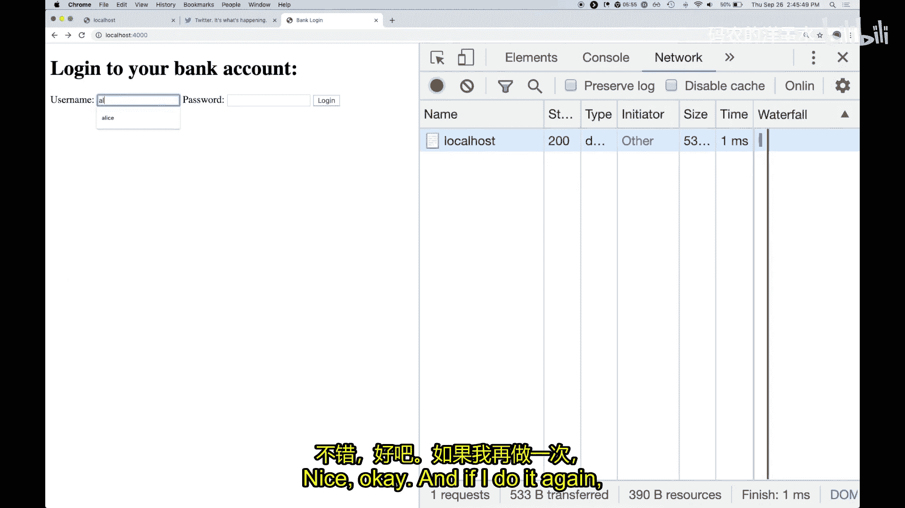

Fail， okay， so it works。It works。 Okay， so now now the， the， the， so we're detecting this correctly。

 But did we， do we see if the cookie was set correctly， We didn't。 So let's see what happened there。

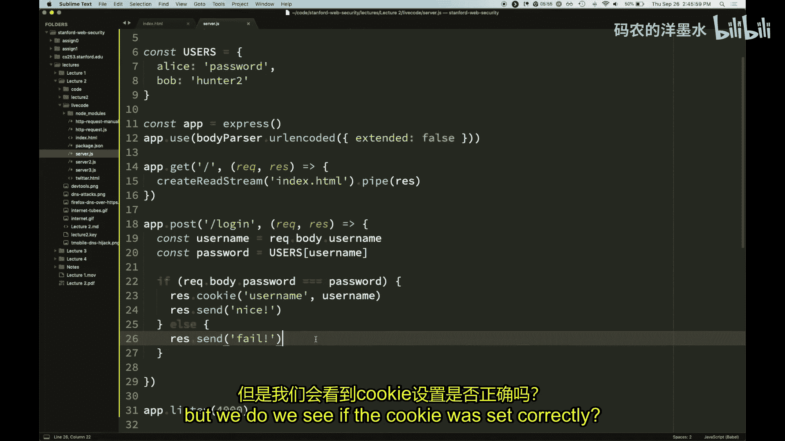

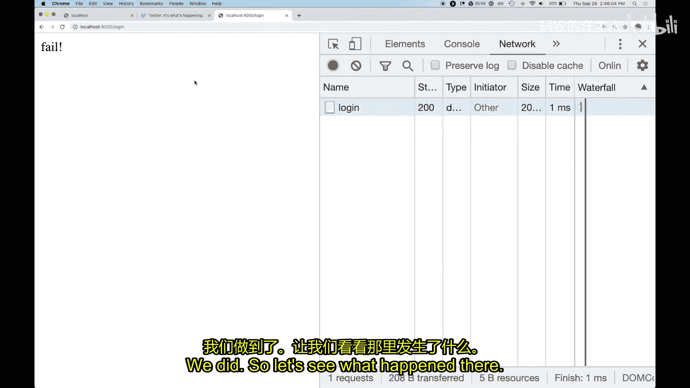

Right， so because remember we said if， if we get the password correct。

 we're trying to send this cookie down to them， right， So let's see if that worked。

 type Alice password login。 Okay， so now if I look at the request。

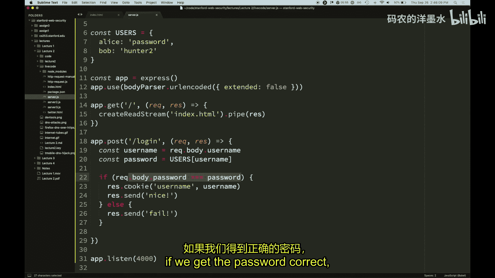

I should see in the response， set cookie username Alice。 Don't worry about Pa。

 We'll talk about that that later。 But， but this is the server telling me。

 remember that you are Alice and tell me that every time you talk to me again。

 So now if I go to the homep page and I and I load that up， we should see in this request。

 even though it doesn't look like I'm logged in because the server is not doing anything with it。

 the request should contain。Cookie usernameing Alice， which it does。

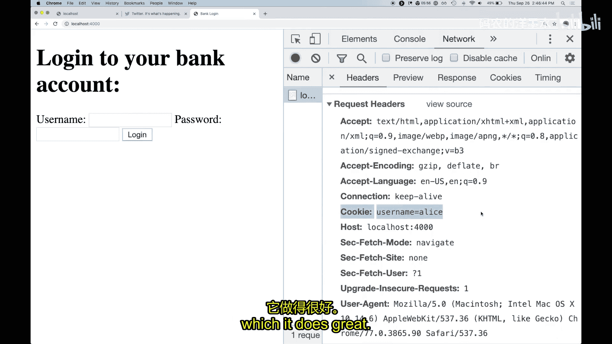

Great， so let's use that to log in Alice when it's present， right So how can we do that？Well。

 we need to import a thing called cookie parser really quickly because I don't want to parse a cookie and I just use I just type Hap dot use cookie parser to have it do that for me。

 And now just because I did that I now magically have a thing called Re do cookie which gives me an object with all of the cookies that are on the request that I just got。

 And so what we're doing in here is this is for the homep page。

 So when the user loads the homepage I'm going to say who are they presenting themselves as so I'll pull the username off of the cookie。

And I'll say if there is a username because this could be undefined。If there is a user name。

 then I'm gonna greet the user and tell them， you know， something like， what should I say。

 I should say。あ。Hi， and in their name。 How about that。 So will send。Hi。

This is just a way to include a variable in your string， so I'm going to sayH username。Okay。

And otherwise， there's no username。 I'll just give in the the login form like before， right。

Makes sense， everybody， okay， so now if I refresh this page。

 my browser should remember that I'm logged in as Alice because that cookie is set so if I refresh I should just now magically be logged in as Alice。

 great。😊。

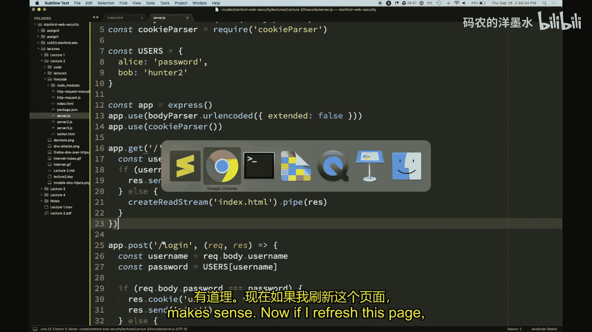

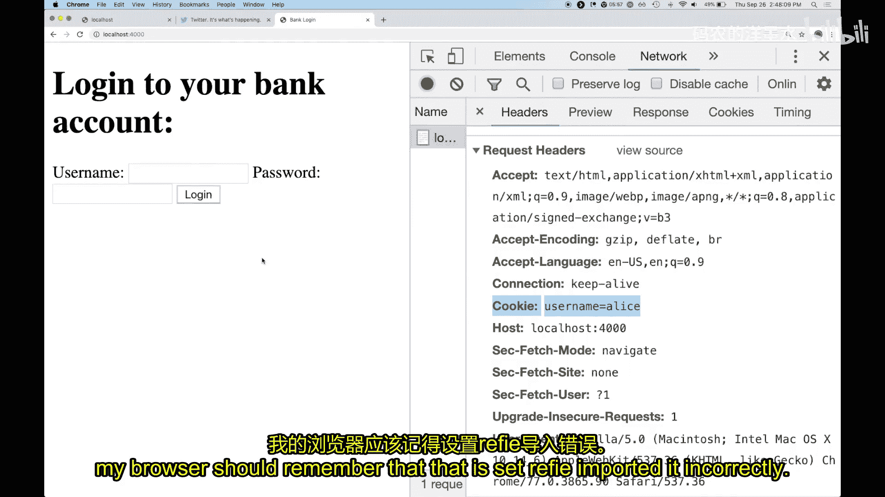

Cookie parts here， let's see， oh， I imported it incorrectly， it's supposed to be like that， okay。

That was easy， okay。Cannot read property username undefined what happened here oh， it's cookies。

 Reta cookies， okay。

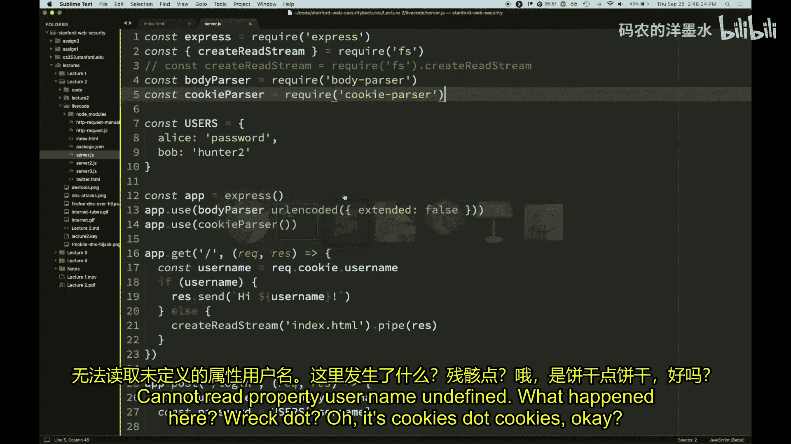

There we go。 Hi， Alice， Okay， cool。 So now if I， if I come in here and I delete my cookies。

 you can see cookies， by the way， under the application tab。

 if you open up application and you go cookies， you can see all the cookies that are set。

 And we see username and Alice here。 So if I delete that。 and I refreshresh。

 get the login form again。 Hoay， okay， that's awesome。😊，Except。Is this secure？What can I do。

 what can I attack or do？Is it that。Attach any username you want， Right， exactly。 So here， So if I。

 if I go here and I say username， Bob， and I refresh。But that was easy。Okay， so， yeah。

 you'd be surprised how often people store important stuff like this in cookies， right。

 So the lesson here is you can't trust the client， right， You can't trust them to。

Follow the steps that you want them to follow for your application， right。

 they can do whatever they want and they can modify any of the state in the cookies。

So we're just about out of time here， but we'll go ahead next time and we'll improve this so that it's better than what it is now and we'll talk about ways。

 other ways to tap cookies that are pretty fun， so I'll see you guys next week on Tuesday and I'll be doing office hours right now after this so if you want to。

Follow me over to office hours as you can， cool thanks。

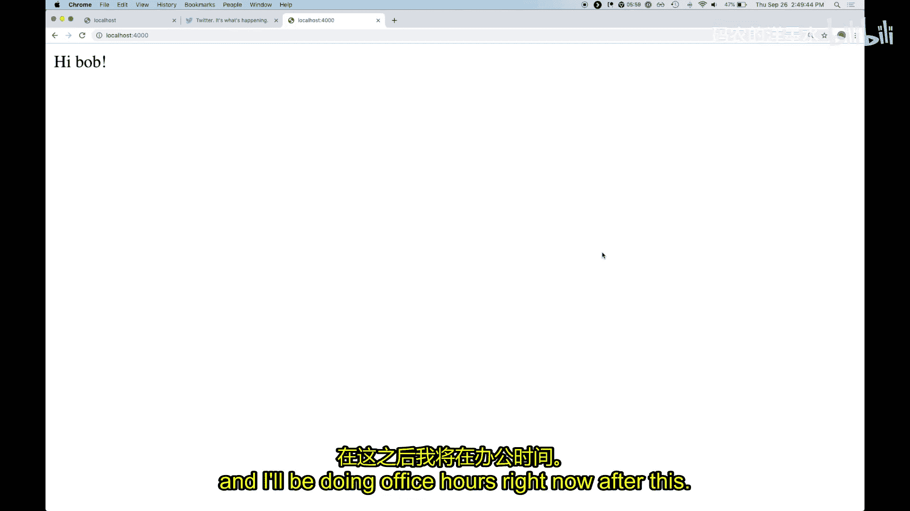