# 【全集】斯坦福大学 CS253 网络安全 中英字幕 1080P p03 Lecture 3 - 会话攻击 -BV1RemEBZEEM_p3-

Cool， so welcome everybody。Hopefully the homework is going well。

 how many people have completely finished it already？Okay。

 didn't mean to make all the rest of you feel bad。Cool， there's going to be office hours。

Thursday after class， I'm hosting those， and then Esthers gonna。

 I think Esther canceled her Wednesday office hours。So right now there's the only office hours。

 if that's a problem for anyone， maybe post on piazza and we'll see if we can add extra， but yeah。

 so just a reminder that assignment zero is due on Friday at five。

And then the next assignment is going to come out on the following Tuesday。

 so the next class that will come out。Cool， any questions about anything before we get started？Okay。

 cool。 so last time we ended a class。With an example of cookies， and we did it insecurely。

So we're going to just quickly review。The idea of cookies can。

 So the server can set cookies with this set cookie header。

 and then the browser automatically includes the cookies of every single request。

So hopefullyfully this is familiar。嗯。So the main idea is that the server wants to do this because it would like to implement the idea of a session。

 So， so what's a session。 A session is the goal is the server wants to keep some set of data about a user。

And they want to do that across a series of requests。And this is necessary。

 we need to do this sort of using cookies because HTTP itself is stateless， if you remember。

So we want to tell the browser， remember this。Key value and then give it to the server every time and that allow the server to sort of figure out that these requests are correlated。

So sometimes some these cases for where we'd want to do this are logins。

 if you want to log into a site you want to be be able to browse around the site and stay logged in even without logins。

 you actually might want to have a notion of a shopping cart so you might not be logged into the site but there's still a session active because you add something to the cart and then you browse around the site you go to a few other pages and there's still something in your cart。

 so the server still has some state across these different requests that you're making。

And then lastly， this is sort of an infarious use of cookies we're going to have a whole talk on this about tracking and this is sort of a way where you can server can tell a browser to provide a cookie every time it contacts an ad server and you can do you can basically figure out over time。

 the sites that users browsing around on because every time they contact the same ad server that same cookie is getting sent and now the server can figure out the same user because they're going to set a cookie that's some unique ID that identifies that user。

And actually， it's really cool。 I got just confirmation from the head privacy person at Brave who's going to be able to come and do a guest lecture on their their sort of defenses against this stuff。

 So it's gonna to be really cool。 Brave is like on the cutting edge of this stuff。

 It's going to be really neat to see what they're up to hes so I think he's employed at Brave。

 but he's also like a PhD student。😊，So cool。 So yeah。

Just to review what the requests look like here in this series of things。

 So the initial request that a browser makes is going to just be say say let's this is an example from last time。

 so we want to send a post request when the user clicks submit on this login form and the browser is going to send something like this。

 you can see there the username and password are encoded in this sort of query style。

 This is what forms do。 This is just the wayforms work and the server has to parse this out and then it can compare the username and password to make sure that they're correct。

If they are， then in the response what we did was， and this is insecure， so don't do this。

 but this is what we did at the end of class last time we sent back a cookie with the username equals whatever user had logged in and also a page can HTMLL right here so some kind of a page got sent back and that's what rendered in the browser and then all futureDP requests from the browser are going to have that same cookie tacked on so it could be 10 or 20 of these they're all going have the cookie every many requests follow theyll have the cookie。

Cool so hopefully that's our review this cookie will only get sent to that same or same host right now Paul。

Oh yeah， that's a great question。the same site and we're going to go a little bit more into sort of what the rules are around that today。

 but yeah， I know it would be really bad if this was being sent to every single site。

 so the key values are only sent back to the same site。Yeah。

 but there there's some chiiness around that。 we'll talk about it。 But so real quick。

 So this whole sort of system here。 this is called ambient authority。

 This is sort of a security concept。 idea behind this is that we want to basically so first of all。

 the idea of access control the whole point is we're trying to regulate who can do which actions on a site。

 So that's why we want to have like a login system or something like that in the first place。

 But then beyond that， there's different ways to do it。 So if you look back at this thing here。

 So the reason why this setup is useful is because the user has this cookie tacked on automatically to every request they do。

 And so's sort of inherently authorized to're inherently the server knows that it's them so they can do anything that the server would allow that person to do They're not like constantly proving who they are via like a username and password and every request So it's called ambient authority。

 So access control is based on a global and persistent property of the requester。

 in this case it's this cookie header that's going。Attached。And so yeah。

 alternative that would be like like you can imagine a really。

 really annoying website to use it be like like it face something like Facebook where you know。

The like button is not just a button。 It's actually like a form。

 You have to type your username and your password and then click submit。

 And then they all get sent to the server。 and it will check the username and the password。

 And if it matches and it will register a like， that would be really annoying。

 But that's the alternative to this。 So obviously really useful to be able to do ambient authority。

 there's four different ways in general to do this on the Web。

 But cookies are by far the most common。 but there are these other three sort of more obscure things that you might have seen in particular。

 I checking。 So。😊，This is the idea of just looking at an IP address that's sort of the source of this HTTP request and then deciding whether to allow it or not based on IP address。

 This is used by Stanford libraries to make sure that only people on Stanford campus can access different journals and things like that。

So that's a good question。Yeah， I mean， so that's actually kind of a complicated question but。

In general， not really for TCP connections， which is what H T TP is based on。

 It's pretty hard because there's a sort of round trip in order to establish this connection。

 So you might be able to booth the initial bit that。

 But then when the person you're connecting to sort of。Sends back the response。

 It's gonna go to to the destination that you sofed。

 And then they're not they're gonna be like what is this。

 And they're not gonna respond one more time and sort of create the connection。

 So but are ways to sort of change your I address。 like you could you could have a friend on campus who sets up a little server for you。

 So while you're off campus， you could sort VPN in through that and then appear like you're coming from Stanford。

 And that's obviously like would get around this sort of thing that this I based authentication。

But yeah， in general now。Yeah， is is any other questions about that。Okay， cool。

 so so yeah So then and who's seen this third one here built in HP authentication。Anybody。It's okay。

 couple people。 Yeah， So it's this really weird sort of。

Username password box that pops out of the browser。 When you go to a page。 It's very。

 it's sort of old。 And no one might have seen it by accident or something。

 It's really really kind of。 And the reason why people didn't this was envisioned initially to be sort of the way that we do sort of logins on the Web when it was created。

 But it was sort of tune flexible。 And terms of the U I of it。 And just the user experience of it。

 So cookies just a better option。 And that's sort of where everybody went。

 And then this last one is basically never used。Yeah， okay。Cool， yeah。

 So cookies is basically that's' that's the game that's in town here for， for。

First sessions on the web。So， so I want to continue with the demo from before so we can sort of improve what we got going in in that little bank website。

So let's see here。Okay， so。Here we go。Can everybody see that we good size wise？

Let me know if any you need it bigger in the back。 Is that a no。Bigger。Lever， okay。Cool。Alrighty。

 so this is what we had last time。 So we'll just quickly refresh your memory。

 we had this password database here that's basically an object that is representing our database。

 and then we had a couple of routes that we set up。 So So we had a homepage route。

 which basically when we visit the homeage， we're going to sort of look at the user's cookie and see there's cookie called username and if it's present。

 then we're going to just assume that that is the user that that is enough proof for us to believe that that is that user right otherwise we're gonna to give them a login form。

So then what does that login form do when it's submitted well if we go to the HTML for that we can just check it out and see that it's going to post a username and a password to this login point and then what this is doing is just pulling the username out going into this database and fetching the password comparing that password to what the user submitted in the request body and then if it's the same then we're going to give them the cookie which is the username and then redirect them back to the homepage and now the homepage will because of what we have here。

 the homeage will just show them sort of say hi we'll recognize them cool any questions about that。

let's see， is that possible？啊。Here we go。 Is that better， Okay， cool。Nice。Cool， okay， so。

 so so let's， let's enhance this a little bit。 I'm just gonna add some kind of private information。

 So let's add the notion of balances really quick。 So every user has a balance。

 So let's give Alice $500。 and Bob。😊，100 dollars。 Okay。

 so and then what we'll do here is just so we have an notion of sort of private information。

 well print out you know， your balance is and then this is the way you do variable substitution。

 So I'm going type in here。 We want to we basically want to print。A balance。

 and I'll just like guess of that as a separate variable。So'll make be just balances of username。

Right， okay， that looks right。 and then I guess we want to probably print a dollar sign in front of this。

 so I'm going to add another dollar sign there that's actually just going to print as a dollar sign。

 even though that looks weird。Okay， now。嗯。Let's check that out。So I'm going to run the server。

Go to my browser。Refresh the page。LetsMake this a little bigger， oops， wrong thing， this one bigger。

 okay。ho。All right， so this is our page here Okay， I'll try logging in really quick Alice。Cool。

 the logs in。 excellent。 It works。 Okay， so one thing that's missing right now is we can't really log out。

 So I'm gonna quickly just add a log out route。😊，So。I'll make this a get request to the URL logout。嗯。

And we'll do is what are we going to do log out。So we need to， I mean。

 I guess delete the cookie is like one way you know。

 to make sure that that user is going to effectively not see that that they're logged anymore。

 And it is all silly because this is an insecure system。 but let's this is going to be useful later。

 So let's let's implement it。 So the way we do this is clear cookie。

And this is just going to tell the client to delete the username cookie that we said before。

 so we need to pass in the name of the cookie that we want to clear and then we need to respond to them。

 so let's just redirect them back to the homepage when they go to logout。呃，OK。So。Let's see。

Let's go ahead and refresh this。So I'm still logged in and I can see here if I make this a little bigger。

 we can see here that oops， that's of something else I was doing。

 So here we have a hook username equals Alice。 Okay。

 so yeah I'm gonna go go ahead and visit the logout URL。 and we should see that。Okay。

 I was logged out。 And if I refreshed this here， there's actually no cookies。 So great。 that works。

Nice。Oh， the request for that， yeah， yeah sure， sure， sure。What is actually sending。 Yeah， yeah。

 yeah。 It's actually kind of funny。 So we're gonna we're gonna get into this。

 Buts so cookies are so old。 Theyre like literally they preceded the notion of like the browser's basic security model。

 which is called the same origin policy， which we're gonna talk all about next time But but yeah。

 they're they're just old。 and they're really jinnk。

 So the way that you actually clear a cookie is there's no built in way to clear it。

 You actually just you sort of say I want this cookie to because you can set an expiration date。😊。

On it， you can say， you I want this cookie to lasts like a year or something。

 But way you clear it is， can you think of what you might do？Yeah。

 you give it a date in the past and then the browser will see that and you can delete the cookie。

 it's gross。 but yeah，s just what you have to do so you just pick an arbitrary date like 1970 or something and just put it in there and that't clear the cookie。

 Yeah， and this is how everything on the web works。😊，And we sort of placed it。Yeah。

 so you have to use the same name。 Yeah， you basically make a cookie with the same name and the value can be anything。

 and then a date in the past。 So let's just see it and we can see what it's actually doing。

 So I'll type in Alice Passworth there we go， and then I'll visit the logout URL。😊，And let's see。

 let'll make sure I'm gonna to save that。 so I'm going to go to the network tab and I'll just make sure let's clear all this junk out and then I'm about to hit enter here and we'll see what happens。

 Okay， enter， okay， so log out。It sent here we go， so it sends username equals empty string。

We're going to talk about what this is， and then path is， yeah， 1970， January 1st。

 that's a youqui cookie。Yeah， cool。Any other questions？

So the browser could just ignore that and keep the cookie anyway right Yeah， in fact。

 some browsers in the past used to let you sort of configure that as a user preference like just like never get rid of my cookies I don't know what the use case for that was but yeah。

 that was a thing。Yeah， there's sort of no enforcement of this in the way we've designed this system so far。

 Okay， so let's go on。So let's see here， yeah， so basically the really bad thing here is like we talked about before is basically anybody can go in here and just show you anybody can go in here and just sort of say username。

Girls， Bob。Refsh and network we are Bob， okay， so that's not good， it's really bad actually。Okay。

 so what's something we could do to fix this？And you already know like the answer。

 maybe don't say it。Yes。Did you all know the answer earlier。Okay， here。 I'll suggest something。

 So what if there was a way that we could give the the browser the value username Alice。

 but we could ensure that that that value could not be modified。 I there a way to do that。 I mean。

 so in general， you can't trust the browser like we just saw anybody can go in and change things。

 But is there some sort of， And there is cheating if you've already taken crypto。

 but is there some sort of crypto primitive we could use that would let us sort of fix that value in a way where we would know if it was modified。

😊，When the user gives it back to us。Come on。 I know some of you know this。Okay， yeah。S the cookie。

 Yeah， exactly。 sign the cookie。 So let's， let's make sure everyone's on the same page with that really quick。

 What does signing the cookie mean， So I have some。😊。

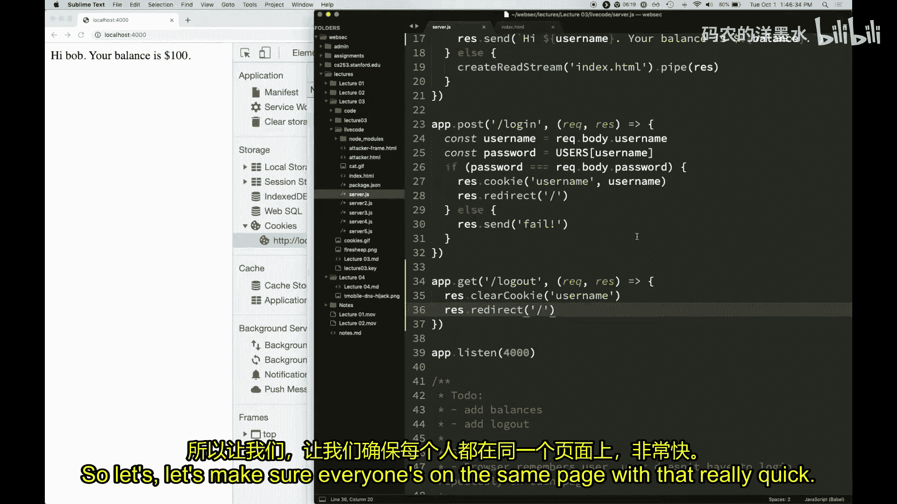

Little just quick sort of review of a primer on signing。 but this is not this is not a crypto class。

 So if you want more on this， take take 255， which is great。

 But so we're just gonna to do a quick primer of signing really quick。 So。

 so signing is this thing you have three algorithms， basically。😊，GS and V， so G is the generator。

 S is the signer and V is the verifier。And the idea is， if you call G。

 you get given these two values that are connected to each other。

 one is the public key and the other is the secret key。And。You also have S。

 So S is the thing that you actually use to sign a value。

 So signing a value means you x is some some random value some string。

 Let's say you pass in the secret key and you pass into the value that you want to sign and you get out this thing called a tag。

So the tag is like a。Another random string， but， but but it has some some useful properties。

 So if the user wants to prove that they haven't sort of changed this X value when they give give it to the server。

 they can provide the tag along with it。 And then there's this verification function we can use。

 which what we do is we pass in the wait， should that be S K passed into V， maybe not P K。呃。No， no。

 no。 that is P K。 Sorry。 yeah， Yeah。 So， so yeah， you pass in。

 you in the the public key and the input X and then the tag。 And that'll tell you。

 was that tag the same tag that was generated by the signing algorithm。Okay。

 so what is this all good for？There's two properties that you actually want from a signature scheme。

 so there's two things that we're going to look for， one is called correctness。

 this is basically the idea that if we've signed me。Any。呃为。The secret key。

 then the tag that it produces， will when passed in with that same X input and the corresponding public key will verify so it will return except it will return true。

 basically saying that that is a valid tag for that input and that should always be the case。

Does that make sense？If it doesn't do that， then it's not a very useful。Grification function。Okay。

 any questions about that？Please ask if you， if you don't understand， please ask。 It's okay。Okay。

So the next property we want is security。So security just says it's sort it's sort of the opposite of correctness in a way。

 it's the idea that if you create a sort of garbage tea， a random tag。

 and you try to sort of pass it off as a true tag that was generated by the signing algorithm。

 then the verifier won't be fooled basically So you try to pass you sort either change the X or you change the T And you try to verify And except should basically almost never be true。

 it's not like never gonna be true。 There's sort of some probability in here。

 But it should basically be really， really hard like rare that will ever be wrong here。

 So so in other words， it's computationally hard。 Some have to try for try for a really long time sort of find a t in an X that would fool this function。

 right。Okay， so that's probably。It's probably enough detail for this for what we're going to use this for。

 but before we go ahead and use it， any questions？Yeah，t but do people normally use the same。

 So to think for signing cookies as the useful should be yes No， no， generally no， Yeah， generally。

 you never wan to just you never wantan to reuse like like keys for different purposes because。

Especially if there's different algorithms in use， it's like kind of sort of it's hard to prove like what will happen when you do that。

Yeah。But okay， okay， so so yeah， just to sort of lay this out。

 So what are we going to use this algorithm for so we have a client and a server。

 This' is a browser in our server and here's how we're going to use this so。

So the server is gonna call G。 and it's gonna get this public key in the secret key。 right。

 And then the client's gonna go to log in just like it did before。 So it's gonna pass snow。

 it's gonna why do I do get login。 That should be post login， because it's the post end point。

 But but same idea。 So， its seems using me in the password。

And then the server looks at that and validates it just like it did before。

 and so say that it is valid， say that this is the correct password。 so the server is happy with it。

 So this time it's going to do something different than just setting the cookie to Alice to username equals Alice what it's to do instead is it's going to generate this tag where the X that it's signing is the string Alice now it gets this tag。

😊，And then it sends both username equals Alice and tag equals T back as cookies， right？

AndSo the browser is gonna remember that。 And now let's say these are gonna give gonna fetch to the home page。

 The browser will send both cookies now， and it does it like this。

 It it's a single cookie header with， with a sort of semies unlimited key values of all the cookies。

And now the server can look at that and it can run the T through the verification algorithm and it could say。

 is this is this really this Alice not modified or is this T really the true T for this？

 And if both they both check out， then we get we get sort of accept back from this function and then we know that the user has not tampered with the username that we gave them originally。

Does that make sense。You look confused I guess so。Why are we using the published and private key crypto here if it's both capturing on the server side？

Couldn't the server just since the server already knows its's own secret kid to generated it you know why do you need this？

あれ。Oh so are are you suggesting maybe we could just encrypt it or something， Yeah。

 that would work too。 Yeah， and so the advantage of this is that the client actually has access to username equals Alice so the browser could like use this cookie to maybe show Alice's name in the UI or something like this is this is available to to the clients。

三看。I mean it's not that you're right， it's not really that useful still the thing like you could do what you suggested。

 but in the way this is done here， the client can actually see this cookie。

 this is not encrypted right， this is completely visible to the client。That's just sort of。

What we decided to do。YeahBut your thing would work too， your suggestion would work as well。Thank。

Just using encryption， but still sending bags。So I say it again？To just use encryption。

 but also somebody。Oh。Just like a symmetric encryption scheme。Right， I mean。

 so then then you're saying that basically we would get back sort of this unencrypted username equals Alice as well as an encrypted one and then decrypted and compare Yeah。

 I can't think of any reason why that wouldn't work。At the top of my head。Yeah。

It might work yeah just one question I have is what is preventing us from seeing what the cookie tag is？

Nothing's preventing us， so we actually see it， yeah。

 everything that's sent in this response is going to be visible to the client。And we can see it。

 we can modify it， we can even try and change it， but because of the sort of guarantees that we have with this signing system。

 we know that that there's really no harm to letting the client see this T。

 like they can't really do anything with that。啊。if I if someone else comes along。

 they see the username and they see the tag and they can kind of also log in via that method by those cookies。

 Yeah， yeah， you're gonna to head here， but yeah， that's that's that's a problem。

 I don't know if everybody caught that。 but yeah， we'll get to that in a sec。

 but that's that's really good。 Yeah，' really good。 You're right。Okay。

 any other questions for everyone？Okay， cool。 So let's， let's try and actually， oh， this last step。

 Yeah， So okay， yeah then obviously， once we， once we verified them， we actually sort of send back。

 we， we sort of believe them。 we now believe this username equal Alice。

 We know that it hasn't been tampered with， right， so we can actually send them back the private page with more confidence。

😊，And because it's a cookie， we can sort of repeat this as many times as we want because this。

 this cookie will continue to get this cookie header will continue to get sent with every request。

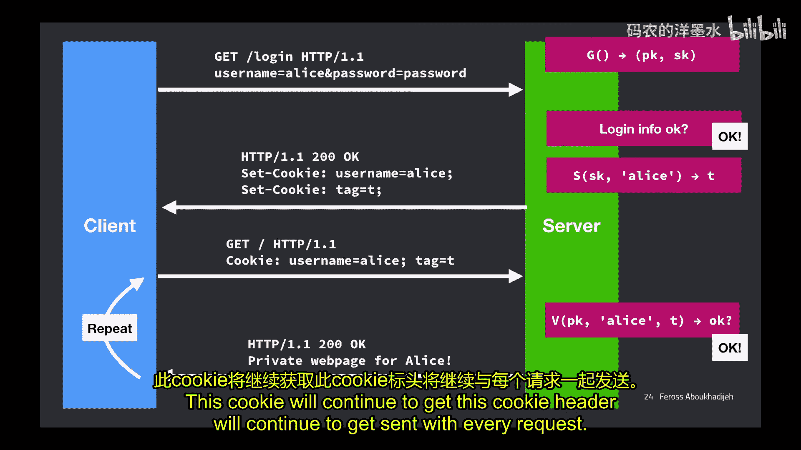

Okay， so let's go ahead and。And try to try to do this so I'm not going to actually use the crypto primitives directly here for time's sake here。

 what we're going to do is I'm going to copy the code from the last bit we had and we're just going to modify this up a little bit and we're going to use some of the built- in facilities of this express framework that we're using here。

So。What do we want to do。 So we want to。 Let's start off by when we initialize this cookie parser here。

 we now need to， So the way that this works is it's。

 it's not quite like the G that I showed in the picture。

 We actually have to give it the the secret key that we want it to use。 And then it it will。

Generate the corresponding public key， but it's effectively the same thing。

 So what we'll do here is we will pass in a cookie secret。Variable。 And then this。

It is some string that we securely randomly generate。Okay。No one can guess。

 but that should actually probably be properly generated in the relap， but there we go。

 so that's our secret key。Okay， now so now what we can do is when we actually set the cookie。

 which we were doing here in the login handler， what we'll do is we'll just add on this little option here。

 signed true。And， and the framework will handle sort of that for us。

 all the stuff in the picture that you saw which handle that for us。 So it's gonna to。

It's going to do that to do that。 And then the last thing we need to do is when we actually go to read out the cookie。

 now we want to make sure that that that that the。The tag is valid， right， We。

 we can't just trust the username because other back in the same situation。

 So we actually need to validate the signature is correct。

 And so the framework will again help us there。 all we're gonna do here is instead of getting the cookies properly。

 we're gonna get signed cookies and it will only add properties which actually properly。

 properly validate。To this。 Okay， so if there is a username here。

 then we know that that it had a tag and it therefore was not tampered with。 right。

 Does that make sense。Otherwise， it wouldn't have gotten added to this object。Okay。Cool。

 so let's try this out。 Let's go ahead and。Let's go ahead and delete this cookie。

 refresh the page and。I think I might need to change the server that I'm running because I switch to different file called Ser 2。

 Okay， so now if I。Okay， here we go。 We're on the new server。 So now I's try the same thing again。

 Alice。嗯。Password。Okay， so， so there we go。 So theres there is an interesting value here。

So it's actually a little different than what I showed in the picture。

 The way that this framework decides to implement the signing is by sort of everyone can see that。

But it's basically sort of。You can see that the plain text value of Alice is there。

 and then all this junk around it is the signature。 Basically， Does that make sense。

So sort of it did it in one cookie， but it's the same idea。

 It's going to of when the server gets that is going sort split it apart and then do the verification。

Cool， so， so I'm Alice。 I'm Alice now， right， But now let's try and see if I can can pretend I'm Bob。

 So I'm just going to go in here and。Change this to BobB like we did before， and if I refresh， oh。

 the server' is not pleased with that， obviously。Cool， and also， I mean。

 this doesn't really makes sense for me to change if I change this back to Alice and I refresh。

 I'll be logged in again as Alice， which is great。 And if I obviously tamper with this tag in any way。

 like delete like let's delete a few characters out a few characters。

 it's obviously going to also be unhappy with that。😊，Cool。So that's signing。

 any problems with this can maybe see you already mentioned？呃呃。But yeah， do you want to say again。

 what was the problem you solved this approach you can see the username and the？Then you can。

Kind of like coffee pasts somewhere else。It'll still walk you in。Yeah， so， so basically。

 you're saying that that if I actually go。 So， so let's actually， let's actually， let's， let's let's。

 let's see what see what you're saying。 So， so let me log in again really quick because I messed up the cookie。

Okay， so I'm logged in， say that I copy this value Why would this happens。

 say I get malware on my computer， right so I have a virus and it decides to copy off my cookies。

 right， I realize I have malware。 So I'm like， oh， I better go log out from all the websites that I'm logged into or change my password or whatever。

 So I go ahead and I do that。 So say I log out。 I go to the log out URL here。Great。

 I'm logged out of my bank。 I say that I I tell the bank。 I called them up and I say， hey。

 my password wasn't good before。 Please change it change it something else。

 So the bank goes into their database。 and they change it to a new secure password。 Okay。

 so now I think I'm safe， I'm like， okay， let me test out my new password Alice password to cool it works。

 let me let me log out and just make sure that old password doesn't work。

 password without the the one on the end。 it didn't log me in。 So I'm safe， right， Nope。

 I'm not safe。 because if the malware，s stole my cookie。😊。

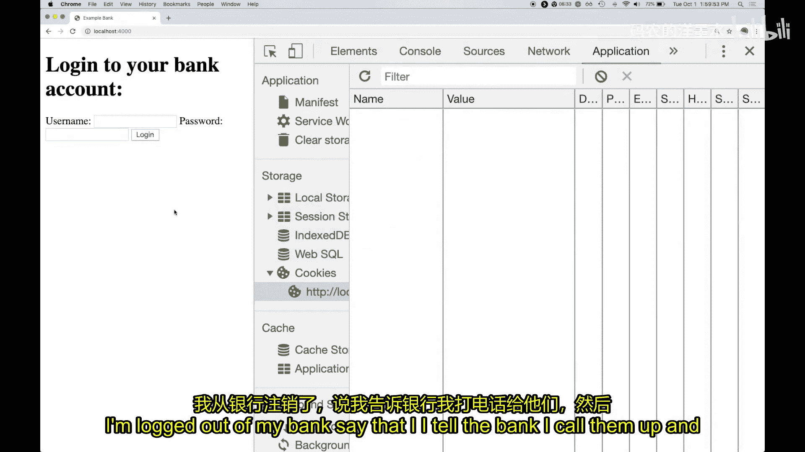

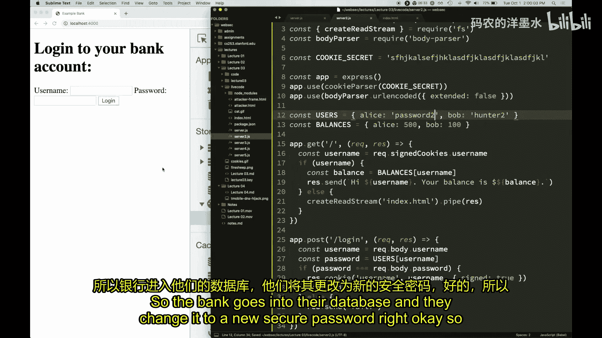

It just sets username and paste that old value in and refreshes， it logged in his knee again。

So I'm somebody who has this string can basically always be me forever。It's bad， it's really bad。We。

 we don't want that。 when we design these kinds of systems， we want to be able to。

 to have the the user click a log out link and have it actually like destroy something in a meaningful way so that that session is actually gone。

 right。Okay。Is everybody， is everybody understand and agree with that。

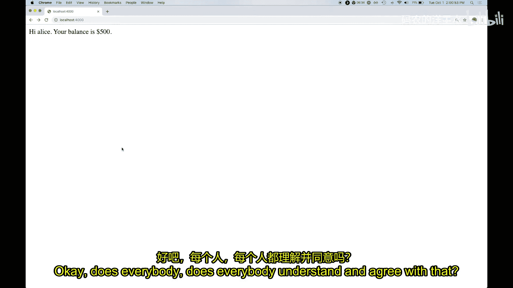

Okay。So maybe we can try something else。So let's see， what should we try？

What's a new thing that we can try here。athletes weird。Was that。

Have an actual tag function that generates new tags every time。what do you mean白 that？

Like so for different sessions when can sign in。😔，I don' don't know if that's all。

Can you like generating a new tag to？我 tell you sign。Oh， I see。

You're basically saying that there should be some sort of way to。

Like you're saying add a number or something to it and then this just changed the signature。Oh。

 so any time， any time the user logs out， I should。

 the server should change the P K and S K that it's using。So it could do that， but if it did that。

 then now when it tries to verify all the cookies from all the other users on the system， it wont。

 it won't think of their valid anymore because those are signed with a difference。SK。

 so I guess it could keep a separate P K and S K for every single user and then destroy it。

 that actually could work， but。Someone else had an idea。 Oh no。

 I was just kind of thinking about the same thing， but I was thinking more along the lines of like a function of。

But what you just mentioned。And you think that？Youd have to keep us separate。

For every single user and then just。Keep track of that， I guess。

Oh like and also change it every single time they were to log in and like start a new session Yeah。

 so sore all you're all sort of circling around a much simpler idea。

Which is to actually throw out all this signing stuff that I just explained and not use it in this situation。

So， so when would so before before we actually here， let's， let's actually make it concrete。 So， so。

 so we are all， we are all trying to to get at is this idea that that。

We want the server to be able to destroy some piece of information that invalidates a session。

 we can't do that if we're giving them a sort of signature which is sort of trusted forever。

 so what if we had a database that mapped numbers， sort of ID numbers to a user that's logged in。

And what we do is when a user shows up and proves to us that they are。

 they are whoever they say they are。 Alice， let's say we we， we pick a number， random number。

 really out of a really big space。 we call that a session I D number。

 And then we we give that to them。 And then we just remember。

 anytime somebody shows up and presents us that number。 we know that's Alice。

They present us a different number。 We know that that one's Bob， right， and， and then。

You know now the user。When they log out， we can just delete that entry from the database。

 So now if somebody shows up later and presents us with Bob's old number。

 we're not going think it's Bob right because there's there's no corresponding entry in our database anymore。

 right。Does that make sense？What do you need to bind to both the ID and？Like the username。

 in case they just like manage you get a collision on the number， a dead number。So yeah。

 colliding on the 1 ID number is really bad if they can guess。

 if they can just sort try numbers until they find a number。

 then then they can basically assume the identity of that user， that's really bad yeah。So we sort of。

Get around this by just picking out of a really large space。

 And so you could sort of try forever and you're。Be hard pressed to find an I。

How thisA may been secure since late？If I store a number and there's a moer watching every cookie。

Wouldn't see the。Yeah， so if you have a malware， if you have malware on your computer and it steals your cookie。

 it will be you for however long it has that cookie。

 But the difference between between the old system with assign signing and this system is that at least if you click log out。

 then we can destroy that entry from the database and then that cookie that they have is no longer valid。

 wouldn't create new inware。Your。Oh yeah， yeah。 So I mean， if they're persistently on your computer。

 then you have kind of。That's kind of like an out of scope， like that's like a really hard problem。

Yeah。For that， that'， I mean， that is a good point。 Yeah， I mean， if you have， if you have。

 if you have somebody watching everything you do on your computer， there's not really。

 not really anything we can do because then they can just sort of do whatever they want as you。

 So what we're trying to do here is just create， create a。呃。I mean， what's another's sort of。

Another place where this design makes it more useful。

So here's another case where useful so say that have any of you ever gone to the sort of security page of your Google account your Facebook account and it shows you all the sessions you have logged in elsewhere。

 So what it's doing is just looking through the database and just saying for us has these five sessions and you can go in and just delete any of them so if you left your computer logged in on on your friends's computer you logged in and then you left you want to remotely delete that session you can do that with this system because you can just delete that one entry and now so that's not really malware but this design enables us to do that where the old one didn't。

Okay。Cool， so let's try to like's try to make this better。

 So I'm actually gonna I'm gonna copy the code from our first attempt because I think that that was closer to what we want because it didn't have it didn't have any signing in it。

 So we'll go ahead and paste that in here。 And so now lets let's create a new table here called Session and it's just gonna be an empty object initially because no one is logged into the site。

 but I'll leave a little comment here that says basically this is gonna be it's a dictionary or map from session I D to to username。

And so we could actually， we could make this a map from session ID to like sort of an object of arbitrary complexity like we could we could make you know。

 we could store a username in here and like some other stuff like whatever other things we want to remember about the user。

 but let's let's just keep it simple and make it the a mapping to the string string that's their username。

But we can sort of do it。 We can do。 We can make this as complicated as we want to in a real system。

Okay， so we have this sessionss object。now when we go to give them a cookie when they log in。

 which is in here in the login handler。Let's see。 Here's the line where we're we're currently giving them a username cookie。

 Let's change this。 And so once we've confirmed that their password is correct。

 we'll give them a different cookie。 Now。 let's call it session I D。And let's see， what should it be？

How should we pick this number？Anyone have any ideas？Ma am number 10 reader。

What happened if I did this？Okay， so start 0。And let's do session ID。Session， I D。

 or I guess it should be。 Sorry Next session， I D。Next session ID， next session ID plus equals 1。

 so we'll give them the number0， and then we'll mark that the next person is going to get a one。

And then let's see， when we log out， let's change。Let's change session I D here， deletelete that。

When when they log out and see is there anything else I need to change。 Oh yeah。

 here we need to change something So when we when we actually get get to figure out who the user is now we can't there's no no longer a username cookie。

 We need to change this to get session I D cookie。 And then what are we going do with this We're going to。

Atic。Adds to the cache。 No， no no。 So we're trying to figure it。 So the user showed up。

 they visited our homepage and they said， here's my session I D。

 We want to use that to figure out who they are。Yeah。

 so we're gonna we're gonna look in the sessions object here， look up that session I D。

 and then what's， what's gonna be the value in there。 Well， it's gonna to be the username right。

 So we'll， we'll say we'll do username equals。That。

Now it's possible the session ID they gave us is garbage， like it's something they made up。

 in which case this look up here will give us back undefined and then this if will be falsey and then we'll go ahead and treat them as a logged out user。

So。Does that make sense that did I miss anything here。 does this look correct to people？ Well。

 wouldn minus the this， the obvious issue。😀。あ关地啊。君るあと。Yes， it。When do we add session ID？Oh yeah。

 good point， so yeah we gave them a session ID， but we didn't actually remember it， good point。

 good point， so let's actually do that sessions。Next session ID equals。

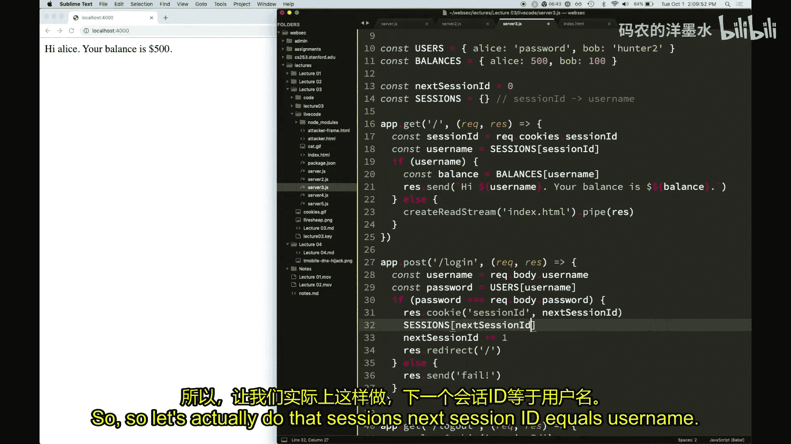

Perfect， okay， so let's go ahead and quick quickly see here how this works out now。 So I'm going to。

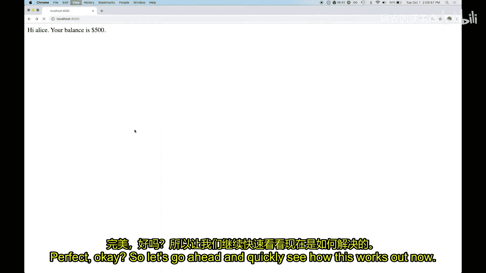

Run。

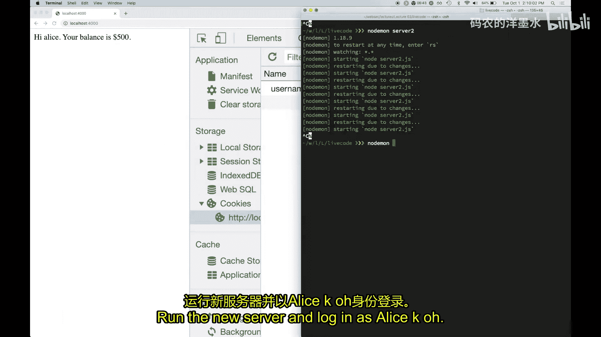

The new server and log in as Alice。Okay， oh， assignment to constant。

 what is this assignment to constant variable On line 33？

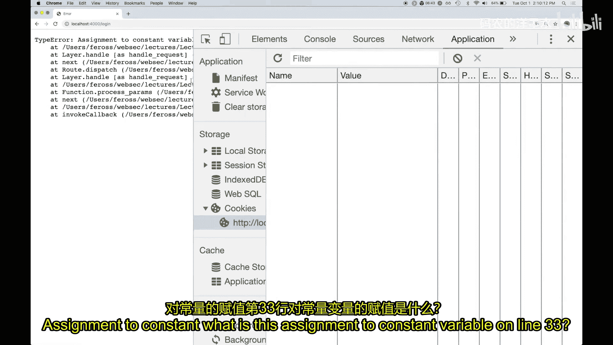

What did I do， Oh， I made next session I D into a constant。 that Okay。

 let's change that to be a variable that we can actually change the value of。 Okay， cool。

 so logged me in。 What's my， what are my cookies。 Oh， I still have the noticed this。 the new server。

 since I'm running it on the same sort of the same domain name basically here。

 We are getting the sort of old cookie is remembered by the browser。 So actually。

 our request to the server included both of these。 but why is this okay。😊。

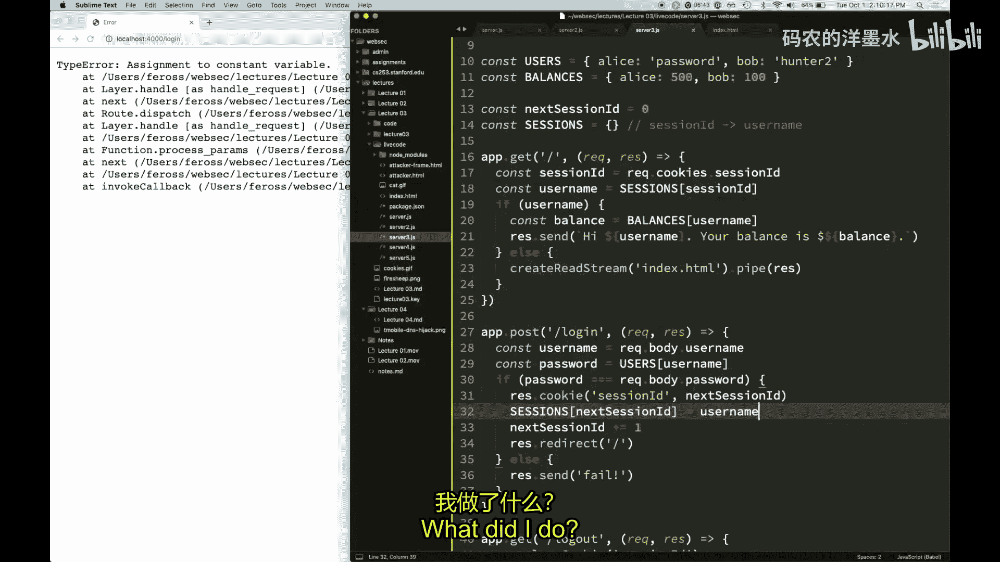

Yeah， it's sort of just not looking at the username。 So that's。 I'll， I'll just leave it to be。

 to be extra clear here。 But yeah， And then here we go。 Session I is 0。 Okay， cool。 So， oh。

 we forgot one step， didn't we。😊。

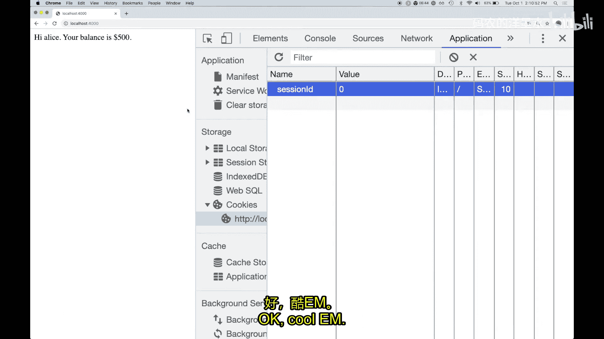

Yeah， we have a problem。 Our log is something's wrong with our logout function。

What's the problem with that。

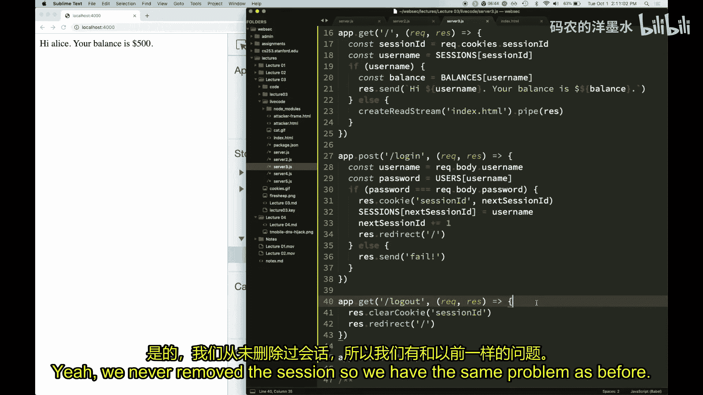

Yeah， we never removed the session。 So， so we have the same problems before。 So if I， if actually go。

 go to log out here， Okay， cool， my cookie was cleared。 But now， like， if someone stole that。😊。

Really secure number 0。 Then they could refresh the page and be me again。 So okay， that's not good。

 So let's actually clear that out of the database here。 So we'll do delete。 I know， first。

 we have to figure out what this， what the cookie is that they sent us。

 So let's go ahead and do this。

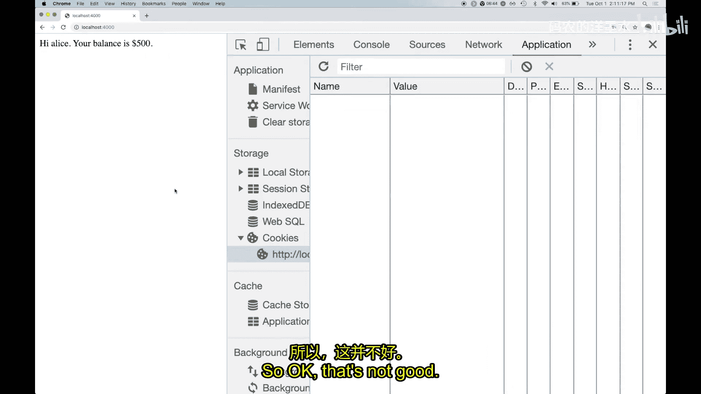

And then we'll so we have the we have the ID they sent us， and now we're going to do delete。Sessions。

Session ID and what this does is it sort of just clears out that key value from the session's object。

So now it's uns。Okay， so let's try to try that one more time to make sure that works。

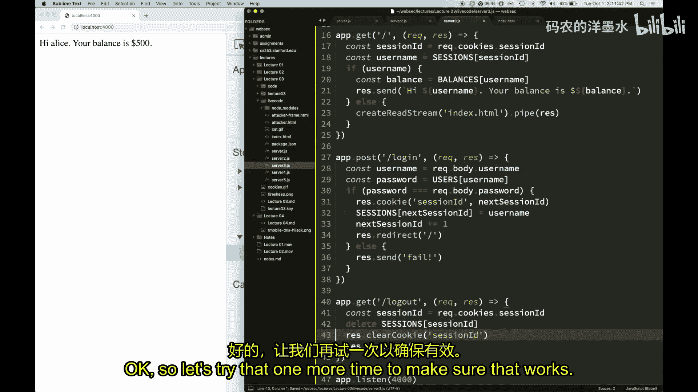

Alice password， it gave me zero again because every time I save the file。

 it sort of restarts the server and my， my server doesn't have them。St so it's going to start over。

 okay， so now let's log it out。What we're looking for here is after I log out。

 we want this to not work here When I set this value to 0。 It should not believe that it's me。 Okay。

 cool。 So the sessions。Session has been deleted from the database。Cool， but what's the problem here。

 the problem is that save Bob logs in now and。So Bob got session I D1。 cool。 say that see here。

 I'll make a new a new browser over here incognito window。 So this is like a new a new person。

 new browser。 They can come along here and。They can just be like， okay， you know， let's say。

 let's say this is Alice。 So let's say Alice logs in。

Alice logs in and notices that the session I that she was given。Is2。 So she thinks。

It's kind of a low number。Maybe， maybe there's other users who are given like sequential numbers。

 What happens if I try a few values。 So say she tries， I don't know。

 she might try like maybe somebody logs in after her。 Okay， no one， no one logs in after her。 fine。

 But maybe she's like， maybe somebody los in before me。Ah， Bobob loged in before me。

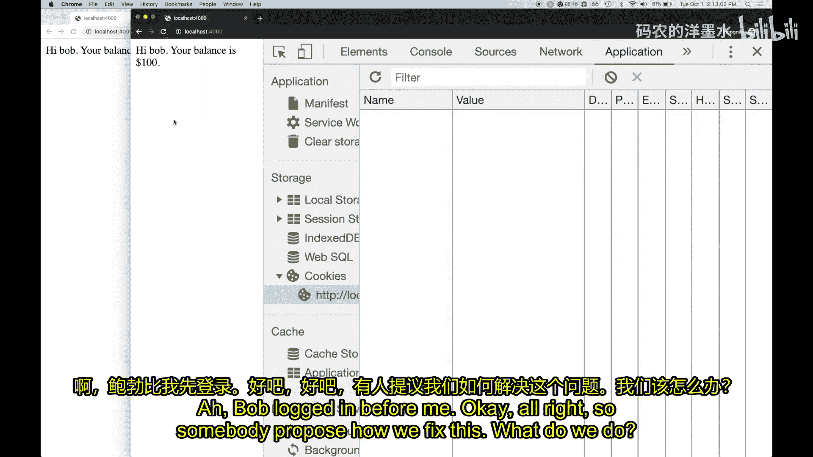

Okay。All right， so somebody proposed how we fix this， what do we do？

Use a random generator to make it。Yes。I think you could sign the numbers also kind of like how we were assigning the username。

Oh， interesting。Signing the number， I hadn't thought of that。 So if you sign it。呃。I guess they can't。

 Yeah。 So they can't。 somebody can't just， you know， produce this tag now for the。

 for the number that they're trying to attack or impersonate。 Basically。 that is true。

I feel like there's I feel like there's some problem with it。 Yeah， Yeah， why just like。

That sessions database keeps the signature， so that way like a signature is only validated。

It's valid and it's in the database。If it's valid and the signatures in the database。

I think that's equivalent to what he was saying。Yeah，cause if you， well， unless you're。

 unless you're proposing something where。Maybe I didn't understand the full thing you was proposing it's relatively similar。

Without the extra step look like the session ID？But even just have you can sign the user。

Get the signature in this session database。And then。The next time a user send a request。

 it's only valid if they have。That signature and that signature。And' for ans database。Right so。

But the request seems again。何在。It's going to generate the same signature again。Even if it's like。

If you were signing a different number， then you could maybe get around that。 But yeah。

 you have a question。I guess is there any？Do different。There's is just rain of degenerating。Yeah。

 so I don't think there's actually a difference。 if you if you pick from a sufficiently large range。

 then' it's going to be effectively impossible for you to guess。

 So I think that's like the simplest thing to do。Yeah， the going sorry he was first。

 but it's it's a case you're talking。 I just go for。

 You just have another database of session to I P and user agent。

And if the I and user agent don't match， then you just say no， Okay， so， so I like that。

 That's that's creative。 What happens if。So yeah that's one problem。

 my piece can change especially on mobile networks。

 so if you're like walking around your cell phone and then you gi little too far from one of the cell towers。

 you can't do a different one， you could get a completely different IP address。Yeah。That is， yeah。

 that is sort of a new problem with the mobile stuff。 like it， that is not a bad idea for a desktops。

 but you still have one other problem with that approach。 Does can anyone think of what。

 what else might not work with with using an I address as the。Proof of like who user is。Mat。

 yeah you said that Yeah， so what's the idea there， Yeah basically just like to the public。

 it's like a bunch of people are actually masking behind something。

Like it's published by an insider kind of like sharing there。

To the outside they seem just to be the same。Yeah， so if you have like a home internet connection。

 you'll have one I address for the whole house and all the people living there will peer to the outside world to actually be the same IP address。

 So if you had you combine it with the user agent， which has clever。

 but you still have the problem like two people both running like MacBooks with the same version of Chrome right in the same house。

 then they'll look like the same person。So that's a not deal。But it could work yeah。

 but just not if thises that a case。To follow up on the signing versus just the having。

ISo going mentioned my earlier question about public hesing。Crypto for it。

 I think the benefit of signing it would be that then since there actually is a public server it's using。

entally， if the user has that publicly， you can verify that you're logged into Facebook and not Facebook or something。

That is true。We'll actually just use TLS for that like the browser will just do that for us。

 but that is true。 you could sort of maybe use that for something。

 but I can't think off the top of my head like what that would give you on top of just using like H TTPS but that is a good point。

 that is something we do actually want but we probably don't want to implement that ourselves in our JavaScript that we send down to the browser。

Could you have one cookie， have the actual like idea or username or whatever you're doing and then sign the entire cookie sculpture like with its。

そ。And is a different。呃。Possibly。I think we should just move on because there's like an infinite number of ways that we could try to do this thing。

 but we can maybe talk about that after class， there is just an easy way which is to I kind of misled you all by showing you signing because now I know all you' are all thinking how can I use this primitive that I now have to solve this problem but so there are use cases for signing it's just not this one。

So you you can imagine like what like so signing be could be useful if you。

If you wanted to say give the user some kind of a promotion。

 So if they if they ever buy a product from your site， you want to give them like 20% off。

 So you want to set a cookie maybe and say like discount equals 20。

 but you don't want them to be able to mess with that right you might want to just sort of sign that value。

 And then when they provide that cookie to the server。

 you know that that's actually the discount that they got they haven't gone into their browser and give themselves 100% or whatever。

The attacker can oversee the cooking also。Use to get their own discount。 Yes， yeah。

 so that' that's a problem with that。 Yeah。 so you could share that cookie with your friend。

 And then yeah， so maybe you put the username in there as well for who the discount is for。

 But yeah let me get off of this signing red herring because I I really tricks you all Okay so so what we doing here yeah。

 So we need to pick a better way to get this next session I D basically。

 that's our problem right now。 So we initialized it to0。

 So let's let's just get rid of this entirely。 And how about this。

 whenever we need to to select a session I D to use let's just do this。😊。

There's a function called random bytes。And you give it a number of bytes that you want。

Usually in encryptpto you want like around 128 bits of entropy， so in terms of bytes。

 that's going to be 16。So we'll just pick that and then let's turn this into a string because what we're giving back is a buffer and we want to string because cookies are always strings。

Okay， so now in the yeah， and where we get this function from， we have to import that。

 So we do that like this。 It just comes from the the crypto module。Notode。Okay， cool。

And this is actually like secure crypttoographyy random。Good good randomness here。

 So the numbers not should not collide。Okay， cool。 is that it。

 I that the only change we need to make here。嗯。Forgettting anything。

Youll probably get rid of the next section that。Oh yeah。 Yeah。

 that's not gonna to do anything because oh， and it's also cons。 So that would actually also。

 that wouldn't work。 Okay， so that's good。 Let's delete that。😊，あ気 you。That。Like before setting。

You could。You could。 Yeah， you could。 it should basically， it should never happen。 Like it should。

 it should never happen in a really， really long time。 but we， we could。

 you could throw it in there if you wanted to be sort of extra safe。 but yeah， it'ss。

So not a realistic concern。

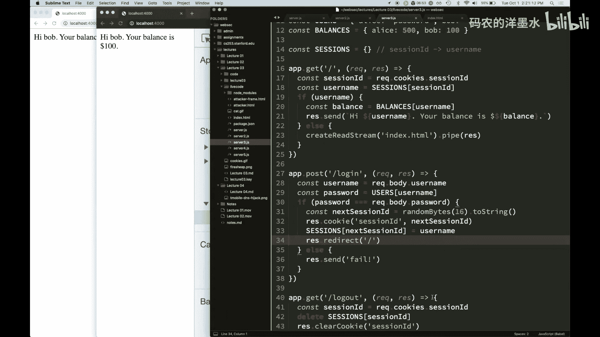

Okay， cool。 let's try this。 Okay， so it's gonna hopefully be better this time。

 So let's go ahead and let's see here。 So oh I kept it in server 3。 Okay， so we're good to go here。

 So Alice password。😊，Oh， that's an interesting。What is that？

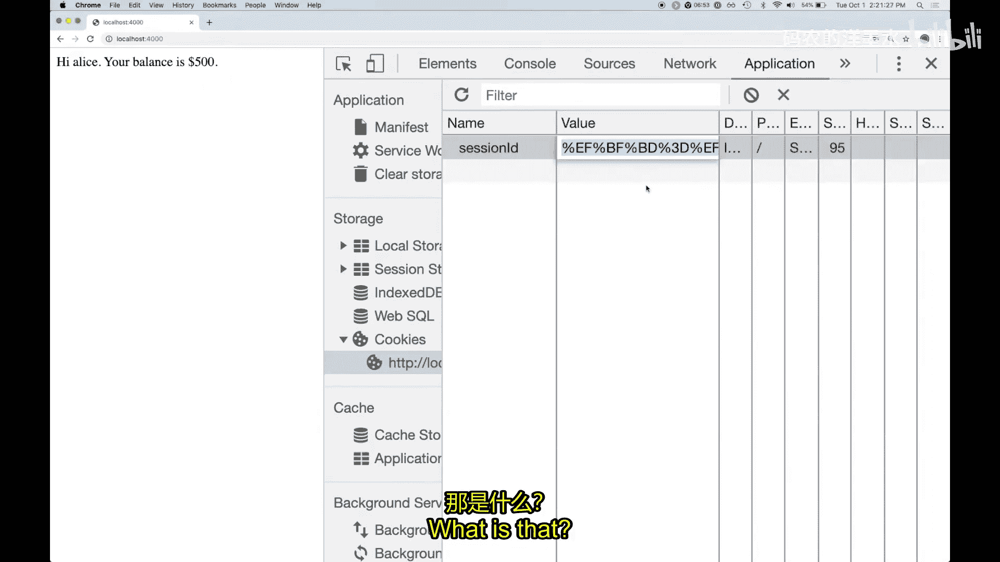

Oh you know what we did here when we two string its， we got back binary string。

 let's go ahead and make this base 64 just to make it a little bit easier to read here okay。

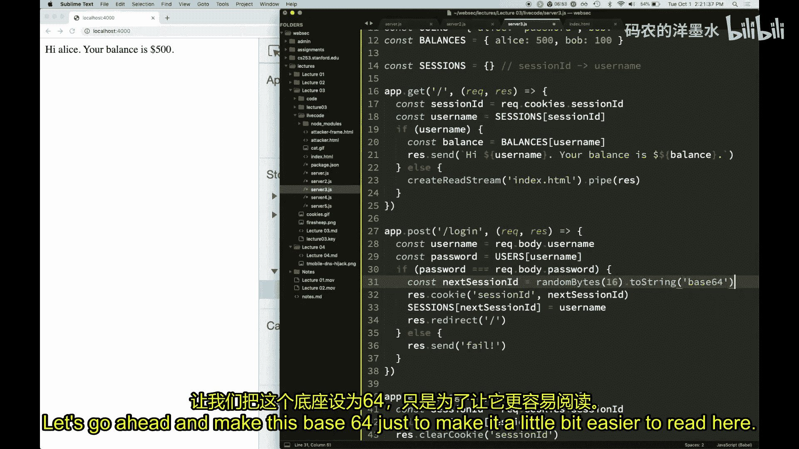

Okay， so that's。It's ugly， it's okay。So that's our session ID， excellent。

 it looks pretty unguessable to me。A。How do we test it， I don't know。は。code looks right to me。Cool。

 any any questions？😀は。we can try logging in as Bob in another window and just see if it looks sufficiently different。

Oh， can I get the get the password wrong。What did I do wrong here？Is it it's hunter2， right。Okay。

 just typed it in wrong。 Yeah， so this looks pretty different M Z versus that。Questions。Yeah。

 so this is the correct way to sort of select sessionession  I want to basically。

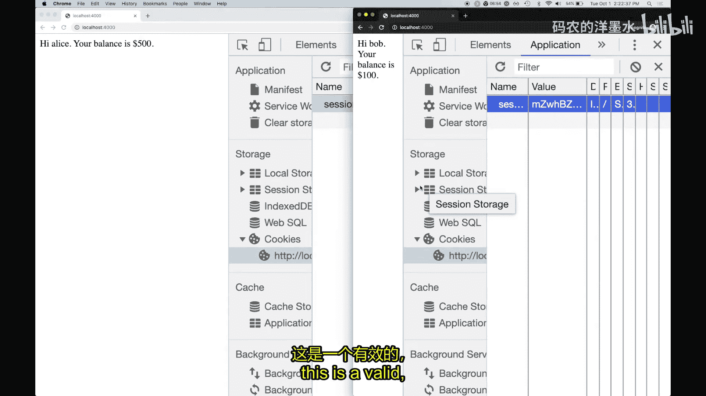

You know。呃。呃。You know。The range of numbers here is so big that you're not gonna ever have any any overlap。

 Okay， cool， So if there's no questions， let's go on。 So， so this is like pretty secure。

 in terms of like the way we're it's not possible enough for users to guess a session I D they're not gonna be able to do that。

 But there's other sort of implementation issues with this design that we have here。 I mean， for one。

 like I mean， our passwords are pretty are pretty insecure here。 we'll not worry about that today。

 But there's also other sort of other problems with with the way we're doing we're dealing with cookies。

 and we're gonna go into sort some attacks you can do with。

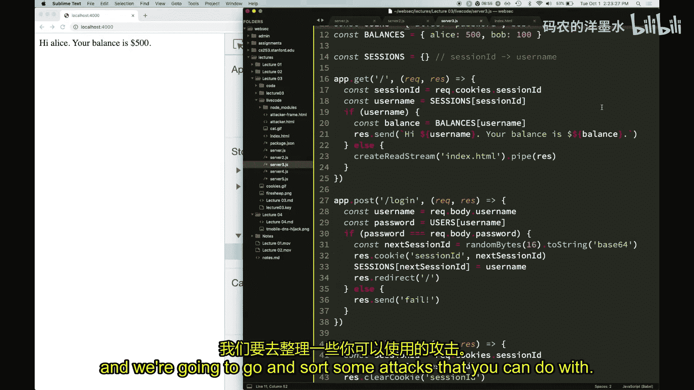

With you know， against these cookies。 So let's， let's let's， let's get keep going here。 So。

 so there's， yeah， so this is sort of our final implementation。 Look， looks good。Oh yeah。

 So I guess before we do that， I just quickly just mention sort of why are cookies so interesting。

 So they were implemented in 1994 in the Netscape browser by by one dude。

 And they were there wasn't that many people writing browsers back then。

 And the idea for them was described in a really short draft。 was it wasn't really a spec。

 It wasn't really precise。 It was sort of like like a Google doc that somebody not not Google Doc literally。

 but like here， here's a thing we could do and sort of a brainstorm。

 And then somebody went and implemented it。 And that was sort that was sort of the standard of like now we have cookies in browsers。

 there was no sort of formal spec for how they should work for a really long time。😊。

There were some attempts made to sort of。Write down what they should do and sort of how they should work so that all the browsers could agree and could have the same sort of handling of a cookie header and the behavior with cookies。

One of this is sort of a common theme in Web specs is that the people who went to go inspect spec this out were sort of overly ambitious。

 And instead of just describing the existing behavior in like the most popular browser of the time and sort of trying to get all the browsers to agree on at least like doing the same thing。

 they sort of got a little bit over ambitious and said， well。

 what if we could also sort change all these other things and sort of make it a lot nicer。

 What if we added this and we added that。 And because of that。

 the spec sort of wasn't describing reality。 And so therefore。

 it wasn't really Ser its purpose of trying to unify the behavior across all the different browsers And so basically people ignored it。

 And there was another attempt made in 200。 And this one was also had the same problem。

 It was was called cookie2。 and it was really ambitious that tried to sort of fix all the problems and everyone ignored it then finally。

 in 2011， someone a group of people actually wrote an RF that the browsers actually follow and that is sort of just describes the way the cookies work。

So they're not they're not。There。Theconsistencies between browsers are not as bad as they used to be in the battle days。

 but because of sort of the way the design was developed in a very ad hoc fashion。

 it's like kind of just a really gross spec and it doesn't really make sense in a lot of ways in particular。

 when we talk about same margin policy we'll see that the security model for cookies is actually completely different from the security model of everything else on the web。

 like cookies are just this weird special case that just behave differently and it causes it can cause a lot of problems as we we'll hopefully see。

Okay， so。Cool， so cookies they have a few attributes you can add to them。

 We mentioned already expires。 So you can say when you set a cookie。

 I want it to expire on this date。 if you don't specify a date。

 then they last for as long as your browser session is active。 So idea is。

 if you close your browser then the browser will delete the cookies。 in practice， though， oh。

 I can say， yeah， in practice， in practice， what actually happens if you don't set set the expiration date is that browsers later on added this thing called session restoration。

 which is I don't know if you've ever like。😊，Had some text in a form。

 And then you you close the tab by accident。 And you're like， oh my God oh my God。

 And then you you reopen the tab。 and the text is still there somehow。

 So the browser is like sort of saving all this extra session information。

 like in a way that the specifications for the web don't really like say like that sort of an addon kind of thing that the browser is doing to make your life easier。

 And in the case of these sort of session cookies when when you close your browser and reopen it。

 oftentimes it'll still remember that that cookie that was supposed to be cleared at the end of the session。

 So if you want a cookie to actually be cleared， you should actually set a date。

 can't rely on the browser actually actually do it for you when the user closes their browser。

But okay， okay。 So， so then there's this other attribute called path。

 So the idea with this is that you might want to set a cookie that only gets sent on particular path。

 So say that you have like， I don't know， like a。A blog and it's you it's hosted on example com s blog。

 And you might want to log into that and set a cookie that only gets sent to the server when you're on something that starts with s blog。

 And if you're on a different part of the site like like slash I don't know chat or something then that cookie won't get sent because the chat system doesn't doesn't need that same cookie。

 It has a different cookie or whatever。 those ideas you can sort of you can sort of scope these cookies to only be sent in certain cases。

So here's an example， if you said path equals/lash docs。

 then the cookie will get sent whenever you're on a page that's like/lash docs or also slash doc/lashweb and so on and so forth。

 anything that sort of basically starts with that prefix。嗯。그。exactly。Oh。Yeah。

 sorry because we' we already use the word session to mean a completely different thing。 So session。

 yeah， so session in this context means literally like sort of the user。😊，呃。

Time interacting with their browsers。 So when they close it， like， that's the end of their。

Browsing session， and then the cookie would go away。Can we trust Brown？No。They don't， yeah。

 they don't really because of that restoration behavior that I mentioned。Yeah。Okay。

 so there's a big problem with this path idea it's completely broken。 actually。

 so you can't rely on it to not actually give you can't actually rely on it to isolate cookies。

 So if you you say paths equals slash docs。 somebody a different page that's slash like you know。

 completely different say different organization in your company or something has a different URL。

 they can write code that will sort of pull for cookies from these other these other paths。 The path。

 the path system and cookies just doesn't work because it was designed before the actual security model the Web。

 So we'll talk a little bit about why that is。In a sec。

 and I'll show you an example of it actually in action。

There's another attribute called domain This one lets you scope the cookie to a domain broader than the domain that returned the header to you。

 So an example of this would be say that you visit login。tanford。

edduu and you login and it gives you a session ID just like we did and our example earlier and that's actually what it does it gives you a session ID cookie maybe maybe what they want to do is they want to allow Stanford。

eddu to also see the cookie so they could do that by saying domain equals Stanford。

edduu but they didn't do that。Then by default， what would happen is only the cookie will only be available to this subdminine and and subdmins which sort of branch off of this so you could have like。

 you know。Hello。login。tanford。edu that could see the cookies from login。

tanford but Stanfordad can't so if they want to fix that they can sort of say domain equals this and then now it' sort of anybody on Stanford。

ed can see that cookie and we'll get sent with all the requests。So anyway。

 this is something you probably don't use very often， but it's just a thing to know。

So how do you actually attach these attributes， you just sort of tack them on after after this sort of the semi colonlon so you set cookies。

 semi colonlon you sort tack on these extra attributes And if you want to set multiple cookies。

 by way， this don't be confused。 This is not a cookie called expires equals whatever right to set multiple cookies。

 you actually have to send multiple of these headers。 So you would add multiple set cookie headers。

It's weird。Okay， so so yeah， we talked about setting the expires header to a date in the future。

 So it used to be that Google would set their cookie to last until the year 2038。

 which creeped a lot of people out because they're like why is Google wanting to remember my computer for that long So at some point they actually switched over to just keeping it for two years but。

Yeah， it's not really necessary to do that because you can。

 what you can do is you can just set it to be like like a month or two in in the future。

 And then any time the user comes back to your site。

 you can reset the cookie to a new date 30 days in the future。 So there's really no need to。

 to be so aggressive， yeah。😊，And as I mentioned， you delete it by doing a time in the past。

 We already talked about this。 You use the same name， and then you just pick a date in the past。Okay。

 this is where it gets really weird。 So the way you access cookies in ja is literally the most like ridiculous API I've ever seen。

 so here's how you set cookies。 So you document that cookie equals， Naming equals for us。

 let's say that's a cookie right So I can set cookies from ja。

 And then those will get sent on all future H T TP requests。 But if I want to add a new cookie。

 this does not actually overwrites the old cookie。 This adds a new cookie。 It doesn't look like it。

 but that's what it does。😊，So if I actually get the value of documental cookie。

 it's now going to be this， this semi colon， thelim string of of all the cookies I' set。

 This is one of those things where the。😊，It was done this way in the early days of the Web。

 and we've never been able to change it。 It's， it's just，s just bad。 And then again。

 to remove cookies， this is the API。Term of a cookie。Yes。

 that's the API and oh you might want to ask like well how do I look up a cookie like say I want to I want to look up a favorite food cookie There is no this is know this is not an object that you can just use to look up the cookie。

 No you have to write the real expression to pull out the value yeah。😊，Yeah， so this is really gross。

 but there are libraries you can use to make this slightly easier。But yeah there we go。

 this deleted the name cookie and now when I pull up the cookie you're going see。

 it's just favorite food here。Okay。Cool， so onward， so let's talk about an attack。

We kind of mentioned it before。 But if you steal someone's cookies， you can basically be them。

 And that's an attack called session hijacking。 So one way this happens is if you're not using H T TPS。

 then somebody who's watching your traffic can take your cookie because it's just there in the open and the clear。

 And then they can they can use it to impersonate you。 when they send the cookie to the server。

 the server will be fooled and think that it's you。 So that's called session hijacking。

This is a pictorial representation of that， so the client sends a request to the server with a session ID equals 1234 in this case。

 and normally what would happen is the page would come back to the client containing the private information and all is good。

But in the in the sort of。Model we're talking about here what you do the session hijacking attack what you have is an attacker somehow sees this request and because you're not encrypting your connection and they can then send the same request to the server that the client originally sent。

 and now they're going to get back the same private web page they're effectively logged in as you right So this is sort of textbook session hijacking attack。

So what's the。Oh actually here Before I ask that， this is a really somebody mentioned this in。

 I think last week。 but this is a crazy thing that happened in 2010。

 where somebody made a Firefox extension， which would turn on your network card and put it into this mode called monitor mode or promiscuous mode。

 I don't know variants of it。 But anyway what it effectively does is it sort disassociates you from the Wiifi network that you're connected to。

 And it just looks at all the traffic that's going by。 Basically。

 you can also do this if're plugged into wired connection basically all the traffic that's happening the local network that makes its way to your computer that's not actually intended for you。

 you can look at it。 And if it's not encrypted， then you can just see people's cookies right in that traffic what you could do is this is like what would happen if you went to Starbucks and you just got on the wifi all the other traffic from the people around you' was going to Facebook at that time was not encrypted。

 and this extension would just notice those requests and pull the session I D out。😊。

And then present it to you in this beautiful UI。 and you can literally just click on anybody do it be them be logged into their account。

 It was ridiculous。 Yeah， it was really wild。 They did this sort of as I think as like activism just sort of tell everybody like。

 hey， it's ridiculous that you're not using HTTPS in 2010。 Like please add HtTPS to your site。😊。

At the time， it was like really common for people to just put H TTPS on their login form because the idea was we don't want people to see the user's password right So we encrypt that。

 But then once we give them their session I D， then all their future interactions with the site can just be unencrypted because their passwords not in in those requests。

 but like the session I still is。 So it's like it's pretty bad。

 you can be them and do whatever they would do。 So it's not a solution。 But yeah。

 this was really wild and this happened。 Does anybody remember that beside the person you mentioned last time。

 Yeah， was was a little while ago。 but yeah it was really crazy。An。Okay。Yeah。

 that doesn't really work anymore。Okay， so so obviously we talked about using HPS to fix this。

 but there's another thing you can do， which is you can sort of when you set a cookie you can say neverever let this cookie get sent over an encrypted connection and the idea there is that you say that your site sort of still has parts of it that are not fully encrypted so you have some pages that are in HTTP and some that are HTPS。

If。If the user visits the HTTP version， you don't want the cookie to get sent because it will be in the clear right So this says like if that somehow happens。

 just don't send the cookie please because I would prefer that they like are logged out or whatever then that their cookie is sent in the clear and somebody could hijack their session right the correct solution here is to just use HTPS across your whole site on every page And then this is not even an issue because then your cookie can your session ID can can never get sent in the clear。

 But this is something to know about。Any questions about this？Okay。Cool。So。

So this is something we're going to talk about next time in much more detail。 But so so what if。

 what if an attacker can somehow run their code。Inside of website。

 So somehow they get they get their code running in the context of the page of some other site。

 So what could they do。 Well， one thing they could do is steal the cookie。

 So because we know that the full cookie in this variable here。

 One way to expfiltrate the cookie is is to basically create an HTTP get request to some URL。

 and a really easy way to do that is to just make an image and set the source to this。

 And then what this will do is'll tell the browser to basically kick off a request to this URL and to fetch the response and then to basically prepare to show it as an image in the page。

 we didn't actually add it to the page here。 but if we did it wouldn't work because this is presumably not actually going to to serve an image it could but it doesn't matter because the point is that this request makes it to the attacker server and the attacker sort of gets the cookie。

But we'll talk more about this。 this is just sort of just let you know that you know the cookie is so sensitive that we sort of this is sort of like worst case scenario is if if a user's cookie gets exfiltrated in this way then now the attacker can basically just set their browser。

 use that cookie and then they're that person right no matter how good you do your session Is and like the stuff we talked about earlier。

 this will still bite you。嗯。When。She so what you're saying is。They're not just。

No just specific for that site。 Yeah， so the idea here is that this code is actually running in。

 let's say let's say example com is your site。 somehow the attacker got this line of code into the paid into your code somehow then every user that's logged into to your site and visits to your site。

 will now be running this code which basically sends the cookie off。

 we'll talk about how you actually as an attacker get this code into the site next time but this is like this is like sort of just a thing that you could do with cookies to dis steal someone's session and we'll talk more about it next time。

 Yeah but one thing you can do to sort of defend against this it's worth doing if it works for your web application is can you can basically tell the browser I want the cookie that I'm setting now to never be made available to jascript so。

😊，What does that mean， that just means that basically that document cookie API just doesn't work。

 It doesn't return your cookie that you've added HTTP only to。

So this becomes a cookie which gets tacked on automatically by the browser in the headers anytime a request goes out。

 but the JavaScript can't see it。Right， so this protects you against that scenario where the attacker is running is running code in in the page。

 Does that make sense。Okayー。Yeah。表。Theさ逼。Because my understanding is meaningful full starts。

Let the jascript。Yeah， so that would be bad if I was。

 if I was hoping to have my javascript on the on the client side and the user browser， look at that。

 that theme equals dark variable and figure out what to do based on it。

 then then this would not be the thing to use。 Yeah， but in that case。

 that's not really a sensitive thing。 So I almost don't care if that's available to， to jascript。

 So I wouldn't use the H T TP only for something like that， yeah。In fact， honestly。

 that's not even really a good use case for cookies。 Theme equals dark is just sort of an example。

 but yeah。ふ。Any other questions about this？Okay。Cool， so。

Okay so this is the thing I mentioned earlier about how path is sort of a lie。Remember。

 this is the thing that lets you say。 I only want the cookie to get sent to particular you know。

 URLs that start with a particular path。 So it doesn't actually protect the the cookie from unauthorized reading on when it's on on on a sort of related。

URL， I'll show you exactly what I mean by that in a sec。 So， so here， actually， let's， let's just。

 let's， let's just do it。 So， okay， so。

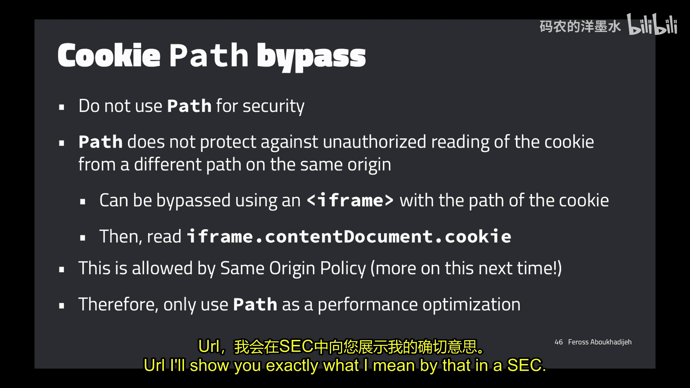

What I'm going to do here。Is I'm going to pick a。Victims site so what are we going to pick here。

 let's pick on 106A。Socause， you know， they are just learning how to code。 So， you know。

 they probably have some bugs in their site。 Okay， so， so this。

 this is a little bit contrived because。😊，Because they actually don't have any kind of login functionality on this on this page here。

 But let's say that let's just say that that there's some code that ran。

 you know that that does document talk cookie equals， I don't know， sessionession I D。Equals 12，3，4。

You know， and。Let's say that they're paranoid so they know that if they if they were to just set their cookie like this that any any sort of page on web。

 Stanford。 E would be able to see this cookie right and they're worried about that because they know that CS 253 is hosted on the Sam URL and they're worried about that understandably and so they're going to do this they're going to say okay you know path equals slash class slash CS 106 a。

呃。Yeah， so actually yeah' let's let's just go at that。 So so yeah。

 so they're gonna set this like this。 And then let's check document cookie and just make sure that that was set。

 So yeah， we have one cookie。 It session I D equals 1，2，3，4。

 and you'll notice that this sort of metadata about about the cookie is not included when you look it up。

 but it is actually stored in the browser。 canop we can check that out by going here to the application tab and just making sure that that that it's kind of cramped here but how do I see basically domain path there it is So this cookie is sort of only supposed to be sent to classlash CS16 great。

😊，So。So how can I get around this？ So let's say I go to。Cs 253。So。Complete different site。

 So if I check document cookie， what do we got here， It's empty。 Okay， so。

 so browser seems to be doing its job。 It's not providing the cookies to this sort of separate path。

 But there's a weight around it， which is。That because。Well， I guess we'll talk about the yeah。

 the same origin policy we' sort of explain in full。

 And that's the next time we'll explain in full or exactly why this works。

 But let's just show you how it works or like how to actually actually do it for now。

 So we're gonna to do is create an iframe， which is a little window to another page。

 and we're gonna add it to this page。 So we're gonna create a little window that contains the one or 6 page and put it into our page。

 we're allowed to do that。 that's sites can do this to your site。

 So you have to be sort prepared for this。 actually。

 that's a a thing that can happen to to your site that somebody can put you in a little box in their page and then move that around or do whatever they want。

 So in this case， we're gonna make the iframe。 Now nothing's actually change in the page because I haven't added it to the page yet。

 But before I do that， what I'm gonna do is set the source of the iframe to。😊。

To be what was that URL？I want to just get the actual URL， so here we go， this is the URL so copy。

the Mid。Check one thing real quick。 Yeah， Okay， cool。 So that's thats so， so copy the URL。 I'm。

 I'm back on， I'm on 2，53。 So here's the URL。 That's now。Wait what？What just happened。

They not name it， Iphan。Yeah lets let's try that again。 Let's show what happened there。

 So make an iframe。 and then I'll say iframe do source equals the 1 of 6 a URL。 Okay， yeah。

 I don't know what happened there。 But anyway， So so now we have an iframe and it's it's set to the 1 of 6 a site。

 And now I'm going to add that to the page。 I'm going to do document out body， which is the body tag。

Pend。The iPhoneframe。Okay， so there it is。Yeah。Beautiful， so now， one thing we can do， too。

 if we want to be particularly fancy here is we can do， we can hide it。 So this。

 this would all run in an instant。 The user wouldn't see that were。😊，Sort of。There we go。

 So it's there， but it's invisible。 And so then what we could do is we could then use our reference to the iframe and so we have this iframe here right。

 what can we do with it。 Well there there's a property on it called content document。

 This is effectively， you know know how we have a document variable here。

 This is the document variable of of that page。 That's the document variable for the 106 a site。

 And we are allowed to actually access that。 So we are allowed to cross that iframe and boundary。

 That is that is like like I mentioned， we'll talk about the same origin policy。

 It allows us to do this。 So we cross the boundary。 and then we we pull out what are we gonna do。

cookie， right document do cookie， but for the iPhoneframe。 And there it is。

 So were allowed to read their cookies。 That mechanism， doesn't work。So， so yeah。 and again。

 this is because of the sort of disconnect between the way cookies defined their security model and the true security model for for the rest of the browser。

 which we're going talk about next time。

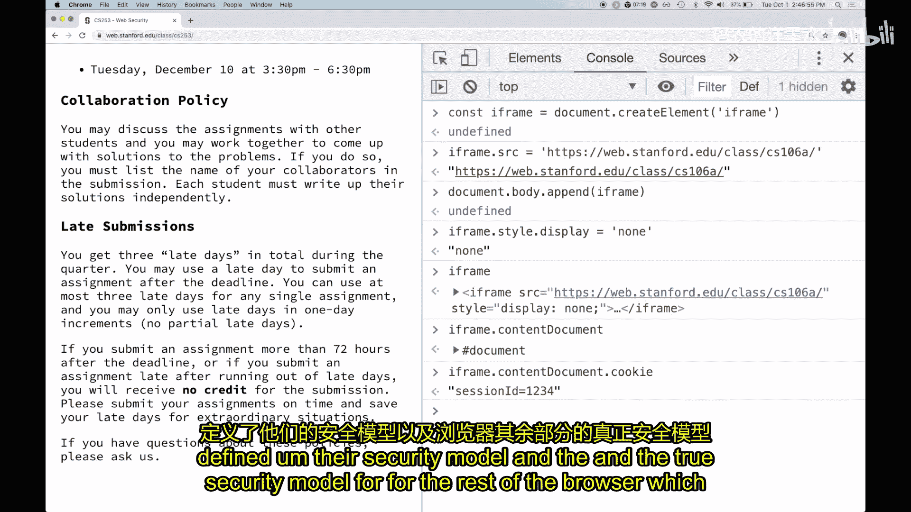

Cool， so yeah， this is something to really know about。Yeah， sure that。いだ。Right。

 so I was allowed to do that because I was also on web。tanford。edu and so the browser allowed that。

That's actually just how the whole security model for the web works。

 I feel like I preview a little bit here。 I should probably just put in an actual explanation of it because it's really not that hard of a concept。

 but we're gonna to talk about that first thing next time。

 but basically it comes down to the browser looks and sees if the domain name is the same the port is the same in this case we didn't really use the。

 port8 the default。 and if the protocol is the same。 which is Https in both cases。

 those three things are the same。 then you're allowed to effectively do whatever you want with the page you can manipulate it however you want。

 you can reach into its context， you can change its do nodes and that's the same origin policy。

 So if those are different then're like you have to sort arms length。

 You can't really manipulate the page that's why we were able to do that。

 So oh the path thing is going protect us is going keep this cookie isolated is really not true because we can just go in and run our own jascript directly in the1 of6a page I wonder if there's actually some there may be some security issue because of this because all Stanford sites are on web。

for EDU in different folders， so I don't know I't actually looked too much into it。

 but that might be a fertile place for looking for problems if anyone's interested。

Does this work in so domain means？I's like if you think about select。Like general。Yeah。

 so with subdomains， those are treated as as different host names so that that triple I talked about the protocol。

 the host name and then the port， so that would be considered different。 Yeah。

 that's actually a good way that that's a commonway sites actually do create isolation because you know。

 when they want that they'll just make a subdomain yeah。Okay。

 so I don't think we have time for for the rest of of this。 We'll get。

 we'll just maybe do do this next time。 So so that's it。 Yeah， thanks everybody。

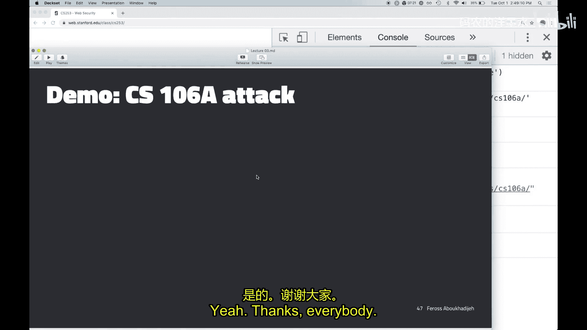

Co。