# 【全集】斯坦福大学 CS253 网络安全 中英字幕 1080P p04 Lecture 4 - 跨站请求伪造，同一来源政策 -BV1RemEBZEEM_p4-

Okay， cool， let's get started。So for today we're gonna focus on the same origin policy。

 but before I get into it， I want to finish up what we didn't finish last time a little bit of stuff on cookies。

 so I'm gonna just switch back to the end of that presentation。

 So if you remember we demoed setting a cookie on the 106A website and then we were on the 253 site and we were able to read the cookie even though when we set the cookie originally we specified that we wanted it to only be accessible to the 106A site So remember the reason for that was that。

There's a different security policy going on here in terms of like letting the 253 site access the Dom of the 106 a site。

 And even though the cookie is sort of targeted to this specific path。

 we're able to basically make a frame and then reach into that Dom and that that's。

AndThat's because of the same origin policy。So。What。

 what can we do here if we want to actually enforce a policy like this， Like say 1 or，6。

 A wanted to be able to set a session cookie and only have it be be valid and accessible on that particular path。

 So is there something we can do here。 turns out like， no， there's just not。

 It's unsafe to rely on path。 And you know， we have to expect that cookies can， can。

And cookies can be accessed if we do that。 So in particular。

 we could do is we could have two sub domainomains like this。 if we had C1。

6 A do Stanford ED U and CS3 Stanford ED U V would not be able to talk to each other。

 So there's some sort of weird kind of cookie rules going on here。 So， in particular， yeah。

 the rules here。 So it's cookies can only be accessed by equal or more specific domains。

 So so so the。Two domains are on an equal level can't access each other。

 But what about this example here， we have 253。 Stanford。edu and Stanford。edu。So based on the rule。

 what do we think is going to happen here？Should these be able to access each other's cookies。

 yeah go ahead， it seems like Stanford should be able to access 253s。呃。Cookies can only accessed。

 Oh so it's actually flipped。 Yeah， so cookies can only be accessed by equal or more specific domains。

 So that means Stanford's cookies can be accessed by Stanford Eduu and more specific。

 So this is like what they mean by more specific。 So like like more things tacked on to the end。

 Yeah So Yeah the former can to the latters cookies。 But the reverse is not true。 it's kind of weird。

 but that's sort of just how the rules are that's actually a reason why in the case of the Stanford login system。

 they put cookies for that on a completely separate subdomain。

 So login Stanford Eu is where you go sign in when your password's correct。

 it puts a cookie on that subdomain。 And that means that like the ACM club， for example。

 couldn't go ahead and read those cookies because because again it's not a more specific subdomain。

So yeah， these are， these are sort of separate cookie cookie jars。

 And then what about this example here just to make sure we're on the same page。

Which can access which in this example。嗯。😊，Oh yeah， go ahead。How we can access more？Right， exactly。

 yeah， that's right。Good。So， so so because because of because of this， like we。

 we sort of just shouldn't rely on path。 one thing， one thing， though。

 is the the default value for this path is actually that the path that you're currently on when you。

 when you。When the server attempts to set the cookie。

 So if you're on like the 1068 page and you don't specify path because I just said don't do that。

 it's not secure， don't rely on it。 So you just omit it。

 then it's gonna end up giving it a path of the page that are currently on。

 which is maybe unexpected。 you might want we might want the cookie to be available everywhere since we're not relying on this a security mechanism。

 So let's just not fool ourselves and just like let's not use path at all。

 So what you really need to do here is actually explicitly set path to the root of the site。

 If you do this， then then it's sort of I think it makes it clear because you end up with the cookies are visible everywhere where they're actually visible。

 You know what I mean you're not sort fooling yourself into thinking that this is doing something。

 So that's my advice is sort always set path to the root。

 So now this is sort of what our cookie setting looks like we've done secure so that the cookies is only sent over H Ttps。

 We've done H TtP only which sounds like it's contradicting the last。

But remember who remembers what HTP only does？Yeah。cannot。So like， oh。The image one。So the only HTTP。

Yes。That's the one。 Yeah， so basically， if you have if if you're trying to attempt to access this cookie from jascript。

 So from javascript running in the browser， you won't be able to see the cookie。

 it'll be it'll be there in the browser and it will be sent to the server and H TP requests to the server。

 But code running in a page can't see that it's there。

 And this is a nice defense against attacker gets code running in a page。

 then sort of limits the damage that they can do。 Okay， so we have those two。 And we throw in path。

 And so this is， this is better。😊，For the reasons I said。

So there's's other sort of general problem with this whole cookie design。

 which is is sort one of the benefits of ambient authority that we mentioned before is that it sort of automatically every request you make is sort of has the authority of this cookie。

 but it can create problems when the browser sort of helpfully includes cookies in requests that you wouldn't expect that it would。

 So in this particular example， say that we're on attacker do com。 Okay。

 so we clicked a link we ended up on a sketchy site。

 And this site just embeds an image that goes through this URL。

So this URL is attempting to withdraw from Bob's account to mallllory's account an amount of$1000。

 And obviously this this probably should have been should have been implemented by the server as a post request。

 not a get request， that would be sort of one defense against this。

 but let's say that let's say that's a get request。

 So the browser is gonna attempt to fetch this displayed as an image and the response from the server in this case is probably gonna to be some kind of Json or something that's not actually an image but that doesn't matter the attacker doesn't care because the request was able to go through to the server and the browser notice。

 you're sending a request to bank examplele co and it's going to look and see are there any cookies from bankexle com and say that the user。

Logged into bank thoughtex com know， in another tab or， know， maybe 15 minutes ago。

 So they still have an active session with the server。 And so their session ideas of valid。

 Well browsers are going attach the cookies for bank thoughtex com to this request。

 And then when the server gets it， it's gonna look and say， oh， this is like the user logged in。

 They have a valid session。 Oh， they're trying to transfer some money。 Okay， go ahead。

 it looks valid to me And so this attack site has been able to sort of create a false like like a request on the behalf of the user with the authority of the user right。

😊，So this is really bad。 Does this make sense why this is possible？Okay， cool。

I see some a couple confused faces。Yeah。The first example that you showed。Previous class。Was that。

Was that。Not it was like attack me。Was this always like a different website that they talked your。

Which example are you referring to？お射で。Was it this？This one。Yeah yeah， oh yeah。

 So this is this is just a method to sort of expfiltrate data。

 This is just sort of a way to sort of send a get request to the attacker server with some information that the attacker wants。

 So when this request goes to the attacker， we'll see request came in at this URL and they can save that information。

 It's a little different because in this case we're trying to do is we're actually we're on a different website。

 We're on the attacker' site。 So it's sort of the reverse。😊。

We're on the attacker site and we're sending a request to a legitimate site that the user is actually logged into。

 And because the browser has this behavior where it texts the cookies on automatically to any site that has its associated cookies。

 then the server， if they just sort of naively looks at this request。

 it'll think that it's actually authorized by the user because's gonna see a request come in with both the correct hook cookies and then it's gonna to go ahead and and do the action on behalf of the user So in the first attack。

 we would need to have the to be in the same domain or a more specific sub domain。

Couldn't you intercept like since you're yelling off the site like this HDP request and just deal the good。

Like you send any。Request through bankexemple。com。And just like send also the that request to my certain。

So you're saying that you're on attacker。com and then you're sending this request to bank thatexample。

com is that you're saying Yes， so I'm like the attacker server， okay？And I'm sending。

 so now I send the BH Act to I send the image to bankexempble。com。

And the browser would turn to be cookies right are you sending this request from this attacker server from the client from the client？

Yeah， so if you're anytime you send a request from the client to this server。

 the browser will attach the cookies for that site。 automatically。 So they intercept No， you can't。

 So yeah， that's a good， So it's a good question。 So in this situation。

 the site that's embedding this image。 So the attack site that's embedding this image。

 It actually can't see， the actual request that's going out。 The browser is just gonna fire that off。

 And it's not like it can observe it or anything like that。 All it can do is。Is it can actually。

 there's not really much that it can see one thing it can do is it can attach event handlers to this image。

 It can attach on success and on error， and it can sort of find out whether what was returned by the server was was a valid image or not。

 It can detect that。 but obviously it's not going to be a valid image in this situation。

 But that's that's pretty much it。 yeah。Can you do the same thing in JavaScript with like a Jack？

Yeah， so that's a good question。 so we're going get really into all the nitty gritty of that in the same margin stuff that's going in a couple minutes but in general。

 in general， no， when you're firing off an ARX request。Actually。

 we'll just save that for say that for a little bit。 we'll get into that like a couple minutes。

 I promise。 Okay， so so this whole， this whole idea here is is called cross site request forgery。

 And the idea is that attacker is trying to execute actions that are unwanted by the user and and it's enabled by the fact that the user currently authenticator or logged into that Web app。

 So why would you do this。 we just give an example at the bank。

 So that's like a normal user you're of executing an attack。

 It's forcing the user to perform some kind of request that you want them to do like transferring their funds or changing their email address or resetting their password or whatever kind of request you want to send you can do that action on on behalf of the user。

If you're doing this and the users logged into some sort of an administrative interface。

 like maybe they're an admin of a Wordpress site or something。 you can， you know。

 that request can be much more damaging。 You can。 that request can potentially， you know。

 create a new admin user on their site， or it could。In some cases。

 allow you to just run code on the server。 If you're logged in as an admin， oftentimes。

 you can just send a request that will just like shell like run a shell script on the server as as you know as as a server user。

 So it's， it's pretty damaging。To create an amin user， for example， the attacker。認知てな。

What kind of like paths？Points are there。Yeah。So there's a bit of knowledge that the attacker has to have here。

 They have to， first of all know like what exactly They have to know what the path is。

 they have to they have to're assuming the users logged in if the user is not logged in。

 then this request will fail and things like this。 Yeah， that's true。

 But you can imagine this being used in a phishing attack or something like that where send a targeted email to somebody。

 You know they're a member of a particular site or maybe maybe you know that you know that they're a Bank of America customer via some of the other attacks we're gonna talk about where you can learn this information。

 And then then what you can do is you can just target your request specifically to the bank URL that you know that they they're a member of and just hope that they're logged in right。

Yeah。Cool， so and then notice， it's really important here that we didn't actually need to read the response to do this attack。

 Right， because what we actually did here was like this image this server of response from the server came back and the browser tended to render it as an image。

 which is gonna fail， but we don't care。 Like the request was sent。 the damage was done， right。

 because the server received a request。 and it sent sent back a response。 So the damage was done。

 Does that make sense。Okay。Cool， so I'm gonna just do a little demo of this actually in action really quick。

 So I like I like doing demos。 I think they're fun。 So let's。😊，Let's see here。没。Cool。

 everyone can see this。 Okay， cool。So。So we have here is the code from last time for our bank website。

 and we're going to do here is add a path。A new route to it。

 So just re familiararize yourself with the code really quick if you've forgotten。

 this is the most important part right here。Cool， so let's add。

 let's add a little bit of additional functionality to the site to make it more interesting。

 So right now， when the user is logged in we just send back this string here。

 I think we should change it and make it。Include a little bit of additional HTML。

 so I'm just going to put it right in line here because that's easiest。So let's make a form。

And this form will let let the user transfer money to another user。 So let's go ahead and。

Make the action of this be。It's going to submit to slash transfer。

So we're going to have to go ahead and write that route in a second。Okay， so we have a form。

 it needs to have a send amount。Justly an input。Let's call the input amount。

And then we need to have a two user to send the money to。Let's call that two。And then oops okay。

 there we go。 And then let's just make a submit button。So type equals。Submit。

 was this big enough everybody。type equals submit value equals send that'll be what shows up on the button。

Okay， let me。Let's run the server here， just make sure that that worked。

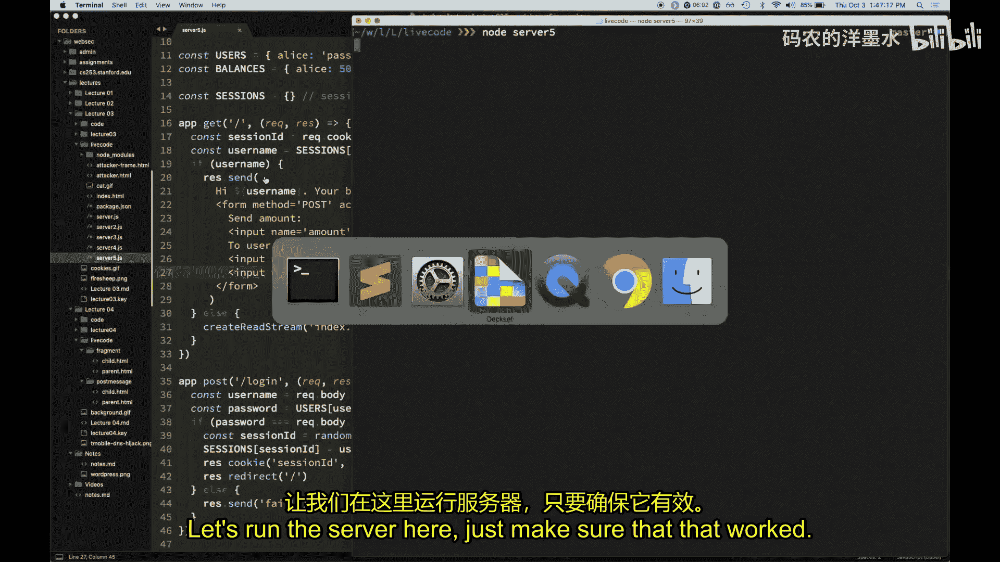

Okay， so I。W again。Cool， I have a send in and a two now。 cool。 Okay。

 now let's implement the actual route。 Actually， let's， let's also add a balances table here。

 So we'll just give every user a different balance。 So we'll go。

 this will be a map from username to balance， basically。 So let's say that， we already have that。

 oops， sorry about that。 Yeah， okay， I'm I'm being goofy。 We already have balances。 Okay。

 So then now we just need to do transfer。 That's okay， that's let's do that。 So。😊。

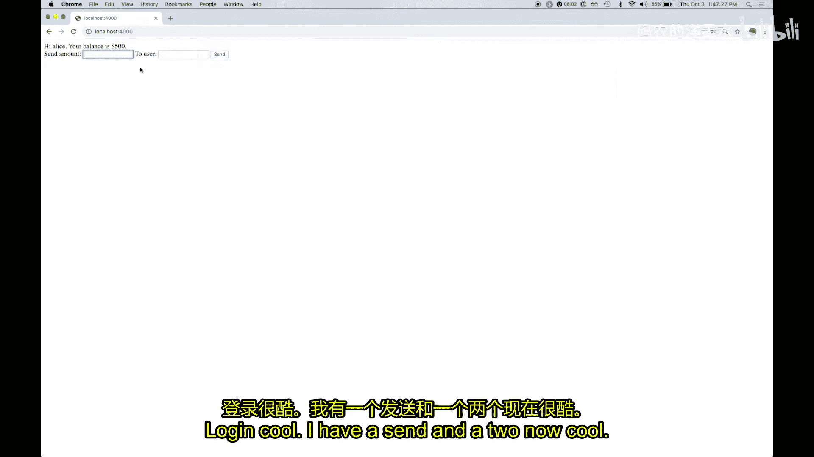

Let's add a route called that's going to be a post。

 So nice thing about this being post is that that an attacker can't use the image trick that we just looked at a second ago because image tags cause a get request to get sent to the server。

 not a post。 So that's maybe that' will protect us， maybe not。 we'll see。Okay。

 so we're going to say when somebody posts to the transfer。Endpoint， let's get the session。

From their cookies。Okay and then we'll look them up in the sessions table and make sure that they have an active session。

Okay， so then this is either going to be set or not set。 So let's say if it's not set。

 so in other words， the user sent a post request to transfer and they're not even logged in well then let's just tell them to go away because that doesn't make sense。

 We can't have an unauthentated user trying to transfer money。

 So let's just send them back the string fail and then do an early return。Okay， otherwise。

 let's actually do the transfer。So what I'm going to do here is I'm going so remember in the form here。

 we had two fields， we had amount and two that are being sent。

 So what I can do is I can get the the amount from the body。And it's going to be a string。

 so I'm going to convert it to a number。And let's also get the two value as well。

 so the two is going to be the name of the account to send the money to。

 so that'll just be under Rebody2， and that's already a string， so we don't need to convert it。Okay。

 so now we know， now we know we need to actually， we need to actually do。 So let's do it。

 So we're gonna take them， take money from。userr name。Which is the logged in user。

 We're going decrement by amount， and then we're going to add。And， and we're gonna add。

The amount to the two account。 and then we're gonna let's just redirect the user back to the homepage to finish things off。

Okay。So this is just like a really simple naive sort of transfer system。 Probably in a real system。

 we we would want to do some kind of a transaction。 So if the server crash。

 like right after this line that we wouldn't have。Something that a state that doesn't make sense。

 but whatever， this is a simple example。Okay， cool。 So， so now， so now let's just test it。

 it works really quick。 So， so the servers already running。 Oh yeah， I need to restart it。 Okay。

 I'll do that。 Okay， so refresh， let's log in。😊。

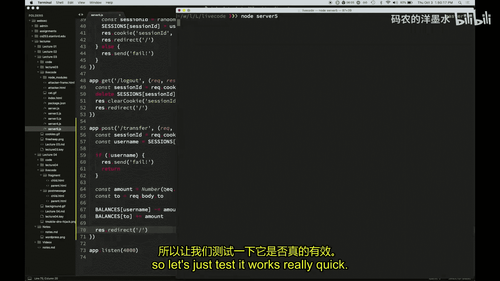

Okay， and so I have $500， and I think Bob had $100， right， so let's send $100 to Bob。Cool， okay。

 not only like log out， just make sure Bob got it。 just make sure we don't have any bugs。 So Bob。

And then。12， okay， goodbyee's$200 now， so it works cool。Okay。

 so there's a problem with this approach。嗯。This， this is even though we switch to using post request for this endpoint。

 an attack site can still cause a request to get sent to the server that the server will will interpret as。

 as valid。 So let's see how to do that。 So what I'm going to do is I'm going to make let's make just make another file here called。

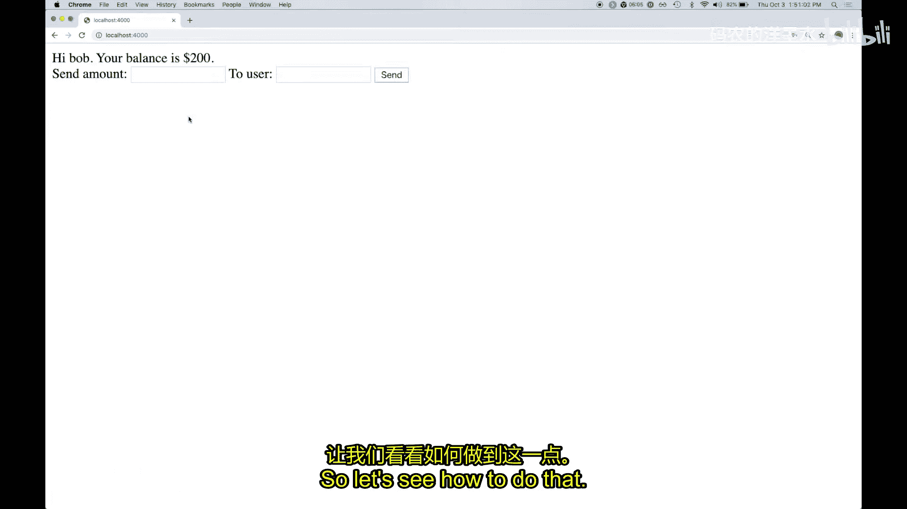

Attacker。 Okay， let's do that。 So I have this file here called attacker。

 and what I' do is I'll start a second server here。

And this is just simulating a completely different website right so what I'm going to do is just start up a server on port 9999。

 which looks like an evil port number。That should help us know which is the attacker and which is the target。

 Okay， So okay， so cool。 So so let' let's see。 What should the attacker do so。Well， let's let's see。

 So， let's make a page where the page looks kind of innocent。 So somebody might come， you know。

 come to it and then be sort of browsing around， maybe looking at cat pictures or something and not realize that this this request is being fired off in the background。

 So let's make it look kind of innocent。 So cool。 Cat site。 And then。

I have a cat I already downloaded。Can'tuck gift。Cool， so that'll keep them distracted， meanwhile。

Meanwhile， what we're going to do here is I'm going to go to the code。

 so remember this code here this form here that includes the sort of amount in the two and all this。

 let's just copy that right there right directly here into the attack site and we can go ahead and hide it。

With style display none。 So users is not going to see that this form is even here， right。

And we can remove this text。 This text doesn't do anything。 Let's just clean it up a little bit。

 So we have the the form fields here。 And one thing we can do is we can just put a value into it。

 So it's sort of prefilled with the value that we want。 So let's say we want to send 100。

 Let's say let's see Alice is the attacker here。 So， so we'll send。$100 to Alice。Cool。

 and then we need to actually submit this form。Oh yeah。

 one thing also one other thing we need to do here is V U is wrong。 So we're on the attacker site。

 So it's not enough to sort of submit this form to slash transfer。

 that would that would actually submit it to the attacker's own site， which isn't gonna do anything。

 We're trying to sort of。We're trying to forge a request。To the actual， you know target site。

 So let's actually put in the URL of the target here， which is local host 4000。

 So we're on local host 9，9，9，9。 and we're gonna fire off a request to local host 4000 slash transfer。

Okay， so amount it's actually fired off， so we do script。

We'll put a script in here and then this is like kind of bad code style but it gets the job done so there's this sort of global called document。

forms which just gives you an array of all the forms on the page and so we'll just we'll use that。

The reason why this is kind of bad is because if the form order sort of changes。

 then you're indexing and you're gonna to get a different form。

 but we only have one form here So it's fine。 and then we'll just call submit on the form。

 So that actually basically clicks the submit button on the behalf of the user effectively。Right。

So there's one problem with this right now， as， as I've written it， which is that。

The user is going to come here and ensure they're not going to see that this form is here because we hit it。

 but one thing that's bad is that。Is that when you submit a form。

 the sort of default behavior of the browser is to is to actually send you to a new page。

 So they're gonna to get kicked off of the cat page that they're on， which will be kind of fishy。

 So let's let's clean this up just a little bit。 So what we can do is we can take the the form here。

And just we'll copy it out and put it into a different file called attackerframe。 HTMLt。

 can you see that there yeah， so I just have a separate file and we're just going to paste the same exact code in here and then what we're going to do is just include a frame that points to that file。

And so what does this accomplish， well， what this accomplishes that is that now this frame。

It's going to load up that H TM here。 Actually， I'll just remove this style and we can see it in action。

 So and actually， I'll comment out the submit button for a sec。

 so we can just see what this looks like。 Okay， so， so let me。

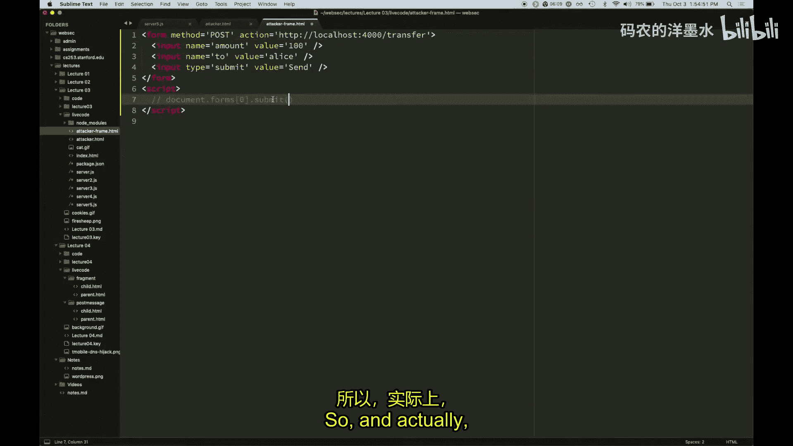

Let me go to the attacker's site， oops。Okay。Okay， so。😊。

So we have our distraction and then we have our frame。

 and what's cool about this is now if I click sendend， then it's going to navigate this frame。

 but it's not going to navigate the entire page， so that's the idea behind that it's just sort of cleans up the attack it makes it a little bit less noticeable。

So okay so let's see here， so now let's actually just sort of do it completely， so we'll here。

 we'll go back to the so I'll actually want to automatically submit the form again and then I'm going to go here and I'm just going to hide this frame with the same CSS as before。

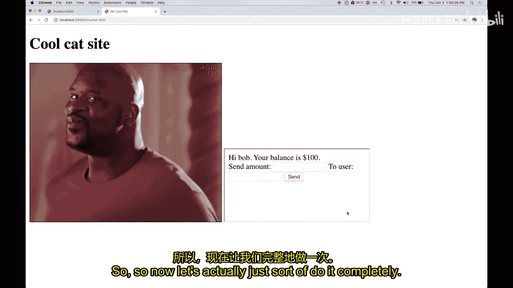

Spplay none， okay。So， now。

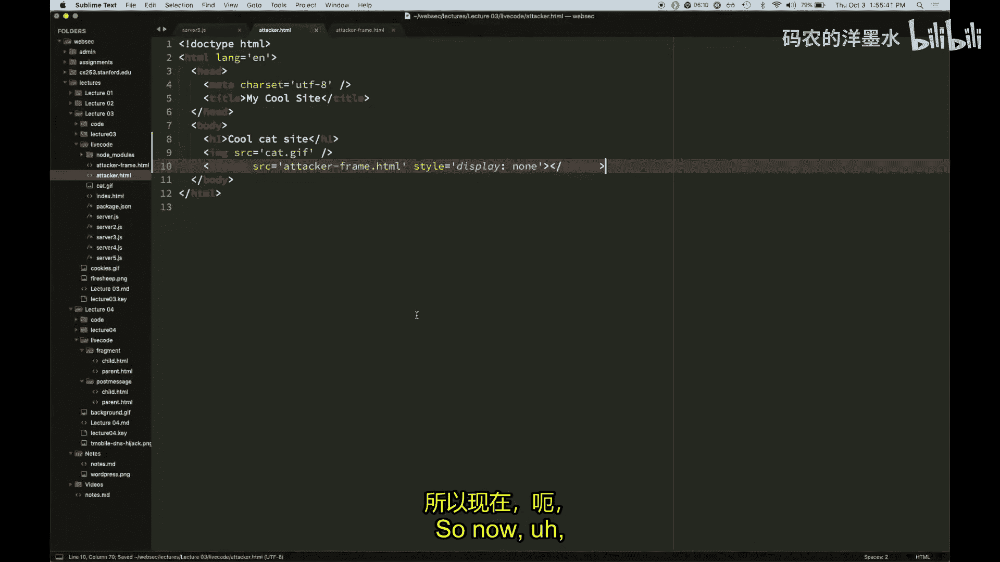

If I。So let's， let's， let's see here。 So we have to start off on。 So the way。

 the way this works is the user has to be logged into。The user has to be logged in to the bank。

 So so we just check here， we're logged in right， We're logged in as Bob。 So that's great。

 So now if I go to this site and actually refresh。Let's go back now and check my my balance。Wait。

That shouldn't have happened。What happened here？So we sent a request to localhos 4。

000 s transfer and it contains a amount 102 Alices。And。Let's see here。

what's the reason why this isn't working So the server， so the request contained the session ID。

Which is great， that means the server should accept it， right？And。Why oh， there it did。 Okay。

 I just needed， I just needed to refresh again。 Okay， anyway， there we go。

 So it looks like it worked。 So let's go ahead and and refresh the， the page one more time and then。

😊，Okay。😊，So the bank has other problems。But we can see here that so every time I come to this site。

 I don't see anything going on， but every time I refresh。

 we're going to keep firing off these requests。So， what's the lesson here。

 The lesson is that forms are also allowed to be submitted from one site to another。

 and we have to think about how to defend against this。This seems kind of like a problem。嗯。Cool。

 any questions about this？Yeah， go ahead。 You just have like Chme security something disabled or is Chme actually just like allowed this。

 This is all always allowed。 Yeah， wow， Yeah， this is always allowed。 So。

 so this is actually this is the crazy thing about this is that a site has to sort of actively go out of its way to implement a defense against this because the defaults are are kind of bad when it comes when it comes to this。

 Yeah， that's just a sort of。😊，unfortunate。Reality with the Web， yeah。People。

 let's say they like Facebook。Does Facebook？For login or like they use something else。ちょっと数字。

Do sites actually use forms like this， Yeah， yeah they do。

 theyre really really common still yeah so typically a site will use a form and then it will it might do something fancier on top of the form。

 so it might sort of detect when the user clicks the submit button and with JavaScript it'll sort of intercept that you know if its own JavaScript on its own site which it's allowed to do and then it might sort of fire off a login request in the background without the page sort of completely refreshing in order to improve the user experience but if JavaScript is turned off then typically like the form will just fall back to being a normal HTML form which will still work but it will cause this sort of page flash kind of thing so。

PeoplePeople often， you know。Do this for user experience reasons。 They don't want to， you know。

 sort of。Have the whole document sort of change when you log in， if that makes sense。But yeah。

 forms are still really common。Cool， okay， so so let's let's keep going。

 So I'll talk about a defense for this like later， but I just want to。

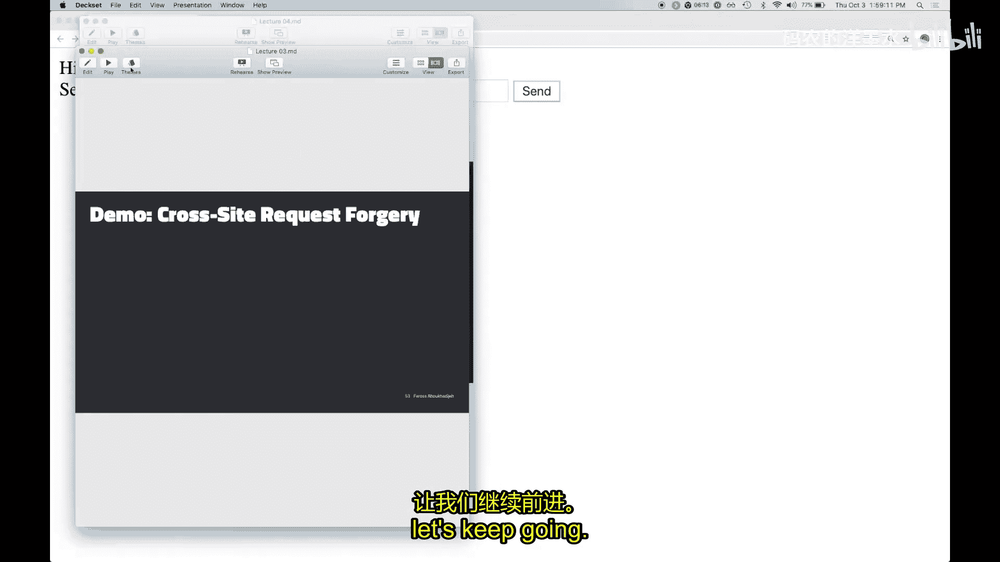

Oh yeah， actually I I'm mention one right now， but it's actually not a complete solution。

 So the one I'm gonna to mention right now is sort of the idea here is is there some way that we can remove this sort of ambient。

 this ambient authority that the cookie is providing when we know that the request is coming from not our site。

 from another site。Becauseuse if we could do that， that seems like it would solve the problem， right。

 what if we could just say， hey， like this cookie browser。

 please don't automatically attach it when you're， you're sending requests to my server unless that request originates from a page that's from also from my server。

 right。That seems like it would solve the problem。So。Basically。

 the attacker could could now could now do the same thing that we just did。

 But that the browser would say， wait a minute， when I was given this cookie。

 I was told not to attach it to request to this server because， you know。

 it's not coming from that same server。Does that make sense， Okay， so let's。

 let's dig into how that actually works。 So this， this is another cookie attribute called the same site。

 So if you attach this， you can sort of solve this problem for the most part， so。😊。

This is an attribute that prevents the cookie from being sent with requests that were initiated by other sites。

So there's three settings， the default is none， so it's sort of just the default browser behavior is to always just send the cookies along if they match the request。

But you can do Las， which is basically what it'll do is it'll say。

Anything that's a sub resource request。 So that's like an image embedded in a page or a form being submitted from a page or anything like that。

 Any request thats sort of。Coming from within a page that's called a subresource request that's different than a like I would call the opposite of that would be like a top level navigation。

 that would be if your browser actually goes to a URL that you can see in the URL bar that's a different thing。

 So just for the subresource requests if those are origin from another site。

 we want to prevent prevent the cookies from being attached， but for top level requests。

 we want to let the cookies be attached。So this setting is is is is is， is。

 would stop the problem that we that we just had。 If you want to go a step further。

 you're extremely paraoid， you can go with the strict mode。

 And what this says is just never send cookies if if the the user was was。A。

The user was sent to this site from like another site。This is really aggressive。 So in particular。

 it it doesn't even send cookies on top level requests。 So what does this mean， This means that if。

 if I have a blog post and I'm talking about how much I love my bank， which I would never write。

 But say I did。 I could link to that bank's home page。 And the user， if the user clicked that link。

The whole browser is going to go to this new page right， but with the strict setting。

 the browser is going to say that request actually originated from Ferross's blog。

And so don't attach the cookies。So even though that's kind of a completely innocent request of just sending into the home page。

 the fact that it originated from another site， even even at the top level。

 like it's not a malicious request， it's literally just the URL that the user themselves could have could have you know pasted into their URL bar。

 that's not gonna send the cookies。 This can be a little bit confusing。

 if you're logged into a social media site。 And then you click a link。 and they have this setting。

 then you're gonna click the link and you might be logged in some other tabs。

 But when you click a link from someone's log， it will end up not logged in in that tab。

 So this is actually almost too aggressive I would say。

 But if you're really you're doing something finance， maybe you want to do this。

 But this is actually probably the best setting for the the average site。😊。

I frame and set document allocation that I frame to assign site like that get request is not a sub that is because an Iframe is considered a subre as well yeah even though it I guess it's a top level of its own frame but it's still a subre yeah so lackX covers like most of the cases it sounds bad because you're like oh yeah I'm like my security las but it's actually it's actually much better than none。

Cool， so now this is what a cookie line looks like it's getting complicated。😊，But yeah。

 any questions about same site？Yeah， so if inside the default was la。

 what are some use cases that would break。If they just made the depot waxs， yeah。

 or legitimate reasons why you wouldn't want that。So yeah， that's， it's a great question。

 So it it would break some use cases。 So like one， one I can think about the top of my head is have you ever been on a site and you see like comments by Facebook。

So so。That little box， that's an iframe， right， And that's gonna make a request to load this little comment box。

 And if they turned on same site Las， what would happen is the cookies for that request would not actually get attached。

 And it wouldn't be able to show you like your avatar there and have a little box that ready for you to type your comment in like you wouldn't be logged into the comment box Basically。

 it would be like a logged out comment box。 You'd have to type in your username and password for for Facebook and also your comment in order to make that work because that's a little annoying。

Yeah， that's one thing another thing is like ad tracking。

 they don't want to turn this on at all because they basically attach cookies to every request for an ad so they can know that it's you and they're very happy to have that tracking information attached to every request so they would be unhappy with this change probably。

Yeah， I think those are。Because are two，2， two use cases that would break。 But actually， you know。

 the thing the thing is interesting is these aren't actually that good of use case。

 Like like people are sort of。The the threat of like this attack。

 plus like people's concerns about tracking are actually sort of changing the calculus around this。

 And there's actually now a proposal by Google to just make same site equal's laxs be the default for all browsers。

 So， this is what it says。 So first， cookie should be treated as Yeah。

 this is basically a sniip that I pulled out of the spec。That they propose。

 so cookies should be treated as same side equals lax by default。

 second cookies that explicitly assert same side equals none。嗯。Should also be marked as secure。

 Oh yeah。 so so the first part is what I already said。

 It's basically that lacks would become the default。 But the second part is kind of interesting。

 This is。Sort of Google's attempts to solve like ad tracking。

 which is to their idea is so if this is the default， the fl is the default。

 then the only people who are doing same set equals none are probably ad people or or。呃。

That maybe something kind of a little more sketch。 So let's let's let's force all this cookies to be marked as secure。

 but the very least that tracking data is going over H T TPS and people can't passively observe it if that wasn't true then in theory。

 these requests would have this tracking data attached that anyone on the network like your ISP or the NSA could read and then learn that it's you right because because this data is being sent in the clear。

 So this is sort of like。Sly better situation。But yeah， so this is this is。

This is a kind of a good improvement， I think。Cool， any questions？

So I think this is going to roll out soon in Chrome， which is kind of exciting。Okay。

 so one last one last thing。 So how long should you set your cookies for I was I mentioned last time like 30 days is probably sufficient because you can sort of reset the counter every time the user comes to your page by sending them cookie header again and itll be 30 days from that moment on。

 So now if we add that is what our cookie is looking like。

 And So now what I want to do is actually want to go in now to our server。

 And I want to add all these options that we talked about。

 So express has this nice sort API for enabling all these features on our cookies。

 And so let's go ahead and add that and see see if if it fixes fixes the attack。

 But one thing to note is when you actually go to clear your cookies。

 how we do that again give the cookie with the same name And then tell expires in the task and then the browser clears it。

 We have to make sure that all the other attributes are exactly the same as when it was set。

 it's a little bity because if you don't do this， the browser thinks that it's actually a separate cookie with the same name。

😊，And you can actually have multiple cookies with the same name that have different attributes。

 So anyway， you have to just make sure these are these are equivalent except for the the max age。

 right because that's gonna to be set to the past。 So we don't have to pass that in。

 but everything else has to be has to line up exactly。

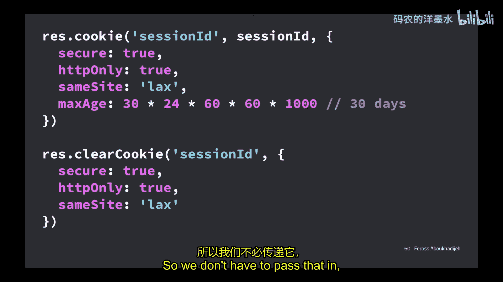

Okay。So I'm going to go ahead and try that。 So， so let's go to our server and try to do this defense。

 So we're going to go in here and we're gonna say， okay， set our cookie。 When we said it。

 we're gonna make it be。

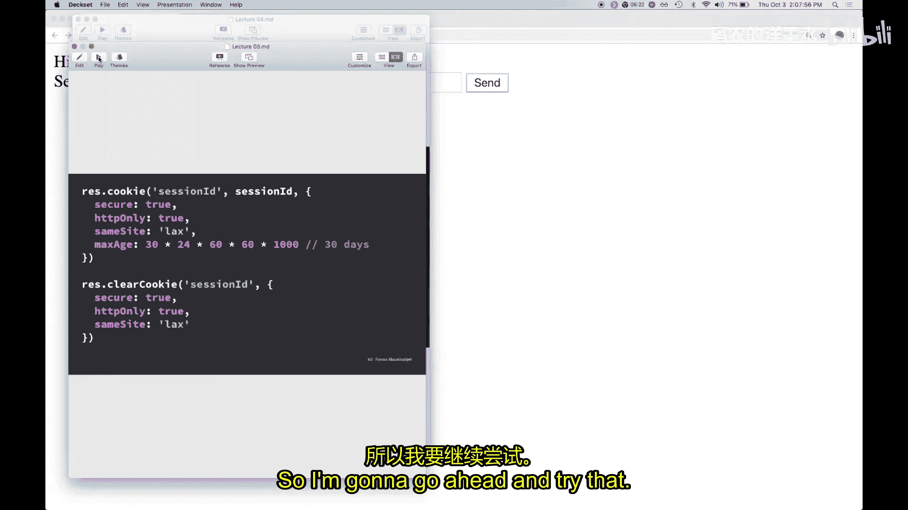

嗯。What do we say it was gonna be。 It was gonna be。 So I， I want to do secure true， but I actually。

 I can't do this because we're running on local host， which is， I just have an H T TP server。

 So I'm gonna go ahead and omit this particular option。 But we could do that on a real。

 on a real production server。 But I'll do the rest。 I'll do。HtTP only to protect it from JavaScript。

 and then I'll do same site。In particular， I'm hoping that this one is going to actually protect us against。

The CSRF attack。And then let's just set a max age because why not。 So 30 days， 24 hours in a day。

60 minutes in an hour，60 seconds in a minute， 1000 milliseconds。30 days， okay。

And then when we clear the cookie， we have to pass， like I said， this sort of same options。

 so let's do HP only true and same site lacks。Okay。

 and I'll just omit secure again because we're not doing that。Cool， all right。That should be it。

 So let's see if it works。 So I'll just restart these servers for a good measure， just to be sure。

 I'll refresh my bank log in as Bob， right， because。

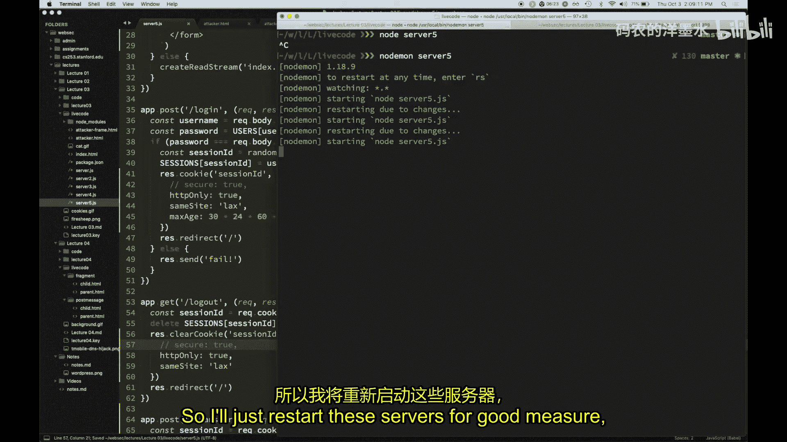

Alice is the attacker in this case， so okay， Bob's balances back to 100 Hooray， now we come here。

We'llRefresh the page。And now let's take a look at the let's just check our balance first refresh。

 what it didn't work。But heck。Okay， see if we could debug this live。What happens So。

 so H TTP only is on and same site。Lax is on。What gives what okay？This what hold on site。Let's see。

As far as cookies are concerned。I mean， yeah。It's still a local host。

 but I don't think that should matter because same sight is defined as。Okay， let's see if we can。

Alright， and then do some real time deepbugging here。呃。I going check this out really quick。Okay。

 this is not specific enough。 I need to take into the。To the spec， to see what happened here。

So our cookie was attached despite the fact that it was same site。Maybe this is because。Actually， no。

 I can'' I can't figure out why it would do that。And。

It could be that same site is because it's localist here here's one thing we can do。

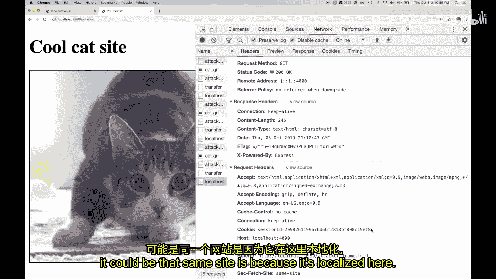

I can。

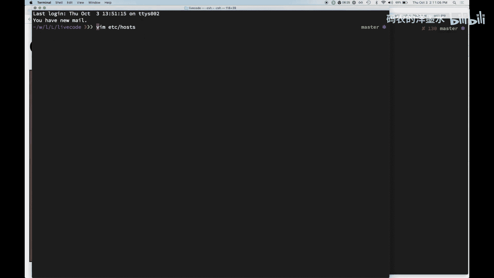

Actually， I don't want to do this。 I don't want to do this live。 Okay。

 well go ahead suggestions that you're making like。

You said something about like lacks allowing for top level resources is a frame top level Yeah。

 I mean okay， maybe that's what it is like look， let's just see I don't think that's the case but。

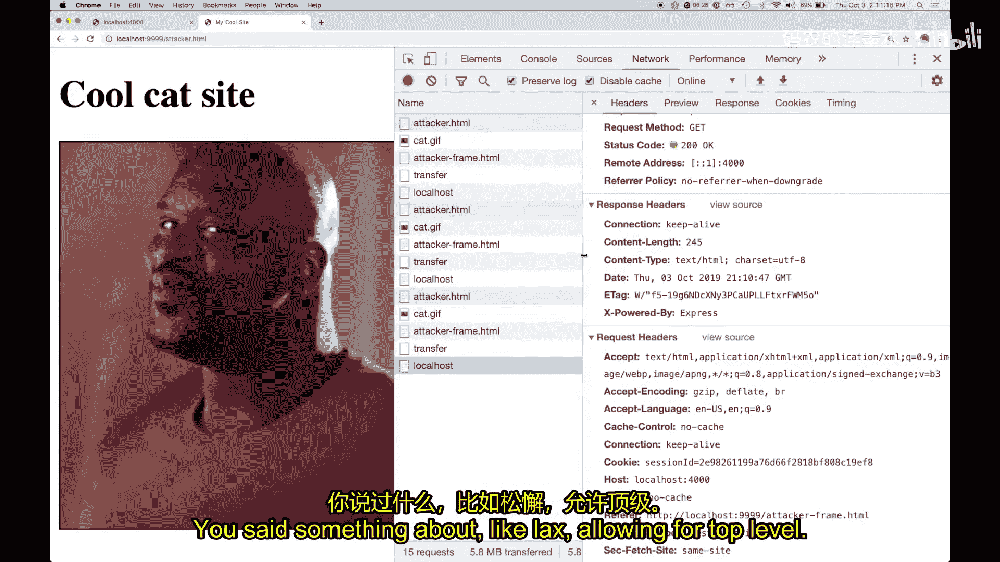

let's， let's rule， let's rule it out。 Okay， so I'll do this again。 So cookies。

 I I shouldn't I should have at least just delete this refresh Bob Hunter to。 Okay。

 so now I I've been given a strict cookie and now I'll I'll refresh this look at the transfer request。

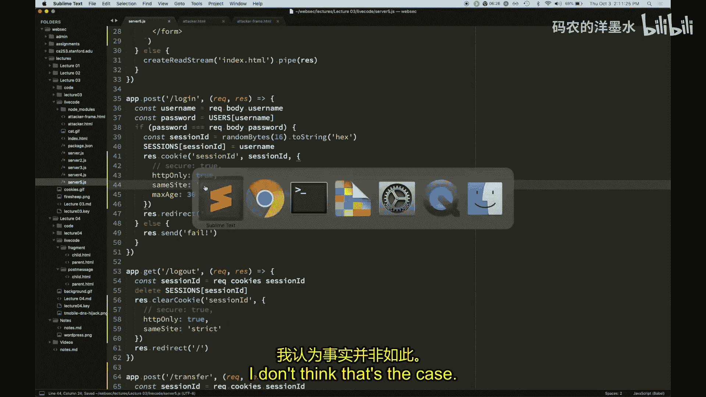

And the request header still includes the cookie， okay。Okay， well。

 just I'll debug this offline and I'll get you guys an answer next time about why this is happening。

Because like they have to see my。反们。So， so cookies the cookies and， and also same margin policy。

 which I'm gonna talk about in just a sec。 don't actually care about the I P。 They。

 they only care about like the。the domain itself， yeah， in case of same origin policy。

 we care about a couple of the other things in the URL too but yeah。

 maybe what's going on here is' because the domain is the same and cookies might be looking at that。

 but I'll get you guys an answer next time I'm not sure why this happened Does not suck v side same side give any clues。

Use。Oh， that's actually very useful。 So this is， this is these are sort of options these are sort of new security headers that the browser attaches to help you figure out where a request is coming from and like how it was triggered。

 So so a site can make more intelligent decisions。 And you're right it does think that it's the same site。

 So I'm guessing this is because of local host。 Okay， here。 I'll just try one thing really quick。😊。

So we're back in action。 So what I did， what I did was I basically just added I added a mapping from a attacker dot com to。

 to my local computer。 So if I type in attacker do com now， it's going to be。

 it's going actually just fetch， fetch a page off of my own computer。 Okay。

 so now let's see what happened here。😊，AS Ve site is now cross site and the cookie is not sent。

 so yes。Thank you。 That's it， yeah。So okay， so let's， let's see how much the balance is at now， Okay。

 so well， it's probably at zero because of the other one succeeding。

 but if I refresh this a few times。Now I come back here， it's okay。

 those requests are not succeeding。 Excelt。 Okay， so so this is because cookies are looking at just the domain。

 not the whole origin， okay。

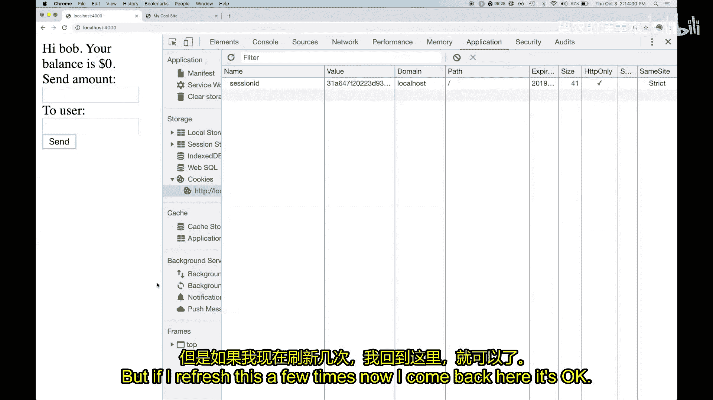

Excellent。Cool， so just final thoughts on cookies so cookies influence sessions。

 never trust data from the client， ambient authority is useful。

 but it opens you up to some risks and if you remember only one thing。

 set your cookies like this cool onto same origin now。😊，Allright， for same origin policy， basically。

 the idea here is we want to think about what do we want to allow what we want to deny。

 So let's go through some scenarios。 Should site A be able to link to site B， What do we think。

Should we be allowed this？Yeah， I mean， this is the way the whole web works。 So yeah， this is。

 this is too useful to not allow it。 Okay， should a site should site A be able to embed site B。

What do we think。Yeah， okay。Anyone think no。Yeah， it kind of depends like， I don't know。

 This seems like it's kind of useful sometimes， but it could be kind of dubious。 Like maybe。

 I don't know， Maybe you can do something bad of this。face of that。Have by invisible。Yeah。

 so this could enable some sort of maybe weird interactions between the sites。 So yeah。

 this is maybe not I don't know， maybe not a good idea should site be able to embed site B and then go into that frame and modify its contents。

😊，Probably never right， yeah， this seems kind of bad。 What about submitting a form？

I think we just saw that it's kind of a bad idea。 But yeah。

 that that actually seems like it's allowed。 Should site A be able to embed images from psy B。

It seems like it's probably more useful than not useful， but I don't know。Who thinks no。why。

Is embedding really？Is embedding resources from other sites useful？

It doesn't seem so fundamental a metal of weight。Mm and。一个。The time where。

There's absolutely no way around it like from a product standpoint the design has to be embedded。

Yeah， I think that's valid。 Yeah， I mean， it's it's kind of useful to be able to like link to someone else's image on your on your site so you don't have to like re upload it to your own page。

 But， but yeah， I mean， if we were doing this again。

 and maybe we would just design things so that everything is isolated from everything else。

 And the only thing you can do is link And and then you could sort of peel off the security if you if you want to。

 but yeah， we we can't can't go back and do that now。Was there somebody else raising their hand？

That's going say one good case for allowing your bets like。Das of ja。

 everybody just admitted the sameque。 So is cash's router the same version Yeah that's a good use case。

 So this is the cn use case。 So the idea here is say that every site is just including the same ja library that helps them build their site we can just have all the sites just reference the same URL to this file And then once you've been to one site that uses it it'll be in your cache So the next site you go to it'll be like oh we already have that file and the sites will live faster this is like less useful these days because people often the builds are so complicated and there's so much custom code that you can't really get much reusability across sites but yeah that was useful at point in time。

What about embedding scripts， Should I be able to embed a script that another site published into my page。

I mean， yeah， I don't know。 seems like， okay， there's some， some， some， some shaking。

 shaking head What about reading data。 Should I be able to read a site another site's data。Okay。Well。

 okay， let's， let's go ahead and go through and see what does the same urgent policy actually actually say and what does it allow。

 Okay， so， so this is the fundamental security model of the Web。

 If you remember one thing from this class， that this is this is the thing to remember。😊，The idea。

 the key idea is。Two pages from different sources。Should not be allowed to interfere with each other。

So if we can accomplish this， then this seems like a sort of a good philosophy to have when we're coming up with all the different security rules we want to have。

So yeah， I'll just say it again to two pages from different sources should not be allowed to interfere with each other。

Now， now this gets complicated when we actually think about what do we want to allow we we don't want to allow like we saw from the list of questions before not it's not so clear but at a high level at a high level。

 if you think of the web as an operating system then we can think of an origin as like a process in an operating system。

 So the job of the operating system kernel is to keep processes isolated from each other so they can't interfere with each other's memory contents or interfere with each other in other ways and the browser is going to perform this role for us。

 So the browser is the operating system and then every different origin is going be a different process basically。

So so we're relying on the browser to actually enforce these rules。

 And if the browser has a bug and its implementation of the same origin policy。

 then then anything could happen。 So we really need the browser to do this right。

So the basic idea is。Given two separate JavaScript contexts。

 one from this origin and one from that origin， you should not be able to access the other。

If the protocols， host name and port associated with each of those way， if the protocols。

 host names and ports of those two contexts are the same。

 then they should be able to access each other。So we call this tuple of protocol hosting port and origin。

So just a reminder， this is what the URL looks like。

 I showed this slide on day one and specifically if the protocol。

 the host name and the port are the same between two different contexts。

 then they are allowed to interfere with each other as much as they want basically So this is the part that we care about when we're judging whether something is the same origin or not。

 And this is like know just drive point home。 It's not like the implementation of it is not that complicated。

 you could write this function yourself to decide whether two URLs are same origin to each other or not。

 So that's one nice thing about the same origin policy it's pretty easy to understand it to explain。

But， but but but it gets confusing when we actually think about， okay， so。

 so so say that two sites are actually different origins。

 When do we exactly want to sort of enforce different security checks and how do we define where a document begins and ends and。

I don't know have what is an origin on there because we just define that。

 but how much interaction do we want to allow between between origins that don't cooperate with each other。

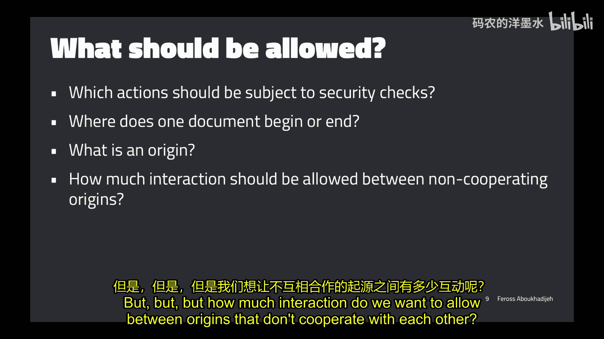

So so I thought I would just show something show another little template here， so I'm going to go to。

To the 16 a page again， pick on them again and。What I want to do here is just。I'm sorry。

 I want to go to the 253 page。And I want to。And。I want to just just remind ourselves that we did last time we did this thing where we。

We created an iframe and we put it into the page。How come I can't tab that？Okay， yeah。

 so we created an iframe。 We set it to the the 106 a URL， and then we。

 we did with this to add to the page and then it got added and we were able to load it。

 So so even though these are are。Oh yeah， these are actually same origin。 that's what。

 that's what we said last time。 So the protocol and the the host name and the port are the same between between my my site appear and 1 or 68。

 So basically， it's anything goes。 I can do anything I want to this page。 I can。

 I can go into it and delete elements， modify things， etc cea， etc ce。

 But what do we think will happen if。If I do the same thing here， but I do it for。A different page。

 Let's do crypto Stanford EU。See， how good is their security so。嗯。Pend this to the page， so hey。

 do you think this is going to work or not？No。There's another origin， right。

 so we maybe think it hopefully wouldn't work。Worked， okay， so， so what does this tell us。

 This says that So actually， sites that are different origins are allowed to embed one another。

that's interesting。 Now， can I do the same thing I did before to， to the 1068 page。 Can I。

 can I do iframe dot What was it content document， do cookie to see all its cookies。Does that work？

Oh， interesting， no。 So， so if I try to actually see what happened here。

 the document is actually set to null。 so I can't touch。 I can't touch the document of that page。

 I'm allowed to embed it， but I can't reach into it and modify it。 Okay， good to know。嗯。Okay。

 what else what else can we do here， I I， do we think I would be allowed to do this， Can I。

 can I reset the source of it to a new destination， So， so so let's see what， what before I do this。

 let me just do something really quick， Let me make this iframe less annoying to work with。

 I'm going to just quickly sort of。Make its width a little bit。More reasonable。Okay。So now， okay。

 cool。 So actually have kind of a bigger window to work with here to say the user sort of is like。

 when you learn about Dan。Read about Dan blah， blah， blah， while that's happening。

 do you think that the site should be able to run this code。

Sort of change the destination of the iPhoneframe。Okay， who thinks yes， it should be allowed。嗯。😊。

A why，Yeah， a why why。My frame。So you。year。Well， I wasn't allowed to go into it and change it。

But you still think I should be able to change its location。Yeah。Okay， who thinks no？

I shouldn't be shouldn't be allowed to do this。potentiallyti like。That site。冇。Yeah， I mean。

 hopefully they would look at the URL and see that they're on the 253 site right now and not on Danbonnet' site。

 But but yeah， yeah， that that seems like a concern。 So let's see if it works。

 So if I hit enter what do you know it works。 so even though this is a context that's that's another origin and I'm not allowed to to modify it。

 I still can navigate the frame as a whole。 That's kind of interesting。😊，Okay。

 what about let's do one more thing， what if I use the Fetch API。

 which is a way to sort of fire off an HTDP request and what if I fetch let's fetch how about access？

See if I can。嗯。Actually， let me just refresh the pat to emphasize that we're not doing anything with the frame anymore。

 The frame is gone。 what we're doing here is we're we're on the 253 site and the 253 site just happens to be interested in data from access in order to service its functions。

 So if， if I run this， do you think I should be able to read the response that this site sends back and maybe do something with it。

 Should I get back a string and be able to see what's in it。Yeah。

 why do you guys think that I should be able to？Dots。know what I'm doing。

 I'm actually not navigating the window。 I'm literally I I'm trying to get back like a string that I can sort of look at the H TM L that that。

That I could see if I were to say， if I were to visit it directly and then view the source。

I'm trying to sort of。Do that like I'm trying to get this back as a string and then。

 do something with that string。See it seems reasonable。Well。Let's just see what happens。Okay。

 so I got a really scary message access to fetch at access。stanford。edu from origin web web。sford。

edu has been blocked by core's policysy。So。What this is saying is that the browser was gonna attach my access cookies to this request。

 And it was going to fire it off。 And then because of that。

 it's it doesn't want to actually give me back the result。

 You can imagine if I did this for something like Gmail， right。

 just think about what what's gonna load when I go to Gmail in my browser， all my emails， right。

 So so。So。It doesn't。 you really don't want to let an arbitrary site make a request to Gmail with your cookies attached and get back this sort of page that's full of personal information and let let a different site read it。

 This is， this is very different than than my own server can make a request to Gmail。 I mean。

 I I mean， anyone can make I curl Gmail here。 if I want to and just sort of see what is Gmail gonna send back。

 Oh， I guess it moved， but。I mean。Obviously， anyone can make a request and move again。Okay。

Keeps moving。 Oh my gosh， Are they Are they serious。 was trying to log me in。 Wow。

 that's why it's so slow。 It' sort of redirects to redirects to redirects。 Anyway， The point is。

 eventually， this would give me my emails back if I was no sorry wouldn't。

 It wouldn't give my emails back because my browser cookies are not being sent with this curl request。

 which is why it''s no big deal。 But in the browser context， my cookies are gonna be sense。

 I'm gonna get back all my email So we don't want to let other sites see that。 So this is browser。

 like chromme。😊，Policies or even different versions of Chrome。佢就话。Yeah。

 we're relying on the browser here。 But fortunately， when it comes to the same origin policy。

 this is like since it's the most fundamental security model of the web。

 it's implemented pretty consistently across browsers。

 there have been a couple of sort of implementation bugs that have happened in the past。

 and I hope I have time to not say， but in the future hope I have time to mention one of them that was really interesting。

 yeah by and large this just works like pretty well。😊，Yeah。

 it's' sort of the same origin policy I believe was created a year after cookies were created。

 So like 1995， by the way， that explains why they diverge in their in their definitions， right。

 it's because same origin policy came after but it's really old and it's really sort of stable and everybody agrees on it。

Yeah， sorry， so when you're executing stuff in the console there。I thought it's coming like locally。

So。I guess I'm confused why the cookies are not attached。No， why can't you just fetch any site？

That same。I guess it's too confusing to me because it's not Gmail。 It's saying no。

 you can't access me。 you can't fetch is the browser saying that。 Yeah。

 the browser is saying that so in the browser right if I go to actually I probably shouldn't show this on the screen。

 I was gonna show you my Gmail cookies， but that would be a bad idea。

 But if if I were to go to Gmail and then open up this sort of cookies tab for it， you know。

 we would find we would find a bunch of cookies for Gmail here that identify me to that server And because the browser was gonna attach those to the requests。

嗯。That means that the response that comes back could potentially be， you know， personalized to me。

 right， And the browser， So the browser doesn't want to let an arbitrary site do that not。

The browser is trying to prevent you from blogging in the console and doing your own thing。

 Yeah he doesn't want that code being executed from the site isn't wanted to be executed with the ambient authority of my cookies right now now the thing that's really maybe a little confusing to you guys about this is that we just saw like a second ago that I can submit a form across origins that's what that attack just was before where that attacker co caused caused caused Bob to transfer 100 to Alice。

 right。That is like not intentional。 That is like a bug。 Basically， that is sort of an artifact。

 like。If we could do it， do it over again， we would have everything follow this。

 this same origin policy。 That's just sort of an exception to it for backwards compatibility reasons of。

 you know， forms we're able to do this in the early days of the Web。

 and nobody has sort of wanted to break that ability。

 even though it does seem to sort of fly in the face of this， this same origin policy。

 because that is， you know， that is literally， you know。Site A submitting a form to site B， right？

But that's how it is。Yeah， in the back。Is this because Gmails。

 as the reason it's not working is' because Gmail is cookies？The same site equals to la。

I'm wondering what this would if the Gmail is like session ID， cookie or whatever。

 was set to same site。No， no， So it's literally it's gonna block any site。

 Like I could try anything here。 Anything， you know， whatever I put in here is。

 is gonna fail because it's a different origin。 So this。

 this whole API just sort of perfectly enforces the same origin policy。 This is like a newer thing。

 So we we're able to sort of just be like， we're gonna do this one right。 So this one， you know。

 this one behaves the way we'd expect sites can' different sites。

 different origins can't interact with each other。 Yeah。😊，Now。

 there are ways to sort of opt out of this。 like if you're， if you're building some kind of an API。

 you know， and you want to allow developers from different sites to to interact with you。

 you can relax the restriction。 But the default is is what we want。 It's。

 it's defaults to being secure。 So like same origin policy using this API。

 same origin policy like takes precedes over like the same site。Yeah。Yeah。Okay。

 I think I need to move on。

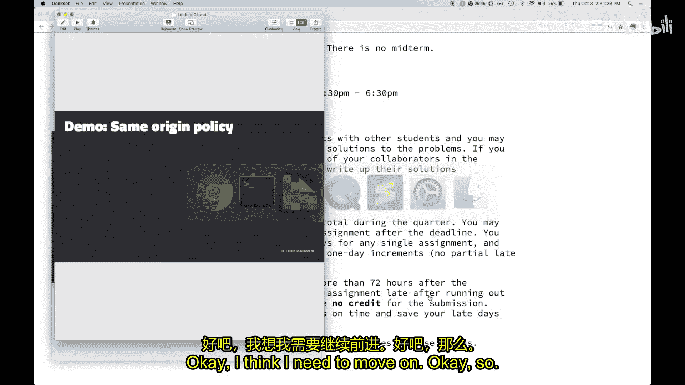

Okay， so。Cool， so。So yeah， a quick review， so are these two sites going to be the same origin or not？

Yeah， they are right because protocol and host name are the same what about these two？

just just shout it out。 if you， if you have an answer， shout it out。No， yeah， causeuse du， du。

 du example dot com is different than example do com。So these are actually different origins。Yeah。

 a little intuitive， but it's the way is host names do not match what about these two？

Ptocols are different， right。Okay， what about these two？No。

 ports are different because the default port is 80 about these two。Yes， yeah， so they're both 80。

 okay， cool。So the problems with same origin are sometimes it's too narrow。

 So sometimes it's restricting us too much。 in the case of like login do Stanford E maybe wants to cooperate with access。

 maybe wants to allow access to read the login do Stanford E cookies the way the same origin policy works。

 I guess thist more like cookie policy。 But yeah， these aren't allowed of the exchange data。

 And then other times we find that policy is actually too broad。 It allows too much stuff。

 So for example， with 16a site and the 253 site because the origins are actually the same。

 but the actual sites are owned by different organizations。

 we might want to sort of specify like we want to keep these separate。 Well。

 the same origin policy doesn't give us a way to do that。 So sometimes it's too narrow。

 sometimes it' too broad。 But but。But yeah， this this is what we have to work with。

 At least it's consistent and at least it's simple。 And yeah， And then， of course。

 the other problem is sometimes it's not enforced for certain legacy web features like form submissions。

 And， and and we need to know which， which things in particular， it's not enforced for。 if we don't。

 then our site will be， will be vulnerable so。So let's， let's talk about a couple。

 a couple of ways to relax the same origin policy when we want to cooperate with another site。 So。

 so， so we need an idea， the idea is we need， we need a way to sort of two sites to sort of say we we。

 we like each other。 We want to talk to each other。 How do， how do we do that。

So one idea is this is actually a really really old API that people through into the web as a sort of way to do this。

 but unfortunately it's a really bad idea。 it has a lot of problems but we're just going to go over it just quickly so you can see why it's such a bad idea and in case you see it you' you'll know to be scared basically。

😊，Idea is seems like a good idea at first。 The idea is， okay。

 so say login Stanford AU and access Stanford do EU want to cooperate with each other。

 So they can both run this line of code， which says， hey， for the purposes of the same origin policy。

 please just pretend that this is my domain。Okay。Now。

 you can't set this to anything right because that seems like it would it would break everything。

 So all you can do is set this to something more general than your domain。

So you can log in out Stanford E。 You can sort of chop log off and it can pretend that it's Stanford by E。

 In fact， you can even chop off Stanford Park， and you could pretend that your ED and let anyone。

 any other EDU site interact with you。 probably a bad idea。 But but you can do that。

 So the idea is both both of the sites have to opt in。And so， so， so。

 so the like one obvious problem with this is some other person like attacker about Stanford ED can also sort of join the party。

 They can say， oh， hey， I'm also， I also want to be treated as Stanford E。

 just like those other two pages。 And now suddenly。😊，aiThen Tigerers still cannot access。Oh， right。

 right， right。 Yeah， so， so， so F， that's a problem。

 But but what what this is saying here is actually slightly different。

 What this is saying is to say that。Say that。Stanford。 EDu didn't run any of any line of code here。

 So Stanford EDU just didn't do anything with document do domain。Could could attacker。tanford。

ed decide， hey， I want to be Stanford。edu for purposes of the same origin policy。

It turns out actually no， so Stanford。edu itself has to also agree to opt into this。

 and the way it does that is by setting its own document that domain to Stanford。edu。Now。

 this might seem kind of silly because you think isn't Stanford。 eu's domain already Stanford。 eu？

So it turns out like this is not anO op， this is actually significant。 This is sort of Stanford。

 ED indicating that it would like to join this sort of party of like anyone who wants to sort of say that they're Stanford。

 ED Okay yeah， so it's a little confusing。 the other thing that's really weird about this is protocol and port are also not setable at all。

So you have to both be on the same protocol in port， that part of the comparison can't be changed。

 you can only change the domain。Yeah， question so if I'm not attack could to you。Bze and then like。

We'll grab Stanford WU run the JavaScript。Wait to see a document。

How do you know what they set their thing to so this is assuming that theres if you're trying to interact from attacker about Stanford E and interact in some way with Stanford Edu。

 you must have like a handle like a reference to a window that that has that other site in it so that could be like an iframe if you have a reference to an iframe with the site you're trying to do something to that's when the check will happens when you try to actually cross that iframe boundary it could also be that maybe open a pop-up window to another site and you have a reference to the window you just opened that's the same thing So the boundary is sort of enforced there when it goes to do the check that page is already ran and if it has done this then that changes the rules。

Yeah， question so just to clarify when like attack it ats。ぱい？

Since it's still made to that and the tries to access。Stanford you。

Deecidedes at that point whether or not it once stopped in based on。No， no。

 no so either at the time that the attacker。tanford。

 ev was attempting to sort of cross that boundary， if this has been set before。

 then that will succeed so like another site like if Staffford。u agreed to communicate with CSs253。

 Stanford。u and then set its domain， then attack it that Stanford。Se its domain to that year。Yes。

 yeah， Stanford agreed to serve let anyone on Stanford at EU talk to it。 Yeah， if it does that yep。

Yeah， question。Just to begin clear， regardless of any of those。

 tap Stanford U can by default access all of StanfordUs。呃。Yeah， that's a good point。 Yeah。

 good good good check。 Yeah， that's because the way cookies work， right， So yeah， yeah。

It'ss a good point。 Yeah， but this is sort of like beyond that。 You can even do more。 Yeah， Yeah。

 Okay， so， so I think it will skip。 this is not too important。

 This is just sort of ensuring that we all understand the way that， you know， all the。

thingsing we just talked about of sort of how setting document domain or not setting it effectss。

 whether something is allowed or not。But you can go ahead and take a look at this in the slides if you're。

 if you're curious's， it's not too important。 But but just to emphasize why it's about idea right is it's that if login and access want to talk to each other。

 they're gonna run this code。 And then now anyone on Stanford E can also run that code。

 and then they can talk to that， to that page。 So this is a problem。Okay。

 so so let' let's just rule that out。 Never use that。 forgett about it。 if you see it， you know。

Just be afraid and make sure you look at all the details because something's probably。Going wrong。

 but so let's talk about。Another way you might be able to sort of get around the same margin policy if you want to communicate with another page。

 So again， we're going to try and find a way to get around it。 Hopefully it's not as bad of an idea。

So what if we？Create a setup where。So stay access once to talk to login。stanford。edu。

So could could access put it maybe an iframe in the page that contains the login do Stanford E page and then and then。

Change this is， this is so so gross。 But do you remember the fragment identifier this part of the URL。

 Okay， so， so if I so we just said that iframes can change the source of their sorry a page that has created an iframe can navigate it to new URLs。

 right， We just saw that I set the crypto and move crypto to example com。 So what if I do that。

 But instead of actually navigating it to a new page， I just change the fragment part of the URL。

 So this actually doesn't cause a page to reload。 What this does is it just sort of jumps the user to a different part of the page based on whatever this fragment is。

 But if the fragment doesn't exist in the page and it actually it does nothing it'll just won't match anything。

😊，So if I did that and then the page。Repeatedly checked its own URL。To see what the fragment was。

We could use this as a communication channel。So this is really kind of ridiculous。

 but let's just make sure we all understand so parents are allowed to navigate the child iframes and if the child can check its own URL and it can see the fragment identifier changing and then the parent can talk to the child。

😊，Okay so this is actually the way that we got around the same origin policy for like a really really long time on the web because there's no other way to sort of opt out of it for this use case so yeah so we're just going to show you this for sort of historical reasons because I think it's actually just hilarious。

So。Go to lecture 4。Live code and let's actually try to implement this， so I have two files here。

 child and parent。Okay， so let's。Let's go ahead and。Let's see here in。The parent。

 what I want to do is actually， let's start with the child。 So let's start with the child。

 The child is going to。Let's say its whole job is it's just going to try and display the fragment that it's been given。

 so this is sort of the message from the parent。So we'll include a script here。

And we will just get this div。嗯。That we just created above。And。

I'm just going to put into the div sort of the result of。Basically。

 the result of what what is in the window dot location dot hash。

 which is that fragment identifier and I'm going to decode。

I'm just going to decode the contents of it so that it renders a little bit nicer。And。

I'm going to slice off the， this is going to slice off the leading hash。

So we just get this stuff after the hash。And what I'm going to do is I'm going to repeatedly poll。

Yeah， I kid you， this is how it was done。It's incredible。 Okay， so every 10th of a second。

 we're just gonna see， hey， is the hash different。 And oh yeah。

 And then what I wanna do when I actually get it， I actually wna。

 I w to set it to be the contents of the div just so that we can see it。

 So I'll just do div dot text content equals that。😊，Okay， so cool。 So now now in the parent。

 this is going to， obviously this needs to embed。The child iframe。

And so that'll be this is going to be now to simulate that we're dealing with two sites here。

 I'm going to use a different origin， so the parent is on 4000 and the child is on 4001。嗯。Okay。

 so we're going to include the child just like that。And now let's， let's create a way for the parent。

 Let's， let's create some mechanism for actually sort of talking to the child。

 So what I'm gonna do is I'll make an input。Which will have the name Val。

And then I'm going to make my script sort of， actually。

 let me add some new liness here too really quick。So then I'll make my script。

Look at that input value and just。Hull that off of the。The inputs。And。

I will get a reference to the frame as well， oops query selector。Okay， and then。

I need to now basically listen for key presses。On the input。

So we're going to listen for an input event。 And whenever that fires。

 we know that the users type something into the form。

 So what we're going to do then is set the iframe source to be。

Let's basically set it to the same thing that it was before， except for we're going to tack on hash。

And then。不给你。Basically， do encode U components。Of the input's value。Okay。All right。

Everybody follow that？So I'm just going keep setting its source。 And because it's a fragment hash。

 it's not going actually navigate the frame to a new new page。 It's still going to be the same page。

 Okay， so now if I if I run this， So how do we run this。 So okay。

 so we need to make sure we're in the right folder， we need to start 2 servers  one on port 4000。

And one on。Port 4001。Okay， and then what we can do is we can go to。So just to confirm。

 so the parent is on 4000， so if we visit the parent。

 it's going to embed the child in an iframe on 4001。

 so I it should just be enough for me to go to 4000 and then go to parent。

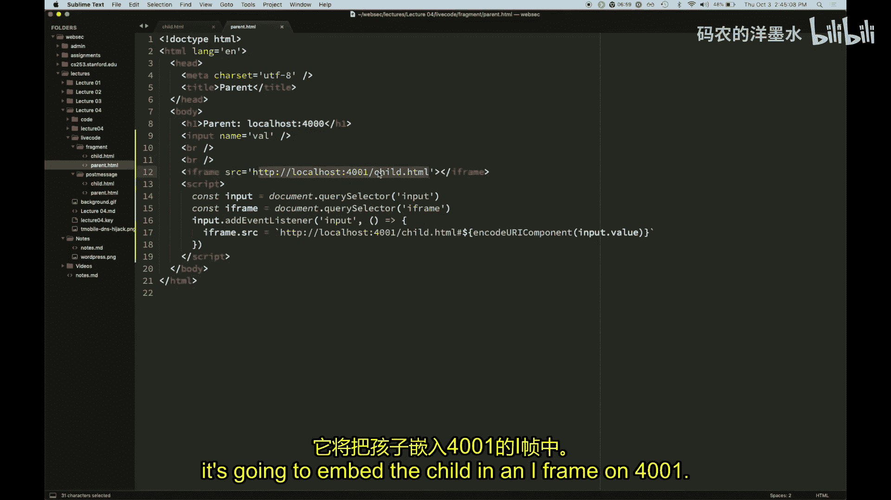

Okay。So there that's what we got。 So we got here's the parent page。 It has an input box。

 and then it has this child eyeframe。 And if I now type in here。

You can see that with a little bit of a delay。It's it's copying over the text。

 and if we actually here's the cool part， if you actually pull this open and you look at the iframe。

😊，CheckCheck out the source。As I type， it actually。It actually updates。So that's actually。

 that's that's that's cross origin communication right there， yeah。😊，Cool， so let's see here。

 We have five minutes。 So I have time to show more things。 Yeah。

 I think we have time for one more things。 So let's see if we can do it。 So this is obviously gross。

 So eventually everybody grew up and decided to actually make a proper API for for lot communication between sites。

 And that's called post message API。 And this lets you basically send any kind of string or any kind of object that you want between two two origins。

 And it has some nice features。 So one thing it does is if you have a complicated object with like maybe you know many properties and subproties and arrays and all kinds of different things in there。

 it'll actually clone that across and reproduce it on the other side and it'll even handle cycles。

 So the object has something that references another part of it that'll work。

 you can't send across functions or do nodes or instances of objects。

 but it works for lots of things。😊。

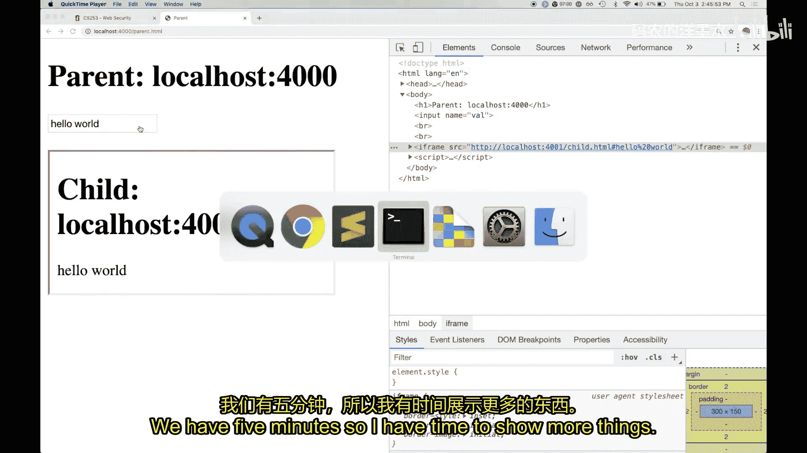

And you can even transfer ownership of an object。 So I could send like say I have like a gigabyte array of like graphics data or something。

 And I want to send it to another page。 That could be really slow to sort of copy across because I need to give that page an entirely different copy of this data because in jascript。

 we don't we don't have like threads or anyway sort of sharing memory。

 So one thing you can do is instead of copying that gigabyte array across to together the page。

 you can use this thing called transferable objects。

 where you sort of say I want to basically give this object to the other site。

 and then you lose your handle on it。 You've sort of gifted it to this other origin。

 and that happens like instantaneously。 So you can actually do sort of zero copy transfers of data。

 but then you lose your reference to the object。 which iss kind of interesting anyway。 So。

 so let's let's see how this works。😊，So all we need to do to use this API is just make a couple of changes here。

So how about now whenever we type instead of doing this jnk thing。

 what we're going to do instead is we're just going to on the iframe， we're going to get a handle on。

The window。And we'll call post message。With the message， which is input dot value。And then。

What we put here is this is the。The origin of the site we want to talk to。

I'll talk about why that's important in a second， but for now just look at this is the value that we're sort of messaging into this iframe。

Okay， so then what does the iPhone need to do。 Well， okay， it's we can remove this stuff。

 It doesn't need to pull every 10 milliseconds anymore。

 Now what it can do is it can just it can just register the fact that it's interested in these message events by saying on message basically on whenever message happens。

 just run this this function。 And in particular we're going to。

Update the content of the div with the data that was sent across in that message。An。Yeah， and。A。

One other thing I'm going to throw in here is I'm going to just check where this message came from。

 I'm going to mention it next time， I guess because we're out of time now why I need to do this。

 but really bad things happen if you don't do this。

But so all I'm doing here is I'm saying where did this event come from。

 if it didn't come from the parent which is this origin。

 then just return and don't actually do anything with this message。

 otherwise go ahead and display it and the parent has a sort of analogous thing on the other end where it sort of ensures its message is going to who it wants to go to。

Cool， so so now let's go ahead and just see what happens here。 So I will。

Restar the servers and we'll see see what happens here。

 So so now if I type in this box and I say hello， you'll notice that the URL isn't changing。

 So that's great。 We're not using the old method and it's it's instant。 So it's。

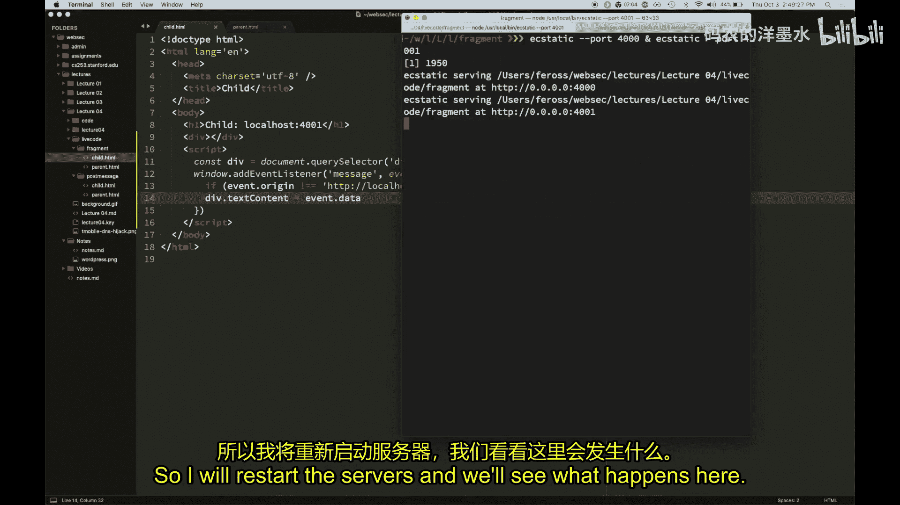

It's faster。My sir。So yeah this is one way to get around the same origin policy。

 if both pages want to cooperate with each other and communicate some useful information。

 can use post message Co， So I think we're out of time， but thanks everybody。

 and I'm having office hours now from three to five。 So if you have questions you can come to that。

 but yeah， thanks have a great weekend。😊。

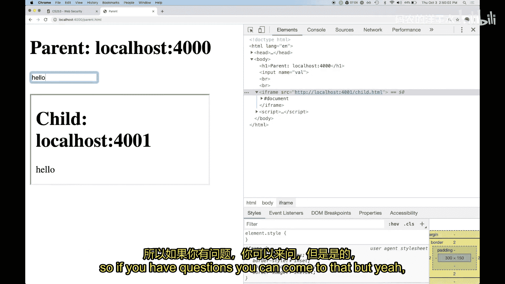