# 【全集】斯坦福大学 CS253 网络安全 中英字幕 1080P p05 Lecture 5 -  同一来源政策的例外情况 -BV1RemEBZEEM_p5-

Welcome， everybody。Hope your weekend is good。So we got a lot of cool stuff to talk about today。

 So first， though， we have to continue with what we didn't finish last time。

 I'm hoping to get fully caught up by end of this lecture。 So we'll see how well we do。

 So if you remember， last time where we left off we had this cross origin communication using the post message API。

 this was that nicer API that we introduce at the very end that allows two sites that want to cooperate with each other to send messages。

😊，To each other。 And one of the requirements of that was that the sites had to have so one site had to have a reference to another site somehow。

 one way to do this， as you can see here is to create an iframe and then load up the site that you want to talk to in that iframe and then you'll have a reference to that frame。

 and then you'll be able to use the post message API to send it a message， right。And then the。

 the site that you're talking to can listen to those messages using using the a event listener API。

So a realistic example of this in action would be something like this。

 So say that you have access wanting to display the name of a loggedin user。

 And it's going to find out that information from login dot Stanford dot E D U。

 which is on a different origin。Remember the concept of origin is what is it， Who wants to remind me。

Origin is the tuple。What what's in the twople exactly， Yeah， So， so obviously。

 access Stanford E D and log in on Stanford E are separate origins。

 So in order to do this communication， we're gonna use post message。 So here's how you might do that。

So you might have access， Listen for a message。And it's expecting to be told the username in that message。

 And then it's going to embed an iframe to login do Stanford E D U。

 And then the first thing that Iframe is gonna do is it's gonna post a message to its parent。

So the parent would be the window that they included this eyeframe， right， So in this example。

 parent would be。Access， right。And so what's gonna happen is that vent is gonna fire。

 And then we're gonna be be able to read this name object here。 So， so this is insecure， though。ESo。

Does anyone know why this might be insecure。Yeah。Mess with。

 so somebody can mess with this name somehow。 Interesting。 Yeah， that's that's actually。

 that's basically right。 Yeah， so， so。One way you could mess with this would be if let's say attacker do Stanford ED U were to embed logging Stanford ED U。

Now， login at Stanford E U isn't checking anything about the parent。

 So it's just gonna post a message to the， to the page that included that that frame and tell it the name of the currently logged in user。

 right， So in that situation， now， some random other site that we don't want to know who's logged into this into access is gonna to be able to find out。

 This can be used for like， let's say， tracking or something like that， right。

So any site on the Internet now can literally just embed an iframe to log in Stanford EU and find out if you're logged into your Stanford account。

 along with your full name， right。So do we see why this is a problem。Right， okay， so。

So you can imagine maybe this page should check who it's sending this data to。

 So it's not sending it so indiscriminately。 That would be one solution to this。Another。

 another sort of issue is potentially this page could be tricked， so。

Access is including this frame to log in out Stanford do ED U。

 And then it's assuming that that a message is gonna follow and that message is going to include the name of the user。

 But this message actually could come from any page that has a reference to this window， right。

 This API literally just says a message was sent to me。

 It doesn't specify at least the way that we've coded up here。

 It doesn't specify where that message came from。 right， that's another issue。

So let's go through maybe see see scenario about how， how this could be exploited。 Actually。

 I have a question first。 Yeah， would you mind light。 Oh yeah， yeah， sure， sure。There we go。So stay。

 so we're gonna represent us origins by the， by these boxes with white borders on them。

 So this is one origin here。 We have access。 and then access embeds in iframe to log in out Stanford A D U。

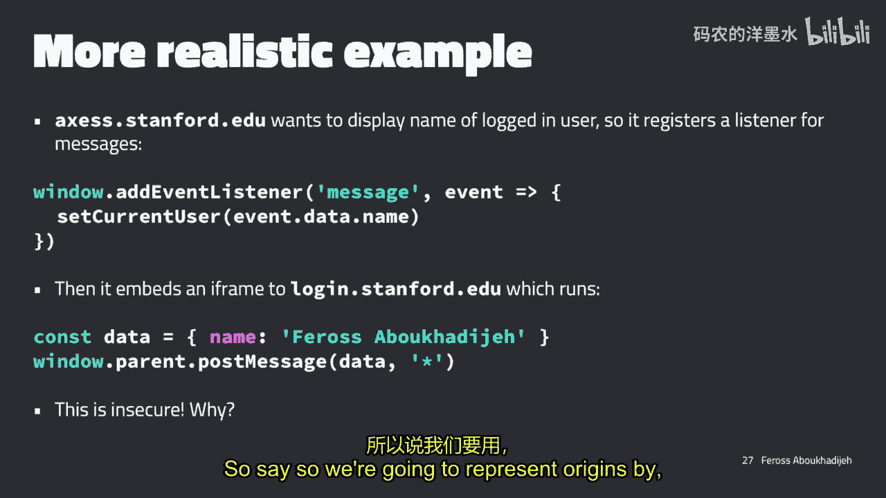

And it waits for this page to post a message。To the parent window。And this is。

 this origin is going to listen for that message。So this is fine。 This is the normal scenario。 Now。

 this is where it can go wrong， so。

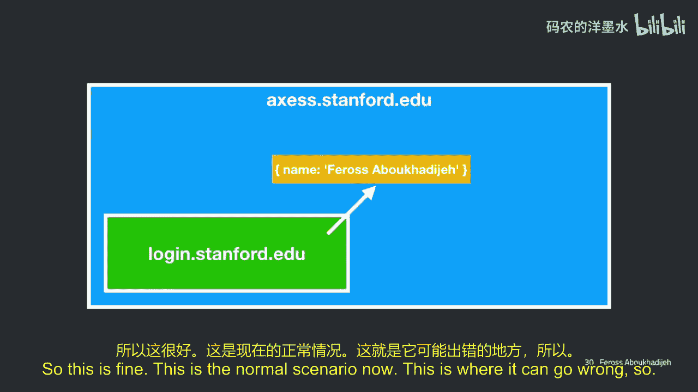

What if an attacker site？Embbeds login on Stanford did ED U， as I said before。

 So this page is currently indiscriminately just， just sending a message to whoever the parent is。

 And this is how we sort of leaked the， the username now to， to any site that wants to find out。Okay。

 so what about oh yeah。 So， So yeah， So， just to review this。

 So we solve this is we need to validate the destination of where we're sending our messages。

 And if we don't do that， then any attacker can just embed this page and find out。

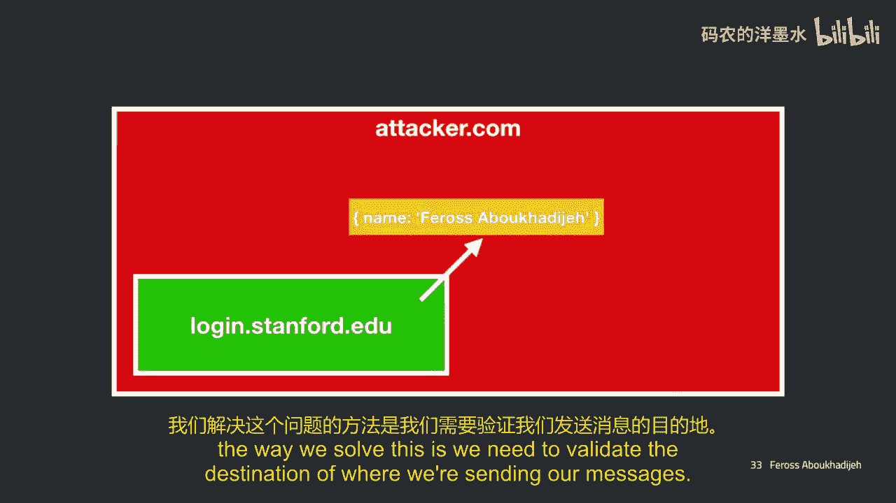

Who's logged in。 so the， the way to do this is to just have the browser do it for you。

 So the API supports this additional parameter here。

 And you just say this is the origin that I'm trying to talk to。

 And the browser will just not let this message go through if。

 if the parent is not matching this origin。So you could， you could， maybe you could， you know。

 try to be， be clever and sort of check it yourself by using the， you know。

 this variable here and maybe looking at the origin of it and checking the origin yourself。 But you。

 you might make a mistake。 So it's nice to just use the API and have it， have it do that for you。

Yeah， but if you want to enable a bunch of different websites to be able to。yeah。

So one thing you could do is you could try to like pull off the the page that is on the， you know。

 the the parent and then。You know， use that origin in the string here。 That's one way to do it。

 I think another way is you， I think you can pass an array here of multiple origins。

 But I'd have to double check that。 But yeah， there is a way to do that。Cool。

 any questions about this。Yeah， so are you to can I talk our website？Otheruth there Stanford I。

With our website。That's a possibility。 Yeah， so， so this is， this is just checking that the。

 to to to repeat the question， is it possible that some untrusted site attacker dot com embeds some Stanford site that embeds login dot Stanford E D U。

And logging at StanfordV U happens to trust that particular Stanford site。

 So now it's going to reveal the name to this particular Stanford site。

 And then maybe the Stanford site has， hasn't done its， itss。Security correctly。

 And now this sort of top level page can， can， can attack the， the。This particular Stanford site。

 and that's totally possible， yeah。好我。Browsers slash。I mean， so at this point。

 you've sort of told this this site your， your name。 And I think at that point。

 you're kind of trusting it to， to not do something ir're responsible with it。 I in this， I mean。

 this situation， I can't think of a way that you solve that。 I mean。

 like if you're assuming that this site is completely incompetent right， then in the worst case。

 it could literally just you know， take the name that the login Stanford E。

 you just told it and then like post it to a site somewhere right。

 And there's nothing that the login page can do at that point because it's already given the information up。

Yeah。5 you teams of URL。Second。Standford thought HPS。Access still is。No， so that that's。

 that's a different origin， right， By your definition of origin， the host name is different。

 So it's different origin， yeah。Okay， cool， I'm gonna move on。 So， okay， so this is another scenario。

 This is sort of the opposite scenario。 So here we have an attacker。

 and the attacker is gonna embed access。 And here we're assuming that access doesn't do anything to prevent itself from being sort of embedded in a frame。

 And then now access is going to。😊。

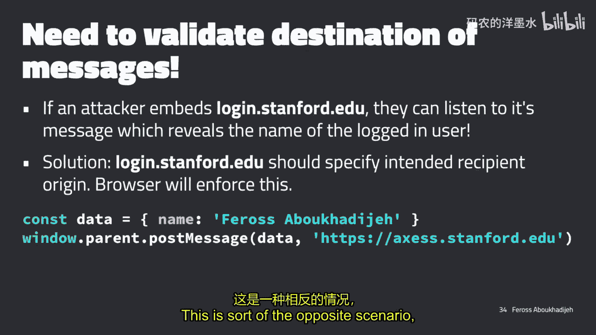

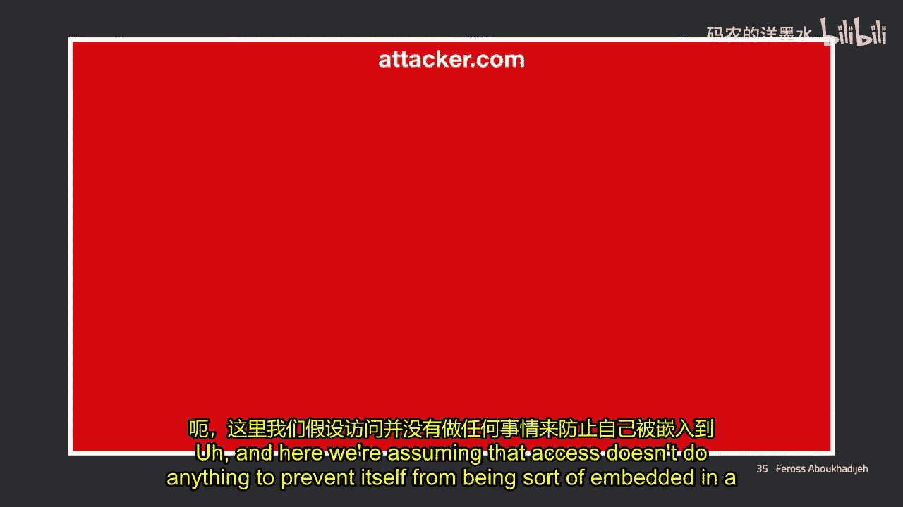

Include login。 And remember， access here is listening for messages。

 and it's expecting that the message it's gonna get is going be is going to contain the username and that it's gonna come from this particular frame here。

 it's a mistake because's not doesn't realize that it's embedded inside of an attack site。

 So what's gonna happen is the attack site is gonna to send a message。 and say that hey。

 this is your name and login that Sanford might also send the message because it doesn't realize that that's already happened。

 And it may be the case that the access site know just trusts the first the first one it receives and ignores future future ones or something like this。

 But you can see here that we're accepting messages pretty much anyone who has a reference to our window。

 And this is a problem。😊，Because， it's really easy to sort of get a reference to， to to a window。

 right。In particular， like one really， really easy ways。

 you can just open a pop- up window or in modern browsers that will actually just open up in a new tab。

 And if you do that， you know， the opening site has a reference to that window now and can now sort of send these messages。

So this is a problem。Any questions。This makes sense。Okay， cool。

 so the way we fix this is we need to validate the source of our messages。 And fortunately， the。

 the this event object has a really useful property called origin。

 And we just need to check that against the origin that we're expecting to receive our messages from。

 And then we're all good。😊。

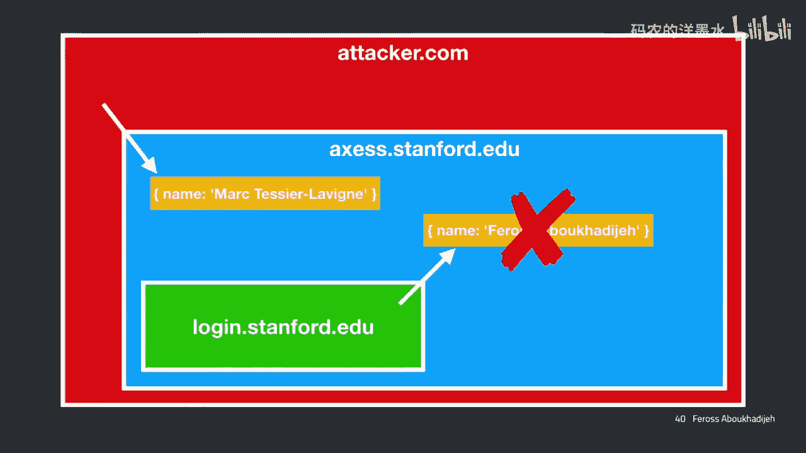

So one， one issue though， with this API design is it's a little bit easier to forget to do this because with the other API。

 we had， we had this sort。 it was like this is a parameter。 So it's like。

You actually can' I believe you can't call this unless you pass a parameter here。

 So if you forget this， you're going to get an error。 whereas in this case here。

 it's easy to sort of forget to do this validation。Yeah。Cool， so does this make sense。Cool， alright。

 So so that's how we get sort of integrity from post message。

 The sender specifies the origin that they want to permit to receive the message and。😊，Yeah。

 this is sort of interesting。 So it's also possible that the windows sort of has changed in the meantime。

 So you might have， here's an example， like， say you're on， say you have a page and you。

 you embed logging out Stanford at E D U。And then you're going to sort of send it a message。

It's possible that some other script on the page has actually navigated that frame elsewhere。

 in the meantime。You know， you might， you might not want your message to go to wherever that frame happens to be pointing right now。

 right。You probably have a bug in your site if random code is changing this frame。

 but we want to sort of ensure even in that situation that our message doesn't go to the wrong。

 to the wrong origin。So that's， that's what we can， we can do there。

 And then this is the flip side of the recipient validates the identity of the sender。And this。

 this protects us against some other random window happening to send us a message。See。

 just remember to always specify these things when you're using post message。Cool， so。

So we talked about all these different sort of exceptions to the same origin policy。

 We mentioned document that domain。 We use， we talked about this fragment identifier communication。

 And then now we've， we've talked about post message and。There are。

Sort of the way thing to remember is there are these sort of automatic exceptions to the same origin policy that can bite us。

 So things like pages can embed。Images from other origins， pages can submit forms to other origins。

 as we saw last time。And these can be the source of many， many security issues。So just just a quick。

 I guess I already told you the answer。Which of these requests would be allowed。 So yeah。

 so what about the the CS S file， Is this gonna to be allowed。Can we reference this？

 So if we are on example dot com and we're embedding a C S file from other one dot com。

 is that gonna be allowed。Who said what was that？Go for it。、そのにもい。Yeah， it's totally fine。 Yeah。

 this is actually how you often， often you'll use Google fonts。

 So you'll embed a C S file with a fonts from Google and， and they give you a CS S file to do that。

 So it's totally fine。😊，How would with the image。Yeah， the image is fine。 And then the script。

 I think last time there was some uncertainty around whether you could do this the script。

 Can you do it。You can。 Yeah， It's totally fine。 So when this script loads， though。

 it's loading from other three dot com。 And so I have a question。

 So is this script running in the context of other three dot com or is it in the context of this page here。

😊，In the context of this page。This page， Yeah， that's right。 Yeah。 So。

 so it's as if we took the code here and we just literally pasted it into this page。 It's。

 that's what's else's doing。Right， so that's why that's allowed。 There's nothing sort of， you know。

 there's very very unlikely that there's gonna be some sort of private user information inside of this script。

 This is just code。 And we're， we're， we're saying on this page here that we want to just execute that code in the context of。

 of our page。 And that will be allowed。 So that's why， for example， if you're betting likeque。

 that's why it works。Yeah， exactly。ca you would if you imagine you're Jquery。

 It's doing all this stuff sort of to create this big API object for you。

 And if that just happened to be like， oh， that's， but that's over on the jquery site。

 then what did that accomplish， right， It didn't really do much for you。😊。

Is there a question back there， Okay， cool。Cool， so basically， all these are allowed。

And then these are just some examples of this， this happening。 you know， people， people do this。

 And this was， this was basically designed this way for， well， I don't think it was designed。

 it was sort of just the browser added these features。 This was allowed。

 And then at some point later， we， we got the same origin policy。 And then these sort of these。

 these sort of things which involve different origins。

Communicating with each other were sort of grandfathered in and allowed to， to function。

Even though sort， they sort of feel like they violate the same origin policy because we have different origins interacting with each other。

 even sort of without the permission of this of the other origin we're interacting with。Yeah。

 this is just related to the tag and not like the mind type the file。Yeah。

 the mum type in G well like anything with the script。That's， it's basically right。 Yeah， there's a。

 there's a couple edge cases there， but I don't want to really get into it right now。 Yeah， we。

 we talk after class。Cool， so。So， so yeah， and just remember that that these requests have the ambient authority that is given to them by the cookies that are going to be automatically attached by the browser to these requests。

So in particular， here's a really sort of maybe an unexpected example。

 So if youre on attacker dot com， you can embed an image from target do com。

 So say this is some social network。 you can if you happen to know that the the social network will show will make this URL show the the avatar of the currently logged in user。

 then you can go ahead and include this。😊，In your attack site to make it seem like， know。

 you know who the user is， which might make your page more convincing if you're trying to fish the user。

 right， So what's going to happen here is this， this request。

He's going to have the cookies attached for target dot com。

 And now this social network is going to get this request for this image。 It's going to look and say。

 the cookie is for this user。 O， and return that user's avatar。 And that will show up in this page。

Right yeah， so is there anything stopping like a Google phing page from like just literally like taking Google CSS and images and just using those？

The CS S of the images are totally， I mean， yeah， they can totally be directly referenced to the to the Google。

 Google page。 I mean， even if that wasn't possible。

 you could just save them and and host them from your own page as well。 So it's not really， yeah。

 in particular， So this， this thing here is， is maybe not that common。

 What you might see more more often is this this will be some sort of unique。

 this will be some sort of URL that's unique to the user。

 And so this isn't isn't that much of an issue in practice。 But it's something to be aware of。

So is there a way to fix this， I think we talked about it last time。

 Who remembers the one way one way that Target do com here could could protect itself from attacker do com。

We use the same site。Bing from the cookie。 So that like。send the佢 second question。

What is that iss a cross origin request。 Is that what you mean， but there is like specific。Yeah。

 so do you mean like the， the fact that this is an image will be allowed to you。 Oh， a get request。

Oh yeah， yeah。 So you're talking about， yeah， yeah。

 So does everybody remember same site cookies from last time， So if targetrget dot com。

 when it logged the user in， if it attached the keyword， same site to that cookie。

That would mean that the cookie for target dot com now will only ever be attached when。

 when we're request making this request from target dot com， from a page on targetet dot com。

What's happening here is a page on attacker dot com is making a request for this image。

 And so the cookies would not be attached。 And so now we're gonna get back whatever the server sends back when。

 when a non logged in user requests the URL。Which might be something like it's sort of a generic avatar or something like that。

And there were two modes on that same site。 There was like lax and and stricts。

 So you could could look it up on the slides， but。Yeah， that's， that's the approach to fix this。 So。

 so， so yeah， to just to， to run through the exact sort of what requests are gonna be made。 So。

 so targetrg dot com， if it's making a request， then the browser is gonna say， okay， yeah。

 we can attach the cookie。 You're requesting avatar do P N G。

And you since you're on target dot com and you're making a request to target dot com。

 we'll go ahead and give the cookies。 whereas if you're making that request from attacker dot co。

 you'll notice the cookies are are oted， omitted there。I if you made your request for an iPhone。

From an iframe。 So do you mean like you've iframed a target。comm， and then it made the request。 Oh。

 then I think it would be allowed， yeah。Yeah， that's right。 So So you in general。

 you don't want your site to be iframed because lots of things become possible when you。

 when you allow that。 And I'm gonna talk about how to not allow that in this。

 in this lecture a little bit later。 But yeah， that's really important。 yeah。

So you say sorry not eyeframe。Does it mean like there's a way to？E bed side。Yeah。

 there's a way for a site to say， like， I don't want anybody to put me in a frame。

 And we'll get to that in a sec。Okay， cool。 So yeah， so use same site。 and then we。

 we solve this problem。So one other idea you might have is if you notice in these requests here。

 there was this refer header， right， and the refer header is the the the browser telling this。

 the server this is the page that made the request。For this image。

It's also used when you click a link to indicate to the the page to the server that you're that you're talking to what the previous page was that you were on before。

 And remember， this is the misspelled header that we talked about the very first class。

 So you might think， well， okay， I'm a server。 I'm just gonna let let the cookie be sent。

 I don't care。 I don't need to use the same site cookies because I can just look at the refer header。

 And And if I'm target com And I see that a refer is coming from a attacker well。

 then I'll I'll just not respond， that seems like it would work， right。😊，There's a problem with that。

In particular， for， for this case， because we're using an avatar image。

 It's common that these types of images are cached by the user's browser。

And something really bad can happen if， if the image is already cacheed。

 So I'm gonna run through that and we'll see what what could happen。 So， so here we go。

 So let's see the， this is the client。 It's gonna make a request to。

 this is targetrget dot com server。And。We'll see here， the cookie was attached。 So excellent。

 And now the server is gonna look at that and say， do I want to let this image load if it's being loaded from target dot com。

 And since we want to allow that， it's gonna， it's gonna you know。😊，Be okay with that。

 And so it's going to respond with the image。So first so good， right？But notice it cacheed the image。

 It told the browser， you know， don't bother re requesting this for a really long time。

 because you know。Like， I know it's not going to change。So now if the attacker。

Embbeds that same image。And were， you know， we're hoping that this request is going make it to the server so the server can do this check。

Against that refer and make sure that it it matches。

 But what's gonna happen instead is it's gonna just hit the browsers H T TP cache。

 and it's gonna say， wait a minute。I was told I I already have a copy of this image。

 I put it in my cache。 And so it's just going return that right away。 And so we。

 we have the same problem again。Does that make sense。Yeah。

 does the cash check if the request is the same and the cookie parametersmeter are not the same。

So it doesn't check in general， doesn't check that the headers are all the same because in general。

 there's gonna to be a whole bunch of them that that are different。

 like like the page that the refer in particular is gonna pretty much always be different because you you're loading the image from a different page。

 but you still wanted it to use the cache if it can。 But you remember。

 there was a solution we talked about last time for this or not last time I think it was the first or the second class。

 there was a header you could use that would tell the browser cache。 Hey。

 when a particular header is different then don't use the cached version。 it was the very header。

 remember that。Anyway， so that's one solution to this。 But we already have a better solution。

 Just use same site cookies then and then， you know， you won't have a problem。Yeah。

 do any browsers ever like check through。So that like if it's a different origin， don't。Like。

 load the cache。No， so， I mean， if you think about the scenario。

 we talked the idea of like hosting Jquery or whatever javascript library on a central CN server。

 So Google actually runs a server that just sort of hosts these really popular javascript libraries on their site and all kinds of different sites on the Internet embed that script。

 And so the reason one of the reasons why people want to do that is because if if you're including the same script that's included on a bunch of other pages。

 it's likely already in that user's cache。 And so the kind of idea is like， oh yeah。

 they're on my site It's a completely different site。 So the refer is gonna be different。

 But I still want to utilize the cache in that situation。 if you't。

 if you didn't utilize the cache and that situation。

 then it kind of doesn't make sense to really have a C DN。😊，Any。Does that make sense。Yeah。Cool。

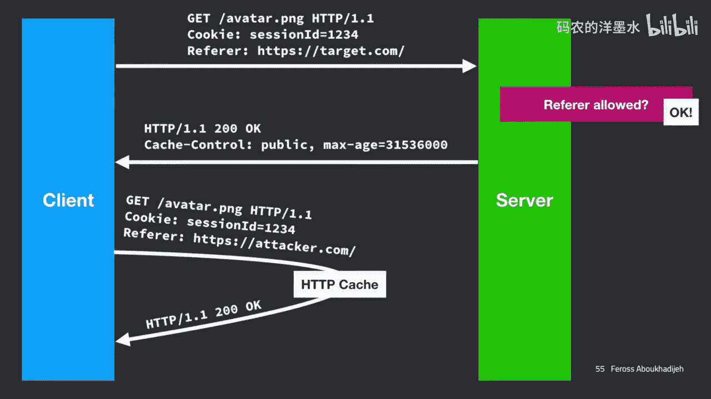

Cool， okay， so， so yeah， basically the refer header kind of you know， can kind of work。 I don't this。

 this approach know， has some problems if if you， if you tell the browser that you sort of the refer header really matters in terms of if it's caching。

 then it will sort of treat everything with a different refer as a different cache entry。

 But now you've kind of broken the broken caching。 You can also just sort of tell it to never cache the image。

 And then you guaranteed that every time this request is made。

 it's gonna hit the server because there's no cache anymore， right So that that would make。

 that would make this approach work。嗯。Cool， yeah， And then there's a huge。

 there's one other huge problem。 So there's a way now to。

 for a site to opt out of sending the refer header entirely。

 which defeats this whole sort of refer scheme。 So it's funny how like these。😊。

This was actually a browser feature that was added for， for privacy reasons。 So here here's。

 here's an example。 So so why would a site wanna wantanna make it。

 why would a site want to not send the refer header to all of its。

 to all its sub resources and all to all of its sites that are clicked on where links are clicked from a page。

😊，We think of a reason。これ最中。So that's actually really useful for site owners， though。

 because people who run sites want to know like where their visitors came from。 But， but yeah。

 so yeah it it's a prone con。 But in one， there's one situation where it's like really bad。😊。

To know that for the refer to sort of leak out。So what about a Google Doc？So if。

 if I click a link in a Google doc。And I go to some other page。 and that page is allowed to see。

What page I was on before。What's the， what's the issue there。Yeah。

 the doctor is just like unlisted but。も。ただいて。Yeah， that's right。 So。

 so oftentimes they use Google Docs use U URLs as sort of a secret key where only the person who knows the URL can access the document。

 And so in that situation。It would be really bad if every link I clicked is just sort of telling that site。

 hey， by the way， I came from this random private Google Doc。

 where we're sort of talking about your site or whatever， right， so。

Google in that situation says sort of， say we don't want to send the refer header to any。

 any links outgoing from this page。 So that's， that's a feature that really makes a lot of sense in this case。

 But it happens to sort of break this， this defense we were using up here。 that makes sense。 Yeah。

 I was just wondering if you'd heard of the there recently Instagram problem where you could go and visit。

Instagram。If you had the link， is that the kind of the same thing here， it's private。

 it's a private link back to a post， even if the account is private。 Oh， Icey。

 so if you remember the link， you can get access to it， Yeah， like without logging。Essentially。

 like is that the kind of the same thing where you don't have to be logged in？

come to see the person's private Google。Like form or whatever。 it seems， it seems， it seems related。

 Yeah， yeah， I was just wondering if。Yeah 응。Cool， so， so yeah， so， and then there was the other。

 of course， the other case where we sort of， we have this sort of ability to send forms and then the cookies get attached to the forms。

 That's the other sort of other other ambient authority sort of situation here。 So， so yeah。

 just to sort of review the interaction between the same origin and cookies。😊，So。The。

 they sort of conflict， the policies conflict in， in some sense。

 because they were designed sort of at different times and cookies sort of weirdly are more specific and less specific than the same origin policy。

 right， So theyre， they're more specific because they imply that you can。

 you can scope a cookie down to a particular path on， on a site。

 And we know that that is actually ineffective because we can always include a frame to sites that are on the same origin as us。

And read those cookies out。 So this is sort of an ineffective mechanism。But yeah， at the same time。

 therere。They're， they're less specific than the same origin policy because of this sort of weird ability for a attacker at Stanford ED U to set cookies for Stanford ED U。

Right， whereas， you know， this is， these are not the same origin。 So anyway， the the。

 the model here is very， very， sorry， very sort of different。So just keep keep that in mind。 And one。

 one really sort of weird interaction here is if you remember the the DN S hijacking we talked about before。

 So this was the idea that， you know， your Internet service provider would notice that you visited an invalid domain name and then return you sort of a hijacked page with a bunch of ads in it。

 because they know that that's not really that's not a real site。

 So you're not gonna really miss out and they figure they might as well make a buck off of that。

 And so if， if they do this， though。😊。

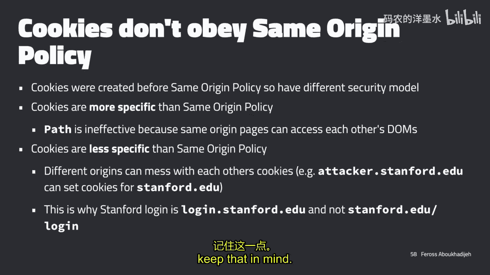

And you， you remember how。

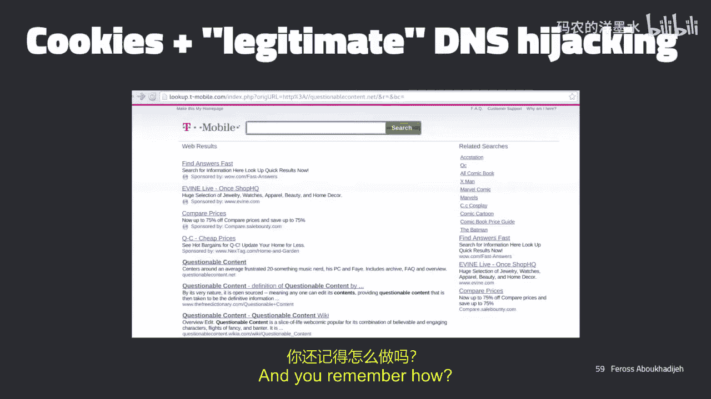

You know， attacker at Stanford ED U can， can mess up the cookies for Stanford at ED U。 So if I go to。

 if I go to， let's say， nonexistent。Dot example dot com。

And my Internet service provider notices that So that's not a value URL。

 And it gives me that ad page。Now， the， the jascript running on that ad page can read all the cookies for example dot com。

Which is really bad。Even if we assume that they have good intentions and they're not gonna do that with this。

 with this。Addd page that they're serving us。 It could be that the page is' insecure in some way where there's a malicious ad included in the page or something like that。

 And now， you know， now we're in really big trouble。So in particular， it's possible。

 let's say that the page is sort of insecure in a way where， where if we were to go to this URL here。

 nonexistent do example dot com slash some attack code。Our， our， our。

 our DN S would be hijacked because the the Internet service provider would see that this is not a valid domain。

 So it would return us this ad page， But， but say that it。

 it sort of did something wrong with this code here included in in the output of the page。

 So now they sort of attacker。He's now running this code in in this page。

 And now this code can you know， read the cookies for， for， you know。

 example dot com and even and set set cookies for examplet com and， and do stuff like that。Does。

 does that make sense。So yeah， the， the difference between those two。

 those two sort of models is is sort of a source of all kinds of issues。喂。Now is a essential example。

Yeah， so this is just sort of。The， the rules around cookies are just。

Different than than same origin policy。 So in particular， it， it， it allows more specific。

 I don't you remember the rule from the lecture， Basically more specific names can mess with less specific names。

 cookies。That's just sort of the way， the way it works。

cause it was made before we have the same origin policy。 And we haven't。

 we haven't sort of went back and changed that。 Yeah， using TL S would have to A TL S to get。 Yeah。

 so not like a valid example。Cific。I didn't understand the question。Okay。

 knew just it would have to be HGS。Yeah， so I。H T T， P fixes this。

 so they wouldn't be able to intercept nonexistent example dot com if we sort of。

Mandated H T TPS for our whole site。Yeah。Okay， so， so yeah， we have， oh yeah， let me just。

'll just skip to the next lecture。 we're gonna introduce this。 So here we go。 So now。

 now we're gonna talk about sort of ways to mess with the same origin policy and make it sort of more specific or less specific for。

 for different use cases that we might have。And then we're going to talk about an attack called cross site script inclusionlusion。

 which is pretty cool。Okay， so。Before we start this。

 I just want to motivate this with a question that I think is kind of cool。

 So I was looking in my Gmail， open up Gmail。 and I was looking in the Web inspector and was looking at the requests that Google was making and looking at the responses。

 And I noticed that like， this was a response that I got back。😊，So it， it hit some。

 some endpoint you know， that Google was running and it it sent back this response。

I removed a few things that looked like they might be like important I D numbers。

 So that's why I have redacted in there， but。But basically， the structures is basically the same。

 And you notice， there's this really weird。Instead of characters at the beginning。

And I thought that was kind of fishy。Has has anyone ever like bothered to like look in their web inspector and see anything like this before。

Yeah， so it's you probably don't like debug emailmail very often。 But yeah， but yeah， that's。

 it's really weird。 So， So I was looking into what， what does that mean。

 And so I think hopefully by the end of this， well， we。

 we'll all understand why they put those characters in there。Okay。

It's's probably for some important reason， right， They wouldn't just add it for no reason。

 It's probably defending against some kind of an attack。Okay。Okay。

 so now let's talk about sort of ways to configure the same origin policy。In particular。

 we might want to harden in certain situations。 We might want to relax it in other situations。

 So the default， the default are are these。 This is what we talked about before。 So， you know。

 we said a site can link to another site， a site can embed another site。

 but a site can't modify an embedded site。 A site can submit forms to another site。

 and it can embed images and scripts from another site， but it can't read data from that site。😊。

You should all be familiar。Okay， so， so let's， let's， let's talk about how we can maybe harden this。

 So in particular， I noticed， you know， oh， like I'm， you know。

 sites are allowed and it forms to me and they can。

 they can embed my images and scripts and they can， they can link to me and they can embed me。

 Are is， is there a way for me as a site to say， you know， I don't want any of this stuff Like， I。

 I want to just。😊，Firewall my site off from everybody else。

 so no one can do any of these things to my site。 So we're going to talk about how to do that。So。

 let's look at them sort of in order。 So the first thing was。

 can we prevent a site from linking to us。This one seems like a tall order because linking is sort of very fundamental to the way the Web works。

 But， but I thought I would， I sort of thought through would there be a way to do this。 and here。

 here's what I came up with。 So， well， first， why would we， why， why might we want to do this。So one。

 one reason。Is。Google actually， and other search engines。

 they actually look at sites that link to you and use that to figure out the sort of reputation of your site。

 It's a little weird because， you know， anyone can link to you。 And it's not really your fault。

 If a sketchy site links to you so。You Google around you search， you know。

 how do I prevent a site from linking to me。 You'll find often it's people who are who are penalized by Google in some way。

 And they're like， how do I prevent all these sketchy sites from linking to me。

 Google thinks I'm sketchy because of that。 And the sad answer to them is you can't really prevent somebody else from making a link to you。

 You just can't。 There sort of other models for how the Web might work that involved sort twoway links with integrity where sort site you're link to had to sort almost like agree was sort confirmation that that link existed。

 that's not the web that we have today。 And And so yeah， there there's no no answer for these people。

😊，But， but maybe there's a way to make it so that when somebody clicks a link to our site。

 we can sort of。Return an error page or something or send them away。 We'd direct them elsewhere。

 so they cant they can't load our page up。 maybe maybe。

 maybe someone's linking to us and and smack talking us and we want to sort of they're link to particular blog posts of ours。

 And we want to sort of just just make those look like there are 4 or4 is when the person comes。

 comes from from that link， right， I don't know。 just trying to think of why why why why wantan to do this so。

So how might we accomplish this， So yeah， we， we can actually prevent the link itself。 but we we。

 we might be able， to reject the request when we get it。So does anyone have ideas。Thefer， yeah。

 exactly。 it' just what we mentioned before。 look at the refer。

 So this is what the request to load our homepage is gonna look like。 And if we see， maybe， you know。

 a competitor wrote a blog post about us， you know， we wantna。

 we want to sort of give them a different page。 We can do that， right。

 And the thing we have to watch out for is that is that header I mentioned before。

 where the the competitor can specify that they don't want the refer to actually get sent。😊。

And you know， this was very useful for the Google Docs case。 But in this case， you know， it would。

 we would foil our plans。 So in particular， there's。

 there's a few different values you can set for for refer policy。 The。

 the default used to be this used to be unsafe URL。

 which which is sort of it just sort of sends the full URL of the。

 of the page that had the link in it to to the， to the site that was linked to。嗯。

But but now we actually have a different default， which is this one， which is particular。

 it's basically the same。 The difference is if you have a secure site linking to an insecure site。

 we don't want the insecure request here。 this H TP request is gonna be visible to everybody sort of on the same network。

 right， so that everybody in the Starbucks， the same Starbucks because you can see see that request。

 your IP can see that request。 The NSA can see that request。 And so in particular。

 we don't want to reveal the particular page you were on on the H T TP S site we don't want to tell the H TDP server。

 know， hey， we were on this page over here。 because now we're not only telling this site we're telling of everybody on the network that particular information。

 So when that downgrade happens， we just don't send a and that's the new default。😊，But。

 but there's these other options。 You， you could say， you know， just never send it。

 I don't care I don't want it to go out。 You might say， you know what。I， I don't。

 I don't care if the site knows that， you know， so maybe our competitor want wants us to know that they。

 that they link to us， but they don't want to let us know the particular blog post that the。

 that the person was reading and when they， when they click the link。

 And so they could just just send us their origin to let us know， you know， that they're。

 they're talking about us somewhere。 But we don' don't know what page of their website they're talking about us on。

 do these， these values kind of make sense。第二。So these refer policies are something that。I guess。

一切たに。I specifying like if I'm going from。Example。t com。Other dot com。But example。com is the one。

That's right。 Yeah， So it's it's this policy specified by the site that has the links in it。

 And when the links are clicked， this policy is what takes effect and affects the requests that sort of the requests that are generated by the clicks on the links。

That affects the refer header in those requests from the links。

So the only thing about this is is Google Google Docs would set this policy to to probably to this。

 I should have looked at what they actually said it to if somebody wants inspect Google Docs and see what they what their refer policy is。

 But basically， when you would go to load the Google Docs page， they would send you back this header。

 And now， anytime you click on a link from Google Docs， those links。

 the servers that are at the end of those links are just going get the origin。

 they're gonna know somebody from Google Docs linked some Google Doc linked to us。

 But they're not gonna know the particular doc that did it。Right。

 because it's not gonna contain the path。Does that make sense。Yeah。specify the refer yourself Oh。

 just said it' something random。Well， if the user is clicking a link。呃。Because you're the one saying。

So when the user clicks the link， the browser， the URL bar sort of changes to the destination of that link。

 and it's the browser that's sending that request。Yeah。

So the site that contained the link needs to tell the browser， hey。

 when you actually send that request when a user clicks on a link。

 make sure to set the refer as I specify。As the， as the Google Doc site specifies。

Otherwise it'll just include it hopefully， yeah。Yeah。downgrade here。

 we just mean that like the protocol in the。Link tag。be and were on， not like T No， yeah， no no no。

 it's much simpler than that。 Yeah， it's just a secure site linked to an insecure site。 Yeah， Okay。

 and there's a few other values which are even get more sort of complicated。

 let's see what what's worth mentioning here。 These are， these are just so。

 so the reason why these ones exist is because if you notice here。You know。

 say that I don't want to leak the sort of full URL。 So I have a site。

 and I don't want to here's an example of Google Docs again。

So Google Docs doesn't want to link link the full path to， to a doc。 And so they use this header。

 But now if， if， if the user clicks on any links that are from Google Docs to Google Docs。

 let's say they click the privacy policy link or they click the some other link to another page of Google Docs。

 Now， even Google itself now is not getting the refer header。

 So they can't learn sort of how users are flowing through their site。

 And so there's options where you can say， you know what， you know let's see。😊，Send send。

The full URL when're on the same origin， but， but send nothing to other origins and things like that。

 There's sort of these different tradeoffs you can make。Okay。This isn' that important。

 You can look at it when you， if you ever need to use it。So yeah， anyway， to summarize。

 it seems pretty hard to prevent linking。 let me know if you figure out how to do it。 But。

 but the best you can do is sort of look at the refer and try to be try to be naughty and do different things when you see。

 when you see a different refer。 But you really can't rely on that。

This one you think they're going to use。Oh， that is what they use。 Okay， so what is that one doing。

 Let's see。 So they're saying that they want the full URL， obviously， so they can。

 they can track how you're using Google Docs and then they want cross originin sites to see just that you came from Google Docs。

 that makes sense。 So they want to get credit for like sending you that traffic。

 but they don't want the site to learn the private doc URL。 And then lastly， they want to prevent。

 they want to send nothing when you're downgrading when you're clicking an insecure link from Google Doc kind of makes sense。

 Yeah， cool， thanks for looking that up。 Yeah， that makes sense。😊。

But that's quite a mouthful for her possse。Okay， so so now let's think is there a way to prevent embedding our site。

 So all kinds of really nasty attacks can happen if someone can embed your site in particular。

 we mentioned clickjacking attacks。 So that's one kind of attack。

 I I don't think I've actually shown No， no， I did show。

 I did show the one that I the one I found when I was a student in in this class。

 But to remind you all， this is clickjacking。 So。😊，So we're on a sort of attacker site here。

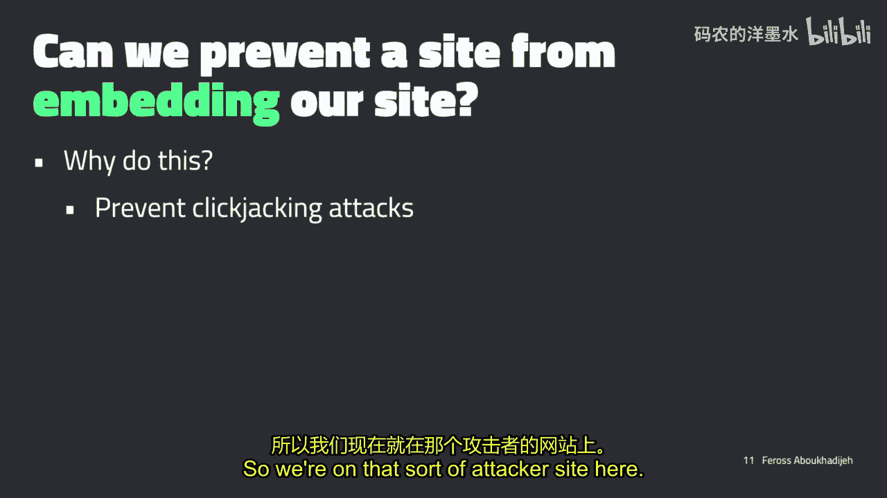

And what's going on here is this this attack site， example com in this situation is embedding an iframe to ebay。

 and it's allowed to sort of shift this frame around however it wants using C S。

 And so it' it's decided to shift it off the page a little bit。 But it knows the layout of ebay。

 And it knows the sort of size of the box that it's selected。

 So it can predict exactly where this bid button is gonna be I guess it says by now。

 So it can predict exactly where the buy now button is。

 And and then it can make sure to put its own button like right in the same position。😊，And。

But in particular， what's going on here is for the frame here， this invisible。

 this sort of transparent or translucent frame is actually on top of this button。

But its opacity is going be set to 0。 So it's going to be invisible， but it's actually on top。

 And so the user is gonna see the green button。 But when they click。

 they're actually gonna be clicking the blue find out button on ebay。Does that make sense。So yeah。

 this is， this is one， one type of attack you can do with clickjackings。Pretty bad。And。

So when the user clicks the one on top。Yeah。The frame registers you。Yeah， you can imagine if。

 if this frame was set to sort of be fully visible。

 then what the user would see would be just this chunk of the ebay site。

 and they wouldn't see the green button at all。 right， So it's on top。And then have who's。

Gets registered。Well。I mean， it's。The user is literally clicking like in the， in the frame， so。

I mean， it's， they're literally just clicking on the button on ebay。

But the weird thing is that they see what they actually see is is they see the attacker' sight。

Did that make sense。But I didn't say when is。It's just a attack。No， no， not。

 the attackers window is not in front。 Yeah， so the pictures kind of looks。

 it makes it look like this browser window is like。The one that's on top， but。Yeah。

 I know that actually， the way they should have drawn it is this ebay site is actually on top。 Yeah。

 it's，'s，'s， but it's yeah， this this is actually another And I'm looking at it。

 this look kind of misleading。Yeah， so if you were to look at this sort of layering here。

 the eBay site on top， then the button is behind。We， oh， how do we see the green button。

 the one that's behind。 Well， we， we make the iframe sort of transparent with a CS property。

 So you can make items。 You can adjust sort of how opaque they are。 And by default。

 everything is sort of fully opaque。 So it's sort of you see it right away。

 But you can make the opacity of it 0。And then it's invisible， but it's actually still there。Okay。

 yeah， I could just I don't have a demo of it， but I could just show you really quickly after class in my browser。

 It's， it's does everybody， does make， does that make sense， everybody。If。

 if it doesn't ask more questions， Yeah， would I guess be successful the user or the victim is already logged into has your credit card information。

 Yes， yes， yeah。 So they have to sort of all be be in the perfect state for us to sort of get like。

 what's gonna happen is whatever， would have happened if they had clicked that button。Normally。

So if they weren't logged in， then， they're just gonna get the login form popping up or whatever。

Yeah。No， so this would work fine over H TDPS S， yeah。So the， the main。

 the main issue here is that this site is sort of allowing itself to get framed。It's not that。

 you know， if， if this site was secure， you know， and this site was secure， the same thing would。

 would work。 which would be exactly the same。 Yeah， but， but there is one。

 one thing that would prevent this。 The same site cookies， again， would prevent this， right， because。

We have same site cookies。 Then this request to ebay would be sent without the cookies。

 and we would be sort of logged out of ebay。 And that， that click wouldn't really do anything。Yeah。

 so it seems like keys are really， really useful。If somebody need to click twice。

 like there's a confirmed payment。 button then the next thing， does the attacker actually get like。

Does the click event just disappear into the ebay frame。 So don't actually。

 their site doesn't actually know that the user is click。 That's a good question。

 So the question was， when the user actually does this click since since I said the ebay frame is actually the one that's on top。

 that click is going to the ebay site， right， So our button that's behind doesn't actually get clicked on So is there some way for for this page。

 the attacker page to know that the attack was successful。

 because as far as they can tell there's there's this ebay frame and the user actually there's no way for them to know the user did something in the frame as far as as far as I'm aware。

 I tried like I tried to figure out how to do that for a while when I was doing this And I couldn't figure out。

😊，Do do you， do you have the， the URL of the frame， like if it navigates。That's a good。

 That's a good question。 not Do you have the URL， I know you can change the URL of the frame。

 I don't believe you can read the URL of the frame。Yeah。like a do attribute。We， we can test it。 Yeah。

 I think you can't actually read the URLca that would reveal。We， we should test it。

 we should test it， yeah。And cookies with the ebay request because you're in a separate。I， you。Oh。

 are you saying if we use same site cookies would wouldn't。

So if you say same site equals lax on the cookies， then I， I。

I believe that this frame is going to be treated as a sub resource request because we're not actually at the top level in sort of in the URL bar。

 we're not on ebay。 We're on this other site。 And so like the policy of same site is going to say which site actually sent us this request for this frame and it's going to be this site。

 not not ebay that did it。Yeah， I just looked it up you can only read the URL。Yeah， okay。

 that's what I thought。 I a domain or it should be origin， same origin。Okay， they， they said domain。

 okay， yeah。Yeah， okay， cool。 So this is a really fun attack。 Like if a site does。

 if a site allows itself to be framed， then it， I mean， you can just do all kinds of things。 Oh。

 yeah， there was a really， there was a really。😊，There was a lot of stuff going around with Facebook like buttons where people would。

 people would make like clickbait sites that say， you know， click here to see this crazy video。

 And then what they did was you know， they had like the play button。

 they would hover a like button directly over the the play button。 So。

 and this was at a time when liking something on Facebook would create like a newsfeed entry saying。

 you know， for us liked whatever viral video。 And then everybody would be like。

 everybody would click that to go see what it was。 And then they would try to click the video。

 And it would it was sort of like a virus。 They just spread across all all of Facebook。😊，Yeah。

 and the other thing you can do， too is you can actually control the。

 the zoom of the frame like you can， you can transform it so that it's， it's really， really big。

 And so you can make the entire， you can sort of take the like button and zoom it so that it's the entire page。

 So no matter where they click， they're just gonna click this like this button for sure。😊，呵呵。Yeah。

Okay， O， lets， let's move on。 So yeah， So can we prevent this。 And， you know。

 we would want to do this to prevent clojacking attacks。

 So one way that was really common to prevent this was this thing called frame busting。😊。

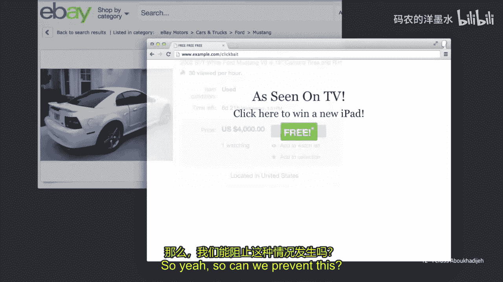

But really， what we want to do is is is a new H T TP header。

 because so frame busting is literally just code where the site that's being framed looks at。

It's parent。Variable and looks， it looks at in just stores tries to tell if it's being。

 if it's being put in a frame right now。 And then it sort of like tries to be react to that in some way。

 And there was this excellent paper that some some Stanford folks wrote a few years ago。 maybe like。

 I guess probably。

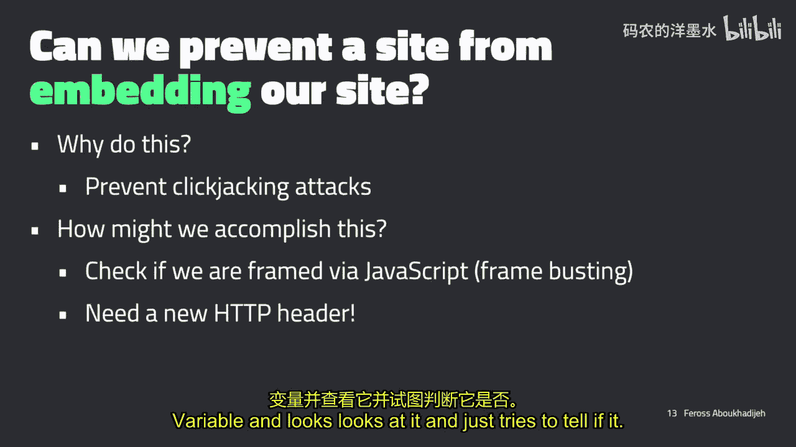

Maybe。Maybe 10 years ago now。Where。They analyzed the techniques that sites were using to detect that they were in a frame and to bust out of it。

 And they found that literally every single version that anyone had like tried was completely broken。

 They were able to break like 100% of frame busting code。

 So like the the the idea was it would work something like this。 So a site would say， you know。😊。

So there， there's this variable called top。 and top just tells you it's a， a reference to the， the。

 the top level frame。 So it's like。

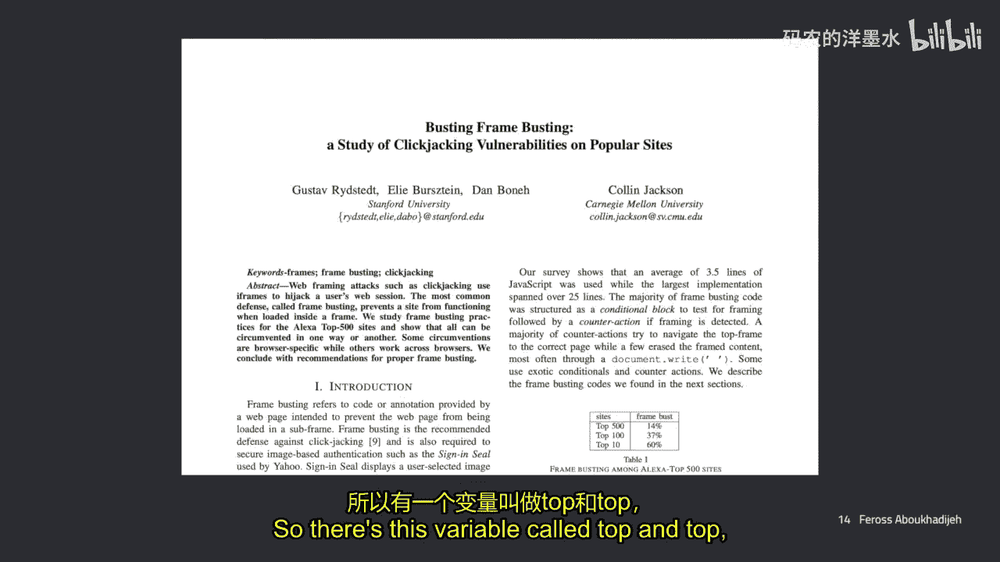

If you have a frame in a frame in a frame， then top just tells you the sort of top frame。

 the one that's the URL that the user is actually on in their browser。

 And it would look at that and say， is that location different than the location of my page。

 So my frame。 And if it was different， then it would know immediately。

 I'm being framed I I'm in a frame。 And then it would try to sort of redirect the whole browser itself。

 So it bust out of the frame and it might be this little box nested really deeply。

 but it sort of sets the whole browser to itself。 that's idea。

 but there was really like a ton of ways to work around this。 So in particular。

 I'll just tell you one really quickly。 It's not that important how to do it because we have techniques now。

 But do if you're the top level site you can detect that you're being navigated and you have a chance to sort of react with javascript。

 like if if're a page you can say when I'm about to be unloaded。 In other words。

 the user is about to go to an URL run this function。 And in that function。

 you could you could basically mess with could interfere with this。😊。

Sort of set yourself back to the original URL and stuff like that。

But they found like all kinds of ways to break it。 It's a really fun paper。

 If you wanna go back go and read it。 it's called， yeah， it's called busting， frame busting。😊，anyway。

 so we have a much better way to do this now。 just， you just。

 you just add this single header here and then。All your problems are solved。Basically。

 what you can say is， you say deny my deny being framed。 And then now now this page can't be。

 can't be in a frame anymore。And there's sort of the middle ground here。 You can say。

 I w to allow myself to be framed by other pages on my own origin。

 and you can use that value for that。And so。One thing I wantna， Yeah， So I want to just sort of。

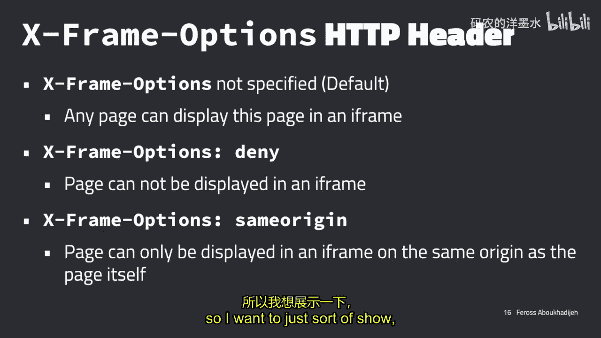

show show show show the idea here。 So， so here we have a attacker dot com。

 and it's going to embed target dot com。 And in this case， target。

 the target has specified that they， they only want to be framed by their own origin。Okay。

 so this shouldn't be allowed， right。 So the browser， what the browser does is it looks。

 It looks at the header that was on the response from this request and sees that the site requested to not be included in a frame。

 And so the browser just denies it it doesn't load anything in that， in that frame。

 It was be an empty frame。Right， but what I， what I wantna emphasize here is sort of the order that this happens in。

 So， let me， let me show the H DP requests that are that are going on here， so。

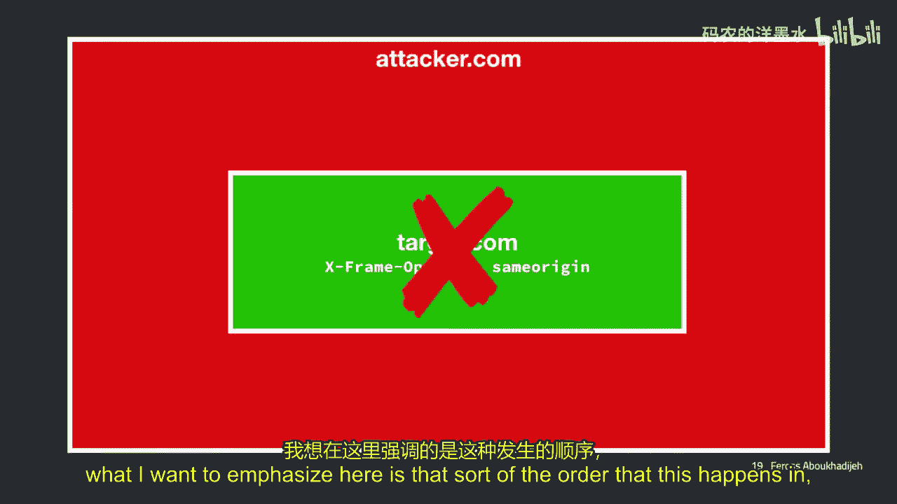

So here we have the attacker server。 So remember， remember， first we load the attacker site。

 and then the attacker is including a frame to to target dot com。

 So we start off by sending a request。To the attacker and。We， you know。

 this attacker site loads in our browser。 and then the， the attacker is gonna send a request now。

 It's gonna it's going to I frame the target。So a request gets sent to the target。

 And now this is where the defense happens。 So this server in this situation， the server。

 it doesn't even know necessarily where this request is coming from。 Like。

 I didn't put the refer header in here。 We're not using that。 This server is just gonna say sort of。

Blanket， I never want to be framed。 So the way it does that is in the response that it sends。

 it says， you know， only allow my， my same origin to put me in a frame。

And it just always includes that， in its responses。But you'll notice here， like the。

 the attack page was able to send this request to the target server。It wasn't blocked。

 And we actually sent back a response with， you know。With our like button or whatever inside。

 And we're relying on the browser to read this header and to do the right thing。

 So that the browser is what is gonna analyze this here。 And it's going say， you know， is。

 is is this this， Should this be allowed。 And， and in this case， it's going to say no， because this。

 this would appear in a frame inside of attacker dot com。 So no。Okay， and then， and then you know。

 that， that response gets discarded。Does that make sense。Yeah。Risky to。I the browser， I guess。じザみ。

Or madeatcker。com also have their own。Oh， I see。So yeah， with all these attacks。

 like the thing we're trying to protect against is a legitimate user who's using like a legitimate non hacked browser。

Who is logged into it， you know。In the example I gave before， they're logged into Facebook。

 And now they're going to attacker dot com。And we want that browser to。

Ensure that they can't that that the like button can't be clickjacked and cause them to send invalid requests to Facebook。

 So in your example， this attacker would be running their own hacked browser and they would be able to clickja themselves。

 like they would， They would be able to log into their own Facebook accounts。

 go to their own attack site。 And then when they click the button。

 they're gonna just post their own Facebook wall， which they could have done anyways， right。😊。

A bad browser。Yeah， exactly。 Yeah。 And in general， like we can't。 we can't remember。

 I't think I mentioned this before。 You know， we can't trust the clients at all here。 So I mean。

 this client， you know， this， this is like what you suggested is this could be like a hacked browser。

 This could be more than a hacked。 This could be literally any script that anybody writes， Right， So。

 so yeah， our server has to be safe against sort of anything here。😊，But， but yeah。

 all the things we're talking about here are， are sort of trying to defend against state that's in the client that is date for like sort of other pages that we don't want to get accessed by other origins。

If that makes sense， okay。Cool。Okay， so yeah， so hopefully this makes sense。

 we're relying on sort of the browser to do the defense here。

 And so actually when it comes to these kinds of defenses。

 you have to think about like how many browsers are my how many， like。

 what's the market share of browsers that actually support this feature because the the users who are running really old browsers you know。

 they might the browser might not know what to do with this header。

 And so they're gonna be vulnerable to this attack。And so you might need think of。

 you might need to try the frame busting thing that doesn't work and throw that in there anyway。

In the case of this header， though， this， this has been around for a really long time。 And it's。

 it's very pervasive。 So you can just trust pretty much。 You can just trust that this。

 this will work。 But in general， when you're looking at these kinds of defenses。

 it's important to think about what， what the sort of。

Number of of browsers out there that actually support is。Okay。Cool， so， so yeah， so yeah， this is。

 yeah， this is a really fun thing。 So what does it actually mean when you say that I want it to be same origin。

 You know， I've been saying same origin here。 And we've just been assuming like。

 it's obvious that it means， you know， like in this situation，  clearly。

 this i frame is not being included by a site that's the same origin， right。😊，But。

There's like another scenario we could come up with， where it might be a little less clear。

Let let me just show you guys。What if。Target。com embeds other side。 com， which embeds target。com。So。

 now。Is Ta do com being embedded by the same by same origin or not。So until recently。

 browsers considered this to be fine。They would just look at the like so so here we go。

 what's going on here is this， this frame is saying I don't want to be framed except by myself。

 And this other side is， is， doesn't have an opinion。 It's， it's cool with whatever。 And so。

 so the browser just， what it would do is it would just check， you know， this against this and say。

 yeah， you're， you're re framed by your own origin。😊，So in particular。嗯。Yeah， yeah， exactly。 Yeah。

 I think that's it。 Yeah， yeah， does that make sense。Okay， so。

 so this was like really quite recent that this was allowed。 So you could basically。

 an attacker could make it a framing chain that like worked like this。 So， so the， yeah。

 like the target would embed attacker， which would embed target。 Now， you might think like， how。

How would this ever happen， Like， why would A a good guy。Embed an attacker site。

W should embed the good guy。Can anyone think of where that might actually happen legitimately， yeah。

Is profile something where you have like arbitrary。Yeah， so， yeah， that's a good one。

 Another example might be， yeah， like myspace is powerful。 Let's with that。 So this is like my。

 this is your myspace。 Where do you use myspace。 This realize you're talking about myspace。

 So this is myspace。 And then myspace is including an ad。 So， you know， the ad can be， you know。

 it's gonna come from anywhere。 So it' is very easy for this to be entrusted。

 And then now that ad is gonna say， you know what。😊。

We know that Myspace allows itself to be embedded by itself， so。So we will embed Myspace。

 And so now your ad， a little box with your ad is actually gonna contain another copy of Myspace inside that box。

 And now， when you click on the ad。😊，You might be clicking on。

 You might be doing some profile action， right， The click jocking stuff becomes possible again。

So they， they can hide some， some button there， and then they can make the ad look like something really enticing。

 And then when you click on it， you know， you're doing some action on， on， on the site。😊。

Does that make sense。Yeah， so this assumes that like target。com。

Or the attacker can somehow get there for。The top。Yeah， yeah。 the target do has to be the topmost。

 Yeah， yeah， which is， you know， I mean， in the case of the Myspace。

 example is not that not that hard because you're looking at someone's profile， you know。

 And then there's an ad in there。 that's a attacker。 And it's like actually。

 it's like not that hard to do。Yeah， so I have a sort of pictorial representation of it just to。

 just to emphasize we can make sure we all see。 So basically， yeah here's the， here's。

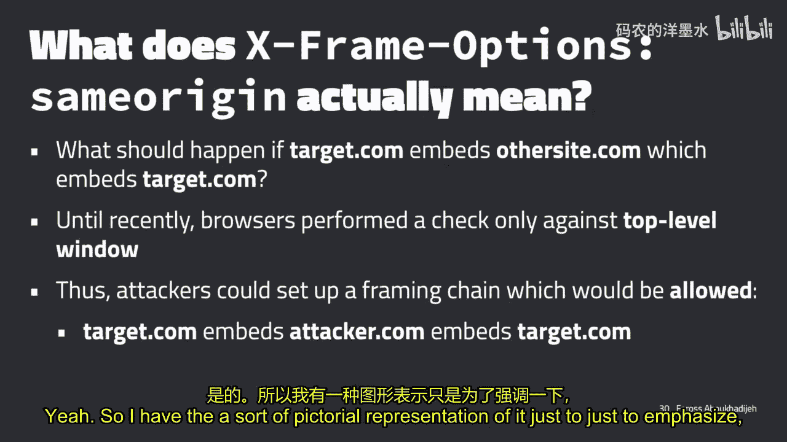

Our social network site， it includes this attacker site。

 which includes the social network site again。 And the browser would say。

 are we on the same origin here， and it would do that comparison。

 and it would obviously pass because those are the same and no problems here。

But what we really want to happen is this。 We want to make sure the entire chain is， is same origin。

 And so as of like， I don't know。A little while ago， Chrome and Firefox。

 I don't know about the other browsers， but Chrome and Firefox check this correctly now。

 So we can rely on this to actually work itll'll you know when it sees that one of those is not the same origin and the whole frame is blocked。

Cool， yeah， these things are surprisingly subtle。 You know。

 the attackers just have infinite time to sit around and think of these kinds of things， so。

They just have to find one thing， you know。

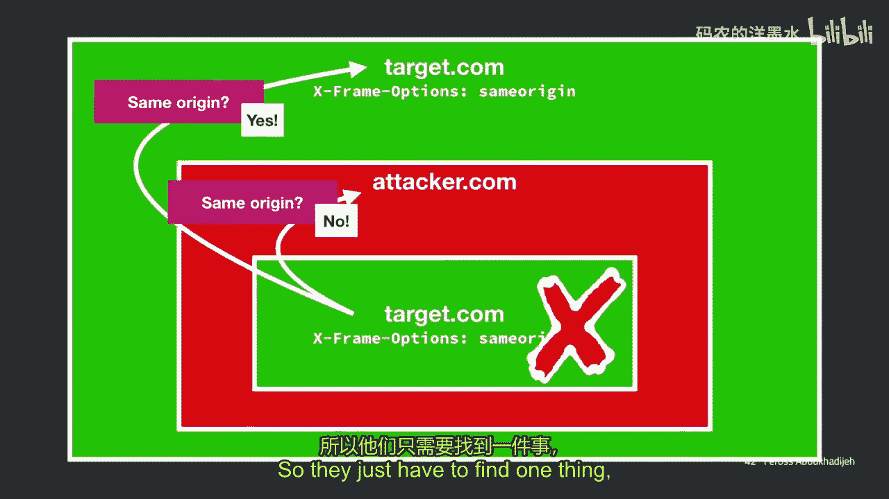

Yeah。Anyway， cool。Any questions on this。Yeah。

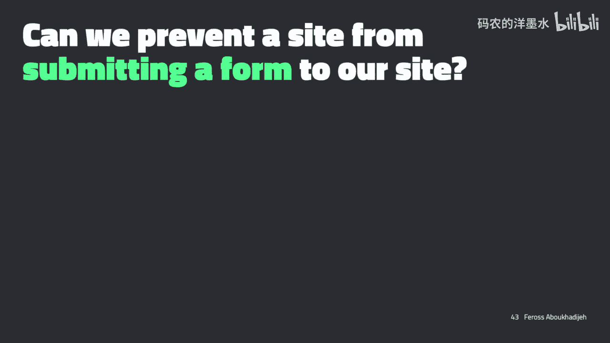

Well， the browser is the thing that's loading all this stuff。 So it。

 it sort of knows like exactly what frames it's putting where。 So it's。

 it's pretty easy for the browser to just。To check all sort of just check the origins of all the frames that it's loading。

 Yeah， and it only do that if it only do that if it sees that。

 that something that's being framed has requested some particular policyy， yeah。

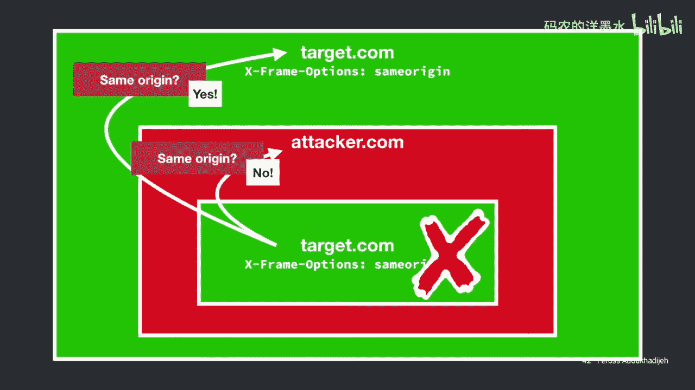

Okay， so now let's talk about is there a way to prevent a form from being submitted to our site becauseuse remember。

 we're trying to lock down our site。 We don't want anybody to talk to us。 We want to be super secure。

 So how do we print this？ Well， first of all， why， why would we want to do this？ So， I mean。

 as we saw before， you know， cross site request forgery was pretty， pretty bad。

 that was the that was the。The thing we saw where we were doing a transfer into someone's bank account。

 And， you know， we have a really easy way to do this we talked about， which is the same site cookie。

 that prevents。 Well， sorry， let me step back。Same site cookies prevent the cookie from being attached to one of these form submissions。

 but they don't prevent the form submission。 The form submission will still happen。

 So what I want to ask here is is there some way to sort of say。

 I don't want any form requests to come to my site。 Cookies are no cookies。

 Just no one submit forms to me except myself。 Like。

 I want my own site to be the only thing that submits forms。嗯。I mean。

We can't really rely on that because of what I said before about how a client can sort of send anything they want。

 I mean， they can write a Python script or something that will send whatever they want。

 So this is kind of the fool's errand。 This is a kind of silly question。

 But say we wanted to try Oh You have question， yeah。Okay， so say， say we wanted to try。

 So one thing we could do is。Anytime the browser makes requests to other origins。

It's gonna add this origin header。 And we could have sort of an allow list on our server of。

 of origins that we will allow to do this。 And we check， check against it。That's。

 that's one approach。 The other approach is to use same side cookies。 But， like I said。

 they don't actually prevent a form submission。 They just， they just remove the cookies。Yeah。Okay。

 so does that make sense to everybody。Okay， cool。 So what if we want to prevent embedding images。

So maybe our images are， are quite big。 And some， say we have a what's since you're using Myspace。

 Can we think of other like 90s or 2000 examples， say you're on some one of those flash animation sites or something or those Ne pets。

 Yeah， And so some other neo pets So So somebody made a Ne pets competitor and they are stealing all of our bandwidth because they instead of making their own pets。

 they're using all the pet pictures on our Ne pet site。

 And so the Ne pets company now wants to prevent those those images that are being embedded from loading。

😊，So that's called hot linking。 When another site links to your images and steals out your bandwidth。

Because now you're paying for all those requests。So， yeah。

 and then another case where we might want to do this is that example from before where where we were。

 we were。Showing a logged in avatar from one site on another site。

So one thing we can do is look at the refer header and， you know， try to， try to respond to that。

 like I mentioned before。 But this is not foolproof because that can be manipulated by the attacker and then。

You know， same Ps cookies was the thing that solved the， the avatar situation。

 So that would just sort of， that wouldn't prevent the request， but it would show the sort of the。

 the logged out image instead。嗯。Yeah。Yeah， basically， the answer here is like， you。

 you can try to sort of do something clever by looking at this header， but you， you。

 you can't rely on it。 that's， that's the answer。嗯。

Another option for the avatar situation would be to sort of use an ungesable URL or something unpredictable。

Yeah。クお。うぱ。Yeah， yeah。 So I realized that's a little confusing。 Yes。

 I mentioned you use origin before。 So there's the rules when this gets sent are a little bit more complicated than what I said。

 this header gets added when the request is considered a course request。

Get requests are never course because get requests are always allowed images。Scrips， styles。

 so this header actually doesn't get sent when you're loading an image from an image tag。

But it will get sent in this case because it's form as a post。Yeah， so。And do we have very？

We do have the refer here as well， yeah。We can use that as well， yeah。

 I'm sure have simplifyim it and just use refer everywhere。 Yeah you're right。You're right。Okay。

 now what about scripts？Why would we want to do this， you know， again， same thing， bandwidth。

 Maybe someone's maybe we have a really cool sparkle effect on our website with a bit javascript that we wrote。

 Have you ever seen those sites with sort of the snowflakes that trail your mouse or anything like that？

 You looked at， Yeah， maybe we maybe spent a lot of time writing a really cool effect。

 And now some other site included our script。 And so it's the snowflakes are string up on their site。

 And that's not cool。 So we wantna。😊，We're gonna block that Note。

 the script in this situation doesn't contain any private data。 It's just a static file。

's similar to an image or or a C S S file。 So we're not trying to block it because of that reason we're not worried about anything like that。

 And again， also， we're not worried about this script like running on our site because when they embed when they embed our our。

 our little mouse trail effect thing， It's gonna run in their page。 So again。

 we're not worried about。We're not worried about the script running on our site。 Really。

 what we're trying to do is just sort prevent the bandwidth the hot linking。So this is。

 this is like one one way where you might see this， this in like the real world。

 So this is using the Google CN to load the D3 library。And so it gets loaded。 and then。

Right after that， we use it to do some D3 stuff。This is just a graphics。Library， so anyway。

 so that's， that's the the we， we might use it。 So can we actually prevent this。So。Again。

 it's the refer header approach。 We can try to do that。

 but it's not it's not going to be that reliable。Okay。So yeah， so if we review our set of。

 our set of things that we wanted to， you know， ways we wanted to change the same origin policy。

 So is this site allowed to link to another site， Yes， we can try to mess with it， but not really。

 It's not foolproof。 Can site A embed site B。By default， yes， if site B doesn't want to be embedded。

 then no。 and that works reliably， so。You can do this on all your sites。

 Pre your site from being embedded by another site。 solve a whole class of attacks。 Very good to do。

Okay， can can site A embed site P and modify its contents？ Well。

 we've been talking about ways to strengthen the same origin policy。

 And this is already quite a strong policy， so。That's still no。 And actually。

 there's no way to relax this either， so。A site that embeds embeds another site can't。

 can't reach into its dom and modify。So can a site submit a form to us。You can prevent that with。

By looking at the origin header， that works quite reliably。

If you want some middle ground here where you want to say， I want forms to be submitted to me。

 that's fine。 but I don't want the cookies to get attached。 then you can use same side cookies。

And then with images and scripts， we have this， again。

 this sort of this is basically all allowed by default fault。 You can try to mess with it。

 but it's not gonna be foolproof。So you can try to strengthen that， but it's not really gonna work。

 And then lastly， the， the。Can site A read data from site B。And we said the answer was no here。 But。

 but now we're gonna talk about ways where you might want to allow this。 So， but yeah。

 you can see here， you can turn some of these into nose。

 And then there's no way to turn this one to a yes。And。This。

 you might want to turn into a yes if you're trying to collaborate intentionally with another site。

 So we're gonna talk about that now。 But before we move on， any questions about this， yeah。Yeah。

 and yeah。 so， so。A site that's making a request to another origin can't manipulate the origin header。

 The browser ensures that's like because that's used to make security decisions by the site that's receiving that request。

 The browser will set the origin header based on whichever origin initiated that。

 You can trust you can trust that the user won't be able to。

 the tax site won't be able to manipulate that in any way。Okay， cool。

 So let's talk about how to relax the policy， so。Here's so here's， this is that last point there。

 So can can site A read data from site B。 And we said no。

 And remember the reason why was because we were worried about this。

 This is the thing we don't want that the browser doesn't want to allow to happen。 So， for example。

 you can't be on my site， My blog。 And I I and you might be logged into access in another tab。

 we don't want to allow my blog to make a request to access for your transcript。 And you know。

 pull that out as as an array， basically and read read the data that's in that P D F。Right。

This would be bad。Yeah， so。Note that。 So what's going on here is that。

This is like me getting the data in a variable so I can literally like read， read it in in detail。

 This is different than， you know， say， say that， okay， say that this was actually like a。

 like a gif or something。 Your transcript is a g。😊，My site could put that into an image。

And that would show up， assuming that the site。Didn't take other measures to prevent that。

Does that make sense。 So， so it's fine to include data in your page。

 But to actually read the bytes out of it is a different thing。 That's a much more intense thing。

 al right。😊，Does that make sense。Serve a separate category of things。

 So that's what we mean when we say read data。 We mean literally read the bytes of a response。Okay。

Cool， so， so this is what's not allowed。 But say we want to allow something like this。In particular。

 here's a use case。 So what if， well， okay， so actually， so there's。

 there is a way to do this that we talked about。 We can post message， right， So I can。

 I can embed an iframe of a page that's cooperating with me and I can post message to it。

 And then it can post message back to me and we can communicate that way。

 But what if what if I want to read data that isn't being generated by this page。 But rather。

 it's sort of an arbitrary response from a server。😊，Like in particular。

 say that there's an API server。 This is similar to what you did in the assignment 0。

 where that server just returns a Json object with some information that I'm interested in。

 And I would like to make a request to that URL and get back to this Json object and and do something with it。

😊，This it wouldn't be possible to use post message to do that。 Does that make sense because。

There's no page here that we can be sort of post messaging to that is responding to us and giving us the date or something like that。

There's no HTML T L response here。 This is just the Json object， right。And any questions。

 but does people， do people not， if you don't understand that。Ask a question， please。Okay。

 so basically， this could be our server code， something like this。 We have an endpoint API， you know。

 slash API slash date。 And we're just gonna send back this Json object。 This is what it looks like。

Not too magical。 And so now we want to enable this。 We want site A。To be able to， you know， this。

 this date API is hosted on site B。 So site A wants to make a fetch request to site B。

 This basically sends a get H T TP get request。 And we want to read the data out and just console log it。

So by default， that would be denied because there are different origins。

We need some way for site B to say， really， this is okay。 I don't mind。So。

So you might think we could just， you know， maybe add an H TP header to this like we did before。

 And that is actually how it's often done。 But I want us to think if there's a way to do it without。

HttP headers first。Yeah。It's like we're API。No， it's sort of a more fundamental problem。是。

In this case， there's not even an API key involved at all。 Like the data is there。 You know， if you。

 if you visited this URL in your browser， you would see that。

 you would see this time get shown to you， right， So the issue is site A can't initiate that request and get the。

 the data out。We actually want to sort of open it up， not lock it down with an API key。Yeah。

 can't just launch an innocence of Google Chrome， go to that site。Copy HTML。えすか？Yeah， yeah。 So。

 so what you're suggesting is called like scraping or proxy。 Yes， you know， if you want。

 like if your site A and you know that site B is has this beautiful API that gives you the time。

 site A could literally on their server side， You know， make that request， like you said。

 get the answer and then provide it directly to their users from a site A URL。

 and then it would be allowed。 Yes， that's correct。 Yeah。😊，Yeah。

 so let's rule that approach out because now their site is sort of proxing all this traffic。

 we say we want the user's browser to sort directly make the request。In particular。

 like one reason why you might want to do that is because maybe this request gives you back different things if you're logged in as a different user or something like that。

 Now， there's no way your server can do that， right。Okay， so， let me just move oncause it's， it's a。

 it's a tricky one， so。Remember how we can make requests from images and styles and scripts to other origins？

So what would happen if I did this？ So， so site A wants to read data from a cooperating site B。

 And what if we initiate their request by putting it in a script tag。

 So scripts are not subject to the same origin policy， right， so that that request can go out and。

I mean， one problem is we can't read the data that comes back。 Let me see， do I have the actual code。

 Yeah， this is what I'm talking about。 So， yeah， this is what I wan to do。 So a site a。Says。

I have a script from site B。 That's this API。And then。You that that's gonna get fetched。

 And this is gonna be what's returned and it's gonna be evaluated as a jascript。

I S A going to be able to do something with that to sort of read that out that work。I mean， so first。

 first question， is this valid JavaScript syntax。It is。What do you， what do you think it is。So， yeah。

 So Jason is a subset of jascript。 So that you， youd think it would be valid。 It turns out it。

 it is a subset of javascript， but it has to be used in sort of a certain context。

 Like you could say var X equals this， and it would be valid。 But this by itself。

 this actually gets treated as， as as a sort of a scope brace。 And then at some point， I think。

I think you get， yeah， you think you get a syntax error somewhere here because you， you made a scope。

 and then you had a string， and then you sort of randomly had a colon。

 And then it it's a syntax error。 So we were able to。

 we were able to make a get request to this other origin。 We were able to get the response back。

 and we were able to execute it as jascript until we hit syntax error。 So but we're close。

 It feels kind of close。 like maybe we can do something with this。😊，Read air。

 That would be really gross， but honestly， not， not not that unexpected for the web。 Yeah， an idea。😊。

putut that script tag inside of it。black。OhI see。 to sort of try to augment the script。 Yeah。

 I don't think there's a way to do that， but that's a good idea。 Good， good， good， good thinking。

 But yeah， so the core problem here is that， I mean， basically， we， we， we can't read。😊。

We can't read what script is executing。 All we can do is sort of execute the script and then observe the results。

Right， so。So， yeah， so first problem is it's not valid jascript。 And second problem is like， yeah。

 we can't access the data at all， so。There's this thing called Json P， which is a。

 is a clever hack around this problem。 So the idea is。

What if we get the server to cooperate with us a little bit here。

 So what if we could tell the server when we make the request， Hey。

 wrap the Json in a function called whatever I want to wrap it in。 So I could tell them， hey。

 I got a function called handle time。 So please， when you give me back to Json。

 just kind of surround it with a little bit of that and a little bit of that。😊，Yeah。

 and then the server， if it knows to do that， will co helpful cooperate and give you that response。

 And then you can implement a function called handle time right before you in the De script。

 And now you have this sort of communication going on。 Super hacky。 But， that it works。

 And this works because this is， this is sort of a valid jascript and。😊。

You have to sort of know what the function name is going to be in order to sort of， you know。

 intercept it there。 But we， we can tell it with the callback parameter。Okay。

 so I think we're almost out of time。Let me just finish up with Json P。 So basically。

 the downsides of this are from site A's perspective。 So remember， site A is the one who is。Oh。

 I think I might have flipped this。 Sorry， yeah， this is from site B's perspective。 The problem is。

That that server now has to write additional code to support these requests across origins， you know。

 and it has to sort of know to。To。Rapid responses in this function call syntax。

 And it needs to be really careful， actually， because there's some Json strings。

 which are valid Json， but which are not legal jascript。 in particular。

 there's some white space issues。 So it might actually produce invalid jascript files if it naively concatenateates that that together。

 And the other problem is， what if the user control So the user does control that callback name。

 right， So the user can sort of what if the user gives like a malicious。

 what if they just give a bunch of jascript code or something。

 Now that code is all gonna get included automatically into that response。 It's called injection。

 And we're gonna talk about that next time。😊，Or yeah， I think next time。 And yeah， so there's。

 theres， there's an attack called the reflected file download attack that that was which。

 which can be caused by not sort of sanitizing that callback argument。

And then the problem from the other site's perspective is they were just trying to fetch bit of data from another origin and do something with it。

 But in order to enable that， they literally had to include a script。From that other site。

 which enables that site， like， say this server gets hacked。

And that it starts returning completely different code that doesn't follow this format here。Now。

 this site has sort of remote execution on this site here。 So really。

 we wanted a way to just sort of ask for a bit of data from this other site。 And in order to do it。

 we had to give it full execution access to our whole site。 kind of a bad idea。

 We want to limit that a little bit more than that。 So that's pretty scary。 So anyway。

 next time we will， we will conclude with sort of。😊，Way way to do that。

 And then we'll talk about the cross site inclusion attack， which is really cool。😊，Cool， thanks。😊。

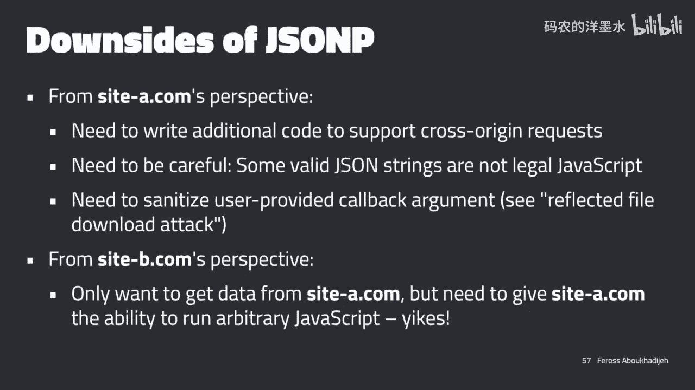