# 【全集】斯坦福大学 CS253 网络安全 中英字幕 1080P p06 Lecture 6 - 跨站脚本（XSS） -BV1RemEBZEEM_p6-

All right， hey， everyone。So。Hope everyone's week is going well。 So this is my favorite topic。😊。

So I think today is gonna be really fun。 So today， it's， it's gonna be all about crossite scripting。

😊，So this is， if you remember last time we， we talked a little bit about the。

The server sending back this response， which was sort of used in an unexpected context。

 which was like inside of a script tag。 And that could cause you know。

 the the content to be run as jascript。 And that might cause issues。 This is similar to that。

 it's about code and data sort of being mixed in a way that they're not supposed to be。

So before we start， I want to just tell a story。 So there is this who run。

 I think you brought up Myspace last time， right， So this is this is a pretty amazing story of a worm that spread throughout Myspace。

 Andll just just let's go ahead and read the story and see what goes on。

 So this is from the right up that this guy Samy did afterwards。

 So he noticed that he could include a little bit of extra code in the box where you type in your profile information。

 And that that code would actually get included in the resulting page and it would run in the user's browser。

 And so naturally， he decided to make people who viewed his profile automatically add him as a friend。

 So he include a little script that would just submit a request。 and then he would have a new friend。

 So he。😊，He also realized that。It would be more fun if instead of just adding him as a friend。

 he also added a script to their profile that would do the same thing。😊，So if you view his profile。

 you're now gonna have a code in your profile。 So anyone that views your profile will will add the same dude as a friend。

 So you can see where this goes。 This is his sort of diary of， of how it went。 So in the beginning。

 he had 73 friends。 and he released the program。 And hour later， he had one friend request。

 So not too， not too successful there。 But then7 hours later。😊。

He had 221 friend requests and was pretty surprised and I guess didn't really understand how exponential growth works。

 so。Eventually， an hour later， he had double that and then。An hour after that。

 he had 500 friend requests and started getting messages from people who were really upset at him。

 They were like， you know， why did you add me as a friend， They also。

 they also tried to remove him as a friend， But if they viewed their own profile。

 they would re him as a friend again。 So it was like really bad and。He also， remember he also added。

 since he added this text to their profile， he was able to sort of insert arbitrary text。

 So he included this string。 Sammy is my hero。 And so sort of throughout my space。

 this message started appearing on profile is everywhere。 And let's see。 So yeah。 So So then。

 So then it just goes really crazy。 Five hours later， he has almost a million friend requests。😊。

And you can see here at the very end I love this。 He refreshes。 And in three seconds。

 he's gained like 100 friends。 And then couple seconds later， he has over a million。 So yeah， pretty。

 pretty amazing example of cross sight scripting to make a worm。 This is pretty cool。😊，Now。

 if you're from from my space's perspective and from your perspective， when you're building Web apps。

 this is what you want to avoid。So， so yeah， so then at some point。

 he refreshes and notices that the whole site is down for maintenance。

 And this goes on for a few hours。 people can't load their profiles。 Nothing is working。

 Probably my guess it'd be because of the volume of requests that are being generated。

 like viewing a page now causes a couple of requests to get fired to do extra things like at him as a friend and stuff。

 And that sort of probably just doubled their load in a way that they weren't expecting。

 and the whole site went down。 So yeah。😊，And then a few hours after that， they got it fixed and。

 and the the program was removed。 So I'm guessing they probably ran a regular expression across the whole database to just strip out his。

 his code。 But the remnants remained。 And you could still see Samy as my hero And like lots of people's profiles after that。

 since they didn't move that。 So its a pretty epic pretty epic story。 I think Yeah， So okay， so。😊。

So yeah， so why， so why do we， what is the reason why an attacker would use crossite scripting？ Well。

 so the goal is they're trying to run code in the context of some site that they're trying to attack。

 right， And so we already talked about how this is not allowed。

 It's not possible for me to frame my bank's site and then to reach into that and sort of let's say。

 add a listener on the login form and then run run this function whenever the user clicks login in their bank and then。

 and then pull out their username and password because we can't cross this boundary into this other origin because of the same origin policy。

 So we need some other way to get our jascript running in the page we're trying to attack。So。

That's what cross that scripting is all about。 It's a code injection vulnerability， and。

This is basically cause whenever you have untrusted user data that's being combined with code。

The code is usually gonna be written by the developers。 So this is you building your website。

 And obviously， in order to make a page， you're you。

 you're trying to combine this code that you know， renders your page with some user information。

 So maybe you're gonna display the user's name or you're gonna display some some bit of data that the user gave you。

 And so you're sort of。Concatenating or combining these strings together。

 And it's really important when you do that， that you don't let the user's data become code unintentionally。

 And that's the source of this bug。So， so yeah， this is anywhere where you see that you have data coming from the user and then you're sort of inserting that into code that you wrote。

 You need to be wary of this。 So one place that happens is crossite scripting。

 which is what today's lectures about。 But there's another place that can happen。

 It's just really common。 It's just called SQL injection。 And this is the same idea。

 It's when the user provides some data。 And then that gets added to a SQL command， which is you know。

 a command sent to a database to retrieve some data。

 And then that user's data modifies the command in some way to do， to fetch different data or to。

 to maybe run a second command after the first command or something like that。😊，So。

So what's the big deal。 So I mean， the point of this is that once the attacker gets their data into a place where it's interpreted as code。

 now they're able to do anything that they want。 as if it was code written by the developer of the site。

 And so I mean so with all these sort client side attacks。

 the idea is that we're doing this in a user's browser。 and that user logged into a site。

 And so we can take actions the attacker can take actions that look like their actions that the user did。

 So's what Sammy did in that example， he was sort sending a post request to the server saying modify modify my profile。

 And then the cookies were attached。 And then from myspaces perspective。

's the same thing as the user actually modifying their profile and sending a request to do that another thing you can do is I I mentioned stealing someone's cookie is a very easy thing。

 if you look at the document cookie object get that string's a string get that And you just send that the attacker server。

 if the attacker just sends that off to their own server。 now they have a cookie。😊。

That they can add into their own browser to basically become that user， right。So that's。

 that's the other thing you can do。Does that make sense。

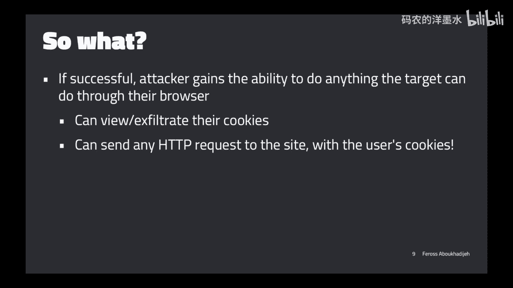

Okay， so， so yeah， this is， this is really bad。 So let's。

 let's go through just like a really naive example。 If you've started the homework already， then you。

 you'll have already sort of seen this in the very first problem。 But by the way。

 the homework is also， I think， really fun。 It's， it's basically。

 you're an attacker and you're trying to attack your competitor's website。

 So you're like a startup and you have a competitor And they launch before you。

 And so you're trying to like， make them unlaunch their site by like attacking it and convincing them to。

 to unlaunch it。 so。😊，So， but yeah。 so， so， so the idea is like， we have this search page and。

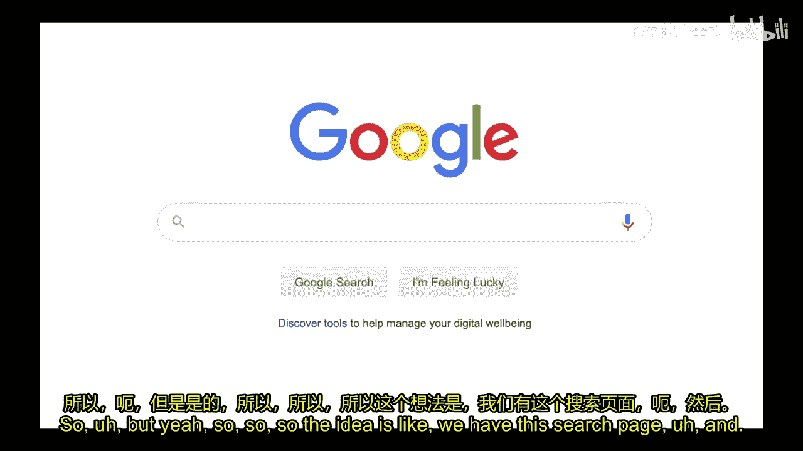

Let's just be really naive here and see like what would。

 what would be like sort of the the wrong way to do this。

 So the user is gonna do a search for flower。 And you know。

 that's gonna navigate them to this URL here。😊，And。Straightfor， right。

 And so now the server is gonna get a request for this。 It's gonna pull out the query parameter。

 And it's gonna see the input is this， right， It's gonna see， it's gonna retrieve that that variable。

 And then it's gonna just sort of concatennate it with this H T L。 So this part here。

In this part here。Is hard coded by the server。 And then this part here comes from the user。Okay。Okay。

 that makes sense。 Now， what would we do if we were malicious？ Well。

 we're gonna put a script in as our search。😊，And we're gonna hope that when the page is assembled that that script is gonna run。

 So how does this work， so。Say we actually typed that into the search box。

So the browser will helpfully， well。So， so that'ss， that's a form field。 right。

 So when we actually hit submit， the browser is going to send us to this， this slash。I guess yeah。

 I guess it's just slash in this case。 It's gonna send us to slash。

 which is just the same page we are on， but it's gonna tack on the， the contents of the form。

 In this case， the， the input is called search。 And this is the thing we entered in。

 But it's gonna URL encode it。 So this is just。😊，That's， that's this sort of percent And。

 and then a hex bite here。And， and that's just so that certain characters。

 which might be ambiguous or considered to be part of， of other parts of the URL。

 don't get confused as， as those parts of the URL。 So， so example， example， say， you know。

 I were gonna say， say this value contains an equal sign， right。😊。

That would be very confusing because here， you know。

 the key and the value are separated by an equal sign。 So we can't have an equal sign in the value。

 So characters like that need to be URL encoded。 And that's that's just what this is here。

 Just a few other ones like， in this case， the angle， the anglegle brackets are。

 are also URL encoded。But yeah， anyway， the point is， when a server gets it， you know。

 this is not sort of a permanent transformation。 The server is actually going to undo that change and get back the original string。

 And then it's going combine it with that same template we saw before。

 And you're gonna gonna end up with this as a resulting H TM L。And， of course。

 this is a problem because the browser doesn't know that this stream came from the user。

As far as it can tell， this is the server sending back a page and saying， this is my page。

And this code is gonna run。 And so in this case， all we're doing is they're sort of alerting out the user's cookie。

 which is not gonna do very much damage。 But this is a common thing you'll see in in cross sight scripting examples。

 It's sort of demonstrating the fact that like the attacker was able to run code in this case。

 just open up an alert， which is a little pop up that just contains the user's cookie。 Obviously。

 in a real attack would attacker would just， send that cookie off to their own server or something like that。

 But if we do this， we can sort of just prove that there's there's a vulnerability without doing any damage。

 So if you're ever sort of looking for cross sight scripting attacks。

 a string like this is really nice to do because your。😊，You know。

 you're only attacking yourself in this case。 you're literally just alerting your own cookies out to yourself。

 So no harm is really done。 If you're just doing something like this where you're putting it into a URL。

 you're sort of just， yeah， you're just。Yeah attacking your own browser。 Does that make sense。Okay。

 cool。So yeah， so， so what do we do here， What do we think we can do to， to prevent this。

 What's something。We should do。Any ideas， Yeah， in the back。It。Reject。You could like。Before。

Sa to check。Okay， so you're thinking， if we see like， like anglegle bracket script， we should just。

Give them an error page instead of letting letting them see the search results。 Okay。

 that's reasonable。 What if I'm a developer， though。

 and I actually want to search for like script alert， Like。

 shouldn't I be allowed to do a search for that。😊，I mean， you could。

 you could say I don't want support that on my search engine。 That's fine。 Actually。

 you'll see some banks will actually， I' know if you' ever seen a couple of banks will actually use that as as sort of their their defense for when you like making an account。

 they won't let you make your username be any like programmer sounding words like seriously。

 like if you try to name your， your username like like script or or select or insert or anything that sounds like it programmeish。

 They'll just say like you can't choose that as your user name。

 And hopefully they're not relying on that for their security because there's that's a blacklist it's like a blocklist approach where you basically are saying。

 I don't allow these things。 But of course， if you forgotten one thing than your your own。

 So you want to have like other。😊，Defense mechanisms in place。 So， yeah， So yeah， you know。

 denying is one option。 But what about something else， Any other ideas。Yeah。でユーザ。Qu stream。そります。

It's not interpret as a straight in some way。Yeah， yeah。 that's the right idea。 Yeah。

 So we want some way to tell the browser like， hey， this is a script。 Oh， sorry。

 this is not a script。 But rather， this is just text that I want you to sort of display to the user as literally like。

😊，Angle brackets， script angle bracket。 like I want it to show up as I want the user to see search result for。

 and then I want the user to see this text on the page。 I don't want it to be executed， right。

 And so yeah， the way we do that in H T L is well， fundamentally， the problem is that we have。😊。

We have。You know， these characters have significance in the context that we're putting this string in right now。

 And so we need to somehow do something to this character to sort of like neutralize it and make it not be treated as the beginning of an H T L tag。

 That's the problem。 right， So so that， that process is called escaping。 I'll show that in a second。

 But， but but first。😊，Just， yeah， this is that string that I kept showing before。 And now you。

 you understand what it's for。 This is like the way that the， the attacker could。

 This is something that they could do instead of just alerting the cookie。 They could， they could。

Make an image in jascript that just。Hits this URL， and then。

This is actually not gonna show an image or anything。

 but it's just gonna cause a get request to go to this URL with the， the user' cookies。

 So now you actually know what that， what that string is before that I was showing。So， yeah。

 and this is what that page would look like with that code in it。Yeah， so， so okay。

 So so before I show how to escape it， let's， let's first see it in action。 So。

 so I'm going go take us back to our bank site again。 This poor bank has all these security problems。

 But yeah， so what we're gonna do is we're gonna go to。😊。

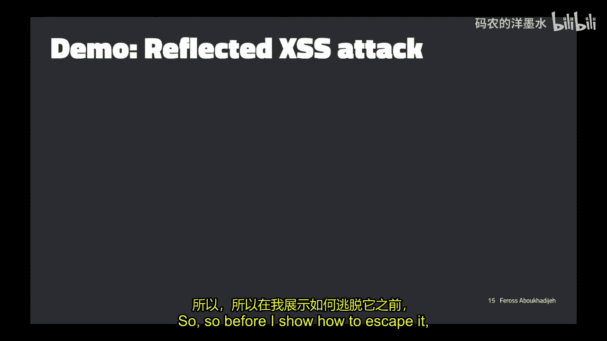

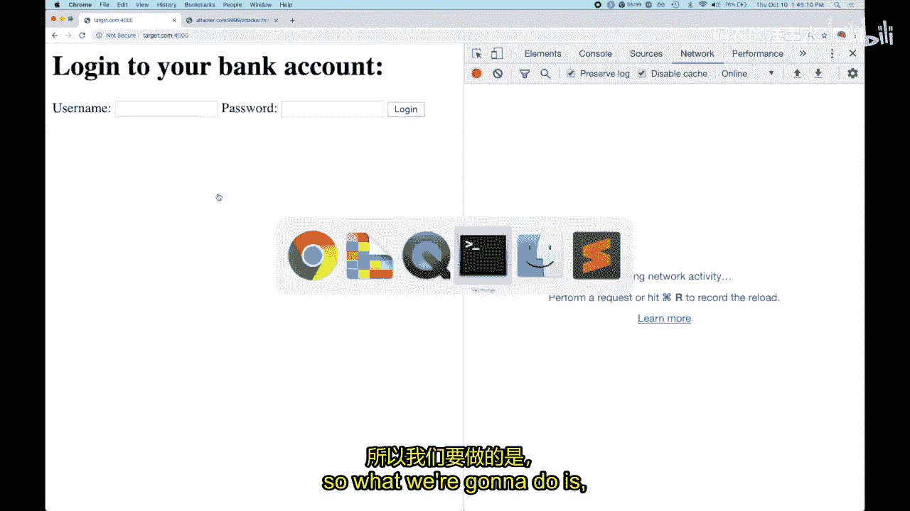

The code we had before。For this， which is let's see， where do I have this here is？So this is。

 this is the same bank site we had as before。 And what I'm gonna to do is I'm going to introduce an excess S vulnerability into the site。

But let's， let's think of something that's sort of a plausible scenario。 So let's say that。

We want to add， so our bank is doing a partnership with a blog。

 and that blog is gonna write a great article about how cool our bank is。

 And we want to track whenever somebody clicks that link comes to our page。

 We want some way for us to just look at the URL and know that they came from this blog。

 And we want to sort of welcome them and say， you know， hello， like wired magazine reader。 like。

 welcome to our bank。 So what we're gonna do is we're gonna add a parameter into the URL called source。

😊，And we're just going to。Pulll it off of the query。So literally。

 what that means is if I go to the bank site here and I don't know if you all can see this right here。

 but it's going to look like this， I'm just going to sort of have a parameter that's like wirered magazine or whatever。

 And we're gonna go ahead and use that to sort of change the text that the user sees here。

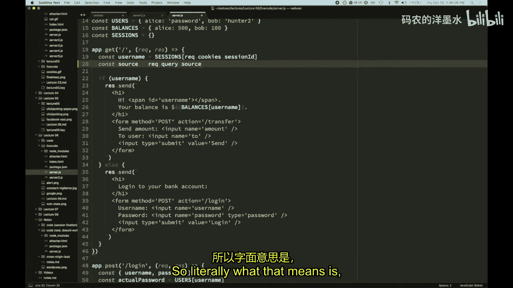

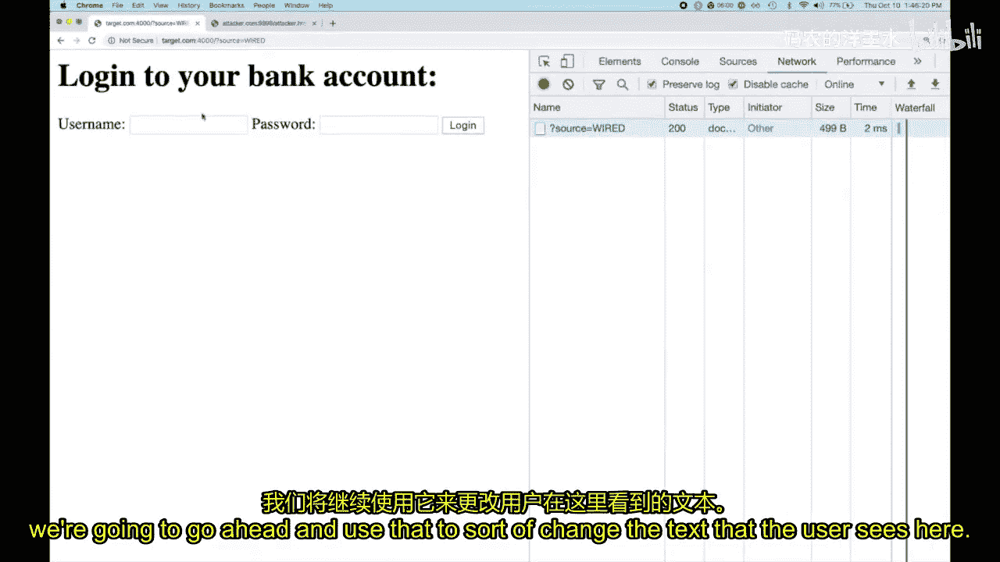

Okay。So we got that， we got that string。 And now I'm just going add it to the page here。 So let's。

 let's only do it if they're not logged in。 How about that， so。If they come and。

 they haven't signed up yet， we'll welcome them。 So we'll say， we'll say。Hi。Source reader。Okay。

 now the thing is this could be undefined。 So let's， let's handle that in case there's no。

 there's no parameter， and we'll just sort of。I'll do another nesting of this。

 If you don't understand this syntax too well， don't worry about it。 It's not a big deal。

 But basically， what this is doing is just just saying。If source is defined。

 then say hi source readerer， otherwise say nothing。 Just don't say anything， okay。

And so I think that's it。 Now。 Yeah， now we can just go here and refresh this。 And there we go。

 Welcomd us， awesome。😊。

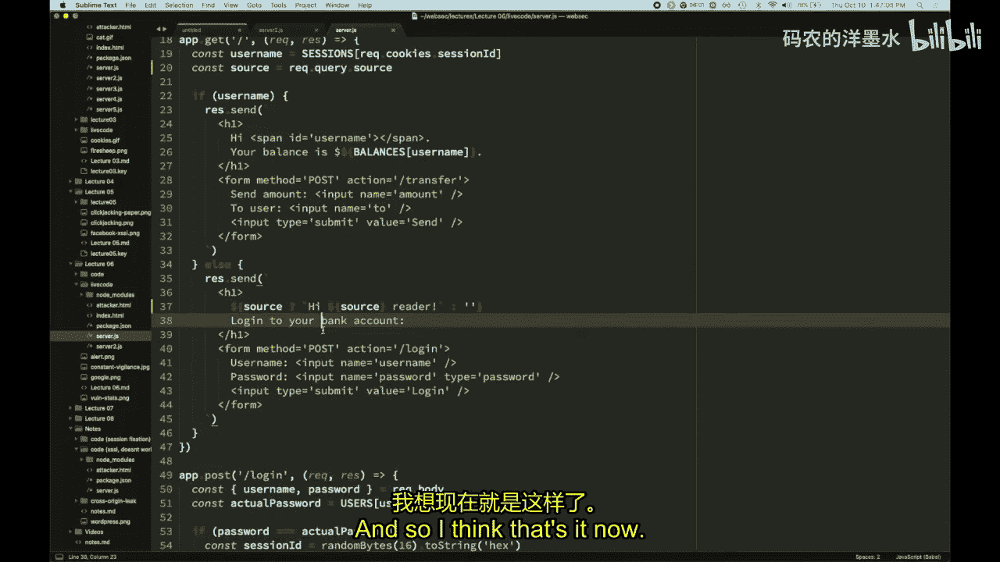

Okay， so the problem， though， is， of course， we didn't do anything to clean up the string。 This is。

 this is an untrusted string provided by the user， right， By the way， quick quick side note， Like。

 what do we， how an attack or actually， Well， okay， I'll come back to that in a second。 Actually。

 let me， let me just show the attack。 So the attack is， of course， we just put a script in here。😊。

And we'll alert。The document dot cookie。Okay， and so if we do that， and I hit enter。

Then I guess I don't have any cookies set because I didn't log in。 but yeah， So it alerted。

 So let me just log in really quick and just prove that this works， okay。Oh， then again。

If I'm logged in， then I'm not gonna see the。Okay， so we have， we have some problems here。 Yeah。

 they， the problem is basically that I only only showing it when they're， when they're。

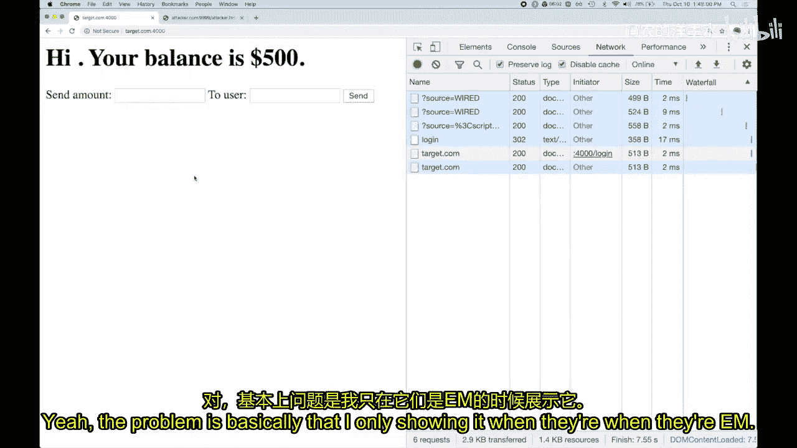

Logged out， right， So I didn't think that through very well。 I' have an idea。

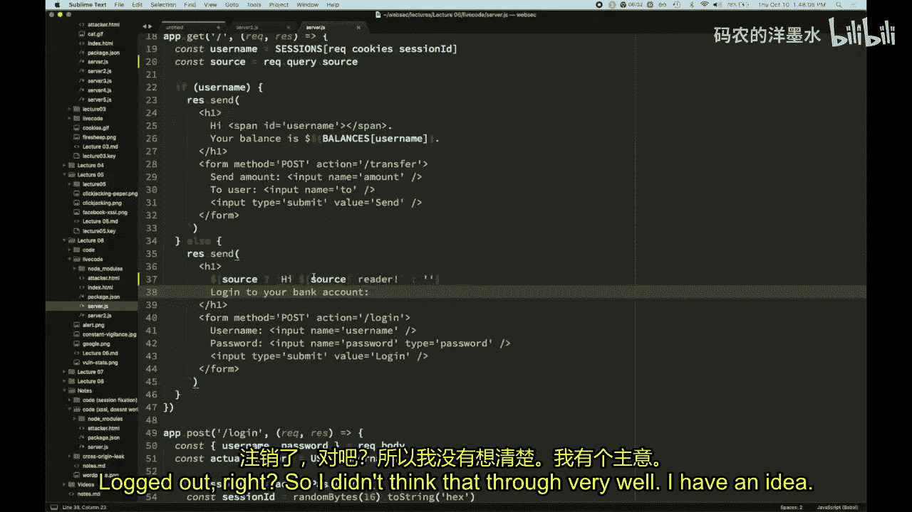

Let me adjust。Let me just go ahead and manually just set a cookie here so we can see that this is working。

 So I will just add a cookie called， you know。Something。Session， I D。Cos 1，2，3，4。 Okay。

 so now we have a cookie。 And now if I add that source equals wired magazine again， there we go。

 And if I add the， the alert version。I'm not gonna see my cookie there。 Okay， Okay。

 so so that that's， that's not good。 And what's interesting。

 though is notice doesn't that script doesn't actually show up right。

 why is that that's because it's being executed， right， It's being treated as part of the page。

 So if I， if actually open up the H T L here and we look at it。 What do we see， We see that well。😊。

I mean， it's just like before。 So the script gets sort of got inlined there in the page where the name of the of the magazine or whatever the the the source parameter should have been。

 And so， and so， so yeah， the browser treated it as code and ran it。Okay， so。So yeah， so。

 so how would we actually， how would an attacker actually get a user to run this code， right。

 Because right now， I'm just， I just attack myself。 That's not a big deal， right。

 It's not gonna do anything。So what actually， What would an attacker actually do in this situation。

 yeah。Do you just send them the link with the script and it sends it exactly runs the script and it appears here on that page。

 exactly exactly。 So， so if you get them to click that link then then this code just runs So that's the thing that's the thing that's really sort of pernicious about this is you might think。

 oh， I'm clicking a link to site I trust。 it's like I'm going to Google But the site itself is vulnerable。

 and you're logged into it。 then the attacker code still runs in that context and steals your cookies and therefore it steals your account basically So you can' it's not a defense to sort of not go to suspicious links。

 You're still， you're still in trouble。 if the site is vulnerable。 So this is really bad。

 The other problem， too， is maybe you think， oh， I'll notice that in the URL I won't click a link that like a script tag in the URL。

😊，But， but you know， a lot of times these days， you're cooking links on。

 on mobile devices where it doesn't show the full URL or stuff like that。 So it's。

 it'ss actually sort of still， still pretty prevalent for that reason。Yeah， so， so basically。

 oh yeah， I'm gonna show you how to fix it really quick。 So one。

 like one really quick way to fix it is there is a package called H TM L escape。😊。

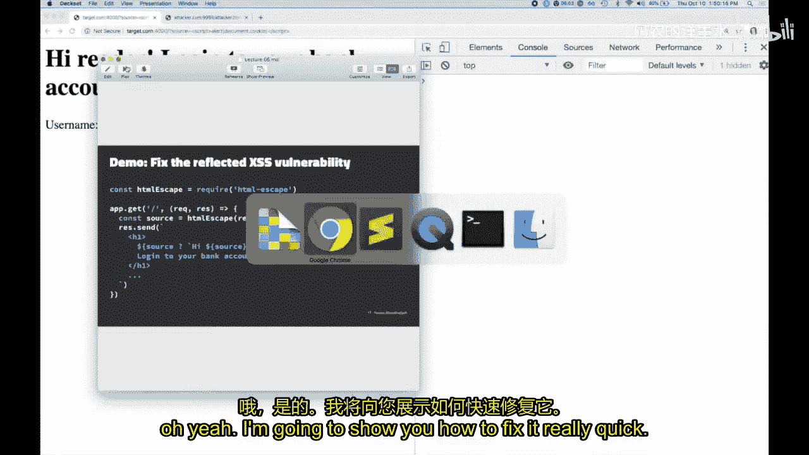

And。I just going import that really quick。 And so what this does is it sort of goes through and replaces the characters that are unsafe with safe versions。

 And so now if I refresh this page with， with the script in it。

 instead of it alerting out my cookies， it should just display me the script。

 which is exactly what I wanted， right， I want to just show the user what what was in the URL。😊。

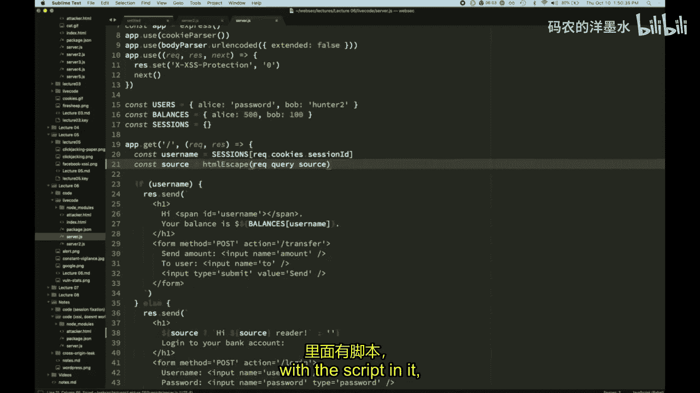

So now this is not an attack， even though it looks sketch， it's not actually an attack。 So。

 so now if I look at the code， what actually happened。我。That first。

 that first angle bracket was replaced with what's called an H T L entity。

And that's indicated by the starting ampersand and the ending semicolon。 And then between that。

 we have sort of the these characters that indicate what character the browser should show。

 So in this case， the L T stands for less than。 So the less than sign or the the angle。

 the left angle bracket is what we're gonna get there。 And again， this one was also replaced here。

And just， just that replacement right there was enough to sort of neuter or neutralize this。

 this script。嗯。😊，Like， for example， howza know that that's a crime。So I only ran that function on。

 on one particular variable， which was the， the source argument。

 So this is that string that was provided in the URL。 And I just， I just did it to that。 Yeah。

 if I were to do it to the whole page， we'd have a problem because then whole。

 then literally every tag in the page would just get。😊。

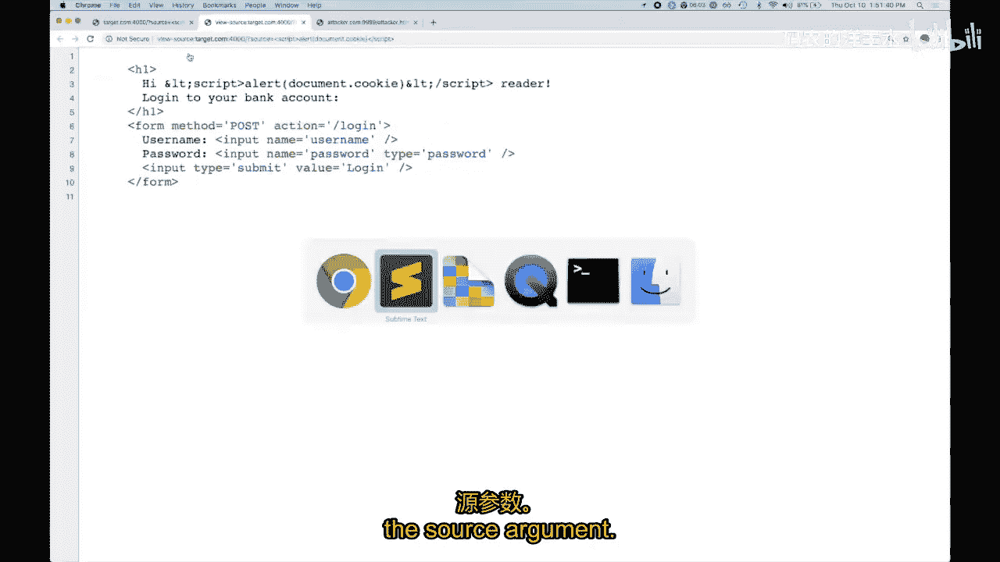

Shown to the user as， as as text， right， And I so I don't want to do that to all my tags just to things which I know are not supposed to be tags。

IfThat makes sense。Yeah， and so， by the way。Most of the time when you're doing this。

 you're actually gonna be， you're not gonna be calling a function like this。

 but rather you're gonna be using some kind of a web framework， which does this for you。

 So if you're using any， any kind of framework at all， you know， typically， youll。

 you'll have a way of inserting data that comes from the user into your H TM L template and you'll that that mechanism will handle this for you。

Though it will usually also offer a way to opt out if you don't want it to to mess with your。

 your input because you， you say， you know it's H TM L and you want it to to actually be treated as such。

 there's sort of a way to opt out of it， basically running this function for you。

 And that's dangerous。 But you can do it。 you need to be aware of sort of the the implications of that。

 yeah。Mm。😊，Yeah， yeah。 So， so， if you're using Express Express itself doesn't actually do this sort of the concatenation of。

 of， you know， of H TM L with user data， but you'll have a tempating language。 W。

 they have a tempating language that that you're using with it。And so like a popular one is。

 is E JS or another one is Jade whatever the point is， whatever you pick。

 when you look at its documentation， it will tell you like here's how you take data and put it into H TML safely。

 And then here's this other way which hopefully has a scarier name or is a harder to use that will。

 that will let you sort of not let you opt out of running this function。 But yeah。

 usually it you should just use the mechanism provided to you by whatever framework you're using。

 yeah。😊，Yeah， and like in those frameworks， do people still manage to find like exploits nowadays。

 or are they like less common。Yes's a great question。

 So I was looking up stats to answer this question。 And I， and I from what I can tell。

 it's just as common as it ever was。 So I have， yeah。

 like I have I have a graph of it in here of how common this stuff is。 And like so for a long time。

 X S was like number one。 it's still basically like half I guess this adds up to more than 100% because sites are vulnerable to more than one thing。

 So but like half of sites have excess S problems According to this this research。

 which is from I think it was called white white hats。

 White hat security It the company that put this report out。😊。

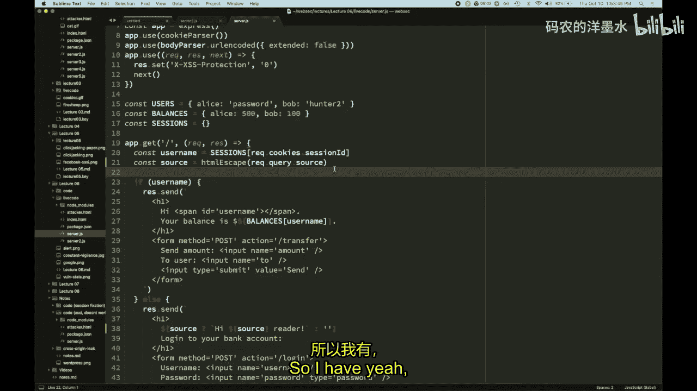

So it seems like it's just as prevalent。 And this is， I think this is from like 2015 or 2016。

 So it's like relatively recent。And。Yeah， and I think。

 I think the issue is is there's actually quite a lot of。Stuff happening on the client side now。

 like with react and all these kinds of frameworks。 And so they're introducing kinds of different。

 different new ways of doing crossside scripting that that are。People， like， we less good at have。

 we haven't figured out ways of of solving as as well yet。 Yeah， so I'll some examples of that。

 too later。

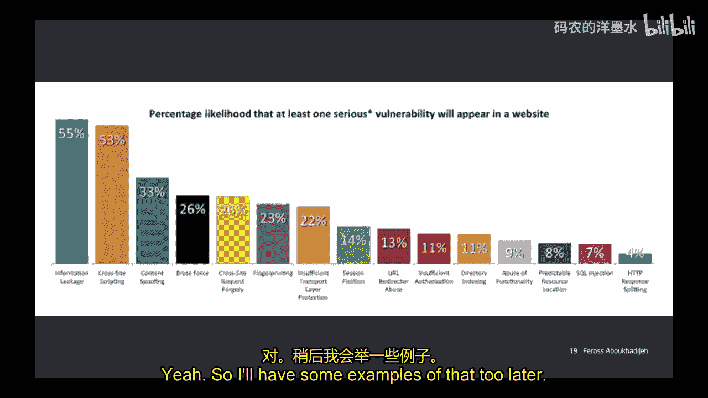

Cool， so， so yeah， basically， the big idea here is never trust the client。

 like this is something I mentioned before。 But in this case， the same thing， right。

 we get data from the client。 We can't trust it。 So it's， it's suspect。 And so we have to sort of。😊。

We have to sort of clean it up before we use it。So。So yeah， So why， yeah， why is it so prevalent。 So。

 So there's like a lot of reasons for this。 one is that， that。

The Web has like so many different languages and different contexts that you can， you can be in。 So。

 I mean。You know， we have literally you have H TM L。 And then inside of it。

 we have javascript right in certain tags。 And then inside of that。

 we have like strings that we might be putting user data into。

 And so there's all these different rules for each of those levels of what characters need to be escaped to be safe。

 So that's one big source of this。 It's just confusing。

 And we're gonna talk about some of these context that H Tm L has。 And the different rules for them。

 And the different ways you can if people make mistakes， how you can attack a site with that。

 And yeah， in each of these contexts， I that have different control characters。

 And some of them have a really complicated rules。 And then like with all things with defense。

 If you make one mistake。 then。😊，It game over。 So it's， it's really bad。But first。

 theres there's two general kinds of， actually， there's three kinds。

 But we're gonna initially just talk about two kinds of excess S。 There's reflected and stored。

 So reflected is， is the idea that the attacker is gonna place some kind of code in the H T TP request itself。

 So this is what we saw with all the examples we've really seen so far。

 And so you're trying to find some kind of URL that you can get your target to visit that includes the attack code。

 So one big limitation with this is that you have to find some way to get that attack code into the URL path or the query or some way that is sort of in the effectively in the link So so it it's somewhat limited in that sense。

 If you can't find if you can't find a way that those things are being used unsafely。

 then you can't really do reflected XS S。On the other hand。

 so stored access is like what Sammy did on myspace。

 So that's the idea is you're trying to get the code。

 that attack code stored in the database of the server。

 And then then the user who comes to the page can be coming from any URL。

 It doesn't matter if they clicked on your URL with your attack code in it。

 because the attack code is actually in the database of the server。 And so when it renders the page。

 that code will be included regardless of whatever URL they come from， And so， yeah。

 what makes this more powerful is that the attacker can use any means to get the attack code into the database。

 So what does this mean， This means like literally let's say I know that the server。

 this is hypothetical thing。 But let's say the servers looking at like H TP header and taking that value and putting it in the database。

😊，So there's no way I could send a link to my to my target and get them to click it and add an extra H T TP header to it。

 right？ But so， so I couldn't do， I couldn't do something like that with reflected， but with stored。

I can actually， like。Put whatever attack code I want in that H T TP header value。

 And if the server goes goes ahead and takes that and puts it into the database。

 And now they're just giving that to everybody who comes to the site。

 It doesn't matter that my sort of means of exploiting it was relatively obscure and involved in H TP header。

 Does that make sense。As long as， you know， I could literally also， you know。You know。

 the attacker could literally just， you know， go。And。You know。

 bribe somebody that adds a script to the database， right， And that's， that's also a stored excess。

 right， So it doesn't matter how you get the data into the database or the rather。

 it doesn't how you get the attack code into the database。Does that make sense。Cool。Okay， so， so。

 so let's let's just look at this example here。 So here we have some I I started playing legend of Z the breath of the wild。

 like two days ago。 It's a really good game。 So， I just put the Wikipedia article for it in here。

 But yeah， so this is an H L page。 And this is untrusted user input that we just got from the user。

 And so the question is， what， you know， how do， how do we make it safe。

 And so for all these examples， I'm just gonna I'm gonna be using user data here to represent sort of un like an untrusted string that came from the user somehow。

 okay。😊，So， and yeah， and， so this is called our H T L template。 So this just means that， you know。

 we have things that we， that we wrote code that we wrote in this case， the P tags。

 And then we have things that that we didn't write that came from the user。 And so that's。

 that's an H T L template。So how do we protect this， We already kind of mention this。

 So we need to change all left angle brackets to this less than entity。

 And then the browser when it sees， when it sees， you know， this， it'll know。

 that's not a real left angle bracket that I'm supposed to treat as the start of a tag。

 It's just something I'm gonna just show in the browser， right One problem， though， with this。

 Can anyone see， like， this is not enough。 We actually have to do one more character。😊。

Can anyone see what it， what it might be。Yeah。So。Can backslash escape me？What do you mean by that。Oh。

 no， no， no。 Yeah。 So you're saying if the user types backslash left angle bracket would， would。

 would our function， which translates all these into these like missed that somehow would would backlash oh。

 and that would somehow make this not work。 Yeah， so it it would yeah。

 would translate it into backslash that and then would just， it would still do the same thing。 Yeah。

 it would be fine。😊，So what is， what is the problem with all sorts of。Any time we。

 anytime we have a language and then we， we decide we're gonna use one character as the indication of。

The start of an escape sequence， which's the problem that we've created for ourselves， yeah。Yeah。

For some reason， the user won。周期。Oh， if you're saying the user typed LT semicolon。

There are Amperserson L Am percent， Yeah， exactly。 user wanted to type the Amperserson LT。Yeah。

 and they wanted that to show up。 Then， then what would happen is right now is it would。

 it would actually show up as this， right。Ca what does that make sense when the browser sees M L Se。

 it's gonna show it as a less than。 But the user literally typed in these letters and actually wanted these literally to show up。

 So this is sort of where you， where you have to sort of go one level deeper in the inception。

 And we， we change all。😊，Ampersands to Ampersand amp。 and then something call。

And now we've actually sort of， now we can represent everything we want to represent。

 So if user types this in， we're gonna get this。And you can， you can think， you can think through it。

 And you know， this， these two things are sufficient。 You can just think through， you know， may。

 it makes sense you just think about it long enough。Okay， cool， so。So yeah。

 and then but one thing that's really important here is this。 So， so it seems like okay。

 we solve the whole problem， right Like we just do this anytime we have data inside of H tags。

 but it's actually more complicated than that。 So style and script have completely different rules。

 So we're gonna get to that later。 But for， for all the other types of tags， you can， basically。

 this is your algorithm， you can apply。 and you're gonna you're gonna be fine。😊，And again， you know。

 when you're you， when you're doing this in practice。

 you probably should rely on the framework that you're using to do this for you。

 but it's important to know what it's doing。 And that's why we're going over all this。

 because especially if you're， if you're a pen tester or you're an attacker， you， you need to。

You you're not an attacker。 You're， you're attacking your own sites or you。

 you're pen testing somebody else's site who's paying you to do so and that you're authorized to be doing。

 Then then you need to know you know what's actually happening and what where。

 where the  vulnerabilities come from。Okay， so， so let's actually see what happens here。

 So say now I take that same input that's malicious。 and I run it through our new system again。

 like this is what we saw before。 We get the replacements right there。 and we're all good。😊，Right。

Okay， so now let's talk about a new， a new situation。 So H T L attributes。

 So attributes are these things， right， So that's an attribute name， and that's an attribute value。

And so this is an image with， you know， an avatar。 And then this is alt text。

 This is text that shows up if the user is using a screen reader or if the user the image doesn't load for some reason。

 this text may， may， may show up instead。And so let's see that this text is untrusted。

So what do we need to do。To make it safe。So， well， actually， first， for， first。

 let's look at what would happen if we didn if we did nothing。

 So how would we actually attack this if we did nothing， so。Here's。

 here's an Htl template that's going swap in user' data right here and say that I made this my input。

What's gonna happen， Well， we can see。So that makes sense。 So， so basically。

 everything between this quote and this quote is my is controlled by the attacker。

 So everything between， let's this right here， this quote and this quote。

That's all attacker controlled。 And so I can， I can basically include a quote here in my input。

 which ends this this value。 And then I can just say， oh， actually。

 I want to add a new attribute here。 And now， as far as the the browser is concerned when it looks at this。

 again， It doesn't know which part of this the user controlled in which part the site control。

 That's just gonna see this and say， hey， that's an image tag that has three attributes。

 source alt and a function that I'm supposed to run when the image is done loading。😊，Right。

And so this is going to run this code。 Does that make sense。Cool。Alright， so let's。

 let's try to defend against this。 So what's， what's something we could do here。

What characters of mean to be worried about in this context。Yeah。A quote。The quote， yeah， the quote。

 Okay， so let's switch the quote to something else， right。Okay， yeah， so let's。

 let's switch single quotes to something else。 That seems reasonable。 One thing， though， is that。

 is that So say you're right， Let'， let's do that。 And this is the。

 this is the H T L entity for that。But， but the thing is。

 you can actually use double quotes as the quotes that surround attributes in H TL。

 And since we don't know sort of we don't want to have separate functions for each of those。

 let's just， let's just be sort of extra safe and just turn both types of quotes into H T L entities。

 And so now it doesn't matter。 It doesn't matter what this is surrounded with。

 We're just gonna sort be a little bit over aggressivegress。 And and it doesn't hurt。

 It doesn't hurt to take a character and sort of turn it into an entity。It， it doesn'。

 doesn't sort of affect。 You can sort， you can actually turn every character into entities if you wanted to。

 And it would， it would do the same thing， so。Does that make sense。Yeah。

I thought the H TL was being served to the client from the server。 Yeah。

 so how are they actually like are they modifying the H TML that they've already received Oh。

 in this in this example here， they actually Oh how are they getting their input into here So so this is that's a good point。

 So so I guess。I mean， so， so we could think of this as a stored excess thing。

 So let's say that let's say that I'm， I'm making a new profile on a site and it asks me what my name is。

 And instead of typing in forosa Bucadija， I type in that， that string from before as my name。

 And now what we're trying to what we're defending against is basically we don't want when anyone comes to my profile that it renders the image of my profile like this。

 because now we're gonna be running code on that user's browser。 So that's how。

 that's how our attack code gets onto the the targets computer。😊，Yeah， so okay， so so we change。

 we change those two things。 And now when we， now when we。

 now when we put our our attack input put in， this is what happens。

 So so now now you can see the browser， what is it gonna think now when it looks at this。

 it's going think， well， okay， we just have some kind of a strange alt string here with。

 with an apostrophe in in it。 But it's not going to， you know。

 this is not going to sort of end the context here and start another one。 Does that make sense。Cool。

All right， so that's far so far not too bad。Now， here's， here's where it gets really nasty。

 So it's possible in H T M L to omit the quotes entirely。 So you can do。

 you can do this image tag here with no single quotes or anything around it。

 And this is totally valid。 one downside of this is that you can't include spaces now in your values。

 because if you include a space that's sort of going be parsed as the start of another attribute。😊。

But this creates all kinds of problems now， because now。嗯。You know。

 now I can just even using our algorithm from before， where we swap out quotes for those entities。

 we've sort of owned ourselves because now that doesn't protect us， right。

 This string here has no quotes in it。 So the the， the， the replacement did nothing。

 and we still got excess。Does that make sense。So theres a whole the question is like。

 what characters do we have to worry about in this case。

 And the answer is a whole bunch of characters that you really don't want to。To worry about。There's。

 and this is。It's， so you might just think， well， okay。

 space is the only thing we need to worry about， right， Just don't let them。

 don't let them put spaces in in here。 Then they can't。

 then they can't end this value and start another， another attribute。

 But turns out browsers are have to serve really lax parsing policy。

 And I'm gonna mention a little bit more about that in a sec。 But basically。

 any of these characters will be treated as effectively ending。

 ending this value and let you move on。So it''s it's kind of the bad idea to do this。

 So just just don't do this。 just always us put quotes around your attributes。

 and then you don't have to worry about this problem。Make sense。Yeah， and so by the way。

 like this for a long time was like different across browsers， Too。 So you couldn't even like know。

 there was like no no sort of single set of things you could。

 you could just escape because every browser had its own rules。 And， and， yeah。

 and now we've sort of gone to a better place where it's standardized， but it's still that idea。

 I think。Okay， so yeah。Yeah， just escape attributes。 Yeah， So theres one thing to mention， though。

 So so far， we've been talking about these attributes like alt， which are like relatively benign。

 Like the value here just affects like some text that's shown in， you know。

 when the user hovers or uses a screen reader to access a website。😊，But。There are certain。

 certain attributes， which， which have like more sort of a power， like， for example， source or H ref。

 So if you do something like this， script sort sequels， let the user set this to what they want。

 I mean， you have a problem here right because now you're letting the user effectively。 I mean。

 choose a URL that a script is gonna get loaded from。 So it's not enough to just be like， oh， well。

 I took the quotes out of it。 So， you know， their string is now like not gonna break out of this quote here and do other things。

 But， you， but you forgot the fact that you're literally letting them load a script and run it。

 So it came over already。 So just keep that in mind。😊，Does that make sense。Okay。

 but it's even worse than that。 So you might think， okay， well， like， let's say that。Let me see oh。

 what's an example here。let's say you had some way to tell that the URL they're putting in here is safe。

 Like you have， like， you know， you have a rex or something。 And you're like， you know。

 I'm okay with them putting that in as the value or something like that。 Probably a bad idea。

 But let's say you， you had a way to know that。 Well， you have to be careful when you write that rex。

 because there's these other weird protocols called data and jascript。

 which can can cause all kinds of havoc。 So let's talk about those。😊，So first of all。

 I'm just going to show you a demo of actually navigating to one of these URLs。

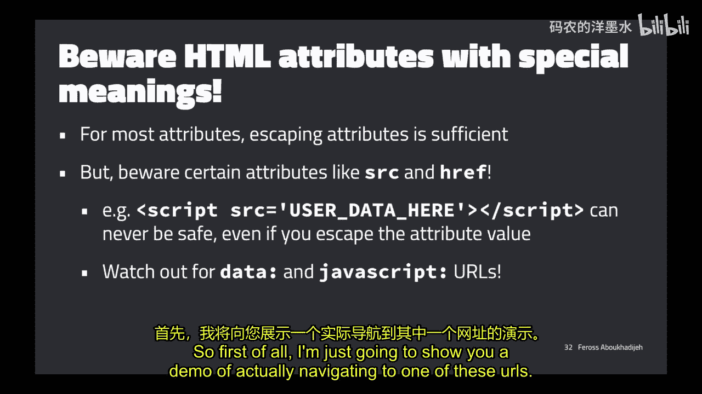

So let's see， let's open a new tab here。Actually， who's seen data URL before。 Okay， a people5。

 What about jascript to colon URLs。 Okay， yeah， so theyre， they're really really rare。

 You don't usually see them。 Yeah， so you can do this thing where you can， you can say data。

 Can receive this data colon。And what I'm going to specify here is a mime type。 So I'm going to say。

 I have an HTML Tmail page。And what do I want to put in it， Maybe I want to say hi。Okay。

 and if I hit enter。That actually loads a page。What is this doing here， This is really weird， right。

 What is this doing this is。This is saying effectively， pretend that there。

 pretend that this is a URL to a some server out there。 Okay。

 and this is pretend like we're making a request to that server and then pretend that the response we're getting back is what follows the comma。

And then pretend that its content type header is set to text H Tl。Okay。

 so it's a synthetic response from， from a non-existent server， basically， right。

Does that make sense。Okay， so one thing about this， though， is this。

 this means that if we don't strip out data URLs and we let people put put that in and think that that's safe。

 we've we've literally given them again， arbitrary script execution。

 because I can put whatever I want in here。 I can say script you know， alert。😊，I can't type alert。

 document dot。Oh， my gosh。Clearly can't type。Alert document。 cookie and then close the script。

 and then if I run this， nothing happens， why？What happened here。No cookies。 Is that why。 Let me try。

 Let me， let me try learninging something else。Okay， yeah。

 so I think it must have just been no cookies or something like that。 Okay， so yeah， so like。

 let me say hi。Yeah， so that's that's not good。 But， but by the way， one。

 one kind of interesting tidbit， you can actually use this for。For some。

 if you just need a quick notepad， like if you， if you're you're trying to type something。

 but for some reason， you can't open up anything but a browser and you also don't have internet and you need to type something you can do。

 and type this。 Can everyone see this。You can make an H T L document and say content editible。

 And then this will load up a page。 And what contentedible does is it lets you just type。

 So you have like a little text editor。 It's kind of cool。😊，Yeah， pro tip anyway。 so that's。

 that's relevant。 though。 Okay， so， okay， so now I w to show you jascript URLs。

 So with jascript URLs， let me， let me go to a page like this。

 and then we can use this as an example， so。😊，Okay， so I'm on this page。And what。

 what jascript to colon does is it lets me basically run jascript in the context of the page that I'm in。

So， it's kind of weird。If I so， let， let's see what this looks like。 So if I say alert high， But。

 but I started it with the javascript colon， right now， and I hit enter， what's gonna happen is。

It's gonna actually run that code on the current page。 It didn't actually take me to a new URL。

That's pretty weird， right？So you can start to think about ways that this could be used to attack。

A slight。Okay， so that's that's that's that's how that works。Oh yeah，1 other， one other tidbit。

 this is kind of funny。 So if you， let me go to a text document here。

 and I'm gonna type jascript colon alert Hi。😊。

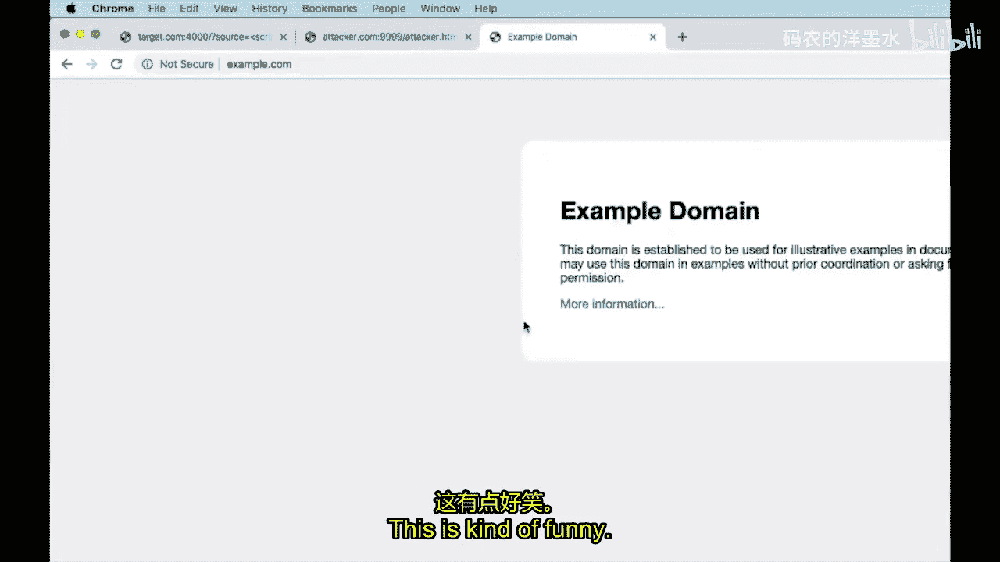

And I'm going copy this to my clipboard， And then I'm going to go back to this page。

 and I'm going to paste it in。

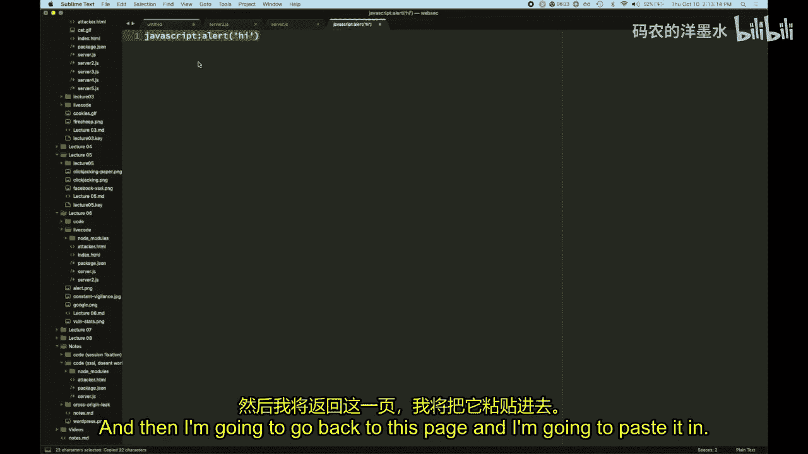

And what just happened。The jascript colon was stripped out。What will happen there。

Anyone having ideas。 Yeah， Chme Yeah， Chrome's protecting me from myself。 So the idea。

 the idea is this is actually a huge phishing vector。 So but what。

 the way that thesees attacks work are say that you see some sketchy posts on Facebook， it says。😊。

You know， copy this URL and paste it into your address bar to see who's viewing your profile or something like that。

 There's like that's a common meme in these phishing attacks they'll often know。

 put whatever code the attacker wants to run。 and they'll prefix it with the jascript colon。

 And if the person， you know is silly enough to believe it and paste it in。

 and they're gonna be running the attacker's code right in the page。

 And that's such a simple thing for a user to do to copy a string and then paste it in their URL bar that like this was happening more than。

😊，Browser vendors we' comfortable with。And so the solution was， well， we'll just take like，ll。

 if we see them pasting in the in in the URL bar， we'll just sort of chop off the。

 the javascript colon part to sort of save them from themselves。 But the thing is。

 you can always go and add it back in。😊，So if you add it back in it， it works just fine。

 But I think that like， that's enough of a roadblock that it makes the the attack like less effective。

 That was， that was the sort of idea anyway。 But if you try to do this in other browsers like Safari。

 you get a different， slightly different behavior。😊。

So what Safari does is it tells you it doesn't allow jascript in the search field。

 but you can go turn it on in the settings， if you want。

Firefox also follows Chrome's approach and just strips the strips the jascript to colon and part out。

Okay， so we have these two really weird URLs。

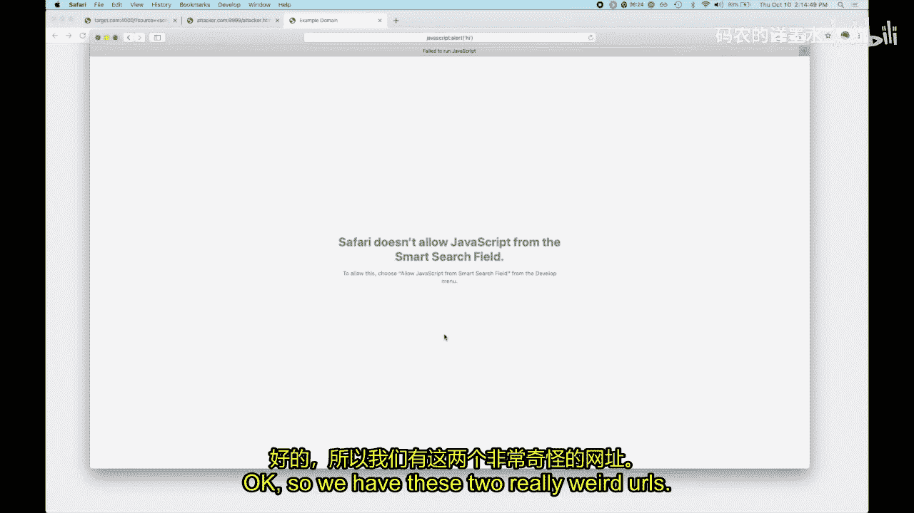

So what are we going to do here。What are these four。 So let's first talk about like， why， like。

 what are the legitimate， Oh， Oh， you have a question。 Yeah。

 why are the jascript tags like still around Like why not rid completely the jascript colon thing。

 Oh， yeah， that's I was gonna try to mention the， the legitimate uses of it here。 But there。

 I honestly argue that there's。Basically， no reason to ever do this anymore。

 But I think it's for backwards compatibility with all the sites on the Internet that were built before we had sort of better ways to accomplish these things。

 So here's an example。 So say that you want jascript to run when the user clicks this link。

 you could say， okay， when the user clicks this， go to jascript colon， whatever code I want to run。😊。

And now I've effectively made a button with like a dynamic jascript behavior attached to it。 Now。

 obviously， we know we can do this without this weird hack。

 We can just have a script tag that like listens you know， attaches an event listener to the。

 to the link。 and then we can handle it that way。 Like we， like we've learned in， you know。

 in basic web programming class。 but。😊，But yeah， this is another way to do it。 and it was used a lot。

Another， the data URLs， the way， these are actually useful。 I think。 So， I guess。

 I take back what I said about data not not being used anymore。 Like。

 I've actually used this actually， So this is actually relatively useful。

 This lets you save an H T TP request。 So so here's an example。 say you have a page。

 And you know like。😊，The logo is gonna like always gonna be requested， right。

So you could just do image source equals the URL of your logo。

 But now the user has to wait for the H Tl page to come to their browser， be parsed。

The browser finds the logo， and then it sends out an H TDV request for the logo image。

 And then wait and then it gets that back。 And so we've done this sort of two round trips before we can see the logo。

 Maybe I really， really care that people see my logo fast and it feels fast。

 So what I can do is I can sort of inline the image directly into the page。

 And so now they're gonna get it with the first request。

 And particularly if this is a really small image。 if this makes a lot of sense。

 If this is a huge image like 3 MB image， you don't want to do this because now。

 every time I click a link。😊，I'm not able to use any kind of caching。

I because I'm now now the browsers the server is always sending me the H T L page with this like 3 MB image included in it。

 And there's no way I can utilize my browsers cache。 But if this is like a tiny little image。

 you know， it might make sense to just sort of inline it and save that round trip。

 This is actually used used quite a bit。 And then another one is。

 same thing you can do the same thing in C S S so you can sort of rather than make make an H P request。

 you can just stick the image right there in the in the page。😊，Does that make sense。Okay。

 so it's like relatively legit。Okay， so。So， so the problems， the problems here arise when。Yeah， we。

 we might think like， oh， we're making a like a site where we let the user select a link。 you know。

 maybe we're building Reddit or something。 so they can pick a link。 Well。

 if they pick a link and we don't do anything to check that it's not a jascript link Well then we've just given the X。

 So that's something to keep in mind， you should validate that it's actually a URL that's well formed before you stick it into this H F tag。

 in addition to also making sure it doesn't have quotes。😊。

So there's extra things required when you're， when you're dealing with H F or source。

 that's the lesson here。 So for source， what do we we need to worry about。 So source， let's see。

 So for letting them pick like an iframe source， now we can， you know， they can pretend that。

 you know， they can， they can give us this data URL that's。

 that's that's actually a page that's gonna run code。

And I actually don't know what origin this is treated as。 I need to， I would need to look that up。

 I don't remember off the top of my head。 but it's。

 it's possible this iframe actually would have its own origin， and it wouldn't be able to。

 this script wouldn't be able to sort of go up out of the frame and do something to that outer page。

 But I actually don't remember。 And then， of course， this is really bad。 This is， you know。

Goingna just run。 this is gonna treat this as a script。 Yeah， this is kind of obvious。Cool。

 so any questions。Just just remember， it's not enough to to。

 it's not enough to replace quotes if you're， if you're putting it into into certain attributes。

 which are， which are more powerful。Okay， so there's another gotcha with attributes。

 attributes have a lot of， have a lot of potential attack vectors。

So this is something that you'll see sometimes where somebody will will say， okay。

 I want this function to run when the user puts their mouse over this div。Okay， well。

We also want to put some kind of user data into this function here。

 And now it's obviously not gonna be enough to just escape the single quote in the double quote。

 because。This， this data here is inside of a javascript context in addition to In addition to an H TL context。

 So if we just escaped， quote double sure， we're gonna they're gonna be able to sort of end the quote and add additional attributes to this div tag。

 But they're gonna totally be able to do this。 and just sort of end our function early。

 And then so say they did this。 They ended our function early。

 And then they wrote their own function。 Well， this is what's gonna happen。

 It's gonna produce basically two functions that are gonna run on mouse over。 Does that make sense。😊。

So， these all these things are really clever。But。But yeah， so， so basically here。

 here we have to do sort of different escaping rules。 And I'm gonna。

 I'm gonna mention how to do that with jascripts in a sec， yeah。Yeah。Okay。Yeah。Let user choose。Yeah。

今は。Yeah， yeah， I don't know。 I don't know。 I I would I've even look that up。Yeah。

 so that is a good question。 though if， if it was a different origin。

 then maybe this wouldn't actually be so bad。 But the thing is one thing that， one thing， though， is。

 if they were to put like a wild true in here， even if it was on a different origin。

 you still have like one browser event loop。 And so they can lock up your whole page。

 which is not as bad as some kind of real security issue， but it is kind of a denial service。

But yeah， yeah， we could look it up。 I'm actually not sure。Yeah， yeah。 you look it up now。 Okay。

 And so I said this was the one one last got to with attributes。

 But then I realized there was one more for lecture。 So this one is this one is wild。 Okay， so。

 so you have to be careful when youre， when you're letting the user select the I D of an attribute。

 And I guess I shouldn't put this up here because I w， I wanted people to guess。

 But I guess probably， no， I didn't up the answer。 Okay， good， good， good。 Yeah。

 so so so say we say we say we let the user select the I D and they select username And then we end up with this H TM L here。

 div I D equals username some text。 how could this possibly cause an issue。😊，Ideas， yeah。ミアディ？So。I。

 I believe that forms use the name field。Although that's a good point。

 I should probably also add name to this list，ca if you're letting them choose the name in a form and you have problems again。

 But， but no， so it's not that， though， for this。 yeah。Oh， yeah， that's a good one。 Yeah。

 So if there's， that's good。 I didn't even think of that。 If you have so the I Ds work。

 they're basically like classes， they let you sort select elements。

 but you're supposed to have one per page You're supposed to be unique across the whole page。

 So if you had two，2， two Is actually don't know what the browser would do in that situation。

 It might， it might return this instead of the thing it should return。

 which seems like a potential issue。😊，Now， now， it's not obvious how you turned that into an attack。

 But you've certainly， you certainly sort of changed what the jascript is doing， which seems like。

Something that could be turned into an attack。 Yeah， There's some otherscript that。That has。

Eonical username in it and then uses that different username somewhere else。Yeah， that that。

 that's right。 Yeah， you can exactly So that's， that's a little what he said。

 So sort of like confusing the code that's looking for an item on the page that has an idea of username。

 Yeah， but there's one other thing which is， did you have another one。

 I actually didn't fully the first one， but this might kind be。

 there's like a script tag somewhere else that fetches that ID。Like printing it or something。

The username。That's that's right， yeah。Y。Yeah， so the 1 I was thinking of was that H T L has this really bizarre feature where sorry。

 it's not H T L。 It's it's the Dom。 I believe it' it comes from the Dom。 What it does is any。

 any element on the page that has an I D that， that name。Is automatically。

 it automatically creates a variable in jascript with that name。That's a global variable。It's not。

 it is not jascript's fault， but this is sort of the dom。

 So it's the interaction between jascript and and and and H T L。 So， so yeah， I'm not kidding。 So。

 so what this means is that if you do this， if you write this code。

 there's literally gonna be magically a username variable， which points to that。

 And so by letting the by letting the attacker or the user control the I D。

 you're literally letting them declare variables at the start of your script。😊。

So maybe that can be used as it you know， as a way to change what the script is doing。 in particular。

 here's something I just thought of where potentially， you know。

The username variable would normally be undefined， except in certain situations。

 And so when they do that， now this is gonna be true。 And so you can do something。

 you can sort of fork them down a different path， which might help you in， in creating an attack。

 yeah。Thescript。No， no， so， no， So the idea here is this is the script that the site author actually wrote。

 This is like， this is like fine。 This script is totally fine。

 The only thing that the attacker was able to control is just the string between the quotes there。

 between I D quotes。 And that allowed them to declare variable here。

 which can alter the behavior of the， of the totally valid script that's allowed to run。😊，Yeah。

I think it's just I D。 Yeah， because because class you have a problem of。

 of therere multiple per page， although I guess it can make an rate。 but I don't think it does that。

 It's， I think it's just for I D， yeah。Okay， so let's keep going。 So yeah， so script elements。

 So this is， this is， this is like， this is gonna seem like a really bad idea。 But。

 and it is honestly， But but this is actually relatively common。

 So a site will often want to include some kind of dynamic user string inside of a variable in a script。

 And they want to make sure that this string can't like alter what the script is doing。😊。

And this seems like really dangerous because we're literally putting user data into a script。

 We better be very， very careful about how we do this。So。So let's see。

So say this is our this is our template here， and that's where our data is going to go。

 and then make this my input so we can see what happens It's not very good。

Does anyone know why I'm putting this slash slash in here？Yeah。

 thank you to some tax editor for the single quote。At the end of user day hear a single quote yeah。

 so basically we're putting this string into the middle of these quotes and so it's important that here at the end this trailing quote doesn't cause the whole frame to not parse and we get a syntax error in the number of our coat runs。

But we can just use this comment here to sort of neutralize that， and then we have a valid script。

Let'll just stare at this for a bit。 Does everybody see what's going on。So yeah， so to fix this。

What could we possibly do。This looks kind of similar to something we've already seen， right？

We're trying to put user data between single quotes。So could we， could we just。

Escape the single quotes， yeah like we did before， the that。Seems like it， right？

Let's see what happens if we do that。啊。Yeah， let's change oh but。The thing is。

 though that this quote is actually， this is a JavaScripts。

text right so in JavaScriptscript when you have a quote you would have put a quote in here you're sort ending the JavaScript string so the way we escape it would be different right we would escape it with backslash quote so maybe that's the way we can solve this we do backslash quote and also we need to let's just do it for double quotes too in case the user uses double quotes in their code。

Okay， so let's see what would happen if we did this。

Let's take the same input from before and now what we do is basically searching in for either we find a single quote or a double quote and we're going to replace it with an escaped single quote in this case。

 and so yeah， this works， it turns this whole thing that the user typed in into a string and it's going to look correct。

 it's going to be literally the strain that we wanted。And yeah。

 I don't see any problems with this particular case， yeah。

 question where the last two back slashes turn into one。Thanks much。Oh。

 I think if they were backslashes， they would， but there were four slashes in this sample， yeah。

 but actually I wonder if you had two back slashes in an input。Yeah， I think it depends on the。

Whether they were literally two backslashes that had already been escaped when they got to the server or not。

That makes sense。So that important。Okay， so this is what we got so but there's a problem with this。

 so can anyone think of a way to alter this input that would let me break out of this stream？

There's actually there's definitely a way。I had of backstlash before the first。Let for all backslash。

So you want to do for Ros backslash quote？ok。So。Let's be clear here though。Normally。

 if if this is in a context， that's a JavaScriptscript context。

 doing black slash code would just be treated as a。As a quote， right？

What we're so what we you're suggesting is literally we want it to be the case that when the server sees the string。

 it's seeing an actual backslash quote， so maybe we have to put two backslashes in here when we send it to the server but the point is yeah。

 if the server sees for us backslash quote， then it's going to go ahead and run its algorithm which is just it's going to look for quotes and it's going to swap them with backslash quote and what is that going to do well。

 it's going to do this。So yeah， it found a quote and it changed its to backslash quotes。

And I backslash。Turn this backslash from what what it would have been before is this would have been a。

Basically it start of a control sequence saying that this is not a real quote。

 but by putting this in front we've as we've said no， actually this is not a control backstlash。

 this is itself a literal backslash。And now we've basically produced the strength for us。Backslash。

Ener in dysfunction， right？So are we out of luck it like？

Seems like it's a really hard problem to solve。Does everyone see the problem？Okay。

 so it seems like a big problem， ideas。What can we do。Yeah，lash backlash。Backslash the back slashes。

 Yeah， that's actually a good idea。 then let's see if we did that then I think you're right。

 that would turn this into a backlash backslash and then this would actually work。 Yeah。

 that actually there's okay， so is that does solve this problem。

 but I actually have a couple more problems with this that we' going gonna hit but that does seem to solve that I think I can't think of the reason why that wouldn't work。

😊，H。Yeah，hu。Okay。But yeah， so to summarize the lessons。

 so avoid using back slashes because can be neutered by placing another backslash in front。

Your approach your approach sounds like it could work。 here's another idea for a fix。

 What if instead of doing you know escaping the backlashes with another backslash instead we just we also apply the HTML escaping。

And then what we end up with is this so now if I type forros quote we're going to get Ferros a pauses and that now this will be when when the HTML pars runs this will be turned into a quote but in no。

 I'm sorry sorry that's not true well what's going to happen is is right because the the way the HTML pars works because it's actually going to。

Just。Identify that this is the start of a script and this is the end of the script and then the JavaScript parsor takes over and actually parsees this as JavaScript and JavaScript actually has no idea what Ampersand APAs semicolon is that's from that comes from HTML and so we've actually done here is we've protected our code but caused the problem that now string just looks like garbage and it's not what the user typed in。

 but I think we're safe here because we're sort of taking out all quotes。We've solved that problem。

So yeah， the two problems are it doesn't preserve the user's input。

 so they get something that they didn't type in when it alerts out。By the way。

 this is the alert that's supposed to happen because remember we're saying hi there username so it's fine that this alert happens。

 we're just saying hi there， and then this should be what the user typed in。

 which is not what they typed in。 so that's a problem。 but also there's another problem here。

 It's still insecure。So let's talk about why that's the case。What about this input？Okay。

 this looks like a crazy input。Can people see what this is potentially doing here？Okay。

Any ideas what this is doing？Yeah。Start。Yeah。So isn't this like a syntax area though it looks kind of like it would be a syntax area？

Like why would it？Just stop there， wouldn't it？Be obvious when。The job Street par is running。

 wouldn't it be like， well， this has to be part of the string。

 doesn't make sense like I'm in a stream right now， how can I do that？But the scripts are running。

はい、そういま。我是。Oh， I see you're saying， do you think that this is an invalid script and this is an invalid script。

 but this one looks out to you， so this is going to still run。Yeah， because。Yeah。

 these in the dom context。All right， so the do parss。The tags。You think it's。嗯。

The job C runs inside the script。Yeah， that's right。

 so I think what you're saying is there's like an ordering。Like。

If it figures out the dom first and then it tries to treat the contents as JavaScript。

 then seems like we have syntax error， this would run， and then syntax error。Yeah。

 so that's actually what happens。 Yeah， you're right。 So if I rewrite。

 if I just take the code from down here and I just re that it so it's a little bit easier to see what's going on。

 this is what we have， right so。As far as the browser is concerned or as far as the HTML parser is concerned。

 this is what the server sends to the browser。And。😊，嗯。

It looks like yeah looks' say we have an invalid script， a valid script and an invalid script。

 and in particular the ordering that the parser is running matters。

The first parser to run is the HTML parser so before we can start to try and interpret the contents of the script tags as code。

 we first have to figure out where the script tags even are so the first step is we look and we just find where all the tags are。

 that's what the HTML parser does and it sort of just goes through and greedily looks for tags and produces a Dotry and when it does that like it's gonna to look at this and just see three script tags and it doesn't even care what the contents are it doesn't look at that it just as far as it's concerned this is a string to be interpreted by the JavaScript parser later right。

So this is fine HTMLL parsse is totally happy with this then the JavaScript and CSS parsers get a chance to run on the contents of script tags and style tags and at that point in time that is when we're going to get the error。

 the parsse error here and then this is a new context so it has nothing to do with that script erroring and so this gets a chance to run and then lastly this one error is out first syntaxt error。

Okay。That is really wild， so now we basically have a problem where。嗯。

It's not enough to like it's not enough to just escape quotes and think that we're safe because we can also just get sort of theed out of the script context by any closing script tag that appears anywhere in this source code。

Yeah，So since there is。The tax error will it still。Yes。

 because they're separate scripts so so like say that you included a script to some like load some ad and that script error it wouldn't cause the rest of the scripts on the page to not load they're sort of independent from each other this will basically be throw an exception on the syntax error which is not caught and then you'll get sort of print out in the console and then the next script we're on。

Yeah， so anyway this is crazy， by the way， one implication of this is that you actually have to be certain when you're writing a JavaScript code that if you literally include this string left anglegle bracket。

 you know， close and then script， like if you have a closing script tab。

 you have this string anywhere in your JavaScript。😊。

And then you paste that into a page like like where was that example here， yeah， like if you have。

 this string just appears anywhere in the screen in your JavaScript program。

 then it will break your page， it willll bust you out of the scripts context that you're in。

So something to view aware。Now， oftentimes we just include scripts by doing script source Sels and we load it from another destination and that doesn't have this problem。

Yeah， so anyway， this is crazy。 So so here's the fix。 Here's， at least one fix。

 there's two fixes that I know of。 One fixes this。 So you can hex encode the user's data。

 So hex encoding basically just takes the user's provided data and turns it into a different representation。

 which is only going use the characters 09 and a through F。 And so now。😊，If you think about it。

 any possible combination of0 through9 and8 throughF in this context is safe。

 There's no way they can get out of double these single quotes here because they can't write a closing script tab。

 they can't write a quote so we're fine then the thing is we have to undo that at runtime So when the program first runs it needs to sort of take this encoding and then turn it back into what the user originally typed in。

And then we're sort of safe， we can sort of ignore a whole bunch of problems and not worry about any of those edge cases。

Does that make sense？Yeah so this is like one way to do it and yeah usually you actually usually see the unsafe way very often in real code basis for whatever reason's yeah so here's a real example of what this would look like so here's our template and here's our user's malicious input。

😊，And we sort of we just hex and code this we get some giant stream that looks like this。

 and we put it in there and no problems， no problems at all。Here here's another approach。

 So this is using a tag called template and this is a new HTML tag that lets you basically you can put whatever contents you want inside of it and it won't render it at all。

 it's inert。 It's just like you're just throwing some data into the page。

 the only way to do something with the data you put in here is to retrieve the data from jascript。

 So in this case I can get the element get an element by ID username in this case that's this template here and I can put the user's username sort of into here and I can retrieve it by getting it contents out And so this gives me this。

And then I can use it and what's nice about this is that。

To escape contents inside of an HTML tag is really simple。

 that was the first thing I showed you it was really straightforward。

 we know how to escape something that goes in between HTML tag is the only thing we have to escape are what characters。

The left angle of bracketet and the amperscent and we can put whatever we want in here。

 so that's a very simple rule so you can just do this。

 throw your data into these into a template tag and then pull it out from JavaScripts and then again you can sort of not worry about lots of edge cases。

Does that make sense？Cool。Okay， so a few contexts which are never say。

 so never never let the user put data in the script like just in a sort of free floating part of the script。

 that's just you're letting them run code HTMLl comments。That's kind of a weird one。Why。

 why not that？Just escape the comment Yeah they can escape the comment with the arrow say you escape that you could it turns out that the parser rules for this are just really annoying and hard and it's just better to just。

Just not put user data it in there like you have other way if you want to put user data first of it's not going even change the way page looks because it's a comment so just avoid know owning yourself by being like I want to put this into a comment like just don't do it You might be able to figure out how to but the rules are not we' not easy for me to find so。

Your recommendation is just avoided。Again， like tag names。

 this might seem like what's the big deal if I wait if I。

Let them name a tag and I just ban script style and a few other tags。

 but I let them put whatever tag name they want in here。What's the problem？王明。In general。

 if you take a blocklist approach you're going to miss some cases。

 if the browser adds new tags tomorrow and you didn't block those ones and that's a problem。

 but it turns out it's also because the browsers aren't consistent about how they interpret weird characters in here I'll show you an example on the next slide where you can put slashes and stars and different things in here and confuse the heck out of the browser。

And here's another one， so attribute mut games， don't do that， and then style contents don't do that。

Okay， so here's。Here are。Some examples of。Really wild HTML you could write。

These are all valid as far as the browser is concerned。

So it's very lax and very forgiving about the kind of HTML that you write。

 so in this case this is interpreted as script space。😊，ExcesS。Space source， blah， blah， blah。

Why is this significant， Why would I want to write a tag like this Well。

 if I'm an attacker and I know that you're doing you're sort of looking for a black list of tag names that I'm not supposed to use and I know you're searching for let's let's say you're searching for anglegle brackets script space because you think that all tags have to start with you the name and space and then so on。

 I can do slash exercise or whatever s whatever I want and it's gonna to get past your filter。

And the browser though is going to sort of treat this as a space and so you have sort of differences in what you're looking for versus how the browser is going interpret it。

 And so there's a lot of examples like that that you could use other characters in that case this one here is a really wild one so in Firefox all these characters just get ignored。

 you can have sort of anything you want between the end of the name and the attribute。

Equal sign and they'll just ignore it and so again if you have a block list approach where you're trying to block names that you don't want。

 this is not going to match your name onload， know if you band to onload you might allow this through and then you let them actually run code。

H。And then these ones down here really well， this is like you don't even， you don't end the tag。

 you actually flip it around。And。And then I don't even know we what this one does。Yeah。

 this actually runs the script for some reason。I don't know how it's actually parse， but yeah anyway。

 it's just the HTML parsse is very forgiving。The reason why it was designedous way is because of this idea called the robustness principle。

And an idea is if you're trying to make a robust piece of software。

 you should be very conservative in the values that you produce。

And be very forgiving in the values that you accept。If you do that， then。Your software will。呃。

Work as it will work better if you do that is the idea。 So the idea is yourre。

This comes up a lot in networking contexts， so say that you're writing a TCP implementation and you want to work with as many systems as possible。

 well say that somebody sends you a TCP packet that's actually malformed like it doesn't follow the specification。

But you can still figure out what it's doing like you kind of know。I know what they mean。

 they're not following the rules， I'll just kind of fix it for them and I'll run with it you know。

That's actually， in a way， good for your users， right。

 because now you've made your software more robust， you can talk to more systems， right。

 And if your users will be happy， right， In fact， if， if you refuse to fix that。 if if you just say。

 you know， I'm going to throw an error when I get a malforms packet。

 your users are gonna complain like， hey， like， you know。

 I'm trying to talk to this computer and it doesn't work。 So there's actually this sort of。😊。

Pressure to make your parsers more forgiving to accept more inputs from people。

 And then the sort of flip side of that is。As much as possible if you produce valid outputs。

 so in other words， you send packets that do follow this spec。

 then everybody you talk to should be able to understand it because you're sort of following the rules very aggressively in the stuff that you produce while being forgiving in what you accept and does that make sense。

So yeah， that's the idea， but the thing is it's actually really bad for a couple of reasons。

For security reasons， you're now sort of having to guess about what some input that you've received means and you're making some assumptions potentially。

And also。You get this bad behavior where。Somebody can write an implementation here here's an example。

 say that， and this is actually how it happened in the early days with browsers。

 If you wrote crappy HTML that was wrong， the browser would just be like。

 I know you meant to close the tag there。 I know you meant to know I know just sort of fixings for you。

 And then you wouldn't know that your code was wrong you'd open it up an Internet Explorr。

 which is what everybody was using。 and you'd be like， it looks great。

 And then Firefox comes along and wants to make an alternative。

 and they write a browser that follows all the specs exactly。

 know they follow all the rules how to parse HTML。 but when they load up normal websites that people have code it and they look at it。

 they say wait a minute， it doesn't look right。😊，So now suddenly Firefox has to。

Guess what the users meant in the same way that Internet Explorer was guessing what users meant and if they don't guess the same way。

 then the sites are going to look different in the different browsers。

And these guesses are not documented or specified in any way。

 It's just sort of engineers at Microsoft just sort of。

Hacking you know just guessing maybe they meant that。

 whatever you know and so you get the situation where the bugs or the sort of implementation details that one browser vendor made have to be reverse engineered and the bugs have to be copied into the new browser just so that existing sites look like they work And so this is just yeah it's it's。

In the end actually a bad idea， even though it sounds good， like robustness principle you know， no。

 it's actually it's better just to error right away and then people can know that the code is broken and they should fix it and we can all you know。

Be happy。Yeah so anyway TLDR you can escape user data safely in these three contexts avoid the other ones just a few final notes so beware of nesting parsing chains so you can see in this example。

We have user data that's in a string in a function's in a string that's passed to a set timeout that's in an attribute of an HTML element。

 so if you do that，And you're trying to figure out how to escape this。

 you're going to have a hard time。Basically。The browser is gonna do this。

 It's gonna pull the oncl attribute value out and tweet that as a string， attach it to the do node。

 And then later when somebody clicks on this did。 then it's gonna say。

 that's a string that I need to now turn into javascript。 it's gonna to parse as javascript。

 and then it's gonna see they called set time out。 Okay cool。

 So itll itll start a timer and the timer is to run the function in one second。

 And the parameter to set time is also string。 And so then one second later it's going be like okay now time to turn the string into jascript。

 and then run that。 And so you actually have to escape your input three times。

 the first two have to be javascript backlash sequences。

 And then the next one has to be HTMLml encoded。 And if you don't do that exactly right。

 then you're in trouble。 So just' don't nest things deeply and write code like this。

 This is actually like surprisingly common。Another example。

 this is an example where you might think oh， it's straightforward like this is a string in JavaScript we already talked about this。

 I know how to escape this， The problem though is that we're then taking that value and putting it into a different context here and so it needs to be then escaped one more time here if we're going to use it it's not enough to just use it in this place。

😊，So yeah。So what do I have in here， I'm running out of time？啊。Oh man。

 that's that's a huge bummer because what case I'll say this for next time。

 But so now we have a good idea of sort of all the different ways you could do excessS attacks。

 Next time I'm going show you this is so cool。 this is so cool。

 So there's this Chrome feature called XSS audititor which it was a great idea initially it was。😊。

The idea was if we see that the user is making a request to a URL and there's some script in that URL and then we see that same script in the page that the server produces。

 then it's very likely that that's a reflected excessorist attack and so they're like oh we can we can just disable that script and save the user from being attacked but it turns out this actually health attackers so much like it created so many different attacks and I'm going show you some of those next time see you next Tuesday one last announcement there's a speaker coming on next Thursday that's the guy from brave and he's going to talk about fingerprinting so that's a guest speaker feel free to invite your friends if you think they're interested in browser fingerprinting user tracking anything like that privacy on the web it's open to anybody。

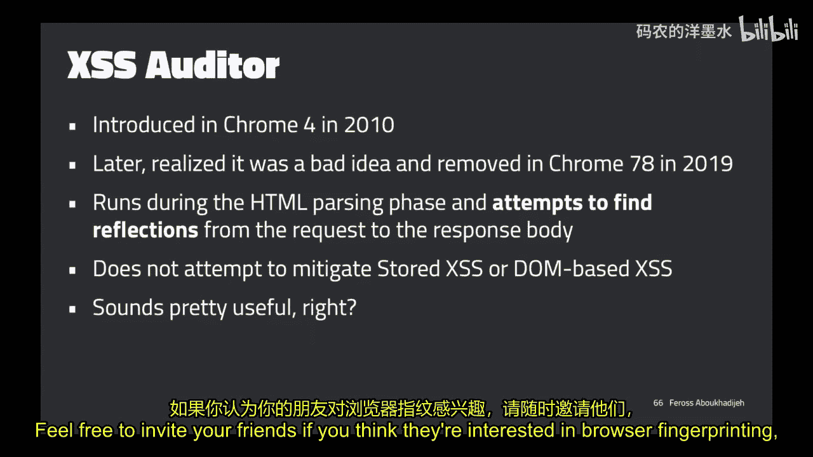