# 【全集】斯坦福大学 CS253 网络安全 中英字幕 1080P p07 Lecture 7 - 跨站脚本防御 -BV1RemEBZEEM_p7-

Alright， let's get started。So last time we talked about crossite scripting。

 and so today we're talking about the defenses against crossite scripting。So。First。

 though some admin。 So this Thursday is the guest lecture on browser fingerprinting by Pete Snyder from Brave Browser。

 and feel free to invite friends or anyone who you think might be interested to come。

And this Friday the assignment one is due， so hopefully that's going well。

 I noticed there's a lot of questions going through on Piazza。

 so it seems like people are making progress。There's going to be office hours， of course， this week。

 so come in if you're having problems here if you're stuck。In any way。Cool， so just to review。

 last time we talked about crossite scripting and the basic idea was we have user data that we're combining with some kind of code。

And when we do that， if the user input is specially crafted。

 then it can produce a resulting page which runs the attacker' code。

And what we want to try and do is actually escape the user input so that it's treated by the browser just as user input and not as actual code。

 right。And remember， the context here is that the attacker is trying to get this code to run in a browser of some user of our website。

And so if the attacker succeeds， then this code is running in one of our users users browsers。

 and they're presumably logged in or they're viewing some kind of sensitive information。

 And so it's it's not our website server that's getting attacked。 It's the users。

Browser who's visiting our website that's getting attacked。Okay。

 so we also talked about there was two kinds of crossite scripting reflected and stored。

 So remember reflected is a bit easier sorry， not easier。

 but rather a bit less powerful in the sense that we're only sort of able to manipulate like a URL and if the attacker manipulates the URL in some way。

 they might be able to get the server to reflect back some piece of data that was in that URL。

And in a way that， you know， it's treated as code by the。

 by the end user's browser and in stored X S， the attack code is somehow added into the database。

 and then it gets sort of returned by the server on potentially any number of different responses。

So it's a little bit more powerful there。Any questions about that？Cool， so it's our review。 Yeah。

 so that's good。 So one thing I was thinking about is a way of thinking about what's actually going on here in both of these types of attacks。

 This might be a useful way to think about crossite scripting。

 So there's like different sort of context shifts that are going on when we're doing when an attacker is producing an attack like this。

😊，And so sometimes we're injecting downward by creating a new context where one wasn't expected。

 And then other times we were doing the reverse。 We're of like ending a context and sort of going back up So what do I mean by like this down and up。

 Well， remember the dom is you know， it it's a tree。

 So it's sort of this tree structure of all the H tags on our page。

 So some tags have other tags in them， which have other tags in them。 So it's a tree structure。

 And so we can sort of go down by adding a new context into a node that wasn't expecting that to happen or sort of go up and a context and go up into like a different context。

 And so if you look at the code here。 So what's going on in this case。

 where our user data was a script， is， this would be is this down or up in this case。Down， right。

 Okay， yeah， because exactly because we we sort of added a new node into the into this into the dom。

 And then in this example here， we were， we were putting user data into an attribute。

 And the attack was sort of to oh， I guess I copied the wrong thing here。 This。

 this is actually properly escaped。 So this isn't this isn't the actual attack in this situation。

 But say that we were able to sort of escape out of this。 This would be injecting up， So ending。

 ending the context of being in an attribute and sort of being now out into sort of being able to hear to create our own attributes。

😊，Cool， so so yeah， So the idea behind these defenses is that just to review the core problem is this untrusted user data being combined with code。

 So actually， I think the name cross that scripting is a little bit misleading。

 We should probably be calling it H TL injection。 And that sort of parallel parallels nicely with what we're gonna talk about later。

 which is SQL injection and other kinds of server side injections。 But basically。

 the idea is we we're inserting new unexpected H TML。😊，And so。

 so our our solution is to escape or to sanitize this user input before combining it with the code。

 And we， we talked about the different characters we have to worry about last time。

 And so where can all this untrusted user data user data come from。

We have HTTP requests from the user， So query parameters， form fields， headers， cookies。

 all kinds of data that comes from the user。 We have to worry about this。

 but also data from a database because we don't know how the data got into the database。

 So this data could be could be added by any number of different people on your team。

 And you don't know whether that data is sort of in a clean format that you can just sort of dump into your page And so you have to be sort of conservative and do not trust it and escape it sort of on the way out。

 right。There's also third party services。 Sometimes you get data from a third party service。

 Who knows if it's safe， Who knows if it's， if it's returning you data that you can just blindly add to your page。

 Furthermore， even if it is returning data that you can blindly add to your page。

 what if tomorrow the service is hacked。 And now it's returning data that you that you can't trust。

 So better to design your your code in a conservative way where when you get data back from anybody you ensure that it's safe to add to your page before you just add it。

Does that make sense？Yeah。Oh yeah， I forgot。ItJust feel free to always remind me if I forget。Cool。

Alright， So， so when do we want to escape？ So I sort of mentioned this before， but we。

We have sort of two choices。 You could escape on the way into that the database or you could sort of escape on the way out at the time you're sort of rendering your page。

 And this is more for the stored X S， but。What are some of the trade offs here。

 What do we think we we would prefer to do。In this， you know， for this trade off， yeah。感中。スけ込んでウ。こした？

That's true。 Yeah， So if you do it on the way out you're gonna be repeatedly doing it。

 the downside of doing it on the way in， though， is you don't necessarily know the context in which that content is going to appear。

 And remember last time there was all these different context。 we could put the content。

 we could put it inside of an HTML TL tag or in an attribute or in a script string And because we don't know we don't really know where our our data is going to appear。

 It's actually safest to just assume that that it it hasn't been escaped and to just do that at the time of rendering because that's where we actually know I'm about to take this string and put it inside of this context or inside of that context and we can make the correct decision at that time。

So。Yeah， I mean， if you， if you， I'm not， I'm not saying you can't do it correctly that way。

 You totally could。 if you know for sure that you're gonna be using it in particular contexts。

 but in general， in general， it's， it's， it's preferred to do it at the time you're producing the HML string。

Does that make sense。Cool， so yeah， always on the way out at render time。

 And I think I sort of said this， you don't know really know in advance what context it is going to appear and every context has different escape characters we have to worry about。

The other thing， too is， you know， you might have somebody on your team who somebody you know who's not you because you're。

 you're gonna to write perfect code， but some other person is gonna show up。

 And they're not gonna know that you know， we have a policy here at at this company of always escaping our data know。

 at the time we add it to the database。 So somebody might write some script that just dumps more entries into the database that that are not following your rules。

 And then now you're in trouble。Cool， so so how do we， how do we actually do this escaping。

 So I mentioned， you know， we we sort of went over some of the things where know。

 we talked about which characters we would need to be be worried about。 But actually。

 most web frameworks come with built in H TL escaping functionality。 And so you should just use that。

 And there's this cool law coined after named after Lanuus Tvals from the Linux project。

 just called Linus's law。 And it's basically the idea given enough eyeballs All bugs are shallow。

 And so。😊，This just means that， you know， if you're using code that's depend upon by a ton of people and it's in your framework and it's open source。

We hope that somebody will find problems in that code if if problems exist versus if you write your own escaping functions。

 and then you， you know， you're the only one using them。

Now you're not really sure if it's correct or not until you're attacked。Yeah， so it's， I mean。

 this isn't always turned out to be true in practice。 Like there was a famous bug called Harp leaded。

 which was actually in plain sight for many， many years。

 And people didn't discover it for a really long time。 So this doesn't always prove to be true。

 And in fact， sometimes and sometimes it's the opposite because people think， well， it's open source。

 I'm sure that thousands of people have looked at this and have audited it。

 So I don't need to bother。 And so oftentime people might actually worry less about open source code than if it was code code that they themselves wrote or something like that。

 But anyway， Im going often on a tangent。 So。Yeah， so basically， the idea is to just know。呃。

To know how your your particular framework provides H T L ecaping functionality and just to use that。

 And also， you need to know it's not just enough to blindly use it。 Again。

 the reason why I went over all this stuff is because it， it's not actually not enough to just say。

 oh， my framework take takes care of it because there's all these different context we talked about。

 So you need to know what exactly it's escaping your。Your untrusted data for。 So， for example。

 if you're using H T Lscaping， you can't just take that output and put it into a string in the script tag unless it's actually escaping all those characters。

 And similarly， you can't put it into a comment unless it's doing that。 So anyway。

 just make sure you know what it's doing。So I wanted to go through a little example here。 So there's。

There's a templating language called E J S， which stands for embedded javascript。

 And it has this interesting， like simple syntax here where we just， we just use H T L tags。

 And then anywhere where we have some piece of user data that we want to add into our page。

 we can we can use here。 Let me see if I can use this remote。😊。

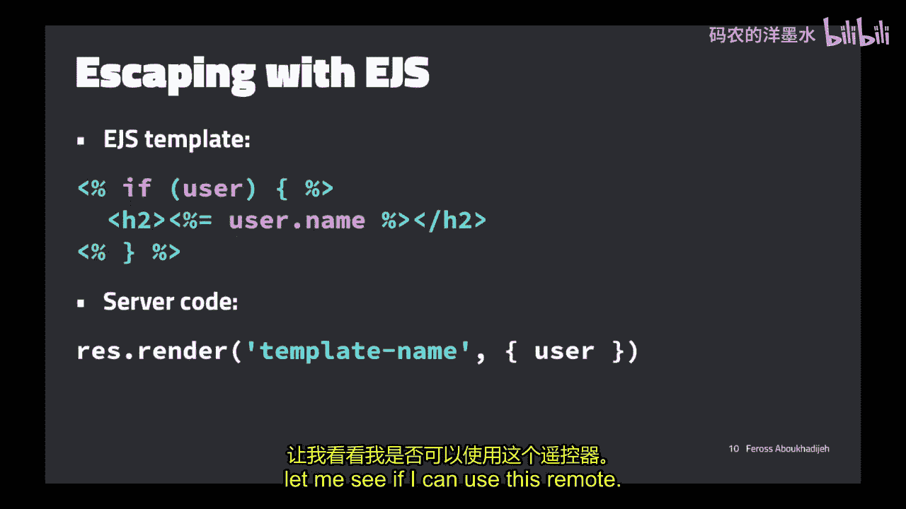

We can use。There we go。 Yeah， cool。 So， yeah yeah， we can use this， this right here， this。😊。

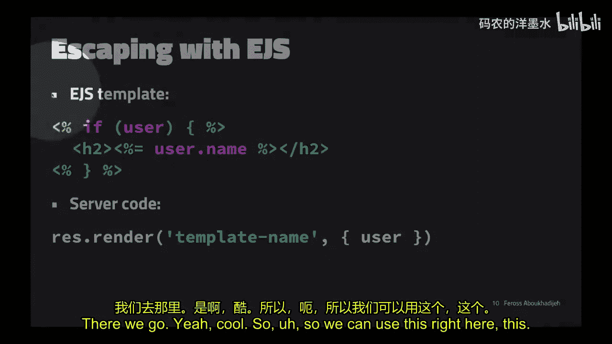

Percent equals syntax。 And what this is gonna do is it's gonna take this， this jascript value。

 evaluate it。 and whatever it returns， it's going to escape it and then put it into the page there。

 And so if we， we do that we're fine。 And it also supports some other things like like this。

 if whatever the syntax here where you can sort of write arbitrary jascript make your template。

 do different things。 And then you invoke you you invoke the template by saying。

 that's the template I want to render。 And this is my data that I want to sort of insert in。😊。

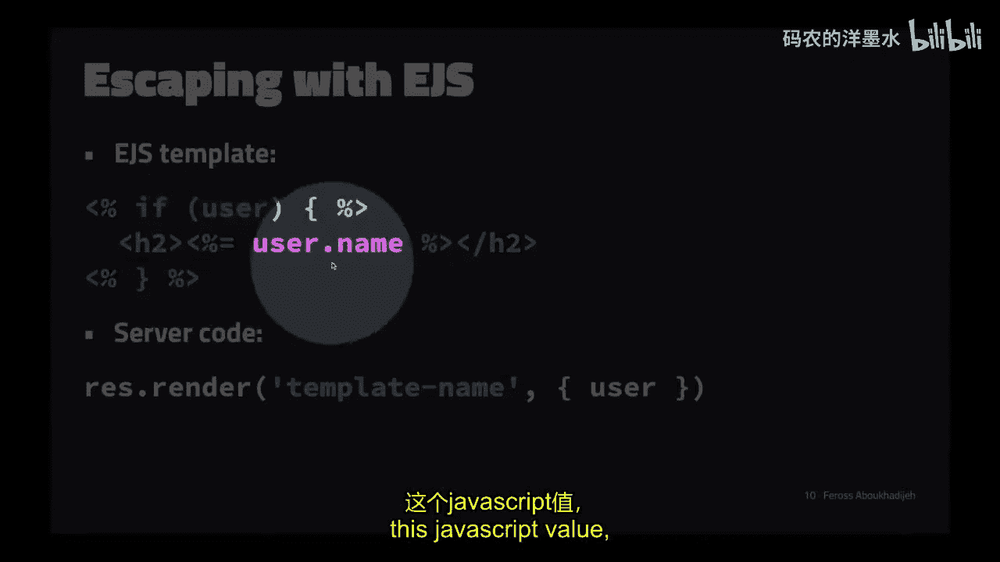

Cool， so that seems reasonable。😊，React has something similar， so。React is you take。You take some。

 some H T L string like we have here， like in this case， high。

 And if we want to put it into the page， then we're， we use this sort of interpolation using。

An angle bracket there to put it inside of this div。

 The thing is though if you try to do this is actually gonna escape it。

 So react is gonna say we think that this is untrusted， this could be some random from the user。

 And so we actually want to we don't want to treat that as true H Tl。 We're gonna escape it。

 And And then you might think， well I know how react works in react。

 I'm supposed to I can put whatever jascript property I want in here as an attribute。

 And then it's gonna set that as it's gonna assign Tl to this string。

 And normally that is what what works。 But in order to protect you from yourself。

 actually makes this not work。 So what's interesting is both of these sort of obvious ways of like trying to put user string into a div are not gonna like let you do what what you think it's gonna do。

 It's gonna。😊，In this case， it's gonna escape it。 And in this case， I believe it's an error。

 So how do we actually take。Some string。 And if we really。

 we really know that that this is safe in this case， like here， we know this is actually safe。

 Let's say we wanted to add this to the page。 How would we do it。Well， in react。

 they have this attribute called dangerously set inner H TM L。

 And it's not only enough to just make that the value be that you actually have to make the value be an object with an underscore underscore。

 two underscore。 So it's extra scary。 H TMl property。 And then you make the value the you know。

 the actual string。 And so when it sees this， it's gonna say， okay， all right。

 you must know what you're doing。 We're we're gonna assume this string here is is safe and we're not gonna run our escaping function on it。

 We're just gonna stick it in the page。 It better be safe。😊，You know， in other words， you。

 the programmer have better have made it safe already by the time you call this。呃。So。

What's nice about this is this looks ugly。 That's actually a good thing。

 because if you see this in a code base， you should。You should want to refactor it。

 You should want to be like， like how， why are you， you， you know， if you see your teammates and you。

 you're code reviewing this code， you should want to ask them why did they do this instead of something less ugly。

 And that's actually， that's， that's nice。 That's actually good。 as that's a feature here。

Does that make sense？Any questions？Yeah， so I like this design and react。They also have this。

 this is kind of unrelated， but they have this hilarious other property called secret Dom。

 Do not use or you'll be fired。 Theres， there's actually been people open to like issues saying like。

 why is this property named this Can we name it something。 something shorter。

 like just do not use and they're like， no， we're keeping it this because we really don't want anyone to use this。

 We want people to be afraid。 and only people who really know what they're doing will maybe feel free to use this。

 so。😊，This is also a funny thing I I， I I found as another idea。 you can make a function。 And if you。

 you really want users to not use it for some reason。

 you can actually add like an additional argument where they have to pass in a string that's like some terms that they're agreeing to。

 they don't pass that exact string and then then functional they're an exception。

 And so it very ugly to use。 But it's nice because you sort of know that they must have agreed to this。

 and they must see that you know， they must see this string at the time that they're calling the function。

😊，Anyway， these kind of， these are kind of tangents。 But the point here is just that。

 is that that the opt out from the safe behavior should should be sort of difficult。

 And I think react does a good job with it。But I w to show you sort of a bad example where they didn't do a good job of it。

 And that would be this， this E J S。Tempating language， which I actually， I do use。

 and it's actually quite nice。 It's just， it， it doesn't make it。

It makes it a little bit too easy to do the wrong thing。So let's see how that might happen。

 So I'm gonna make an express server here。And。IJust going to make it listen on port 4000。

 and we'll just add a really simple。Route for the homepage。

And all we're gonna do is just send back some H T L。

 And let's actually define what this H L is going to be。So the way that this works is。

I believe E JS has a render function that takes in a template and then some variables。

And so let's say that we're gonna， we're going to have a name。 and we're just gonna try and put。

 put my name into the page。Is，Can everyone see this this？Visible， okay， think it is。 It's big enough。

 right。Okay， yeah。 So， so now let's make the template。And so this is that。

 that template sort of syntax that we saw before where we're just going to sort it。

 Let's make this page just be an H one that says hi。 and then the name of the person。

 So we use this percent。Equals name equals， ort know， I think it's percent that。

I think that's the syntext。Okay， so that's our， that's our H T L template。 And then we're saying。

 render that， but substitute in for us anywhere， where name is， is used。 And that's gonna escape it。

 So this should be safe。Let's go ahead and actually see if that works。So。Here we go。

 So I'll load up local host。 And it says for us。 Okay， cool。 And if I change this to。

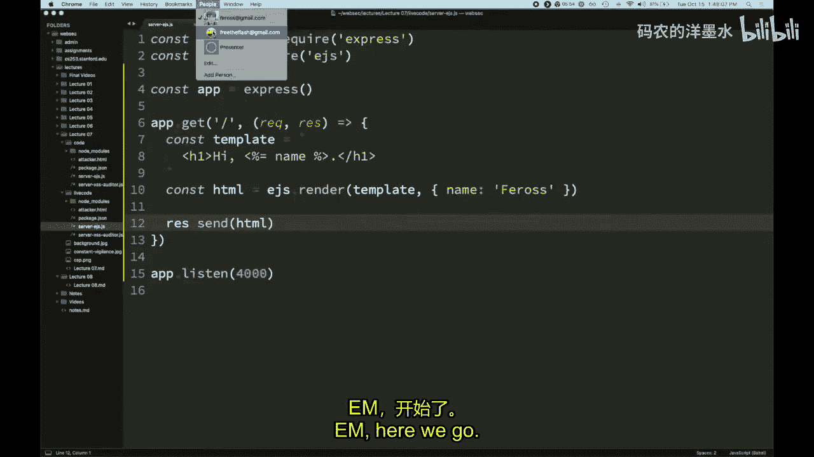

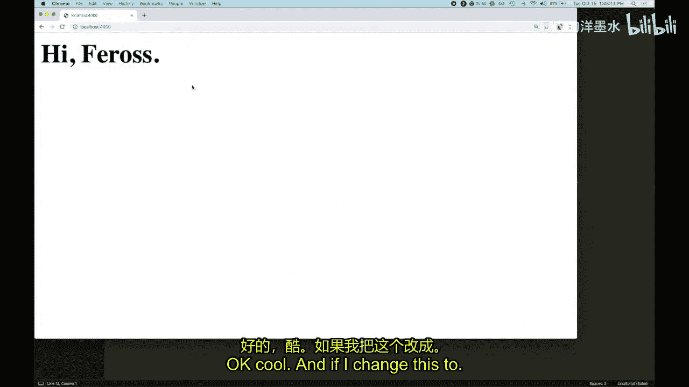

Let's change this so that it actually。嗯。Actually， before I move on。

 let me just make sure we all understand。 like， it just put， it just put the。

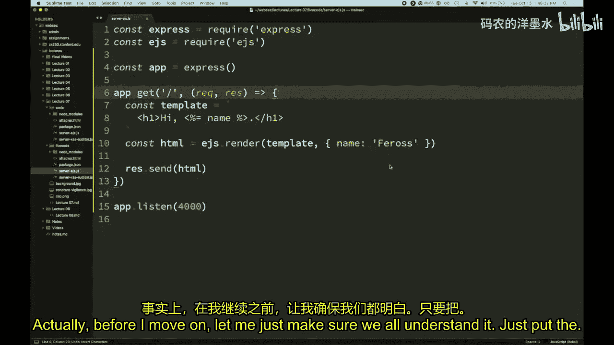

The name right there， right。Okay， so now let's， let's do something slightly fancier。

 Let's make it pull the query parameter out so that the name can be specified sort of by the user who's visiting the page。

 And if we do that。

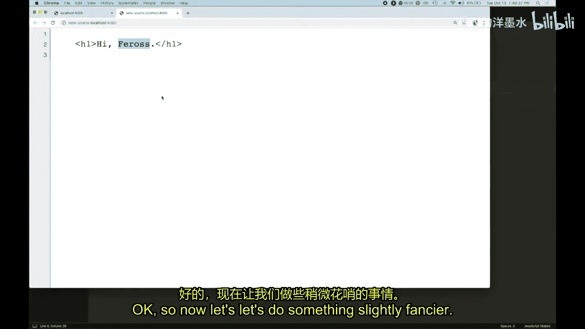

And then we take that name and put that in here。Does everybody know this syntax right here？

 What I'm doing here is this is just saying。The key is name。

 And I want the value to be the name variable in this local context that we're in。

 which is just going be that。If I want here， I'll be less fancy Then we we won't have to be confused。

Okay。So that's what's going on。 And so now I can be pretty sure that this is safe。 I think。 So if I。

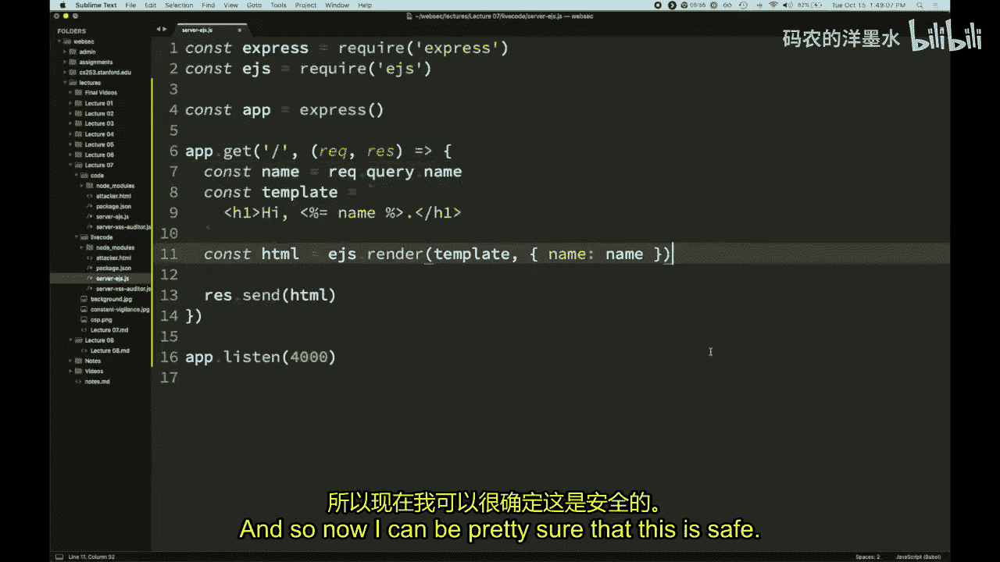

Refresh this。 Oh right， I need to default it to something。 If， if， it's。

 if there's no query parameter set， we'll default it to anamed person。

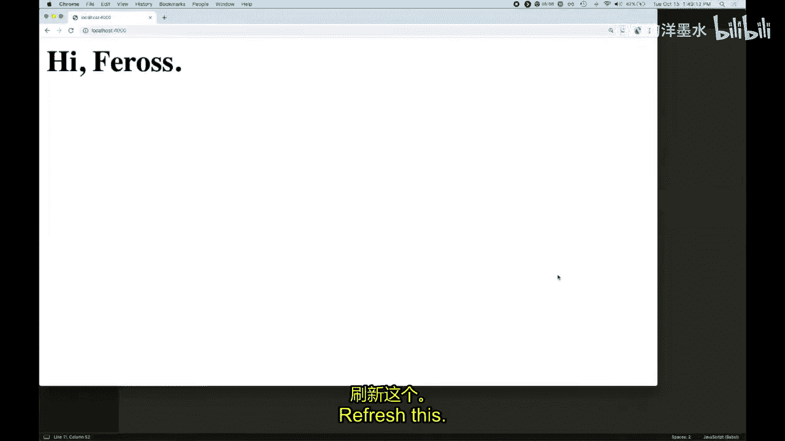

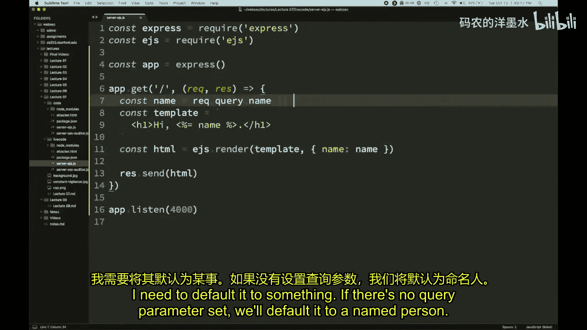

Okay。So now if I go in here to the URL and I say。Name equals。For us。It works。

 And if I change that to be name equals。Scrriip alert。Hi。We're gonna get what we want。 Co。

 So the only thing that's really worrying about this is if I were to make a mistake in this template and accidentally type a dash instead of an equals。

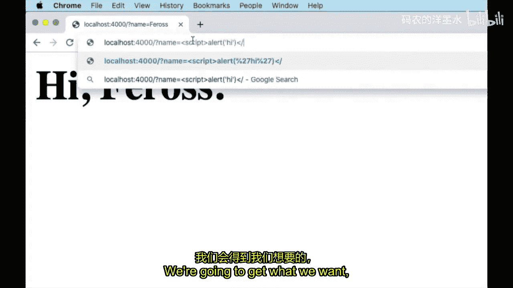

Then we have total disaster。 We're completely owned。 So now this script is actually。

 apparently not running。 I don't know。

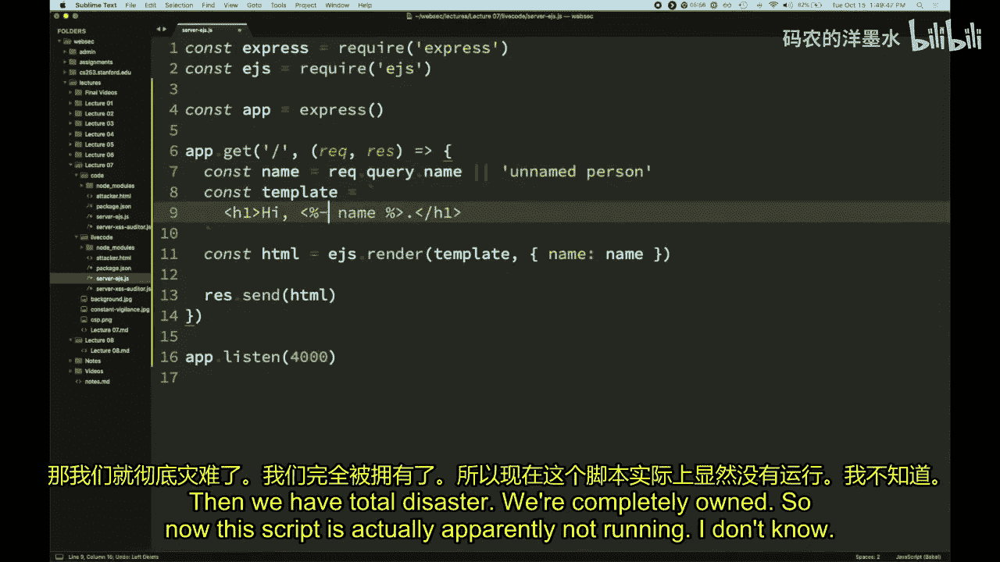

But why is it not running？ Oh， ha ha。 Okay， that's actually something we're gonna get to in a second。

 So let me whole hold of。 I'll just switch to different slightly different browser。

 and then we'll see， okay， so it works。 So yeah， so what's going on here is。😊，Right， that script is。

 does everyone see that。 It's just in the page。 And it it didn't escape it。 So， so anyway。

 the lesson， the lesson here is just that I think this。

 this templateative language makes makes this like way too easy of a mistake to make。 Like if。

 if one of your colleagues submits this in， in a code review and you just happen to miss this like single character。

 then you've just introduced a massive security hole into your into your website。

 So it's a bad design。😊。

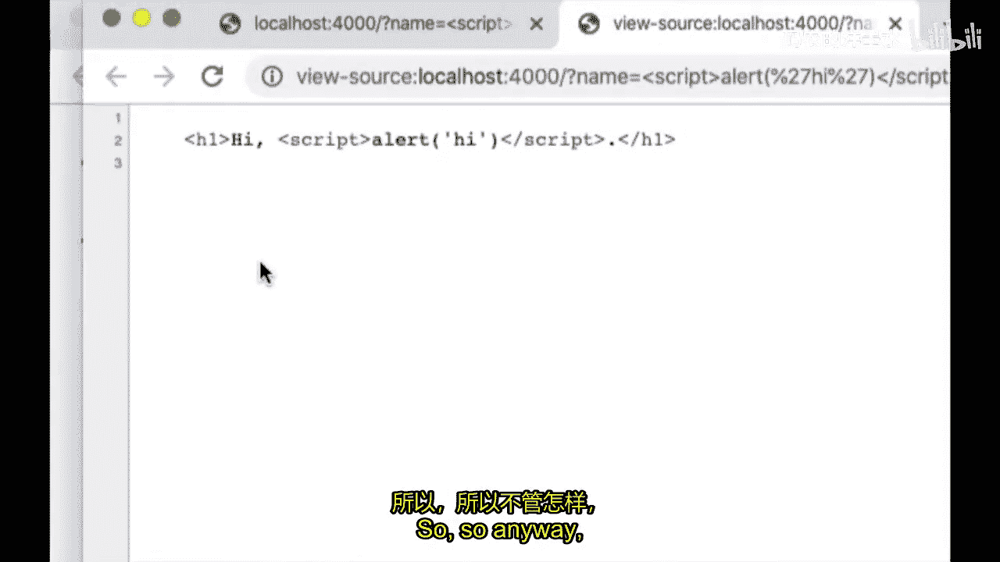

Yeah， okay， so。So， let's continue， so。So yeah， and then they have all these different confusing prefixes。

 They all do different things。 And then these， these are the two where this is like totally fine。

 We're all dandy。 This is like。Disaster， so they're way too simple or too similar。Okay so okay。

 so let let's continue and talk about what we can do if if we just assume that this is going to happen。

 Ex is going to happen， our site is going to be attacked in this way。

 we saw like how prevalent this is。 so maybe the right strategy is not just to try to be very careful and to avoid it。

 but also to just assume it's going to happen and then think about ways we can be safe even when it does happen。

And so that's what we're going to talk about now， so。So remember， the。

 the core problem here is the attackers's code is running in our in the same page as this you know。

 in the same page as。 So this is the page that we wrote all of our code in。

 and it has user data in it and it has user cookies and all kinds of private information。

 So how can we make sure that when the attacker's code is in this page。

 and it's running auck and doing whatever it wants that we're somehow still okay。😊。

It seems like a tall order。Almost impossible。 But there is a way。

And the concept here is is called it' it's this key idea of of this class and of all computer security。

 which is the idea of a defense in depth。So this， this term means we want to provide redundant security so that even if one measure fails。

 it will be saved by another one。And so the attacker now has to find multiple vulnerabilities in order to produce a successful attack。

We sort of have multiple layers of defense。So did anyone。

 can anyone think of any examples of defense and depth in computer systems that you might have used。

So I know for some cases when you're like downloading files and no version of Sofari。

 it'll say do you want to allow downloading files from this domain， and then depending on the file。

 you'll have to right click and click open and then click open again just to run it。Yeah， yeah。

 that's， that's particularly annoying sometimes。 But， but yeah， so I think the idea there is like。

The idea there is that。Safari has a built-in way of detecting when you're visiting a malicious site that they're they're hoping to sort throw up there and warn you about。

 like don't proceed。 Are you sure you want to proceed and say that you proceed anyway。

 Even then like you end up downloading some malicious file。

 you still have to be relatively advanced user and know how to right click open instead of just double click which I guess you're such a basic user that you don't how to right click open this is actually protecting you。

 So I guess that's the idea there。 anyone else have any other ideas。 Yeah， that's a great example。

 So even even though you've hopefully said a really strong password。

 And you know that no one can guess your password， you're still using a second factor。

 you're still saying that even if an attacker were to know my password。

 it would also have to physically have my phone or my second factor device。 that's a great example。

 even in that situation with a password plus two factor there's even a third thing which is oftentimes you'll you'll get an email from the service saying we notice that you logged in from a new location。

 So even if you lose。😊，You know， someone gets your password and they happen to get your second factor。

'll hopefully be some kind of an audit trail that you will be able to see and know， you know。

 I got hacked。 and I can sort of respond in some way。 And so this is all this， this is， this is just。

 you know。😊，An example of defense and depth。 have another one。 This doesn't imply to like。

I think I've never heard of someone encrypting something bin twice。Oh yeah， that's interesting。 Yeah。

 I've not heard of someone。No， I yeah。 I think， I think I've not heard of that。Yeah， but that was。

 that was because D E S was insecure。 and they were like， just do it three times in a row。

 and then it'll be better。呵。😊，Yeah， no， I don't， I I don't know， yeah。

I feel like that in that situation， too， it's actually， if you can encrypt something twice。

 and then you lose either key now you're in trouble。

 So it's actually double the risk of you of you losing access to your data。

 But maybe if you gave those keys to different people or something， it might work。 But anyway。

 I think we're sort of stretching the metaphor at this point， so。So I'， I'll move on。 But。

 but this is， this is defense in depth。 Any anyone have any questions about it。Okay， cool。 So。

 so let's talk about a way to do defense and depth。Specifically。

 we want to defend the user's cookies。 So we know that the attacker is running their code。

In our users's browser。And they're trying to steal that user's cookies。 If they， if they succeed。

 they're gonna to be able to take the cookies and log in as that user from their own attacker computer。

 you know。Okay， so we talked about a way to defend against this with H T TP only cookies。

 And remember the way this worked was that even， So even if the attackers are running jascript in the page。

 they can't access this， this value。 So when they， when they， when they call document dot cookie。

 it will be as if this cookie was not in the browser。So hopefully that's familiar。

 and specifically like this attack that I've been showing over and over again where you were you just exfiltrate a cookie using an image。

 this would not work because documental cookie would not return this key value pair。

Does that make sense。Cool， so， so then then just just quick， quickly review。 So how how do you。

 So why would we do this？ So I mean， how how would the。

 how would this value actually end up being used。If it's HP only。Why would we even bother Like。

 how is how do we actually get to use this， this cookie now。It's included as a header， exactly。

 So whenever we make， like we if we make an H TDP request to some end point on our server。

 like slash API slash something， that cookie will be added automatically。

 And so our server will be able to see it exactly。😊，Cool， okay。

 so this is a really fun thing that I didn't have time to get to last time。 it's really cool。 So。

 so there's this。😊，Feature that， oh， yeah， okay， before I go， Yeah， you have a question。Sure， yeah。

 was， yeah。What I mean if I can somehow like。This。I can。That's totally right。 Yep， you're right。

 So this is not like this by itself， you know， if you do this and you think。

 like I'm safe against X S S now， like the attackers bring your code in my site。

 you're still gonna have trouble。 Like， so， so the idea here is just。

 we sort of mitigated one potential thing that they could do。😊，Ultimatelyly。

 if they can run strips on your website， though。Yeah， that's right。 Yeah， that's right。

 If they can run scripts on your site， then they could do all kinds of things。

 They could change the page。 They could delete your account。 You know。

 they could do whatever they want to the user。 Yeah， yeah。

 but we're gonna combine this with a bunch of other things。 And then together。

 they sort of collectively make a really nice set of， of layers of defenses。 yeah。😊，That's。

 that's a really good point。 Youre right。 This does not does not fully protect you。Okay。

 so here's a usually cool idea。 So， so Chrome was like， okay， so reflect， so X S is a huge problem。

 everybody keeps making excess vulnerabilities in their websites。 And almost everyone's vulnerable。

 So what if we could just help everybody out。 like just make， make it go away。

 So they had this awesome idea， which was how about this when。

 when we load a page and we're parsing the H T L for that that page。😊。

If we notice that there's something in the URL。That matches something in the page。

Then maybe that was a reflected excess。RightMaybe the server was。

 was tricked and would actually put it it reflected out something that it got in as input out into the output。

 And so what if， if， what if we see that， we should just maybe just block it。 just like。

 don't let that script run。 And now we now we've protected the website。

 even though the website's insecure。 like our browser。

 the browser is smart enough to effectively refuse to run that that attacker code。 right。

 seems like a good idea， right。I mean。It's， can anyone think of what might be bad about this。 Like。

 I can， I mean， a first， a first look at it。 It seems like it's a good idea。Yeah。You can make。

I guess you can include stuff in the query that。It then。

It'll thing that it's like bad code but instead it's。And it's scraped it。

 just kills it from the server。Exactly， yeah。 So that's what we're gonna talk about。 Yeah。

 So that's right。Yeah， so， so， so let yeah， let's，'s go into it， so。And。Well， first first of all。

 before we go into that， just want to mention， it also had a bunch of false negatives， too。

 So it was possible to get past the filter quite easily。 One thing you could do is you could。

Change the query slightly and encode it in different ways。 And then if it got echoed out。

 Chrome wouldn't be smart enough to tell that that that input was the same as that output。

And but this the bigger， much bigger problem is the false positive problem that you mentioned。

 So in particular， there's no way to know whether a given script block。

 which appears in both the request and the response was actually truly reflected。

 or if somebody just added it into the into the request to make it look like it was a reflected excess S attack。

So let's make that concrete。 So say we have a page and the page has a script alert high in it and this and say that this is supposed to be there。

 Like this is code that the site author included。 So they're happy to have this code run。 Now。

 if the user visits this page， then the X S auditor is not gonna， it's not gonna do anything。

 It's gonna， you know， it's gonna think that everything's fine。

 it's gonna run the script to no problem。 But， but if the user visits the page and they attach this query string here。

 query equals that script。😊，That that appears in the page。

 and the author is going to think that that was reflected into the page。Right。

And so it's going to conclude it's an attack。 And then， therefore。

 it's gonna sort of neuter the script and make it not run。Okay。

 hopefully we're starting to get some ideas。Things we could do with this。

 So I'm gonna show a demo of this。 So let's go to our。Our， our bank site that we've been building。

 And let's just add a little script here into the page。Okay， so I don't want to type this。

 I'm just gonna steal it from something I already wrote。Okay， so what we're doing here is I'm just。

 I'm just including that frame busting code that I mentioned before。 And we。

 we have better ways to defend against being framed。 Remember。

 we have an H T TP header that we should use instead。 But， but just to make this， this demo。

We're going to use this method of sort of detecting that were that this page is in a frame。

 And so the idea here is that bank doesn't want anyone to put it in a frame and it's going to use this jascript to ensure that if it detects that it's in a frame。

 it's going to set the whole browser's location to the bank site。

 And so that frame will sort of bust out and take over the whole page。 And so that way。

 the bank has sort of prevented itself from being framed。Hope， that's familiar。So were。

 we're gonna add that script to both pages if these are logged in and if they're not logged in。Okay。

 great。 Now I'm gonna go to a file that's going to represent our attacker。

 and our attacker is going to try and include。Frame now to this bank。 And the bank， I think。

 is called Targ on port 4000。 And so this should fail because。The attackers is framing the bank。

 and the bank just wrote that script。 So let's， let's see if that's true， so。If I go to my browser。

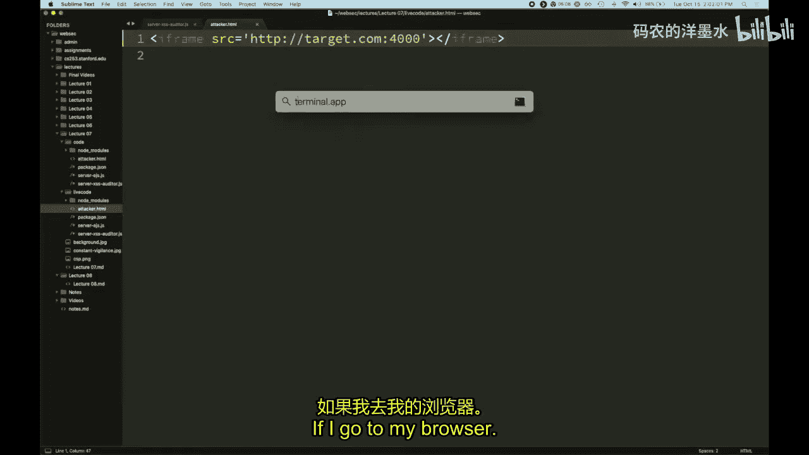

And I load target 4000。 Wait， oh， sorry， I'm running。 I'm running two servers。 I need to。

Switch to running。Different server， okay。There we go。 So here's our bank。 perfect。

 And let me just confirm that the script appears in there now， excellent。

So now we'll go to our attackers page， and。Okay， so notice what just happened。

 I visited the attackers page and the whole browser redirected to the bank。 So that means that the。

 the frame busting worked。 Let me just confirm that that's true。 If I open up the inspector here。

When we look at the requests， we can see if I visit attacker do com。

Let me just clear this really quick and do that more time。 Okay， there we go。

 So what happened was we loaded the attack， the attackers' H TM L here， which was。呃。

I guess I can't see it very easily。 But the point is that yeah， we loaded up the attackers page。

 and then we were sort of forcefully redirected to the bank site。Because that script ran。Okay。

 so now let's see if there's a way we can， we can cause that script on the bank to not execute。

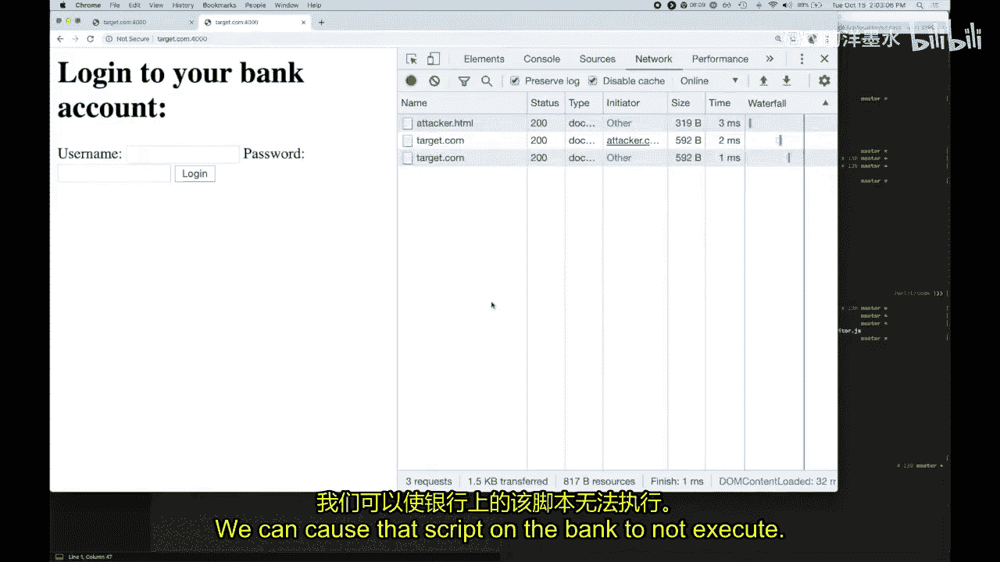

So let's just， let's， let's test this out by， by directly playing with the URL here on the bank site。

 So I'm going to， let's see。 I'm going to。

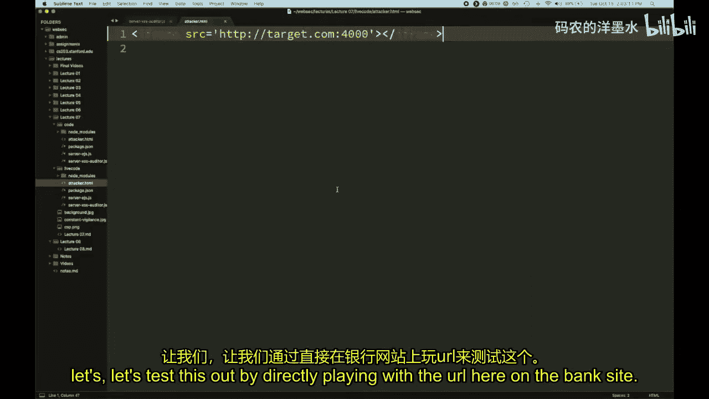

Let's view the source and let's just copy this script because this is the script we want to prevent from running。

 So if I copy it， and I just put it into a query parameter here， query equals that script。Now。

It looks like nothing's different， but， but if I view source。This is in red now。

So this is Chrome saying it looks like you have an X S in your site。 and we're gonna make。

 we're gonna protect you by making this script not run。Okay。

 so now the attacker just copies that URL。

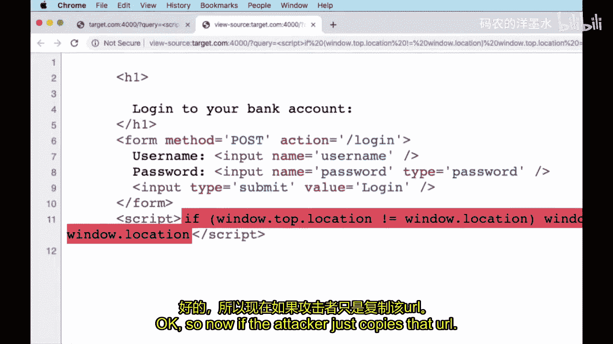

And puts that into the， into the frame here。And then now we load up the attacker page。

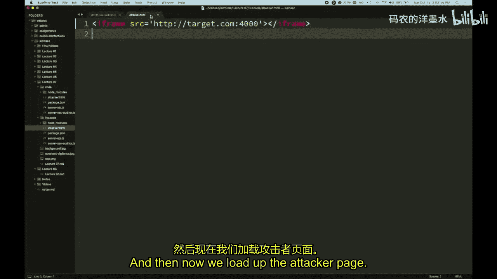

I think the only issue is it's cached。 So I need to。

 I need to visit that wall while that wall my inspector is open。 But there we go。

 So now now the bank frame is there and the attacker is allowed to， allowed to frame it。

So we we sort of neutered that script that was a little bit inconvenient for us as an attacker。

 It seems like a problem。 We can sort of snipe out particular scripts that bother us from sites that we're trying to attack。

 not good。Any questions about this？Yeah。wasn thisす。Doing that stuff before it。Gues the server。

I got the script in the do。Can you just like look at the？Oh。

 could this server just look at the query and say that looks like your browser？

Like right when you query this oh， could the browser prevent you from making a request that looks malicious。

 Yeah just like query question。Oh， yeah。Like pop up what you。So that would work。

 I think that would break some legitimate sites。 So some sites are actually coded in a way where they pass H TML from one page to the other through the query string。

 And it's bad idea， but。I guess you could do that safely， right。

 if you're actually filtering the tags and you， but you expect that to work。And。

 and your suggestion would break that。But doesn't this solution like break that？Anyway。

 because then' scrapes， then it deletes the script。That's true。 Actually， right。

 And that how is that use case。Supported then。Ha。I think that this is fine if's not if it's not dynamic content。

 like scripts and stuff。嗯。But yeah， that is， that is true。 Yeah， I'm not sure。But。But yeah， it's，'s。

 let's move on， so。But any other questions。Okay， so， so， so so anyway you know。

 they realized this was a bad idea。 So after， after like。

 I think six years of this being deployed and you know， ton of bypasses being found。

 the sort of policy that they came up with was well， you know， we don't think bypasses are that bad。

 This still protects， this protects people some of the time。 It catches some attacks。

 Let's keep it there and。They didn't consider， you， being being able to bypass it as as significant。

 However， when people， people started pointing out， well。

 you could sort of snipe out scripts that you don't like from sites you're trying to attack。

 Then they took that more seriously， and they switched the default behavior to be that I think。

Instead of it just removing a script from the page， it would entirely block the page from loading。

But anyway， now， now， now the current policy is is that they， they're just deleting all this。

 This is just they just considered it's a bad idea。 concluded it's a bad idea。 So actually。

 if I switch over here to， to to Chrome Canary， which is。

 you know the latest version of Chrome that is sort of in beta right now。 And if I visit that page。

 what do we get here。😊，Oh gosh。 this is， oh， wow， that is hilarious。 So， so， so， so okay。

 so two things just happened here that I have to point out this is， this is actually。

 I did not expect this， but it's very interesting， so。😊，Let me first， let me first copy the。

 the target URL here that， that has the attack in it。

 And I'm just gonna go over here now to to the beta Chrome。

 And I'm just gonna show you that that it doesn't try to block。 It doesn't try to block it out。

 So if I wait。W't give me one second。W is it being escaped。

 I thought that it was supposed to be an attack。啊。Oh， right， right， right。 I I'm Yeah， I'm okay。

 Two things are going on here。 So the point is that the script is in the page。

 and you notice that it's not read。 It's not red。 even even when I put when I put the script into the URL。

 so。Yeah， so the point is that they're not they're no longer filtering this out auditor has been removed from Canary。

 But what we saw happen was that redirect block thing is actually another security feature that just actually kind of got me in trouble here because what I wanted to happen was I wanted this bank site to I wanted the frame busting code to run and the bank site to take over the page。

 But Chrome has a feature that prevents iframes now from from redirecting you。😊。

Which just interfered with what we were trying to do， which is really annoying。

 So the reason they they do this is because there's a phenomenon on the Web now where ads will actually in addition to just like sort of showing you an ad。

 they'll try to just like take take you elsewhere。 And so sketchy ad networks will just navigate you elsewhere。

 And And this prevents that。 And I think the reason why they decided this is an acceptable trade off that would just broke my defense here is because we have a better way to actually do this defense。

 which is an H T TP header that says I don't want to be framed。 And that's what we should have done。

 So if we had done that， then then we we would still be fine here。 But wow。

 all these different interacting things。 I this is an example of why security is hard。😊，Okay。

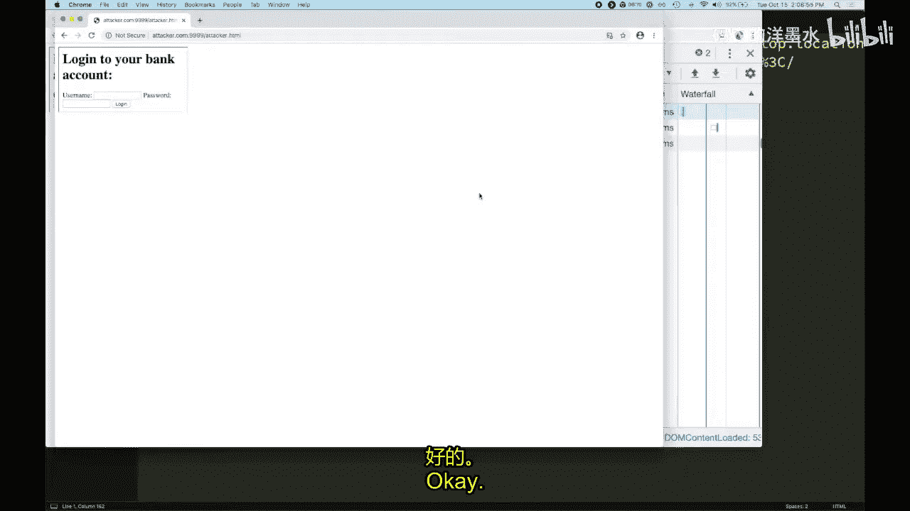

Okay， let's move on。 But yeah， that's， that's the excessor auditor。

 It lets us snipe code out of the page。 And in about 7 days。

 all your chrommes are gonna auto update to remove it。You can do this now。 can you can snipe， Yeah。

 you can attack sites by sniping code out like this for seven more days。😀。Yeah。

 I'm actually glad that I was able to show you before my Chrome auto updated and made it really hard for me to。

 to demo it。😊，Yeah， so， and then just one other point is you can do this for you know。

 more than just inline scripts。 But even if， if there's like。

 let's say save bunch a security code in some particular file， you can also snipe that out。 You know。

 if this code is assuming that this， this is loaded， you would just， you know。

 include basically this piece here。 And then that that script just doesn't load。 Yeah。

 so it's a problem。Okay， then one other thing I want to show that this is actually， okay。

 before I show it， let me just give the context。I。There's a whole nother attack here as well in addition to disabling scripts you don't like。

So if you。So what is going on here？ We have， we have this way of。Basically， if， if we。

 if we put something in the URL that appears in the page。Then Chrome will will， you know。

 sort of interfere with that will， will block the page from loading， right， So if we， if we use this。

 we can actually detect when things are like particular strings are in the page， right？ So， so if I。

 if I。If I want to say。嗯。Steal some， some variable that's。

 that's a session token or something that's in your page。

 I can sort of include a prefix that tries to match that。 And if it matches。

 the whole page will be blocked。😊，And if I can detect that。

 then I just now I just discovered that that string is in your page。Right。A a few following this。

 I see some confused faces。Let me， let me try to explain it one more time， so。So what， what。

 what do we， what do we show， We showed that basically， if the。

 what's going on here is if this string is in the page， then this， then this page you know。

 it it loaded differently。 And in particular， it， it's actually blocked。 The entire page is。

 is blocked from loading。Actually， well， the site can opt into being to fully blocking it or。

 or I think the default is that it snipes it out， like I said before。 But。

 but let's say that let's say the whole page gets blocked， right。So now I can sort of， by。

 by setting this， this string very carefully。 I can。

 I can test for the presence of particular particular strings in the page。Yeah。Is it because the I。

Like the。This from。Because it's an my frame。It's。No。

 it's because the auditor is saying we think a reflected excess is happening。

And so if the site has said via header that it prefers when X is detected。

 that the whole page is blocked。Then my attack site now can sort of put a string in here and then watch to see whether this eyeframe fires an on error event。

And if there's an on error event， then I know this string must be in the page。

 And I'm not supposed to be able to tell that because of the same origin policy。

 but I'm able to sort of。Trick this trick the browser into revealing that fact to me。

 And so if I try a bunch of things， I can actually learn a lot of stuff。 Like in a simple example。

 I could， I could sort of maybe include the username and to see if that that appears in the page。

 And then I know that that's the user who's who's on my site。 But， but more， more maliciously。

 you could actually iterate through like a token that appears in the page and try to steal it out of the page。

 And I actually have a video of that here， which is a wild video。😊。

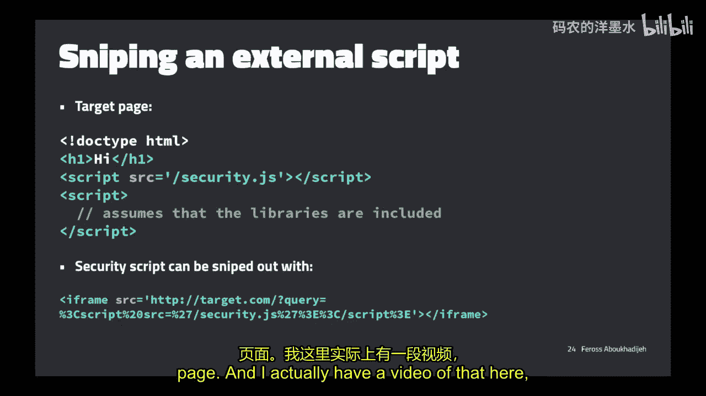

So。So this is， there， this is a page that includes a secret token in the page。

 And this is an outer page， which is iterating through。Adding things to the query， basically。

 And every time it finds a match for a prefix， then Chrome blocks it from loading。

 and then the page learns that that is that is in the page。 And it'。

 it's just like in in in the movies where you see that it's breaking the password one character at a time。

 It's just like that。😊，Yeah， so， so this page is gonna learn the full， the full token there。Yeah。

 anyway。 So， so this is a bad idea。 This exorus audit is quite a bad idea。

 So let's talk about a different way of。

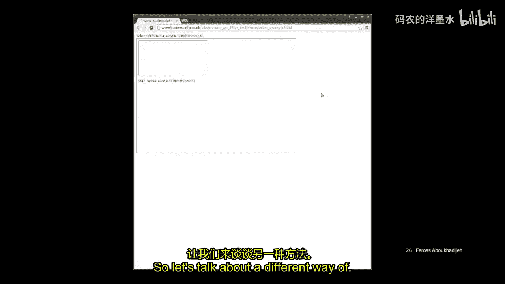

Of actually protecting our sites， especially since that X auditor is going away。So。

 so we mentioned last time or， days， two times ago that。

We have certain ways of tightening up the same origin policy to sort of prevent other sites from posting forms to us or loading images or scripts or styles from our site。

 And that was a way of sort of defending our site。This thing called CSP is sort of the inverse of that。

So this is a way where we can actually prevent our sites from making requests to other sites。

Now you might think， well， what， why would we want to do that， That seems weird。 Well， remember， we'。

 we're trying to defend against an attacker's code running in our page。 and we want them。

 We want to limit what they can do。So if we assume the attacker has jascript running on our site in one of our users browsers。

 it would be great if we could say， you know what。😊，That code is not allowed to talk to any server。

 except for like my server。And now they can't sort of expfiltrate any data， right。

 I've sort of sandboxed them in。So， so this is an added layer of security against crossite scripting。

 So obviously， we don't want attacker code to be running in our sites。 But if it is。

 wouldn't it be great if we could just say， like， sorry。

 you can't talk to all these different servers。 You can only talk to this particular white list of like maybe three servers that I trust。

 And now the attacker is very limited。 They can't actually steal any information。

 except it can talk to those three servers and。😊，If you control those three servers or whatever。

 then they can't do anything， right。That's the idea。

So we need a way to actually specify this policy in a way that the ja can't interfere with it。

 obviously， because we've just we just said the attacker has code running in the page。

 So what are we going to do to set this， We're going to use an H TTP header。So with an H T TP header。

 this is coming directly from the server when it provides the H T L。

 And it's saying this is a policy that I want you to enforce for all the code running in this page。

 And so now， even if the attacker's code is in that page。

 it's too late for the attacker to do anything to change this policy because this policy is included in the H T TP header that the server sent back。

Right。Does that make sense？So yeah， basically， we add this header。

 and then the CSP will go ahead and block any requests that violate the policy。

 So maybe it will help if we look at a few examples， I think。So here's a really simple policy。

 If you add this header to your， your server's responses， then you're basically saying， I want you。

 I want to the， I want the。The page to only be able to talk to the same origin。So now。

 if an attacker happens to stick a script tag in there， they can't talk to any other servers。

 There's very limited， you know， in terms of what they can do。 Although your your point， I forgot。

 was your name， sorry。Yeah， so your point was that they could still make requests to the same site。

 and that' that's still true in this context as well。

 their code could could do things on behalf of the user。

 but they can't steal any data now in any way because we've sort of prevented requests from going out to any other sites。

Does this make sense， This is the simplest policy。 So hopefully this makes sense if not ask questions now。

 because we're gonna， we're gonna to add a lot of complexity in a second。Okay， so say now we want to。

 oh， yeah， let's， let's test our understanding really quick。 So would this be allowed。

So if this HTML appeared in a page where that was the header that was sent back on that page。

 would this be allowed？Yeah， it would be， right。Cause this is just loading a javascript file from the same site。

 right， Okay， so relative URLs will load this file from the same origin。 So we're fine。😊。

Would this be allowed。Obviously， not， it's a different site， right，Different origin。 Okay。

 what about this。Unclear， right。Well， remember， we're trying to defend against crossite scripting here。

 So it seems like if we let the attacker just write code in line that we're not really that safe。

 I mean， most of the attacks we've been showing have been us just calling alert on the cookie。

 you know， or writing code directly in line。 And so it's actually not very much of a defense to tell the attacker。

 You can't load scripts from your attack server， but you can write whatever code you want。Right。

 that's not a very， that's not a very good defense。 So actually， this policy will， by default。

 prevent all inland scripts from running。And so you need to be sure when you do this that you're not sort of breaking your own website。

 You need to make sure basically all your code now appears in hello dot JS or something like that。

 external， an external file。But this is really powerful because now we're basically saying like you can't。

 the attacker can't stick code on our page and they can't load code from their site。

 So all that they can do is hopefully they could hope to have some way of maybe affecting this file。

 But but that's a whole nother kind of an attack。 That's not crossite scripting。

 And so this actually sort of seems like it defeats crossite scripting。😊，Right。Yeah。

This is not really question more。But it seems like this is another reason that。

Like having different files on it。one， it's not just a stylistic thing， but it's。Yeah， I mean。

 in this situation， you're right。 Yeah， yeah， because we're sticking a bunch of user data into the page。

 And now we know that， we know that if it happens to be a script， it's not gonna run。 Yeah。

 that's totally right。 yeah。So， yeah， that's great。 And then one other example here。

 So what about if there's code inside of an attribute like an event handler like that。

 like on mouse over。Shouldt that be allowed。For the same reason as this was denied。

 I think we also want to deny this， right because if the attacker happens to get something in there now they're running code again。

 so we want to block that as well。So yeah， that one line right there just sort of completely。

 it seems like it completely saved us from crossite scripting。 That's great。So。Cool， so。

 so now what if we want to change the policy， slightly， relax it a little bit。

 say that we trust trusted dot com and we want to let them load， we want to load scripts from。

 from sub domainomains of trusted dot com。 Well， we can just add trustedt com there to the list of sites that we trust。

😊，That's pretty simple， pretty simple。 Let's go through an example now where， say we。

 say we're a webmail provider。 and we're trying to。

Just loads of scripts from our same origin and then maybe subdomains of our site。

And then we also want to allow images to be loaded from anywhere because images can't really do very much。

 So let's say we're okay with images coming from any any location。 when we。

 we write a policy like this。So yeah， not too bad。嗯。So here's a question。

Say that an attacker manages to get a script in this page。Although I guess they can't。

 because of what we， we said about。This would this line here would block the script， from running。

 right。嗯。Yeah， I think this is actually a silly question。 Let me。Let skip it。O。

So what I want to mention now is deploying CSP。 So say that you， you think that this。

 this header is a good idea and you want to add it to your site。One problem you have is that。

You might think like， okay， I know that I'm loading images from here and here and here and I'm loading a couple scripts from here。

 And know these， these domains。 And if you miss one though。 and then you deploy a policy。

 you've actually just broken your site for all your users because you've told the browser。

Don't let these resources be loaded。And so that's really bad。

 And so we have a way of deploying a CSP in report only mode。

 So you put the policy here and you just say， look if there's a violation， it's fine。

 let the code run。 but please send a little request to a URL somewhere where I will be notified。

 and I can look at those reports。 And I can see what exactly what would have failed in production。

 And I can adjust the policy before know before I actually deploy it for real。

 And I remove the report only part。😊，This is a way to sort of test it out。

 And this is important if you're deploying on an existing site that's really complicated。Cool。

 and then there's one other thing which is on on So then when you actually do deploy it。

 maybe you still are a little bit paranoid that that you might have made some mistakes。

 you can also include a report URL， which will get ped anytime anything is blocked。

 And so you can watch those reports and see like， okay， I guess I forgot that one edge case there。

 you know， and you can you can update it。😊，Other thing that's kind of cool about this is if an attacker is playing around with your site and trying to find the attacks。

 every time the CSP blocks it， you'll get pinged and you'll be able to see attacks happening in real time against your site。

 well not real attacks， but an attacker playing around with parameters in your URLs。Cool。

 so there's a whole bunch of these directives。 So we I， I showed default source earlier。

 but there's like a whole bunch of different ones。 I'm not going to go into all of them。

 but just point out a few， so。😊，So we talked about images already， too。

 We could sort of say we want to load images from， from these particular locations。

Object is a really interesting one because it's， it's all this sort of old flash and Java applets and things that can be embedded in pages。

 If you're not using that stuff on your site， just block this entirely。😊，And then。

Scrs scripts are probably this is probably the most important one to set a policy on。

 because this is really what we're trying to do here is prevent crossite scripting。

 So you should be very careful about how you set the script source。Cool。

And then there's a few other ones， which these are， these are interesting because so。

 so if you look at the old list here， if you don't set a policy for any of these。

 then it inherits from default source。 So you can just set a default source to be like my own。

 you know， just same origin。 And then you don't have to set any of this other stuff。😊。

Which is kind of nice。 And so you can sort of just change a few that you need to change separately from default source。

 But then these ones don't inherit from default source。

 So you actually have to set these separately if you， if you care about them。

 And there's some interesting ones in here， so。This one is kind of interesting。 So。

 so there's this tag called base in H T， L。 And if you include it in a page。

 then all the relative URLs in the site become relative to whatever is specified in base。😊。

So I could， if if an attacker can put can put a base tag on your site。

 then they can say like base is attacker dot com， then any of your code that is that is sending a request to like slash API。

 whatever or slash any endpoint， Basically that is relative that is relatively specified。

 will just have the attacker dot com prepened to it。 and the data will go there instead。😊，So。

 so yeah， this is a tag that you probably want to have a policy about。 and in particular。

 you could just prevent it。 there's not really a good reason to use it。But yeah， that's interesting。

 And then this one's also interesting。 So frame ancestors lets you say， I don't want tona be framed。

 And I mentioned before there was already another tag for that。

 So this is a sort of duplicated way of doing it。 This is the newer way of doing it。😊，Yeah。

 and then this one is also quite interesting。 upgrade and secure requests。 So this is useful。

 If you have a site that is， again， an old site and you're trying to migrate it to be more secure。

 you want to have all of the requests that happen to point to H T TP URLs be magically upgraded to H T T P S。

 You can sort of apply that as a policy to the whole page。 And the browser will do that for you。😊。

But yeah， these are pretty different from， you know， in general。

 they seem pretty different than Xs S， but they're， they're part of content security policy。Okay。

Any questions。All right。Okay， so。Let's talk about actually deploying it。

 So here's a script that appeared in one of my websites。 And when I was going to deploy CSP。

 I was like， okay， okay， so clearly， I need to load something from Google Analytics because I want to track how many visitors that coming to my site。

 So I said， okay， let's allow scripts from Google Anatic。 and also from my own my own site。

 obviously， And for everything else， let's just default to to only allowing it from my own site。

 So images， videos， everything else will just be only allowed from from my own site。

 So this seems pretty safe， right， Like code can only run from Google Analytics or from from my site。

😊，I like that， right， Seems good。So what's the problem， Well。

 we mentioned before that actually somebody tell me， somebody tell me what the problem is。

 She should know this。Said it earlier。What's the problem。Inline code。 Yeah。

 that script tag if there is inline code。 So this policy is going deny that。

 It's going say that could be a attacker code。 It's in line。 You should put that in a separate file。

that's kind of annoying。 In this case， I could put it in a separate file and no big deal， but。

But sometimes you can't。 Sometimes you have some kind of like ad code or something that you're putting on your site。

 And it has to be in a specific format so。Yeah， unfortunately， you know。

 this policy is gonna block these inline scripts， which， which， which is gonna prevent my， my。

 my Google analyticstic from working。 But there's this thing I can add called unsafe inline。

 And that basically says， let inline scripts be okay。 Like， don't block those。

 The problem with that is that's basically equivalent to having no。😊，Content security policy at all。

 because now we're back to the situation where the attacker can put whatever they want in。But。

 but that would solve the problem。 A better solution would be to move the code into another file hosted on our own site。

But for now， let's just throw this in here because I don't want to change the H Tl code。

 So that's a bad idea。 But I'm， Im gonna put it in there anyway。Okay。

So there's still another problem。 The CSP here is too restrictive。 It's going to break our site。

 What's the problem。Seems fine。Yeah。Try to。おさが。Yeah， that's right。

 So when the Google Analytic script runs and it， the jascript executes。

And now wants to sort of save information about what the user did on our site。 Like in particular。

 this thing right here， send page view。 This is gonna actually。

Ping URL using an image like I showed the code I showed before。

 where you do new image dot source equals whatever。 And when it does that。

 it's going to basically be attempting to load an image。

 And our policy says images can only be loaded from our own origin。

 And so we just broke Google Analytics。😊，So we actually have to， yeah。

 So this is the code they're running internally。 They're running。

 They're making an image that points to Google Analytics slash whatever collect equals some data that they're collecting。

 right。So。We need to now say， okay， fine， you can load images from Google Analytics。Okay。This。

 this works。 But it seems like this is kind of fragile。

 Like we're sort of now making our policy sort of dependent upon what the code in here is going do。

 And if Google decides to change what this script does or what domain it talks to。

 then we've broken it。So it's， it's actually not a good。 it's not ideal and。And so。So yeah。

 we should we could say， you know what， let's just make the image be anywhere because images are pretty harmless。

And so now， I guess that's a little bit better if if they change the location that they're talking to will still allow it。

 But we still have the same problem。 Like in particular。

 theres there's a thing that they actually that scripts often do。

 which is this script might include another script to load some more functionality。

 And then that script could come from a different page。 And now we've broken Google Analytics。

 So this is code that actually like used to appear inside of this script。 It would make a script。😊。

Point it to S S L dot Google Anatics dot com， and then add that to the page。

 And that would get blocked。 And so you'd have to add that as well。 And so this is just， it's。

Really hard to get right， basically， because it's based on this sort of runtime behavior。

 what is the script gonna do。 I better make sure I I allowed that in advance or else I just broke my site。

 And so for this reason， people have actually been very hesitant to deploy this。

 even though it's such a good defense against cross sight scripting。 It's just so fragile。

 you might break your sight and people prefer to not have broken sight。

 And so it's just been a very hard thing to roll out。 And so。😊。

We need a way to basically ensure that our CSP never breaks our site。

 even when new scripts are added。 And so here's an idea。

 What if we propagate trust from the initial script to which we trust。

To any scripts that it includes at runtime。Which we now want to implicitly trust。

And we do that no matter where that script comes from。That seems like it would work， right？

 So we're basically saying we trust Google Analytics。 They could put it。

 They could put whatever code they want in there that might be malicious。 We already。

 we know they're not gonna to do that。 We trust them。 So， so why don't。

 why don't we just also trust them to load code from wherever they want。

 because we already trust them。😊，It doesn't seem too bad to just trust them to load code from any place they want。

 right。So that's the idea。Questions about this。

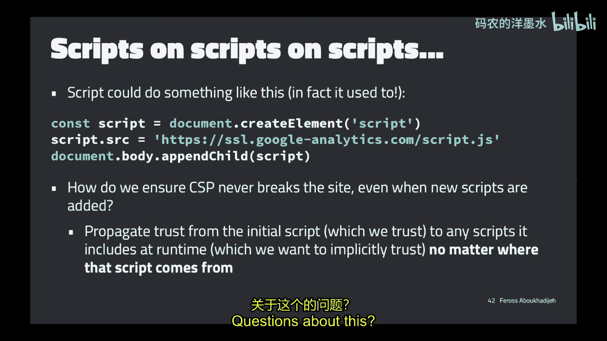

Cool， yeah， okay。 So so there is this paper that some some Google people wrote called CSP is deadad。

 Long live CSP。 And it talks about how they they basically analyzed all these sites that have deployed this to protect themselves。

 And they discovered like extremely damning results。 like it's ridiculous。 I have some quotes here。

 So 14 out of the 15 domains， most commonly whitelisted for loading scripts contain unsafe endpoints。

 And as a consequence，75% of distinct policies use script white lists that allow attackers to bypass CP。

 So this is just saying they trust domains where effectively， an attacker can upload code。😊。

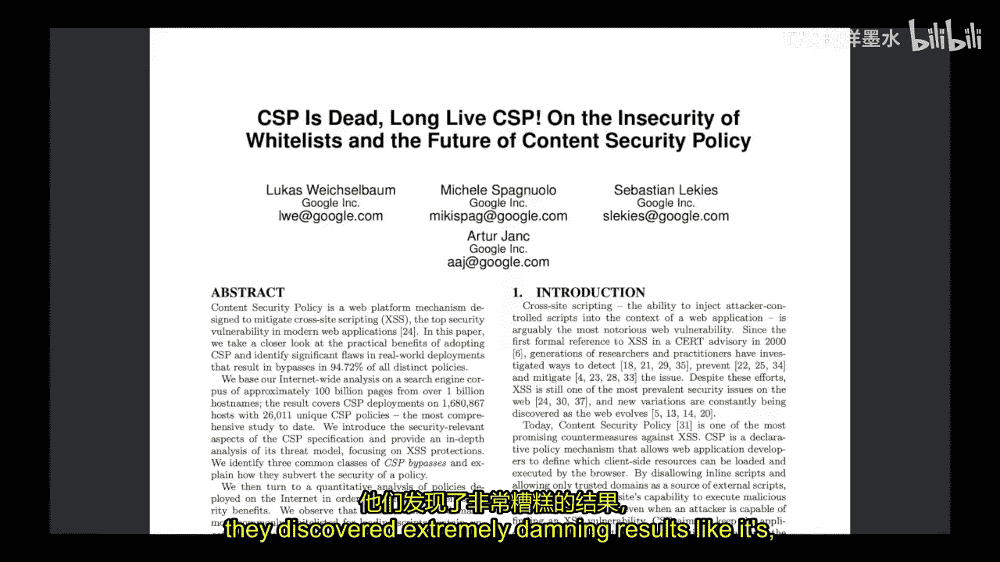

Like， they can put whatever they want there。 So you said， I trust that domain。

 but anyone can put stuff on that domain。And so what， what did you actually。

 you didn't accomplish anything by saying that you try you know， by adding that policy。 Another。

 another thing。 So here，94% of policies that attempt to limit script execution are ineffective。

And 99% of hosts with CSP use policies that offer no benefit against crossite scripting。 That's like。

 why are we even trying here， Like， this is just so bad， right， O， so。So， so the good news， though。

 is in the end of the paper， they proposed a solution， and that solution has been deployed。

 and it actually works great。 So， so there's， there's this silver lining here。😊，Okay。

 let's first talk about the things they mentioned in the paper that allow bypassing the the CSP policies。

 So here's an example。 I kind of mentioned this before at the Json P。

 Remember where this is an end point where it's going to return us。 It's going return us some data。

 But we we we' asking that server。 Please wrap the data in a function named this。But in this case。

 if an attacker can put some code in here， and then they can make。

They can make that return sort of anything they want。Now， it's really bad if we trust this。

 this server now， because we're saying we trust any code that comes from this server。

But if an attacker can get this script in the page， they can make that server。

Run whatever code they put in the parameters here。And so we got no defense from that。

Does that make sense。So， so I， I guess I should have included an actual domain in the。

 in the URL there， but。What's going on here is we're saying we trust this site to only return us。

 we trust this site to return us like safe code。 and we're gonna to allow that code to run。

 But it's possible for an attacker to create a URL that makes that site return whatever code the attacker wants。

And so it's a really bad idea for us to trust a site that has such a， such an endpoint on it。嗯。

Are you saying that a tiger of me？杯就。They allowed。They have security loop。A loud of attackers。Yeah。

 somehow。Intercept， whatever response that they were。So they're not directly like attacking the site。

 just has this site happens to have a URL that if you go to it。

 it will echo out whatever the attacker gives it。 And if so if it can get it to echo out valid ja。

Then now the attacker can basically put， it's effectively like they're putting whatever code they want on that site。

 But it's actually just echoed in this case， but it's， it has the same effect。Yeah， okay， so let's。

 let's show another example here。 So this is an example using Angular Js。

 So it's typical an Angular J S to include the library and then to include template code。

 And then the， the the jascript up here will actually look through the page and find code that matches template。

 And then it will run the jascript that's in the braces here。😊，And so。

If you have Angular on your page。And。You think that your CSP is protecting you from arbitrary code execution。

The thing is， so you， you， you， you， as a p site creator， you've said， I trust Angular。 Like。

 I know Angular is not malware。 So I'm gonna to trust a dot com to load， you know。

 to load Angular from there。 The problem is that if an attacker can make divs in your page。

Like which presumably they might be able to do because divs are not。Codes。

 so you might let the attacker control some divs and you let them put braces in the divs。 Well。

 Ar is gonna go come along later and see these braces and think， I should execute that， right。And so。

You've have given the attacker again， arbitrary JavaScript execution on your site。So to attack this。

 you would put some actual malicious code inside of the braces。So it's just things to think about。

 right？Even if you trust Angular， like， what is it doing and how can the attacker control things that would affect its behavior。

Okay。And then here's another one。 This is， this is a really wild one。

 So say that you have an endpoint on your server， which returns。Returns an error。

 It says error colon。 And then in this case， this is supposed to be like a URL and then not found。

 like it's a4 or4 page。What we could do is we could try to visit slash alert。Document cookie， blah。

 blah， blah。 And the page is gonna say， you know， this， this site is gonna say wait a minute。

 that's not a URL。 So it'll say error。It'll say that's the URL you tried to visit is not found。

And my question is， is this valid jascript。It actually is。

 So this syntax here is is a way to name a line of code。

 And then you can use a go to to sort of jump to that line of code。 Basically。

 it's not literally go to， but it's effectively like a go to。

And so we've named this part of our code error。 And then this is the code we're gonna run。

 And then we， we sort of commented out the rest of the page。 And so again， if we trust this site。

 but it has this 404 page implementation， then we're in trouble because now we attacker can basically put whatever code they want onto that site。

Does this script now look at？Oh， interesting。 the4，4。I wonder if you。

 if you return a 4 of4 from a script and then。But it's valid jascript order to execute。

 I actually don't know。 I don't know。So maybe that， yeah， maybe that would prevent this。

 This is definitely getting into sort of esoteric territory for sure。 But you know。

 my guess is it would， it would actually execute it。 That would be my guess， but I I。😊，I don't know。

Okay， and there's even more wild detect。 like， say that the attacker can control some data inside of a CV file。

 This， again， might be possibly valid javascript。 Like if name is a variable and value is a variable。

 this will just echo name and value and then run this code。 really quite esoteric。 But anyway。

 the point is， the point is that。😊，Is that CSPs are hard to get right。

 and so there's this site called uselesscP。com， which collects examples of people who failed to do CSP correctly。

And if you go there，s actually， there's a whole bunch of big companies on there。

 Like I think the Hawk result right now is Apple is on there。

 and Apple's CSP is completely ineffective。Yeah， and I think right now their their。

 their S L certificate is expired。 So if you try to go there， theyre also a failure in。In some ways。

 so if you just ignore that， you can actually see the site。😊，h security。Yeah， so， so yeah。 So anyway。

 So basically， the solution to this is what was proposed in the paper。

 And it's a really great solution。 And this is what you should use。

 And it solves sort of all the problems that we've talked about。 So it's called strict dynamic。😊。

And the basic idea is， instead of specifying in the policy for scripts that all the list of domains that you know might ever be contacted by code that you trust。

 you can just say， look。I'm just gonna implicitly trust certain ones and then let those load anything they want and just sort of cascade the trust onwards to anything that they may want to load。

 And so that's great。 So now we're gonna load some code from trusted dot com in this example。

 But how do we know that we can trust this script。 How do we know this script is not attacker injected code。

 Well， the the the H T TP header here included a nonce。😊，And this example， it was ABC 1，2，3。

 So this is just gonna be a random value that the server chooses。

 And then what it's saying here is it's telling the browser， look。

 any script that you see in the page must include nons equals that value。 ABC 1，2，3。

 If it doesn't include that as an attribute， then it means that it was a attacker injected。And so。

In both of these examples here， this， these， both these， both of these code。

 both of these scripts will be allowed to run。 Even the inline one here is fine。

And the reason is that we're saying we trust any script that has the nouns on it。

And so that has a nonton。 So it's allowed to run。Okay。So a question， yeah。We。Yes。

 this is in the HP header。You declare the nonsense value as ABC 1，23 in this example。

 And then you have to， then all the H T L， all the scripts and the H T L have to have the same value。

 Yeah， it for an attacker。Yeah， so that's a great question。 So， so it's really important that。Okay。

 what is that doing here。 Alright， Yeah， Okay， So here's， here's an example where。

 here's an example where the attacker tried to inject these last two scripts here。

 So they tried to add evil dot J S， and they tried to include some attack code。 Now。

 these two scripts are not gonna run。 And then your question was， like， how。

 how come the attacker can't figure out what this nonsense is， right。Who knows why。

 who can think of why？It might be hard for the attacker to figure this out。Yeah。Yeah。

 that's so can you expand on that？Presumably， like the attackers。Sa。Attacker com。Yeah。Exactly。The。

 the idea is that that initially， the server sent back a page， right。

 And that page included includes thisnce sort of in the header and also in the page。 Now。

 how can an attacker possibly see that value， They can't look at the headers of a page you know。

 of a response that came back from a server。 And they also can't look at a nonce that's in an H TL page of another origin。

They just can't， it's a different origin。Now， you might think think， well。

Couldn't they run code that looks at thes， like couldn't they look at the Nonce attribute in the page。

 But the thing is。Then you're， you're assuming then that they're already running code in the page。

So if they're already running code in this page and they can look at the Nosvalue。

 then you've already lost because they're already running code in this page。

So if they're not yet running code in the page。Now， they have to find some way to。

Figure out what that nonce is。 And what we're doing is we're making sure the server picks a different nonce every time it it sends back a page。

 So this is a completely random and unpredictable value。And so because it's completely unpredictable。

 the attacker can't just know sort of I priority like the nonsense is going be this。

 So when I include this in my like URL for my attack， they'。

 they can't know what the nonsense is going to be。 Yeah， mean HTML can't be cache anymore。

 like your pages。Yeah， for so H TL responses would definitely not definitely not want them to be cached if you're using CSP like this。

 Yeah， but the good thing is usually H TL isn't usually H TL isn't cacheed anyway because you have like。

 like personalized information for the user。 Like when they're logged in。

 you show their name in the header and stuff like that。 And so usually don't cache that anyway， but。

😊，Oh， it's just， it's just kind of a crypto term for like random value。Random string， basically。

So it's protecting the web page because the server is selecting it and it's completely random。

 And then， then when the browser gets gets the H for the page。

 it's gonna look at this header and say， okay， I'm being told by the server。

 Don't trust any scripts that don't include that nonnce as an attribute。

 And so if the attacker manages to say， let's say they do a stored excess。 They get。

 they get this script right here， E Js。 this one， they get it into the database somehow。 Well。

 when it gets echoed back out into the page here。😊，It's completely， it's completely inert。

 It's not gonna be allowed to run because the browser was told not to run it unless it had a nonat。

That was valid。嗯。😊，Page load， Well， I guess a request to an H L page。From the top level， like。

The URL and the URL bar of the browser。ださ。And just。Refreshing on。啊。Yeah， so that's， that's great。

 You know， you you understand this。 You understand the problem perfectly。

 So you need to make sure the nonsense is long enough that it would be impractical for them to。

 to iterate overall。 Yeah， like in this example， ABC 13， that's way too short。

I should have made it longer。 I should have included a dot dot dot or something。 Yeah， that's way。

 way too short， yeah。Cool， great。 So that makes sense。 So there's one problem， though。

 Some browsers don't support this strict dynamic thing yet， because it's really new。 in particular。

 Safari doesn't support it。 And so we have to decide， what are we gonna do when Safari when safari。😊。

Users come to our site。 So one thing you can do is you can So the way that content security policy works is that the browser will ignore things that it doesn't understand。

 So it will ignore strict dynamic and it will ignore nons。

 And so what we can do is we can just sort of have these other really unsafe properties in here saying。

 like load scripts from anywhere and let code run in line。 And when Safari sees this， it's gonna say。

 okay， I I'm just basically applying。Noob security policy here。 And if you do that， then。

 then Safari will sort of the code will will work。 And this won't break your site。

 And then when you run it in， in another browser like Chme or Firefox or Edge or whatever。

Then it will see this。 and it will say， okay， strict dynamic and nons actually tell me that if those are present。

 I'm supposed to ignore any of these other ones。 And so you can sort of in both in a single policy。

 you can actually have fallbacks for browsers that are that are old because these these。

 this actually won' won't run at all in a modern browser。So this policy is actually great。

 it doesn't really protect the Safari users。 but hopefully the fact that most of your users are protected is is is is is good enough。

 and that would hopefully discourage an attacker from bothering if。

 if they can only sort of target a smaller percentage of your users。 But you could also hear。

 you could also include the full list of domains that you know。😊。

Should be used here as well if you want。 I just， I'm too lazy。

 So I just put star unafe in line and just figure those， those users， sorry， sex to be them。所以啊嗯。😊。

For a single page like。One non to you say like a script。Like another。For example。Likeオに。T not。

So that's a great question。 So if you've included a script tag like this one here。

 trust dot com and includes a once， it can just dynamically create dom elements that are scripts and add them to the page。

 and it doesn't have to even include a once。 The fact that it is。

 it is the code inside this script that is running will implicitly allow it to just do that。

 The browser won't like restrict that script in any way from， from adding other scripts。

 The trust cascades basically automatically。😊，so can it doesn't have to change its code at all。

 like this code doesn't have to be aware that nonsense is even a thing。 Like it can just。

 it can just add scripts to the page。Yeah。Cool， okay， so。

So here's just an example of a reasonable starter CSP header you could use if you're building a site。

 Okay， a few other things。 So there's this other thing called feature policy。

 which is kind of cool that lets you say I want to completely disable certain browser functionality in my site。

 And this is yet another way we can sort of limit the damage an attacker can do。

 So you can say like the geolocation API like I don't if an attacker gets code running in my page。

 I don't want them be able to get the user's current location or something like that。

 And there's a whole list of other ones that they're planning to add。

 which are not currently supported， but which eventually we let us sort of ban a bunch of browser features that we we know that we're not using。

 And so why would we want to let an attacker use use that as well。😊，Yeah。

 there's the web can do a lot of things。 in particular。

 there's a thing on hackcker news the other day。 I think yesterday about this thing。

 people were using the ambient light sensor to fingerprint users。 Yeah。

 because they could sites could literally look at the light conditions in your room without without a prompt at all。

 So they could just tell， are you in a light room or a dark room And like apparently like that's yet another way to sort of get another data point on a user I'm sure that I'm sure that Pete is gonna talk all about this on Thursday。

😊，I I guess it's using the light sensor on your phone， so。Yeah。

 it's probably next next to the camera， yeah。Cool， okay， so man， we have like three minutes。

 I wanted to mention one other kind of X S S called Don based X S S， so。😊。

The idea behind this is that the dom can be modified by a script that's running in the browser。

 and we might actually trust this script。But it's possible that an attacker could trick that script into adding some do nodes to the page that we don't want it to add。

 So unlike reflected or stored excess， the attacker is not actually changing the HTML that the server returns。

 But what they're doing instead is they're somehow at runtime。

 getting the page to do something unsafe like this。

 So why is this unsafe This is fetching like my bio say this as a social network。

 It's fetching like fors's bio。 And then that's going go into a string。 And if that contains HTMLm。

 what this is doing is it's adding it to the page and it's saying treat the H in this string as like actual tags。

 Add them to the page。 So this is very dangerous。 And so the correct thing to do in this situation is to just use text content instead of inner Htl。

 And then it will treat it as text and do the escaping for you。

But you can see how this would be another X S vector。

 And so this is actually the one that's more common these days because all the kinds of。

Client heavy frameworks that we're using， like react are all。

Which is making this kind of attack more more common。 But there's this new browser spec。

 which is not shipping in any browser， but which is going to be coming in the next year or so。

 which also completely solves Dombased X。 So I wanted to make sure you you all knew about it。

 at least heard the name of it。 So so CSP protects us from reflected and stored excess S。

 And then for this dombased excess S， the idea is。😊，If we have this kind of code like this。

 we would like to be able to say， like。Basically， we don't want to be able to say inner HTMLtl equals some HTMLl string。

We want， we want， we want to sort of make that be an error。 and so。

way we do that is we say we use content security policy to say we're using the trusted types API。

 and we would like all of our interh T L equals。Code to fail if it's past a string。

And only to succeed， if it's past something， which is a type trusted HTML T object。

And so what that means is now how do we produce one of these trusted HTML objects？

Well they're going to come from a very particular sort of factory for those。

 And so we say what we're saying here in the header is we want we want to use this factory that we call template。

 And so we make a template factory。 and then we give it a create HML function。

 And then it takes the user input and it just escapes it。

 But while this may look like it's returning a string here， it's actually it is returning a string。

 But then this factory will actually return a trusted H TL object。😊。

And so so now if I get back for Ros's bio and I get it back as a string here。

 I have to now create a trusted HL object using this factory。 And then now if I set it。

 it will be allowed。 And so what's cool about this is literally now in this example here。

 the only way to ever add any H TL code to the page is to go through this factory。😊。

So all other places where you might set HTML strings into the dom all throughout your whole code base。

They almost flow through this one function。 or else they're gonna be blocked。

 And so now when we want to audit our code， it's very， very easy to audit it。

 We just look at this function。 and we make sure that this function is rock solid。

 If this function is safe， then we know there's no other way that anybody could have added any。

 any dombased excess to our site。😊，So that's a very interesting approach that I'm， I'm a fan of。Yeah。

 so， so final thoughts。 So yeah， excess S vulnerabilities are pervasive in real world sites。

 be very vigilant and never trust any data from the client， always sanitize it。

And beware of the context that you're using the data in and make sure you escape it appropriately depending on the context and then use CSP correctly with strict dynamic and soon you can use trusted types and if you use those two things together。

 you'll basically prevent all kinds all the kinds of excesses that exist pretty much so。

And so that's great。 If you do it right， you can have a site that's safe against the most pervasive Web attack that exists。

 and you can never be too paranoid。 So just constant vigilance。 That's the right mentality， thanks。😊。

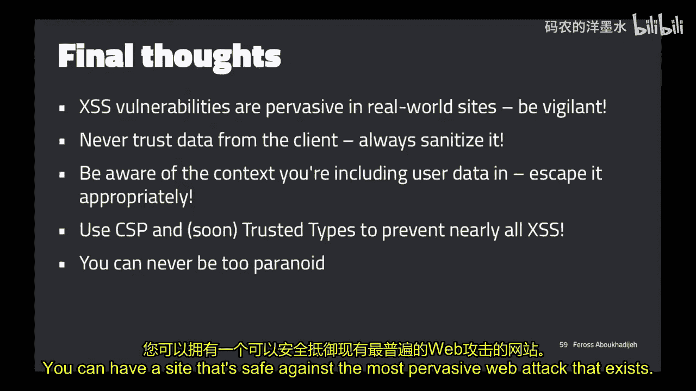

See y'all later， see you Thursday for the guest lecture。

