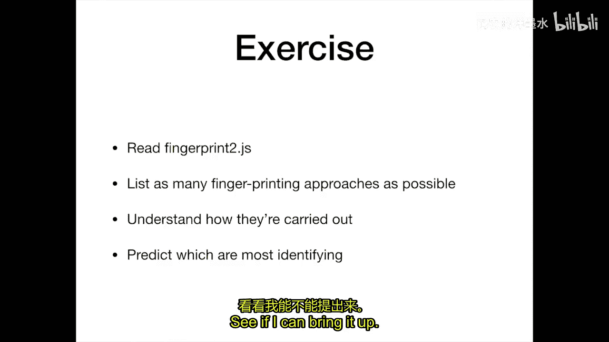
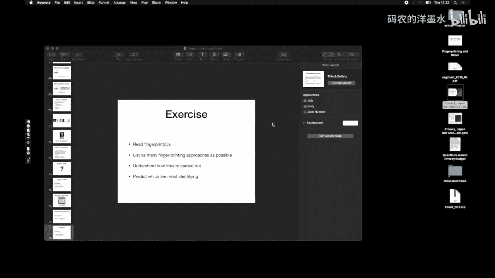
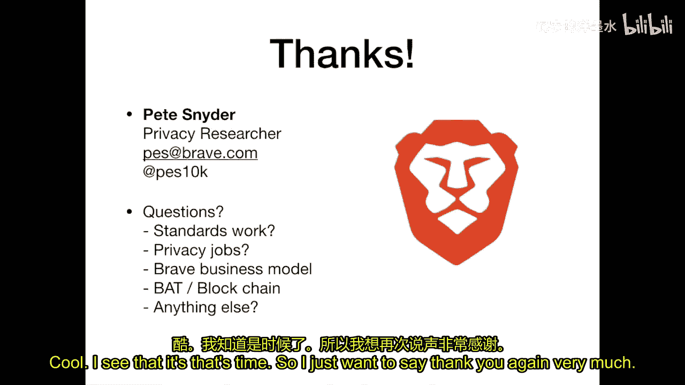

# 【全集】斯坦福大学 CS253 网络安全 中英字幕 1080P p08 Lecture 8 -  指纹识别与网络隐私 - Pete Snyder -BV1RemEBZEEM_p8-

Cool so I guess we'll get started。So hi everybody I'm really excited today we have Pete Snyder joining us from Brave Brave browser is a cutting edge browser that preserves privacy for you while you're browsing around the web and so I'm really excited to hear what he's going to share with us today I think like more than any other browser they're sort of pushing the frontier of what's possible in terms of protecting user privacy on the web and sort of fighting back against the way that the defaults work on the web so I'm really excited to hear what he has to say and you。

Are you currently or reformally at。University of Chicago， University of Illinois。

 Chicago I graduated。But a year and a half ago cool yeah。

 and now you do brave as your as your full time thing right yeah he's also the representative to the W3C for which is the standards body of the web for for brave so cool take it away thanks。

Hi， everyone。 Thanks very much for， for hanging out with me today。 So in this talk， I'll just be。

 I'll talking about a couple things。 I'll give kind of like a。

 a non technical but kind of high level。😊，Explaination of how we kind of got to where we are regarding privacy violations on the web and tracking and just kind of the。

The calamity history， and then I'll talk about what Brave is doing about fingerprinting and tracking。

 and then I'll have some more general stuff where I'll ask you to talk amongst yourelves and make some suggestions about open privacy problems。

So first， a little bit about me， I grew up in Chicago。

 I got my degree at the University of Illinois in Chicago。 I didn't go there directly。

 I went to law school for a little bit and then I moved to Anchorage and did freelance web design for a while。

If at one point me sued somebody and got invited to be on the Judge Judy Show。

 I'm happy to talk about that more later， but then I came back to Chicago。

 got my PhD in computer science at the University of Illinois， Chicago。So now that I'm a bit brave。

 I wear a couple of different hats I'm the privacy researcher。

 which means that my goal is to conduct research and publish papers about novel ways of protecting privacy online and then also holding people's hands and helping with the engineering team to move that stuff into product。

 I co-jed Ping。 Ping is the privacy group at the W3C。

 And so we do reviews of new things that are about to get shifted into standards and try to keep them from being privacy harming。

 And then I do a fair amount of collaboration with academic partners also publishing papers and working on stuff like that。

And then before getting to the meat of the talk， just brave at a very high level。

 Braved us a couple different things。 As mentioned， were， we're extremely privacy focused。

 That's everything we do is， is， is measured by that。Criteria。

 but beyond being just a privacy preserving tool。 we also propose this alternatively of funding websites on the Web。

 And so I won't go into too much detail， though I'd be happy to talk about it more if people had questions。

 But the general approach is to flip the incentive structure on the Web right now。

 most sites find themselves through advertisements。 Use don't like advertisements。

 And so there's this agent problem where the user wants to deprive the website。

That they're visitinging of the funding that the website needs。

 There's this total in mismatch in terms of the incentive structure。

 Bradde proposes it a different way of doing this where users get paid to view ads。

And so the users have the incentive to look at ads， websites get funded through the payments。

 a portion of those payments。So Brad is primarily a browser right now。

 but there's a lot of infrastructure being built。 There's a bad or cryptocurrency aspect to it。

 And there's a lot more。 So I'd be， I won't talk much more about Brave as a company for the rest of talk。

 but I'd be much， might be very happy to to talk about to answer questions or anything like that people had them。

😊，So at a very high level， here's what I'll be talking about for the next what hour and a half or so。

 I'll talk about why websites track track。 And so this will be this kind of like non formalal history of tracking on the Web and。

 and how we got here。 But I'll talk about how how tracking has been done is still done predominantly on the Web now。

 but also。What enables that and how that's actually carried out。

 then I'll talk about how fingerprinting makes that more complicated and how that's conducted and how that's become a replacement for this kind of classic cookie based tracking。

I'll talk about a different set of categories of。Fingerprinting countermeasure。

 so how people are actually trying to prevent fingerprinting from from happening online。

 then I'll ask you all to do some some work in terms of addressing fingerprinting surface that's currently exposed in the browser。

 and then I'll talk about how this stuff actually shipped and brave。So first。

 why do websites track what's going on and why， why in the world that people build a system that enables this。

 I also want to say this is pretty informal， especially at the very beginning。

 So I really want to encourage people if they have questions， interrupt me at any given time。

 if something's not clear。 if you have， if something just doesn't make sense or if you just have something add。

 please jump in。Okay， so why does tracking exist， Why is this enabled in the web。 So way， way， way。

 way back when when most of our news came paper and this kind of thing。

 people realized that you could sell ads against this stuff。

 and people who bought a certain type of paper would be more also maybe more likely to buy a certain type of paint or a certain type of meat or a certain type of whatever else。

 And so people would place ads next to the kind of content that the people who might buy those products would buy。

 And so here in this kind of classic model， people weren't tracking users。

 they were tracking content on the second order expectation that people who consume that content would also want a certain type of product。

And so you had ads like this， which again， are they're being matched against the content。

 not against the person reading the paper。 That's important。 And the reason that matters is because。

Even way back then or still going around now， but predominantly when these kinds of paper publications were the predominant way of sharing information。

 even then people were trying to target users。 And so this would happen if you say sign up for a magazine。

 people would buy magazine subscription lists on the idea of being like these are people who like a thing。

 So I'm going try to track these people across different populations and sell ads to them。

 So even in a pre online world， there's some effort to track people or to matching ads against people。

 but predominantly you're matching ads against content。Then the Web becomes a concern。

 and people start doing the there's the exact same model。

 So at the very beginning that you have these kind of dumb ads or unintelligent ads where they just people put an ad on a page because they think it's related to the page content on this theory that。

People who look at the page will also be interested in the ad。

 You're matching the ad against the content。And then very quickly on， though。

 this is probably before most folks in this room were online。

 but you had these things called Web rings where basically websites would self- identifyentify on some topic。

 they would form an organization amongst themselves。

 But those people who like Disney or the Simpsons or whatever it might be。

 And they would they would swap ads amongst themselves。

 And so all the Disney sites would advertise for some other Disney site。

 every Simpson site would advertise some other Simpson site， this kind of thing。

 These are called Web rings they had a bunch of different names。

 And so just as with print publications， there starts to be some effort to track people across websites。

 you're not you're not tracking the person themselves You're inferring their interest across time。

But then its technology gets more sophisticated and people start pushing these things to third parties in a specialization on the Web。

 You get a situation where ads are no longer tracked by the interest of the website。

 but tracked by the interest of the person。And this seems like a tiny shift but ends up being pretty fundamental for。

 for tracking online。 And so for folks not familiar with with how this actually works in practice at a very。

 very high level， ads like this get i framed in。When the browser makes some requests for the i frame。

 for the content in the i frame， it sends along some information derived about the user so that might be。

Purchasing history， it might be name。 It might be location。 It might be a bunch of different things。

 but then the third party makes the choice about what to， what to return the content。

 So there may be some matching of the ad against the content。

 but primarily you're matching against the person looking at the content。

 This is where things start to go sideways。So you have these third parties where they have a foothold on a large number of different sites。

 and they start to build up these massive databases of information on on per person。

 So these parties can see when somebody visits that one person might visit these four sites here and another person might visit some subset of them and some additional sites that aren't listed。

 this kind of thing， but all this information gets collected in these large to users invisible databases that are basically just tracking this is a person and this is what the types of sites theyd like to look at。

And so now when you have a website that may be very low quality。

Have content that people don't particularly care about。 You can still do the same sort of thing。 the。

 the quality of the ad doesn't is no longer connected to the quality of the content。

This hass pretty massive repercussions for why the Web is so terrible or is has the problems it does right now is that good good in quotation marks。

 ads can can be matched against the same people on bad websites。And so， presumably。

We think that these are my hometown newspapers。 These newspapers are producing high quality content。

 This arbitrarily bad website on the， on the other side of this pages are producing low quality content。

 And if we had an old business model， it would cost a lot of money to to， to attract or to。

 to get ads in front of the people who looked at。News and there'd be very little benefit in putting ads against rarely seen or rarely desirable websites。

But what we see is moving is revenues moving from high quality websites to low quality websites because advertisers don't have to target the websites。

 They can target the users。And so put different， Oh， sure。だめは。

or per user visiting the website this is the cost the publisher pays。 there's two different costs。

 This is the cost that the advertiser pays to the ad network。

 which is kind of sort of a proxy for what the advertiser pays to the person to the website owner。

That would be a fair impression。 Still， the bad website will get much less revenue because presumably is much less visible。

 Sure， buts that is absolutely true。 But there's the two important dynamics here are one is that money is being siphoned away from the other because there's no longer any incentive to put advertisements on the high quality content because you can get the exact same people on 1000 different poor quality websites。

 And so it ends up being beneficial for the poor for the poor quality websites because they can only least get some ad revenue。

Because its some marginal improvement in in the quality of of the ad placement。

 That's one thing and the other thing is that it harms the people who are making the the content that you want to attract But presumably the high quality websiteex still has incentive because you will attract more users and so total。

For Rethan War， we'll get more visitors。You'll be able to profit。So， no， so。

 so that that is how the system is supposed to work。 But in practice， that's。

 that's not how it works because the advertiser may get， may get their ad in front of。

Say we have some very simplified distribution of of web usage and 50% of the time people go to just Chicago Tribune and 50% of the time they go to everywhere else。

 You might think that okay， advertisers are going spend 50% of50% of their ad spend budget on Chicago Tribune。

 50% everywhere else。 But that ends up being not what happens because it costs much more to put an ad on the Chicago Tribune than everywhere else。

 And so even if the Chicago Tribune is still making more per more per day putting ads。

 all the money is being siphoned away to other places because they're much， much cheaper to go。

 So can your ad spend dollar goes much further you target cruming websites than quality websites。

So even if the absolute， the absolute income to the Chicago Tribune is higher than the Kmmy website。

 the marginal decrease is dramatically， dramatically larger for the Chicago Tribune than the marginal improvement to the to the to the Kmmy website。

Does that make sense this， this dynamic is pretty important for understanding。

 not just advertising online， but。Well， why websites like Brightbuer。com make a lot of money。

Other websites don't。 I I don't mean anything political by this。 I have my own political opinions。

 Of course， I justt mean that I think even among people who find bybart dot com appealing。

 they would agree that there's less reporting and less like original work being done by that website than there are the people on the other side of the the column。

 settingtting aside people's might included political preferences。So the new。

 the new strategy for online tracking is to identify the kinds of people who go to these sites but then try。

 then place ads against them everywhere else on the Web。

And so what is a down target effectiveness this， I don't know if this is people are familiar with this story。

 Have youve already talked about this。 So this is a pretty horrible situation where theres a late teenager woman who was pregnant。

 She had reasons for not wanting her father to know。

 but Targ started sending information about pregnancy clothes and and maternity wear and this sort of thing to the house and the dad found out that the daughter was pregnant because of target not because of the daughter。

 So all this is to say is it's not just about defunding websites。

 although that's a pretty horrible implication in itself。 you have these very。

Kind of insidious downstream effects of the tracking that the system enables。

And so this is where things look like right now。 This is not a complete list。

 This is not a complete list for two reasons。 One is because people are constantly going out of business and chiping in。

 but also because there's just many， many， many more names that you may or may not know that or not on this list。

 But the point is that there's an enormous number of middle parties that exist only to figure out to build databases about people and to figure out what kind of person is going on to one website。

 side effect is that almost every company you see on this list is not profitable。

That is true almost entirely across the board if you're not Google and you're not Facebook and you're selling ads。

 you are almost fores sure not a profitable company， you're making a long term bet about something。

 but that's just an empirical fact。Okay， so that's how tracking works and kind of how we got here。

 But how much is this is actually happening。 So I want to refer you to this paper。

 This is this came out about four years ago， five years ago， semi recent。

 but the numbers are a little bit out date。 But the general direction that is accurate。

 So his work that was done at Princeton， Stephen Engelhart， by the way。

 is now basically has my job at Mozilla。 He he's a privacy engineer there。

 Arvin is kind of a mild celebrity in the world。 I don't know if he talked about it。

 But He's an incredibly cool dude and does a lot of Internet privacy work and is just all around great guy。

😊，So they did this paper where they basically visited a million websites。

 measured what third party resources were requested。

 categorized those third party websites in some ways。

 and basically had this kind of census of how much tracking is actually happening online。

So I'll show you three figures from the the paper of the entire papers is interesting。

 What they find here is that even on just the average website。

 something between almost 20 different part tracking parties understand what's going on there。

 So there's 20 you can think about there is something on the first sort of 20 different databases get a row inserted to so that you looked at a website。

 that's just on the average website。 just the median website。

And a slightly larger number of people could have would have the technological capability of of recording information。

 but don't。 So they're not categorized as trackers。

 but they have the same vantage point of the same information access that trackers do。

 So something like 20 different people know every time you visit our website。

So what are those 20 people， Unsurprisingly， if you look at the far side of the room。

 It's it's not equally distributed。 So things that belong to Google Analytics is by far the most popular tracker online。

 This number is above 80% now。 These numbers are a little bit old， but。

The thing about it is like the Google Analytics database understands has a record of 70% of the websites that you view。

 And that is a database that you don't get to edit。 You don't get to audit。

 You don't get to whatever。 Yeah， so yeah， so the next table is。

 is just groups these by organization And you can see unsurprisingly。

 the only two profitable advertising companies Theyre up here and everybody else here is in their advertising budgets。

 at least losing money。That is。I'm trying to think of there's any exceptions to that rule right now。

I don't see any that have turned profitable。 But yeah， so Google。

 basically by having a bunch of different vantage points， which are mostly Google Anatic。

 but things like Google fonts and Google Maps and things like that understand。

About 80% of websites you view。percent first parties。 Oh， so， sorry， first part。

 So this is generally， first party means the top level URL frame。 So whatever you type in the URL。

 that's the first party， the first party is usually or not always considered to be that domain。

 Do you know what E T LD is。TLD is top level domain name。 So that's like dot com E T LD is effective。

 top level domain。 So now there's bunch like CO dot UK is two domain names， right。

 but effectively that's one。 So E T L is something like that。 E T L D plus1 is the top level domain。

 effective top level domain plus one。 So if I register a website like CNN or whatever。

 Pete Snyder at C UK， the E T LD is UK， the E T LD plus1 is Peteder UK And anything else is considered a subdomain。

 So if you everything by E T L D plus1， which is just a general heuristic that's used on Web。

That is the first party。 So if it's like， you know。

 static that's CNN do com and font at CNN com or whatever。 That's all considered the first party。

 The third party is every other page。 Sometimes it gets divviied up by third party resources operating in the first party context。

 So if I load some third party frame third party code in the first party frame。

 sometimes it'll be considered first party， sometimes it'll be considered third party depending on the kind of measurement you're taking。

 sometimes third party just means iframes。可快。It's so if I have a， for example。

 stay I link to a C DN or like an image posted on a C DN。That part。

 that CN may make explicit guarantees。 like fastly makes is a CDN that's very popular that makes explicit privacy guarantees saying we won't record I P addresses beyond this period of time。

 We don't record anything else。 We don't set cookies， this kind of thing。

Fasly could violate that promise at any point they do。

 but they make legal guarantees to not be trackers。

 And so they get theyre the organizations like that are this pale blue bar。

 people who could do tracking or at least have the technological capability to do tracking。

 but for various reasons aren't believed to be doing tracking。Cool， so there's a lot。Yeah。

 short story， there's a lot of tracking going on。Ill pause for a second。 Any questions。 I， I mean。

 I just kind as is a background to， to explain why tracking is profitable。

 why so many people are interested in doing it， that kind of thing。 Any questions before I。

 I jump in further。So the 80% Google first party graph that just means that that's JavaScript code that is like that's mostly Google Analytics that's running。

On sites directly in the first， in the first party context， mostly2， two slight clarifications。

 One is that it's not in this， this one is Google Analytics。 This one is Google。

 all Google properties。 So this is Google the company。

 not Google any particular any particular resource。

 So this would group together Google Maps and Google fonts and Google Analytics and all this kind of stuff。

And it's first party because the user visited those URLs。 No， it's first pretty because the。

 the way the resource was included in the first party。

 it's able to determine what the first party was。So if I， if I like pound include my。

 my Google Analytic script， that's a third party resource， but it has access to。

 it can determine what the first party is。 And so it can record the first party behaviors。Yeah。

 so the the way to understand this is Google Google has a way of understanding at this point greater than。

 but something on the order of recording 80% of the first party or else you visit。Cool。Okay。

 so that's， that's why websites track and kind of where we are。 So how is website。

 So now I'll talk about how tracking is usually carried out， like the common case。 before I jump in。

 this is Brendnda Ike。 I don't if people are familiar Bnda I Brennda I is the person who owns brave。

 Hes indirectly my boss。 He's a extremely important person in understanding the history of the Web。

He's the person who invented jascript more or less than 10 days that's kind of a little that's not 100% true。

 but that's that's mostly true is that he went from。

Somebody Microsoft sorry somebody at Nescape said we need something like this。 And he said， okay。

 I can get this done and came up with the prototype in 10 days。s pretty astonishing。 dude。

 He also did the initial version of the Web API。 So any time you hear something called Dom 0。

 that's now 100% but a largely decisions inspired by Brendan。 Brendan was an early guy at Nescape。

 an alum of U I U。 He was an important person of Firefox for a long time。

 And he's responsible for brave and bat。 He's the person who who cake this all off。 Brenan is。😊。

An amazing dude。Oh， sorry， I bring him up though， because what I say。

 the reason I want to mention him is that。The， the mechanism I'm about to describe for how tracking happens in the common case is something that's enabled by Brennan's choices and totally unintended by Brennan's choices。

 So when you when people explain or understand how the Web works， it's not supposed to work this way。

 This is not the intended。Purpose for any of this stuff。

 This is a bunch of decisions that got made under extreme pressure when Netscape was about to go broke the other day and。

 and has these enormous downstream consequences。 So if anybody ever says， well， we have。

 this is what the standard requires so we should do it， you should keep that in mind。

 But this is a lot of accidents。Okay， so back likes web 0，0。

 and it was still like a research project of the simplest form of it I'm sure you all know this。

 but the simpler version is you make some requests， there's no state attached in the server response。

And then if I would make another request， same thing。 there's。

 there's no state carry between these two operations。

 This is like classic web way back in the day when it's still a project at Cern。U。

So this has some problems。 So I say I want to have a server that can distinguish between different types of users。

 How do I do authentication。 How do I I don't want to make people type their password on every single page view。

 I need some way of carrying that stay along。 And even though H TP has a way of doing authentication。

 It's pretty crummy for a whole lot for enormous number of reasons that I can go into。

 but nobody uses it for a good reason beyond I think literally the W3C is the only website I know that uses HP off It's not not great。

 And so the solution was at a high level。 So we'll have some way of transmitting tokens across browser views or page views will get somestand for describing state that gets checked in the browser And this iss being called coies。

😊，So a cookie is just at a high level A value that the server gives you and you return on every subsequent request。

 So now when I make my request to a server， it returns the content and also some cookie identifier。

 So I D X， Y Z。 And then when I visit it again later， I return that value。 and the good site says。

 okay， X， Y Z is a valid token， I'll give you back the secret resource。

 But if somebody else comes along and request with all that I D， the server will reject the request。

So， that's。Column 1， there's a separate column of things going on at the same time that end up enabling tracking。

Second is that lots of websites have host lots of images and maybe not so much now。

 but particularly back in the 90s， all this stuff is extremely expensive。

 Finding hosting was something you paid for in a large amount of money and so。

When websites would do this kind of thing and host the same image， this ended up costing a。

A not trivial amount of money， not the kind of thing they would just get， you know， pocket change。

 And so people would want to refer to images across domains。And so even though there's just one。

 there's the， the。Image now becomes a third party request of cozy kittens or whatever。

And so the question was， what do we send cookies on this request， It's， it's a third party request。

What should we do And largely be largely because of rush rushing and the specification being unclear and a bunch of different things。

 the request the decision was made to include cookies on this request。

 And so third party cookies became a thing in a way that tracking could be done。And so， yeah。

 this is fundamentally what's going on here。 Cook plus third Si cookies on third priority resources is the primitive that allows people to track people across websites。

 That's not 100% true， But that's to a first approximation，90% of why of the trouble。

And so how does they actually end up getting weaponized， make some request to site A。

 a returns information that makes your issue a request to the tracking site。

 tracking site sets of cookie， and so now when I make a request to site B， I return that same cookie。

And this trackingre site is able to learn that I've visited both site A and site B。Extremely simple。

 extremely uncomplicated， but this is。This is what almost every tracking system that people care about online。

Yeah， so I guess I gave this away earlier， but the point is that Brendan opens up。

 or at least I've heard Brendan open up maybe a dozen talks at this point where he says。

 I invented JavaScript in the 90s and I invented the Dam in the '90s and I've been apologizing for it ever since。

Yeah， I think brave is as privacy respecting as it is because Brennan has some background guilt going on。

I say jokingly。Okay， so how does the story advances， though。

 that a lot of browsers notice this is happening， lot。

 though not all browsers think this is unacceptable and start fighting back a little bit。

 So Safari is probably the first person take an extremely strong stand about this。

 Firefox also early on blocked third party cookies。 although ended up rolling that back。

 And so right now， a number of large browsers Bra included。

 Sa no third party cookies or has some restrictions on the kind of third party cookies that get sent。

😊，So as the countermeasure site started saying， okay， we're not gonna use cookies。

 we're gonna use URL parameters and we'll store these values somewhere else。

 So instead of storing in the cookie， we'll store it in local storage or I guess I shouldn't assume too much。

 if people familiar with these things。 I can talk to them。

 HS TS as a way of describing cookie upgrade that a resource should never be requested un encryptrypted channel。

 you can do tracking through that。The other stuff， whatever。

 But but the point being that people who wanted to do tracking started to get a lot more sophisticated about how they were going store these values。

 Have you ever heard like whatever cookie is， cookie is a not precise term。

 basically for storing unique identifiers in places where you wouldn't expect to find unique identifiers and some of these things can be extremely insidious insidious just。

Show of hands。 Who knows how HST S tracking works。 This is kind of the absolute grossest example about how a security feature can be cooped for tracking。

 HS T S allows the site to say when I make a request。

 it returns a head that says never make a request or never make a request to me again over an unencrypted channel。

 So even if the like the link says H TP automatically upgraded to HPS S。That's a great feature。

 right， But what advertisers realize is that we can make arbitrarily long domain names so I could have tracker dot A dot B dot C E whatever arbitrarily nested。

 And we can set a different set of HS T HS T S instructions for every sub domainomain。

 and we can do that differently for every user。 And now， if I have nested sub domainomains of length。

 I don't know，32。 I have 32 bits that I can set 32 yes， no values I can set for each user。

 And now I can uniquely identify everybody on the planet。😊。

So the point is just that people are extremely sophisticated about this stuff and it gets really nasty。

 So Brave has its own countermeas against this。 Safari has their own countermeasures， but。

If people can figure out a way to leverage something to track you。

 you can be sure it's happening right now。Okay， I will pause for， for questions。

 but the point just being。That that's how it used to happen。

 And now it gets a lot more complicated real quickly。Cool， okay。So， now。Fingerprinting。

 fingerprint you can think about is like tracking hard mode。So in the classic mode。

 the website would just find somewhere to put storage on the device。

 then figure out something to read that storage back。 fingeringprinting isn't about storing values。

 It's about determining unique characteristics of each browser and using that to identify them。

And so how is this done in a whole bunch of ways where you might not expect。

 So your browser window might be a different size than your neighbors That's somewhat identifying。

 You might have some bizarre font that you picked up at some point to make a I dont know。

 PowerPoint presentation。 And that's unique， that's going to uniquely identify you at least somewhat。

Yeah， your' hardware will be different。 maybe you picked up a plugin at some point， whatever。

 all these things， none of these things are uniquely identifying。But if you combine them together。

 you get you get a set that becomes very identifying。 So here's a toy example of this。

Consider this to be the set of all internet users， so something like three to 4 billion people。

You're one person among3 to 4 billion people。 And so the website。

 the trackers challenge is to figure is to identify you from everybody else without storing state anywhere。

So you might think， Firefox these these， you know。Let's see， Firefox is 20% of the web。

there's hundreds of millions of people using Firefox。 that's not identifying at all。

 I'm pretty private。And Windows， almost everybody uses Windows still， right。

 so that's also pretty private。Lo of people have office installed。 So this was also pretty not。

 not to identifying。DN T don't do not track if people familiar with that。

 This is this terrible not terrible well meaning idea where basically your browser could send a a header to a website to say。

 please don't track me。That's it。 But the expectation was that people would respect that and not track you。

 I think Twitter is the only person who ever actually reads this value currently。

 But the point being that。Some browsers send in some browsers don't。

 but that is also semi uniquely identifying。 So if you go into Firefox and say， don't send the。

 don't do not track header， all of a sudden that's。Another interviewtropy bit。using an ad blocker。

 everybody uses ad blockers， but at some point， like the little set。

 the bit middle becomes extremely tiny， right， even if all these things have millions of people in or billions of people in them。

You may be the only person who has all these particular parameters。

So this in a nutshell is how fingerprinting works。Is to find enough of these kind of subset intersections to identify each individual person。

So two proper two characteristics come out of this that to be successful at fingerprinting。

 you need two things。 You need a large number of semi unique identifiers。 you can pull off people。

 and you might be able to trade that against a smaller number of very uniquely identifying identifiers。

 but。Fighting。Protecting against fingerprint means under kind of fighting on both of these fronts。

Okay， so I won't go through， even begin to go through the entire set of。I fingerprint points。

 but I want to talk I'll talk to you four of them as an example and ask you about the fifth one。

Alright， so the user agent string， there is an extremely kind of funny or just maybe interesting explanation of how in the world we gotten to use this identifies Chrome。

 how in the world that could possibly be。 So I just want to refer you to that if you're interested。

 But the point being that over time for web compatibility reasons。

 each one of these parameters got added on to the point where Chrome sends strings that seem to identify Mozilla and K Tl。

 which was the predecessor of Webkit and Safari and blah bh blah。😊，So this in most browsers。

 this gets into on every single page request。And so you might think， again。

 you're you're in the Mozilla。 or sorry you're in the， the set of Chrome users。

That that's pretty good。 But this value is gonna change frequently。 This value is gonna be different。

 but depending on platform。 This is gonna be different。 This will be different， etc cea。 So already。

 there's a whole bunch of semi identifiers in this thing that you're sending to every single website。

 And this is also this is easy to get to。 It's exposed to javascript and navigator that user agent。

 It's also just as a HTP header to most websites， by default fault。嗯。Any questions about this。

 It gets a little bit more buckweil from here。Cool， okay， so then this is the， this is。

It'sK of the craziest one， at least the one that I find most frustrating so right now when a browser when a web browser visits a website。

 it reads the CSS， whatever and in CSS you can say use this font for this element。

 use this font for this element， et cetera， ettera。

And there's a is a semi complicated algorithm for figuring out how to match the font on your system with the name that's in C。

 S S。And so the way the standard works is that categorizes all fonts into one or3 categories。

 system fonts are the fonts that if you're using Windows， Microsoft provides by default。

 if you're using OSX that Apple divides by default， whatever。

 But the system fonts are ones provided by the system。

Web fonts are ones that the web pages includes using a variety of different ways。

 but the web page instructs the browser to go and download it somewhere。

 Local fonts is is middle ground of fonts that the user has installed to the platform。

And so it's in this local section where， where you can fingerprint people。

 So say that you've installed office or Photoshop or for whatever reason you've installed fonts。

 Web pages can read those back out。 And so even if the vast majority of people have only the system fonts and then one oddball font that one oddball font is likely to to not be on anybody else's system or at least be on a very small number of other people's system。

 So every font is a bit of arpy。And so this there's no API specifically to say。

 tell me all the fonts in the system。 But the way websites extract this is kind of。Annoying。

So websites， it's done by this。 So websites will just have some list of extremely long list of fonts。

 So will be hundreds of thousands of fonts， just the names of fonts。

Then we'll create some page element like this。And the fingerprint font will just read。

It'll just iterate over the list of fonts， try to apply that font the。

 to the text and then see if the size of the of the span changes。 And so if it changes。

 then it knows that the user has the font。 And if it doesn't knows that the browser is ignoring and it doesn't have a font。

 So even though there's no specific way for the web page to say。

 tell me about all the fonts the user is installed， you can infer them through this indirect way。

2 characteristics about this that are important is if you're someone protecting you against this。

 it's extremely difficult to think， what is the defense you're gonna deploy here。

 You can't stop websites from reading the width of elements， right。

 That's gonna break gazillion different websites。 You also presumably don't want to say you can only use these six fonts。

So figuring out like practical countermeasures to get against this ends up being difficult。

 I'll talk about some ways that browsers have tried to， some browsers have tried to mitigate this。

 but think about this as as kind of a hard case。To like， identify you， like say if I like。

I installed a new fund。R me as someone you。Integrrated。So generally what happens is。

So a first approximation of the logic is if if the tracking party sees a cookie， it looks to see。

 is this a cookie I recognize from somewhere else。 If so， stop， I've identified the user。

 If this is a cookie I've never seen before， also take a whole bunch of different like try to identify the person through all these kind of fingerprinting methods and use that to what's called cookie sinking and identify this cookie and this cookie both identify the same person。

 And the finger fingerprinting like this is is the mechanism that cookie sinking or cookie linking ends up happening。

 So you can think about there's some higher table that says these 50 cookie。

 I'll identify the same person。😊，This exists。 I'll say that to later。

 to talking about countermeasures and browsers。 But yeah。

 this cookie sync thing is is an extremely difficult part to problem to work about to work around if you are working on practical web privacy stuff。

Does brave have any defenses against this。 or you talk about later Sure， Yeah。

 I'll say that we have some defenses against this that are unsatisfying。

 our two pronged kind of approach try to fix the standard。 that will be very useful。

 if we can get that fixed， although the blink team is very resistant against that。

 Although Mozilla and Apple are much。And a much more privacy preserving point of view。

 So if we can fix the standard the novel and Bra gets the gets the fix for free because it gets implemented upstream chromium。

 in the meantime， what we can do is。嗯。Well， these are a couple of different approaches。

 One is that we can just say local fonts is always zero。

 That's appealing for most English language websites and most Western websites， it'll be fine。

 but there is a nottrial number of sites that are particularly in in Asia that basically all but require a certain set of wellknow fonts to be installed that are not provided by operating systems or that the quality of the fonts that are provided by operating systems are so poor that it's very common for people to use these local fonts。

 So saying just that local fonts is an empty set breaks websites for a nontrivial number of people。

 It seems the proposed alternatives are。To either try to build consistent mappings between the requested language。

 So browsers advertise， please give me text in this language in a number of different ways。

 And if you can map a small set of possible local fonts to the language。

 you can probably at least keep people in a pretty big anonymity set anon set is just a general way of saying how many people do I look similar to so a larger anonomy set is more private a small anon is less profit。

 Yeah， so if we can build these mappings of languages to possible fonts that at least keeps like I don't know the Iicle font out of what gets enumerated and you might be able to keep limit the amount of fonts that people can identify to like5 per language instead of 5000 and that would be useful。

 the other approach is to say put things behind like a permission prompt or ask users to opt in fonts they want to put on the web in the browser instead of just inferring everyone on the system and then that would that would solve the common case harm of I installed some font。

Three years ago， completely forgot about it， and now it's allowing me to be uniquely identified on the web。

But to answer your question directly， brave right now， doesn't matter those things。我认的发生公司。

S in the missing local font for a web web font and kind of load lazily download it something So that would be fantastic for。

😊，呃。If we could get website authors to do that。 But if the problem is website users。

 then you still have the exact same privacy harm， because if you， if you。

 I can then infer by looking at the network traffic。

 whether or not the person is is using that phone because they go and request it。

 If I understand what you're saying right， But presumably maybe those funds would have some。

 some third party storage at least not， I know some reposory。

Of fonts that you would download all missing font from。Oh， so you're saying that that if。

 if I'm in this case instead of。So for every iteration here I go and download another font。

 So that would give you the privacy benefit， but fonts are one to 2 mebys in size。

 And so if someone's testing 5000 fonts， you've just killed your website because that's a gig of data or something every designed but whatever。

 it's a not trivial amount of data。 And if you're on mobile。

 you've just cost the user 20 bucks or whatever。So that would have a nice privacy property though。

Okay， this is， this one is kind of particularly interesting。

 There's two versions of this kind of fingerprint。 All this stuff comes out of a paper。

 all this stuff is kind of initially identified in a paper that came out of useD， I think， boy。

 I hope I'm remembering write。 But this paper on the top。

 I'll say a little bit more about because he's a particularly cool dude， But yeah。

 the approach described here is to basically at a high level。

 I'm gonna do some drawing on to people who on canvases。😊，So yeah。

 I'm gonna do some drawing campuses API that allows you to like instead of writing text or squares。

 you can draw a line in a circle and whatever。 You can do arbitrary drawing。

 So I'm gonna instruct the browser to do some set of drawing operations。

 then I'm gonna read it back out and in extremely subtle different ways。

 different hardware platforms in different browsers do this extremely subly different。

 And so even though it might look will almost always look imperceptibly different to the user。

 there will be extremely small there are often extremely small differences that will be due to color depth。

 And the graphics card and whatever else。😊，I the JavaScriptscript can read the output。Yeah， so wait。

 yeah， there's two ways of do doing。 You don't， It doesn't get to iterate over like say Pixel 1 pixelixel。

 you know like that。 But there's two APIs that allow you to read the the contents of it back out。

 either as as a blob or as a data URL。 And so you can use that。 And even if that the data URL。

 you could actually， both of those， you could translate back into some other data structure that you could iterate over。

I mean， you might ask why in the world is there this API to say。

 like what is the use case for reading things that you presumably already know there because you drew them。

 Why did browsers include this That's a great question。 but this API exists and not a lot。

 but a not zero number of websites use it for non malicious purposes。 Actually。

 it's funny the main use for this the main not tracking use for this to data URL method on canvases is to detect whether or not the operating the current platform has emoji support。

 And so you draw like the smiley face， then you say did the canvas change at all No then the user this user on a platform that doesn't support emojis。

Yeah， I mean， all this stuff is just adopted for all sorts of extremely difficult to predict kind of things。

Oh， yeah， you like obvious use case。 So if you you have a paint app and you're drawing and then you want to save paint。

 save the drawing as a J。 So I think， I mean， that is， that is like the benign purpose。

 But presumably if I know the instructions that went into drawing the canvas。

 I can recreate that in some other way。But yeah， mean that is why that exists。I only mean that。

If I put the information into the system， I should already have it somewhere else that I don't need to read it back out of the system。

So what this actually looks like is this is an image just taken from the paper。

 But this is what the user drew。 So these are the graphics like the 3D graphics instruction the open GL graphics instructions they issued at the website。

 And these are all extremely subtle where each graphics card render things slightly different from the other ones。

 So this is like you can think about is this is your ground truth。 This is the difference。 yeah。

 this is the difference between them across different platforms。

 And you can see that different graphics cards have extremely these differences that may or may not be subtle。

 but are usually imperceivable to users。 And so by finding these differences than I can fingerprint people in this way that I expect the people who made this API did not anticipate。

😊，Anyway I just want to say something else about Hova O is such a cool dude。

 not only if you've ever heard about return oriented programming。

 he is largely responsible for that from this paper。

 which I think has the greatest title of any paper I've ever read。

 geometryometry of In flesh in the bone sounds like literature to me and not something about Jack and computers。

 but yeah Oab is just an extremely cool dude， so I want to show him up。不要 say。谁现在改了。全定がら。

Differentate the perspective。Mmhm。😊，sendend the graphics card as the WebGR render as one of the head。

It's a header。 can we say more Im it for you， please Does't the browser the graphics the machine the header。

I don't think so what hat are you thinking of， I might be missing something。Could be wrong。

 I was just reading some article and I thought there was the web georemulator that was sent。

you you might be thinking of it I'm not I could be a mistaken。

 but you might be thinking of this proposal that comes out of Google called plan hints。

 where the there's the website can ask can request the browser to send additional information on the next request about different things。

 So it might be heightened width。 and it might be the graphics capabilities was one of those。

 You might also be thinking of， I don't think I've ever seen this， but。

 but it's not impossible that some browsers would send in the accept。

Ill shoot what is that one called， It's not called accept L except except hyphen this phrase that I'm not remembering。

 basically says I can understand this image format and I can understand this text and I can understand X H Tl and whatever。

 And it might be that there's some browser at some point may the choice to include that in that string。

 I'm not familiar with any browser。 So I do that。 but it's definitely not that might be what you're thinking of It might be something I'm not familiar with。

Any other questions？Cool， well then sorry' a little bit behind schedule。

 So I try to pick up the pace。 There's also a nottri number of APIs that will just straight up tell you like here's a aspect of the hardware I'm on。

 usually won't say like im MacBook， whatever with four USB ports and whatever。

 But you can infer a whole bunch of this stuff very quickly。

 So there's an API that's not completely standardized but ships in chromroium browsers that will tell you the number of hardware you have。

 So you can some amount of concurrency with workers threads if you want to the Web audio API will tell you the number of channels in the machine audio channels。

 whether you have stereo or 5。1 or whatever that might be。

 The Web G API will tell you the number of shaders you can support information about S instructions and stuff like this。

 There is a not standardized but shipping in all chromium browsers。

 device memory endpoint that will tell you a bend version of how much Ram you have in the machine。

 And then there's a whole bunch of ways to a whole bunch of different network touch。😊。

APpis that'll basically allow you to learn things like am I on Ethernet or am I on Wifi right now？

What is my IP address， what are the capabilities of the hardware devices that are in the platform right now？

None of these things require permissions， so every website gets access to all this stuff across the board currently。

That's bad， but that's the state of things。Yeah， so I， I just。

 I just mean to highlight that these are all extremely trivial。 Any piece of script can get to these。

 You don't need a permission。 You don't need anything like that。

 at least if you're following the standard。Okay， last。 So height and width。

 I mentioned before the height and width is identifying。

Does anyone have any idea of how you would extract this， There's an easy answer and a hard answer。

 The easy answer is just to go window height windowt width。And guess from there。

 But can anyone suggest an alternative to this， this is what makes it so difficult to deal with。

So say I don't get to actually huge JavaScriptscript or something like that。

 but I wanted to determine。The height and width for fingerprinting purposes。

 how would I go about that？The body taggger da that you。いタ。

So you can say I don't get to use JavaScript though。If I understand the same rate。

Maybe the browser load something lazily and then if you have a small window and you don't。Exactly。

 yeah， so it's very easy to lie about window that width or whatever。

 but it's very difficult to lie about。 am I actually displaying this image or how many。

 what's the text flow currently or this kind of thing。So this is why the end up being。

Probably the most identifying feature of your browser and also the one that's hardest to deal with。

I can talk a little bit about how people are trying to deal with it， but but that's the sad truth。

Okay。Are people familiar with So the EFF is a terrific organization that's based in San Francisco。

 They do mostly privacy law， but sorry privacy work， a little bit of legal work。

 but mostly technical solutions。 if you've ever use privacy browser or privacy badger the authors of that tool。

 if you ever use H TPS everywhere are the people who are originate of that project or at least coorig that project I just say that theyre fantastic people。

 They also put out this paper a while ago， it's gonna be like 10 years ago now， called Panopticl。

 You can visit your browser right now。 And what Panoptic click will do is it'll do not even all these things that we've talked about a subset of the kind of identifiers that we just talked about。

 and it will tell you how identifying you are。 So it'll say I can detect you one out up 100 people。

 one on 1000 people using just an extremely nonaggressive set of fingerprinting variables。

So when a lot of websites or a lot of browsers say they want to improve browser privacy。

 this is the benchmark they used they try to improve their panopical score。嗯。Cool， so。

 so one last thing I want to say before I start talking about countermeasures is that the way this actually happens in practice is that most fingerprinting code will figure out for each piece of fingerprint endpoint I want to target。

 I'll figure out some way to hash that value。 So people familiar with hashing and this kind of thing。

 So some way to derive some semi unique value based on arbitrary input。

 and I'll map say the number of fonts I can find into a hash and I the height and the width into a hash and whatever。

 whatever else。 then'll hash all those together and I'll store that in a database somewhere。

 So you can think about my fingerprint value is some 256 bit hash value or something of that。😊。

Which has a nice implication that if you poison one of these values。 If you change one。

 you'll change the outcome， which ends up being， does that make sense。

 So if I can lie about one of those things， I can make one of those values random， I can probably。

 at least in a not sophisticated fingerprinting implementation。 I can just make say。

 if I lie about the user agency string every time。 I can get a unique fingerprint every single time。

 I just need to get one， like to poison the well in one place to get the entire approach to fail。

That's not always true， but that's。Often true。Okay， so I want to， boy， we're short on time。

 maybe I won't do this。嗯。30 maybe there's time for this。 Okay， yeah， let's do this。 And who has。

 does anyone not have a laptop or a machine with them。Okay， then。

 then I want everyone to go to fingerprint2 dot J S。

 This is probably the most popular fingerprint library online。

 There's a an open source version and a paid commercial version。

 You should be able to find it with just a simple search。And then pair up with someone next to you。

Or maybe pair up in3 some some， not some， some group like that。 And then just take five minutes。

 read through the code and then let's figure out， let's try to enumerate as many different fingerprinting approaches as we can find in fingerprint 2 J S。

If anyone has any trouble finding this， let me know is battle。

And so in the Gitthub repo that you probably found， there's a just fingerprint to HJS actual script。

 and let's a。Human readable version of that the againnon compressed， notmnified one。

If anybody has trouble finding， let me know。So we open up the file called fingererprintt 2。

 Js in that repo and then look。Through the file to try and figure out what are the。いや这是。

See how many different mechanisms you can pull out of that file， this is shipping on a large， large。

 large number of websites， so you can think about this as semire of how fingerprinting is actually happening in the wild。

And open open。I'll call him in three minutes。See if I can bring it up。

あたけ。

Maybe just call them out as you see。 sorry we're a little bit。 I'm going a little bit long。

If you found one just shut it out。To see rotation。The orientation of your device。 Yep。

 so your browser。And most browsers on permission allow you to determine using the gyroscope。

 am I holding it like this， am I holding it like this， am I holding it like this。

 and sometimes at what angle and you can use that to uniquely identify people。Yep， so you can。

 there's two different， if I remember at least the last version of fingerprinting to J S。

 I saw there's two different ways to finger people using the audio API。

 One is just to ask about capabilities。 The other is to generate audio and then see similar to canvas fingerprinting。

 See the very subtle differences that happen in the in the generated waveform and then hash that and turn that into an identifying value as well。

😊，So my， my audio card may do that in a slightly different way than your audio card。Yep。

 so if you're using Web RTC， you can say， tell me the tell me the names。

 the devices that are on here。 So that will be either the labels or unique Is for them。

 depending on the permission you have。 and that will be。Largely identifying。是呀。Yep。Yep， pretty。

 pretty brutal。Any。Yep。Also hard to lie about that one。生。Yep。

 also extremely hard to lie about that one in a way that's not going to break websites。

Whether the device supports touch or not， Yep， again， also hard to lie about。Yep。

 so thankfully most browser don't have plugins anymore。

 but that makes it very identifying if you do have a plugin installed。

 you have a weird old version of Java around that will probably very quickly uniquely identify you。

What don't we try to use the I origin to？See see， I gonna show， I follow what you're saying。

do they get a request， right？Or the I or the idea？Sure。

 why don't we use that to try to figure out like？Where there。Approximately where they located。

 So there， the people do do exactly that。 There's a company called Max Mind。

 I think their name is that sell like the， like the most popular。IP address to。

 to geographic address mapping Two things。 One is that IP V6 makes it a little bit more difficult。

 although not impossible。 that makes that more difficult。

 And as IPV4 space has been kind of all consumed， those are no longer consistent。

 So you don't get the same kind of geographic per slash64 mapping that you did before that kind of thing。

 Just IP allocation has much more scattered as I almost been consumed。Yeah very三。You just go to VPN。

Yeah， so there's there's an approach called I P cookies， which is basically。

 if I can figure out a unique set of I Ps that somebody has seen before， I can track them with that。

 But exactly， as you say， tour makes that difficult。 VPNs make that difficult。

 that makes that difficult。ちっとです。To get your system device and get the I and look at it and be like oh。

 the two locations don't match。 Sure， yeah， so there's actually a paper does it's not doing that。

 but there's an interesting paper I can refer people to that identify people based on places where a privacy preserving tool would lie in an inconsistent way with some other value。

 And so say you install。I can't think of the worst offender， but say as a toy example。

 you install some arbitrary canvas fingerprint protection extension。

 There's like 100 of these things on the Chrome store。

 And so it'll like lie in some places and say like， oh。

 this person is in an English speaking region and whatever， whatever。

 But if I also look at this endpoint， it says my preferred language is you know Spanish or whatever else。

 And so。Unless you rely the right way across the entire system。

 you actually probably made somebody more identifying than less identifying。

 so that approach gets to be extremely complicated。Anyway， I， I won't believelabor the point anymore。

 But if， the more you look at fingerprint to to J S。

 I I this is not even the most sophisticated version of this， but you can。

I just think that as an example of one， how it's actually done in the wild and two kind of how difficult a problem this is to kind of fundamentally deal with。

O， so that's fingerprinting in a nutshell。 that is not even a complete。

 That's not even close to a complete list of ways that people are doing this。

 but that's I hope some representative examples。 Now， how are people fighting back。

So there's kind of at a high level 5 ways you can deal with this。

 One is you can just remove the functionality。 So you can say I'm not gonna to let people draw canvas anymore。

 or I'm not gonna to let people read the value out of canvas。

 or I'm not gonna to allow people to read fonts or whatever。 That's one approach。

 Another approach is to say I'm going preserve the functionality。

 but I'm gonna make it consistent that kind of boils down to the same scrapes down to the same thing。

 but it's at least conceptually different。So I'm gonna to make every browser as much as possible。

 say the same thing or put them in some anonymity sets and make the functionality consistent。

 Third is going to say we're going to lose this battle。 There's no way we're gonna get this right。

 So instead of trying to mu with how functionality exists。

 we're going just try to keep most sites from accessing it。

 So maybe the first party gets to gets to do some things。 but the iframe in doesn't get to do it。

 that kind of thing。 There's a of a bunch of approaches to that。The fourth is noise or randomization。

 That 1， I think is probably the most promising， at least for like the current arms race。

 I'll talk about that a little bit。 And then fifth is this proposal out of Google for something called privacy budget。

 which is a generalization of this idea of We'll let people do some things。

 but we'll stop them after a while。 I think this is a very bad idea。

 I'll talk about why talk about a bit why I think it's a better idea。Okay。

 so easiest thing to do is just delete the API， right。

 we're not gonna have a navigator do user agent anymore。

 We're not gonna have a navigator do device concurt device concurrency。

 I think that's what it's called that kind of thing。 We're just gonna remove it。In many cases。

 this will work because the vast majority of this functionality is extremely rarely used。

 The number of bad cases in almost literally every case dwarfs the number of benign cases。

 I think I can't think of a single exception for fingerprint。

 So I bet there are if we thought about it， but for the vast majority of these things。

 they get used for bad things way more often they get used for good things。

But you can see that this is gonna break stuff too。

 like in that benign set of use cases that people actually care about。 All of a sudden。

 you've broken the website。 And if you make a you are company like Brave。

 who makes a browser that you want people to use that is a a losing long term strategy。

So instead you， we can just make it consistent。 but this has the exact same problem。 You don't know。

 this isn't really that much better。 You might break。

 preserve some like jascript code paths or something like this。 But at the same time， if。

 if you're having， you're returning a consistent value， you might as well return to low value。

 You're not really。You broken the functionality of one way or the other。This one this approach。

 I think is much more promising。 So there's a whole set of categories of ways of saying we're going to allow the functionality in there。

 but we're going to reduce the number of party seeking accesses。

 So permission prompts to the most obvious way for example。

 a geolocation API where you can the website can ask your phone or your laptop or whatever give me the the la long of the person with some arbitrary precision and understand websites。

 the browser will prompt and say， do you really want the website to do this that kind of thing permission prompts are a useful approach but there's。

A well documented phenomena called permission prompt fatigue。

 which is basically people will very quickly just say yes yes yes。

 yes or turn the site off or whatever。 But asking people to like to cognitively manage device functionality is an unreasonable thing to ask the most users。

 It's not user serving。 It's not a scalable approach。

 So maybe maybe we can reasonably address just the most egregious cases or the most powerful functionality with permission prompts。

 but it's not going be a way of covering 50 different fingerprinting endpoints。

User gestures are a term of art， which means that they're standardized。

 which means a user is clicked in a page or has done some other subset of things that that means the user is intending to to interact with the page。

 So clicking is one hovering for some I don't the exact the complete list。

 but the main one is clicking。 if a user clicks in a thing， the browser considers a user gesture。

 and maybe you can use that to say， we only give。Frames that have user gestures access to functionality。

 The other one is this this first party versus third party distinction。 that seems pretty obvious。

 If I visit， I don't know。 CNN dot com， I want I I trust CNN do com to do some things。

 but I don't trust。I don't know Google Analytics to do some things。

 inside engagement is this proposed lot of Google that is kind of like a user gesture writ large that basically says we have a whole bunch of signals that we can draw from。

 One is like how often does a person go to the website， has the user added this bookmarked the site。

 has the user added it to the homepage of their phone， has the user clicked there。

 hass the user whatever， whatever， whatever。 And from that we can derive whether or not we want to give permission。

 I don't like this。That would be an improvement in over the current state of art in a number of ways。

 But I don't like this approach for several reasons。

 One is say it's just impossible to reason about in a predictable way。 So if I'm writing code。

 I have no idea what functionality is gonna be available to me in an ego time。

 that becomes extremely difficult to reason about。 And it's very hard to describe to the user what privacy what's gonna happen to their privacy given some machine classifier。

So I， I understand the intuition behind it。 I think it's probably。

I think Google's plan is to ship it。 it some version of the future， though not currently doing so。

 I don't like this idea。This is， I like this idea very much， though。

 So are people familiar withtenography。 Sography is this extremely cool way of saying， like。

 I have two images。 and I'm gonna find ways to embed data in， say。

 an image or a piece of audio or some， some sort of media in a way that's not perceivable to be a casual observer。

😊，And so there's a number of approaches to， to inject noise into high entropy fingerprint endpoints using sography。

 So the example here is， this is not a real example， of course， but basically there's some very。

 very subtle difference between these two things to a casual observer。

 they might as well be identical。 But if you're gonna read the bit values back out of the out of the image。

 that would be different。 So maybe what we can do is instead of trying to make everything consistent across browsers。

 we can make every single canvas read different。And so if I just say change the highest order bit of every single 32 B image identifier or image pixel。

 then users will not notice that。 But any fingerprint technique that attempts to read the canvas will fail or it will fail。

 It'll just not be useful for identifying a person。 Does， Does this make sense。

Cause I think this is probably the most。嗯。promisingmising way forward。

 at least on a couple of different approaches。 There's been a couple of papers that have proposed doing this。

 not just for images， like canvas， but also doing it for audio， for doing it for video。

 Brave is planning on chipping this for user agent strings。 So that wouldn't actually be stography。

 but for finding the bits in a user agent string that we can consistently change or that we can。

Frequently change without breaking website。 So maybe we'll change。The most。

 the least significant bit in the in OS S X is user strings。 So sometimes it'll be 15。0。0。

 and sometimes it'll be 15。1， whatever， or whatever。

And so if somebody's using this like hash all the values together technique。

 this will be an effective way of providing privacy。 The downside is that。

This is also easily circumvented by the， the fingerprint， right。

 Wait if they notice that you're doing this， they'll just drop these。 But at least you've。

 you've removed some。Some techniques from the field of play。

And then the last is this privacy budget proposal that's coming out of the blinklink project right now。

 this is I think， a terrible idea。G folks do they like it， but don't think anybody else。

 I think this is extremely unlikely to ship in Google and 100 in Chrome and 100% not going to ship in Brave or Safari or anybody else。

But the approach here is to say。I know that there's there's 100 different fingerprint endpoints。

 and this one adds one bit of identification， and this one adds 13 bits of identification and whatever whatever whatever。

 So I enumerate how identifying each endpoint is。And then I'm gonna say。

 I allow users to be identified with a precision of one out of 1000 or whatever。

 And so once I've triggered enough bits to identify somebody with more precision than one in 1000。

 now I'm going to start imposing privacy practices some sort of privacy protections。

 It's a very intuitively appealing approach， But I think it has some really catastrophic problems that。

Make it not not worth thinking seriously。 So first is that what do you do。

 You still have the same problem of what do you do once you exhausted your budget。

 Are you gonna break the website then， What is the lifetime of the budget？ So if I revisit the page。

 do I get 20 more identifying bits in which case game over， or is it。How does it。

 what is the scope of the budget。 So if I have a third， include a third party on the page。

 Does it get its own privacy budget， in which case the game over tooca you can just move identify us back and forth or if not。

 if there's a shared budget for the entire page， I that mean the third party can exhaust the first party's budget that also seems like a complete game changer that Google Maps and kill the the functionality。

 the first party page。 like you break in broken all your isolation at that point， E cea， et cea。

 et cetera。Anyway， I mention this just because it's。

 it's like kind of the new hotness in this kind of stuff。 But I think it's。

I think it's a trash proposal。I I would bet my fingers that Google never ever ships it。

 but that is my。Casual interpretation。Okay， so you have 15 minutes。 So let's do this quickly。 then。

 So my idea was to。I think it， this is worth doing。

 So pull with the with somebody sitting next to you。

Choose another example out of fingerprint to HS and propose a countermeasure。

Using one of the five approaches we did or something else that comes to mind。 Cho just one example。

 and， and then。F out some proposed way of solving that。

 so I'll just wait let's just take three minutes to do that and then I'm curious to see what people find。

What was the one you proposed？Inites with。They still be able to detect it。Yeah， but。And work to。まそな。

If flashes and， they're going to be。さ。Yeah， itll talk to that third。

But I think usually the present party is our。What about screen？Do not try this。Okay， alright， sorry。

 it's not quite3 minutes。 But who， let's， let's call out someone at least real quick。

 who especially someone who hasn't raised their hand yet。 someone suggest one， someone in the back。

That's one that someone tssled with。I， sure。We used for maybe like adding sandboxing。So。

 which endpoint did you choose first， Oh， this is more in general， ratio or any kind of like。

In the product device memory， whatever。I just have like sandboxing layer。

Our jobs you have the same way as like。Soce control。

But the scenarionare would then means of the developers of the website， first party。初。What。

The third parties can access。First parties to limit。But perhaps you have to default。到还去 crazy的。

So I think that's a promising idea。 two thoughts。 One is that what you're describing something kind of like feature policy。

 which is a way that the first party can control what third party frames get access to。 But second。

 even if you say I'm gonna block the third party from learning about screen resolution or whatever。

 you still have to figure out some some useful mechanism for blocking access to screen resolution。

 So it's a little bit。 it's a good primitive to imagine。 But I think it is a。

You still need some practical approach for， for nulling out each fingerprint method at that point。

 So if I'm gonna if， if the fingerprint method is the screen resolution。

 I still need some way of keeping the third party from getting access to the screen resolution。So。

 so I think it's a prim a way of addressing like a primitive to apply to these kinds of things。

 But you still need some way of saying， how do I， how do I keep the third party from learning the thing once I've delegated or I've made the decision。

 I want to keep a third party from learning。That would be intense。Yeah。So there's some。是。No， I mean。

 that's， so that's， yeah。 that's one we hadn't even talked about。 But lots of browsers will on。

At the at the corners respond different， slightly differently to different error cases。

 This is another way of people like particularly trying to to grab version information out of the browser in a way that somebody's lying about the user agent。

 they can do this kind of air case can checking。 Yeah， that's that's。

An extremely difficult problem to， to address。The there's a paper about H TL 5 parsing errors where people take from U IU。

 I don't remember anyway I don't remember aware， but basically they enumated a large list of ways that you could basically break browsers and and get code execution by misformed HL documents So you could do sorts of fingerprint techniques。

 And the approach there was exactly what you're describing to standardize error conditions and H TML so that everybody you would take this identifying information away。

 But yeah， I think that's a a great approach。It's I really don't know why。

 I just wanted one more iteration on this。Whatever your approach just was。

 spend two minutes of thinking about if your website， how you would fight against it。

 So now imagine you're the finger printer instead of the privacy preserving party。

What approach are you going to throw back at people to get them to not do what you just imagined？

Just'll pause for 60 seconds， I think it's a worthwhile exercise。The first party just cave。

 Did you hear。いせよした。可せ。I feel like that feel like。If they said something。%。大丈夫ので。

Alright what comes to mind in any example。So yeah， throw it out any， any idea。

 if you are a fingerprint who sell somebody doing this， What would you do。

I can at least I can tell you some things that I see people doing。

 which are we are gonna make the failure as catastrophic as possible。 We're gonna spin loop。

 We're going to throw up warnings。 We're going request additional permissions。 Basically。

 we're gonna to make the website so intelably use that the tool than will roll back They would rather unbreak the site than they would impose the privacy restriction。

 There's a large number of mechanisms for doing this。

 They're all extremely ugly and not user serving。 but is there's。Yeah。

 endless stories about website intentionally or trackers intentionally breaking websites to。

 to try to up the game and and prevent people from， from protecting their users。Okay。

 so let me jump over this。 I just want to wrap up by talking about what Brave does and then briefly at the very some some final thoughts。

 So this is what brave actually does。 This is what we ship currently And a couple of points about what we're gonna be doing in the future。

 So Bra is privacy permanentitive or like privacy。Conceptly。

 what we do is we have something we called shieldds。

 Shields is a bunch of privacy tools basically behind a single toggle over some granularity below it。

 And it does a bunch of different things。 It's on by default for every website you visit。

But if you're one of these cases where you're breaking a website， we allow you to turn it off。

 main the main thing we do is we have this cross cross site tracking blocking。

 which does a number of things。 mostly it consumes a bunch of lists of known URLs of trackers。

 So these are things like easy list， easy privacy， you block origin ships of lists。

 we generate our own list， etc cea，tera。 But these are just enormous lists of 70。

8090000 rules identifying URLs that are associated with tracking。

 And so every time you request a URL in Bra。 we run it through the system。

 we say this looks like a known tracker。We're not going to we're not going to even load it。

That's the main thing。 That's the first line in defense。Oops。So yeah。

 we consume lists from a whole bunch of different places。 Some of these are hand curated。

 So easy list and easy privacy are just maintained by like their crowdsourced。

 disconnect is a commercial list it's seeized by Firefox that's mainly verified。

 U Black origin is probably the best privacy extension online。

 So if you're not using brave you origin is probably the next best option。

 but they also generate a list then Brave generates a whole bunch of list in house get download those your browser or it's all local。

 So if its online， you would be the obvious privacy advertising。

 this is all done onsite or on client。😊，Next thing we do is so we just spite a rule。

 don't send third party cookies to anybody。 There are a extremely extremely extremely small number of exceptions we do to unbreak sites。

 But to the first approximation， we just never， ever send any identifying information that we can avoid to third parties。

So this is sorry really short on time。 And then last is we do a bunch we know a whole bunch of fingerprinting stuff。

 So， so by default， we just turn these things off。 So those endpoints are just dead by default on third parties for first parties。

 we allow access to them。 There's some kind of's a bunch of different plans we have going forward for how to be more sophisticated on this。

 I can talk about those in detail。 people are interested probably afterwards。

 But the point is that our initial approach is， is pretty dead simple。

 but also seems to be successful。 Well need to keep pushing it further And this is kind of an area of active research。

Sorry there's just five minutes I just want to wrap with a couple things。 So one。

 if you're interested if any of this is of interest to you， we have internships。

 we are interested in collaborating with people。 we have in and out of house of collaborations。

 So if any of this is interesting to you， let me know， reach out to me。

 It'd be interesting to figure out ways that we could work together。

 second is so brave is mostly focused on the web， academic research is focused on the web because it's an open system and easy to measure。

 but it's not at all clear that this is the worst place where people are getting harmed。

 the guy mentioned before just put out a paper about the privacy implications of Io T systems。

 And how of catastrophic your apps are leaking privacy violating information and all sorts of ways。

 So the web is one part of the problem， but it's definitely not all of it。

 Third is that as people are graduating and taking on jobs or writing code themselves。

 totally reject the framing that privacy is a feature。 A thing that you're adding to the system。

 Think of it as a fail state。 if you're harming your users that is not。

A feature you're not giving them that is。Physically'snumerable harm that you're doing to people who don't realize that you're harming them。

 So， so anytime someone says privacy is a feature， they put it as a sticker on the box。

It's important to have privacy， but just reject that framing。

 And the last is you're all at an elite institution。

 you all will have an enormous amount of choice about who you work for。

 I just really want to encourage you to think about these principles as you're choosing who to work for there's somebody who said the the first way to think about an employer is。

 will I' be working on projects that make powerful people more powerful over weak people or working on projects that make weak people stronger against powerful people And if the job you would take puts you in the first category I would consider I would think deeply about that。

And with that， there's only three minutes left， but I just want to say。

 thanks very much for your time。 It's， it's been an honor to get to talk to you。 And yeah。

 if there's any questions I'd be happy to to answer some questions。😊，Cool， yeah。

 if there' are any questions。 Shot it out otherwise。I don't know Ba break or whatever。

Do you think our privacy to be protected by like laws and regulations。 is that possible。 Yeah。

 so I think that's really an interesting front， too。 So a couple of thoughts on that。

 One is that Europe right now has this pre legislation on called a system called the GDPR and。

Because Europe is a large market in a relatively wealthy market， there's a lot of work。

 including Brave is doing to basically try to hold international companies to the standard of European legislation。

 That has been very useful。 I can talk about specific instances。

 particularly where brave in companies like Bra have gone after advertisers and it seems like very successful there。

 though it's still early days。 The other is that there's legislation is getting better at a slow rate。

 but better in the United States。 California is passing what will be the strongest privacy privacy legislation in the United States。

 It's not as strong as the GDPR， but it's good。 And there's a particular piece of interest in that legislation that's called dual purpose or I might be saying that's slightly wrong。

 But the idea is that if a user consent sense data taken for one reason。

 the company can't use it for something else。 And so if you are say Google。

 and you take information to say we use this information to improve the quality of our products。

 You can't also then use that information， it would be illegal to use that information to also improve the quality of。

Advertising or to give another example， if you're Facebook and you take a phone number as a way of a second factor of authentication。

 it would be illegal to use that as a way of linking together cookies and doing the kind of stuff they do That ends up being having implications that I think people don't realize that I'm thrilled about。

 but it means that you can't use your Instagram data to improve ads on Facebook you can't do use Whatsapp to do to extract any information for any other system。

 etc cea， etca， etc cea。 And so。😊，That laws can be extremely an extremely useful part of the puzzle Last thought is that。

A large number of these people are not in the United States and are not bound by US laws or European laws。

 and it is extremely difficult to measure these kinds of things。

 so a technological solution will need to be part of the solution。

 whether or not the legal environment gets better。any other。すすど。Its to。S。Sure， could you go into it？

So I won't be able to do that in a minute or whatever。 But。

 but the the general principle is that Ens a way that imagines certain transactions as if you。

 there were survey results and using， if you're familiar with Ch mixednets。

 which is basically a way of mixing data by secret like clustering in time and then pushing it back out。

You can get some privacy。Privacy improvement， some privacy guarantees out of how you move information on either side of the operation。

 the analyze paper is its own paper and I'd be happy to def it or to talk in more detail about it。

 but it's sophisticated and not easy to talk about it in a couple seconds。

 but yeah it's an important part of how brave is doing transactions。Cool， I see that that's time。

 so just want to say thank you again very much。

