# 【全集】斯坦福大学 CS253 网络安全 中英字幕 1080P p10 Lecture 10 - 代码注入 -BV1RemEBZEEM_p10-

Yeah， so last time we， we， we left left off with a sort of summary of user interface security。

 And we talked about how it's。It's an attack on human perception。

 And we should just sort of admit that it's gonna happen。 And rather than handicapping the browser。

 we would prefer to have an additional layer of security that helps us out when we end up on a sketchy site。

So there's a system devised by Google called Google Safe Bsing。 How many people have heard of this。

Okay， couple people。 How many people have seen the warning page when you go to a site where the browser is warning you。

 you don't want to proceed， but you can like proceed if you want to， right， Yeah， O。

 more people have seen that。So the idea is Google' is maintaining a list of known malware and phish URLs and。

If we could query that list。Before visiting URL and check to see if the site has been reported as a phishing page or as a page that know。

 is going to have some kind of unexpected behavior。

 then we can warn the user before they go to that page。

And so one downside of a naive approach to this would be we would be sending a real-time browsing data to this third party every time we're about to visit a page。

 So there's there's two downsides I can think of this。

 One is you're giving your entire browsing history to whatever service in this case， Google。

 before you actually load the URL。 And the second issue is're introducing latency because now you can't actually start to load the page until you've heard back from this service and confirmed that the URL is indeed safe。

 So we need a better way。And so。AnotherAnother idea is maybe we should just download a giant list of all these suspicious URLs。

 and our browser can check this list before loading loading a URL。

 and that will be a little bit faster because we'll have the list locally。😊。

But the downside is this list is constantly changing， and it's also going to be ginormous。

 So we can come with something better。

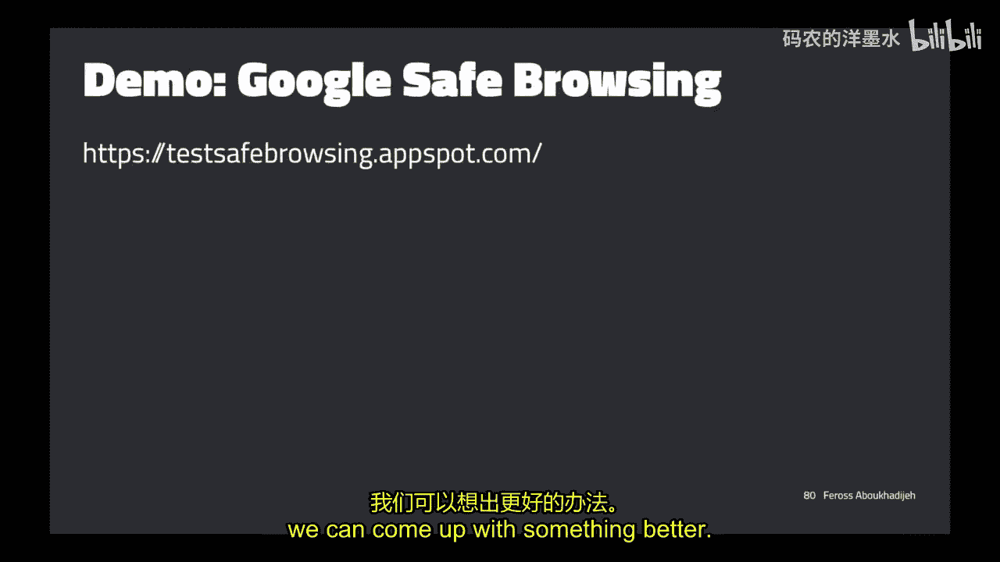

嗯。So what we can do is。Actually， I guess I was gonna show a demo of what it looks like just in case some folks haven't seen what。

 what this looks like so we can go to。

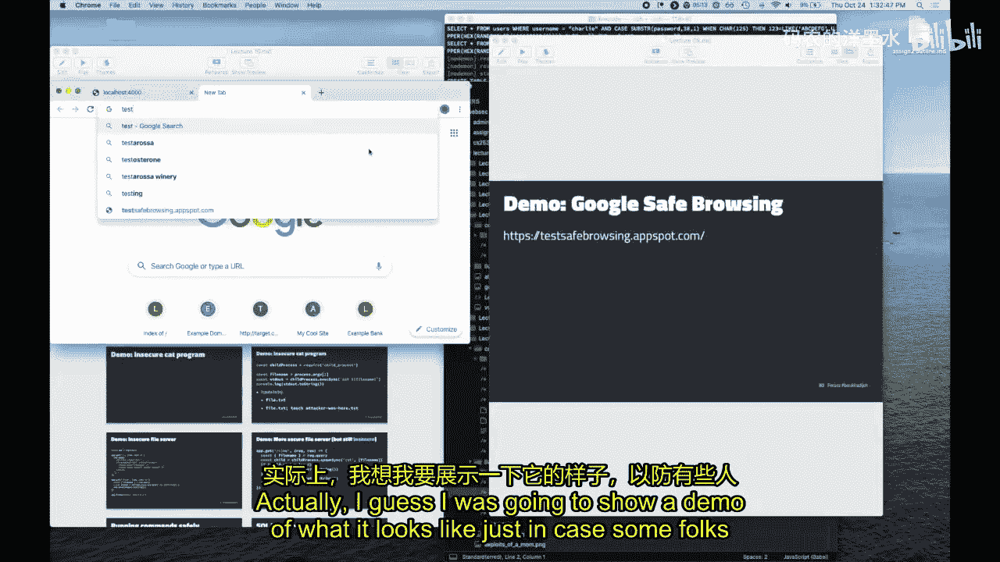

This page here。And。So these are just various types of warnings that the browser might throw up。

 So if you want to see like， this is a phishing warning。And if you want to bypass it。

 you can actually。Click that and then click this visit unsafe site link。But there's also， there。

 there's a bunch of other types of warnings you might get。 How do I go back。

So there's a hourware warning， which is slightly different。 The site of ahead contains malware。

 There's one for unwanted software。 So this is like， if。

A page is serving downloads which are bundled with other software that you might not want like software that shows you ads or software that I dont know。

 Min cryptocurrency in the background。 then you'll you'll get this warning。

 And then this is one that I think is very interesting。 this is introduced more recently。

 there are sites that try to claim that they're providing a free service。

 they might ask for your mobile number。 And then you type your mobile number in。

 And then they somehow charge your mobile number and you'll see a charge on your bill。

 because you actually agreed to some of sort of paid service。

 And then just knowing your phone number， somehow enough to get this onto onto your bill。

 And so in this situation， technically like。😊，In theory。

 you may actually want some service like this。 but if the page is sufficiently sketchy about how how it discloses this to you。

 then it gets put onto a list that shows you this， which I think is a pretty funny warning。

The page ahead may charge， may try to charge you money。 Sound really saying that， you know。

 anything is that will happen。 Just be， be aware that the claims that the service is free may not be actually true。

 But anyway， So there's these lists of URLs that we can， we can look up。😊。

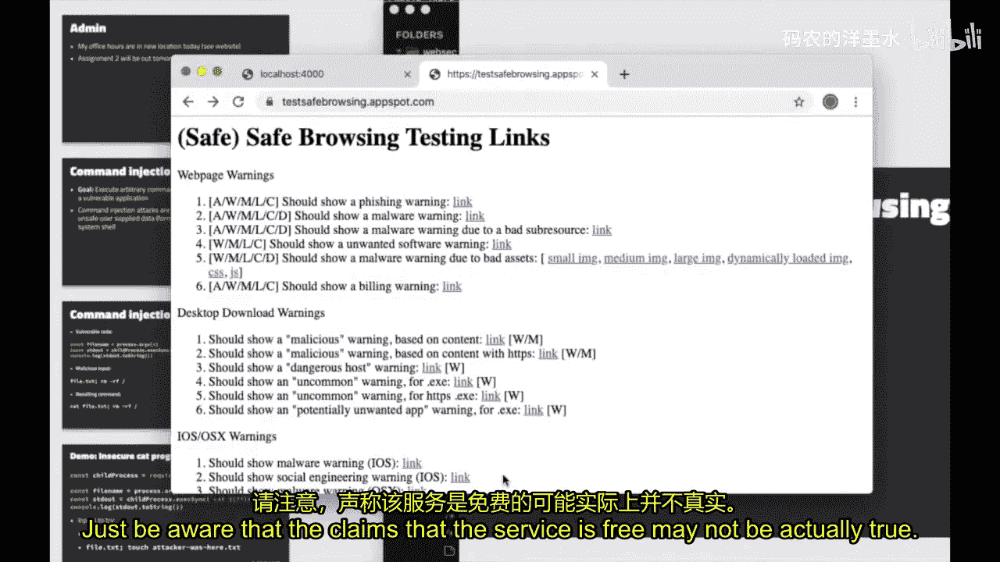

Yeah， so， so。

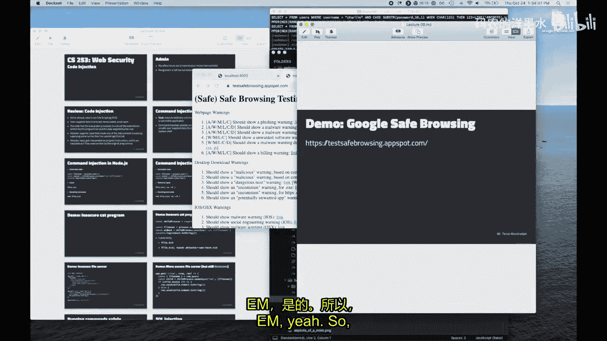

Basically， this is quite useful。 But again， we don't want to。

 to query a central service every time we， we need to look this up。 So there's a better way。

 So there's this。Well， yeah， this is actually the sort of the， the， the naive way to do it。

 They provide an API where you can literally ask it if the URL is safe。

 and it's a simple post request that you make。 and it's gonna return basically the state of the URL。

 whether it's safe or if it's unsafe and then sort of what is you know。

 why is it unsafe if it is unsafe。😊，But， of course。

 the drawbacks are your URLs that you're sending to the service sort in the clear。

 and the server knows exactly what URL you're looking up。

 And also the response time issue I mentioned where you're waiting for the the service to tell you whether the URL is safe or not before you actually start to load it。

😊，So there's a better API that they provide called the update API。

The idea here is instead of exchanging， instead of telling the server the URL， you in advance。

 download a list of hash prefixes。 and essentially。

 So what Google is doing is when it sees a suspicious URL that's reported to it。

 it will take that URL and hash it。 And I'll mention review hashes just in case anyone's forgotten。

 But basically， it produces some value。 And then it's gonna take the entire set of hashes that it's produced and chop off sort of the end half and take the prefixes and send that down to all the browsers。

 Every browser。😊，Has a list of prefixes of these hashes and what we do to check to see if。

The URL is safe or not。 is we hash it ourselves in exactly the same way that Google did when we chop off the the。

 you know， the beginning and just take the prefix and we look and see if it's in the list。

 And if it's in the list， then it means that。😊，It may be unsafe， but it may not be。 And so let me。

 let me just go go through， walk through what what what it will look like。

 And we can see what actually is going on here。should I should have done this in another order。

 but yeah， so let's quickly review cryptographic cacheh functions。 just just so like I can good idea。

 raiseise your hand if you're familiar， with this concept。Okay， there's still a few people because 1。

55 is not a prere for this class。 So I'll just quickly review this。

So it's an algorithm that can take data of sort of any size。

 You put it through this function and out you get what we call a hash value and。

We want certain properties from hash functions in order for them to be useful to us。 So。

 so one thing is we want them to be one way。 So we we want。

Given sort of the hash value that comes out of the function。

 you can't very easily get back the value that was passed in to to produce that， that value。

 So there're one way。And we want to be， we want to be the case that if we hash the same value twice。

 we get the same hash value out。And then。We also want to be relatively quick to compute because we want to be doing this operation relatively often。

 And we also don't want to be possible to， to come up with an input that produces a specific hash value。

 And lastly， we， we want sort of a small change to an input to cause a ginormous change in the output。

😊，So。These properties are are producer or a primitive。 that's quite useful。

 So let's see how we might use this in this protocol here， so。So first step is the client。

 this is your browser， is going to make a request to the Google Safe browsing service and ask for a list of these hash prefixes。

 It's going to get them back so。😊，These are， remember， these are basically。

The beginning part of a hash that is a hash of a suspicious URL。

And so we're downloading a bunch of these now。And。Remember。

 it's possible that multiple suspicious URLs have the same prefix。

 And it's also possible that non suspicious URLs have the same prefix。 right。

 We've lost some information by chopping off the last part of this hash value。 but that's okay。

But so now we have this list that I'm， I'm drawing it here as a box sort of indicate that it's we're gonna be able to query it from the client。

 But this is sort of this is on your own computer。 This is part of the browser。 this。

 this hash prefix list， this is sort of locally available to the browser。

And so now we want to ask the question， is a particular domain safe or in this， in this case。

 it's a domain， But yeah particular URL， is it safe。 And so we put the。

 the URL through a hash function。 In this case， shot 256， and we get out of value。

 And now we're going to chop off the same sort of prefixed length that Google did when it provided us this initial list。

 And we're gonna look and see if it's in the list。 And so let's say that it's not in the list。😊，Well。

What do we know now。The deal was， Google gave us this list of every prefix of。

 of suspicious URLs that exists。 So if we look up a specific prefix and it's not in that list。

 then we know it's guaranteed to be safe。😊，嗯。😊，Or you're going to answer the question。Sorry， yeah。

 yeah， so this is sort of guaranteed to be safe because it's not in this list。😊，Cool。

 so we know sort of quickly that it's safe。 And so we can just in， in the， in the normal case。

 we can sort of quickly go ahead and load the load the URL that the user requested。😊，Great， now。

 what about in the case where it's not safe。 So we have the same question is， is it safe， We we。

 we do the hash， We ask about the prefix。 And this time。

 we find that it is indeed in in the prefix list。 So now we know it may be unsafe。

 So what do we do now。😊，Well， yeah？野きさんの。We could send the full URL to Google。 Yeah。 but remember。

 there， there is the potential that like a safe URL actually has the same hash prefix。

 And so when that happens， we'll be telling this the sortll be telling the Google server the exact URL that we were attempting to visit。

 So we can do slightly better than that。😊，We'll just send Google the prefix that we that our URL that we're attempting to visit starts with。

And then it will send us back the entire sort of full hash list where all these hashes that it send back have the same prefix that we asked about right。

 And so now we can take the full hash that we got out of our Sha 2。

56 function and compare it to this list。 And if it's in the list， then we know that it's unsafe。😊。

So how now you have this new list， We ask if it's in the list。 And then let's say in this case。

 it's not in the list。 So now we know you know， hurryay， we have a safe URL。Cool。Yeah， sorry。

 So is the advantage of using this patch prefix list just that it's much smaller than a you。

All of the URLs or something。Yeah， I think that's so your。

 I guess the alternative is you could download the entire sort of list of of hashes。 And then it's。

 it's gonna be a little bit big。 Yeah， that's sort of the main advantage here。

 The downside of this is， I don't know if you could start to see， But basically。

 we are kind of leaking some information to the central service。

 Like it knows that we visited a URL that starts with this particular prefix and。😊，You know。

 so it knows it may be one of these， it may be one of the URLs that produce these hashes that it doesn't know about。

 It could also be some other URL that that the service doesn't know about as well。 But， you know。

 maybe over time， this service can start to sort of if it wanted to。

 if it was behaving maliciously sort of pay attention to the requests that come in from。

 from your particular IP address and sort of to learn over time the kinds of things you visit。Yeah。

Cool， and then so let's see what happens in the case where it's not present。 I mean， this is。

 this is pretty straightforward。 So if it is， or sorry， if it is present in this list， then。

 of course， now we know that we， we indeed have， have an unsafe URL。 and we。

 we want to warn the user。😊，음？Wailist。Because how does the。Sa browser。ニすけ。Yeah。

 that's a really good point。 I think， I think it's a trade off where， I mean， if you attempted to。

 to。If you attempted to have a whitelist approach to sort of the URLs you're willing to visit now you。

 you're gonna have not only will be pretty large， but you'll also sort。

 you'll never be able to visit a URL that the service hasn't seen before。 So it be kind of， I mean。

 it may be actually good idea if you're really paranoid。 and you have like you know， I don't know。

 reason to be， to be paranoid or something like that。 but。Yeah。

 I think the trade off here is that like。You know， there's URLs that all the time that are sort of dynamic。

 Like you can imagine a URL of the query parameters that that are like haven't been seen by the service。

 You can imagine even know another example would be some kind of a document where like a Google doc where you have the parameter indicating sort of a key that makes so that only people with that key can be the document And for those types of URLs again。

 like the service would not have seen those before。 But yeah is it is really good point though。

 This is this is an approach that is guaranteed to miss some cases。 yeah。😊，M does Google get。

So I think they the main way is people just report URL is like in Chrome， you can just。

 if you go to a suspicious page， you can report it as a phishing page。 And I think they also， I mean。

 they have， they have like a search engine crawler that's just constantly going around the web and one one thing that they do do is they have sort of。

Effectively， imagine like a VM running like。A really vulnerable version of windows in it。

 and they when they see a URL that may be suspicious。

 they'll open up like Internet Explorer unpatched or something in that VM， visit that URL。

 and then just see what happens to the computer。Basically and so they can sort of see what is this site going to do to the computer and if it's not in a pristine state after visiting the page。

 then they can say okay this is a suspicious site like it cause damage to this computer and then you can also imagine doing this for sort of every site that has downloadable files like if you see an executable file like maybe a program。

 you just download it and you run it and just observe what happens to the computer and again you can sort of see patterns of the types of things that malicious programs would do。

😊，And so that's another way they can add a lot of URL elses to this list。Cool。Any other questions。嗯。

How far is it for Mellyious sites to？ToRandomly generate URLs together。Yeah， yeah。

 So that's another great point。 I didn't put in the slides here。 So you're right。

 Like if all it takes， to avoid the list is to just tweak the query parameters in the URL then you can imagine the site would just sort of generate random query parameters all day long。

 And so actually when you send when you send your when you look up your hash prefix。

 you're not just hashing the URL that you're on。 youre sort you're actually transforming it in a couple of different ways and you're hashing all of those。

 So like one thing you'll do is literally just check the homepage and see if that's in the list right And then you might also check like say you're on slash a slash B slash C。

 You might decide to chop off the C and try checkinglash a s B。😊，And then again。

 you might just check slash A。 And so there's a sort of algorithm that you can look up if。

 if you Google this and look up their docs， and you can sort of see the general categories of Us you check。

 But you are checking like around 10 or 20 different sort of variants。

 including the sort of homep page。 So if the homepage is reported as malicious。

 then you won't be able to go to any URLs on the whole site。

It's really hard to like randomize the URL。I mean， you can buy new domain names。

 but now there's at least a monetary cost where you have to like be willing to at least spend what 5 bucks to like。

 you know， keep buying new domains。Yeah。Gong。Alright。 So， so yeah， So's， that's really useful。

 So we we we sort of this is like sort of a defense in depth。Approach。

 you can think of it as sort of an extra layer of defense if it doesn't work。

 hopefully the browser still， you know， excuse me。 Hopefully， the browser still protects you。

But it's nice to have。Okay， so now I want to talk about side channel attacks。 So。

 so these are really cool。 So these are attacks where you， you。😊。

You have a system that's functioning correctly。 Like it's following the implementation， like。

 there's no implementation bugs。 but yet， it still somehow leaks sensitive information。

 So it's almost like it's， it's。There's nothing wrong with the lines of code that the programmer wrote。

 but yet。In， in practice， in the real world， there's something wrong with how assistant system behaves because an attacker can learn information that they shouldn't learn。

 Okay， so， so so common examples of， of things that can cause side channels。

 side channel leakage is timing things， right So if， if， if。

 if something takes a certain amount of time in one case and a different amount of time than another。

 but。😊，The system is like， sort of not revealing。To you。

 it's trying to sort of hide the difference between these two cases， but it takes different time。

 and you can measure the time as an attacker。 You can figure out what case the program is in。

 And let's just go into an actual example here to， to see here。 So this is okay。

 so I have an example that is that is very much not related to Web security， but it's really cool。

 So I thought I would show it。 So this is a side channel attack that you can that these M T researchers show that you could do in the real world。

 So let me set up the sort of threat model here。 So， our goal is we're trying to build a system。😊。

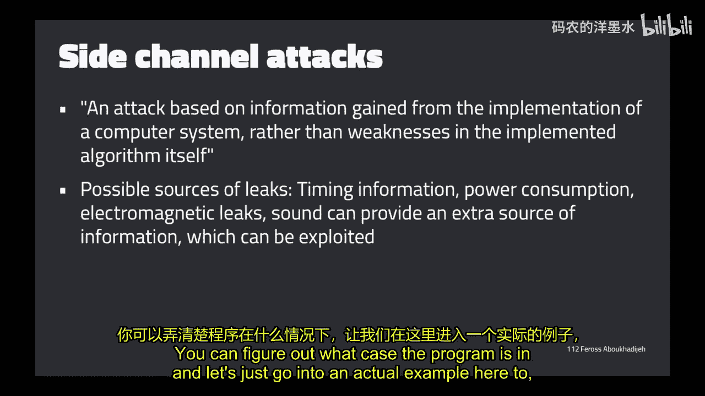

Which we're trying to build a room。 Let's say， like a room where when we're inside it。

 we can talk and we can have a really secret conversation and。😊，Outside the room。

 nobody can hear what we say。 Okay， so our constraints are， no sound should escape。Right。

 so today we would decided we we we find this like really nice glass material。 Okay。

 it's really thick。 And so we make a room out of this glass。 And we say， you know。

 with our engineering hats on， we say this room is impervious to sound escaping。

 So we go inside the room。 We shut the door。 We talk inside。 and it's true。 No sound is escaping。

 We have succeeded as engineers in making this room。 You know， impervious to sound escaping。

 But we made it out of glass。 So the attacker can see through。😊，The glass。 And the question is like。

 is， is that a problem。 Well， we designed it so the sound wouldn't escape。 And。

 and so now the question is， can we somehow use the fact that we can see into the room to。

 to learn what conversation is going on。 And so in this research paper。😊，Here。

 I'll just play the video。 It's it's an amazing video。 I， oh， that's the problem。

 though I don't have an audio cable。 So I， I will have to just turn up my speakers and hope for the best。

😊。

Okay。When sound hits an object， it causes that object to vibrate。

 the motion of this vibration creates a subtle visual signal that's usually invisible to the naked eye。

In our work， we show how using only a video of the object and a suitable processing algorithm。

 we can extract these minute vibrations and partially recover the sounds that produce them。

 letting us turn everyday visible objects。Visual microphones。In the silent。

 high speed video shown here on the left， we see the leaves of a potted plant shown on the right。

The video was recorded while a nearby loudspeaker played the notes to Mary had a little lamb。그 응 거。

Even when we play the video in slow motion here， the vibrations caused by the music are so subtle that they move the plant's leaves by less than a hundredth of a pixel。

 making the plant appear still to the naked eye。But by combining and filtering all the tiny motion happening across the image that you see。

 we are able to recover this sound。😊，哦。In our next experiment。

 we recovered live human speech from high speed video of a bag of chips lying on the ground。

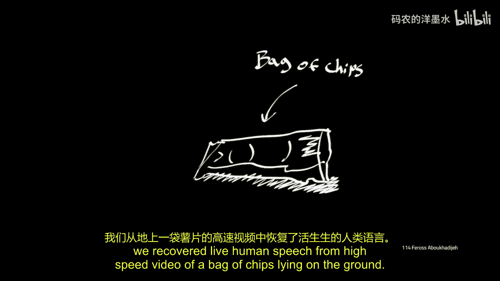

But to make things a little more challenging， this time we put the camera outside behind a soundproof window。

This is what a cell phone was able to record from inside next to the bag of chips。

Mary had a little lamb。Slece was let us know。Everywhere that Mary went， that lamb was door to go。

And this is what we were able to recover from high speed video filmed from outside behind soundproof glass。

対でね。没有人。あから。In this next。 So yeah， I could keep going。 But I think， yeah， it's pretty crazy。

 I think the next thing that we're gonna show is video of headphones。

 And just from like looking at the headphones they're able to pick up what was playing on it。

 which is， I think they're just showing off at this point。 But yeah， Wheres it， It's right here。

 we recover music from high speed video of some earbuds plugged into a laptop computer。

 Then we take our recovered sound and use audio recognition software to automatically identify the song that was being played。

😊。

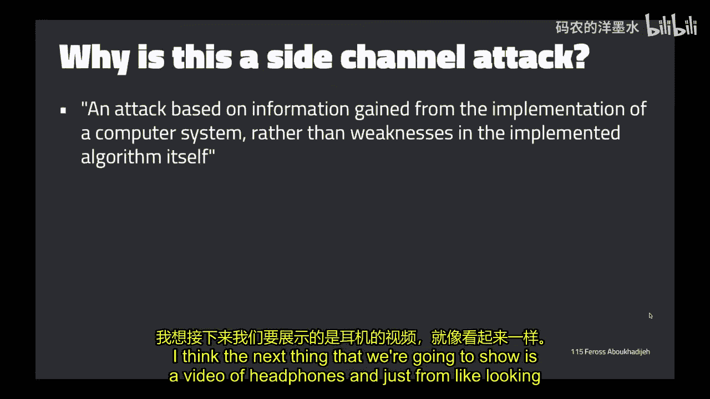

That's true。Yeah， so yeah， it's good enough for shazam。

Anyway， yeah， so this is， this is the idea of side channel tax。 But yeah。

 so we want to do this on the Web。😊，And。But yeah， it wasn't that really cool。 That was super cool。

 And there's all kinds of， there's all kinds of real world side channels like this。 Theres。

 there's even stuff where you can you can figure out what a decryption algorithm is doing based on the power usage that your computer is is like pulling from the wall。

 basically。 So you can monitor the power line。 You can sort literally like in the power levels pull the key out。

 There's all kinds of some of this stuff a a little bit like theoretical and maybe not。

 you're not practical， but there's a really cool stuff。😊，InIn this area。Yeah， but yeah。 so， so yeah。

 let's talk about one classic attack。 And this is almost。

 this is almost barely a side channel because it's so basic。

 But but this is sort of the beginning of where we'll start。

 So there was this was a sort of a really longstanding attack for many， many， many years。

 I think it wasn't fixed until 2010。 where you could literally just create a link and stick the link into into the page and then check the color that the browser rendered the link with And so browsers render visited links in purple and unvisited links in blue by default。

 And so just by checking the color of the the link。

 you can figure out whether the user been to a URL。😊，So this is like pretty bad If you。

 you can imagine like listing the top million sites in an array and then just sort of iterating through really quickly in the background。

 you can figure out what kind of sites the Caesar likes to visit。 This is really bad。The problem is。

 it seems kind of important to be able to like check style attributes of elements that are in the page。

 Like， that's kind of the fundamental thing of you know， about the way the dom works。

 So what can we do here to fix this。 Anyone have ideas。What should we do。

 What should the correct trade off be， what did what do you think the browsers did in 2010 when they。

 when they fix this。Yeah。Only turn。Click on the link。That。That that's not the way it works。

 But that's one possible solution。 And that's a really interesting solution because what you're basically proposing is you're saying。

I visit site A， and I click a link to site B from it。

 Then it's pretty obvious to site A that I went to site B。 I mean。

 they're they're already running javascript on site A。 They can see exactly what my mouse clicks on。

 they have all kinds of ways to detect what I'm doing on that site。

 And so it's we should just assume that they know I went to site B， right And so at that point。

 it's not really it's not really that bad to just rendered the link in purple because the site already knows。

 whereas if I had been to site B before I came to site A。

 Then maybe we would render the link in blue。 So there's no way for site A to no。

That was an approach that browsers considered， but they decided against it because of the usability like downside。

 basically。They thought users would be confused about why like a link that they know they've been to is sometimes blue and sometimes purple on different sites。

 And so they threw that solution out。Any other ideas？ Yeah， oh you're raising your hand。 Oh O， sorry。

Anyone have any other。Bts。m。😊，Say that again。Oh， just make the color of links unviewable。Okay。

 that's not it's not a bad idea， but with CSS， we can actually change the way that visited links look in many other ways besides color so we can write a CSS rule that says that for example。

 when a link is visited， I want the background of it to be an image。From my server。

And so now every time I visited a link， any time a link has been visited， I can。

 I will tell because my server got got a request for this background image， right。But yeah。

 that is good if we could eliminate， if we could eliminate these other ways， that that could work。

 yeah。嗯。Like making it so that after you visit a link。The attribute。

 you can have a separate attribute。is the shade。我者。This color。And then just make that one leg。H。

Could you explain more how would that work you just have like plug a separate style。

Like a separate attribute that's only like visitedor or nonvised and that one can have like a different rule for how you apply that on the client side and you can just make it so that。

I guess like。On other sites。So it could work。 But I， I think given the。

 given the thing I said about C S S rules causing， you know。

 potentially causing like an image a backward image to load， that still seems like a workaround。

 to your to your approach。 if I understand it correctly。Yeah， but， but yeah， so it's， it's hard。

 it's like a pretty hard problem。 And so let's see what they what they tried to do。 So in 2010。

 Mozilla finally， I think this was back when when Firefox was sort of。

 I don't remember when Chrome came out， but。Yeah， this was back when Firefox was was much more prevalent than even Chrome。

 So they they decided to basically the goal was they said we probably just can't fix this entirely。

 What we should focus on trying to do instead is make it a lot slower for an attacker to iterate through all these URLs。

 So you might be able to check maybe instead of being able to check 10000 URLs that a users been to per second。

 Maybe we should make it so that you can check like 10 per second。 And that will be。😊。

That will be like our defense for like their V1 attempt at solving this， basically。

So they they decided to do three things。 One is they restricted the set of CSS properties you can apply to visited links so you can't cause you can't say when a link is visited。

 I want a background image to load because that leaks the fact that that link is visited。

 you can't change the position or the size of a visited links either because if you could do that then you could write JavaScript that would detect how the layout of the page has changed when this visited link when it's visited or when it's not visited。

 you can make it like really wide when it's visited and then it will displace other elements on the page and you can find that out in JavaScript。

 right。So we just don't allow those things。 So we literally。

 they literally had a white list of like you can set the color of the link。

 You can set the like other things。 I forget underlying bold italic。

 that kind of stuff really sort of minimal changes to the text then they they also change sort internally in the browser。

 they had code paths where when you change a link from when you change the H of a link。

 It sort of goes through a code path that was really slow and people could time that and detect that a visited link。

 So they sort of tried to make their code， take the same amount of time whether the link is visited or not visited。

 And then lastly， they just。😊，This is this is the sort of obvious thing。

 the code that we had on the other page。 where you literally just check the style in jascript。

 thats that obviously is as a workaround to all the things we've mentioned so far。

 So the thing that came up with here was， let's just make this lie to the user。 So when you。

 when you ask what the color is， it'll always be the color of the unvisited links。

 So you literally can't get the true color or any of the true sort of styles of links if they're visited。

 It'll just act as if it's unvisited when you check it。 Does that make sense。😊，Yeah， okay。

 so that sort of solves that problem。The problem is that this is sort of in completele solution。

 There's many other， many other leaks that remained。 So， so I want to show a demo now of。

 of something that actually still works and。

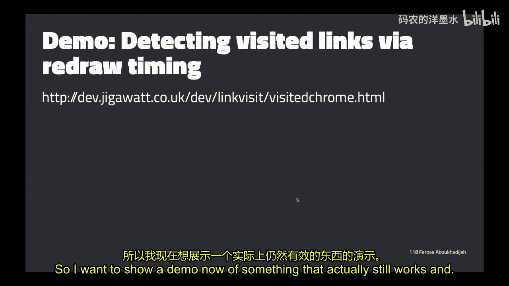

You know， it， it， it。It's kind of wild that it works。And。So here it is。So。Let's see here， so。

Let me make this window slightly bigger。 And let me see I'll do。We'll do this。

 and I'll zoom into here。 Okay， cool， so what we have here is I visited。

 I just went and clicked on a few of these， few of these links so you can see their're purple。

 But remember， again， if the site were to try and check the color， it's gonna report that it's blue。

 what we're gonna do instead is。😊，We're going to。This page is going to。呃。So。You see。

 how to explain this。We're not allowed to set text shadow on visited links。

 One of the things about text shadow is it's actually quite slow to render a shadow。 if you make。

 especially if you make the size of the shadow really big， like 500 pixels。

 because it has to sort of do do a wild computation to figure out sort of the diffusion of the shadow。

 And so like you can literally， it'll take like， you know。

 a noticeable amount of time to draw something with a shadow that big。 And so we can't set。

 we can't set that shadow on links。 But what we can do is make。😊，We can make all links。

 including like visited and unvisited， have a shadow on them。

 And then we can make a link that starts off to a site we know we haven't visited before。

 Like we make up a URL， and then we swap the HR attribute on it and make it now point to a site we're trying to query and the browser will redraw It will redraw it if its state has changed。

😊，Even though it's gonna look the same， no matter what， And we can time that。Does that make sense？

Yeah， and so， and then to make it sort of to make the timing effect even bigger。

 we're gonna put like thousands of links in the page so that the time difference will be really big when this happens。

 So let me just click click start and we'll see it happens。 So basically， what it's gonna do is。

It's timing the difference between this URL that it knows we haven't visited and this URL that we we clearly have visited because it's the URL we're on right now。

 And it's you'll notice that the one that we have visited is generally taking more time to load。

 because it's triggering this redraw。 So do you see these times here。 Okay。

 so now it's figured out has enough confidence that it's gonna try and guess which ones we visited。

 So what what it's done is it sort of decided here。

 Where does it say median visited is 216 and median unvisited is 16 milliseconds。 So basically。😊。

When we've not visited a link， it renders much faster than we have。 And so it。

 it decided the threshold to use is 1，66。 And so anytime something takes more than 166。

 millisecon is gonna assume we visited it。 And here you can see it detected。 We've been these URLs。

 It failed on a couple of them。😊，Which just shows the unreliability of this technique。

 So you can see even though this was an this was a visited link， it took 83， and our threshold is 1。

66。 So it's not perfect。 But it's， it's like good enough for fingerprinting purposes。 And if I。

 I bet if I increase the， the the tech shadow to be even bigger。

 we'd get sort of more reliable results。 But yeah， does this kind of make sense what's going on here。

😊，Yeah， pretty wild， right， it was able to sort of。I mean， it also clearly had no false positive。

 It didn't think I visited any of the ones that hadn't， I hadn't actually visited， so。

It's pretty cool。Yeah。I think this is an implementation specific thing in， in Chrome。 So basically。

 what's going on is when they set the Hre attribute of a link and。

It was was so it was it had a previous value that was an unvisited URL。 And we we changed the Htrif。

 And now it's a visited URL。 The browser decides to go through a codepath to redraw that link。

 and can we can tell when that happens if we had set it to a URL that was still an unvisited URL then it wouldn't do that redraw path。

 And so time the thing is how are we timing this。 We're actually doing to time this is it's using an API called request animation frame。

 which is use by video games sort draw frames into the browser And if the browsers occupy doing this redraw step。

 Then that function actually takes longer to sort of call to tell you it's time to draw the next frame。

 And so it's like as if you like lagged lag the browser and you would have had a frame skip if it was a video game but you're using it to time to time this anyway。

 the details aren't too important here。 I just wanted to show that this kind of thing is still possible because is an inherently really hard problem to solve it leaks。

😊，These kinds of leaks exist。Yeah， so， so let me continue。

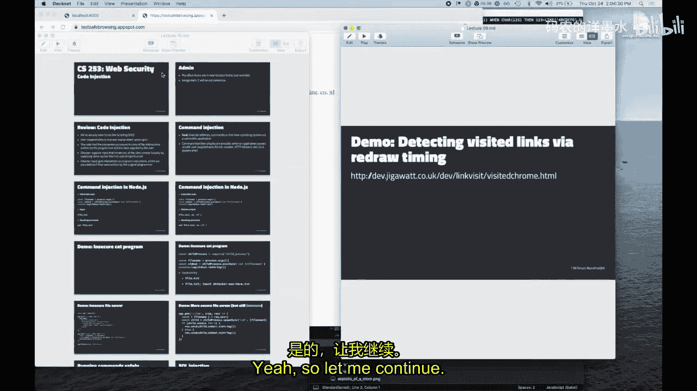

Yeah， so。So basically， yeah。 So one thing you could do to try and fix this is you could say we're gonna ban。

CC， S S properties that affect rendering speed， like like tech shadow， like even on unvisited links。

 like just just no styling of links。 Basically， This seems like a， like a bad approach。

 Another idea is to double key the visited link history。

 This is the suggestion that you made about sort of。😊，Deciding whether to draw is visited。

 unvisited based on the。The， the site that you visited it from。 So basically。

 if you go to example do com and you visit， sorry， if you go to good do com and you click a link to example dot com。

 then now example dot com will be will be visited when you're on good dot com。 But later on。

 when you go to evil do com， it will show up as unvisited。😊，よさけ。

I don't know if they actually implement。They do。Like down the line。

You don't know which browser implemented， which and you don't like sometimes you。With CS。

You don't know why it's not working。Like I really want to set the text out of my links and somehow it's just not working。

Qu star question。My knowledge of web development as a whole。Yeah， no， I agree。 in general。

 when when browsers attempt these mitigations， they'll they'll try。

 they try not to violate like outright violate a spec。 But when they do。

 they try to sort of get the spec changed so that so that sort of the ground truth is the spec。

 And you can say like， well， we did it because the spec said so but if they can't get all the other browsers to agree。

 then they may decide to just be in violation of the spec on their own。

 if they feel really strongly about their change But the way these changes happen is typically a browser will just ship the change and sort of see what breaks。

 And if like they don't get a ton of sites broken and users yelling at them。

 then they can go to the other browsers and say， hey。

 we ship this to like all our users and no one complained， like you should do the same。

 And then they have a discussion about it。 And that's kind of how things evolve。 Yeah。

 it's very sort ad hoc， yeah。Yeah， okay。 so oh yeah。 And then the last one was sort。

 if you could just completely remove the ability to style links that that would definitely fix this the spec。

And so， yeah， one other way that images can， can leak stuff is I mentioned before that。You know。

 when you， when you include an image using an image tag that the cookies get attached to this request。

 So your cookies forjima will get attached and。One thing you could。

 you can imagine is maybe this link here is is a or sorry。

 this image here is is a button that Gmail is using to to sort of show。

 it's like the button that says login。Or log out。 But the state of this image will be based on whether you're logged in or logged out。

 So they're using one URL for this image。 and they're gonna look。

 the server is gonna look at the cookie that's sent。 And if it sees that you're logged in person。

 then it will this will draw a log out button。 This will the server will turn a log out button image。

 right， And if you're。If you're， if you're。Aly logged out。 it' will show login， right。

But like say these are slightly different widths。So if if I as an attacker。

 want to figure out whether you're logged in or not to Gmail， I can embed the image of my page。

 and then I can I can detect how it affects the layout。

 So if one of the images is slightly wider than the other。

 then I can design a page where if it's slightly wider than something the layout shifts。

 and I can detect that。 And then I can know that you must be signed into Gmail。

 which might make my phishing page much more effective because I can now show you a phishing page for Gmail instead of a phishing page for some other email service So this this is a violation of the same version policy in some ways。

 because I'm learning that you're logged into Gmail when I shouldn't be able to do that。 But again。

 this is like not an intentional design decision， but it's just。😊。

We're leaking some information based on the size of the image here。

 And there's not really a way around it。All like that house。

The attacker would put this image into their attack site and then they would set up the page so that if。

 if this draws a sign in button， then they they know that it's gonna be 100 pixels wide。

 And so some text that maybe they put some text over here next to the image， right， And when it's 1。

20， it shifts the text down。 they can tell it that happened。 they also need to know。Like。

 isn't this an nature？If they're going to put this image on their website。

 don't they also need to see， like， isn't it dependent on whether their user is actually sign in and therefore will they need to know the cookies？

So remember the way that the browser attaches these cookies is when this request is made。

 it's gonna just automatically add cookies to the request。

 So if the user has cookies in their browser and this request is going to this origin right here。

 then the browser is gonna just add the cookies to it。 Yeah Now， remember， again。

 I keep keep coming back this。 But same site cookies are really good because same site cookies would solve this problem。

 if you had， if this was same site cookie， then it wouldn't get attached to this request and it would always appear signed out when the attacker embeds it。

嗯。They can also just。So remember the attacker here is making a site like attacker do com。

 And they're trying to get a victim to visit it。 And so the victim that visit visits it is los into Gmail in their browser。

 And so this code is running on that victim's computer。 And so we really need our jascript。

 our attacker jascript to be able to look at the size of the image on that particular victim's browser。

😊，Yeah。Yeah， this is， yeah， yeah， exactly。Okay， cool。 So yeah， So again。

 And so just a few more sort of recent examples of， of， of side channels。

 And then we're gonna move on to， to our next topic。 But these ones， I think are just。

 just also just really cool。 So this is， there's an API that lets you detect the ambient light in a room。

 And for a while， this was。😊，Planning this the browsers were planning to just include this as an unpermissioned API so that any site could just sort of ask like what are the light conditions in the room right now。

 I idea being maybe that like if you're in a dark room。

 they could show you a dark theme or something And if you're in like a bright room。

 they could change the U I to make it brighter。 You know， native apps can do this。

 your iPhone apps and your Android apps can detect the the ambient light in your room without any issues。

 They just call an API and they get it。 So why shouldn't a website be able to do that's the idea。😊。

But。Detecting whether the user in a dark basement or in like like a bright outdoors place can actually cause some some issues。

 In particular， we can distinguish between the color of of a user's screen。 if they're in。

 if they're in like a dark room， if we put like white on the screen。

 we'll be able to pick that up with our ambient light sensor。 if we put black on the screen。

 we'll be able to pick that up or even， even colors are are picked up by the ambient light sensor。

 And so。😊。

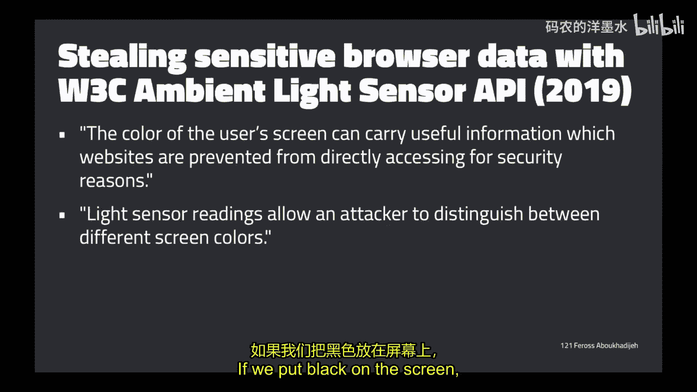

Here's a video of a really wild use of this to detect someone's browser history。 So what we're doing。

 what's going go on here is。😊，They're going to show a white。Page。

 and they're gonna then wait a second and then read the sensor and see what does the ambient light sensor say about the conditions in the room right now。

 And then they're gonna show black page。 And they're gonna read the sensor again。

 And that's how they're gonna calibrate and know like what。

The ambient light sensor reading is gonna be in both of those cases。

 And then it's gonna draw a link on the screen， and it's gonna use C S S and say。

 if this link has been visited， I want to have a black background。 And if it's not been visited。

 I want to have a white background。 And then just gonna read the sensor reading out。

 And then they're gonna be able to sort of iterate your， your browser history。 So let's see it。😊，Oh。

Here we go。Okay， so。Yeah， it's just going through like some different sites it wants to know if you visited。

 and it's just like looking at the light conditions in the room as it does this。And eventually。

 it will just tell you which。Yeah， these are the URLs you visited。So， you know。

 you might say this is not very practical。 It's sort of taking up your whole screen。

 You're gonna see that it's happening。 You， but maybe maybe you could run this code when you step away from your device。

 you know， when， when your device becomes still， they can sort of just say， okay。

 go for it now they're not in the room。if you constantly browseze something ni on you。

Most of these attacks just failed。Yeah， all the ones that involve your browser history。

 like if you're if you're。嗯。Well， you know what， no， not if you're all in one incognitive session。

 I believe the that the way that incognito works is it doesn't actually clear your history until you close all incognito windows So。

 but yeah， in general， in incognito when you visit a slightly wall。Change the CSs form。

Or like how it using light to detect it if you're in the same e session？

II think I think that if you're in the same incogni session。

 everything you visited in that session would all those links would still render as visited。

 I believe。But unlike 100% sure we'd have to look that up。Yeah you click？Okay， so basically when。

When。sorry， my shortcuts aren't working here。Okay， yeah。

 so I can't remember if it's white or black that's visited or not。

 but let's say that let's say this this rendered is white because we wrote some C S that says anytime there's a link that we've we visited。

 we want to have a white background。 and otherwise， it should have a black background。

So while we're showing this link on the screen。There's code that's looking at the sensor reading。

 and it's going to get a value back between 0 and1。 That's how bright is the room right now， right。

 where one is like the most bright。 And so。In that calibration step we did before。 we。

 we determined that like when we showed black on the screen， maybe it was 03 brightness in the room。

 And when we showed white， it was like 0。6。 And so now we know like roughly。

 whenever we see a value that's 06， we know that white must be shown on the screen right now。

 And so this page would not be able to just ask what is the color of the of this link right now because it can't do that。

 But what it can do is read the sensor reading and know that it must be displaying as white。

Because it's， it's getting that from that sensor。 Does that make sense。

So it's a violation of the same origin policy。 We shouldn't be able to find that out。

And then here's a， here's an even more。Potentially insidious examples。 So， so what they。

 what they're doing here is this， this is an image of a。Let's see here， me。

Let me see if this is actually what I think it is。Yeah， okay。

 so basically what's going on here is there is a URL to a QR code。

 And this QR code contains sensitive information。 It's like a key or something， right。

 And were allowed to embed this QR code image in our page because again like images。

 you can load images from any site right， And the cookies are gonna get attached to it。

 So we get this image。 It's in our page。 But we're not allowed to read it as an attacker。

 We can't ask， we can't query the values we can't get the pixels out of the image。

 But what we can do is we can center we can zoom into one region of the image。

 And since it's a QR code， we know exactly how the image is laid out。

 It's gonna be a set of pixels so we can we can put the image in the page。

 and then zoom it in so much that the whole screen is occupied by one square of the QR code。

 And then we can measure the light in the room and we can get the value of that square。

 Is it black or white。 And we can iterate through all the pixels and then reproduce the Q R code without being able to actually read it。

 And that's what this is doing right now。😊，As it goes through it， as it detects the value。

 it sort of updates this little map down here of what it's read out of the Q R code。

I just think that's so cool。 Somebody thought of this and like wrote and code this up。 again， like。

 I don't know how practical this is。 but that this is。

 this is actually this gave gave browser renders enough pause that they're like reconsidering whether to actually ship the ambient light API now or whether to maybe do some do some。

 some steps to， to potentially make it less precise or something。😊，questions about these。

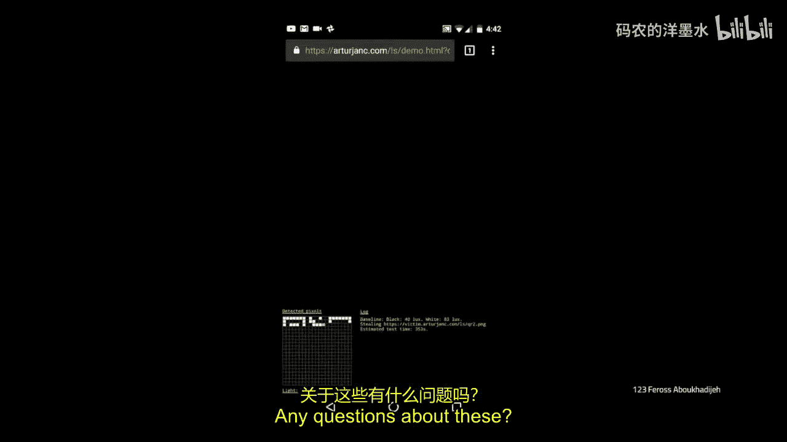

Cool， okay， so yeah。 So here's another one。 This one came out of Stanford in 2014， so。😊。

A very similar sensor API， the gyroscope API lets you detect sort of the。You know。

 the orientation of your of your device。 And that was an API which did ship was shipping for a very long time。

 and sites could just call it without any permission prompt。 and basically。

They figured out that the gyroscope was so， was so so precise that you could actually pick up acoustic signals。

 And even if a site doesn't have microphone permission。

 just based on the way that the phone is moving， you can pick up what's being said in the room and reproduce it。

 which is completely wild。 Yeah， And so the key point is that since ios and Android require no special permissions to access the gyro。

 That means that any arbitrary website you're on， could could could read the gyro and then figure out。

😊，What's being said in the room and eavesrop on speech in the vicinity of the phone。Yeah。

 pretty well。 So so I think in ios 13 or maybe it was ios 12。

 the gro the gyro API is now behind a permission flag。 And so sites can't just read that anymore。

 which is sad because as we， as we keep locking up these API， it means that， you know。

 somebody who made a really cool demo of know website that you know， changes based on your， you know。

 orientation， that's broken now， right， but。😊，诶。But yeah， I dont tradeoffs。对啊。Cool， so yeah， so yeah。

 these， these attacks may not be practical， but， but therere。

 there're still technically violations of the same origin policy。

 So we should kind of worry about them and and， and maybe think about whether。

We want to allow that or not， and then some mitigations might be able to limit the frequency of sensor readings or to maybe just make the precision of the sensor output quantized so that the user of the site can't get as much signal out of it。

And so just to conclude the this stuff on， on side channels and on， on。This kind of and fishing。

 So there's a tension between security and capabilities of the web browser。

 Fishing is a human problem and side channels are everywhere and really hard to prevent。

So I'm going to go now to。Any questions before I move on。Okay。

 I'm gonna go on now to the actual topic of today。 now we're switching。 we're switching from from。

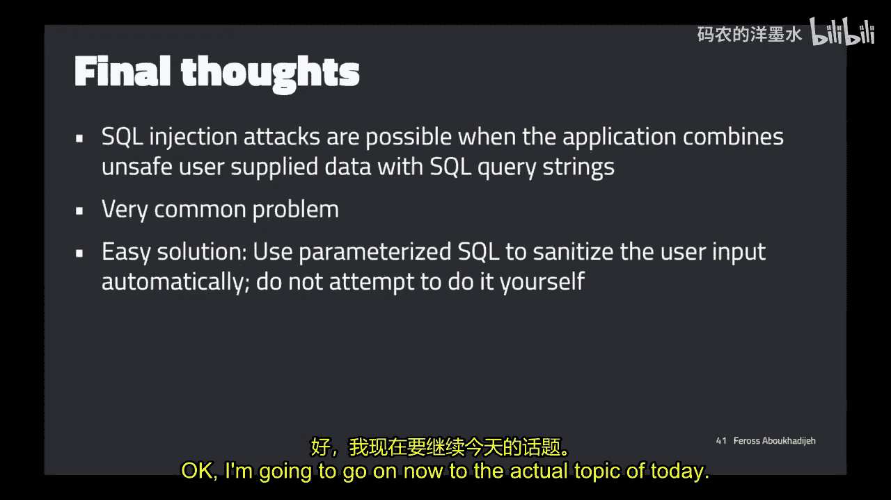

W， why am I， Oh there we go。 Yeah， I're， we're switching to code injections。

 So we're switch to server side stuff。 Yeah， question about。

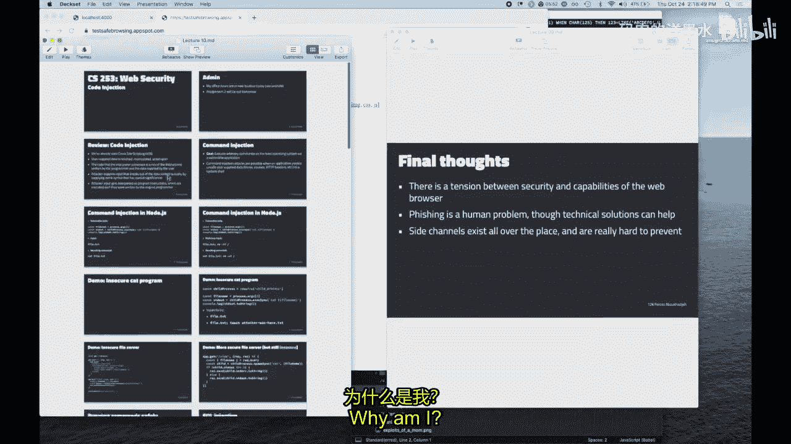

The gyroscope if。You pretend it's a game and like。You need the Drsco to play the game， but it also。

Listen for啥。So it doesn't really help anything。嗯。Yeah。

 but you can at least make it so that when you're reading a news article。

 it's not like using the gyro， but yeah。Yeah， you， you're totally right。

 I mean that's that that's also a problem in native apps， too， though。

 where a native app might actually have a legitimate reason to use your location like say it's a navigation app。

 right， But then it also turns out that they're using the navigation data everywhere you go to target ads to you。

 And it's like， I proved my location for so I could navigate around not so that I could have this other use of the data。

 But like once you've approved it。 I don't know how you。😊，Ho。Control what it's used for。嗯。Yeah。Cool。

 so let's move on to code injection。 So this is， this is now we're shifting from the client side to the server side。

😊，And so this is a whole type of new kind of attack。 So code injection。He is really cool。

 Co injection is。Is similar to we've already seen crossite scripting。

 That's one example of code injection。The broad idea of code injection is， again。

 we're combining user supply data that we can't trust with code that the programmer wrote。

And when the code that the interpreter processes is a mix of these two things。

 then it might basically it might get confused and treat the attacker supplied input as a command that that our programmer wrote you know。

 So it has no way to distinguish what is user data and what is a command that we actually want to run。

 And that attacker often does this by breaking out of the data context using a quote or something like that。

 some kind of special character， some special syntax。 And now their their writing code。😊。

And then the attacker input gets interpreted as program instructions。So let's just review。 So。

 so we're gonna talk about one specific kind to start off with。 So command injection。

 So command injection is。The goal of the attacker here is to execute arbitrary commands on the operating system that the server is running on。

When we do command injection， we're going to。We were be able to basically run effectively shell commands。

 terminal commands on the server that we're tacking。

 And this happens again because we got some kind of untrusted user data from some source。

 it could be somewhere in the URL or a cookie or anything where the client sends data to the server because remember。

 the client can include whatever they want in their request and the server now takes that and combines it into some kind of a shell script that it's gonna run。

 And now if we do it wrong， we're gonna have the attacker controlling what what shell command we run。

😊，So let's look at an example。So， so here we have some vulnerable code。

 So we pull out the first argument to our to this node program。 So this is not a web example。

 This is just like a script， just a simple script。 So we're just going read in a file name from the command line。

 And we're going to produce this command here。 So we're going to cat the contents of whatever file the user typed in。

 And then we're gonna log log it out。 So if we， if we type in file thatt text。

 then the command that we produce here is going be cat file thatt text。😊，Great， it works perfectly。

 right， It's gonna count the file up。 But what happens if the user types in this as their file name。

Okay， so。You know， it's going to do a straightforward substitution。

 And we're going to end up with two commands separated by semicolon， which in shells is。

 is the sort of。Statement Terinator， and this is actually going to run a separate second command。

 and yeah， we're going to lose all our files。Yeah。So， not good。So let's see this in action。

I'm not going to hire MR my computer。But yeah， well let's see what we can do here。嗯。Alright。

 so I'm just gonna。Okay。Okay， there we go。 Allright， why is it doing that highlighting， Sorry。

 I need to just turn this off really quick。Okay， there we go。 Think that worked。 Okay， so let's pull。

 pull in the file name。 I already have already wrote this code on the slide。

 I shouldn't be typing this up。 This is， let me just copy it out of the slide to get us going here。

Cool， okay。So。There we go。 And so now， if I actually。Go here， and I run。Cat JS。

 and I say file out text。It's going to print out some text， hooray。'm caught now if I。

Let's see what's the command I can do that won't destroy my computer in front of you all now。LS。

 yeah， okay。Wow， that's cool。 It worked。 Yeah。 So it L S， and then it printed out the results。

 Another thing you can do is if you want to creep out the person who's running the servers。

 you can say hello， server operator。😊，Hello， server operator。Yeah， yeah yeah。Another thing。 yeah， So。

 it' clearly working。 Yeah， so let's， let's， let's see what， what should we do here。 So。

 so here's like a more， a more realistic way that this might actually be used in a Web app。

 So we might have some kind of an endpoint。That comes from express。 So we're， we're gonna。

Make an express app。 And then we're gonna create a route。 And let's say that we have like home page。

 and。The homeage。I is going to have a form that lets people look up files， So we need to send back。

Some HTMLl。We'll call this a file viewer。And we'll。Let's see here。 we need a form。

 And the method is gonna be， let's do get。 And we're gonna make our action be another route that we're gonna to implement called view。

And。This form can contain two inputs。The first will be a file name。And。

The next will just be a button that we can push to submit this。Cool， so if we do that。

 and then we now implement that route。Slash view。And we make it just pull the file name property that's going to come from the form off of the query object。

And then， we。Get the standard out。Childprocess do Exec syncync is the way that you run commands。

 and we're going to be naive here and just sort of stick the whole file name directly into this command。

 and then we'll send the response， we'll send the standard out back to the user so they can see the contents of the file。

Okay， and then I can delete this code down here， and I can also。Start the server up。

And since I'm worried that one of you all is going to make a request to this server。

 I'm going to ensure that it can only listen on my local interface。

I don't want to receive any requests on the server。 In fact， I should probably walk out。 No。

 it's fine。 okay， so。😊，So now let's run this。 Okay， and if I go to my browser now。And I。Make request。

To the homepage， we get this file viewer interface， which is excellent。 Okay， and then I can。

Type in file dot text， and it's gonna serve me the file。 Co。 yeah， So again， So this is web exposed。

 The client is is controlling what's entered into here here， into this， into this input here。 So we。

 we can't trust it。 You know， they can do things like。😊，Make a file called you know。

 a attacker was here。Which should be a very disturbing file defined on your server。 Yeah， so。

 so that that outputted this， But then it also created a file in the server。 So if I， if I L S now。

 oops。

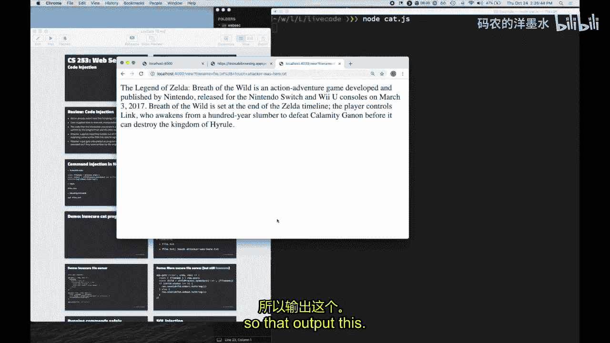

For LS now， we're going to see a attacker was here exists。 Yeah， so not good。Yeah， so， so let's。

 let's fix this up。 So what we need to do is we need to， where's the， where's the file。 Here it is。

 What we need to do is not just blindly concatenate the the user input into this command that we're gonna run in our shell。

 We want to escape it correctly。 And so for that， there's a different function we need to use here called sponsoring。

 And this is gonna be different depending on the programming language that you're using。

 But the key idea is you don't want to be producing a string that's a combination of commands and user input。

 You want to。😊，You want to use a function that can go ahead and escape the user input for you and produce a string that is safe。

 So what we do is we change this and we say， cat is the name of the program we want to run。

 And then we give an array of arguments like this。Let me see， does this make sense to people。

 what's going on here？So。We're telling it very explicitly， run cat。

 And this is an array of arguments。 And now this sponsoring function is responsible for taking these arguments。

 which may be completely untrusted， contain quotes contain semicolonons contain all kinds of attack or controlled characters and it's going to escape them and then produce a final string that it's going to run。

 And it's going to ensure also that no semicolonons are in there。

 because this sort of promises you that it's just going run cat and nothing else， right。😊。

Does that make sense？Cool， so now if I run this， let's see， do I need to restart the server。

 I think I do， yeah。Okay， so restart the server。 And now if I go back here and I。

Run the same command。 Actually， let's run a different command。 Let's run L。 S and see what happens。

Wait， what looks like you're in it。Right， yeah。That's not good。 Oh， I didn't save。 Yeah。

 I didn't save， okay。Now we're getting back an object。Interesting。Oh， I think I know what。

 the interface is different here。 So this function actually doesn't return buffer of the standard out。

 It actually returns a trial process object。 And so what we want to do is actually。We w to say。

Basically， so。We want to check and see if。The program ran successfully or if it crashed。

 And so if it， if it crashed， then it'll， it'll have a status of nonze。 And in that case。

 we want to send back the output of standard error。To the browser。 And then otherwise。

 let's just send back what we were sending before。And so child do standard out， yeah。Okay。

 so now if I refresh， we should get and more useful page here。 There we go。

 So see what it tried to do。 So it produced a effectively asked cat to to cat out a file called file dot text。

 semico and L S as the whole file name。 And so Ka tried to find a file name that。

 And it couldn't find that。 So it worked， worked as we expected now。😊，There。

 there's a huge other gaping problem I'm not going to talk about with this， this approach。

 But like what what is， what is another problem with here we haven't fixed。

 even though we've escaped the user input， yeah。D die life die die life die die die。Yeah， I mean。

 yeah， the whole， the whole thing we're doing here is kind of ridiculous thing。

 We're letting the user pick any file on a computer that they want to view。

 So it's not just letting them view the， the sort of current folder we're in。

 So I I don't know exactly what file I should type in here to show you。 but let me try like。

 let's see。嗯。Yeah， maybe we can go up and view the lecture， the lecture notes。 So lecture 10 dot M D。

Yeah， there you go。 Those are all， Those are my， those are my slides basically in text form。 Yeah。

 so basically， I mean， nothing is gonna protect you if you're。

If you're letting the user like at the end of the day。

 the command that you're producing is is a bad command that you don't want to run。

 then you're still in trouble。 But the difference here is at least now we know that they're not tacking on additional things to cat。

 That's what we've protected against。Does that make sense。Okay。こ。Nice， so basically， in node。

 of course， this is gonna be different in all kinds of different whatever language you're using。

 But there's very very similar functions in Python and in Ruby and in all the other programming languages。

 But basically， you need to know that there's usually one way to do it that's insecure where you're producing this string。

 And then there's another way where you sort give it a list of arguments。

 And then you have it to do this escaping for you。 And then you're， you're in good shape。😊。

It's an important idea here。Cool， so now we'll talk about SQL injection。

 It's another code injection attack。 It's it's sort of very similar。 All these things。 You know。

 once you learn how to do one of these things， all， they're all kind of similar to each other， right。

 you're combining user input with， with code。 and then you're。

 you're getting sort of unexpected effects。 This is the same thing so。😊。

The difference here is that we're trying to query a database。 And so this is， you know。

 you can imagine a Web app that is designed to get requests from users。

 And then it like looks stuff up in the database。 And then it produces an HTMLl page and。

If the attacker can can change what the query does， they can do any of these things， right。

 They can do anything that a SQL query can do， including reading any of the data from the database。

 modifying the database， doing administrative operations on the database。

 like deleting tables and things like that。 And even sometimes they can just shell out and actually just like run commands on on the operating system。

 And from there， they can， they can do anything。 right， They They took over the server。

 They can attack other servers。 They can steal all the data。 Its game over。😊，Yeah， so。

 so let's go back to our example of the， the bank site that we've been building and let's。

Let's see if we， So let's say we wanted to add。An actual database to it to store our users and passwords。

So we might have some code that looks like this where we're going to let the user this is the login route。

 So the user submitting the login form， and we're gonna to take the username and password that they typed in。

 and we're going to look up and see if that user exists in our database。

 So we we have a SQL query here。 and we're just going to sort of stick the username into the query。

 and then we're going to query the database。 And this function here just returns a list of rows。

 So all the rows in the database where this predicate was true。😊，Okay。

 now if there was more than one result， that means that that user must exist。

 and hopefully there's only one result， but。But yeah， basically， the user exists。

 And then at which point we may decide to check the password against what the user typed in。 And。

 if it matches， then we go ahead and authenticate them in， okay。And so， of course。

 this is vulnerable for the same reason why the command injection was we're。

 we're taking this sort of SQL query template。 and then we're sort of inserting user controlled input。

 And so， you know， in the normal case， it's fine。 know， the user types in for us as a username and。

 of course， it produces a valid query。 But what happens if the user types in for us， double quote。😊。

What is this going to do？Mmm。😊，syntax error。 Yeah， syntax error。 Yeah， you have， you have。

 you have two quotes。 It's invalid。 So one good way to test if a site is vulnerable to SQL injection is just add quotes to things。

 If you can cause an error to show up， then it means like adding a quote should not cause errors。

 It should just be treated as part of the user's input。

 If you see a different behavior when you add quotes。

 the server is probably vulnerable in some way to SQL injection。😊，So that's very indicative here。

 This server turns in error now。 So now let's say we decide to investigate further。

We need to now fix the syntax error。 We don't want to we don't want to have a syntax error that's not useful to us。

 So in SQL， there's a way to comment， which is dash dash。

 and then everything after the dash dash is ignored。 So say we changed our query to quote dash dash。

 Then now we've sort of gotten rid this this other quote here。

 and now we're back to sort of a valid query。But we didn't accomplish anything yet。 But that's okay。

 Now， what we'll do is add in a predicate， which is always going to be true。So what does this do？

This query is basically saying select any user where their username is for us or true。

 so it's going to select every user in the database。Because or true is always going to be true。

 It's gonna make the whole condition true， right？ And so this returns the entire entire database。

 And let's see， what did I do here。呃。I'mOh， right， right。 And at this point。

 there's no need to even include forross anymore。 We can just make this an empty string。

 So if we chop the forros part out， then we get just username is nothing。

 And this doesn't matter because it's always gonna， we're gonna select everything。

 So we make we have a nice little attack string here。 And this is a very， very common。

 Like this is the most common way to test if a site is vulnerable to SQl injection。

 that's the string to use。So why you。So we didn't add this quote。

 Remember the template saying that it's going insert username between this quote and this quote。

 right？ And so our string is going to get stuck right right in there， right。

 And so we don't want this trailing quote here。 And so we just do a dash dash。

 And then it makes everything after it inert。Yeah。Cool。

 so now what the server code is gonna to do is when it gets to the line here。

 where where is it this line。 So here we actually have all the rows in the database。

 And so this results will always be true。 And in this case， we can't do too much with that。

 But but depending depending on what the site does once it collects these results， we can you。

 we might be able to see， for example， what， what it actually selected。

 like see the entire user database or something like that。😊，Yeah。

And so here's another thing you can do。 So you can actually tack on additional queries if you add a semicolon。

 just like with command injection。 So this is a really mean thing to do。😊。

If you do semi quote semicolon， we've now sort of ended the username query。

 So this is maybe gonna select no users， right， you know， select the users who have no user name。

 So this is gonna be this is gonna do nothing。 But then we， we add it on。 oh， and by the way。

 delete all the users。Yeah， so this is pretty bad。Yeah， so let's， let's see some of this in action。

 So I have a little。呃。Server， I wrote here to do。To do this。 So， and I'm。

 I'm going copy some code in， so。There's， let's see here。 Oh， yeah， let's go back to our bank server。

 Okay， so we have our bank server。 and we have our users database that was an object。

 So I'm gonna go ahead and delete that， and I'm gonna add in some code for a real database。😊，Okay。

 so all this code is doing is， iss not that big of a deal。

 But what it's doing is basically we're using SQLite here。

 which is a database that exists in a file on the computer。 And it's going to open up a new database。

 And then I'm just gonna say every time you do something in the database， every time you run a query。

 just print it out so we can look at it until we know what's going on。

 And then I'm also going to just initialize the database with some data here。

 So I'm just gonna make a user' table with spots for username password and bank balance and some other things I'm gonna insert some users into it。

 And then when we close our process， I'm just gonna close the database。 So nothing too fancy here。😊。

Now， the， the interesting part。Is here。 So we're going change the way our login works。 So now。

 instead of looking up our users in this object， we actually need to query the database。

 So let's write a query。Using a string here， select everything from users where username。

Equals quotes。User name。 And this is the value the user typed into the form。 And let's make it。

 make it also match。 only match if。Their password。Is。Correct。And this database is very inecure。

 It has the passwords in plain text。 I apologize， but that's okay for now。

And now we actually need to execute this query。 So we're gonna to do D dot get query。

 And what get does is it's really nice。 It ensures that this query will only return one item。

 So if it returns multiple items， it just takes the first item that matches。

 there should only be one user with this username and password in the database。😊，Okay。

 so we're gonna call that。 And then we're going to。

 it's gonna give us a call back when it's finished getting。The data。

 And so we're gonna say if there was an error like the database wasn't working or no， no user match。

 So in other words， the row， the database row that was returned。 No row was returned。

 So in other words。It was an invalid username and password。 If either of those cases happened。

 we're going to tell the user that they failed。 So we're gonna copy this code that we used before just take say you failed to log in。

And then otherwise， they successfully logged in。 So we will go ahead and just include all this code from before。

 So well go ahead and give them a session。 I D， give them a cookie。

 and then redirect them to the home page。 So now they're logged into the bank。😊，There we go， so。

That's great。 So now we should test it， let's。Let's run。Server。What happened。misssing啊。Pen。

After argumentless on line 74。What where' is this quote。Go。Was， was it。So this。

 I you need that like that or what。Oh yeah， it looks like it worked。 Okay， cool。 Alright。

 So so go ahead and， went ahead and ran some queries because we want to run those queries to sort of create the tables and the users and stuff initially。

 And so， so now our database is initialized。 I can actually open up this app here and we can。

 we can open up the database and just look and just make sure that it worked， so。😊。

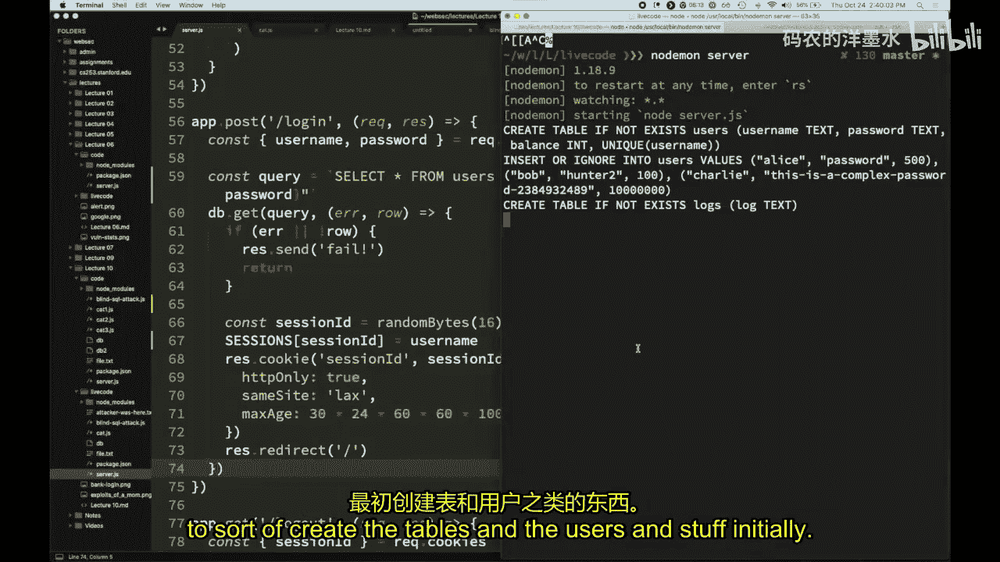

I'll just open up that database file， and we can see our users table if I browse。Browse the data。

 There we go。 We have， We have some users in our database there， Alice Bobin， Charlie。Cool。

 And then now we'll go to the browser， and we'll actually。Try to log in as Alice password。 Hey。

 it works cool。And that， that you know， that checked against the password here in the database。

Excellent。Okay， so let's log out。And let's try some other things。 So let's try a query， Bob， quote。

 space， dash dash。So if I， I hit that， what's gonna happen。Okay， oh， you know what。There's one。

 that's a bug。 There's， there's one thing I need to change。 I forgot to change one thing here。

 This should be。Ro dot username。 Sorry about that， okay。Now， if I try that again So Bob。

 quote dash dash。I got into Bob's account by typing that in。

 and I I left the password field completely blank。 So what actually happened there if I go to our terminal and I look at the query that was submitted。

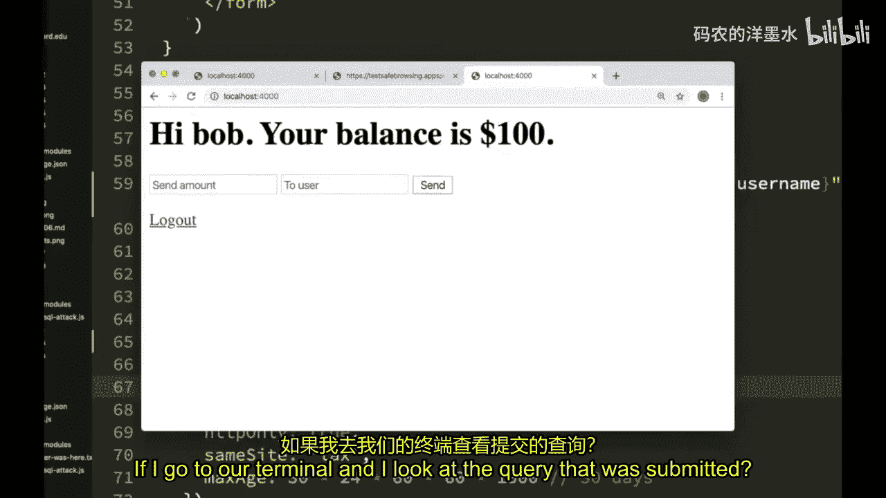

Here， let me make this bigger。 There we go。 So the query that was submitted was。Select。

Select all the columns from the user's table where the username is Bob。And that's it。Just select Bob。

And then。And I'm bought so it matched great。So that's really bad。 Another thing we could do is。

 so that's gonna log us into Bob's account。 Let's try a different thing。

 Let's try to log into just any like random account in the database。

 So we'll end the user name and we'll do or one equals one。

And so this is going to match every row in the database， like I said before。

 But because we're using D B dot get， that ensures we only select one item。

 So it's just gonna take the first user in the database。

 So this will log us into the very first or not。Oh， yeah， dash。 Thank you。 Yeah， there we go。

 So now I'm logged in as Alice。 And if we look at the query that was sent to the database， it was。

You know， very similar。 It was basically select。Where the username is is whatever or true。

 So it's going to select everything。 And we're going get We're gonna get logged in as Alice。

Another evil thing we could do is try to just log into like a user who's loaded。 so we could say。

Or balance is greater than。Anoan。And we're gonna just log into the first account。

 I need the dash dash again for the comment。 Yeah， but now if we do that， I log in the。

 to a user who is interesting to me。😊，Yeah。😊，That's cool。Okay， so that's， that's， that's nice。

 But so1，1，1 thing we can't do， by the way， is we can't actually run additional commands。

 like I mentioned before you could actually tack on additional  query queries by using a semicolon。

 If I try to do that， let's see what happens。 So I do quote。😊，Quote paren， semicolon。

 and then update。 Let's try to change some users' passwords。

 I'm gonna include a completely different query here。

 updateate the user' table and set the password to root。Where the username is Bob。

So I'm gonna try and update Bob's username here。 So does that make let me just run。

 And we'll see what it was on here。 Okay， it failed。 It didn't even， it didn't even parse it so。

Essentially， what happened is the code， the Kobe wrote here that calls get is smart enough to know that this。

 because we're literally trying to get a single user。

 It doesn't make sense that you would never put two queries in here。 So it's just protecting us。

 It's saying you put a semi。 they're not gonna run it。 The thing is， though not all of the thing。

 not all the API is exposed by this library do this for us。 In particular。

 there is one that users very may well use called exec， which does support taking in multiple。

Querries in particular， one thing that the developer here might want to do is say they want to just log every time a user attempts to log in。

 Maybe they have some security system that's gonna audit these logs。 So let's just。

 every time a user tries to log in， let's just add an entry into a table that logs the fact that they attempted log in。

 So we'll insert into a logs table， the values。And then in this case。

 we're just gonna have a single value login attempt。From。Username。Okay， so。

 we're just gonna run that sort of right away when they attempt to log in and then。

 and then we continue to do the rest of the code just like normal。 Okay。

 so now if that was the code that they had， and then I， I paste it in that。

 that same code from before where we're trying to update Bob's password。

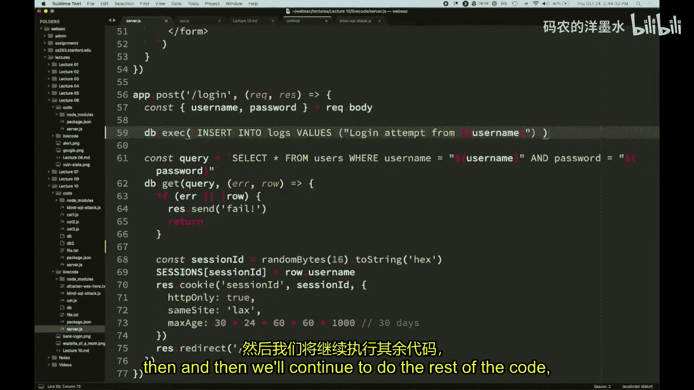

So it's gonna to tell me I failed， but notice what it did here。 So it。He actually ran。

It ran two commands， and it actually parsed them as two commands here。

 So it ran insert into logs value login attempt from。

 And then this is my username right That's what I typed to the username box。

 So it logged like it logged login attempt from no one into the logs。 And then it up。

 it sets the password to route where the username is Bob。 So I just， I just changed Bob's password。

 And so now if I， if I go and I try a login is Bob。😊，Root should be his， his password。 So that's。

 that's pretty cool。 So you can tack on additional arguments。 And then if you wanna be really evil。😊。

You， do the thing we we said before where you drop table。 So you end， you end the， you end the thing。

 and then you type drop table。Users， dash dash。Oh， thank you。 Yeah， you do that then。Yeah， so。

 so it ran two commands， log an attempt from blank， and then goodbye。

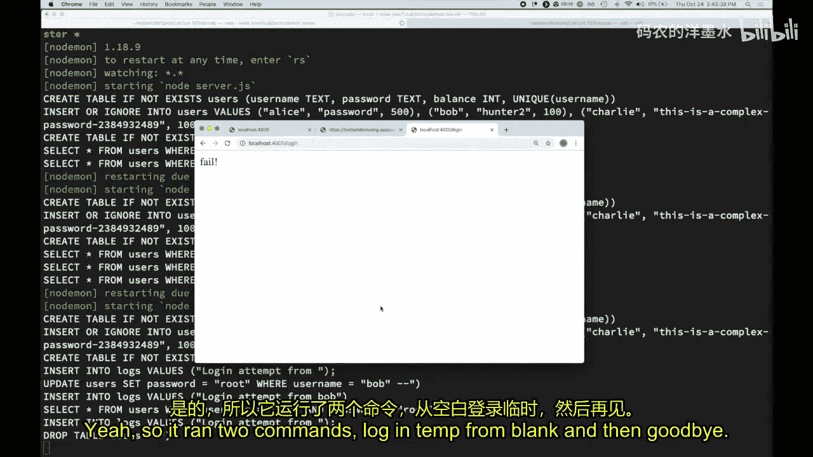

Out of business。And so now if we actually go to our， our database viewer here and I refresh the data。

 Oh yeah， So our logs just show some suspicious activity。 And then， oh yeah， we don't even have。

 We don't even have a user database anymore。 So I can't show you， yeah。😊。

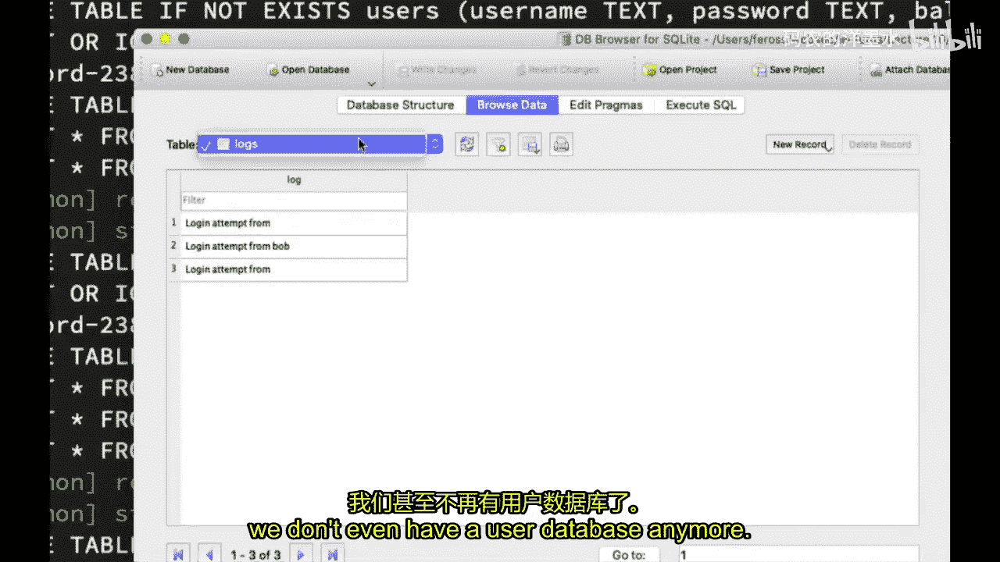

Not good。So， so yeah， that's， that's some some sequL injection。 Now， there's this classic X C。

 I have to show you， if you， if you don't not aware of this， you have to see it because it's。

 it's like cultural security stuff。Yeah， so it's pretty good。 Little boy tables。我看看。Yeah， so， okay。

 so let's see。I don't know if I'm gonna have time to explain this。 man I was have time。 I'll try。

 I'll try to see what we can get through here， so。So。So， that's sQL injection now。

In the case that we just went through here， we， we had a kind of。

 we had it kind of easy where basically， if we were able to match a particular user。

 if we were able to make the the predicate true， then we were logged in as that user。

But what if this server is vulnerable to SQL injection。

 but it doesn't actually show us the value of the query that it like it doesn't show us the result of the query that it ran。

 So we're injecting into that query， but we can't actually。

 It seems like we can't use it to sort of print anything out of the database。 It's。

 it's not getting us anything， right。There's this thing called blind SQL injection。

That lets you basically ask true， false questions。 You can ask， ask a question。

 and then you get a yes or no answer。 And if you ask enough questions。

 you can figure out like anything from the database， basically。

 But you have to be creative and patient in order to do it， so。There's two types of this。 So the the。

 the easier type is where basically you can somehow cause the page to respond differently。

 depending on if the query matched something or didn't match something。So maybe if。

 if it matches something。You know， it returns an array of things and the。

The code is expecting maybe a single value like one item。 And so then you get you get the server。

 the server crashes。 Then in the other case， the server doesn't crash。 Well。

 now you sort of know whether you match something or not。

 And you can you can tell basically whether you got an error page or whether you didn't get an error page。

 What happened， right And so so you can that query is sort of a yes。

 no question and you get an answer。 And the other kind which is even harder is you do timebased attack。

 So basically， you want to make the database pause for some amount of time when your question is the answer to it is yes。

 And when the answer to it is no， you want it to return immediately。

 And if you measure the time difference， you can get an answer to your yes， no question。😊。

So let's look at an example of this。Here we have this is our same query from before。

 And what I'm going to do is I'm going ask a yes， no question。 I'm going to say。

 so I want to log in as Alice， but I don't， sorry， I don't want to log in as Alice。

 I actually want to find out Alice's password from the database， right。

 And the thing that makes this hard is the page doesn't have a built in way of printing out like it has no functionality for printing out Alice's password。

 right so。It's hard to sort of do a sQL injection that will will cause it to print to。

 to print that out。 So what we can do instead is we sort of， we ask a question， we say。And。

We want to do a sub string on Alice's password and just select the first letter of it and say。

 is it equal to the letter P in this example。And so that's going to produce this query。

 So we're going to select。We're going select a user from the database who's named Alice and whose password starts with P。

Okay， so if this is true， then we will have selected Alice。 If， if。

 if Alice's password doesn't start with P， then this will be an empty array。

 We won't have selected any user， right， Now， I told you that the result of what we've selected is not being included in the output of the page in any way。

 right， so。So we can't actually use the result here。

 What we somehow need to do is make it when this is true， that it takes a certain amount of time。

 a long time。 and when this is false。It runs really quickly。 Okay， so how do we do this。Yeah。

 so this is what I already said here。 Basically， we can't observe the difference in the page output。

 So what we need is a slow sQL expression。 Something that just takes forever。 In this case。

 we can just make a huge blob， turn it into hex string and then uppercase it and then compare it。

 see if it see if this string is present inside this。 And then when that whole thing is done。

 compare it to some number。 If we do this， this takes like a third of a second。😊。

A noticeable amount of time。 And so then what we can do is we can use an if statement in SQL。

 We can say， basically。Take some expression。 And when it's equal to this， then we do a slow thing。

Otherwise， when it's not equal to that， we do a speedy thing。Okay， and then based on timing。

 how long it takes， we can answer this。 Yes， no question。 So let's put it all together。

 So here's what we get， we say。The question is， basically， is。

 is the first letter of Alice's password， P。If it is， do slow thing， that's all this crap。

 And then otherwise， do nothing。Okay。And then that's our query。 And so I want to run it really quick。

 and we can see what happens so。😊。

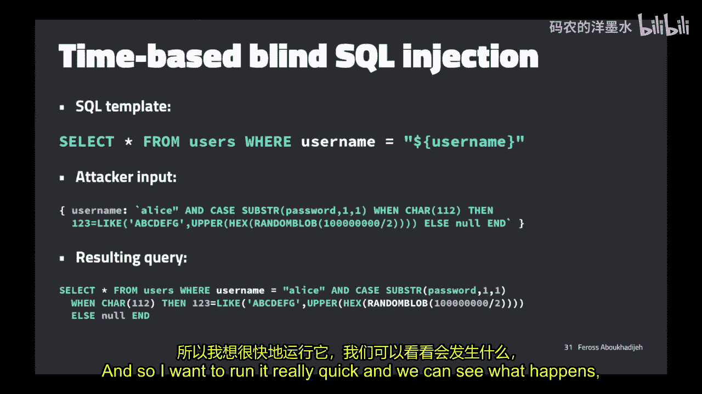

It's quite cool。So where is it？Okay。Give me one second here， okay。Alright。

 so now I go to the bank site and refresh。 And now I'm gonna to paste in this query。

 and I'm going start it with Alice okay， so that's， that's the whole query that was on the slide。

 Now if I push login。😊，That was。口てるけさ。Oh， my daily miss is empty。 Yeah， I need good point， yeah。😊。

Thank you for catching that， okay。Okay， so basically the timing here is what's really key。

 So I actually wrote a script that I can just run that will just show you this in action。

 So basically what the script is doing is it's attempting every letter。

 And then when it sees a slow response。 it knows that that it must must have been that letter。

 And then it goes ahead and tries like letter2 in the password。

 And so I can post this code on Piazza。 if you want to take a closer look at it。

 Buts it's sort of just iterating through and trying everything。 So let's let's actually run it。😊。

And see what happens。So。😊，Basically， what it's doing is it。

 it's trying every letter in the first position。 And then when， when it matches。

 it's gonna take a little bit longer。 And so the timing is on all these。

 on all the other letters that were wrong was basically instant。 And then the timing when we hit P。

 right， Where was it， The very first match was P。 So right here， P。

 This took like a third of a second。 And so we're like， a。😊，It's P is the first letter。

 And then we just kept sort of adding， you know， adding letters， trying， trying other letters。

 And then we sort of assemble the password。 And this works。 You know。

 it doesn't matter how secure your password is。 If I type in Charlie here and we do it on a much more secure password。

You'll see that， you know。There's no complexity increasing here。 We're just of。

 we're just asking about each letter。 And so， you know， just based on the timing difference here。

 we're getting sort of the whole password out。Which is pretty cool。😊。

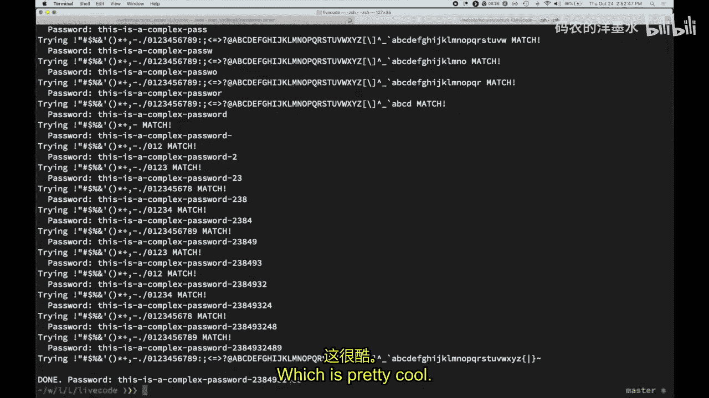

Yeah， so I think we're definitely over time here。 So thanks for thanks for sticking with me。

 and I'll see you all next week， bye。😊。

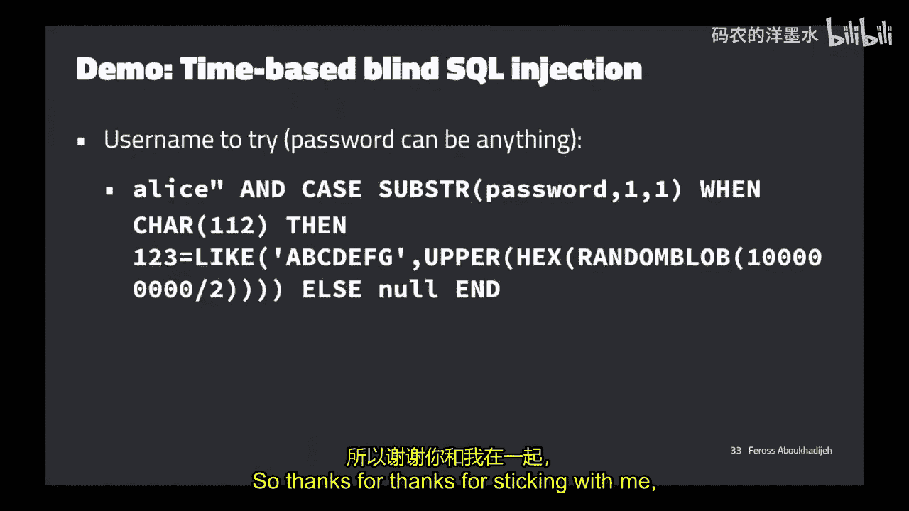