# 【全集】斯坦福大学 CS253 网络安全 中英字幕 1080P p11 Lecture 11 - 传输层安全 -BV1RemEBZEEM_p11-

All right， let's start。So today is all about T L S。

 I'm just gonna spend a couple minutes at the beginning finishing up the SQL injection stuff that we didn't get to last time。

So go to these slides here。All right。I concluded last time with this little script I wrote that was doing that sort of what was it called a time based blind sQL injection。

The the idea there was， remember， we had this SQL query that took a different amount of time。

 depending on this like。string here that we injected that takes a little bit of time to run。

We were able to use that， that timing difference to extract information， in particular。

 we extracted a password out of the database。 And I just wanted to use this example to point out just that。

 that， even if you think that you know， a SQL injection isn't exploitable by the user because it's not resulting in the user being able to control。

😊，Something that， you know， gets displayed by the Web page。

 There's still sort of these other ways that SQl injection can can get， can bite you。 And so。

Let's talk about sort what's the core problem here with with SQL injection。

 The cause is we have we're using our application server。

 which is our server code to decide what queries to run on our database。And。

It's important then if we're doing this， that our server。

Ensures that our users of our website are only able to make queries that make sense for the permissions that that user has on our site。

And so。We run into problems if the user can sort of modify this query。

 the SQL query and create whatever query they want。

You could imagine a different design where the sort of access control isn't happening in the Web application。

 But instead， the database has some notion of who are all the different users on our website and the database itself might be able to enforce access to different rows in the tables and different tables in the database。

 right， This is another possible way you could architect this。But typically。

 for sort of ease of development， we， we just sort of let the web server just look at whatever rows in the database at once。

 whatever tables in the database at once。 And we just hope that our team of people who are coding this server are doing a good job in。

 in ensuring that the correct user only accesses the， the data that they're allowed to access。

So something you think about if， if it's really bad that， you know。

 if a user were to access that they're not supposed to see。

 then maybe we could use a different design in this。

I'm gonna skip this and just talk about a few solutions to SQL injection。

 So like the other stuff we've seen， we want to escape user input when we're producing these queries。

 And so the， the sort of standard way to do this is parameterized SQL。

 And there's also another option you have called object relational maps or O Ms。😊。

And the the idea here is just never， ever build your own SQL queries using string concatenation。

 You should call a function that's going to combine the untrusted user input with the。

 the query that you want to run and sort of insert the user input in the correct place。

 And so heres an example of this。 So for doing parameterized SQL， you'll notice that。

This is the same query that we that we used before that was vulnerable。

 And this is vulnerable because we're relying on this sort of this is the jascript template string syntax with these back ticks here。

 And what this does is it sort of just looks at。Any variable here in this。

 in this lexical scope called username and just sort of dumps it right in there and replaces everything from the dollar sign to the。

 to the bracket with that， that variable。 And， of course。

 this is a problem because the user can put anything they want in there。

 And so a safe way to do this is。😊，We swap out that with just a question mark。

 and then we call the same function， but we pass it the untrusted user input as additional arguments。

 And now it's the job of the DB dot all function to take that untrusted user input。

 escape it correctly for the context where it's going to get inserted。

 And then it's going insert it where it finds a question mark。Right， and if we just do this。

 then we're fine。This is called parameterized SQL， and no matter what sort of SQL library you're using。

 it's going to come with some kind of functionality like this。😊，Cool， so that's。

 that's one way to do it。 The other way is O R M。 So an O R M is it's not its primary purpose is not to do sort of escaping user input for you。

 but you sort of get that as as a tangential benefit。

 typically people want to use O R Ms when they're trying to just create a different way they want an easier way to access the data in their database。

 And so the idea is normally data and database is composed of rows or relations。

 And we want to because we we're writing our code in an objectoriented program。

 we typically want to represent each row of the database as an object in our object oriented programming language。

 And so if we use an R M， we can sort of pretend like you know this person's table in our database know。

 we have this object person that we can work with to。😊。

That's just sort of an object in our in our language。 But in fact。

 it's sort of mapped in back end to a row in the database。And so with that。

 we could do something like this where we could say we want to sort query our users table where the username matches this and the password matches this。

 And of course， because we're using these these functions。

 it's going to escape the untrusted user input for us here。Cool。So yeah。

 maybe you've seen one of those before。 But anyway， so those are the two options you have。

 Did you have a question。The question is why not working into just to。

Would that so video I think that so。So you still have the same problem if you're composing queries that are that are combined with user input that's not trusted because you still have to make a query to this to this database。

 And it just so happens that your query might take the form of a query object in the NosqL case instead of a query string。

 But still， if you're letting the user select that object。

 like however they want You're letting them provide you the object。

 Maybe they're sending you some Json or something， Then you're gonna have the same problem because now they can select whatever they want out of your whateversql database。

 you adopt the same solution like an like。なそう。Yeah， so， so， yeah， if you're using。

 if you're using something on top of your database， typically， it's gonna provide these。

 these faculties for you。 In fact， I don't， I't know what Monga provides out of the box。

 It might also provide some way of escaping this input。 But yeah in general。

 if you're just taking sort of whatever the user gives you and just sticking it in a query。

 you're gonna have problems。 But yeah， I think Mongo handles that for you。 yeah。😊，Cool， alright。

 so let's keep going。 So anyway， just， this is sort of the end of the SQL part。

 So just the key things to remember about SQL injection are that the the attack happens like when you're in the same way as all the other attacks we've talked about of this sort。

 you're combining untrusted input with query strings。 And the simple solution is just to remember。

 use parameterized SQL to， to sanitize your input。😊，Cool， so now we'll get on to。

Today's topic of TlS。So TL S is， this is cool。 So it's not the area I'm most comfortable。

 so I'm going to do my best today， but。😊，Its， it's really cool stuff。

 and theres's all kinds of attacks。 And TL S solves a bunch of attacks。

 but also itself has has some some ways you can use it wrong。

 And so we're going to talk about all the ways that can be used wrong。

 And what we need to do to make sure your site is secure。😊，So the。

 the core problem here is H T TP has， has， has a big weakness。

 You often hear that H TP is not secure。 And when you visit an H TP site， even these days in Chrome。

 you'll see that it tells you it's not secure。 You'll see the little not secure indicator next to the URL in the address bar and。

The question is， why。Why is it not secure？So。What's。

Quickly review HP request response and see exactly what's going on here。

 So in a typical unencrypted HDP situation， we're going to have the client。

 This is the browser making a request and say it's a post request to log into a website。

 So it sends a request to the server and the server sends back after checking the username and password it sends back a response that includes a cookie。

😊，And so in H TDP， this is， of course， all this is visible to anyone who's on the network。

And so what could happen is the network here is， you know。

 every any router you're connected to or any ISP that you're that you're using。 so， so。

 so let's say that that。

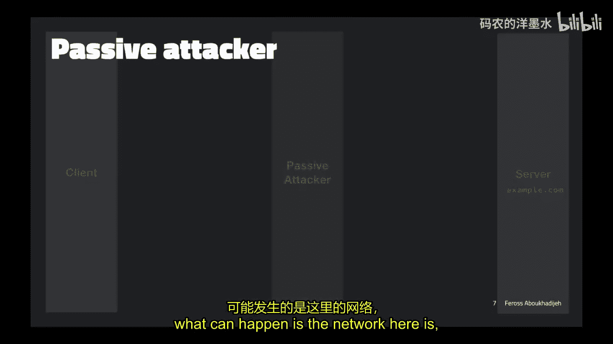

Somebody on that network， we call them a passive attacker in this case， wants to observe this。

 this traffic。 Then then they can literally watch， you know。

 those requests and responses as they go by。 So in this case。

 this request from the client goes through the passive attacker and passive attackers passive。

 They don't do anything to the request。 They sort of let it go along。 but they observe it。

 And so they see your using a password in this request here。And then similarly。

 the server's response also passes back to the passive attacker。 And so they also observe your。

 your session cookie。 so this is is not good。 So we want to fix this problem。

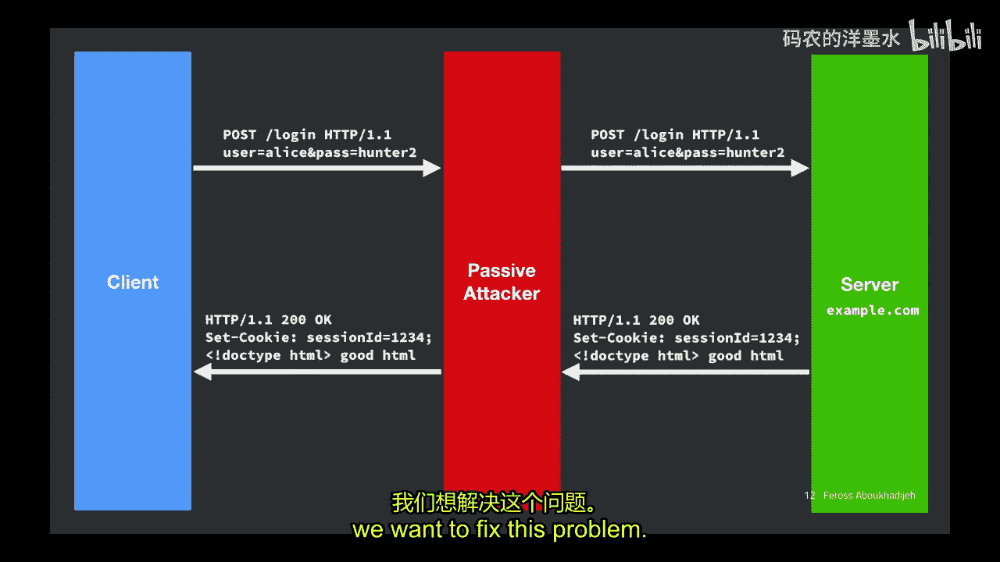

Oh yeah， I guess also， there's， there's an even worse situation。

 which is where you have an active attacker。 So we should talk about that， so。

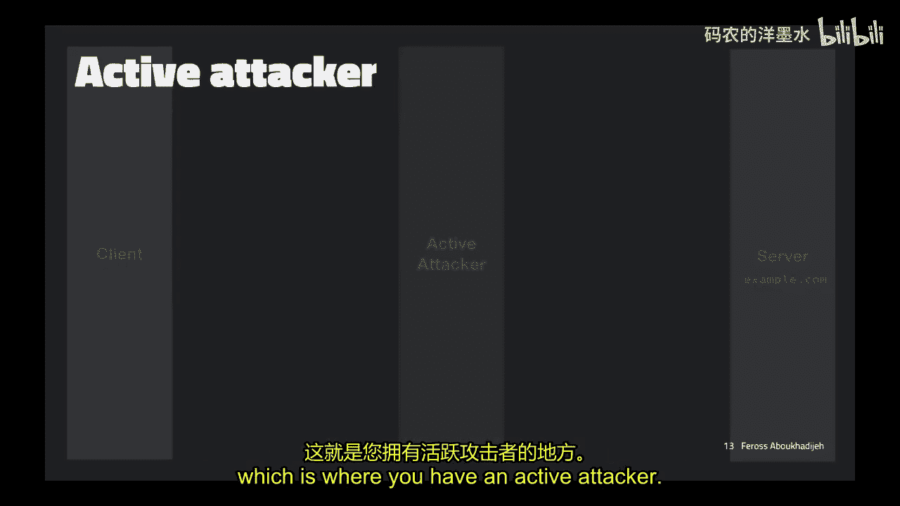

An active attacker is willing to actually do something to the requests and responses that it sees going by。

 It's willing to modify them。 It's。A little bit harder to， to pull this off。

 Buts there's actually out of the box software you can install on like like a router and you can set this router up。

 know， at a coffee shop and whoever connects to it is， is going to， your active code is gonna run。

 And you can， you can do like we'll show here。 So it's actually not it's harder。

 but it's not that hard。 So let's， let's take let's take a look here。

 So say the client is just going to request the home page of website。 sends to get request。😊。

The active attacker just， for this request， lets it go through and modified。

The server sees it and responds with some H T L， and。Remember， from this server's perspective。

 this is the client it thinks it's talking to， right， So this is acting out like a proxy server。

And then the active attacker goes ahead and modifies the H TL that it got back from the。

 the server and adds in its own。 let's say its own jascript that that's gonna sort of change the behavior of the page in some way。

 steal your information or or。You know， do whatever the attacker wants to do on this page。

 And so it'll forward that back along to the client with the evil H TL included。 And so now the。

 this client， you know， has no idea that this happened。 And it's gonna think that this is the， you。

 it doesn't know that it's， it's not talking to the real server。Cool， so any questions about this？

Cool。Alright， so。So the threat model here， the thing we're worried about in both of these examples is that is the network attacker。

 A network attacker is anyone who controls an infrastructure。 It could be， know。

 the example I used earlier was routers or your ISP。

 but it could even be like you can think of a malicious DNS server also as an ER attacker because if malicious DNS server responds with an I P address of not the correct server。

 but its own server， you're gonna go and talk to that server instead。

 and it sort of has the same effect as if that attacker controlled the router。😊，And。

If theyre passive， they can eavesdrop on everything that goes on or if they're， you know。

 want to be more active than that， they can inject additional packets。

 They can prevent certain packets from being sent。 They can modify packets。

 They can change the timing of packets。 There's all kinds of different things they can do。

 They can basically play with the network traffic any way they want to。Okay， so， and then， yeah。

 of course， I I already mentioned the wireless networks at cafes or hotels。

 But there's also any place where your traffic crosses a national border is another place where traffic can be played with。

 So those border gateways also have have sort of all all the same pitfalls and network attacker can sort of play with traffic there as well。

😊，Cool， so our goal here is we want to have secure communication in the presence of these network attackers。

 And so specifically， we want these three properties， privacy， integrity and authentication。😊。

So privacy is no eavesdropping。 So that sort of prevents passive attackers from seeing what we're doing and。

On top of that， we want to ensure that the messages haven't been tampered with right。

 because if you could tamper with the response， even if you couldn't see it。

 if you could tamper with it， now you're gonna potentially be running the attacker's jascript in。

 you know， in the response there， because the attacker can tamper with that H T TP response。

And then lastly， authentication， this is really important。

 You need to know that you're actually talking to who you think you're talking to。

 It turns out if you don't have authentication， you don't have any of the other three things， right。

Like， what， what good is it to， to be communicating with an attacker privately and with integrity。

 You're still talking to the attacker， right， So， so you know， all these。

 all these are really important。 You need all three。

 So we're gonna to talk about how to get all these three things using T L S。But yeah， first of all。

 any questions about this？Cool， alright。 so， alright， so let's， let's run through。An example here。

This is kind of what we want。 We're gonna start off really high level here。

 just I'm representing a secure connection that has all these properties we want with this little green box with a lock in it。

 And so we want to be able to somehow send our request to the server。 Not the attackers still here。

 right， we're still potentially using an untrusted router or an untrusted Internet service provider。

 We might be talking to a site in another country。 So we still have these network attackers still exist。

 But somehow we still want the protocol to ensure that we we get those three properties in the presence of that attacker。

 right so。😊，The way that works is the， the attacker sees the request。 And in this case。

 let's say it forwards it on， right。You might say maybe maybe the attacker sees this request。

 by the way， to be clear， it doesn't actually see the text inside that box。

 This box is sort of like representing sort encrypted。 it's impervious to the attacker。

 The attacker can't see what's in that box。 the attacker has a choice here。

 They could sort of not forward this on and just sort of say no。

 you're not gonna like we're not gonna forward that on And that would appear to the user as the site is down。

 So the attacker still has that option。 if they literally your Internet service provider or the router that you're connected to So that's sort of something that's available to them。

 but But of course， you will probably move to another cafe or switch Internet companies if this happens to you。

 So yeah， so the attacker decides to forward it on in this case。 And the service backer response。

 And of course， the attackers only option again is either maybe not send not forward it along to you。

 there's nothing else it can do。 in the normal case， itll forward along to and it learns nothing。😊。

Right。So。Yeah， I mean， I guess it still learns the IP address of the server you're connected to。

 right？Because。All this， all this sort of TL S stuff that we're showing here happens at a level that's sort of on top of on top of I P。

 So all these packets are gonna have destinations attached to them。

 The IP address of the server we're talking to。 So that's still gonna be visible to the attacker。

 but that's sort of， yeah， it alsos the size of the It size the messages that's right。 Yeah。

 it learns， it learns sort of the timing between the messages I guess that's true。

 There's all these kinds of potential side channels here。 that's a really good point。 Yeah， Yeah。

 but。😊，Those are sort of outside of the scope of what we're like trying to solve。

 we're not trying to solve that here。Cool。Oh yeah， the last thing we have to check here is。

 of course， we want to confirm that this response actually came from example dot com。

 So if the client gets this sort of this response here and just sort of trusts that it happened to be talking to example dot com。

 that that might not be a correct assumption， right。

 It could be that this whole exchange happened with the， you know。

 like the attacker could have sent back something else， right，😊，And so that's。

 that's a really important check to make sure that this response actually comes from who we think is gonna come from。

 And we're gonna talk about how that happens a bit later。

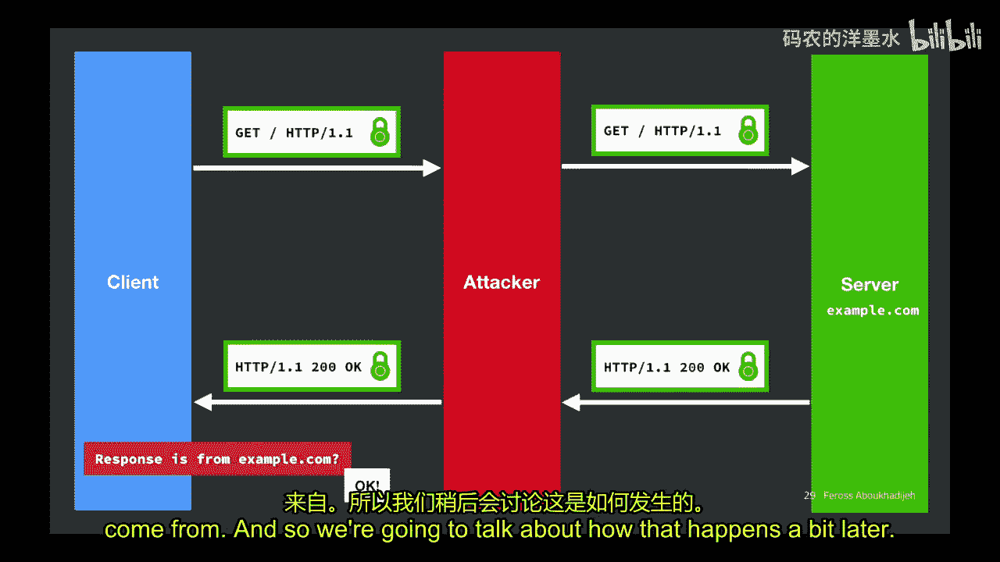

But just keep that in mind。Okay， so let's， so let's， let's sort of define sort of what is T L S here。

 So T T L S is what that whole thing I just showed is now。When Tl S is used with H TDP。

 we call it HTDPS。So the underlying encryption protocol is called TL S。

 but sort of the whole package with TL S plus H TDP is HDP S because T。

 L S can be used a a bunch of other things。 It can used email instant messaging Vo a ton of other protocols。

 really。Yeah， so so that's。So it's HttPS。And so now I want to talk about sort of the。

The first kind of primitive that we need。To。To communicate securely with a server。

So I'm not gonna go too， too much into detail here because I think if you want to know more about this。

 you should take C S 2，55， which is intro to crypto， which is a really， really great class。

 And they go like way into detail about this， this kind of stuff。

 All these different crypto primitives。 But we're gonna state like a relatively high level here。😊，So。

 so let's talk about anonymous Deiffy Hillman key exchange。 So we call this anonymous。Because。We。

 in this protocol I'm about to show， we don't do any authentication of the server that we're talking to。

So this is not this， this。Protocol here is not going to protect us from an active attacker who's actually willing to modify packets。

What this is going to do is just ensure that a passive eavessdper doesn't learn anything。Okay。

 and we're gonna add into the， the extra。 we're gonna fix that problem in another step。Okay。

 so let's start off here， we have a browser in the server。So we have this notion of a cyclic group。

So acyclic group is。The level I want to keep it out here is just think of it like a set of numbers。

 And you see here， like1 G G squared G cubed G is just a number。G is publicly known。

 and it's sort of defined in the standard that So it's， it's something that everybody who， you know。

 the browser makers， the attackers and the servers， everybody knows what G is。 And we can。

 we can do group operations on thiscyclic group so we can take， for example， G。

 We can multiply it by G cubed and we'll get G to the fourth， right。And so because of that。

 we can do exponentiation。 We can sort of take any of these group elements and。

 and expentiate them by by you know， some number。 And in this case， the group is a size  Q。Right。

 I think it's yeah， it says Q， Q-1。 Yeah， Okay， and so what we're gonna do here is we're going to have the client and the server each pick a group element randomly。

😊，And we'll call the the clients A and the servers B。Now， we want the client to send。

G to the A over to the server。 and the server is going to send G to the B over to the client。And。

One thing that's interesting is that the G to the A and G to the B are within the group G， So。

Any of these group operations， the result of that is。

 is actually gonna still be in the group when you're done。Anyway。

 so the point is that that now the client and the server have have these values。 and then we're。

 we're're trying to produce sort of a shared key in the end that both the client and the server possess。

 But but yet somebody who's sitting here in the middle watching these messages go by they can't do anything with the messages that they see to get this value here And so how is the client in the server gonna agree on this value somehow。

 well， if they each take the， the thing that they received from the other party and take it to the power of the。

Group element that they selected randomly at the beginning。 Then they'll。

 they'll derive this D H key value， and they'll both end up being the same value， particular。

If you run this through here， you'll see that basically， so the client received B from the server。

 right， it， it takes that to the power A and it gets B that A gets gives it this。

 And that's the same as what the the server does。 It's just you know。

 because this is comm whatever the term is commutative， I think。

 So we end up with the same value here， DHK on both sides。😊，Yeah so。

This is nice because now we have a key that we can use。

 We can use this with an encryption algorithm to encrypt all the future messages between the the server and the client。

😊，Does that make sense。Cool， so this is called Dety Heman。 And yeah。

 the important part is that both the client and both the parties need to need to agree on the same key and you you'll notice that that somebody in the middle here is sort of an attacker who's observing the messages go by here。

 they only get G to the A， G to the B。 Of course， they also have G， because G is G is publicly known。

 like I mentioned before。 And using G G to the A and G to the B。 There's no way to get G to the A B。

Right。Ca cause okay， so I what is G to the A times G to the B。That's not that was it。

Like to figure out what。Oh， I forgot to mention。 Yeah。

 So that's one of the properties that thecyclt group gives us。 So the the way the group is selected。

 it's， we it's computationally difficult to do that。 Yeah， so just assume that you can't do that。

 Yeah， you have to look more the way thecyclt group stuff works to understand why that is。

 but take 2，55 for that， yeah。😊，It's a good point。 Yeah， you can't sort of call log on that。 It's。

 it's a huge number。 And it's， it's computationally in feasible。 Yeah， really good question， yeah。

Cool。Alright， so that's theie Heman。 Okay， so， but of course we see here。

 the problem one problem we have here is the client has， has has now you know。

 is pleased because it knows that it has this DH key that the server also derives。 And so you know。

 they can now use this shared key to to communicate securely， Right。

 but it doesn't know who the server is。 It could be anybody。

 This could this could be the network attacker that it's actually negotiated this secure key with this shared key with。

 right， So thats that's， that's， that's a problem。😊，Does everybody see that？Okay， cool。So yeah。

 this is called anonymous key exchange。 And the， the problem is。

 we don't know which server we actually performed this key exchange with。

 It's possible that it could， could have been the the network attacker。

 And so while the communication is technically private， it's private to a party who we don't know。

 you know， we don't know who that party is。 And so we say that this lacks authentication。

And without authentication， you can't actually have the privacy property that we want。Cool。

 so we'll show just to make that clear， here's a sort of an example of a man in the middle attack on anonymous defeat Helman Ke Exchange。

 And so we have the same group as before。 But now we'll insert an attacker here。And so now。

 when the client derives its A and the server drives its B。

 the attacker is also going to derive a value here。C。😊。

And now the client sort of goes through the same process as before。 And remember。

 it doesn't know this attackers here。 This is some party。 This is the router。 This is the IP。

 This is some， this is some party that's between the client and the server。

 And this party is sort of secretly modifying the message So this is an active attacker to be clear This is an attacker that's willing to mess with the messages in order to to trick the client。

 And so what it's going to do here is it's going to。😊，When it sees this message come through。

 it doesn't forward it along to the real server。 Instead。

 it sends back G to the C where C is its own its own secret that it， it's selected。

 And and so now there's this， we're gonna call DHK1。

 which is a key that's going to be agreed upon by both the this client and this attacker。

 And so the client has no way to know this happened。And then， of course。嗯。At this point。

 the client is going to make some kind of a request to what it thinks is the server here。

 And at that point， we will， I guess that's just showing that。 Yeah， So at this point。

 the attacker will want to itself negotiate a connection to the real server here。

 And from this server's perspective， this is just some client that's shown up who wants to send a request to the server。

 And so we'll run through the same sort of algorithm over here where the attacker sends C， sorry。

 the attacker sends G to the C to the server。 The server sends G to the B to the attacker and then negotiate a shared key DH2。

 which which is G to the B C。And so that's shared here and those two are shared there。

And so now at this point， any this request from the client can get forwarded along this connection here。

 And then the response can get sent back to them。 and they won't know that theyre that they're being man in the middle。

So it's called a man in the middle attack。Cool， any questions about this？Does the。

 does thecyclic group stuff make sense to everybody or like sort of。

 at least at the level I've explained it at。对。Yeah。

How does expentiating a large number to a larger a really large number notta like rubber？So there's。

 there's some optimizations that they， that they have to make that fast。

 I'm not too familiar with the details of it。 But yeah，s。

 it's like there are tricks to make it relatively fast。Yeah， okay。Cool。

 so how are we going to add authentication to this。So our goal now is we want the client to。

If a client could somehow figure out who it was talking to。

 then it could securely derive a shared key with that and only that server， that's our goal。

And so I mentioned before signing in in lecture 3 when we were talking about cookies I introduced sort of the way that signing works。

 And that's what we're going to use here， So。TheThe whole sort of idea there is is called public key cryptography。

 And if we use that， we can sort of add that on to this Diffy Hem key exchange and get what we want。

 which is authentication。 And so let's just quickly review the signature schemes the way the signature schemes work from before。

 So we have。😊，A triple of algorithms here， G。S and V。So G is the generator。

 And so we when we call the generator， we get out a public key and a secret key。

And so these are going to be。Randomly picked， but the public key and the secret key are tied together in it。

In a way。And then the signing algorithm takes in the secret key and some input X that we want to sign。

 And then it outputs T， which is， which is what we call the tag。

And then we have a verification algorithm which can take in the public key。An input X。

 the same input X and and a tag。 And then in that situation。

 it would accept saying that this is actually a tag that was generated by you know。

 an S function with this input。So it's used to check the validity of a T on an input X。Right， okay。

 so the way， maybe one way to think about this that would be useful is we have。

Some one way you can use this is you have some party who wants to announce something to the world。

 and they want the whole world to know that it's them who said it。

 And so if that party called G generated a public key and a secret key。

 kept the secret key secret and publish the public key far and wide So everyone knows this person's public key now。

 And now this person wants to sort of say something and have everybody know that they're the one who said it。

 they could take the message X that they want to say run it through S with their secret key that only they have。

Produce a tag T。 And now they can take T along with X and post it sort of somewhere on a bulletin board。

 And anyone who comes along now can confirm that that was that was said by that person。

 So take they take the X and they take the T that was posted there。

 They put it into V to verify that was actually said by that person in order to do that。

 they also need to have the public key， which was originally published or far and wide。

 Everyone knows it。 And then and that that would return accept if that was actually a message X that was assigned by the owner of the secret key。

Okay， cool。 So of course， the properties we need here are for correctness， we have to ensure that。

Anytime you do this， anytime you do actually take the output of S and then put it in here is the tag that you're gonna get and accept every time。

Or else its， this isn't gonna this is not correct。 And then we also need to ensure that this only that this only happens when it's a T that's actually produced from one of these S functions validly。

 So if an attacker gives you a random T， a random tag that they made up， it shouldn't verify。

 this should， this should never return except or if it does， should be very， very rarely。Co。

 does that all make sense。Cool， so that's just a review of signature schemes。Cool， so， so now if we。

 if we use signature schemes in our dihelm key exchange， we get authenticated dihel key exchange。

 So let's see how to do this。 So we're gonna do the same thing as before。 We have the group G。

 But this time， the server generated。 So the server called G and generated a public key and the secret key and it kept its secret key secret。

 and it announced its public key far and wide。 And so somehow the client sort of already knows the public key and we'll get to how how how we actually accomplished that in the real world later。

 But。😊。

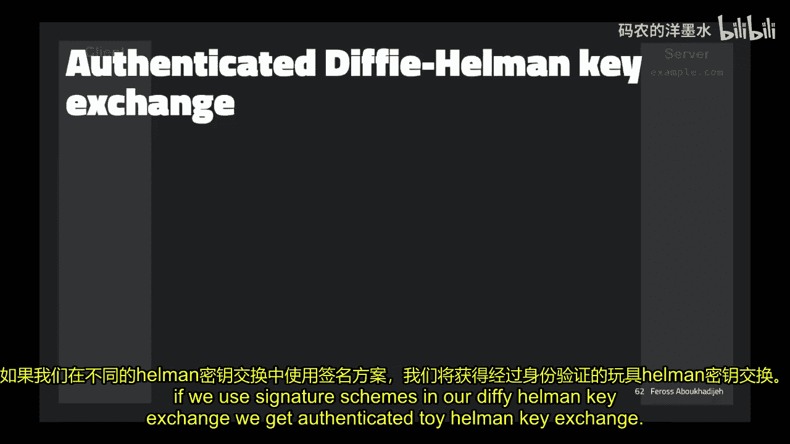

But we'll just assume for now， the client knows P K in advance。

 and the server obviously has the has its secret key。 And， and so now we do the same thing as the。

 So we do the client in the server generate A and B。 the client sends G to A to the server。 But now。

 before the server sends a response， it's going to take。😊。

But a transcript of everything that's happened in this exchange so far， which in this case。

 is just the fact that the client sent G to the A to the server。 and it's going to。Sign that。

Transcripts。With its secret key and produce a tag T。And so now。They can send its G to the B。

To the client， along with the tag T。And。Before the client actually goes ahead and does the drives the shared key that it's going to use at the server。

 it first verifies that the tag T is actually valid。

 So it's going to call the verification function on the P K with the transcript and the tag T that it received from the server。

 And so only the the the owner of the secret key should be able to actually produce a tag T here where this will actually return except。

😊，Right。So if we're talking to anyone else， if we're talking to a man in middle。

 then the tag is not going to be valid。So this is gonna， let's say it returns except。

 then we we're good。 And so we can go ahead and now now actually derive the， the DH key on。

 on the client。 And， and then， of course， it's gonna to match with the server just like before， yeah。

😊，How come the server。That's a good question， let's see， so the server assigned you to the B。

 what would happen？And I guess also is due to the being included in the transcript I would actually I think it would be included because it like otherwise we could just send some random things。

嗯。Yeah， so I think you wouldn't want you wouldn't want to exclude you to the be because otherwise you could send literally anything like whatever you as as an attacker client。

 you could just send any message to the server and they'll sign that message for you。

 which which means you could you could then use that to men in the middle， you know。

 other connections by just sort of taking whatever the client sends。

 giving the server to sign a thing。 and then yeah， yeah。R the。K just around you to be。 Yeah。

 you know， I don't know off the top of my head。 Let's see， I mean。

I can't think of what would break if we removed G to the A from the transcript right now。

 but it there might be something。 I have to think about it a little bit more。 Yeah。

 do you have an idea。 I think it was something like， if there was a previous session。

Like if you didn't sign the entire transcript and you would sign that one message。

 then like you could send a message。And then as an attacker， you just saved that message。

And then send it in a different session。But have to be， wouldn't have to be the same session。

 have to the a session that also used the same G to the B， right。Well， no， because the attacker。系。

It seem， it seems like。You're onto something there， but。I feel like。Yeah， do you have。

 do you have some thoughts。Sessionな。Because the client doesn't know which means。

So as long as the key。しきで？just pretend I that the server had chosen。So I think that that。

 so if we're assuming here that this transcript actually includes the G to the B that the server is about to send。

 So it's including G to the A and G to the B in the transcript， then。Or as than like the attackers。

Oh， I see sing and sends it with its own。いか丈夫。Yeah， that seems possible。 Yeah， yeah。In general。

 when you mess with any of these protocols， you just break it in some。

 some way that's like maybe not obvious to you in the moment。

 But then turns out to be really important later。嗯。Yeah， I， I think we should move on， though。

 But yeah， there's， there's。There's the the main problem that we've solved here is we。

 we've we've ensured that the client can validate that it's talking to the owner of the secret key in this case。

 the the secret key that goes with the public key that it knows about。

And you'll notice one thing is it's actually not， it's not like a two way authentication。

 The server actually， at this point has no idea who it's talking to。And。

 and it's kind of okay with that。This it's not a big deal if the server doesn't know who it's talking to in this case。

 because once we have this， this shared key。It's。The client is about to。Send an HTDP request， which。

Its probably let's say it's going contain a username and a password to log into the site here。

So as soon as the client is sure that it's talking to this server。

The client is happy to send a username and password across that connection because it knows it's going to the site that it wants it to go to。

 right， And so， and then at that point， the server can， can can confirm the username in the password。

 And that's gonna all happen at the Web application layer。😊，Does that make sense。Okay。Great。Yeah， so。

 so， so， so how does the client actually get this service public key， You， you。

 you could imagine that we， we just take the， take the website's public key and build it into the browser。

 And we have to go sort of go to all the different websites and say。

 give us your public key and we'll include it in our browser so that when somebody visits the site。

 they'll know your public key。😊，But that would be a huge list， and it would be constantly changing。

 and if the list was even slightly out of date， you wouldn't be able to actually negotiate a secure connection with the server。

 so that's obviously not a good approach。Another idea would be maybe the server could send the public key。

To the client that it's about to。Connect it could send the key to the client during this key exchange process。

 And then now， you know， now that the client sort of has the public key that it needs to do。

 to do this whole thing。 And what's the problem with that。Z闻。Why wouldn't that work。Yeah。

You haven not had to get to this river yet， so you don't have。It' reading。Yeah， exactly。 So。

 so we're back to the same problem as before。 if， if we let the server send us the P K that it wants us to use for this whole。

Ify Heman exchange， then we have no way to know that we're actually talking to the correct server because the attacker could send her own public key in the exchange。

Does that make sense。Okay， so， so we can， we can't do that。 So that that that that that would。

 that would take us back to anonymous exchange。And so we need something better than this。So。Yeah。

 okay。 So， okay， so the solution。Is certificate authorities who's here knows about certificate authorities or has heard this term before。

Oh wow， okay， pictures doesn choir。 Everybody knows。

So a certificate authority is gonna be the one who issues digital certificates to the site owner。

 And in particular， it's going to。Certify that a specifically named subject is the owner of of a specific public key。

And so it's， you can think of it kind of like the certificate authority is making the the following statement。

 It's saying， I， this certificate authority， certify that this subject name is the owner of this public key。

And this statement is， is， is。Useful， because。If we just trust a sort of。

 if we just trust a small handful of certificate authorities and this statement comes from one of the ones that we trust。

 then it it's a very useful way for us to now learn that this subject name is the owner of this public key。

 And so we can then take it on faith when a server sends us its public key that it is actually the correct public key。

So a server will say。This is my public key。 And also， by the way， this person that you trust。

 the certificate authority will vouch for the fact that this is indeed my public key。

And when the client gets these two things together。

 it now is willing to sort of trust that this is the public key that it should use。

And so you can look at any， any of the certificates that your browser gets sent by servers by just sort of clicking on the lock and then clicking on more information button。

 And then you get this， this whole sort of spiel about the details of the certificate。And。

There's a few fields that are interesting in here。 So one is。

 there's like a bunch of of sort of like information about the sort of entity that owns this that's that's been issued this certificate in this case。

 Google， LLC。WHas been issued it。 But the， the part that the browser actually cares about is has nothing to do with the country。

 the state like that that that actually isn't used in anyway。

 The most important field that the browser cares about is the common name field。

And so this is the field where it's actually going to look at it and compare it to the URL that you're on。

 And it's going to say， is this actually a certificate for the site that the user is visiting。😊。

And if it is that， that's great， That means that， you know。

 we should actually care about this certificate。 If it's some other certificate for some other random site。

 then， of course， this is not useful。Yeah， and then。

You can see who actually issued the certificate here。 So in this case， it's Google Trust Services。

 which is the C A。 So Google issued itself a certificate。😊，And。We also。We also see， I guess， yeah。

 this is interesting。 So this is actually the public key that's being signed or that's being sort of validated in this in this certificate。

 And then here's the actual like。Signature from the CA。And so when the client gets this， it can sort。

 it can look up， does it trust this C A， if it does trust this CA， then great。

 it's going to now trust that this public key is the public key that belongs to mail。 Google com。

Cool， so then。嗯。Just a few details about the common name。 So that's。

 that's the mail dot Google dot com field here， so。It's usually an explicit name。

 but it can also be a wild card。 If it's a wild card。

 then you just put a star in there and then anything that matches that will。

 the browser will then trust that this is a certificate for that。

 for that sort of whole set of domains。So this is really useful if you're。

 if you have a site like like。Tumbr or Github or something where you have like millions of users creating sites。

 and you're， you're letting them select the the subdomain for the site。

 So it's like something dot tuumblr dot com or something dot Github dot I O or whatever。

 because you don't want to be generating like tons of， know。

 millions of certificates in that situation。 to to generate one and say this is trusted for this whole sort of subdomains。

 And then to， to actually。😊，Match the rules here is that the star matches the leftmost subdomain component。

 and it doesn't match dots。 And so that just means that basically the star does what you think it does。

 So it's like anything do Stanford E D U。 but not you know。

 So star do A dot com would match X dot A dot com。 but it wouldn't match Y dot x do dot com。

 So you can't sort have infinite number of subdomains tacked on there。嗯。

The signature at the bottom is F the CA's signature on the public key or like the public key signature on the message。

I thought it was the C A's public key， but it's， it's under the public key info。

 which is making me think that you might be right。 It might be something to do with the actual public key itself。

 yeah， but。Yeah， you might be right there， yeah。Yeah。嗯。Cool， so， so that's the common name and。

I guess the other thing to mention is theres， there's also this other thing。

 I don't know if it's in this screenshot here called the alternate subject name。

 An alternate subject name is just a way to include more than one domain in here without using a star so。

You could， instead of saying like start at Google dot com。

 you could say like this certificate is from mail do Google do com， but also Gmail dot com and also。

 you know， I don't know， Google Ma dot com in case there's sort of variant names。

 you could just sort of throw those in there as alternate subject names。

 And the browser will will sort of compare against all that that full list。

So you might see that if you look at some certificates in the wild。Okay， so how do we figure out？

What CAs our browser actually actually trusts。There's。

 there's a list that you can look up in the case of Firefox。 It's built into the browser itself。

 And so you can actually just go right into Firefox settings and say。

 show me all the C As that my browser is trusting right now。 And it's very interesting。

 I'd recommend just going looking through it。 It's really fascinating。😊，In this case。

 here's the Google Trust services LL C， the one that we saw in the Google certificate。

 But any of these other C As here actually has the power to issue certificates that your browser is going to trust。

 And there's some， there's just really interesting ones in here。 Like 1 I saw for classes。

 Hong Kong Post is the post office in Hong Kong can issue certificates for any site。

 And there's a few other interesting ones in there。😊，There's a whole bunch of governments。 there's。

A ton of different companies。And then。Yeah， actually。

 so one thing that is interesting is sometimes one organization actually has multiple。

Secret keys that are trusted by the browser。 And so actually。

 if we go and have that same page right here pulled up。

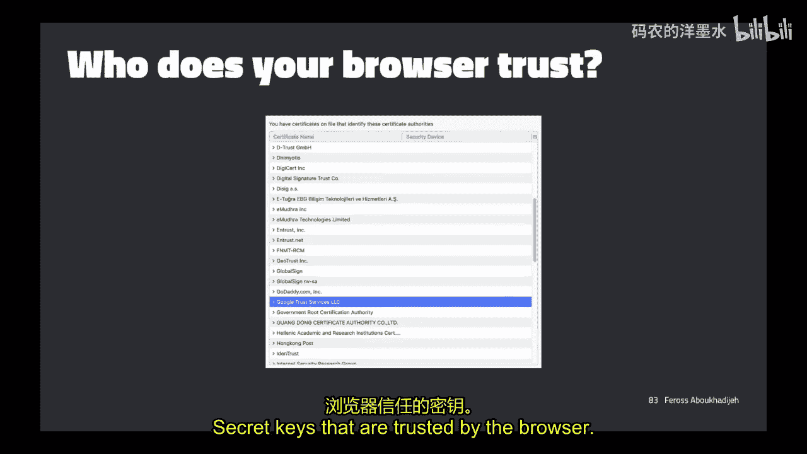

You can actually sort of expand。Any of these organizations here。

 And you can see there's actually a whole bunch of different route certificates that are trusted。

 So Google actually has four here and。Sometimes if it's not clear， like。What the organization does。

 you can sort of expand and sort of try to。Figure out based on their certificate name， what。

 what they might be associated with。There was one that was really interesting that I saw before。

 Where is it， This one， government Ro certification Author。

 It's like not clear what what government that is。 But if you open it up， you can see who。

 who it's for。 But yeah， there's a whole bunch of these about like on the order of like 50 or 60 in here。

For other browsers that are non Firefox in particular like Chrome and Safari。

 they use a certificate store which is built into the operating system。

 And so when you get your computer like directly from the factory。

 it has a hardcoded list of different Cs that it's gonna to trust。

 And so Chrome and Safari and I think most the other browsers that are Chroium based are just going look at that certificate store that's in your operating system。

 And then whatever whatevers in there it's gonna just trust。

 I don't know why Firefox ships their own with the browser。😊，If anyone knows that。

 that would actually be really interesting， but yeah。

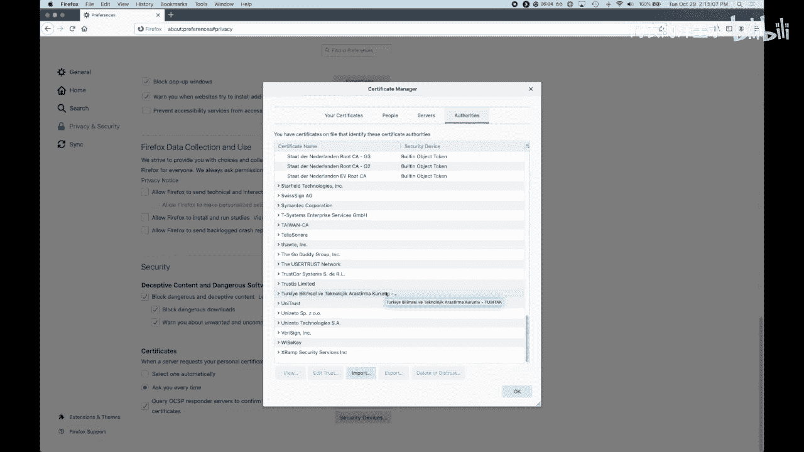

Cool。Yeah， so。Yeah， what else do gonna to say about Cs。Any questions about CAs？Yeah。

 so can you manually go in and like distrust certain CAs？one if you don't want radio Kong Yeah。

 you totally can。 It just means that any site that got their certificate from。

 from that C A is gonna now cause like warnings in your browser when you go to those sites。😊，So。

It would be interesting to look up what sites you're going to break when you delete those CAs to sort of do like a risk reward analysis before doing that。

Yeah。Also possible to a。To， yeah， so can an attacker add there like OA and issue itself a certificate。

So that's， that's a great question。 So a attacker an attacker is not gonna be able to get their own certificate trusted by like all the Chrome browsers。

 right， But if the attacker already has an malware on your computer。

 like one of the things the malware could do is go in and add their own key as a trusted key in your C。

 A store。And if they do that， then， yes， then now they are able to man in the middle all your traffic。

 because what would they do， they would take， they would take their。Secret key。

 They would issue a certificate for the site。 They want a man in the middle and say say they want a man in the middle Gmail。

 right。 And now when they， when they intercept your request to to Gmail。

 they're gonna send back like their fake page with their。

 fake certificate attached that your browser is gonna trust。 Yeah， So it's really， it， it's a huge。

 I mean， if you if if an attacker gets， gets an additional entry in this store here， then like your。

 they can in and know anything。 Basically， In fact， actually。

 that's one of the things that employers do if you ever get like I don't know if all employers do but a live employers will。

 when they issue you a laptop。Will actually add a new like trusted C， A into。

 into the store in the laptop that they give you。 And that's so that they can while you're in the。

 while you're sort。On the company network， they can men in the middle of all your traffic。

And there's actually sort of network appliances like boxes that these companies will just buy that will just actively man in the middle all the traffic on the network for security reasons。

 They'll often want to sort of inspect the traffic and look for different things Like。

 are you talking to a known mallware domain。 You know， maybe， maybe they're worried that like。😊。

You know， if， if all the traffic going by is completely encrypted。

 there's no way for them to know what their employees are doing， right。

 maybe maybe maybe there's some malware that's sort of exfiltrating a bunch of data， right。

 So one of the arguments is they want to be able to inspect all these requests and sort of make security decisions。

 Maybe they also want to be able to tell if some employees is uploading a bunch of a bunch of company data to a server somewhere。

 So this kind of thing maybe putting something in dropropbox that they shouldn't right， Yeah， so。

 but， but it's， it's kind of。It's， it's kind of dubious because they're sort of improving security by like breaking T L S kind of completely。

Yeah。嗯。Yeah。Any other questions about the TLS stuff？Yeah。

 it's really fascinating like the politics behind like sort of who gets included in this list， too。

And， and like， what happens when an organization sort of proves that it shouldn't be trusted anymore with。

 with the ability to issue these certificates。Cool， so let's actually this like， look。

 look at what happens with the protocol when we actually do a certificate exchange， Okay， so。😊，嗯。Now。

 in this example， we're just gonna include the certificate authority as an organization here。

 And so the first thing we have to do is the server needs a certificate。

 So the server is going go out and ask for a certificate guess first first step is that like I said before the browser is going already include the public key of all the Cs that it trusts。

 So in this example， the this C A here is already trusted by our our browser over there。😊，Okay。

 and so now this server generates a public key and a secret key for itself for the server that it's going to use to securely communicate with all the clients that show up later。

 But the problem it has is its public key is not trusted by the client。

 And so when the client gets this this P K from the server later。 It's。

 it's not going know that this is a P K， for example， com。

 So that's the problem we're gonna to solve here with this certificate authority。😊，Right。

 so what do we do， we send our P， K to the certificate authority and also give them some kind of proof that we are example dot com。

This proof could be， you know， like mailing them like you're。Your driver's license saying， like。

 you know， I'm this person and I own example dot com in practice。

 it typically just is some kind of proof that you， the this person who's sending this request is。

 is in control of example dot com。So typically， what the C A will do is it will， it will just tell。

 tell this person， hey， to prove that you own example do com。

 just take this file and put it on the site at this URL。 So I can go visit this URL。

 And I can confirm you added the file that I I asked you to add。

 And only therefore you must have access to this domain。 you must be authorized to do this。

 something like that。 There's， there's various ways to prove it。

 It could also be like ask you to modify the DN S in some way or。😊。

Another way is there's literally like a sort of sort of interactive protocol。

 They can ask you to run with them where they'll talk to example dot com。

 They'll make a connection to example do com。 And then you have to answer with a certain answer。

 But the point is， you sort of have to satisfy the C A that you are actually the owner of example com。

 once you've done that。Oh yeah， theyll confirm that that the proof is actually satisfactory to them。

 And then they will go ahead and sign the message， the message from before where they say， I， the C。

 A， att testest that example dot com has a public key of P， K。

And they're gonna go ahead and sign that with their secret key。And then they produce this。

 this certificate。They go ahead and send the certificate to the server。And， now。

 this server has the certificate that it can give to all the clients that show up in the future。

 And so this process only happens one time。 It's not gonna be repeated。 It's you。

 only gonna be repeated when this certificate expires， which might happen， you know。

 every year or something like that。And。Yeah， so now when a client shows up。

 I'm omitting some steps here。 Like this is this is where the Diffy helmetman exchange is gonna happen。

 But at some point in the Diffy Hel exchange， the server is gonna to send the certificate to the client and the client's going to validate it using the public key of the C A that it has。

 And it's going to say， is this actually a certificate that came from the C A that I trust。

 And if the answer is yes。 then it's going say， all right， also。😊。

Is this actually a certificate for the domain that I was trying to talk to。

 I don't care if it's a certificate for a different domain。

 It has to be the one that I was trying to talk to。 If it is。

 then now now we're sort confident that that this is actually the the。

 the P K that we should use that we that we should we should trust。

 And so now we can actually sort of sort of。😊，So we trust the messages in the Dffyhoman exchange that follows。

 yeah。But I was just wondering， can of that tracker？T the server in this。

Like if they just wanted to hijank or disable a surgery。Oh， yeah。 But So this happens one time， so。

So you're saying like， could， could they， they disrupt the process somehow， Yeah， for。

authorityity gives them like a file to inserting a webage can， not an attacker。

 maybe like finger orcept that and submit them too。

And sort of just to prevent the server from ever getting a certificate do。Sure， yeah。

 that's totally possibles。I would say that's sort of outside of this， the scope of like the。

 the TL S protocol itself。 But， but yeah， I mean， if， if。

 if the server can't even get the certificate to sort of send to all of its users。

 then it's kind of yeah， it's kind of。In trouble because it can't prove anything now to its clients。

 So it doesn't need a way to get this。 In fact， actually， your question， it makes a lot of sense。

With the way that people often will implement this process nowadays。

 because there's this new certificate authority called Lesenrypt that pretty much everyone is is using now。

 It's， it's sort of the fastest growing C A by a huge margin。

 And that's because the certificates that issues are free。 previously。

 usually these Cs would charge about $100 or so to do this for you。

 And so lets encryptpt is a nonprofit。 I think it's funded by Mozilla and and a few other nonprofits。

 And and so they're just giving certificates away for free to anyone who can prove that they own that they own the domain。

 And so。😊，One of the things they did as part of that is they just provide like a command line tool that you can call。

 and then it talks to the Let servers and then provides you back a certificate。

 And because they have this tool， they're actually trying to make this process a lot more foolproof。

 So typically would like you would do this would be some kind of thing involving emailing like some random this random company and maybe a human would be reviewing it。

 and there's a lot of room for error。 But now if let's encryptpt。

 you just you just call this you run this command line program， it calls an API。

 And then you just get back a certificate in like three seconds。 And so。😊，For that reason。

 these certificates actually tend to expire a lot quicker now， because they figure， well。

 since you're automating things， you're， you're calling this program。

 why don't we make these certificates expire in like three months that way。 if。

 why would we want to do that。W， well， why， why do you get additional security from。

 from a short expiration。It is。Yeah， somebody gets secret key。 Yeah， if they get your secret key。

 Now， the damage is limited to three months instead of a year， right， It's still really bad。

 But but yeah， so we want this we want the sort of expiration date to be。

 to be sort of relatively soon。 And for that reason， that means that， that yeah。

 if this process gets disrupted in any way。 And typically。

 it's an automated like cr job or something that's just running like once every every week to check if the certificate needs to be renewed。

 If you do disrupt that process in some way， then you can take the side offline。

 if that doesn't run when people are expecting it to run。😊，Yeah， that is actually interesting。

 But that's，'s， again， that's like a denial of service。 that's not really gonna be。呃。

Not gonna let somebody be a man in middle， for example。Cool， so let's keep going so。 yeah。

 And so yeah， just to be very clear here， this certificate is reused for all the client connections that happen。

 So we're not like， we're not going back to the C A to get any certificate every time。 Like。

 that's just a one time thing or once every three month thing。😊，嗯。Cool， allright， so。TL S 1。3。

 This is the latest version of T L S。 It replaces a whole bunch of previous versions。

 I'm not going go too much into the exact details of it because I'm not an expert on that。😊。

But if you w to know all about that， I really recommend taking 255 It's a really， really great class。

 But it is interesting that all these previous versions had like catastrophic problems in them and had to be replaced。

 And we've been through so many versions。 And if if you've ever heard the term S L。

 it's often used interchangeably with T L， S。 And that's just sort of a previous。

 really real old version of， of T L S。😊，And as of today。

 I believe no browser actually will talk to a server that is using any of the SSL versions or even TL S 1。

0。 And they're just so broken that the browser of decided， like。

 if a site tries to talk to us using TL S 11。0 like we're just gonna throw an error page and and say that the the servers broken。

 you can't talk to the site。1。1 and 1。2 are headed that way。 So I believe。Is it 1。2 or is it？

One of those is is also about to is about to to be listed as untrusted by browsers in 2020。

 And so yeah， this sort of march of progress goes on and， and T L S 1。3 seems to have no problems。

 as far as as we know right now。And。But yeah， so so it has， has has it has two phases。

 I kind of alluded to both of them。 The first point。

 the first step is sort of establishing this shared secret。 So that's。

 that's the part we've been going into a lot of detail about。

 And once we have this shared secret using the the certificate。

We then use that to actually just encrypt all the data that we send and receive。

 And that's the second part of TS1。3。 that part is look relatively more straightforward。

 It's just sort of you take this key and you put it through an encryption algorithm。Okay。

 so so that's， that's， that's how T S works。 But then if we add H T TP on top that we that that gives us that gives us the。

 the lock in the browser。 It gives us H T TPS， S。 And so。One thing we're。

 we're thinking about is how does the browser actually decide when it should show the lock and when it should not show the lock。

 so。嗯。Rules are like。嗯。They involve like checking more than just sort of the initial H L page you got back。

 And that's because the page can contain references to scripts and images and all kinds of resources from other sites。

 And so we don't want to show the user a lock unless every element on the page was fetched with HDPS。

ca， becauseuse if you， if you fetch the homep page， you know。

 if you fetch the main page with with H TD P S， but you fetch some scripts with H TDP。

 then what could happen。N， yeah。Yeah， the man in the middle attacker can modify the HP response for the script。

 and now they're running a script on your page。 So it doesn't matter that your main page is HPS。

 You're completely owned。 So we don't show the lock unless everything on the page is fetched using H TPS。

 And so yeah， that means for each element for every single different site that we connected to in order to get all those different elements。

 every script every image。 We're gonna perform all these checks。

 So we're gonna make sure the certificate that came back was issued by C that we actually trust not any T。

 And we're gonna make sure that the certificate is not expired and that the common name or the subject alternate name matches the URL the origin。

😊，AndSo if that's all true。 every and it's true for all elements， then we show the lock to the user。

 And so the user is supposed to feel like， I see a lock。

 like I feel all good about connecting to this site。😊，Yeah。

So what's stopping a phishing page like G0google。com from applying for？

Assert to Lusen encrypt and getting one kind of appearing like more legit because they have a long。

Yeah， I mean， nothing。 That's one that's actually one of the biggest criticisms of lessonen is that all they care about is that you own the domain that you're trying to get a certificate for。

 And if you prove that you own it， then they'll give you a certificate。

 they don't care at all if it's like clearly a site that's gonna be used for fishing or is really similar to another site。

 So in theory， in theory， the Cs were actually checking this before。 But I say in theory。

 because like a lot of times these companies were just trying to do as little work as possible And just even though they were collecting 00 and you might think like they could actually afford to look at the thing before they issue you the certificate。

 oftentimes that didn't actually that little extra step didnt actually add us any protection。Yeah。

 so I think。Yeah， the。Consensus is that it's just better to give everybody certificates and deal with that problem that you mentioned another way。

 And so maybe Google Safe browsing is a way to solve that where we just sort of mark those known phishing sites as phing sites。

 and the browser will throw up a warning。Oh， theres。

 there's also an experiment that Chrome I think is running now， which is quite interesting。

 It actually does some， some machine learning on the uses。

 it uses some M L thing they developed to look at the URL and then。😊。

See if it contains like typos to， to any of the sites that are like really popular。

 And so they have some list of like top sites。 And if you're visiting a site that's like one letter off。

 they have some way of throwing up a warning saying， like， did you mean to go to this other site。

 Theres， there's all kinds of different approaches you can use。That one's kind of interesting。Okay。

 so this is a slide from Dan Bnet's lecture from 255。

 where he talks about actually sort of the details of how TL S 1。3 actually works。 We。

 we sort I already showed sort of the high level here。 But when you actually go to implement T S 1。3。

 you know， the message have specific names like you have client hello， you have server hello。😊。

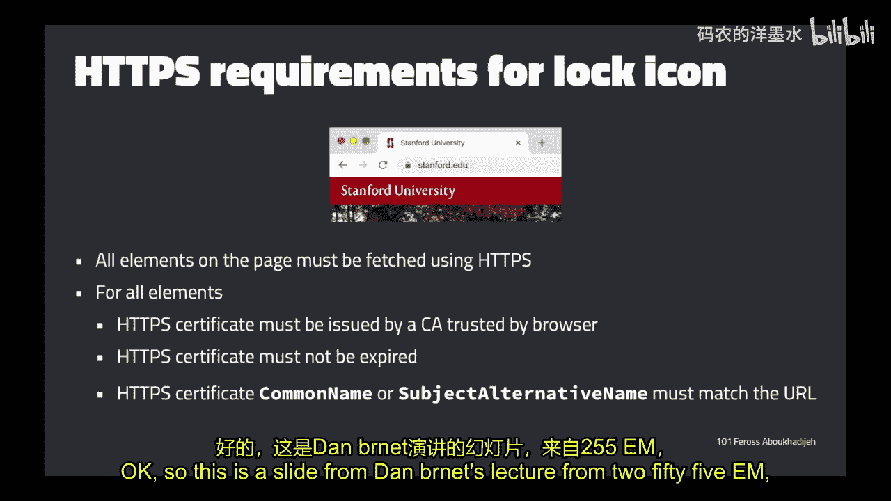

This is the， the key share part here。 This is the the diiffy Heman key St that we already talked about。

 So this is like the client sending its G to the A to the server。

 And this is the server sending its G to the V back to the client。But you also include a nos。

 Why do we include in nonce。 Does anyone know。Yeah。P。So explain Well。

 because you're sending a transcript to us So you want some randomness in there so that you can。Yeah。

 so specifically if。We didn't include this。 Then a man in the middle。

 a person who an attacker who observes this message to the server could replay it。 And in this case。

 nothing doesn't seem like anything bad would happen。

 But what I think where this actually starts to matter is in order to make this whole process go faster。

 there's this thing that。That that browsers and servers like to do called0 round trip time or 0 R T T。

 And the idea is， if you look at all this， look at how many back and forth there are， right。

 It's not until down here。 we actually send the H TDP request to the server。

And and so if you're really worried about performance。

 you might want to sort of try to get the HP request to the server sooner so it can start to work on the request and start to get the response ready。

 even before this whole process has happened。 And so there's a way I'm not gonna go into how。

 But you basically send you send that request up here with the hello。

 And if that's included with the hello。 And there's no nonsenses。

 then you can an attacker could see that message go by and later on So take a copy of it and send it to the server。

 and then the server will go ahead and sort of act as if it received that request again and run run it again。

 And so if that request was buy something on Amazon。

 it's it's gonna cause the server to do that action twice。 And so' that's that attack there。

 But yeah， anyway， that's what the nonsense is for。😊。

And then you'll see the server sends the certificate that it got from the C A back。

 That's just like what we talked about。 It's encrypting it first。

 And that's just so that if somebody's watching this whole transaction or this whole this whole protocol。

 they， they won't know what server you're talking to by looking at the certificate。😊，And so there。

The servers going going ahead and encrypting this certificate with the shared。

 the shared the shared secret that you're gonna to use for all the future sort of messages down here。

 And so， so， so now a passive server can't see with the certificate。 This Does that make sense。Okay。

 what else？We're also。We're also signing the data。 Data here is just the transcript of everything that's happened so far。

 So it's just like what I I mentioned before。 And why do we do that。 That's， that's because。

 of course， we don't want。We don't want this whole thing to be a man middled。And then finally。

 we send finished， and then we run this key derivation function to get some session keys。

 and then we this is actually the thing we're going to use for encrypting our HTP requests。

I think that's the mostly important stuff。And。Yeah， any， any questions。Yeah。

In order to decrypt the encryption for the certificate。

 don' you need the public key which the certificate is telling？

You need what you need this certificate for to tell you that trust publicly you。

So I think what's going on is。The the key share here and this key share。

 like once this message gets to the client， it uses the information in this message along with the A。

 you know， the secret that it generated before to produce that shared diffyhelman key that they're gonna to use。

 And so just by using this， it can get that key。 and then we can decrypt this message。

 and then pull out the certificate。 And then it can look at the certificate and decide if it wants to trust it。

 if it was signed by one of the Cs that it trusts。😊，Yeah， so， it's。

 it's totally willing to sort of decrypt this on a kind of provisional basis， like just。

 just to get the certificate out before it actually sort of trusts， you know。

Trust sort of the rest of the， the stuff in the protocol。 that anything sense。Yeah。Cool， yeah， okay。

 So let's keep going。 Okay， so， yeah， so basically。

 we mentioned nonsenses that prevents replay playss of old sessions。

 But we also have another really nice property in in T S 1。3 called called For Serecy。😊。

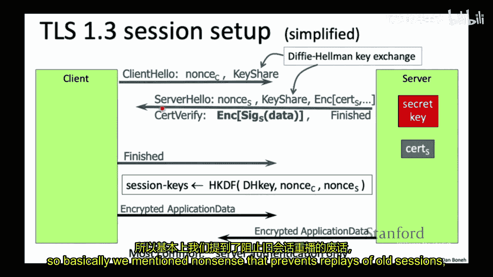

And this is really cool。 So this， this is the thing we're worried about here is what happens if the server gets hacked and some attacker goes ahead and steals this secret key here。

 Now， obviously， they can man in the middle they can they can be a man in the middle now。

 But but on top of that， one really， really bad thing they can also do is if they were in this network position here and observing all this all this traffic and they were saving it。

😊。

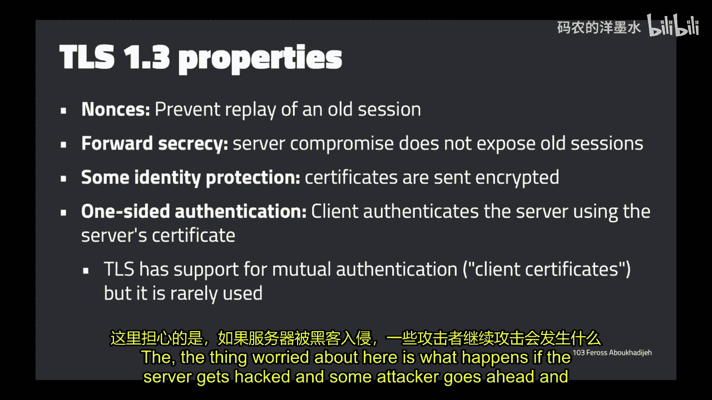

Just saving it in case they might one day be able to get their hands on the secret key。

Then we're really in big trouble now， because。You know， for， like say for like a year。

 they were just sitting here and saving all this traffic。 It's meaningless traffic。

 They don't know what to do with it because， of course， you know， this。

 that the whole point of T L S is that the the men and the middle can't do anything。

 O A passive observer can't do anything with what they're observing。

 But if they get their hands on the secret key。 and then they can suddenly。😊。

Derypt all of that traffic from the last year。 That's really， really bad。

 So we want to ideally not have that be a problem。 We want it to be the case that if you get the secret key。

 all you can do is is man in the middle traffic in the future。

And so that's actually what this accomplishes here， so。

You'll notice that the only thing that secret he is used for here is to sign the transcript。

It's not used to generate。 it has nothing to do with the key that we actually use for the secure communication。

So we generate this shared key。And then， and then we， once this。

 this whole exchange is finished and we send our like the server send its response to the client。

 then we throw away the key material。 We throw away the A。

 We throw away the the G to the A to the B that we that we generated。

 And so so even if somebody gets the secret key， that's not enough for them to dec all of this traffic。

😊，Does that make sense？Yeah， that's really important。It's really cool because that means that if。

 if somebody comes to this server operator and says， like we。

 we want to force you to decrypt all this traffic from the last year。

 there's nothing that they can do to help。😊，It's basically impossible， right？Cool， okay。

 so that's forward secrecy。 We also get， like I said。

 some some identity protection from the fact that the certificate is encrypted， but it's really。

 it's really quite incomplete。 So even though a passive observer here can't tell what certificate the server sent。

😊。

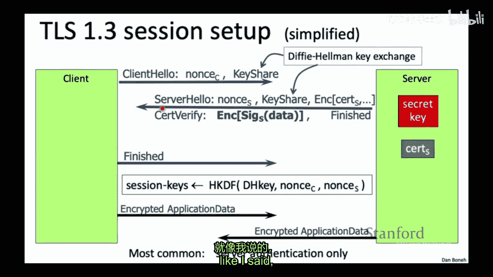

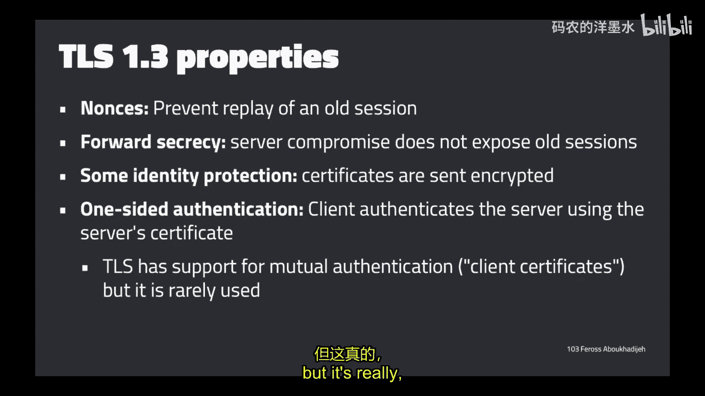

Like I said before， it can still tell that you sent all this stuff to this particular server at this particular I address。

 And that tends to be pretty revealing。 it is possible for multiple sites to be operated on the same I address。

 But a lot of the big sites just sort of own own their own Is。

 And so they're the only site that theyre being hosted on that I address。

 And so it's pretty revealing if you can see that。 although， again。

 you can't see of any of the actual encrypted H TP data。

 But you can still tell this person is connected to Wikipedia， for example， or whatever。

 or also DN S requests if you're not if your DN S requests are also completely in the open。

 then they can see exactly what sort of DNS lookup you did before you did all this stuff。 And so。😊。

That needs to be encrypted， as well。But yeah， that's， that''s， that's， that's really good。

 though theres， at least we're not leaking more things than we need to。

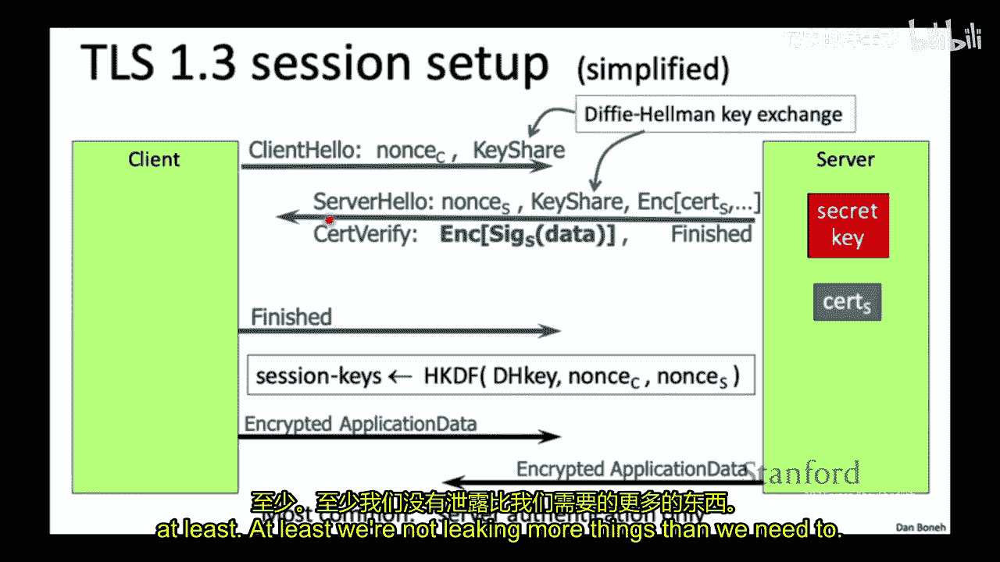

And then， of course， we have those sort of one side of authentication。 So the。

 the client is authenticating the server。 The server doesn't know who it's talking to。

And then I mentioned this， like， I think really early on in the class。

 But there's this thing called client certificates that you can do， but no one really does it， but。

In theory， you can， you can be， you can install a certificate into your browser。

 And then when this exchange happens， it happens the the， the。

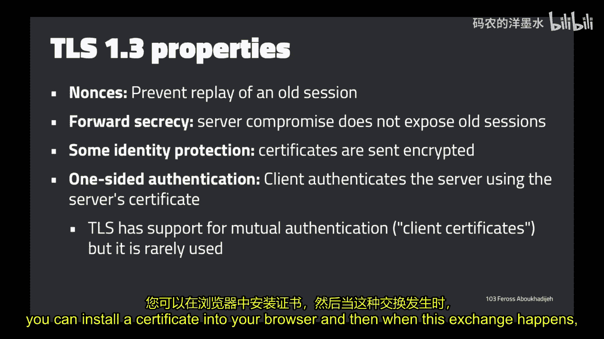

Sending the certificate happens in two directions。 So you。

 as a client can send your certificate to the server。 And if the server knows your public key。

 then it can confirm it's actually talking to you。 no one uses this because no one wants to install certificates into the browser。

 no one knows how to do that。 but but but it is， it is is in theory possible。 Yeah。

 is it just possible for someone to steal the like certificate file itself。

 I just install it on their browser and like Yeah， yeah， I mean。

 think about has have any any of you set up what what is the term for it。 It's like，😊。

Pty the exact term。 It's， has anyone set up S S H where you don't use your password where you。

 you put a key file on the server。 You sort tell the server this is the， the。

 the forget you fingerprint or you tell it the。You， you essentially tell it your your public key。

 and then you have some secret key material on your laptop。

 And then anytime you connect to the server。The the。

 the S H server is willing to trust your laptop just purely on the basis that you have this file on your computer。

 And so， yeah， if that gets stolen， you have the same problem， yeah。

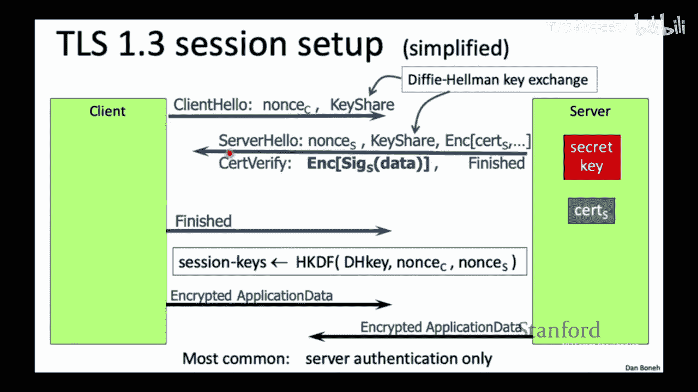

But yeah， it's， it's still useful。Alright， so let's talk a little bit about the adoption of H T TPS S。

 So there's this really cool report that Google puts out called the Google H T TPS Transpar report。

 And they talk about how many sites they've observed during their crawling of Internet that are using H T TPS S。

 And so this gives us some really good insight into how this stuff is being deployed。

 so how many I'm gonna get some， some hands here。 How many people think this number here of sites that work on H T TPS S is more。

 Okay， so this is the top 100 sites that are not owned by Google。😊，So how many do you think？

Work on HPS， more or less than half of them。Right now， right now， Yeah， right now。 So more than half。

Okay， more， what about more than more than three fourths。More than 90%。More than 95%， okay。So， yeah。

 so that's interesting。Yes， I'll just show you the numbers。 We're actually doing really well。

 So almost all the， the top sites work on H TPS。And。A few of them don't default to H TPS S。

 And that's actually a a pretty big problem。So。This number used to be these numbers used to be really。

 really bad。In the past， it's gotten really good in the last few years。

 mostly because the browsers have basically threatened to。

 to print the words not secure next to your site。 If you don't add H GD B S。

 And they announced sort of very far in advance。 like， hey， in two years， we're just gonna。

 we're gonna sort of。Put this really scary text next to your URL。

 So you better figure out in the next two years how to get a certificate or else。 And。

 And then that sort of has made been pretty， pretty effective in making people figure it out。

That combined with Lets encryptpt， providing free certificates for everybody as well。嗯。Yeah。

 there's a really funny thread on， on one one of the browser vendors websites where somebody was like opening a bug saying like。

 my site's actually secure。 how dare you print the words not secure next to my URL。 Like。

 I have my own security mechanisms。 I'm I'm unhaable。 And then very quickly after that。

 like a day later， somebody like profoundly hacked to the guys site just for saying that。😊。

Ptty pretty mean， but also。I don't know。Anyway， but yeah。 so， so that's been pretty effective。

These are some of the the graphs they publish。 So this is how many the percentage of。

 total pages that have been loaded over H TDP S。 And then its sort of split out by by platform。

 And so you can see like Windows is somewhere around like 80，80。

90% for it's a little bit different per platform just because the types of sites that users on the different platforms go to varies a little bit。

😊，For whatever reason， Linux users。Like to go to unencrypted pages for some reason。 I don't know。

 Maybe they're just visiting more interesting esoteric sites that haven't that are less mainstream or something。

 I don't know。 But anyway， And then here at the very top is is Chrome OS。

 So like Chromebooks and they're， they're probably because people are mostly using Google services。

 They're just mostly interacting with H T TPS S sites。😊。

And then this is this is because this is from Google's data。

 There's a lot of sort of Google centric here。 But this is the number of pages from Google services that are loaded over H T T P S。

 So they're almost at 100%， but it's interesting that it' sort of levels off here in the last few years。

 where they can't quite get all their pages to be loaded over H T TP S， which is kind of interesting。

😊，So looking into that to figure out why it is， you'd think that it would be。

Possible for them to just sort of say， we're just gonna go all in on H DP。

 So why is it not 100% And oh， yeah， so。Typically， people use a few excuses for why they can't deploy T L S。

 It used to be the case that crypto was kind of slow to to do this。

 to to run these algorithms on the server。 and it would actually delay the， the。

It would delay the server sending out the response。 That's not true anymore。 And also。

 a lot of ad networks didn't support H T TPS for a while。

 So if you were a site and you wanted to deploy H T TPS S。 and your ads were loaded over H T TP。

 that would cause the lock to break。 and maybe the ads wouldn't load in your browser because of mixed content。

 And so people were sort of hesitant to to sort of throw away revenue。

 And it took a while for that to not be the case。 but that's generally not the case anymore。

 But in the case of Google。The reason why they， I think they haven't hit 100% is because they have a bunch of users on really old mobile devices。

 which are talking to， to certain APIs over H TDP。And those phones are not gonna get any more updates。

 They're just really old phones that， theyre that are out of support。

 And so I think they're just waiting for people to stop using those phones。

 You could imagine they also could just block those requests。 But， but， but yeah， I think。

 I think that's the reason why that number is not100% right now。

And I also looked at like specifically what products it was。

 It was Google News and Google Maps were the two that were， that were below 100%。

 I think maybe just like there's some old maps app and some， and， of course。

 news maybe is because some news sites haven't migrated H TPS S yet。But yeah。

 it's kind of interesting。

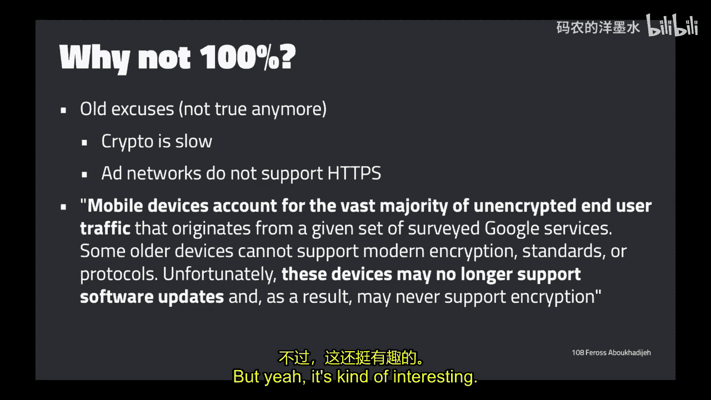

And so yeah， that's the not secure thing that you see in Chrome。

 And now all the browsers have adopted this as well。So it's cool。 Yeah， So there's。

 there's there's a whole bunch of these C As。 and we have a problem。

 which is that if any of them are compromised， then the security of all sites on the Internet are are compromised because that C。

 A can， can issue certificates for any domain it wants to。 And your browser is gonna just trust it。😊。

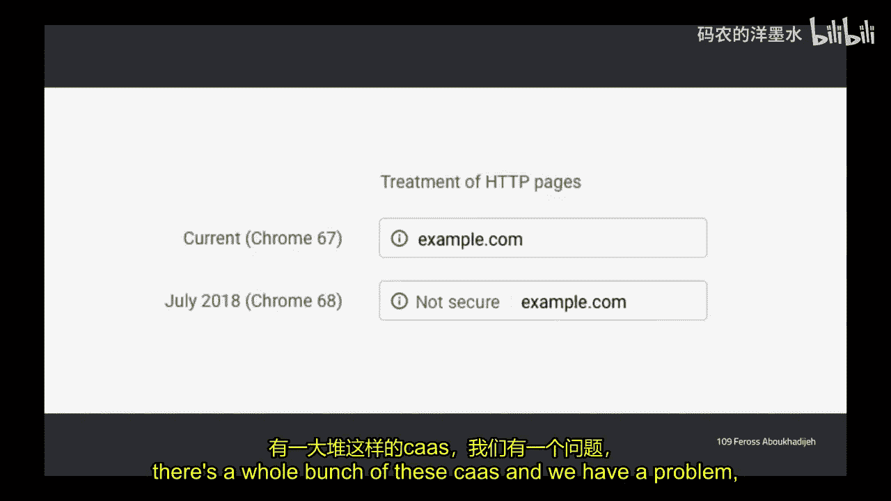

And we have these things called intermediate Cs， which are Cs。

 which are only a thing because some other C A said， hey。

 you can be a C A and signed gave them a certificate effectively。

 And then they can now go and issue certificates to any domain they want to。

 And then your browser looks at the whole chain。 And if it trusts the top level C and the top level C A tells you a trust to this as an intermediate C。

 then you'll go ahead and trust their certificate issued by that intermediate C。

 But they need to be really careful when they issue that because it's basically a flag and the certificate that the issue that says like this person can issue more certificates。

 And so they don'tan to give that to just anyone。 They want to give that just to people who they want to be intermediate Cs It's a really important flag。

 yeah。😊，They。How do you become one of these 1200， You just have to go to one of these people and pay the money。

how do you come to top level C A， Yeah， I think， I think a lot of it is just sort of。I mean。I mean。

 really important companies can somehow make an argument for it。

 I actually don't know the exact process。 There's， there's mailing list for people discuss this stuff and like petition to get in。

 and there's。There's also here， I want to mention a few things。 There's， there's。

So there's here maybe you should。But， I think I think like theres an attempt to sort of let every like different countries have sort of a seat to the table And not so it's not just so US centric。

 but I don't actually know the exact process that that is undertaken。

 I do know there's a process to get people removed。

 which has happened several times in the last few years， which is really interesting。 theres this。

 this case from 2011， where A C A in the Netherlands issued a a bunch of I think it was just for Gmail。

 It was a fake certificate for Gmail。 And this meant that like whoever had this fake certificate man in the middle。

 Gmail connections。 And it was， this was happening in Iran。

 So like hundreds of thousands of Iranian users who were visiting Gmail dot co were getting a man in the middle。

 And no one really knows who did it。😊。

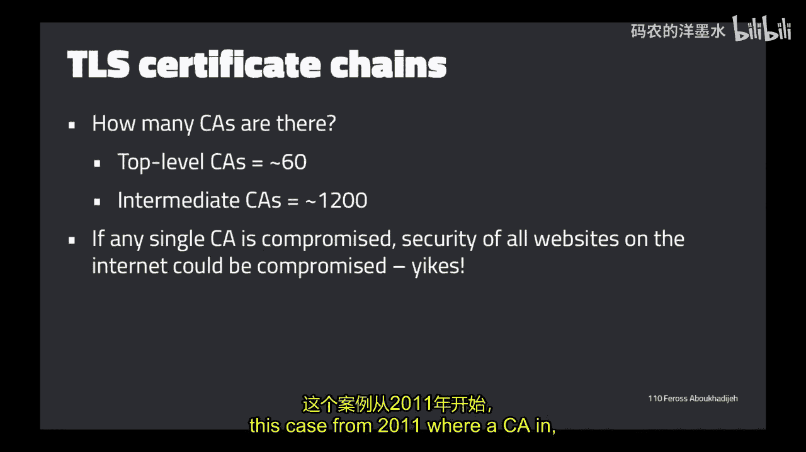

But you can read， you can look it up and just sort of read about it。 It's quite interesting。

 The company that that that lost their the company that sort of got hacked and issued this fake certificate went out of business because as soon as this happened。

 all the browser vendors said we're gonna delete your trust from our browsers。

 And that basically made them out of business because that's the only thing they offer is the ability to to issue certificates。

 So there's actually kind of very high consequences for for， for screwing this up。

 which is really good in terms of accountability。😊。

This is another weird case where this company somehow， it seems like they emailed。

The private keys of some of their users， about 23000 of their users to to ran in person。

 And what's really confusing about this is that they shouldn't have the the private。

 the secret keys of their users anyway。 they should just remember the process I showed。

 you send your public key to them and then they create a certificate and then provide the certificate to you。

 And at no point， do they see your secret key as a server。 right。

 that's supposed to be kept only known by the server。

 But somehow they had like hundreds tens of thousands of actual secret keys。

 So it sounded really unclear what happened here。And then。This one is， is， is。

 is also quite interesting。 Kmoto is always in the news for， for bad security practices， it seems。

 but。Yeah， in this case， one of their resellers got hacked and issued fake certificates for a whole bunch of sites。

 including like Google， Yahoo， Skype， Mozilla， Microsoft。

 And the best thing is the quote from the president and CEO he said， so as a summary。

 it's a sQL attack， fairly fairly common。 on a company in Brazil who sell some of our products。

 nothing to report really。 So yeah， basically got hacked so thoroughly with a SQL injection that that that all these fake searchs were issued and was like nothing to report。

 yeah。😊。

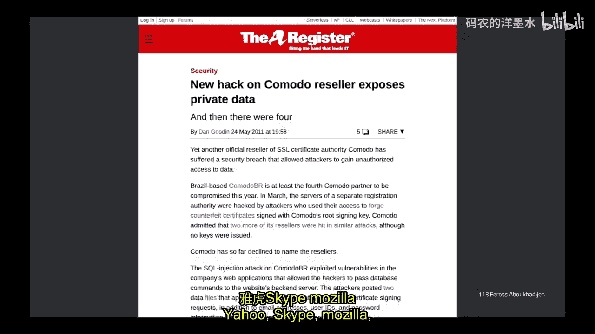

Yeah， so and then and this is an example of sort of the worst thing that can happen to you if you're a C A is that the browsers decide that they're gonna just remove your trust from from the browser。

 And this happened to Cantec recently because of a whole bunch of violations that they they did。

 they were actually then acquired by somebody who was it。 They were acquired by somebody。

 I think And But anyway it didn't matter。 They still got， they still lost their trust and。

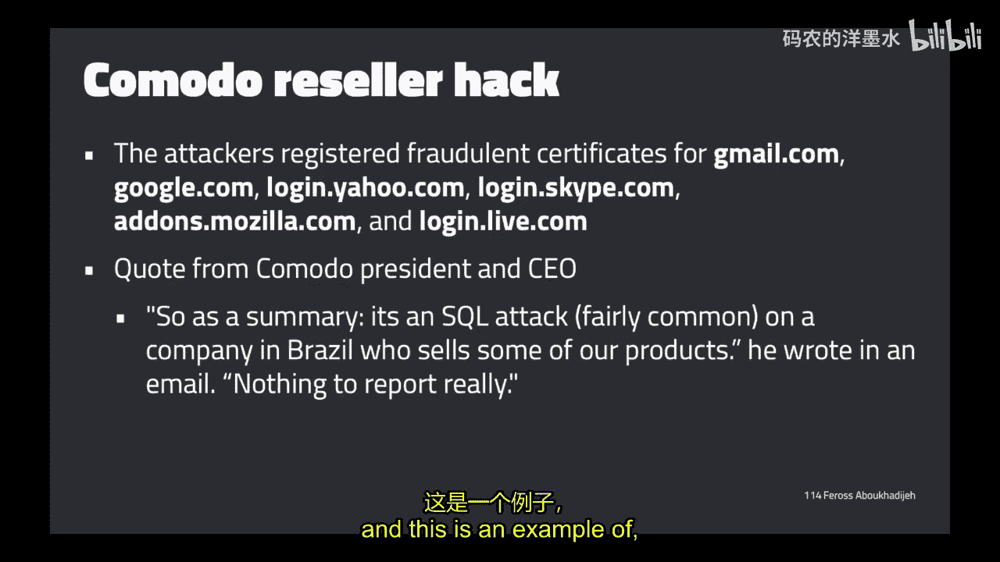

All the other browsers also typically follow what Mozilla does here。

 So if Mozilla decides to remove somebody， the other browsers kind of all sort of in support。

 sort of go along with them and， and remove， remove that C A as well。 But yeah。

 there's a lot of discussion that goes into this。 It's not done really Willy newly。

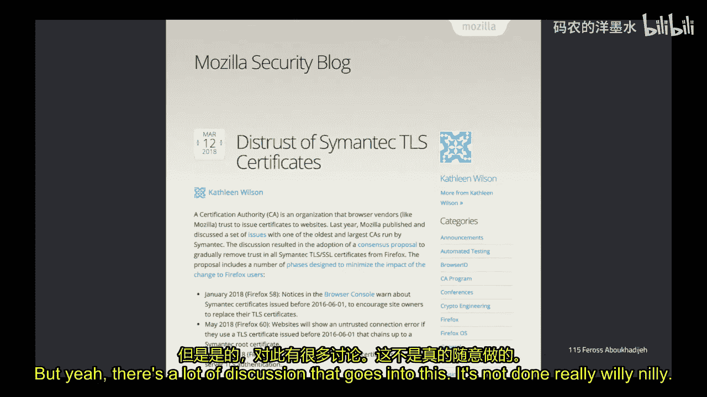

Now let's talk about an attack on HTTPS called TLS Strip。

It's often commonly known as SSL Strip because that was the name of TLS when it was originally released。

 but now we talk about it as TLS， so I'm going to refer to TLS Str throughout the rest of this lecture。

The idea here is most servers implement HTTPS on their servers。

 and then they redirect all requests that come into HTTP to the HTTPS。URl， and so that means that。

Users who accidentally type in HTTP or users who omit the protocol entirely when they're typing in a URL will be redirected to the HTTPS version of the site。

 and that's really useful because the browser assumes that the protocol is HTTP when the user doesn't type anything in。

And so。You know，This seems good but。What if the attacker intercepts the first unencrypted HGTP request？

Before the redirect happens， right？So if they do this。

 then they can man in the middle all the traffic to rewrite the HTML and keep the user on the HP version of the site。

So what would this look like？So here's a。Flow of what this might be like。

 so say that the client makes a request for the homepage of example。com。

AndNow the server here sees that this request came in over HTTP and there wasn't a TLS handshake。

 and so it's going to respond with a 301 response code。

 which means to redirect to the location that's indicated by the location header。In this case。

 there's also some HTML returned that just says the page is moved。

 but the browser will ignore this and we just， it will just look at the at the location header and just redirect the user straight on through to the H TtPS version of the site。

 And so this is great。 So now the browser will make another request。😊，For the same URL。

 but this time it will first do the whole TlS 1。3 handshake mumbo numberbo that we saw before and then it sends its HTTP request within that and then it gets back this HTP responses and again this green square with the lock just indicates that these messages are secured with TlS so。

You know，Everything works out great in this case where there's no， active network attacker。Okay。

 so what the TlS strip attack does is when there is an active attacker。

 we're going to have quite a lot of effect on the client here。

 So what is the active attacker going to do， Well， it's going to see the unencrypted request go through to the server。

 And remember this is a completely unencrypted。 This is being done over HTTP。

 And so the active attacker can observe all the details of the request。And when it sees this request。

 it's going to just go ahead and pass it on through to the server。

 The server is going to respond and from the server's perspective again。

 the active attacker is the client who connected to the server。

 and so it sends back a response saying you know this page is move to the HPS version and then。

And then the attacker there is not going to afford that through onto the client。

 but instead it's going to handle that redirect response itself and it's going to sort of follow up with another request to the server but this time over TLS。

And then the server sends back a response like it normally does。 And at this point。

 the attacker wants to forward。This response that it received from the server on through to the client。

But。Before it does that。It's going to modify it and it's going to change the HTML that it sends back and of course。

 even though this is encrypted with TlS， this is a TLS session that the attacker itself started with the server and so of course this attacker can read this plain text in this response no problem and so it's going to take that plain text response it's going to take it out of the encryption in it's going to go ahead and modify the HTML and in particular it's going to modify all the links in the HTML。

So anywhere where there's a link that is an internal link to the same site。 So you know。

 things like the login link， the link to the different sections of the site， all those links。

 those are all going to be rewritten so that they point to HTTP versions。Of the URL。

So anywhere where there happen to be an HTTPS。URL， those are going to be rewritten to HTTP。

And of course， anywhere where there's a relative URL or an absolute URL。

 So those are URLs that omit the protocol entirely。

 those don't need to be rewritten because of course those are going to be relative to the page that they're included in。

 And so anyway， the idea here is that then。😊，After this strip operation has happened。

 the attacker sends on the modified HTML to the client。

And now the client doesn't know any better that this has happened because of course。

 there's no TLS going on here， the client made an unencrypted request and got back an unencrypted response and and knows no better that this whole operation has happened。

Of course， the especially damaging part of this attack is that this HTML that it got back。

 all the HTPS links have been rewritten to HTTP， and so of course any link now that the client clicks on in their browser is going to go to is going to make another HTTP request。

 which the active attacker can intercept。And so here's here's representation of that。

 So say now the user clicks on the login link， they want to go to the login page。

 that request gets made over HTTP。And the same。Steps that we did before the attacker would do again。

 So the attacker will， you know， man， you know， will， will forward that along。

 get back to the login page and， of course， rewrite all the， all of the。

Links and forms and everything to use HTTP instead of HTTPS。And in so doing。

 they can basically force the user to stay using HTTP throughout their whole entire session。 Okay。

 so we get an idea here that this is quite bad。😊，All the requests have had the TLS stripped off of them basically。

And we want to have a way to prevent this so that the client doesn't get man in the middle because of that first request being unencrypted。

Okay， so the solution to this is HTDP strict transportport security or HSTS。

SoHSTS lets us defend against the ATLS strip attack by allowing the server to tell the browser。

 no matter what protocol the user specifies， always use HttPS。 So if the user types an HtTP colon//。

 they leave off the S and they visit the URL like that well the browser will automatically add in the S for them ensure they're always using HTPS。

😊，The same thing is true if the user clicks on a link from another site。

 or if they even click internal links within the site that are HTDP。

 the browser will always rewrite those to HTTPS when the server has asked the browser to do that。😊。

So how does the server ask the browser to do that， well it sends an HtTP header。

The header is called strict transportport security。

 and you can specify how long you want the browser to remember this preference。

So in the header I've written here， where this is a header where the server is asking the browser to use HTtPS whenever talking to this server for one year。

So the browser is going to have to save that fact， know save that bit of information in the browser and ensure that it follows that rule for the next year now。

One downside of this header is that。It has to get sent to the browser before it can work。

 So the downside here is that that means that the very first request that we make to a site is going to potentially be unencrypted if the user types in H TTP because they can't。

No， in advance， a priorityi that they need to use H T TPS until they've gotten at least one response from the server that includes this header。

 So this is called a trust on first use model。 And it's， it's。

It's quite similar to if you've ever used SSH to log into a server。

 the very first time that youH into a server， oftentimes it will ask you to trust the fingerprint of the server and you can specify yes or no and the idea there is that this is a fingerprint of that server's public key and it's a way to identify whether or not you're talking to the correct SA server。

 so if you're being man in the middle then you would see a different fingerprint than the fingerprint of the actual server that you're asching into and you would know not to trust the server。

Now in practice， most people don't actually verify the fingerprint of the server they asching into most people just hit yes and move on with their lives and in fact this actually isn't the worst thing if you trust blindly the very first time you SSH into the server and you're doing that from home or you're doing that from Stanford or some network that you trust then that's actually not that big of a deal you know。

😊，it's not ideal， but if you're safe that very first time that you interact with a server。

 then in the case of SSH， it will remember that fingerprint forever and if it ever changes。

 it will warn you very very loudly and prominently and refuse to let you connect to the server or to the SSH server。

And so the idea here is that if you trust the server the very first time you talk to it。

 you're sort of rolling the dice the first time， but if you get lucky and it works。

 then you're sort of secure for the rest of time after that。

And so that's sort of how this header operates。So that's great。

 I mean least at least once the users talk to us once we can make sure that they're sort of safe from then on out。

 Now one question is what happens if the user clears their history。

 know they want to clear their browser history， their cookies。

 all that stuff should it also clear the list of sites that have requested to always use HTTPS should it clear the HSTS list。

Now， I mean。If you don't clear it， then you now sort you're keeping a list of effectively of sites that the user's been to you're any of these headers that the browser has received that it's remembering are an attacker or somebody who gets hands on your computer can look through that list and figure out what kind of sites you go to。

 or at least figure out the sites that have set this header。

 which will certainly leak part of your browsing history。So， you know。

It seems like that it would violate user expectations if we didn't clear this information when the user clears their history。

 but of course， the downside there is that now the next time you connect to any of these sites。

 this information has been lost and you can now be be man in the middle on that very first request with the TLS strip attack that we just talked about。

This is an example of a privacy versus security tradeoff。

 and browsers in this case err on the side of privacy。Okay， yeah， so so。One solution to。

To this sort of trust on first use problem is to use a preload list。

 And so this is an idea where can browsers basically offer to hard code URLs of sites which want to always be HtTPS only。

And so the idea here is that you can just tell the browser in advance， hey。

 even before you've seen this header come back from my site。

 I'm just going to tell you now that that header is always going to be present and so just please just preload that into every user's browser。

 so even before they've been to my server。I can just tell， I'm just telling the browser now。

 just make sure that all those requests are HttPS。In order to do this。

 you have to add preload and include subdomains to the HSTS header that the server sends back。

 and when you do this， you're basically saying I am giving permission for the browser to preload。

This header into the browser， and also I'm doing this for all the subdins on my entire site。

Now the way this works is the browser literally has a list。

 it's a source file code in the source code of the browser that is a list of every domain that's opted into this。

 and it's compiled into the browser itself。 so when you download the browser or when you buy a new computer and it comes with a browser。

 that browser includes a list of sites to always use HttPS for and so that means that now any of the domains that are in that list are just the users guaranteed that the requests will always be HttPS。

 even if they omit typing that in the very first time。So that's really， really great。So if you can。

 you should do this for all your sites。And one thing to keep in mind， though。

 is it's difficult or impossible to be removed from this list。 You can request that the browser。

 you know， vendors remove your domain from， from this list later if you want， but。

For all the browsers that are already deployed that users are already using on their computers。

 they if they have your domain in the list， then the browser will refuse to ever load your site over HTTP if you ever decide to go back to serving it over HTTP in the future。

And so so you know， even if you did get it removed。

 you would certainly have users struggling to connect to your site for some time thereafter the way this list is implemented it is actually quite interesting too it'ss literally a URL you can go to。

If you just Google HSTS preload， you'll fly into the domain， you go there。

 you type in your domain and the site will actually make a request to the server and confirm that an HSTS header is present that the max age is at least a year and that the include subdomains and preload keywords are present and if all that stuff's present。

 then the site will go ahead and add your domain to the list of sites to be preloaded and then you'll be added to the list the next time the browsers do a release。

And I believe this site's maintained by the Chrome team。

 but all the other browsers just pull that same list into their source code as well directly from the Chrome repo。

 and so in that way this is sort of the definitive way to get your site into the preload list。Yeah。

 and one thing that's kind of cool is certain TLDs have added their entire TLD to the preload list。

 so I think one example of that is the dot dev TLD。 So if you buy a dot dev domain。

 then you don't have to add it to the preload list。Because。

The owners of the dot dev TlD have just gone in and added that entire TLD to the preload list。

 And so it's impossible to host an HtP site over on a dot dev domain。

 All those are forced to be H TtPS， which is quite cool because now， you know this。😊，You know。

 it's really nice because now。All the different dev domains don't need to go and go through this whole process to get preloaded and we can sort of keep this list from growing out of control。

 and so I'm hoping in the future that more TLDs make this call and just opt a whole TLD into the preload list that would be really great。

So there's lots more things we could cover public key pinning is really interesting we have guest lectures coming in on Thursday。

 Emily and Chris from Google Chrome we're going to talk a lot more about that and certificate transparency and DNS certificate Author authorization is something those are both quite interesting topics that you can look into if you're more interested in this stuff buts there's lots of stuff we could do a whole class on just TLS TLS is a really deep and interesting topic but we'll have to leave it there so thank you very much。

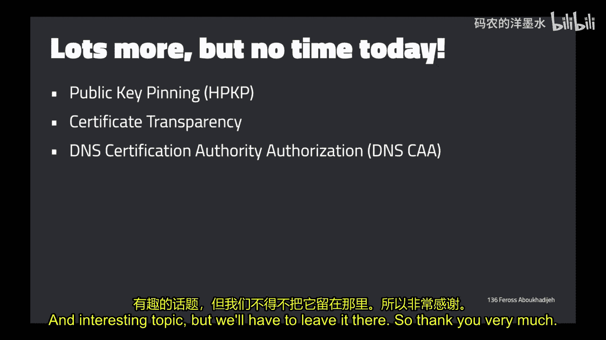

See you on Thursday。