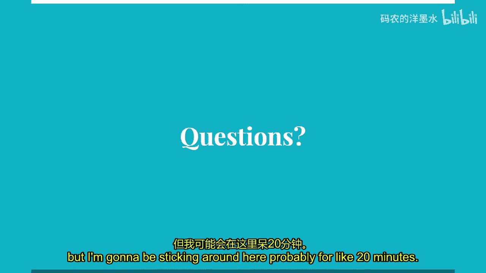

# 【全集】斯坦福大学 CS253 网络安全 中英字幕 1080P p12 Lecture 12 - 现实世界中的 HTTPS - Emily Stark 和 Chris Palmer -BV1RemEBZEEM_p12-

That well is。Ridiculously hard and fun， and then memory safety and unsafety。

 like all of the C++ bugs are in scope for us， and so we work on that。

Making the languages and libraries more resilient to exploitation and so on。

And then in addition to that， I also do another thing。Which is， I'm the。The buck stops here。

 person for。All new Chrome features to make sure they're safe enough for democracy。

And sometimes that's exciting and usually as boring and boring is good。But sometimes it's not boring。

One other introductory note is that we have candy。We want this to be interactive and tell fun stories。

 so if you ask a question or make a comment assuming this is okay， then we will throw the video。Okay。

 so I think you've had some background in the previous lecture aboutGTPS in general。

 just as a reminder， HGPS， which is sending your HTP requests and responses over TLS。

 provides confidentiality and integrity and authentication。

 and those are great properties that we want all web traffic to have。😊。

But the problem is that not all web traffic even today is HGPSS。

 even though there have been great strides and HGPSS adoption is improving quite a bit。

 has improved quite a bit， still the case， but not all web traffic is HGS。😊，And so as a consequence。

 browsers still support HP。And the other problem that we're going to be talking you about today is that HTTPS is only as strong as the underlying certificate。

 which authentics the server that you're talking to。

So the theme of what we're going to be talking about today is that。

Systems that we have worked on in Chrome that live on top of HTTPS or additions or modifications to HTPS that attempt to solve these problems。

 and we'll talk about some of the lessons about what kind of worked in the real world and what didn't。

Okay， so first we're going to talk about strict transport security， otherwise known as HSTS。

And the underlying problem that HSTS tries to solve is that basically HTP still exists。

 and even if a web server supports HTPS， you may still end up trying to contact that server over HTP。

So for example， if you just type example。com in your browser without having been there before。

 the browser will by default， send you to HEPexle。com。

For if you click on a link and the link is hard coded to say HTP or say if a web page loads a subre using the HTTP scheme to load the subresource。

 these are all examples of how traffic can end up going over HTP even if the server supports HTPS。

And as a result， the attacker， an attacker can intercept and tamper with that HGDP request in response。

 even if the server is redirecting to HGGPS， an attacker can drop in and say， well。

 I'm going to rewrite that response to remove the redirect， or provide malicious content。

 redirect to a malicious server。So this isn't theoretical。

 there are the real life examples of this kind of interception。

 one example here is a software that a person named Roxie Marlin's bikeike built which is sort of like demonstration that you can just sit in your coffee shop wF and strip HTD to HTPS redirectracks and insert malicious traffic instead。

 this is an example of a reallife attack that happened to GiHub where they were GitHub was loading analytics scripts that were loaded over HTP and went through China and were being replaced with malicious scripts that performed a DoSA attack on GitHub。

So the first attempt that browserrow is deployed to try to make sure that。

Tffic would not go over HGP when it was intended to go over HGPS was UI you're probably very familiar with the lock icon that shows up in browsers and has shown up in browsers for a very long time Chrome and Firefox showed on the left this is actually an old screenshot used to be green now it's gray and Chrome。

And the purpose of this log icon was to tell users， hey。

 your traffic is encrypted and secure and so that users would know if their traffic is not going over a yes。

 they would notice the absence of the law icon and say， oh。

 my traffic's not secure so maybe I shouldn't enter my password or make this credit card payment or whatever。

Turns out that didn't really work。In practice we call these positive security indicators meaning that they show up when something's good。

 not when something's bad， and then we rely on users to notice when something is missing when the positive security indicator is missing and that's how they know something's bad so it turns out there's a lot of research and literature showing that this whole approach basically doesn't work we don't know if it's possible to design a positive security indicator that actually works so in the case of you know you send an HTP request to a server that supports HTPS but it's going over HGTP and some malicious malicious party on the network intercept and taamppers with it。

 most users aren't going to notice the lack of a lock icon so it's not really a reliable defense。

So the next solution that browser stumbled upon is called strict transport security。

 and this is a mechanism where a website can opt in to a strict mode where the website tells the browser。

 hey， I only ever want to be contacted over a secure connection。So often strict。

And the result of this is this basically results in two behaviors in the browser。

When a website's opted into strict transport security。

 if the browser observes an HP request going to that server over HTTP。

 it'll just rewrite it to HTPS so the traffic never hits the network on encryptryed。

 we don't have to go to the server and get a redirect and get redirected back to HTPS。

 the browser just directly internally rewrites the URL to HPS。

The other consequence of opting into strict transport security is that browsers will not allow users to bypass certificate errors on that website。

So I'll explain both of these a little bit more。This is a screenshot of Chrome's developer tools when making a request to a website that has opted into strict transport security。

 and you can see the way we represent this in dev tools is the request gets internally called an internal redirectact meaning it just gets immediately internally rewritten to HPS before even hitting the network。

So that's the first property。And the second property is that if you ever encounter an invalid certificate on a website that has opted into strict transport security。

You don't get an option to bypass the error， normally on a normal certificate error you'd have an option here in this space to click through the error to ignore it。

 and we don't offer that option for HSTS sites。Any questions so far？

Can you be the candy for for the moment Chris do I have like an HSTS cash and I don't know that is there some danger that I might go to Facebook for the first time like having wiped that in the software update Yes。

 yes so。There is an HSTS cache I'll talk in a minute about about how it works and how long things stay there。

 theres also a problem， we call that the first visit problem that the first time you install Chrome and visit a website we don't have any information about that website with a caveat that I will explain why my costume shortly so generally speaking the first time you go to a website we don't know if that website's opted into strict transport security or not。

 and so that request can be intercepted。There's another question。downOkay。Okay。Okay， so。

Good segue how do you even opt into strict transport security in the first place the general mechanism is an HTP response header so this is the syntax as a response header that a server can send to opt into strict transport security。

😊，And it has a few different what we call directives， which I'll explain one is the max age。

 which is how long the information gets cached in the browser is HSTS cache so for example。

 when a site is first turning on HTPS， they might set this to a very low value so that they can kind of test it out and see how it works but they're not locking themselves into using HGTPS exclusively more mature site with a more mature HST deployment would probably set this to a year or two years it might be capped at a year but to a long value so that once a user visits that website they're protected and only sending their traffic over HTPS for a very long time。

The includes subdomains directive is basically what it sounds like if a website so if you observe a strict transportportsecurity header on example。

com and it sets includes subdomains then it covers all the subdomains of example。

com and so that's kind of good practice but as I'll talk about in a minute it can also。

Create some pain。And finally， there's a preload directive， which again。

 I will discuss later using my costume as a teaching ageide。Okay。

 so I'm going to talk about a few kind of sharp edges that turned out to be sort of issues that deployments ran into after HSTS was standardized and implemented in browsers。

The first is that include subdomains， as I mentioned， applies to all subdomains。

 so this is a problem for large organizations where their whole site pretty much is HTTPS。

 but they might have like one or two subdomains that are operated by a vendor or something where they don't support HTPS and because of those one or two subdomains。

 they can't turn on HSTS for their whole domain in one falsewoop。

So there isn't really best practice or work around or solution for this。

So now this is just sort of a rough edge of that organization。

 large organizations encounter when they go to turn on HSTS。

There's also sort of the opposite problem， which is that if you land on a subdomain of a website。

Theres no standardized way for that subdomain to set HSTS for the whole domain and where this usually comes up is that it's very common for users to land on www。

example。com that's like the website's main landing page and it would be desirable for Www。example。

com to be able to set HSTS for all of example。com but there isn't really any way built into to hSTS for that to happen and what ends up happening in practice is that www。

example。com will load a pixel as a subresource just like an invisible pixel that is loaded from example。

com and sets hSTS with the include subdomain sg。The other big gotcha of HSTS which is basically by design is that there is really no undoing it once you set it and serve the header to real users。

 there's no saying oh I didn't mean to do that once a user cachees it they will remember it for the time that you told them to remember it and that's why as I mentioned organizations tend to roll out HSTS gradually sort of bumping up the maxage as they go so that they don't just like jump into a one year expiration all at once。

Okay， so as you've pointed out， this doesn't protect the first visit and so that turns out to be a pretty good tradeoff in practice。

 like that covers 99% of people's exposure， you you install Chrome。

 you visit the websites that you normally visit， you get HSTS set for those websites， that's great。

 you're protected from there on out， but doesn't protect your first visit because until you've had a chance to receive the HSTS response Centerter。

 we don't know if the website's opted into HSTS or not。嗯。

A final very interesting sharp edge that I want to talk about is what's known as HSTS tracking。

 or you might also hear this referred to as a super cookie or a fingerprinting vector。

HSTS by design allows websites to set persistent state which can be queried from third party contexts。

 so what that means is that both set and read from third party contexts， so if you go to example。

com an example。com loads an image from Facebook， say Facebook can set HSTS and that sets global state。

And if you then go to some other website。com and that other website also loads an image from Facebook。

 that state is being read in HSTS is being applied to Facebook's image load on that connection。

So if you already had the Bra lecture， so you probably your ears are probably perking up thinking about privacy and tracking。

 which turns out is exactly what this can be abused for。

 anytime you have persistent state which can be set and read in a third- party context that can pretty much be abused for tracking。

And you might wonder like why is this worse than cookies which are explicitly designed for tracking like this and the answer is that。

Sort of。Unexpected tracking vectors like this can't always be restricted or cleared or controlled in the same way as cookies。

 so if you go in and clear your cookies it's not necessarily clearing your HSTS cache too so you may think you're sort of started clean from a fresh slate and you actually have an and can tracted。

So。It's sort of like a fun puzzle to figure out how you would do this like how you would actually implement a tracking cookie with HSTS here is a high level idea so here's how you set the cookie you go to a website you're a fresh visitor you don't have a cookie yet。

So say you're visiting shoppingsite。com and shoppingsite。com loads a script from adnetwork。com。

So adnetwork。com chooses a random large number to assign to the user as they're tracking identifier and represents it in binary。

 and then they issue the ad network script issues a subresource request for each bit that is set in the identifier that they've given the user so this example it's 157。

8 are set so we would load subres from subdomains named accordingly。

And those subre loads set HSTS for that specific subdomain that they're loaded from。Okay。

 so now you have this HSTS state set in your browser where each subdomain corresponding to the bit that's set in your identifier has set HSTS in your browser。

So now say you go to newssight。com， so like some other site wants to that also loads a script from adNework。

com and wants to correlate your behavior with shopping site。嗯。

So now that ad network script wants to read the cookie that it's previously set。

And what it does to do that is loads a subre for each bit in the identifier。

 so however many bits can possibly be set， it loads a subresource for each of those bits and observes which of those redirects to HTPS。

 meaning which of those you previously had HSTS set for in your browser。

So that's kind of a high level idea of how you might track someone with HSTS， there's a lot of。

 I think if you actually sat down to implement this， there would probably be a lot of nuance。

 but that's the high level idea。So the interesting thing is that the HSTS designers actually knew about this tracking vector when they designed and standardized HSTS。

 so they actually wrote about in the spec like yeah。

 theoretically this could be used for tracking and security researchers knew about it。

 security researchers wrote articles about how one might。Might have used HSTS for tracking。

But no one really did anything about it until it was observed in the wild。

 so Apple found some evidence of websites actually tracking users via HSCS。

And then they decided to deploy mitigation against it。And I'm going to talk about。

 I'm going to describe the mitigation that Apple deploy and I'll talk about how we on Chrome are kind of thinking about mitigating it。

 but we are not sure yet if we're actually going to implement this plan。And the very tricky thing。

 often， I think our jobs come down to deciding the least bad option with this kind of problem。

 all the solutions that we know of or a tradeoff between security and privacy。

 the more we protect against HSTS tracking， the less power HSTS has。

 as you'll see in a second it'll become more clear what I mean by that。So Safari deployed two mitigs。

 one for setting the cookie and one for reading the cookie。For setting the cookie， they allowed。

 they said if you're a subresource， you can only set HSTS。

 like we're only going to honor an HSTS header if it's for the toplevel domain that you're visiting or the registerstrable domain of that toplevel domain thats a lot of words。

 let me say some example， so if you're on example。com。

 say you're on oh I have an example here if you're on food。bar。exle。com。And food。bar。example。

com loads a subre。That subresource will only its hSTS header will only be honored if it's from F。bar。

example。com or example。com， but a subre from bar。example。com won't be honored， Ba。exle。

com won't be honored， etc cetera。For candy。Does anyone have ideas about why， so like， you know。

 only for the first party host name kind of makes sense。

 you only get to set first party state why would they want to allow in this example example。com。

 like if you're on food。bardoexample。com， why would they want to allow example。com？

Maybe it might be easier if I ask if you are on www。exle。com。

 why would they want to allow you to set example。com？What you were saying earlier about how was。

Tend to assume that WWW is。Yeah exactly， so it's like that they want to support that， oh yeah， candy。

嗯。Good choice。😊，It goes back to like if they want to support that use case that if people land on www。

exle。com， they want to at that point the site wants to set HSTS for the whole domain so they tend to load a subre from example。

com so that it can set HSTS for the whole example。com domain。

 so that's why they kind of said the firstparty host name is fine and the top level what we call the registerable domain it's fine but anything else is not allowed。

Okay， so then so that's their mitigation for setting the cookie。

 they also have a mitigation that prevents people from reading HSTS cookies。

And that basically piggybacks on Safari's rules for thirdpart cookie blocking。

 which are very complicated and I'm not going to attempt to explain。

 but they basically say if we don't allow cookies for a subresource。

 then we're also not going to apply HSTS to that subresource。

So if youve kind of put these two things together， then you can neither read nor write HSTS cookies。

So we have a somewhat different idea for a plan about what we're going to do in Chrome to mitigate HSTS tracking。

It sort of dovetails with a separate effort that we have。

 which is about getting rid of mixed content， which is HTTP subres on HTPS pages。嗯。

So if we go back to my description of how you set and how you read HSTS cookies。

 you have to load an HGTP subresource because that's what you're observing。

 if it gets rewritten to HTPS or not， so if we just say on HGTPS pages。

 you don't get to load HTP subresources， then that mitigates reading the cookies on HTPS pages。

And then our trade off is that we're just not going to apply HSTS on subresources on HDP pages。

So that's where we lose out on some of the security of HSTS because if you're on an HTDP page and it loads an HTDP subresource we're not going to apply。

 so we basically won't be loading that subresource over HTPS when we might have before。

 but we think this is kind of an acceptable trade-off because you're already on an HTDP page。

 you're subject to your traffic being eavesdrogged or tampered with。

 so it's a fairly minimal security loss from not applying HSTS on subresources on those pages。

Questions in terms of the immediate way you detect the like is it that they're looking for the 307 redirect in particular or that they're like creating a window and seeing location changes Yeah it's more the latter like one way you could do this is serve an image and so like load an image and the server serves a different image depending on whether it's accessed over HTTP or HTPS and then the script looks at the image and says which image is served or a plain text resource or something like that。

I didn't think about the double candy situation， I guess we have plenty of canddy so far。Of course。呵。

And oh， yeah。What's the drawback on the Office Sari approach in New York？嗯。So there is there's。

 I would say there's two reasons that this isn't ideal。

So the first reason is that we lose HSTS for subdomains。

 for sub resources where third party cookie blocking is in effect。

So this could be you you are on Facebookbook。com and Facebookbook。

com loads a script from some analytics provider， and we would lose HSTS for that analytics provider if Safari doesn't think it's appropriate to send third- party cookies to that so that opens up your Facebook。

com window to malicious's script injection， whereas before that script would have been loaded over an encrypted connection。

The other downside of it is that it relies on Safari's rules for third party cookie walking because that's sort of。

how they define their solution， and that's probably a whole other topic。

 but like that's sort of not thats sort of not Chrome has a different approach to cookie blocking and so we don't want to adopt their roles for blocking third party cookies。

YeahSo for the Chrome solution， like what happens with the subre？

It support like HTPS or something like that， it only supports HTP their policy。

What to do in that situation So in the case， if you're on an HTPS page and yeah。

 so what we will do in that case is just not load separate source。

Which could cause breakage and there's probably a whole other topic do about how we're rolling out that first bulletlip it basically amounts to。

rununning experiments for two years and measuring what the breakage will be and then we have with a phase timeline over the next few months of basically phasing out mixed content it's going to be a little painful because it will cause breakage in that there like there are HTPS sites that are loading subresources that will just stop working but we do one of the things of one of the you know nice and painful things about working on the web is that we do break things and so we can kind of evolve the platform in the direction that we want it to go if we are careful about it。

just holding up on that little last actually we learned that like something like 4% of the top like 500 visit sites don't even support issueTPS Have you guys received any like angry emails from those guys you're like let' like a backlash on this。

Man， Chris Chris， probably， he has the best stories， I think the short answer is yes。

 we have received angry emails。嗯。Yeah， I mean， people get real angry， yeah。

do you want to take that one， it's weird， there's a lot of difference。Ideas in the world。

Most of which are wrong。You know， just like for anything right， but like some people believe that。

Upgrading to HGTPS， like deploying your site in a way that supports it is an unreasonable and impossible burden。

嗯。And that was definitely true 20 years ago， it was expensive。And it had performance implications。

So they come to the argument with that old idea。But in the modern times。

 HGTPS actually can significantly outperform HGTP for weird reasons。One reason is that。

It enables quick the other HGDP2 protocol， which has rather monstrously awesome。

Spougly awesome performance improvements， and so the only way to get that is HGTPS。

Another is that people believe that certificates are super expensive。And they're not。

 that hasn't been true for a very long time。And it used to be $1，000 when I was a kid or more。

And now there's zero or five or 10 or zero by another means， it's free。So， you know。

 there's a lot of weird arguments out there， but you can't。you ever convince？

Them that you can point to all the data and they just don't listen。So kind of who is it。

 which scientist is it？I want to say it was Neil's bo， but I'm sure that's wrong， he said。

 science progresses one funeral at a time。And then it wass like， you know？Crazy。

 old ideas have a hard place， they're sticky and the way you move forward is you just。

The next generation has a better idea。And so to a certain extent。

 there's always going to be an angry。Deniier， but the numbers are good。

 we have super high percentages of HGTPS。For the things that are really important。

It's pretty much there。So it's okay， they can do what they want。你唱了。But they're mad。

 they'll know you。You just hit archive。😀Yeah。I think go be a day when h T t。Do guys to doよ。

They would be， well， put it this way。After years and years of me yelling。

 FTP is about to be unsupported in Chrome。So an MTTP is from the 70s。

So whenever HGTP is 40 years old。We'll probably remove it from our browsers at that time。

And that'll be awesome and the way we got there is by FTP got to like we have measurements and it's like。

How many page loads has this been used on？0。00002 or something。

 it's something that may have said too many zeros but I'm not sure that might even be too few zeros。

 it's very small。So then we can like。Guiltlessly push the kill button。And we are， and it's great。

So someday that will happen in GDPP too。But until then， we'll continue to marginalize it。

And that's almost as good。What's your flavor？Sneakckerers， reeses， ws， reeses， very smart。

So I might imagine that a tech startup in South Bay is like not going to have that big of a problem with operating to HTBS。

 but like you might get a lot of emails from like small companies in South America or something like people that aren't like tech companies full time。

 I do you have an idea of who your constituency is in that kind of situation？Yeah。

 there's actually a lot of regional different not so much anymore。

 but one time there was a lot of regional differences in HTTPS adoption and it doesn't actually always follow the like what you would sort of guess。

 like HTPS adoption really lagged in Japan for some reason we'd never really figured out why except just like a lot of top sites in Japan hadn't moved to HTPS and once they did。

 then Japan sort of caught up。So yes， there is a lot of regional there are a lot of regional differences。

 but I think like Chris said it's just not that big a deal anymore like they you know it's easy to get a certificate。

 there's lots of documentation and tooling out there。It's not like a， especially if you're new。

 like if you are creating a new website， it's really pretty， pretty straightforward。

 migrating large existing websites still continues to be a bit of a challenge both for technically capable large organizations and not。

Yeah， and then results in a movement towards。You know there's arguments pro and con about decentralization and centralization。

But lately， the industry has been centralizing。And when you all centralize on hosted WordPress or。

AWS readyy to go web server thing or whatever else there is， app Engine。

When they do things like turn on HTPS for free for everybody， and then overnight。

A billion sites that weren't saved before now have HTPS。

And then so that covers a lot of non expert use cases， just like， okay。

 we're fixing it for a million people， and then all the non expertss don't have to do anything and WordPress did that and like suddenly。

A vast swath of stuff got fixed， so that's how to handle the non experts is。

Do it for them where you can， so that a benefit of centralization。That comes at a cost。

 now you're dependent on WordPress or you don't dependent on Amazon or whatever。But。It's trade offs。

All right。Ha anyone owed a candy？Or you want to get one anyway， come on and grab one。Okay。

 one more HSTS thing I'm going to talk about is the first visit problems。嗯。So as I explained。

 you can set HSTS once you visit a website， but you don't know if it's opted in the first time you visit or not。

Except if that website is baked into the browser， so browsers ship massive lists of websites that want to be opted in to HSTS from the very beginning。

 so the second you download and install Chrome， you have a giant list of websites in your browser。

 this is probably like 。0001% of it， that the first time the browser contacts them。

 they will have HSTS set。I am the spooky ever growing HSTS preload list for Halloween。

This is the entire list， double sided。系嗯。You can actually read it。

 probably not from where you're sitting， but it is Oh my gosh。

Keeping in mind that binary size is a make a break concern for。

Like you'll get an angry email if you increase the binary size。

 you could like land a permit that increases the binary size by more than， I don't know。

 a little bit a little bit and then for every N kilobit， kilobytes of binary size on Android。

 we have a percentage of people who don't get the update。

So that really hard security also it costs people real money yeah because like in a lot of markets people may pay money for the data that they download onto their phone and yeah so I think we're currently compressing that as a try in the binary。

要な。There's a question， two questions。对。How do websites get added？Yeah， that's。Theies part yeah。

 so wait is it this？Yeah， so there's a website hSPSSpreload。

org where you can go and add your website and there's like some automated checking。

 you have to meet certain requirements but that'll automatically get you onto the list and you can also submit for removal like that's kind of a nightmare because once you're in the list you can't get out quickly because you have to wait a release cycle and that's just for Chrome I think as I mentioned here other browsers pull in Chroium maintains the list and then other browsers pull it in and apply their own policies on it and so like you might have an even longer update cycle for them if you want to get off the list so yeah it's kind of a nightmare。

I just had a similar question about how they get removed Oh wild be org doesn't actually load and was on the last slide。

Yeah oops yeah， there's no there's we don't currently do any pruning so like we don't check that sites are still live or is still fulfilling the requirements。

 but one could imagine doing that like trying to automate automatically prune entries that are stale or even like if you at a domain and then you discover that it already knows they should discussed on that maybe you don't want that Yeah yeah good luck getting off the list。

Yeahや。😊，Could you talk about like a security risk of why？If they don't have this for the first time。

 like how we might introduce more security risk？You mean like are you saying is the first visit more security sensitive than subsequent visits？

I don't think that。I struggle to come up with a reason why the first visit might be more sensitive than subsequent visits。

 it's just it's just a visit that is unprotected， so I think similar security properties as if the10 visit weren't protected it's just like that's a time when you're vulnerable。

 it's not that the first visit is particularly important in my mind。

I can't unless you're being extremely carefully targeted。In which case。

 someone who's targeting you that closely has other means， most likely interdiction of the gear。

So I don't think first is particularly worse than any other business。Yeah。

Like this like to sign up for this like preload list。

 does the person have to prove that they own the site？

So the way that they prove that they own the site is by setting the header on the site。

 so that was I showed early on that preload directive， and I didn't really explain it。

 the way that you prove that you control the server and want to be on the preload list is by serving HSTS header with that preload directive。

嗯。One could， well， Chris will probably get into some other interesting aspects of proving ownership of a server。

 but that's how we do it forHSTS。Yeah。way why did Chrome choose do it this way as opposed to doing something that's a little more hacky。

 like if you're visiting the site for the first time？

And you know that there's no STS header set sending like。

A fake small request to first retrieve the head and then design the room。

So the way that the preload list started， well， there's two answers to that question the first is that。

The solution that you propose would probably not。Achieve all the same security properties because that request to see if the header set could be blocked by an attacker which would then force it to fall back to HGDP the other answer though is that no one really meant for this to happen。

 I think the preload list started as a list of high value sites like you know Google。

com and like people that friends of the person maintaining the list asked to be on the list who ran high value sites and then it became this so it just no one really designed for it to be this way。

no one has a better idea it's， all these people care about security I yeah it's a lot of it。And。

So an interesting thought exercise like you just started doing is like what would we ever possibly do instead and the answer is we basically don't know。

 like maybe someday we deprecate HTDP and then we don't have to have HSTS at all because everything is only HGPSS。

Maybe we you know go back to the days where the preload list was just high value sites。

 somehow figure out how to define what a high value site is and only that gets to go on the list。

Yeah。Ideas welcome， big open problem because this is obviously not a sustainable solution。Okay。

 that's all I have for HSTS， I'm going to hand it over to Chris unless there are any more questions。

And I think weve switched my。I my。よしなすけ。I。诶应该好 o。あと。See here， what do we got， So keep inning。

First is getting people to use HttPS at all。But once you've done that， what do you actually get。

So a big problem is that。You still have to authenticate your website with a certificate that's been issued by some certificate authority。

And。They're not all as awesome as you'd hoped， or even if there are awesome， you。

 bad guys can break into computers such as the computers are run by certificate authorities and they do。

So the thing that got my former boss to want to come hire me is that that happened。

 some people hacked into CAs and started misisssuing certificates for Google。com among other sites。

And then they could then attack and impersonate the Google server。

From the perspective of those users who happened to be on path of the attacker。

 so they wanted to fix that。So they say， oh， we got to find someone who knows about this stuff。

This Chris guy， he can do it， so they hired me for this to solve that problem。

And so we did or we tried。And then we unship it because it sucks。It turns out it's an open problem。

 how to authenticate in a reliable way。Some random person on the internet youd never met before。

We tried but。He didn't fly， so I deleted it， you're welcome。

So any certificate authority can issue for any origin。

That's good because that means if you're running a website。

 you can buy a certificate or for$0 or for five from anyone you want。

 anyone you think is trustworthy。But that means attackers can also attack anyone they want and then get the same power to serve websites as you。

So， you know， double edged sword there。And in fact， some bad guys have indeed succeeded in this。

In 2011 in the summer of 2011。Some people hacked。This issuer named Digi Noar from the Netherlands。

The attackers were in Iran， I believe。And they issued fake certificates for Google。

And I think some other sites too might have been Yahoo and some others， and at around the same time。

 other hackers also hacked other CAs， there's nothing specific to Google。The Netherlands， Iran。

Diggiotar， it could have been anybody at any time and has been multiple people at multiple times。

 but indeed it has happened。And we didn't want people who use Google services to have。

To find themselves talking to a fake Google， so we got to do something right。

 to solve the problem that anyone can issue for Google or whatever site。So a lot of people。

 I'll first talk about a solution that absolutely does not work。

But absolutely does come up every time on angry emails。And that is， well。

 obviously the problem here was， they say。The Netherlands。

 a CA based in the Netherlands shouldn't be issuing for an American company。

Why don't we just block that？Or an issuer for Japan shouldn't be issuing for a company from South Africa。

 why don't we just block that？And people have wanted to do this solution for a lot of things。

 not just the CA misissuance problem， but in the early '90s and mid-'90s。

 it was a supposed solution for spamM。People would say， oh， I'm getting so much spam from China。

 I'm just going to block China from sending me email first of all。

Does your business development manager know that you've just cut off a billion people from ever doing business with you。

 I bet that won't fly， but you know like back then angry systems administrators thought they had all the power so A that's just a terrible idea from a business perspective。

You know， it's the World wideide web， come on and B。The punchline of that one is。

It turns out that when email spam was a problem before it was solved like it is now。

I think it is mostly most of the spam is actually coming from Florida anyway。

 so sort of like the xenophobia and the nationalism and the you know goofy quick fix of just block all the Chinese IP blocks or don't let anyone from Russia send you email wouldn't worked anyway because all that stuff was coming out of Miami。

So jokes on them， so it won't work for CA's misinsuents either， like for a long time。

 one of the biggest issuers was a South African company and they issued it for everybody in the whole world because after all it's the World wide Web。

And there's a really good issuer in France。And there's a really good issuer in San Francisco and people from France might want to use them and why shouldn't Cambodians get their certificates issued by that good issuer wholesale？

It's not a solution and you can't enforce it or even define the boundaries anyway。

 so' that's a non starter， but I wanted to bring it up because everybody brings it up。

And then we laughed at them。So another solution is。Look， we know if you're a site operator。

 you know who you have。Hired to issue your certificates and you know your key pair for your end entity。

 your leaf node certificate in the hierarchy。So why don't we tell the browser expect？

The keys from those certificates in the chain， I'll show you a picture here in a moment。

And then we would get three benefits if we could do that。You still get the benefit of。

Anyone issuing for anyone because you could bootstrap the pinning of the keys with the existing non pinned infrastructure which does work。

 at least it has the availability property。You could still change at any time and buy your certificates from anybody。

But attackers would lose the ability to issue。Under the authority of any CA。

 they could only they'd have to hack the ones you chose to issue for you。

 which reduces the problem somewhat if there's say 300 issuers all over the world。

But you bought from one， now the attackers don't get anything if they attack 299 out of the 300。

 that's a reduction of the attack surface and that's good。

So another thing to note about that is we pin the keys。The public keys。

Not the certificates themselves。And not any non key aspect of the certificate。

There's a lot of key pinning or certificate pin implementations out there， like for native apps， too。

 people do it themselves， not in their browser， but in their like。Twitter。

 co native app or whatever do co， whatever native app。

 but they often do it wrong in a way that is not。Crypttoographically tied to the actual identity that only the operator can have。

People pin serial numbers from the certificate， which is fable， all sorts of stuff。

 so it's crucial that we're pinning the key。How do we do that？Here's a terrible example。Spooky。

 so scary。Sookies header， you sayP key pins in your HTTP response， just like for HSTS。These are my。

 are my keys。 Please pin them。Here's the Shah 256 of my public key。整体。是吧。

Very frightening So it looks like that and just like HSES it has a max age and you can specify more than one key and in fact you should and must。

And this is the hash of a particular subfield of the certificate called the subject Public key Info。

It contains the thing that says。This is a ED25519 key or this is other kind of key RSA 2048。

 and then here's the bits of the public key itself， you take those two things together， hassm。

 that's the pin。That identifies your key。So in your certificate chain。

You might have a hierarchy like this。Google。com， the end entity certificate has a key that we generated。

Our operators， our operations team。Fired up a generator and built has a key。

 put it in an assert that we then got signed by this GTSC， which is also Google。

And that's now the only one we use， and then that has its authority from GlobalS。

 which just built into the browser。You could pin any of the keys in that three certificate chain。

 in fact， it might be a good idea to pin them all。Because。Pin validation。

 so you've made a connection to a web server。With regular HGTPS and regular CA authorized。

Certificate validation and then we're going to do an extra step we're going to validate the pins the browser has previously seen a pin set。

 a spooky one maybe。And then we're going to see if any of the pinned keys。Interssect， intersect。

With a set of keys in the chain。And if they do， then we know that it's good and if they don't。

 then we know that we're talking to maybe an impersonator。Or maybe the operator set the wrong keys。

Ohoops。But that only happened one time that we know of。To a person making an encrypted chat app。Oops。

 but it does， it could happen and we found that operators had a hard time with it。So the trouble is。

Successfully doing this is kind of hard。You kind of have to be a public key infrastructure nerd。

To even know that there's this hierarchy and to even know what a subject public key info is。

And you know if you're。Randomsite。com， you don't necessarily know all of this。Esoteric。

 weird information。And we found that indeed people don't and we tried to like help them out。

 we you know published She scripts， just run this script and you'll get a pin set。

And that was too hard for people。Um，W which， you know。

 I feel their pain because the last thing you need is yet another hurdle。

When you're trying to just set up a thing。But the other thing is that's like absolutely not their fault and also unfixable。

Is that the chain that your server serves when you're like。As part of the Tls handshake。

 the service says， hey， here's my certificate chain。

I hope you validate me so that we can keep talking。The client in order to validate it。

 builds a potentially different chain。Different from what the server served。For example。

 see how it says built in object token。The server definitely does not serve the root certificate as part of their TLS handshake。

The client discovers that from their own database of roots。

And what if the client discovers a different route， what if GPSC has been signed by two routes。

 for example， that can happen， it's called cross signing。And what if the client happens to find。

 what if you pin to the root？Only， let's say。But the client builds a different chain to a different route。

 then you will fail pin validation in a way that you， the server operator。

 might not have ever been able to predict。And then like what are you supposed to do。

 it's not your fault so and then the worst you can't， you might think well， okay。

 server operators now have to learn how clients behave。Hey， that's unfair。B is a million clients。

You know， there's Safari， open SSL。Chrome， Firefox， every version of every browser， you know。

 and on every platform they behave differently。Because they have different routes。

 they have different TLS client libraries， they have different certificate libraries。And then three。

 they're subject to change or how many points am I on， whatever point number 17。

 it could change at any time。Including by administrator policy on the client side。

The server operator has no reliable way to ever guess。What kind of？

Chain the client's going to build at connection time and they shouldn't have to it's crazy and also even if you couldn't learn。

It would be the entire focus of your career， suddenly that's your whole job。

 we have a person whose whole job is to know that。And。

He went from being a tea toddler to kind of drinking a lot。

It's really hard and it's crazy and it's scary and it's buggy and man。

 so point being it's too unreliable。U to be something that we can actually ask people to rely on this is an open web platform feature。

 you should use it for safety， also you can't never know how it works reliably enough to make it work。

Good luck everybody， so that's a barmer。So also。It's hard for the people who use browsers to use。

For two reasons。One， failure like for HSTS， we thought this was a good idea back then。

I no longer think it is a good idea。Failure is done recoverable。

 you can't click through the error screen。If pin validation fails。

 you cannot see the website you are hoping to get to today。And it's not actionable。

 what are you supposed to do when you see the screen？HeEverybody。

I don't know if try again later tomorrow， sorry about that。That's not a satisfying answer。

And it might not even work tomorrow either， like what if there's something really wrong with the website。

 what if they accidentally set the wrong pins and a max lifetime of one year。Oops。

 you know there is no trying again later， so it's nonrecoverable and non actionable。

 and so it's just a real bad experience for the people who use browsers。

Even though the reason it's broken is because for safety， like you might actually be under attack。

You know， and you would not want to proceed， that's what we thought was the better trade off。But。

It doesn't go over very well。So there's also the problem of， I think this is a marginal problem。

 as far as I know we never saw it in the wild。But we theorize that it could happen。Hostyle pin。

If someone hacks into your server， A is game over anyway。But B。

 they could do an even worse thing to you， they could set their own pinet for you for your domain。

And they could pin clients to their servers。Or whatever， are keys they control。Um。

Or they could just set junk that like they could set it to keys that validate today but。

They set a lifetime of one year and then after today。Those it'll never validate again。

So then people would lose the ability to talk to your site， even after you recover from the attack。

 you know， oh no， we got compromised， set up fresh web servers， generate new keys。

Send out those notifications， all the users， the breach notifications。

 do everything you can to repair。But people with clients that got the bad bins might still never be able to get to you。

And again， there's no way for the users to recover or no usable way。

 you actually can go to a secret web page in Chrome to delete pins。You have to know what that is。

 no normal person is ever going to do that。There's no like easy recover。

Whereas when this happens in SSH， has anyone use SSH， probably many some people？You know， when you。

Talk to like if you reinstall your Linux server， it'll generate new keys and your SSH client remember the old key and then it'll tell you key mismatch。

 lookout， you'll know that it was you set up the new server and you can say， okay。

 delete the old key， continue anyway。But that's like that doesn't scale to the whole world of billions of people talking to tons of websites and they don't know。

 they have no way of knowing what's the right decision。So there's no recovery。

 so hostile pinning is a thing， I don't know if it ever happened。But we didn't like the risk。

So our solution to all of these problems was unship。平ing。Here's the C。

 the change list where we removed it， and we were so happy。This good old feature that really helped。

Was also broken and hard to use and too weird， deleted。So we did。Years later， this is in 2018。

 seven years after I was hired to build it， we deleted it Also people were angry about this they were another time we got angry email people were mad that we added it and they were mad that we deleted it。

And some of the people who really wanted it， like some people were。

Trying to use hostile pin as a feature。In a way that I didn't fully understand。

And they were mad about that， other people were mad that。

They were losing the safety features of pinning， like I should say of dynamic pinning because it really。

 you know， when it works， when everything works well。

 it does do the job that it's supposed to do if people are mad about losing that。

 which is understandable。We just didn't think that the usability concerns and the risks outweigh the benefits。

Because we have alternatives。One is this other mechanism called CAA。

Certification Author authorization。Remember the key problem here is that anyone any CAA can issue search for your domain。

That's just part of how the way PKI works。So there's this other solution where you add a DNS record to your domain and you say basically。

Look up this when a certificate authority is going to issue it for your domain。

 they look up this extra DNS record for your domain and the response value of that lookup is RCA is you know Fo company。

 we use Let's encrypt encryptrypt or we use Global sign or we use some other one。

And then if you're not that company。If you're lettinging CR and you receive a CAA record that says that that domain wants to be using a different issuer。

 then you're supposed to stop the issuance process。So it's advisory。

 like we're relying on the good behavior of CAs to adhere to this suggestion。And if they break it。

 then you yell at them and then you know there's phone calls and there's lawyers。

And that sounds like unsatisfying to nerds because。

Keep hitting with stopping real attacks at runtime in the wild。And this is like， well。

 after the fact you could sue or have an argument。You're welcome， so it's not as awesome。

 but in fact it actually does work。CAs actually do adhere to what they see when they do these lookups。

And when there is a problem， they do behave well， like one time Letsenrypt accidentally did issue some certificates that they were not supposed to and they behaved well and they revoked them and they did the best thing they could to recover from that。

And。That's as good as it gets， and it did work as far as it goes。

The other thing is DNS is not secure yet。We're working on that， that's happening， but for now。

That the request and the response for a CAA resource record is in the clear， not encrypted。

 not integrity protected， not authenticated。So an attacker who's on path between。

The CA and your server can alter that response。And set it to the CA that they have compromised and then they'll still succeed so it's not perfect。

But it's better than nothing， we say up to 20% better than nothing。And soon。

 DNS actually will be safe。For sure， this time。So that helps。

So another thing we could do is static pinning， in fact。

 the first version of pinning was preload just like this。And only after that work。

 did we have the idea of doing it dynamically with an HGTP response center？

So we still have static pinning in Chroe， that's still there， there's also a giant list of pins。

 much much， much less giant it's much somewhere thankfully， it's smaller。

But it's there and it's carefully manually curated by us。And。

The way you get on it is you got to know the right person to email or whatever does the form does the HSTS form work literally you have to do the email。

 yes。So it's less， it's a pain in the ass。It's less of a panone the as than the giant list。

But if you're pins。Our bacon into the chrome binary。

And you then change keys in a way that you can't migrate from， like if your pin set doesn't include。

Say the issuer that you're still using。If you ever change your keys。

Then your site is bricked in Chrome until the new Chrome release comes out。So it's not great。

 I don't know if we had that problem happen to us， but it could happen No no。

 their problem was no you're right， you're right。It was ecst， you're right。But yeah。

 so it's a thing that could happen， it's a bummer， we do it anyway。We think it provides value。

 we know it provides value， like that's what makes Chrome know for sure that you're talking to Google。

 Facebook， Twitter， tour project。A whole bunch of important size that you care about are protected in this way。

 so it's worth it。But you know。去哪了像。Another alternative to pinning is certificate transparency。

Which is similar to CAA in that it's sort of after the fact。

Auditing and enforcement at layer8 with phone calls and stuff。But it does do a lot of good， actually。

 and Emily will explain。Yeah， until 250， is that it， yeah。very free。对。こです两。嗯。

Anyone have any questions about？O，我're going toCG。嗯。

Okay so I have a lot of slides about certificate transparency that there will not be time to go through so maybe we can distribute them after or something Okay so I'm going to try to do lightning to CT so the high level idea behind certificate transparency is we may not be able to prevent attackers from actually using malicious certificates which is what pinning keep pinning was aiming for but maybe we can make all malicious certificates discoverable。

😊，And the idea here is if the malicious certificate is our discoverable。

 then maybe we will discourage malicious issuance， we'll reveal accidental issuance。

 so when things go wrong， not out of malice， but just out of sort of accidents。

 we'll be able to notice and remediate that。😊，And we make a tax noisy。

 so that sort of increases the cost of an attack and make sure that you can't pull off an attack silently indefinitely。

 you're going to be noticed eventually and I'll talk about what eventually means。So before CT。

 this is just kind of a reminder， I think Chris explained this and you probably already know this browserrows has a list of root CAs when it receives a certificate from a server。

 authenticating that server， it checks that the certificate is signed through some chain by one of these built in root CAs。

嗯。Okay， so what if we introduce into the picture， the idea of a public log？

Where all certificates go into the public logs and anyone can view everything that's in the public logs。

Meaning that observers can watch certificates that get added to the logs and look for malicious certificates。

 so a domain owner like a website operator might look for certificates for their domain that they didn't intend to issue and that were issued either accidentally or maliciously。

 researchers might watch certificates for evidence that CAs aren't following proper practices。

 etc ce。So this is a cool thing to have if we had these public logs， but how would we use them。

 the question is how we would use them to ensure that all certificates are publicly logged。

So one idea you might have is suppose we add this step into certificate validation in the browser where before validating a certificate。

 before treating a certificate is valid， we go and check with the logs and make sure that the certificate is actually logged。

 so the browser only accepts the certificate if it knows that it's valid or sorry that it's logged。

 so the effect of that would be an attacker can't use a malicious certificate like the browser won't accept it unless the certificates been publicly logged。

It turns out this doesn't actually really work because a lot of reasons。

 including privacy and performance。So an iteration on this idea is suppose that when you put a certificate into a log。

 the log gives you back sort of a receipt saying a signature on a statement saying I logged with a certificate。

Then the server can provide this signed statement along with the circuit give。

And the browser can validate that sign statement using the log's public keys and say， oh。

 this log actually promised that it logged this certificate。

 even though I'm not  querying the log online directly while setting up the connection。

 I know that this log said， hey， I saw this certificate and I'm going to log it。

So this starts to look a little bit more like the actual system of certificate transparency there's one more sort of iteration on this that needs to happen for very practical reasons。

 which is that the receipt that the certificate， the receipt that the log provides upon receiving a certificate is actually a promise to log the certificate in the future。

 specifically within 24 hours in practice。And the reasons for this are kind of silly and practical it arises out of the fact that CAs didn't want logs to be in the critical path for certificate issuance。

 so CAs didn't necessarily want to wait for logs to do slow operations and logs the certificate before the certificate can start being used and accepted by browsers as valid so the actual system evolved where the logs say。

 hey， I saw the certificate I'm going to real quick give you back a signature that I saw it and I promise to log it within 24 hours but the logging might actually be a slow operation that takes longer。

So this is cool we have we have sorry is the login have in response to something the CA does like they notify the log or is it something like when the client sends a certificate it can be and all of the above anyone can submit any certificate to a log so typically the CA submits it when they issue the certificate。

 but it could also be the site operator， the website operator it could be the browser vendor。

 it could be a researcher， the Google bot submits certificates to CT log so as Google crawls the web it submits every certificate it finds to CT logs。

嗯。So one more challenge which I probably don't have time to go into is what really makes certificate transparency challenging is that we want the logs to be untrusted so in this diagram like this is great if you trust the logs to do what they say they're going to do if the log says I saw the certificate I'm going to make it publicly visible then that's great as long as you trust the log but the log might lie to you and say it's going to log this certificate but then it doesn't or it might tell one observer hey I log the certificate but not tell other observers and ideally we want to prevent that because the whole problem we're trying to solve is that there are all these CAs and they're not necessarily trustworthy and we don't want to just replace that with oh there are all these logs and these logs are you know not necessarily trustworthy so we want technical mechanisms to make sure that the logs are behaving the way they're supposed to。

嗯。The core idea of how we do this technically is an underlying cryptographic construction。

Where what you want from the logs is sort of a short summary where you have these properties。

 these two properties from the summary。The first property is that if two observers of the log have the same summary and they can efficiently compare that summary。

 then they know that the same data went into that summary。

 so the summary is sort of like an efficient way to compare that all the same data was observed by those two observers。

The other property that we want from this summary is that if you have a certificate and a summary。

 there's an efficient way to say this certificate was included in the data that produced this。

I think I'm going to skip over how this actually works you may have seen it before in a different class did you like hear about this yesterday or something No like I'm thinking a blockchain class in Har base there's a blockchain class really。

Okay， yes。I'm going to refrain from commenting for this So if you've taken the blockchain class。

 this kind of construction might be similar to there's a summary。

 the summary is the head of this tree the top of this tree。

 this is what observers can efficiently compare to prove that they've seen the same data and you can also efficiently prove that a given certificate went into a given summary。

I will skip over this about how you actually do that。Right。

 so so the idea is that when a server sees a certificate with one of these when an observer sees a certificate with one of these signed statements that a log is going to incorporate that certificate。

 it can ask for one of these summaries with a proof that the log actually included that certificate in that summary。

 and then different observers can compare the different summaries that they saw from different logs and make sure that they're actually seeing the same view。

 so that way you know a malicious certificate doesn't show up to one person but then the person who's actually looking for that malicious certificate doesn't wouldn't see it。

The high level takeaway here is that。CT does not provide all the security properties that keep an aims to so as Chris mentioned it's not runtime detection or prevention if you get a malicious certificate there is a period of time where you can use it before it shows up in CT logs。

 there also might be a malicious log and it could take an unspecified amount of time for that malicious log to be discovered and the consequences of that to be discovered。

So it's all about detection rather than prevention and as I mentioned。

 you know that has some good effects like it discourages malicious issuance， it makes a tax noisy。

 and it helps with what I'm calling hygiene here， which is that it helps organizations and researchers discover bad practices in the ecosystem。

So this had happened in the wild， Facebook discovered that they had some certificates accidentally issued。

 that they didn't through some vendors， they didn't mean to issue。

 and they discovered those through CT。CAAs have been found to be violating their requirements of being a CA。

 many times many different CAAs discovered through CT。

Other high level takeaway is that CT has been in development for like。I don't know seven。

 eight years now like this is you know just a snapshot of some of the milestones involved in rolling it out we were dreaming when I started in 2011 yeah okay so like yeah eight plus years yeah and all this work is like only the very tip of the iceberg in terms of actually fully deploying CT like the systems I described about observers comparing summaries with each other and verifying that every certificate they see is actually included in a valid summary none of that stuff is really designed or built or deployed yet there's like theoretical ideas about how we might do it but very much open problems。

So speaking of open problems， I just wanted to wrap up by reiterating some of the interesting giant open problems that we talked about。

HSTS tracking， no one really knows the best security privacy trade off there what do we do about these static giant lists we're carrying around which are very spooky。

 there is no system being proposed that replaces the security guarantees or keep pinning without the downsides and all the open questions around CT log honesty that I just talked about I want to make one note about that kind of stuff and the hardness of these problems。

They're hard conceptually and then they're tripled exponentially double hyper hard when you are talking about moving a whole ecosystem of billions of people and people with tons of different motivations and sometimes countervailing goals and we joke like oh。

 I'm getting angry emails and I was driven to drink and you know people yelling at me but it's worth it。

 it's so fun， we've achieved a lot of success and we've。

Bumped up to the point where our hard problems are things that like。

There is no known solution for it because we already solve all the easier parts， you know。

 and that's pretty awesome before we got started， Emily and I were talking about how we wouldn't want to do anything else。

Because like， this is hilariously fun。Even when you're getting a me and email from a random person。

 it's like， yeah。Still， we're winning。Cool， thanks， Brian， see you later。So it's great。

And I hope you all do too so Dave， thanks for taking this class， which I assume is。Elective， right？

Yeah， so you can help people with what you learn here in this class and I hope you do。Cool， thanks。

Thanksice， will you guys to stick around for a few minutes for questions if people have stuff Okay cool yeah I have office hours after this。

But I'm going to be sticking around here probably for like 20 minutes。

 so we'll start a little bit late。

