# 【全集】斯坦福大学 CS253 网络安全 中英字幕 1080P p13 Lecture 13 - 身份验证 -BV1RemEBZEEM_p13-

Hi， everyone。So today， authentication。Before we start just some admin， today。

 assignment 2 is going to be due at midnight。 How is that going for everybody。It's good。 Who。

 who's not finished with this still。Okay， how is the CSP step specifically。Okay。

I'm suspicious about it。Yeah。Okay， someone else， anyone else。 How is the， Yeah， excuse。Really。

 and I went to the talk hours yesterday， and that helps a little bit we did some disgust some CSP stuff。

 but。My biggest takeaway was this is why people don't use it。Really， okay。Understanding it。Darn。

 the the whole point of， of having those questions on there was like to make you all feel confident。

 Like I can use CSP when I build my website。 That's too bad。 I man， okay。

So some ideas we've been thinking about is maybe doing like a， a。

 like sort of a review session on CSP specifically to help with getting through the homework。

Would that be useful for people？So， is it just the CSP stuff or is there other other parts of it that are hard as well。

 Most of the CSP， okay。Okay， so we， Esther， we can talk about doing that， maybe。

raise your hand if you would attend a review session on CSP。Okay。Okay。

 so maybe we can do that before Thursday。 Okay， how about this。

 We'll extend the assignment deadline to Thursday。Okay， and so it'll be midnight on Thursday。Okay。

 that probably helps a lot of you with midterms this week too， so okay。Alright。

 so so assignment will we do on Thursday at 1159， and we'll， we'll。

Try to announce a time and a place for a review session on CSP。 Also。

 there's office hours that Esther' is holding on Wednesday。

 and I'm holding my usual ones on Thursday as well after class。

 So those are always available as well。😊，Okay， alright， great。

 Any other issues with the homework or anything like that you wantan to talk about。Okay， cool， so。

 so Thursday， we're having a guest lecture by somebody named Lucas Garin。 He was my year at Stanford。

 and he was a fellow fellow section leader。 So he's really cool。 he's gonna talk about Webbo N。

 And fun little fact about him is that remember the preload list that Emily was wearing on her body。

 So he was actually the one who was responsible for maintaining the website for that list。

 HS T S preload dot org site。 So you go to the site。 you type in your domain and would verify that。

 you know， you had the right HS T S header。 and then it would go to him for like a review。

 And so he was literally seeing the sort of the list get bigger every day。

 That was his job at Google。 So we can， we can hassle him about that when he gets here。😊。

We can blame him for it。Cool， yeah， but that'll be interesting。

 So Webboth end is is a way for the browser to。😊，A way for the browser to interact with different authentication devices on the machine。

 So things like the fingerprint sensor， F I sensor and physical hardware tokens in a standardized way。

 So it's really cool。😊，And they're using it at Gitthub。Alright， so。Yeah。

 so today our topic is authentication， and the question we should keep in mind when talking about authentication is how can we build systems which are secure even when the attacker has the user's password？

😊，So this is。Seems like a hard problem， hard challenge we've set for ourselves。

 But we have to keep in mind that， know， one of the themes of this class is like defense and depth and being resilient。

 even in the case of like one of our systems failing， right， So we。

 we want to think about what we can do， How can we not fail so drastically when。

 when an attacker actually has a user's password。嗯。Yeah， okay， so。

Let's review what is authentication。So authentication is when we're trying to figure out that a user is who they say they are。

that's the big idea。Is the user who they say they are typicallyypically， you。

 you will do this by checking something about the user。 So it could be something that the user knows。

 So a password that the user knows and has in their in the brain that they that they present to you。

 or it could be something that they have something physical that they have like a phone。

 an I D badge or some kind of a cryptographic key that they possess。

And it could also be something that they are。 It something physical about them。

 like their fingerprints， their retina or any kind of other biometric data about the person。

I was just reading a news， a news story about interesting new sources of biometric data that that are being used by governments and other sort of。

Inesting actors there's now like G is actually a biometric a data point that you can use to detect a user。

 So literally based on how you walk nothing if nothing other than that information。

 they can figure out that it's you because it it's unique enough， which is sort of terrifying。

ho was the other front one that was kind of funny。 There was， Oh yeah， there was an experimental。

 So some some Japanese car company was doing experiments on how to reduce car theft。

 And one of the things that this didn't ship。 But its kind of a funny idea was they could actually detect the shape of your rear end on the seat。

😊，And then just like not start the car if it's different。They said it was really accurate。

 They said it was something like 99% accuracy， but they didn't release it。 I don't know why。

 It seems pretty good to me， yeah。😊，Yeah， I mean， maybe if you're paranoid you turn this on， right。

 like， okay， I only want my， you know， I only want these two drivers to be able to drive。

 but like anyone else can't， right。Yeah， what else。I mean。Yeah， I mean， emergency situations。

 then somebody else couldn't drive your car also that's kind of not ideal， right。The。

 the thing about biometric data's not that's not ideal is that it's not changeable。

 So if if your biometric data gets stolen， you can't reset it。 that's something to keep in mind。

 You can always change， you know， your phone or you， if your computer gets hacked， you can。

 you can put new cryptographic keys on it， but you can like change your fingerprint。

This is one of the reasons why a lot of systems that do this kind of biometric authentication。

 They actually， they do it on device and they don't send the biometric data to the remote service。

 So I don't know how it works on Android， but on iPhone， at least anytime you use touch Id or face I。

 that data stays on the data stays on the iPhone。 and you're actually just using that biometric proof to unlock a key store。

 And then there's a cryptographic key in there that that you can use to actually authenticate。

So yeah， that's something Kim。 And that's actually how Web authentic is gonna do it as well。

 That's the browser authentication thing I mentioned earlier that Lucas is going to talk about。

 You wouldn't want to actually send that to the server。Yeah。

 so the more factors that we use out of these three categories of factors。

 the more sure we are that a user is who they say they are。Any questions about this？Okay， cool。Yeah。

 so， so if you think about like approaching ATM， what do you do at an ATM。 Well， you。

 you provide two of those factors， You provide usually you provide something that you have。

 So like the ATM card。 and then you also provide something that you know， which is the ATM pin。

 So that's a sort of two factor authentication。 you don't typically。

 as far as I know scan your fingerprint or do any kind of other biometric authentication。

So what do like UB keys or physical security keys do to like secure themselves in case somebody happens to find yours on the ground？

Is the premise like you have no idea like what service it's tied to so like you can't really eat。

Like， you don't know the user name that's tied to。 So it doesn't really help you。

 or that's a good question。 I don't know。 I， I think like if somebody。

 So if an attacker gets your specific key and they know that it's yours。

 then that factor is like useless， right， So hopefully you have other factors。

 Like hopefully they still don't know your password or hopefully they don't you know。

 they don't also have your your finger or your face like handy。But， but， no， actually。

 that's a good question。 I don't know what you can actually get off of the devices if you。

have physical access to them。 I imagine they try to do this stuff to be tamper proof to like inspection。

 But I actually， I don't know。 That's a good question。 It's a really a good question。Yeah。嗯。Yeah。

 okay， so， so one thing to point out is the difference between authentication and authorization。

 So these terms sound kind of similar or they're pretty different。 So don't get them confused。

 So authentication is when you're verifying that a user is who they say they are。

 And then authorization is deciding once you know who a user is。

 whether they should be allowed to do something。So make sure you know the difference。

 So authentication is， you know， a login form， a cookie， some type of authentication of H T TP。

 It's any of the， the types of of authentication we've already mentioned。

 So biometric or something you know or something you have。

And then authorization is all handled with typically with know some kind of an AL。

 and AL is just idea is like， here's a user and here's what they can do。

 And you have a big list of all the things that know。

 all your users and all the things that they can do。 And then we also do capability URLs。

 That's the other kind of authorization we've seen。

 That's that's a term for the unique token inside of a Google Docs URL that makes the Google Docs URL sort of the URL itself be kind of enough to unlock access to the to the Google Doc。

 So it's called the capability URL。😊，Cool， so if you look up the N guidelines on， on authentication。

 youll， you'll see that they they point this out。 So authentication doesn't determine the ac claimantantss authorizations or access privileges。

 So you want to think of the two as pretty separate。

 You don't want to confuse the two or put the two， You know， accidentally mix up the two things， so。

You know， when you， when you're giving out a session I D to a user， you give them an I D。

 And then any time they provide that I D to you， You then go and look up to see whether they're authorized to do the thing they're trying to do。

 You don't give them， You don't give them some kind of of。Token， which says， I'm allowed to do this。

 this， this and this， right。Even if you were able to sign that， it's kind of a token。

 thered be no way to expire it。 Thered be no way to update it if， if。

 if the authorizations change sorry， not the author， the， yeah， the authorizations。

 the authorizations changed， you would be able to sort of update that。Yeah， so。That's good to know。

Okay， so， so now we're gonna just go over a bunch of like implementation mistakes you can make when you're building authentication into your Web app。

So first off， just username mistakes you can make。 So username should be stored case in sensitively。

 It's kind of obvious if you type in different cases， it's the same user。

 but make sure that you're actually storing it that way in your database。If you don't do that。

 then you might accidentally have two users， one that's like lowercase F for us and one's capital F for us。

 that's not good。Furthermore， you should actually enforce that those username are unique。

 So you know， don't， don't， don't let a second user register with the same name。 If you do that。

 then you know。And clear what will happen。 But it's not good。

You can also if you want to make if the user does sort of type in their username with capitals。

 what you can do is you can actually create like a second column in the table and list save how they prefer their username to be capitalized while also saving the lowercased version in another column that way。

 when you actually go， when they go to type in a user name。

 no matter what they type you lowercase it and you compare it to the lowercase column。

And then when you actually render their username in the UI。

 you render their their preferred case version。Cool， so。

Let's talk about passwords now so that was username to passwords with passwords。

 users just choose terrible passwords。 that's just the fact。

 This is the list of top top 10 passwords over a bunch of years and you can see it alternates between password and 1。

2，3，4，5，6。😊，Userss not doing too good there。嗯。It's pretty embarrassing。

Rise your hand if your password is any of the ones on this list。😀呵哈。😊，Yeah， of course。You're。

 you're all too smart。Yeah， so it's not good。 I don't have newer data on this。

 but I'm sure it' it's not improved。So。One thing that people try to do to mitigate this is is to create password requirements。

 And so you do this on the server side。 You you refuse to let you user register if they don't have a password that's to your satisfaction。

 And the question is， what should these requirements be。So for a long time。

All of our guidance was was based off of advice like this。 So so this is a PCI。

 which is the industry group that creates the standards for how credit card information should be stored。

 And they have sort of a spec or a standard out called DSSS that has this beautiful graphic in it。

 It talks about how you should change your passwords regularly and treat them like a toothbrush。

 Don't let anyone else use them and get new ones every three months。

 So how many of you change your passwords every three months。 like no one， right so。😊。

It's a really outdated advice。 But yet you still see this like， you know， even this is like。

 this is the thing I just screenshotted like this week。

 So it this is like advice they're still giving out， So it's not practical。 And typically when you。

 when you ask users to do something like change their password every three months。

 they just tack on a number on the end and rotate that number。

 And so it it ends up not actually doing much and just creating needless work。😊。

The other thing you see a lot is this advice to select passwords that have a combination of upper and lowercase letters。

 numbers and symbols。 And you know， the the， the site will refuse to let you select a password that doesn't have all that stuff。

 And that's also outdated advice， so。He'll see it a lot。 But you actually。

 you actually don't want want to， We'll talk about what we you should do instead， But that's not。

 that's not really a good requirement。 Don Don't do that on any of the sites that you build， please。

And while I was looking for this graphic， I also found a much more hilarious graphic that talks about how you should treat your passwords。

 not like a toothbrush， but like underwear。 never share them with anyone。

 keep them off of your desk and change them often。 There's all kinds of you start going a Google Image search。

 you'll find all kinds of ridiculous like metaphors for what you should think of your passwords like。

😊，Yeah， it's。It's pretty funny。But this is from a university， putting out this advice。Yeah。

 so here's here's the sort of outdated requirements that you might see。 So， you know。

 ensure passwords are complex， where complexity is defined as like a combination of numeric。

 alphabetic， both uppercase， lowercase characters in combination with with special symbols。

 forcing users to change the passwords regularly and then requiring that a user select a password。

 they've never selected before so that you actually have the site saving a history of passwords you've selected and then preventing you from reusing passwords。

 And they usually do that in combination with with forcing you to change it every three months so that way you can't like go back to when you use last month last time you change it and alternate。

😊，And then they， they would， they would， they would give like this like as an example of a good password。

 So sort of swapping in like symbols and and numbers， certain for certain letters。

 So those are bad practices outdated practices。 These are absolutely terrible practices。

 Defite don't do any of these things。 These are things that real sites do that are just awful， so。

If if you've seen a site like typically it's a bank fortive reason。

 we'll have a maximum length on passwords。 typically it's because they have some legacy system that can't handle passwords that are longer than that for fortive reason。

 So they'll actually cap your password at 10 characters。

 Or what they'll do is they'll they'll actually just trunccate it。

 They'll let you think that you've typed in a longer password。

 but it's actually you're not getting the security of all those extra characters。

The other thing that I that I've heard of， which is absolutely hirrendous， is there is。

 there is a bank that let you log in over the phone using the touch， the touchpad。

 And thing about the touchpad is you only have numbers and the numbers are mapped to， you know。

 every number is mapped to three letters。 right， So the number  two is like ABC and3 is you know， D。

 E F， right。😊，So what they did was in the back end。

 they would whatever letters you chose for your password。

 they would translate it into the numbers represented on the keypad。

 And so you lose sort of all that entropy and you just end up with like some， you know。

 sequence of whatever know digits， how many digits you have in your you have how many characters you have in your password。

 you get the digits for that。 And then they store that。

 And so that means that like a whole bunch more passwords can get into your account。

 somebody confirmed this by sort of swapping a couple of letters in their password based on know choosing the same number on their phone and they were able to get into their account。

 So that's horrible。 there's all kinds of these horror stories。 you， if you look at there。

 All kinds of crazy things you can do that are bad。😊，Yeah， it's wild。 And so then there's。

There's also a minimum password age policy I've seen。 So you can't change your password too much。

 And the idea there is like they don't want people to sort of dodge the requirement to change their password regularly by like changing it to something and then swapping it back。

 That's really bad。 If you， you know， if you lose your password or you get it exposed。

 you need to be able to change it now， not like a week from now， right， So that's really bad。

How many of you， have you seen have you how many of you have seen sites that disable cut and paste on a form before。

 Okay， yeah， that's also really bad。 I think the idea there is like if the users saving their password in a text file then you know。

 they're being really bad。 So we should not let them copy paste in。 But， of course。

 it's completely breaks password managers where you are all all the time copying and pasting things in。

Such' really bad。And then， password hints are。Really easy to do wrong。

 So a lot of times password hints just don't have enough entropy。

 So there's there's an airlines that all of you probably know that does this where they'll actually they'll have a set of hint questions。

 And the answers are just a set of eight options that you select from a dropdown menu。 And so。

 you know that that isn't very good proof that it's actually you when you know， the attacker can try。

 And there's like， you know， they have a one in8 chance of like getting it right。

 They do combine it with like two or three questions。 but it's， it's still's。

 it's too small of a set of questions。And， you know， if that's a way into your account。

 then youve now created this sort of a much， much weaker way to get into your account than the actual strong password that you've selected。

So， that's not good。And then this is also another terrible one。This is such a misguided idea。

 The idea is like say you have a key logger installed in a computer that's saving all the keystrokes that you type。

 and it's sending all all the keys that you press to some attacker。 Well。

 what if we solve that by having a keyboard pop up on the screen and you can use your mouse to click on the letters and numbers in your password。

 then an attacker won't be able to get that。 But the problem is， I mean， yeah。

 maybe this is effective against literally a key log But of course。

 a real attacker can just screenshot record your screen and send that to them or they can implement a custom weight to sort intercept the clicks on this keyboard you're owned at that point。

 And this just creates like so many usability issues for normal users who want to log in。 So anyway。

 just wanted to point out really terrible things that you should ever do。

 theyre they're not good even though they're often claimed to be done for security reasons。😊，Yeah。

 question。Netflix。TV。Use their remotes up down left right。I stop。Its like anyone else。

there's like a better solution。One thing I've seen is。

 if you have a phone that's paired with a device， they'll sometimes have like like you type it on your phone。

 But， but I agree with you。 I don't know you do about that。Hopefully trust your friends。Yeah， okay。

 this is another， another practice that isn't really used anymore。 Fortunately。

 But how many of you have seen this， this idea of an I D shield or a secure I。 Okay， yeah。

 the idea here is like， if the idea is to help the user detect that they're on a phishing page。😊。

And the way you do this is when the user creates an account， they select an image。

It's supposed to be their own image。 no one else has or， you know， not that many other people have。

 And any time they go to the bank site and they type in their username。

 the bank will show the image that they selected。And the idea is a phish site wouldn't be able to do this because the ph site wouldn't know what image the user selected。

And so you can detect a phishing page。What are some problems with this， Can anyone， yeah。て在。Right。

 just， just， just an image or show like a broken image icon or something。 The user will think， oh。

 the site must not be working， whatever。And remember from Emily's what Emily mentioned in the talk last Thursday was that positive U I indicators often are ignored by users。

 So totally right。 Yeah， any other reasons why this is bad。😊，Yeah。

Usesrname that they've typed into your site and then just。On your server。いっぺん行け。

Nine times or whatever， find a common。Yeah， it itll literally be only one image。 Yeah。

 but you're totally right。 Yeah， So this is this， by way。

 this is the selection page where the user gets to pick the image they want。 If it's only one image。

 So it's even easier than what you said。 the attacker literally just goes to the types in your user。

 the the victim's username。 and then an image comes up。 and they just。

 they sort of load that into their， their phishing page dynamically。 Yeah， So it doesn't work。😊。

Maybe it helped at one point。 I don't know。 I I， but， but， but the data is really bad。 So there。

 there is a study done。 I think this is pretty recent on。The effectiveness of these security images。

 And if you look just in the abstract， you can see it's pretty bad。So， yeah，73。

 the majority of participants，70% entered their password when we removed the security image and caption。

 least there's also a caption that the user can type underneath it。

 like some text that they came up with。 And so that's really bad。Yeah。anyway， yeah， so。

 so that's typically not used anymore。 It's kind of a security feeder， fake security kind of thing。

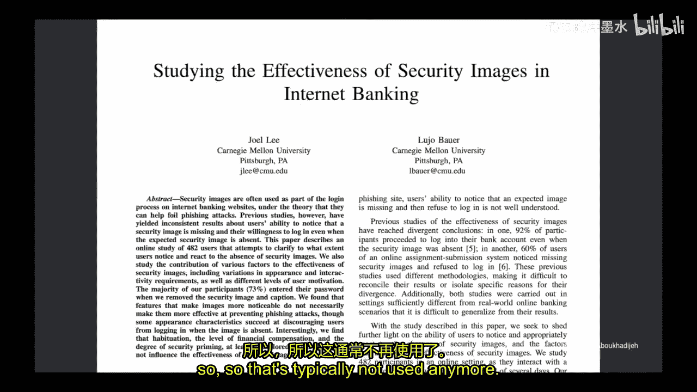

Yeah， okay， so some things we've learned about password requirements since。

 since the days when those， those old requirements were being given out is that complex isn't necessarily strong。

 So numeric alphabetic special symbols， forcing the user to use these in their password doesn't lead to stronger passwords and。

AndAnd。This quote sort of summarizes that choosing multiple words。

 So this is sort of an alternative idea。 Choose multiple words from a suitably large dictionary of words。

 And， and if you do that， you you'll end up with stronger passwords。

 Even if all the words appear in dictionaries and are spelled with lowercase letters and no punctuation is used。

 So literally， you can just pick like four words from a dictionary。

 And that's gonna give you more entropy， Then putting all kinds of symbols into your password。😊，Yeah。

 and and then if you're worried about users， despite， you know。

 despite the fact that So say you lift these requirements from your， from your site， you say。

 you know what， choose whatever you want。 You don't have to pick symbols and numbers。

 Use might really do some some dumb things at that point。

 So one thing you can do is instead of instead of just hoping that this requirement protects the users is just go and check the passwords against known leaked to breach data。

So there's all these， these databases of user passwords that have leaked in all these breaches that you hear about in the news。

 And you can literally just have a database of that and query against that whenever the user tries to choose a password。

 And so this is actually much， this is actually the N。 the current N recommendation。

 So they've eliminated at least NISist has eliminated this as as a good suggestion。

 And they now just suggest checking against known breach data instead。

 So that's the way to do it going forward。😊，They also don't recommend changing passwords regularly anymore。

 And on length is the primary factor that we care about now。Mhm。あち。Yeah， yeah。 That's a good。

 really good point。 I mean， if you think about it， what this is with， I mean， if。

 if you assume over time， every， every database gets breached。Like this。

 let's just assume that or like like some percentage of them are gonna get breached。

 Then effectively， by saying your users can't pick a password that's in a breach。

 You're riskly saying that they can't pick a password that anyone has picked before， right。

 And thats， that means they might might not even be able to pick their own password that they use on other sites。

 which which maybe they shouldn't be doing that anyway。

 But but they wouldn't be able to pick even their own password if that password was in a breach。

 right。So yeah， I mean， it's not a perfect solution。 All these things are a balance between。

 you know， usability and security。 So if you， if you have this policy。

 then you're gonna be restricting a bunch of users who just like don't care。 They just， you know。

 maybe， maybe， maybe your service is kind of like not security sensitive service。 Like it's I don't。

 I don't， I don't know。 pick something that doesn't really matter， right。

A lot of people don't care about their Netflix password， right。

 even though there's like viewing history in there， you know。

 maybe Netflix just doesn't want to bother forcing users to， to， you know。

 not choose a breached password because the consequences are very low， right。

 And we're gonna talk about other things you can do in combination of passwords that。

That that will give you security， even if you like。

 let them pick one that you know has been breached。 By the way。

 the reason why we care about it we care about them picking a password that's been breached is that people who are attacking breached database or who are doing sort of who are who are sort of trying all the possible passwords in an online attack are are going to be using the breach lists as their sources of passwords to try。

 because these are more likely to be real user passwords。That's why we care。

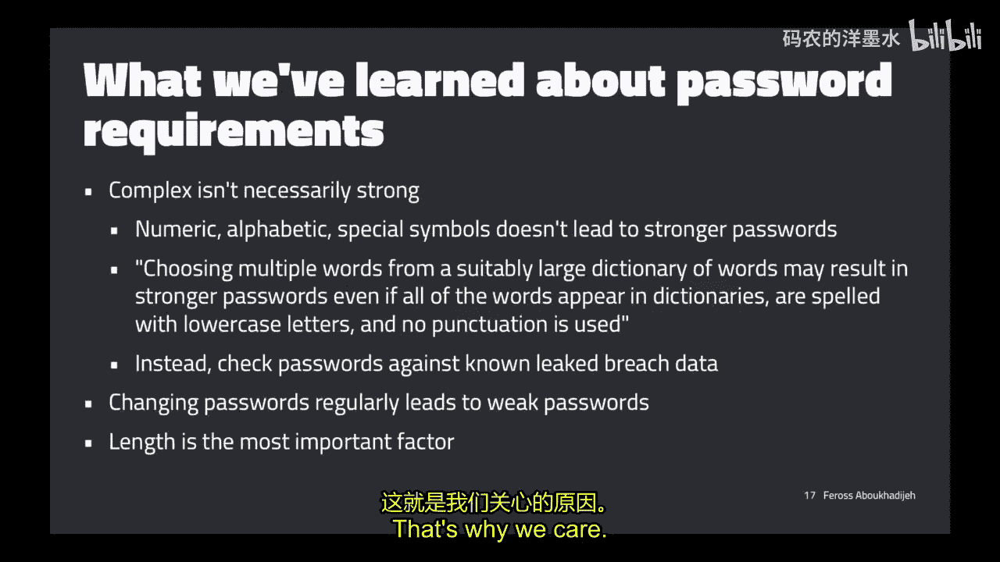

And then， of course， I bet a bunch of you have already seen this， but it's obligatory。

 I have to show you， this is the ex X KCD about how to choose passwords。

 So I'll give you a minute to read it。😊，Yeah， basically。You know。

 you can try to do all these things like substitutions， using numerals。

 throwing and some punctuation。 But you see the number of bits of entropy that you get are quite small for those things that you throw in。

 And this is， of course， this is assuming that users follow a specific pattern of pick an English word swap in some common substitutions and then tack on a symbol in a number at the end。

 Theres obviously， that's not the way that's not the pattern that all passwords follow。

 But there's not that many of them。 It's typically something like that。

 So you can add a bit more entropy。For those other patterns。

 but you end up with like not that much in the end。

 you end up with sort of this password being able to be guessed in three days using100 guests a second。

 whereasas if you just picked four words， you know， you， you have way much， you know。

 have a lot more entropy and a lot longer for the password to be guessed。

 And it's much easier to remember。Yeah， so that's idea。So if you， if you have trouble picking words。

 you can use a password manager and they'll pick the four words for you。 And sometimes the。

 the words they pick are really funny。 So it's kind of amusing。

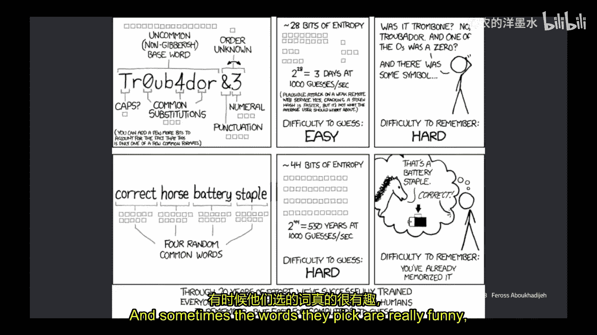

Cool， so。So yeah， in general， user passwords are just way too short。

This is a mapping of sort of password length to how long it takes to crack the password。

 And this is assuming that you have a password using uppercase lowercase and number characters。

 no symbols。 but that doesn't change it that much。 But you can see here basically， if you're。

 if you're using something less than like 12 characters， you're kind of in trouble。

 If somebody really wants to find out your password， they're gonna be able to find it out。

 And we'll talk about how， how exactly they would do that in a second。😊，But yeah。If。

 if your password shorter than this go change it now。Any questions about this？

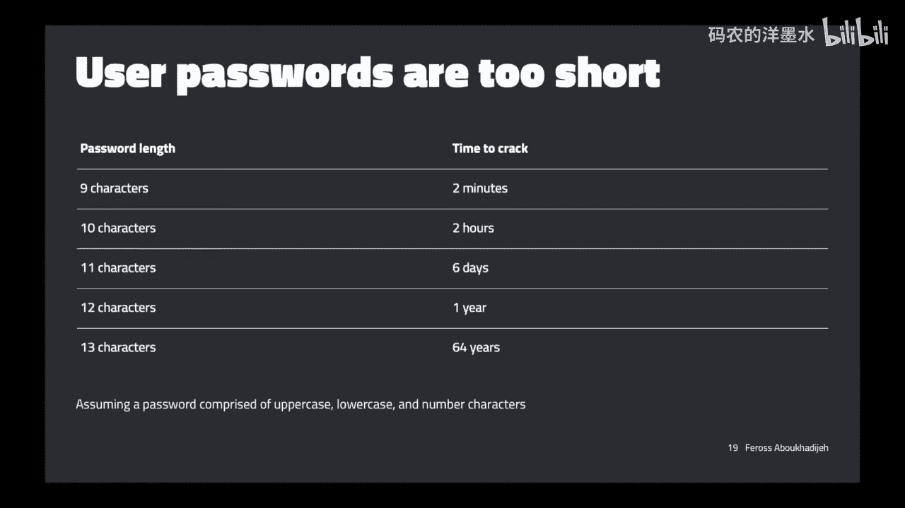

Okay， cool。 So， so yeah， just， there's a cool site I wan to just show really quick。

 This is a a sort of site that lets you type in an example password， and you can sort of。😊。

Just see the time it takes to crack it。 So it's quite interesting。 So like this password， you know。

 maybe we'll add a one an exclamation point or something。 But you see like this is interesting thing。

 There's three sort of attack scenarios we care about the online attack scenario。

 this is where the user is the attacker is literally sending requests to to the server with potential username and password combinations。

 And so this is gonna be inherently like very limited by sort amount of request that can send to the server without getting blocked or without getting noticed。

 And so the assumption here is 100 guess a second， which is very， very generous assumption。

 most services that are watching login attempts are not gonna let you try 1000 things per second。

 So yeah， even in that generous assumption， this this is actually a good password， right。😊。

This is assuming you're exhaustively searching the space and not using a list of known passwords。

 which that would actually significantly shorten the amount of time it would take to guess this。

 And then you have these other two scenarios that are offline。

 which is which is which becomes relevant when somebody has stolen a database of hashed passwords and they need to sort go through and try to sort reverse the hash function and figure out the original password。

 And when they do that， they can go much faster because they're just doing it locally。

 they don't need to talk over the network。 And the two scenarios here are just like this is sort of like an average individual computer。

 How fast can can you break passwords like a normal computer。

 And then this is if you build a cracking array of computers where you sort buy a bunch of GUs。

 you spend like $20000 And it sounds like a lot of money。

 but it's actually not a company can easily buy this an attack government this is like nothing for those types of of attackers。

 And so yeah， you see here that it's like totally crackable very， very fast。😊。

Whereas if we put in correct。Porse。Battery staple， It's like。You know， I mean。You're good。Yeah。Right。

 anyway， this is cool。 I don't recommend putting a real password in here。

 even though they promise that they don't send it to their server。 But you know。

 it's still fun to play with this site。😊，Cool， any questions about this？Yeah。

 I guess if this becomes too common， could they not just use a mask whether they're like dictionary or a dictionary or a dictionary or a dictionary？

And just like， guess that。 So if you， if you assume that you like say。

 you know the pattern of of the user you're attacking， you know that they did dictionary word。

 D dictionary word， like you said。It let's even assume you know the dictionary that they're using that they're choosing the words from。

 right， So you could assume it's like 2 20000 words or something like that。

 You can do the math and see that even in that situation， you're actually totally fine， right？ Yeah。

 there's， I might have a slide about it。 I I don't remember if I do， but。😊，But yeah， even so you。

 you wna， you wanna， you wantanna assume that the attacker knows exactly the scheme you're using and exactly the dictionary you're using and you wantan to be safe even in that situation。

 Yeah， and I think forward， does that。

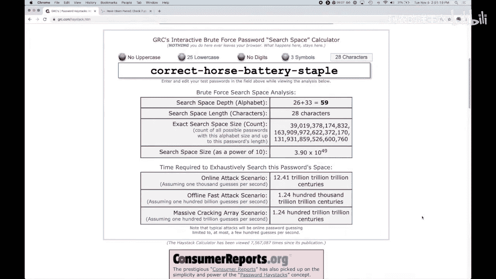

Yeah。Cool，So， so here's the current sort of best practices that we that we recommend。

 So you want to allow the user to pick really long passwords， potentially up to 64 characters。

 But you you also want to enforce some kind of a minimum length。 So8 is like the bare minimum。

 Like don't let them go below 8。 but even that is like kind of low。

 And then other thing to keep mind don't allow unlimited length don't get sort of gun ho and think like。

 let them pick whatever they want really long。 because you can actually get password denial of service where where the hash function takes just way too long。

 It's not expecting input that long。 you can mitigate that by hashing the password first before you with a fast hash function。

 But but just don't let them pick passwords that long and it'll be fine。😊。

One gotcha to keep in mind is we'll talk about be crypt a little bit later。

 But B crypt is one of the most popular hashing functions that people use to hash passwords。

 And it has a maximum length of 72 ASi characters， which is quite short。

 because we were recommending here that you do at least 64 characters as as a maximum length。

 And oftentimes you might want to do 128 or whatever1000。 And if you do that。

 and berypt will just chop off the remainder。 And also these are ASI characters。

 And you typically you should allow user to type in whatever they want as their password。

 any kind of unicode symbol， emojis， you could have emoji passwords。 And if you do that。

 you're gonna get far fewer than 72 characters。 So。😊，That's a gotcha。 you should keep in mind。

The fix there is to hash the password first before you put it into into berypt。

 So you hash it with something， some other hash function first。And then like I said。

 you should check the passwords against known breach data。

 and you should definitely rate limit the authentication attempts。

 so users can't just sit there all day trying， trying a bunch of passwords。 and then， of course。

 encourage or require use of a second factor， depending on how sensitive the the Web app you're building is。

 So if it's really， really sensitive。 It's something like financial。

 then just require a second factor for， for logging in， Otherwise just heavily encourage it。😊，Yeah。

When you're doing this， some common implementation mistakes are don't silently truncate long passwords。

 That's's the gotcha that be cryptto just do that。 But don' don't do that yourself。

 Also in any code that you write。 don't restrict the characters that users can choose。

 So allow Unicode allow whitespace。 And this is a big one。

 Don't accidentally include passwords in plain text log files。

 This is the thing that's just bit a bunch of companies really recently。

 So Facebook and Twitter were in the news for this very recently。

 Basically idea here is say you include some logging code。's like any time I get an H TTP request。

 I'm just gonna log it to a file because I might want to look at that later。

 maybe it's interesting in some way。 maybe know， maybe our server was attacked。

 And we want to have a log of all the H TTP requests that came through。 So we'll log it。😊。

But remember， a users are sending you their password in an H T TP post， right。

 And so you don't want to log that out。 So your logging has to be sensitive to that。

 And it turns out like at Facebook， a bunch of their logs were just logging out people's passwords for years and years since like 2012。

 I think is what this article said， so。

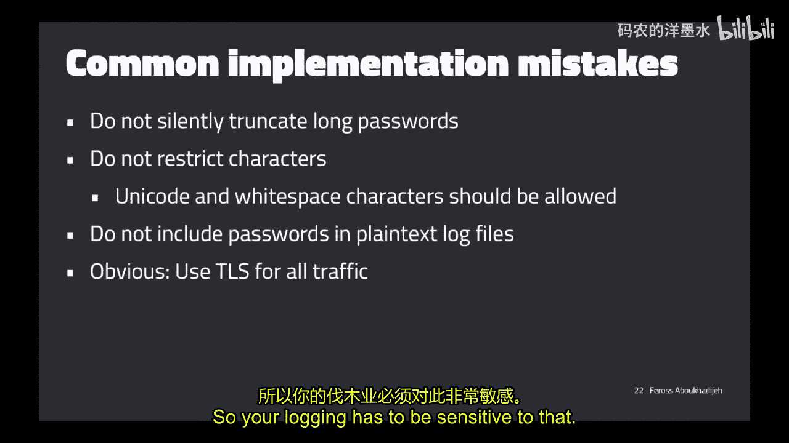

And the problem with that is that， of course， now， you know。

 engineers at the company are allowed to go view logs， right。

 So viewing log view viewing logs is like sort of part daily part of of of a job of being an engineer。

 And so in theory， any engineer， know， Facebook could have could have seen passwords in plain text and then。

 you know。You can take a password and use it on another service or something like that and get into someone's account or use it on Facebook itself。

 right。Yeah， so this is really bad。Yeah， anything else want to say about this。H。Yeah， any questions。

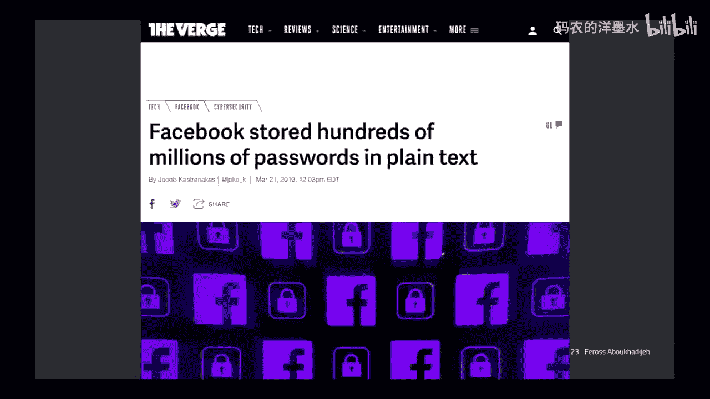

Cool， okay， so what else did I say， obviously use use Tl S for all traffic， Of course。

 encrypt all your traffic okay， so。😊，Now， let's talk about network based guessing attacks。 So， so。

So let's assume that， you know， you have， you implemented a system。

 Your users are picking strong passwords。 So， so now we need to think about what will happen if an attacker sort of just over the Internet just sort of tries a bunch of passwords for users that they're trying to target。

 How can we defend against this。 So， so so certain systems where， where you have users。

I guess what this is saying is actually is that in a system where where a key is chosen completely randomly you can。

 you can ensure that there's some some sort of security in in the way the key is chosen。

 But when you let users select passwords， there's no way to get that guarantee。

 And so even in that situation， we want to ensure that we can， we can protect users because。Yeah。

 the kind of password that a user will select is going to come from a very small sort set of all the possible passwords that we could have。

And so we need some defenses in place to prevent attackers iterating over all possible passwords that are like really short or really obvious。

 And so the three ways that they do this are these are the three main types of networkbased attacks。

 brute force， credential stuffing and password spraying。 So they're all kind of related。

 but they they're just sort of subtle distinctions between the two。 So with brute force。

 the idea is you just have some list a dictionary and know or you' just iterating over all possible passwords to target a specific account。

crruedential stuffing is where you， you， you take the data from a breach of another site and you try all the username and passwords that were in that breach on another site。

So the idea is like users commonly reuse passwords。 So if I saw like， oh。

 somebody was using this username and password on site A， they might be using it on site B。

 So let me just try it， right， And you just go through the list and the attacker just tries all those and hope hopes that some of them work。

 hopes that some of those passwords are in common between the two sites。 And then password spraying。

😊，Is where you just say， I know this is a really weak password that users like to choose。

 And I'm just going to try it on every account that I know that is on that is on this site。

So just different variations on how to try usernames and passwords。Cool。

 so so defenses are like the most obvious one is the rate limit the rate at which an attacker can make authentication attempts。

 So in Express， there's actually a really easy package you can install if you're using node Js。

 It's called like express rate limiter And all you have to do is make sure that any route in your app。

 which is doing authentication runs through this rate limiting code or this rate limiting middleware And what that will do is basically just keep track of which username are being like which username someone is attempting to log into and ensure that that there's not too many attempts for that username in a given time。

 Another way to do is to look at the I address of the attacker and make sure that give an I address isn't making too many attempts in a certain period of time。

😊，And then what do you do when you see that someone's doing this， Well。

 you can either delay them and just like hold the request and don't respond for some period of time。

 or you can just return a rejection， like some kind of an H T TP code that tells them you're。

 you're going too fast。 slowlow down。 I'm not gonna accept any more authentication requests。Cool。

 so this is pretty easy to do。Yeah， it's worth doing it。

Another thing you can do is throw up some kind of way to ask the user to prove that they're a real person。

 And if you if they successfully prove that they're a real person。

 then maybe you unblock them and you let them continue to make more attempts。

 So one con way I to do that is a capturecha， you all probably seen this before。

 The full name is completely automated public touring test to tell computers and humans apart。

 which I didn't know until I made this slide， which is pretty hilarious acronym。

 It's also commonly in was a reverse touring test。 And this is how sort of early capture just looked。

 But ones you've you've seen are probably more well， we'll get that in a sec。

 But but this type of capturecha， was sort of。😊。

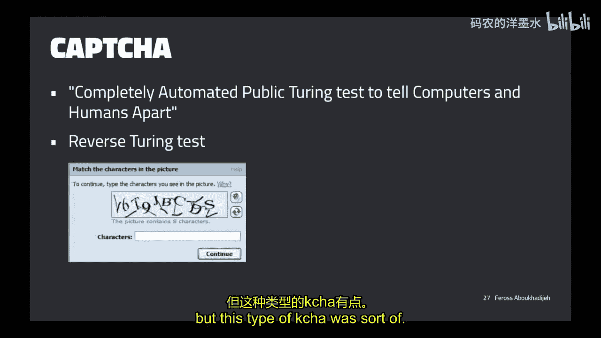

completelyle just sort of least a couple of the common implementations of that type of capture were completely destroyed in this paper that was published in 2003。

 where there was these two specific implementations， Eas Gmpy and what's the other one， Gmpy。

 I guess。And， open source packages I always choose。Interesting names。 But yeah。 so。

 the breakage rate is really high。 It's 92% for one of them and then 33% for the other。

 And remember with a capcha， usually you're given more than one attempt。 So。

 so even succeeding 33% of the time is actually more than enough。 And typically， the。

 the people who write papers about this stuff， They look for 1% breakage。 If you have 1% breakage。

 then it's sort of broken。 So this is， this is completely broken in this paper。

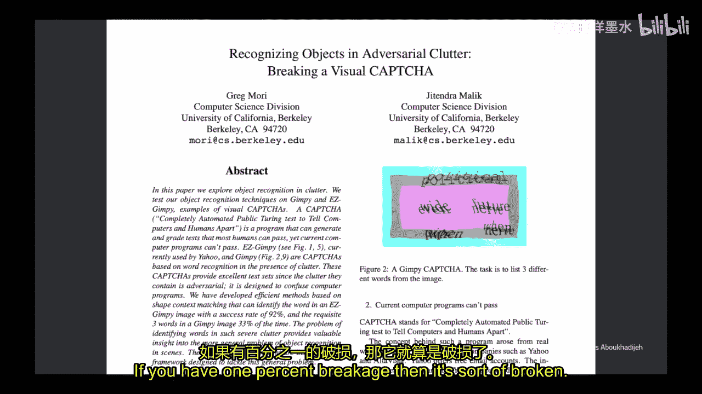

So。The other problems are just sort of how users experience capturechas。 like you can do。

 you can do one in about 10 seconds， which is like a huge amount of human time to be wasting。

 It's also difficult for users users with visual impairment。

 And so then typically a site wall for like an alternative capturecha using audio or something。

 But if that's less secure than the main one。 know。

 an attacker will just go and like try to parse the audio file。

 So you need it's only secure as the sort of weakest form。 This is。

 this is this is a real actual real problem。 This is sort of。😊，a big like， no matter how。

 how good you make your capturecha， Basically， your capturecha is gonna be vulnerable to this。

 If it's， if it's the kind of capcha that looks like this， right。

 where a user types image into a box。 And what this is。

 is basically when you're trying to do an action on an， on a victim's site as an attacker。

And you're given a capturecha。 What you do is you you detect that you've been given a capcha。

 You take a screenshot of it。 And then you， as the attacker。

 runs some other site that gets a lot of users。 So it can be， you know， I don't know。

 let's say you offer free pirated software or something like that。

 They'll offer whatever they can to get users to come to this。

 Then they'll throw up a capturecha to those users before letting them access the content that they want。

 And that capturecha will come from the site that they're attacking。

 So they sort of take the picture of it and show it to them。

 And they have these other users solve the Capcha。 And then in real time they take the answer and put it into the attack the victim site that they're attacking。

 So yeah， it's really hard to stop that。😊，Yeah， and and then there's actually dark market services that offer。

 So if you don't want to be bothered to implement this yourself。

 you can just call an API and then some attacker will or some。

 some sketchy person will do it for you。 And this is one of the sites that does this。

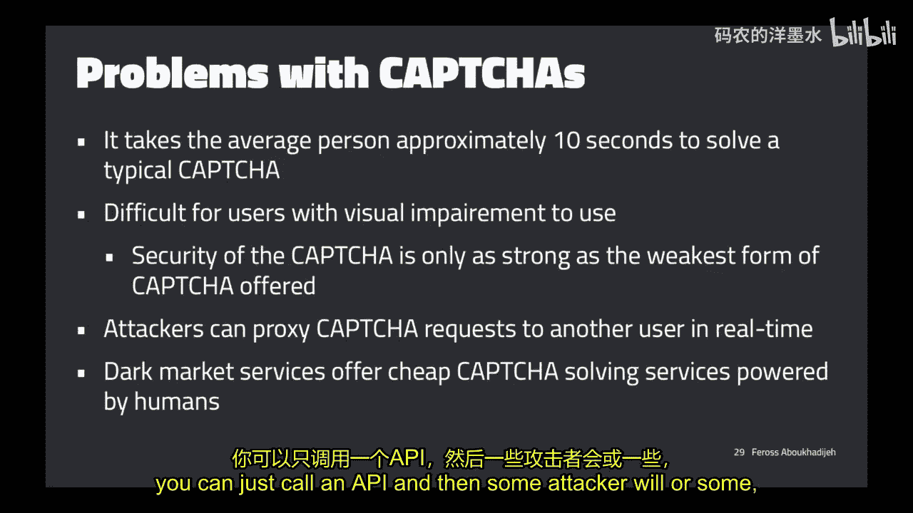

。It's it's prettymus， but you can see the prices are really low。

 It's like 50 cents for 1000 capturechas solves。 So that's that's really' I don't know。

 I feel like that's really cheap。😊，And。Yeah， so。So this is， this is kind of kind of a broken system。

 One of the things that you that you， you've seen in that you see sort of as a response to this is now there's interactive captures that involve sort of clicking on。

 you know， images of traffic lights and things like that。 And those are a little bit harder to， to。

 just， to moveof like this because you have to sort of capture all that state and send it across。

 And it's very interactive But just makes it harder。 I don't know if it makes it impossible。😊。

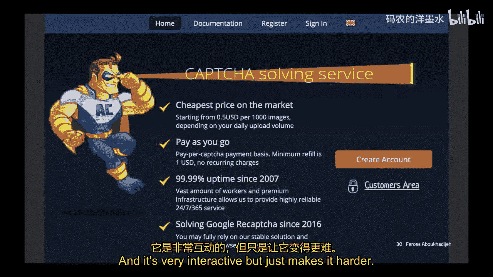

And then this paper came out in 2014。 And it's from some people here at Stanford。 Actually。

 Ellie was the T A for the Web security class that I took as an undergrad。 So hes's T。

 he now works at Google as their like of head of privacy and safety or something like that。 anyway。

 Yeah， with this paper in 2014。 that basically said all caps that are tech space are just broken。

 they came up with an an algorithm which could just sort of break arbitrary caps and do it like in one step like really really fast。

 And I think it says that。😊，They broke all existing we were able to solve all real world capture schemes。

 We evaluated accurately enough to consider the scheme in secure in practice。

 So they broke Yahoo at 5%， recapcha at 32%， By do 38， you know， CNN at 51。 And so basically。

 remember， anything above 1% is broken。 So they just broke everything。😊，Yeah。

And so this is this is sort of the like evolved version that's sort of like， okay。

 let's get away from textbased because that's broken。 What can we do instead。

 The idea here is that Recapcha will sort of look at all the behavior of the user in the current browser session。

 So sort of the way they move their mouse， the way they scroll the I P address that they're coming from and sort of try to create a trust score for this user。

 And they sort of since they have these widgets on tons of sites across the Internet。

 they can build up a trust score for for like an I P over time so that I P can have reputation。 And。

😊，And if they think that you're sketchy， then they'll throw up sort of a capture for you。

 But most of the time， you can just sort of click this box and get through。But。

But this is also going away。 There's like a new version of this。

 which doesn't even have any E Y at all。 It sort of does the same thing without a click。

 And that operates kind of completely transparently in the background。 And the way。

 the way that works is that the site that you're interacting with。

Will log attempts to log in and to do various actions on the site with recapcha and sort of just sort of reporting on everything that you're doing as a user。

 And over time， this service sort of builds up reputation for like how real of a person is。

 is this this user who's interacting with this site And so then other services and all， you know。

 other services that use recapcha and also your service can sort of query and get sort of a trust score back。

 And you can make a decision about whether you want to allow the user to do an action or not based on the number you get back。

Yeah， so。How many people have have implemented recapture on a site and like used it before for anything。

Okay。W is it easy to work with？Yeah。Yeah， so this is a good thing to do。 good， good。

 good good solution to sort of dealing with， with automated login attempts or any kind of bot doing something on your site that you don't like。

Yeah。Yeah。😊，It's like it。CCoer of powder they're figuring out I'm a robot that if I use。

Or something like if I。T your finger。Steps that I'm building。Yeah， I mean， that's really， yeah。 Yeah。

 I think certainly the client side stuff that their code is going be able to detect is gonna look a lot more uniform and lot like less individualized。

 And if that's one of their factors that they're looking at， then yeah， you'll look more like a bot。

 One big problem is that this， I mentioned how like they use I reputation as a way to determine whether you're a real user or not。

😊，And。One of the implications of that is that people who are using To browser for privacy。

 they tend to mean， they end up using I P addresses， which are。

Extremely sketchy because people are doing sketchy stuff on tour。

 And so those users end up just getting getting thrown up captures all the time anytime they try to do anything。

Yeah， so if you， if you're， yeah， it's a little bit。

Not ideal because you're sort penalizing users to care about their privacy even more。 Yeah。

 and I I don't know how to solve that。So another thing you can do if you have a sensitive features on your site is you can re authenticentate before the user is allowed to use the sensitive feature。

 So say that say that you you， you have a form that lets the user change their password or change their email address。

 Or if it's a shopping site add a new shipping address。 one thing you might。

 one of things you might want to do is。😊，Ask the user to type in their password one more time before they do that。

And this is a defense and depth technique that can protect you if your site is vulnerable to X S S or CS SRF or session fixation。

 So if， if any of of your So you， if you've made a mistake and your site is vulnerable to say XS S。

 And now an attacker can get code in the page and they can sort of take actions on behalf of the user。

 Well， at least they won't be able to take these actions on behalf of the user because they'll actually need to know the user password and put that in the request。

 And so it lets them do sort of everything but these sensitive actions。 So it's， it's you know。😊。

It's not perfect， but it's， it， it's better than nothing。

 And one of the ways you'll see this is if youve ever use Github on Github when you go to add a collaborator on a project or you go to add an S H key to your account。

 any of these really sensitive operations， you'll get thrown up this page here。 that's like。

 you are entering Zo mode。 and it'll ask you for your password。😊，One more time。

 And then after it does that， it won't ask you for a little while。

 And the other nice thing about this is it actually protects against more than just these sort of Web security attacks。

 but it also protects against physical， temporary physical access to your computer。

 So if you step away and you forget to lock it and somebody comes in quickly tries to do something to your account。

 They at least won't be able to sort delete your account or change your password or do any kind of other sensitive operation。

 again， not perfect。 but it'， it's something you might consider for really sensitive things。😊，Okay。

 so this is another one that's kind of new。 So response discrepancy， information exposure。 This is。

The idea it's a fancy really unnecessarily fancy word for basically revealing information that an attacker shouldn't be able to figure out to the attacker。

 And your user authentication system might do this if， for instance， you。

 you tell the user who tried to log in。 Hey， there's no user that has that email address。

 where you say， hey， theres， there is a user with that email address， but your password is wrong。

 and these different responses can let the attacker learn whether an account exists on a service or not。

And so yeah， basically basically the idea here is， you know。

 information exposure is sort of a general term for attacks that leak information to attackers and then specifically response specifically response discrepancy is when you respond differently to different responses and you allow an attacker to sort of gain some information about state that they shouldn't have。

 So it's kind of a side channel attack。Yeah， so so， so here's an example。

 So here's of a way to sort of not have the problem。

 which is to always respond with generic error messages。

 regardless of whether the user typed in the wrong username or typed in the wrong password or whether the account doesn't even exist at all or whether their account isn't some kind of special state like locked or disabled。

 Just don't， don't say anything about this。 Just sort of say， like， you know。

 we couldn't log you in your username or password was wrong and just sort of say that in all cases。

And you have to make sure if you're gonna do this that you do it on all possible ways that that an attacker might try to get at this information。

 So don't forget to to do it for password reset forms and also account creation forms。

 If you only do it on when a user tries to log in， then， of course。

 an attacker could just go to your account creation form， type in a potential email address。

 and then your account creation form will say， there's already an account that email address。😊，So。

Let's go through some examples here。 So these， this would be sort of the wrong way to do it to say。

 you know， login for user fo invalid password or login failed invalid user I D or login failed account disabled。

 You're sort of revealing sort of information that an attacker shouldn't necessarily have about the state of the account or whether that that that is a real user on the system。

 So the best thing to do is just of just always say a generic string like this。😊。

The problem with this is this is actually kind of annoying for the user， right。

 Like the user gets less information about what went wrong。 That's the trade off here It's。It's。

 it's more annoying for the user。Another case where you could do this is if you user tries to reset an account。

 you might say， you know， we sent you a password reset link。 or， you know， this email doesn't exist。

 Instead， just say， if this email exists， we'll send you a link。Another example is account creation。

 You know， don't say this user I is already in use or welcome you've successfully signed up。

 Just say， you know， just assume it's worked。 if they already have an I guess this is really annoying for users。

 though if they already an account and you told them you just email them。 that's not ideal。

 But again， this is the sort of trade off here disclosing to a potential attacker and being user friendly。

 So it depends it depends really on how how much you care about this how bad would it be for an attacker to be able to enumerate all the users that use your service right I'm an attacker and I have a list of email addresses。

 and I go to some bank site， and I try logging in with all these email addresses。

 and I look at the different responses， and I can figure out this subset of the email addresses。

 are customers of this bank how bad is that right in the case of a bank that seems pretty bad。

 I mean， now as a fisher， I can call up these users And my phishing attack is gonna be much more effective because I'm gonna know theyre actually a customer of the bank。

 right So yeah， it depends on the service you're building。😊。

And then this is another one you might forget is actually。

 the H T TP status code can also leak a state difference。 So don't forget， you know。

 to make sure that the state is consistent。 You know， even if you're saying the same message。

 but you're sort of returning a different H TP code， that's not gonna， that's not gonna work either。

Okay， and then， of course， timing is always a thing we have to worry about， so。呃。

What's going on here is this is， this is code that sort of takes the username and password and then decides whether they're valid。

And。It's bad because there's， there's sort of two different code paths that we take。

 depending on whether the user exists or not。So in the case that。

 we look up the user and we see that this is actually a valid username。

 Then we go ahead and hash the password， and then we look up in the database。

 whether the username and the password hash So we hash the password that the user just typed in。

 and we， we compare that to the the wait a minute。😊，Oh yeah， yeah， this makes sense。 Yeah。

 So we we hash the user we has the password that the user just typed in。

 And then we we look up in the database and make sure that that exists。 And then if it does。

 then we go ahead and we say the user is valid。 But if the user didn't exist at all。

 we would sort of bail out early。 And that if initial。

 if statement would be false and we would end up down here and we wouldn't do any of this work。

 And in particular， this function here is an asynchronous function， That's why you see a weight。

 And we're talking to a remote database。😊，And that's going to be pretty slow。

 And so it will be possible for an attacker to sort of just time the difference here and figure out whether the user exists or not。

Does everybody see why this is bad？Okay， yeah。Bring about like in the database。

 like if a username does not exist。Might it take longer？あそい。Yeah， I mean， it's possible。 I mean， I I。

 I think the very least you can do is make sure that you're not sort of adding to the problem here。

 I don't know how to actually make sure the database takes the same amount of time in that situation。

 But that's， that's an interesting question to look up。 Yeah， I I， I don't know。

So the way to rewrite this to make sure that you're not introducing a timing difference between the two code paths is just to make sure that sort of。

No matter whether the user exists or not， just do do everything in in both cases， right。

 Just sort of run the whole code path no matter what。

 And so we can rewrite it like this where we just hash the password that the user typed in and look it up in the database。

 And if it's valid， then it's valid。 And we we， we go ahead and you know， we。

 we return or else we throw an error。 But this is happening sort of， at this point。 And it's。

 it's doing the same work in both cases。So just be aware we're using early returns in authentication code。

I think another thing to do would be to sort of empirically test this。

 Like if you're building a service where this actually matters， you know， you。

 you sort of have to test your system because you're totally right that， you know。

 the database could take a different amount of time。 And if you， if you notice that。

 then you're gonna have to try and do something to， to mitigate it， yeah。 basically the。

 the main point here is just that mitigation， these mitigations have trade offs and the user experience will definitely be worse if you're。

 if you're giving the user generic messages and not specific messages and it can totally frustrate legitimate users。

 Like， I've been in a situation where I've had an I know I had an account on a site。

 but I don't remember what email I used。 And I'm trying the different emails and I'm getting the same message of saying。

 you know。Either your username or your password is wrong。 And I'm like， I don't know now what to do。

 You know， So so that is really annoying。 one thing you can do if you。

 if you don't wantan to go there， know， you dont wan to make the user experience worse is you can just rate limit the authentication attempts so that you can say。

 all right， if somebody wants to enumerate whether like I for us specifically has an account on Bank of America then they're gonna be able to do that。

 Like just print them a friendly error message say like， oh。

 this user name exists or doesn't exist or whatever。

 But but rate limit it so that at least they won't be able to do this at scale。And that's。

 that's like sort of one trade off you can you can make。 So you still get friend error messages。

 but you just don't let them try this for like thousands of accounts， right。Yeah。Okay。

 before we go on any questions about this stuff。Yeah。I agree。吃没だ。I mean。

 whatever you think the fastest possible human would be， right。

 you also have to keep in mind that there could be multiple people sharing the in IP address。

 And so if you said it too low， then you know you'll prevent you'll prevent like you know a corporate network where you have 100 people all showing an I from logging in so。

I my real thumb is like just said a couple like maybe an order of magnitude more than you think the most extreme user would ever do。

 And then if you notice people are getting blocked， then you can consider raising it more。

 But you know， you just give a ton of space you know that no normal user will probably hit the limit。

 But then bots are gonna be like way above the limit anyway。 So they'll definitely trigger it right。

 it's something you kind of have to test， I think。😊，Yeah， okay， so let's talk about data breaches。

 So this is kind of the stuff you see in the news all the time。

 The most sort of big example from this year is the Equifax data breach。

 where they lost 1 hundred43 million US customers information， in particular。

 it was really bad because they lost Social Security numbers。 And so if you're an American citizen。

 And even if you were maybe UK citizen or Canadian citizen。 then。

I don't know what the equivalent of social Security number is in those countries。

 but in at least in the US， there's a very good chance that if you're in the US。

 your Social Security number is just in a breach somewhere and somebody can go buy it now。So。

That is very disconcerting。And。By the way， this is tangential。

 but you can lock your credit and that will actually help quite a bit against this kind of stuff。

 So can Google that if you're interested。 But anyway， another one that happened。

 this was like a few years ago is Yahoo got hacked。 And you said a billion user accounts were hacked。

 And then it came out later that was actually 3 billion。 so。😊。

There's all kinds of examples of these things happening。

 And sort is a list of like some of the biggest ones that I could find。Yeah。

 Yahoo 3 billion is the biggest。But like lots of companies on here that you would think note they're doing。

 you know， still get breached。 So like， you know， Dropbox， Facebook， Qra。

 these are some companies that are local here that you might know。呃。You know。

 this typically happens because they had a server somewhere that was misconfigured that allowed people to just connect to the server and read the data on it。

 or maybe。You know， maybe there was a command injection or a SQL injection attack。

 we talked about those earlier。 and an attacker was able to get on a server。 And， you know。

 even if this data， this data is in a database server somewhere else， you know。

 once they're on on an app server they might be able to sort pivot their way to other servers that are accessible from that server and get to the database and then exfiltrate all the data。

 And so sometimes it's really dumb， sometimes it's as dumb as as like somebody left their S 3 bucket public instead of private。

 So if you putting a bunch of data somewhere in an S3 bucket。

 which is just like a static file host and you say like， oh， anyone can access it。

 Then when someone finds the URL， they're gonna be able to download everything。😊，Yeah。

 so it can happen for a whole bunch of reasons， kind of beyond the scope of， of this lecture。 But。

 but yeah， if you assume that these are out there， right， how do you protect the users on your site。

 given that this info is out there。Right， so like one thing you you might think of is like， maybe if。

I， I look at the data in these breaches。 I'll be able to sort of proactively figure out if any of my users on my service。

Are reusing a password that was in a breach you know， on， on my site。 And then if so， I can。

 I know that that user is very vulnerable right now。

 because now because now attackers have that password and they have that username。

 and they might try it on the site So you can sort of proactively lock their account。

 That's something you can look into doing。And， and you can do things like that。So， let's talk about。

A little bit more about breaches。 So， so were you in， are you in a breach， Probably yes。

 Probably all of you have are in existing breaches that have happened。

 There's a service you can use to check this。 How many of you have heard of have I been poned。Okay。

 so I'll just show it for the， for the benefit of the rest of you。 This is a really great site。

 Go check it out。 havevi beenponed dot com。 You can type in your email address。

 I'll just type in mine。 be be public。 And by way， there's nothing。

 you did nothing wrong if you end up in this list here， It's not like I did something wrong。

 So I'm not embarrassed to show you this。 But this is this public information。😊。

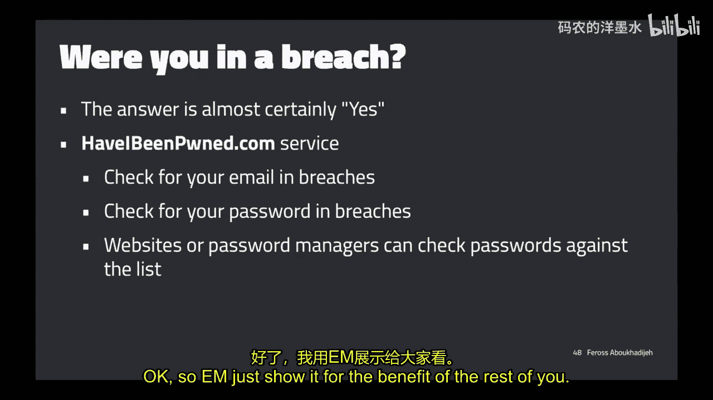

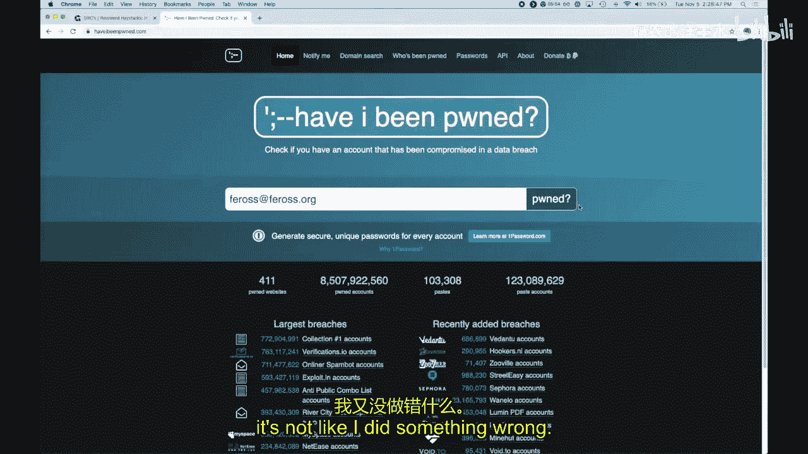

Basically， there's these， these different companies that apparently I。

 I either do business I did business with at one point in time or that had information about me because I。

 I ended up in their， in their database somehow。 And， and so， yeah。

 all these different companies had were breached。 and my information was leaked and you can see sort of。

 in each case， what exactly was lost。 So yeah， Tumblr， that was probably actually me。

Email addresses and passwords were compromised in that situation。 But yeah。

 look this up for yourself。 You can also set up an alert so that any time a breach happens。

 you'll get an email and then you can， you can then know whatever password was I used for that site is now insecure。

 I should go change it anywhere else。 I'm using it。Yeah。

 and then this service is also really useful as a site builder because you can， you can。

 like I said before， you can check this service to see if a password that a user is about to use on your site is in in a breach。

 and then you can decide whether to allow them to use that password or not。😊。

Passtor managers can also do this as well。 They can。

 They can alert you if your passwords in a breach。So yeah， really， really cool service。Okay。

 so now let's talk about how to store passwords。The first thing to know is。

 and this is going to be obvious， but never ever store password in plain text。So in a data breach。

 the attacker is gonna learn whatever is in the database。 right。

 So if you store your passwords and plain text， that means that attacker is gonna to get a dump of all your users' passwords and they're gonna to be able to attack that user's accounts on all the other sites that they use。

 where they reuse that password。 And because people are humans。

 they're very likely reusing that password a lot。😊，So this is an example of just literally like。

 you can， I don't So encourage you to go looking for these things。 But you can， this is like。

 like in a two minute Google search。 I found a paste bin。

 which is Pae bin is a site where where people who。

Breach services typically like to go and dump sort of proof of like what they hacked。

 And so this is an example of someone posting sort of a proof that they leaked that they hacked a Twitter database or that they have access to the to the database in some way。

 And they're offering to sell access to this or to basically send you this file for。

 for half a bitco and。The leak includes sort of emails and passwords。

 I tried to redact the usernames and passwords。 But like， yeah。

 the actual actual file has the real stuff。 And， they theyll send it to you for for quite an affordable amount for。

 for 32 million count account passwords。 Yeah， so this is。

 this is what happens when you store stuff in plain text。😊，Not good。

And it's also really embarrasing if you get hacked and people found find out that you were storing passwords in plain text。

 It's like really， it's just don't be that person。So this is like， you know。

 what the user table might look like if you were doing this。 So passwords are all there。

 any developer at your company or any hack can see。 So how， how do we fix this， Well。

 we need to hash the plain text password and then store only the hash in the database。

So we use the cryptographic hash function for this。 I mentioned a little bit about this before。

 But just to review these are the properties of a hash function。 And in particular， we。

 we care a lot about only of the properties we don't really need quick to compute。 And in fact。

 that's a bit that's actually bad。 In the case of of a hash function for passwords and actually wanted to be slow to compute。

 So an attacker who has the database and is trying to crack passwords。

 Well actually have to go slower。 But the other properties are all important for for a hash function we're using in in a database for authentication。

 And so this is some code you might write。 So so let's say we this is node so we're gonna to use the crypto library and we'll call create hash and we'll say we want to use shot2 p6 hash。

😊，And the way that that this function works is it gives you back a hash object that has an update and a digest method on it。

 And so update， you sort of just provide data progressively to the to the object。

 And then eventually， when you're ready to sort of get the hash。 you call digest。

 And so this will give us back the hash。 And so we just sort of define a little helpful function here called Sha 2。

56 that we're gonna use later down here。 And so then when a user actually gives us a password。

 we just Sha 256， hash the password。 and we insert that into the database。😊。

And so this is sort of an improvement overs storing the passwords in plain text。Now， later。

 when a user comes to authenticate， we actually need to check to see if it's valid。

 And so now some user is claiming to be this user and they were going to provide us a password and're going to hash it and compare it to the hash that we saved in the database。

 yeah。😊，So is the shopping？Yeah， so one of the properties of the hash function is that it's。

 it's deterministic。 So basically any message， anytime you put a string in。

 if you put the same string in again later， you're gonna get the same output， the same hash value。

 Yeah， that's really important。 a good point。 It's the same for every user。

 So that's okay because hopefully the users are picking different passwords。

 doesn't doesn't really matter。 The main thing is that we want it to be the case that when the user comes along later and presents another。

 like。😊，You know， presents a later password a login attempt。

 We want that this function is gonna return the same hash that it it returned before， right。

 and then we'll know that it's them。Yeah， cool。 So okay， that's， that's that's an improvement。

 So now this is what our table looks like。 So we've stored sort of all this these。

 these hash values as our passwords。 That's definitely better。😊。

There's something that's not ideal about this， though。Can anyone spot it？Yeah。

 I feel like the people who know where I'm going with this are gonna have a little easier time。

 But yeah， go ahead。 the password。 Yeah， because the shot 256 function is deterministic。

 if we put the same password in twice， we're gonna get the same hash value out twice。

 And so we can look just looking at this database， we can spot that Dakota and Bob both have the same password。

 even though we don't know what it is， because this hash here and this hash is identical。

 And so this is not good。 we shouldn't， we shouldn't be able to to see that。😊。

And there's another problem with that， too， which is that in addition to spotting addition to spotting identical passwords or at least spotting users who have identical passwords。

 we can also do precomputd lookup attacks。And so the idea of a precomp lookup attack is。

 say I know in advance that this site that I want to the site that I want to attack uses shot 256 as their hash function。

 I can as an attacker in advance， go and try all the common passwords。

 put them through this hash function and then save the outputs in a database。 And then later。

 when I actually get my hands on the database。 I can go through all the users and for each user。

 I take the hash and I compare it to my database and see if it exists in that set。 And if it does。

 then I know exactly what password they' are using。

 because I produce that set and I save sort of the original password alongside the output in my own little copy。

 And so it means that it's possible to attach all the users in the database at once。

 by building up this precomputed table sort effectively for everything that ends up in your table。

 you can reverse the hash functions just for those entries。😊，And so that's really not good。

 So we want some way to sort of defend against this。And so。

 does everybody understand the problem here。Ask questions， if you don't。Okay。

I think no raise their hand。Okay， so the solution is password salts。

So password salts prevent two users who use identical passwords from。

 from being revealed or being identified。 And it also adds entropy to weak passwords and make makes the precomputer lookup tech not work。

So all salt is it's literally a randomly chosen value。 It's cryptographically randomly chosen。

 So it's a strong randomness。 And typically， it's like some short amount of bys。

 like 16 B or 32 B or something like that。 You just pick this value randomly。

 And what you do is you concatenate it to the password before you put it through the hash function。😊。

Okay， so I chose some random value。 and I， and I add it to the user's password。 And then the output。

 that's what I store in the database。Now。The problem with that is that now the next time the user comes along and provides me their password。

 I need to be sure that there's I'm gonna be able to， to test that it's correct。

 And so I need to know the salt because I need to take their password attempt and combine it with the salt again in the same way and produce this sort of new hash and compare it to what's in the database。

 right And so for that reason， the salt actually gets stored alongside the password in the database。

 It doesn't need to be kept secret。 It just sort of sits there next to the password in the database。

😊，So， so let's just quickly show this is what it would look like in the database。

 So now I generated these salts， and I did this at the time that the user created their account， so。

They all have different salts。And， and now， because their password got combined with salt before I generated the hash。

 This is what our hashes look like now。 So they're different。

 even though these two users have the same， actually， they have the same password。Right。So。

 this is the code to do that。 So， so it's， it's really similar to the previous， the previous code。

 The only difference is now we're actually generating this random value here。

 This is just a string that's randomly chosen。 And we combine that random string with the user's password to produce their hash。

 And and then when we go to store the hash， we also store the salt alongside it in the database。😊。

And then again， to， to， to validate it later， we need to make sure we repeat the same steps。 So we。

 we， we take the salt and combine it with the。Password attempt that this user is making。

 And then if the hash matches， then we know we found， we found the real user。Does that make sense？

Cool， yeah。 that's salting and。If you don't wantan to do all this yourself， you can just use Brypt。

 So B crypt is a library that does， basically does this for you。

 It was designed by Neil's provost and David Masiers。 David Mosiers is ar here， or sorry。

 professor here。And it's been around for many years。 I think it's like over 10 years now。

 And there's been no issues found with it really。 So it's even though it's old。

 it's somehow still wait，11 years， maybe more than that， like 20 years， I think。I think it was like。

I need to look that up。 I think it was like 2000 something。 anyway。 but yeah。

 some of the things it gives you is it has a really expensive key set of algorithms。

 So that means that when someone goes to use B crypt。 it's gonna take a lot longer。

 And you don't really want speed in a password hashing function anyway。

 So this is actually good for us。 And then we also we also don't have to worry about salting anymore。

 because the B crypt library itself we'll generate a salt at the time that we create an account and then include that in in the output。

 And so when we write our code， we can just do something like this。 So notice the salt stuff is gone。

 So all we're doing is saying， hey， we want to use be crypt。

 here's the password that the user gave us when they're creating their account。

 And there's this new thing called hash rounds， which is sort of a hardness number the the more you increase the number of rounds。

 the more sort of long this function takes to run。 But。😊，Anyway， we so we call this function。

 and we get out a hash。 But in fact， this string here contains a salt as well。

 that's embedded in there。 And so when we go to store this in the database。

 we actually are storing the salt and the password a hash both in the database。

 And then later to actually compare， we actually can't do it on our own now because we don't know how to parse this sort of string that berypt produced。

 So we're actually gonna rely on the v cryrypt library to do that for us。 So when we get a password。

 This is a plain text password。 and we have this hash here that includes the salt in it。

 we actually ask be cryrypt to go ahead and compare the two。

 And so what it does is itll look at this string and the string will contain the salt and it will contain the information about the number of iterations。

 The number 10 up there will be in there as well。 And and then it will it will make sure to to process this plain text password in the same way。

 and then compare the result to that stored hash。😊，So if we were to look at the database。

 this is what we'd see。 You'll notice that the number 10 is present in these hashes because of the fact that we chose 10 iterations。

 And then you'll notice also that they all start with dollar sign2 B dollar sign。

 And that's just a sort of I can't remember what operating system came up with the standard。

 But this basically just says this is a B crypt hash。

 And then and then the next thing that follows this dollar sign here is the salt。

 And I don't actually know how many bytes it is。 But there there's some pre predetermined number of bytes here that is actually the salt。

 And then finally， the password hashes is is the rest。

 And so that's all in there And B crypt knows how to sort of pull that out。😊，Okay， so。

 so what would an attacker actually do if they got their hands on a database like this。

 So a B crypt like like a well， a database where the developers did everything right。

 What would they do， So this is really terrifying。 Microsoft put out some。😊，A paper or。

 I think it was actually， it was a blog post。 Maybe there was a paper that went with it。

 But I read the blog post， and。It sort of goes through what an attacker would do and what the costs are for things today in 2019。

 And this terrified me。 So basically， you can get a machine capable of cracking 100 billion passwords per second against Shaw 256 So this is not be its Sha 256。

 which is happens to be what Microsoft uses for their for their password storage。

 And you can build that for $20000。 So billion， that's 100 billion passwords for $20000。

 And that's as of July 2019。And so their sort of proposed strategy for how one would would go about breaking breaking passwords in a dump where the dump looks like this。

 right where you don't actually know what password Dakota chose。

 but you want to find out what password Dakota chose。

 you would start by looking at every password discsing a breach where the breach was the breach included plain text passwords。

 So you start with that as you starting list。 And you can think of it like this is every password that anyone's ever thought of。

 right it's a huge list of real passwords that people chose。 And statistically。

 they claim that that would break 70% of actual user passwords because people aren't just not that creative。

 And so now you have this list of 500 million passwords。

 And because you can crack 100 billion in a second。😊。

You can actually attempt 200 accounts per second。So you go through that list that you。

 you go through this database here， basically， and you try to see any of these on that。

 on that list of breach passwords。 And you're gonna。

 you're gonna get 70% success rate just by doing that。And then if you wanted to make it better， they。

 they， they， they suggest going for song lyrics and news headlines and other sort of strings that users might choose and adding that to your to your set。

 And you can sort of eke out a little bit more success another like 5% or so。 But， but yeah。

 this is really terrifying。😊，So， so even if we do everything right and， and we're breached。

 our users are kind of screwed。 right， It's really not good。So。EBasically。I think the main thing。

To to focus back on is just how do we， what do we do in in spite of this， Like what do。

 what do we do， you know， given that someone attacker is gonna be able to get this database and they're gonna be able to。

 you know， let's assume an email address for Dakota is in here。

 They're gonna be able to figure out what what password Dakota actually uses。

 and they're gonna be able to come to our site and try to attempt to log in with that user name that email address and that password。

 What are we gonna do。 Well， we can do multifactor authentication。 That's one sort of strategy。😊。

And in that same post， Microsoft claims that， in this post。

 they were sort of trying to claim that passwords are broken Like， you know。

 it doesn't matter what password you choose。 Basically， they were saying。 It really doesn't matter。

 your passwords already known to the attacker。 So just choose anything effectively is what they were saying。

 But， but they say they say claim that if you use MA or multifactorual authentication。

 your account is way less likely，99。9% less likely to be compromised。So， so， so let's。

 let's look into MFA。 You know， and and MFA is， you know。

 back to our sort of additional factors we talked about before。

 We want something in addition to a password。 So we want something that the user has or something that they are。

 And we want them to present that to us。 So we know that it's them in addition to their password。

And so。So， so what exactly if we just have a strong password， what。

 what are we actually protected against well。These two are the two things we're protected against with a strong password alone。

 So somebody can try and guess or you know spray passwords。

 They can sort of use the list of insecure passwords and try to find our。 But if ours is really。

 really strong， it's like some huge number of characters。

 they're not gonna be able to get our password。 they're also not going to be able to brute force either。

 but But if we're looking at sort of the normal user case， actually， before I say that。

 So even if you choose a strong password， you're not protected against all of these attacks up here So if if your password was reused and it was in another breach。

 then you're gonna be vulnerable because they're gonna be able to do credential stuff。

 if you get fished or men in the middle in some way or your computer has mal on it and your keystrokes get logged or you're extorted or somebody literally finds it written post that note or something like that。

 none of these things are gonna to protect you， even if you have a strong password。😊。

But if you don't even have a strong password， then you're vulnerable to all of these things。 So。

 so passwords， the point is passwords alone are not enough。

And so we want to require a second factor in some way。 Now。

 if you're a little concerned about requiring a user to sort of present a code from their phone or something like that every time they log in。

 you might consider only requiring it in certain situations when you've detected that the user is behaving suspiciously in some way。

 so。A common pattern you'll see is that a site will keep track of a browser that it's seen by cooking the browser。

 And then it will only require a second factor when it sees that a browser is shown up without that cookie presence。

 So it' in other words， it's a new device， or you can save all the I addresses that the users ever logged in from and sort of prompt them any time they're at a new location you could also sort of prompt them if it's the first time they've logged in from a certain country a certain location。

😊，Or you can use the I addresses the I address of the user and look it up on a list of suspicious Is。

 So you can， you can download these lists。 They're publicly available and they're maintained sort of collectively by the community of site operators who who do this stuff。

 And you can sort of just save。 If the I is on this list， I'm just gonna throw up。

 I'm gonna force a two factor I'm gonna require this particular user to to prove that they have a second factor before I allow them into the account。

 right。😊，嗯。Another really easy thing to do is just like save sort of I P addresses。

 And then what accounts they've tried to log into。 And if you see like one person try to log into an account like0 sorry。

 if you see one person try to log into like 10 different accounts in one minute。

 that's probably not a real person， Who logs into 10 accounts within like a minute， right。

 So behavior like that is is like is like pretty easy spot。 And then， of course。

 there's other ways you can try to detect that something is a script and not like a real user。

 you maybe look at the user agent or you look at sort of other behavior behavioral things about their browsing。

Okay， so。I want to talk， I want to end with just sort of one example of。

 of how to implement second factor。So a really common second factor that you'll see is TOTP or time based one time passwords。

And so way this works is this is not the S M S version that you might have seen before。

 This is sort of like， you have an authenticator app on your phone。 This is Google Aator。

 This is an example of one app that you can do it with。And typically。

 the way it works is the user takes their phone and they scan a Q R code presented to them by the website。

 and then their phone gets a six digit code that rotates every 30 seconds that they will present to the site when they want to prove that they have they're in possession of this device or know。

 this is their second factor， basically。And so what this。

 what this Q R code actually is is it's a secret key。

 It's a shared secret that's gonna be shared between the server and between this， this phone here。

 And the secret key is used in combination with I'll mention it in on the next slide。

 But it's it gets put through a Hm function and。😊，Through a couple of other steps。

 and then you end up with a code that comes out basically。

 And this proves to the server that that you are in possession of this， this shared secret。

 basically。And so you， you can just present that to the server anytime you want to prove it。

 you have that second factor。So this is sort of a rough idea of what we want to do。

 So the server is gonna create a secret key that's specific to this user。

It needs to obviously be different for every user。And then it shares that secret key with the user's phone app in some way。

 And typically， it's just a Q R code like that。And then the phone app is gonna initialize some kind of counter。

 And it's going to use that to make sure that the code changes over time。And。

It puts the counter along with the secret key through some kind of a function。

 And then we get out a one time password。 And then the user can provide that one time password to the site。

 And then it sort of regenerates this every， every 30 seconds by sort of incrementing the counter。

Yeah， so the whole of the private part of the setup is just an IQR show。

 look if I got a picture of the screen right then， it could have been。Yep， that's it。

 the Q code is really sensitive。 It's， it is， it is literally stored on the phone。And it's a。

 it's a shared secret， yeah。Totally y。And I mean， this is just some。

 this is just some like random value that the server chose。

 Like you can also get it is an manual form， typically。

 and you can just see the bytes that the server chose， but it's completely random。 Yeah Nope。

 it's completely offline。 Yeah yeah， so this app， this app never talks to the server。 In fact。

 I mean， this apps airplane mode。 But this app literally just sort completely deterministically just takes this counter and plus the secret key that it in this Q code and puts it through a function and then increments the counter every 30 seconds that's all it's。

 Yeah And then of course， the server can verify that you that you are actually in possession of this key by itself doing the same thing。

 So it needs to also have a counter that's set to the same counter that the phone is set to。

 And so you can sort of see where I'm going with。 What's a good counter that sort both the server and the phone would have。

😊，That would allow them to both know what counter we're using。

 even though this phone doesn't have Internet， right like this phone is an airplane mode。 time， Yeah。

 time， exactly。 So they both have the time。 And so what we do is this is actually the the， okay。

 this is the first step where you create the secret key。 So what you do is。

The server is just gonna pick some random bytes， And then it's going to add it to the database for this user。

 So， you know， this user is in the database somewhere where you're just gonna add an entry in a column that's like this is their。

 this is their， their one time code key， right？ And then now we give it to the user via the Q R code。

And then when the user actually wants to。generateenerate a code。

 What they do is they take the current time and they divide it by 30 seconds。

And that gives us the counter。And then they run that through the H Mac function。

 where they use the secret key。Basically， it's a combination of the secret key and the counter。

 and then they produce hash。And now we need this hash is really long。 so we just do a few steps here。

 The details are not important， but we effectively choose a couple of bytes some bytes from the hash。

 and then we mod it by the number of characters we want to show to the user。

 So we want it to be a six digit code。 And so we just sort of mod it by 10 to the sixth。

 and that gives us our code that we're gonna present and that's it。

 And the server has to do the same thing。 So the server sort of goes to the same process and compares it to this。

 And if they're the same then it knows that we must be the user must have the second factor on hand。

😊，And that's pretty much it。 So the final thoughts are just remember。

 always hash and salt your passwords or just use be crypt。 That's that's a really easy way to go。

 know， hard to go wrong if you do that。 And keep in mind， you know。

 depending on the kind of site you're building， Think about ways to protect the users。

 even when the attacker has sort has their password and and has everything， right。

 what can we do to protect the user even in that situation。

 And hopefully some of some of the things we talked about here are ideas to get you started on on ways to protect your users。

 Thanks。😊。

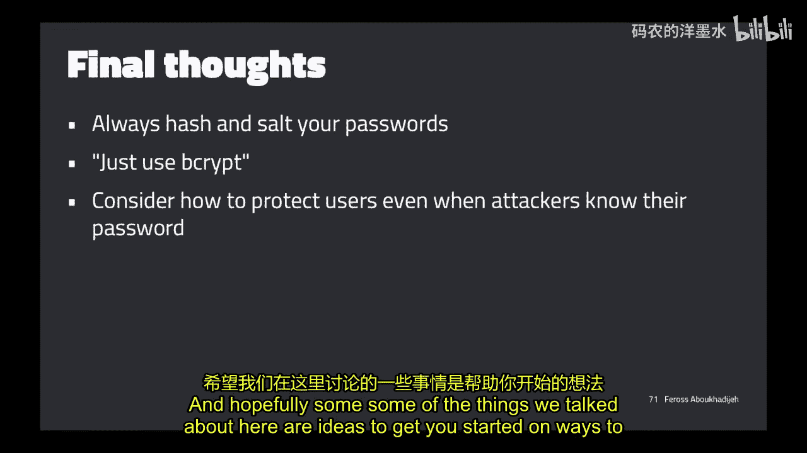