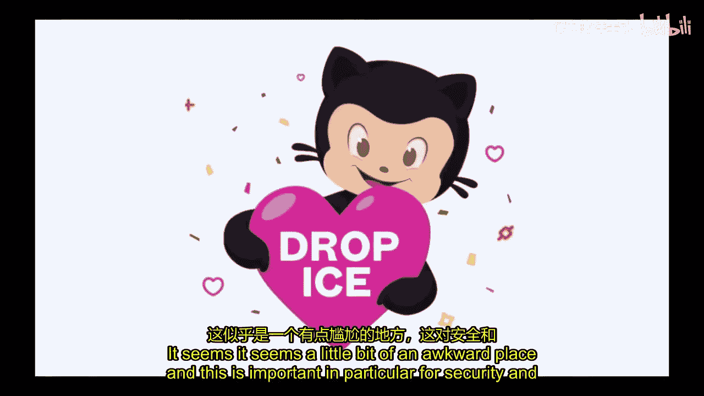
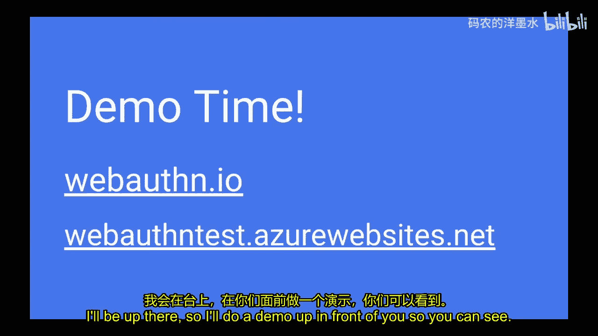
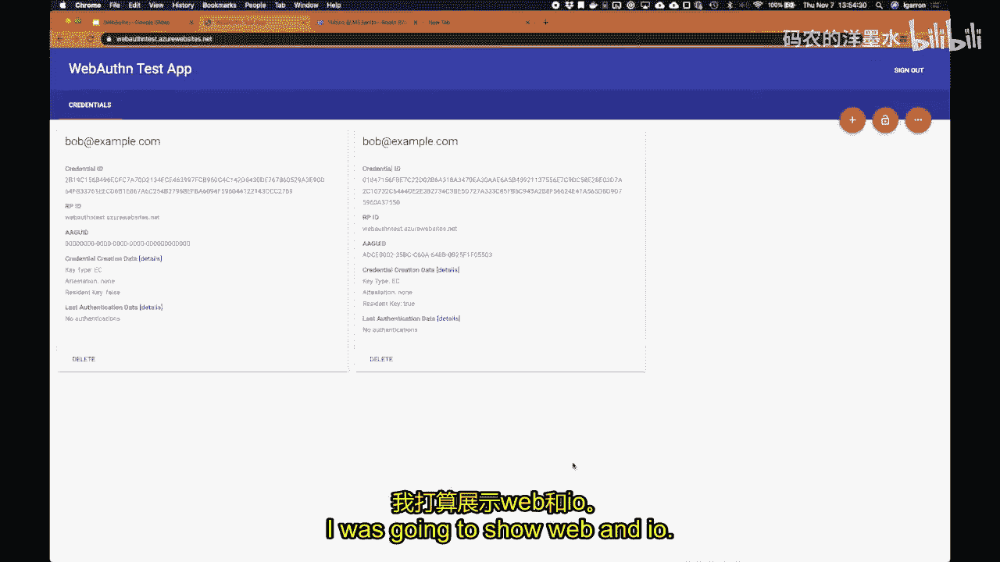
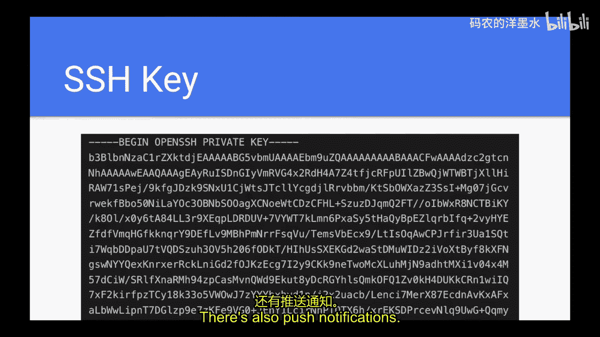
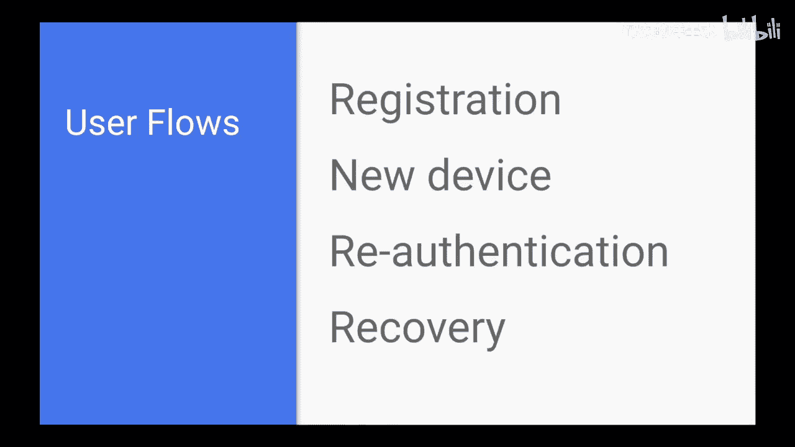

# 【全集】斯坦福大学 CS253 网络安全 中英字幕 1080P p14 Lecture 14 - WebAuthn - 用户认证的未来 - Lucas Garron -BV1RemEBZEEM_p14-

All right， let's get started。 welcomelcome everyone。

 So today we have an awesome guest lecture from Lucas Garin from Github security。 Lucas's friend。

 We were both freshmen。 We met we NSL because we were both walking back to Gs with meron Saami。

 I think we go back。 back I was beginning freshman year。

 Yeah and so Lucas is a name of many talents So he was on the Chrome security team where he worked on the bad SL site。

 which is way you can test what your browser does when you get self certificate in one of many different ways。

 he also worked on the HttP strict security preloads。

 which we learned all about actually Emily was kind of Emily and Chris my old coworkers on the same team。

 well they were telling us about how bad it is that the preload list is growing out of control。

 So was my job until I left's no longer my job。 It's their of job。😊，Right。

 right and he's also a really fast speed cuber so he can solve like a three by three cube in like less than 10 seconds。

 which is amazing and then I think you can do or do you have him with you of course if we've run out of time at the end。

 I can work on this。😊，Or I can show you Bluetooth cuing he can also solve a cube at his foot。

 he can solve four by four cube in less than a minute so yeah he can solve all kinds of cues ask him about it afterwards really impressive Anyway cool without further ado take it away。

😊，He's still half of my intro。 Okay， Yeah， I'm Lucas。I， I also dance around here a bunch。

 If you've taken a class from mature powers， you've probably heard some of my hacks and。I don't know。

 You can let me know your pin afterwards， not now。So I worked on Web A at Gitthub。

 I've been Github for at Github for a little over a year now。

 And this entire talk is about what Web authentic is。So this finally launched in August。

 and we might play around with some new features in the future。

 And part of this talk is talking about what happens after the very basic Webath。Implementation。

I wanted to give talk a few words about responsibility。

 I work at Github and Github has been in the news recently for supporting a contract with Ice。

 I am not comfortable with that。 It's something that would make me not join a company。

 So I thought hard about whether I want to stay。 But we have a lot of responsibility。

 especially when building privacy and security features to build them responsibly。

 and I encourage you， if you're talking to a company and recruiting to。

If you have certain moral views about ways you should not be enabling certain behavior like human trafficking to ask them for really strong statements or actual technology that they're working on。

 That's not just big。 We want to do good in the world。

 This is something that's important to me and the fact that this is happening at Github really disappoints me because they were a company that learned from some diversity inclusion mistakes and。

嗯。It seems， it seems in a little bit of an awkward place。 And this is important in particular。

 for security and privacy， because security and privacy for a lot of users。

Are really important。 And they're the most important when you have the fewest resources。

 So if someone like us gets hacked， chanceances are。

 you could call it a friend at Google or Facebook and say， my account was hacked。

 can you help me recover it？ But people who just have a single phone in the third world or who have。

Who don't have。Who don't have money for devices might not have backup options so they can't set it up to recover And an account if something goes wrong if they get hacked。

 And even if they're very savvy with a single device， there are still issues。

It used to be that security was a lot about having a threat model and the threat model was someone has a technical capability。

 Like if someone gets access to your computer， they can run code and they can steal stuff。

 And if they can do that， all bets are off。 And your web browser is a certain protection against that。

 But I think there's been lot more talk about more nuanced threat models， like domestic abuse。

 technically， you have something is your device。 But if somebody is monitoring what you do and making you feel like they're going to。

Abuse you based on what they think you're doing。 It can be really difficult to look up help for how to do things securely or how to try to lock them out of your life。

And so these kinds of things where technically someone owns the device， but these neat。You know。

 strong security boundaries that we used to think about。

 and we think about a lot for these threat models don't necessarily apply。

 This is something to think about。 I， I appreciate that Apple in particular has been focusing a lot on their push for privacy。

 It's a bit of marketing。 But they have a nice page where they where they discuss some of these features and rather than moving everything to the cloud and centralizing everything。

 they're moving things more to the device。 And so a lot of technologies are not inherently centralized。

 but just convenient to do so。 And it's valuable to think about the impact that has on the users and in particular。

😊，For。For Webath then， it's a client site technology。

 So everything I'm talking about is happening in the browser。

 and usually you'll be talking to a server。 But there's other ways to use this technology very effectively。

 So I wanted to say a few words about all that。嗯。I was， I was gonna talk a bit about passwords。

 but that is pretty well covered by for us。 My short version is current advice is use Brypt。

 There's other standards for hashing， but there's a certain standard to which you should protect passwords on the server and B crypt is basically good advice for now。

 They are terribly fishable because anyone who convinces you to tell them the password。

 They can just use that password exactly the same way you did。

 And so the whole point of Webath then is to provide a better way to do this for other authentication methods。

 And it used to be that password strength wasn't really a wellmeasurable thing。

 And then some people tried to make some tools for password measuring password strength。😊。

There's one called Z。 let's， it's on key， Z X， C VBN。

Sobody named a project that because people would just swipe their hand across the keyboard。 And so。

So company somebody started detecting what's， what's a bad password。 Let's block that。

 And the conclusion was， at some point， well， so of these passwords are being leaked。

 we can just keep track of every leaked password。 And if somebody tries to use it say， well。

 someone's used this before。 hackers， we know that this password has been used。

 So hackers' node has been used。 and it's really easy for them to try it。

 And so something like have I been pd is a service that keeps track of。 Gitthub， for example。

 doesn't let you use a password that's been used and have I been pned。So。

All the things that for us as apply。 Yeah So there was a question last time about sort of the usability of banning passwords。

know any human has ever thought of ever， then won't we eventually， I mean。

 run out of passwords wont want' to be so hard for a normal user to pick a password that hasn't been used before。

This is care about that。 we have savvy enough users that like we have faith people being able to use tools。

 like a lot of people use password managers。 And then you generate four random words。

 and that's memorable enough。 you might have to get used to memorizing a few of these。

 But if you don't use a password manager that remembers that for you four words are memorable enough。

 And sufficiently random and unguessable enough to be unique。

 But this is a bit of a concern for users who don't have password managers and what not。

 And unfortunately， Webath then hasn't completely figured out what to do for all of those。

 But it does offer some alternatives which is nice。😊。

One idea is that you can replace passwords with something else or with multiple other things。

And this might be a future we head towards， rather than trying to make passwords practical。

Something I was gonna get into later is the idea of authenticizing using your device。

 If you can use your fingerprint to unlock your phone and get access to everything。

 why can't you use use your fingerprint to log into a website And we're at the point where actually you can now for a few websites。

 And that's part of what。What about often allows？So I think passwords have been thought about a long。

 a long time， and problems like this still exist and。Are hard to solve。

 And that's why we need alternatives。 And Webath is， is sort of。Where we've arrived for standards。

Does that answer the question。I'm not seeing many nods from there just for us。

 but I'm going to trust him， okay。So I'm going to be talking a bunch about factors and then telling you why you should not think about factors。

 So for us。Had a slide about how a factor is something you blank。 And remember what those。

 what goes in the blank， just three things that he had。H something， you know。

Something you have or own， and。Something you are。 So those are traditional factors for authentication。

 They are in terms of things like passwords。 And they're also like in the movies for like fancy Schmaning biometric or neural interfaces。

 like these are still something you。They generally fall under those categories， so。Something。

 you know， traditionally， as a password。It can also be something like a security question for your bank。

 Like， you know， what was your first pet's name or whatnot， but。Those， ideally。

 it's something that's not tied to anything else。Something you have is generally something physical。

 So I have some security keys， which I'm just gonna hand out in a second。

 but they're kind of floating around。And you' help pass these around more。

 These are for trying out Web authentic then， which I will explain in a second。

 But if you want to go to this website and just try it。They'll be floating around。

So the idea is with cryptography， it's barely possible to have some good assurance that if I have this physical security key plugged into my computer and now I disconnected。

 this computer doesn't have access to whatever physical key is burned into the hardware here。

 And the only way to get that key is to disassemble this completely。

 And even then it takes a lot of money and is borderline impossible for something that's well engineered。

 which the Ubi keys， you can have fairly good confidence that unless there's some secret state government facility that has perfected this。

 you probably。Finding against everyone， except for them。

So the fact that something you have can be used to I indicate you on the Web strongly depends on cryptography。

 which is why Bobba then is based on public key cryptography。 but conceptually。

 it's a more general thing like。Like， if you have a hallway pass to go to the bathroom at school。

 that is also something you have， which you can authenticate the fact that you have permission to go to the bathroom。

 It's just in this context， we'll be talking about physical electronic security keys。

And then something you are， common examples are fingerprint and face unlock。

 which is available in a lot of phones and can be used for WebFN。

 and then there's technologies like gateit analysis。

 which detects how you're walking or if you have a smartwatch。

 there's always this notion of like you can measure more things about you and see if this is really you who's wearing it。

But generally， fingerprint and face are the general most common factors for。

 for biometric authentication。 So these are the classical factors。

And I want you to stop thinking about factors， despite the fact that I've just mentioned them a bunch。

 because a lot of things don't neatly fall into this。

So Webath is supposed to help you stop thinking about all these factors because one。

 they don't completely make sense。 But two， as a if you're。

 if you're implementing a website and you to authenticate users or you're trying to do some research around stuff。

 And like at some point， you have to solve the authentication problem in a given instance。

 And you don't really want to be thinking about whether someone has a certain device or whatnot。

 your， your goal is really just to keep them secure and Webathuth has an abstraction between。

Here' is an interface that defines like a public key that Ientifies them。

 And there's lots of different ways that you can tie this to something physical or something that the user might know。

So Webba found itself is a browser API， and I'll show you a bit more details for all these different authentication factors。

And it basically has。2，2 API calls in jascript。 If you go into your browser console。

 you can call navigator dot credentials dot get and at navigator dot credential credentials dot create。

 However， it probably will fail because these have really， really complicated arguments。

 But I can put them on one slide and pretend it's a really simple API。And conceptually， it really。

 it really is just two things。 I have a physical security key that I want to authenticate to a given site。

 So I first have to tell the site about that。 So I'm gonna create that credential that。

Association to the site。 And then whenever I want to authenticate。

 I need to get that physical key to authenticate。 So I need to， I need to interact with it somehow。

 And that's the get。Function， the details are really complicated。

 I have lots of really bad experiences working through under documentation for this。

 And I'm happy to answer lots of questions。 And in general。

 if you have any questions about something that I've under specified here。I'm happy to。

Talk about that a bit。 as I don't have any questions so far about。The overarching。Gold Webathin。

 please do interrupt me if you。You have some。 So I said that there was lots of。

 there was lots of details hidden in those dots。This is a specification which is just everything that goes in the dots。

呃。There are two arguments for public， key。Cruedential， there is like the create command。

 and they get command。 and each of them go like two or three levels deep of essentially Json specification。

 but it's not even Json。 And it's actually a combination of different formats。

 which if youve heard of there Json， there's base 64， B 64 URL encoding。

 You actually interact using a Bra buffers underneath its seaboardre， which is based on。

What's the sign CBboard format。Turns out when you have。

 when you try to make a whole bunch of things talk to each other， you end up， you know。

 taking legacy ways that implemented and cobble them together。

 And Webath ends up having a lot of different things that unfortunately， right now。

 you have to worry about。 And hopefully someday will be abstracted if you ever。

 if you ever have to implement this。So I'm trying to keep things to the high level details。

 to not scare you， but。There's lots to learn， and I can talk for hours about this。But right now。

 I want to do a bunch of demos。 There's some security keys going around。

 Can you hold up a security key if you have one。Alright， if anyone hasn't tried one yet。

 can you try to get one of those from around， because I'd like you to play around with it。

 There's two websites written on the board over there， which you can use to test it， which。

Aren't super self explanatory。But if you click around， you'll probably figure something out。

When I use this see。If anybody has an iPhone， you can now try that on iPhone Its a special app。

 which I'll have to mention。Here's one more。 Anyone with Na。Ha anyone have USBC， have you tried it。

Okay， let be hold to that。 So I'll do a demo up in front of you， so。

You can see。So this is the， this is the general。Test app， which has all these options。

 which is this is a representation of all the options I had on that previous slide and the defaults are fine as far as I'm concerned right now。

So the user wouldn't see this， right， so the user would only see this pop up here。And I would。

Tap the key and I have its registration。 And here's a representation of the data that's all underneath。

 And normally you would send us back to the server for the service。 And when you log in again。

 after you type in your username， you would use this。 Now， you can do something slightly fancier。

 which is you can。Require resident key。 And I think this will trigger it。And。This doesn't quite。

Let's see I have to remember which ones I need to specify this domain attachment platform， Bob。

I can't make this bigger， but。What I'm trying to get at is do you see the prompt for touch IDd？

So I've just set a bunch of options， and those options require me to actually use touch Id on this device。

 Or if I didn't have touch I D or something equivalent， it wouldn't work。

 So if you have a Windows computer with Windows hello。

 Windows hello would work the same way with whatever you choose。

And these two registrations look similar when they're represented here。

 but essentially one of them is a thing that is associated with this physical device that has a little metal strip that I can tap。

And the other one is located on my computer and associated with my fingerprint。

 And what's nice about the last one is that。😊，Unless I'm physically there with my fingerprint。

 assuming you trust Apple， no one can log in with this。

 And so rather than just me being able to press and tap， it verifies that it's me。

 And so it's reasonable to say， well， if you can unlock your computer with that。

 you should be able to log into a website with that。 And in fact。

 this is what people are calling either password list or user nameless login。

The notion that I could go to a website。 And since I can authenticate with my fingerprint。

 and that's enough to identify me also。I could just press one button， and it's like authenticate。

 I press it， and I don't have to enter my username or password or anything like that。

And what would be cool in the future is if you don't have to worry about where that is stored。

 because right now， it's tied to this physical device。

 And if I want to recover my account after to worry about， I need a second device and whatnot。

 But you can imagine things like Apple has an icloud keychain。 So it could be synced between devices。

 And if you're comfortable with that level of replication。

 And that Apple is not storing it on their servers， but only your devices。😊，You could， you know。

 register one device like your laptop and then you go to your iPhone and you register。

 then you can authenticate there。 Who knows if Apple is going towards this。

 There's some indications that they're starting to support this， but。

EThey don't officially announce anything until they actually release it。Yeah。

 so resident key literally means that you want to require a fingerprint or does it mean that something else。

 I was gonna talk about this later。 Reside key basically means the key is resident on the device。

 So in the in the case of laptop， it means it's attached to this physical laptop and there's a secure element like whatever is under the touch Id sensor。

 And unless you have physical access to that touch I sensor。 you cannot get it off this laptop。

 So it doesn't have to necessarily involve a fingerprint， it could just be， yeah。

 So I was gonna also talk about this later。 But these ubi keys。They have。

 you can use resident key authentication with this。

Resident Key means that there's nothing that's stored on the server or on the computer。

That is important for the authentication。 Everything is stored on this physical device。

 So you can imagine with cryptography。 there's lots of ways you can wrap things。

 You can encrypt something that's already encrypted。

 So you can imagine the computer has the actual key。 And this has something that unlocks that key。

 that second key and the second key is used to authenticate。 But resident key is， is a way to say。

 I want this physical thing to be the absolute only thing in the world that has access to this key。

 which means if I unplug it now， there's no way you can use this laptop to authenticate。

 In this case， the first one。😊，And so for some high security applications。

 you might want this assurance。 like if you're a company that hands out physical tokens and you want to make sure your employees only use that thing that you know you。

 you trust， you might want to assert something like that。

 So this is one of many configuration options， which I was going to mention later。

 but it's the most interesting one because browsers required for this passwordless experience。

I was going to show webath and。 IO。

Where then요。So here is something more similar to what a user would see， assuming it loads。

So if you imagine these two fields not being their， user would type their username， I'd be like。

 Elgin。And would register， and this would be under the config settings for whatever site。

And then when you log in。press login。Something like this。

So these sites let you play with all sorts of configurations。

 It's interesting to see what fails under what circumstances。

 because if you combine certain settings， it will not work anymore。嗯。

Seemed like you were going to ask another thing。Alright， give me a second。 Take a sip。

 If you haven't yet， it's interesting on Android。 now， you can use your fingerprint。

 So if you're using Github， Dropbox。Microsoft， whatever you can go to settings and you can enable fingerprint unlock。

 So I have that on my Android test device。 And on iOS， you can't quite use this。

 but theres can someone hold up one of the white longer security keys。It's got USB。 Yeah。

 so the production ones are black。 I actually got one of those is a test one。

 But Ubico has ones that you can register USBC and lightning。 And if you want to try that on ios。

 you'll have to download Bra。But it will work just fine， and。

It's kind of fun that we've gotten to a point where we have these really interoperable things。

 because I remember the days when things were not interoperable and you have to worry about a lot more details。

😊，There's an unfortunate aspect， though， that once you've tied things to physical hardware that you can't update。

 you make certain assumptions and future technologies have to be compatible。

 and I'm trying hard not to gripe about all the ways I've had to deal with this。

But there's a lot of legacy issues。 Yeah， So something I'm thinking about like if you have a password this login。

Like what happens if you lose here？Are you locked out of your？So that depends。

Weath then gives you a way to register that。But account recovery is a really hard problem。

 So a lot of sites like Github will ask you to register multiple factors。

 like you'll have to register at least two keys。 or in the case of Gitthub。

 you need to either set up SMS or backup codes or timebased one- time passwords。

 and then you can add a security key。And the idea is there that some of these are more recoverable。

I ideally， there's something that's low risk that you can use。

 Like if you set up S M S with security key as a backup factor， then you only secure as S M S。

 But a lot of sites will give you reasonable options to like have something that doesn't give you more surface area。

I think Google lets you have two different security keys and nothing else。 So， in fact。

 I've set up my Google account， so I have multiple security keys。

But if you only have security keys or physical devices and you lose all of them。

 then you are locked out of your account。 And if you use something like Google Advance protection。

 the whole point is that you want a lot of control over this。 And if you sign up for it。

 and you're like， no one can access my account unless you have this device。 Like。

 you have to come hack me in person。 and you lose that thing， then you're out。This is in general。

 like I just said， an unsolved problem and the compromises are not great。

 They're sort of all the things you might imagine based on having backup options。

 but the more flexibility you have， the more you're willing to fall back from strong technical measures too you can call support and give certain information the more you lose the physical guarantees of those devices。

So I think the future that we're hoping for in my corner of the industry is something like tying it to your。

 if you're using Apple， for example， your icloloud account。

 because if you lose access to your iCcloloud account， then you've got lots of other problems。

 And if you don't trust Apple， then you've got other problems with your with your devices。

 But if you have access to iCloud account， it's pretty reasonable to assume that you can trust Apple to be authenticating on your behalf。

 And so rather than each person having to juggle lots of keys and like backup options and passwords and whatnot。

 you would tie it to something else where you also have to solve this recovery problem that you really trust。

So I always use Apple iCcloloud keychain as an example of this。

 I think that's something I would personally be comfortable with。

Who knows what the trade offs are that we'll eventually end up with。嗯。That's a long answer。

 but does that cover that？Any other questions on that。I know if you。

 if you go on Twitter and you follow my manager， Patrick Toomey， he talks a lot about recovery。

As an issue， we would love to use security keys much more often and push for Webath then。

 But the main reason we don't is because if we encourage it too much。

 people assume it's the same thing。 Oh， I'll use it。 And then I'll be fine。

 And if you don't get them to really understand the trade offs。

 then you get people losing their account。Yep。Sll me if you're going to get to this。

 but from like an implementation perspective， if I wanted something like。そい選入スケジ。

I would have done like fine certificates， no no the only human that ever did。

 but like it is nice that all your're kind of。Cypher suites and so on are defined in the same place for kind of all the crypdo web server needs to worry about and here it seems like all of a sudden like linked at the guide like I'm slicing array buffers of public key data to get like just the right bit to validate 18 points。

Yeah， well， conceptually sort of as like an thing is how do you think about like what will what will I eventually have to worry about when libraries get fleshed out Well。

 I have client certificates in a later slide。 client certificates， if you know about them。

 are conceptually fairly similar to this， except with something that is holding on the client certificate。

Equivalent， the the key， like a physical device。 in terms of what you have to worry about right now。

 I could tell you the columns you need in your database conceptually。

 its you register and you get back a bunch of opaque stuff that represents like here's a thing that asserts that this key has。

This stuff。 And then when you authenticate， you send some side of that to the client and the client proves it and。

Ideally， libraries should let you abstract。 It's so young enough to worry about。

 Here's a few configurations。 like this is the name of the website and the username。

 handle everything else。 And then the client does that comes back and you store whatever comes back。

 And then your library would let you take a subset of that， send it to the client， the client。

Answers the response。 you get it back and you ask your library， was this all。

 does this all pass muster。And so。Conceptually， that's， that's all there is。 And in theory。

 it would be nice。 if you could just say， here's the name of my website。 Here's a few options I want。

 Like maybe I want resident keys。 Please give me the configuration options。 And then later。

 you're just like， does this pass。 Unfortunately， you right now have to keep track of lots of extra details。

 I'll talk a about this a bit more later。😊，This is one of those things that， like。

Makes it a little bit hard to recommend Webath then right now for a service unless you have like a dedicated security team。

But the documentation is getting better， and the API is being worked on。

 And I've built an abstraction that we use that our open source to make some of this easier， so。

The goal is to move towards really just thinking about a little bit of configuration in the beginning。

 and everything else is just blobs that you're passing around。Yeah， if I'm， if I have my own。

Fact that I want to introduce like I'm going military you。

Is that something I can do with Webath then。 Yes， you can。

 you can tie lots of factors to Webath then。 In In fact。

 I was about to start listing a whole bunch of them。 You can。

 you can put anything behind it as long as it's something that can produce or hold onto or do calculations with a public key that you can use to answer public key challenges like can you encrypt or decrypt this or sign this。

And。呃。And so it could be， it could be a different card reader。 I think in Estonia。

 they have physical cards with a chip on them。And so military could do the same thing。 And those。

 in fact， use the same P KC S， like public key RA based。And or elliptic curve based standards。

And they're designed to be easy to plug into WebF， if you can imagine other abstraction layers。

If you， if you were really， really good at math， you could also just memorize a public key in your head and do these operations conceptually。

 But usually you'll want some sort of physical device that can do the calculations for you。😊。

You can imagine if you're really paranoid， not even plugging it into the computer， but like。

 imagine like cold storage for bit。 you like take the request from the browser。

 you like copy it or take a picture and physically move it to another computer， do something。

 and only transfer back the little bit that you need。And Webba then could let you do that。

The whole point is that that you specify a way to do this so the website doesn't have to care about it。

 the user can choose whatever they're comfortable with。

 and the website has some control over like not allowing some some less secure options if they want。

 but those are sort of discouraged from being used。But overall。

 the point of Web both then is to specifically allow things like that。Just I'm glad you。嗯。We just。

Try this ourselves a bunch。So I to give a tour different security factors for contrast。

 A lot of them have already come up。 And as they've come up。

 I've realized I I've forgotten some like security questions from your bank。

 but I want to basically contrast the way Bob Ban works with a lot of other different things。

 So email is often used as a security factor and you'll experience this when you try to reset your password and they say we've sent you a link。

And usually， that link will be a thing that you can open in any browser， Even incomogni or whatnot。

 And you just need that link， and that will let you reset the password。

And if you don't have any other factors on your account。Like。

 if you have access to that one link and know the username， you can get full access to the account。

 So any email that has access to that one link。Is now。

 now holds the entire security for your entire account。

 Sure you could notice if somebody gets the password reset link。

 like if if somebody triggers one and you get in your inbox and they don't have access to the inbox and enough to delete it。

 you might notice it like this on subtleties。 But basically。

 that makes password security no more secure than your email account。

And so even though email isn't really a factor for lots of sites in the sense that they present you log in with your email。

Most sites， there are some sites that do。 There' are some sites that only let you log in with your email with a link。

 but most of them don't。 but the ones that don't actually implicitly have this as a factor that's equivalent to a password。

And so that's why I'm listening as a factor。嗯。Here's a fun one。 that's not a factor。 Does anyone。

 Did anyone used to use a bank website that had like a security image they showed you to prove who they were。

Wassn't that fun。What did you pick，'s a nice A nice doggy。 Well you shouldn't tell me。

 because then I can know if you're talking if I'm talking to your bank and they say they're talking to you。

 then I know they're talking to you。It's， this is， this is always something that confused me。

 So I found an example for yougo bang It's like， it says choose an image or sound category to identify your account。

 So there's a bunch of animals。 You could pick an eagle or whatnot。😊。

And this is not a user off factor because what the bank is saying。

 when you type in your username will' send you back an image to prove that we know you you are or right before you enter your password。

 So like， if you type in username and we send you back an eagle， you picked an eagle。 So you know。

 it's us。 But if you know about practical attacks。 meddr in the middle。

 which is the gender neutral version of man in the middle， I go with。

the third person in the middle company was using that。 Yeah， but no one calls it pom。Yeah， and。

 in practice， a lot of the attacks you have to worry about are ones where somebody like has access to something and can do things in real time。

 like before H TPS S was common， just anyone in your local network in the same room。Nowadays。

 whenever you're logging in， they can remotely， if they have some remote access， they can intercept。

 And so in practice， me in the middle is really common for things like hacking email or bank logins。

 And this is useless against that because it's not outending the user user。

 It's supposed to identify the server。But if someone is just relaying things back and forth。

 they get this for free。 They just send you a copy saying， heres what the bank said。 I on the bank。

And it provides no security。 The real solution to something like this is really， of course， H T T P。

 S， which has strong security guarantees and ties it to something that the browser can know rather than like something the bank invented。

So it's not really a security factor， but I wanted to give this example of something that got touted as one until it went away。

There SMS， how many of you have registered SMS codes for a site？

How many of you have removed S M as a factor because of the news。Okay， rest of you。

 there's lots of articles out there about the risks of SMS S。 It's really convenient， but。

With moderate effort or a moderate amount of money， it is pretty practical to hack， so。It's this。

 it's this awkward sort of thing where it's a little bit better than passwords。

 But like if you have a good password manager and good hygiene。

 like it it doesn't protect you much more， but it also still has some risks。

So a lot of sites choose to stay with it because it's way better than nothing。

It has a really nice recovery story， which is that if someone loses their phone。

 they can still get their phone number assigned to something else。 So then you're relying on。

 you know， A T and T your Verizons process for reassigning numbers。

 And you can think of that what you will。 But at least there's some level of。IIally。

 it should be you whos reassociating the number to recover it。 But since that exists。

 And often they they don't use super identify， they don't use super private information to identify you。

 let's say on the phone to to do something like this。

 you can be hacked by casual hackers and government hackers very easily。

 And someone with more resources can make it even hard to tell that this has been done。

 There's a lot of articles。 Well， there's a few major articles about some journalists who got hacked and they describe how they noticed because they got like their S M S stop working。

 So that's really conspicuous。 But there's there's sneakio ways to do this。So。S，MS S codes are。A。A。

 not very secure。 And B fairly fishable because they have the same problem as the bank picture。

 I guess I didn't describe what S MOs codes were。 Did you， Did you do that。 what you do is you。

 you provide a site your phone number and they text a code to that number。

 and then you can enter that code。And then in the future， if you want to log in。

 they will text some code to that number。 you will know somebody's trying to log in the website。

 And if that was you， you enter the code。 If that wasn't you， you get a text。

 So you should be suspicious。 Unfortunately， that point is also right when youre like。

 I'm getting hacked。 I need to change my password。 guesss who would love to see you interacting with your password If they have some sort of access to what you're doing。

 Like if you're in a coffee shop， They can look over your shoulder or something like that。

 Sos some issues there。 But S M S is fairly fishable in that way。 And。😊。

This is also the same case for O TP， which I'll mention in a second， but。

It's it's probably the most common thing that is called a second factor or an multifactor option other than a password。

 and it's not quite going away， but it really should。

 and we'll see if Webathan successfully does that。Yeah。

 so the main in the middle thing you're talking about is the fishing vector you're talking about is basically。

 is it that if I'm interacting with the fishing site and I type in my password？On that site。

 I give it to the attacker。 And then they go and log in on the real site。 and I I get an S M S back。

 and then I type the S M S code into the same attack site。 Yeah。

 that would have been good to have a slide for， but I don't。 Yes， so basically。

 if somebody wants to hack you using this， they。They can either do it。

 try to do it sort of separately from you。 and you'll get a message。

 But the most convenient one is when you're logging in。

 they do the same thing at the same time in parallel。 And if they get access to your text messages。

 they'll get the same code。Or they'll get the code instead of you or something like that。

Or maybe they can forward it to you。 And so they can do exactly the same thing。

 And if they already have your password because they got it in another way。

 then then this is what you're relying on and。So I am I typing my typing S and S code into the attacker site。

 or are you saying that they have access to my text some other way。 Okay， this is a good point。

 It is susceptible to。Well， this， which I'm about to mention， which you mentioned also。

 is susceptible to that。 So it can be that if they're person angnorant another side。

 let's say it's googi dot com， which is just like a little bit pixel difference。 They can。

 they can intercept this and then on。On your behalf， like you， you got the S M S message。

 You got logged in。 You were trying to log in。 You pass it to the server。

 but the server is actually not the real one。 They intercepted， and they log in for you。

And then they keep relaying。 That's one attack。But with SMS。

 you also have the additional problem that somebody can do this。

Without you actively logging in because of the way SMS S works。

You covered time based one time passwords， right， very briefly very briefly。 All right。

 Who remembers this from from Tuesday。Alright， little bit。 So this is another。

 this is another code that you get。 So if you've used Google authenticator。

 Usually sites will call it use Google authenticator as a factor。 Usually， you'll have your phone。

 a physical device and similar to Web authentic。 you have something tied to the physical device like Google authenticator doesn't back up the codes。

 If you lose your phone or reset your phone， you don't get the codes back。

 They're none in the backup。So there's a thing that holds onto the codes for you as long as you have physical access to that device and skill still can unlock it。

 And so when you want to log into the website。It， it says， okay。

 now you should add your Google authenticator code。

 And rather than getting an S M S text message right when you're in the login process。

 you would open your phone， you would copy the code and go from there。

 And the nice thing here is that even if your phone is not connected to the Internet。

 you can do this。 and even if。Like there's no physical way to do this unless somebody either has your phone or is peeking over your shoulder。

 they're peeking over your shoulder。 then you've still got this problem。

But it's a little bit better than S M S in that regard。 However。

 it has more usability issues because。At least until recently。

 most authenticators didn't let you back them up。 And if you back it up。

 then anywhere the backup goes， you're as secure as that。 So if you back it up to your computer。

 unencrypted， then anyone with access to your computer can also access this。

 even though the idea is that it's tied to your phone。

And sites often make it hard to set this up in multiple places。

 And I personally have a really funky configuration where sites that don't use Web authentic then don't have security key support。

 I register T 2 P on my phone and on my computer。嗯。It's。

 it's sort of like the least terrible solution for a while。

 but it still has the same phing issues that we discussed with somebody impersonating a site。

And from a technical basis， the abstraction is you just get a number that matters。

 This is time based in the sense that you don't need to be online and connected。

 And it's synchronized based on， okay， I want to code for， what's the time right now， It's you know。

14，14 ish。So there's a certain code for the next 30 seconds。 and the site knows how to calculate it。

 your phone knows how to calculate it， and they agree。There's actually another variant。

 which is hash based one time passwords。Has anyone heard of this？Okay， do you know what they are。

Okay。You've heard of it。 There's a spec that has both of them。 I think。 Yeah， basically。

 no one uses this。 I think some， some authenticator。

 like maybe Googleicators supported it back in the day， but like。

I think not even the idea is a hash is impossible to reverse。

So you can hash something a whole bunch of times。And do you know what pre image is？So， so basically。

 when you hash something， you get， you can't go backwards。 And so if you。

 if somebody knows that you've gotten this hash and when you you wantna prove to them。

 like you hash stuff a bunch of times and end up here， How do you prove it to them。

 You just give them something higher up the chain and they can hash a few times to verify this。

 So it is， you can hash 10000 times。 and you give some sight that you wantna authenticate with the final hash And you want to prove that you had this original one that LED to here。

So you give them whatever hash to that， the 9999th one。And then next time， oh。

 they've seen the 9999th one。 You're gonna show them 9998 time。

 you can keep going up the chain every time you authenticate and。嗯。You will。嗯。

You will not be giving them anything they can use to prove to someone else who you are。

 So if someone intercepts this， they can only do this authentication。

 But if the site only lets you authenticate using that hash once。

 then they can't authenticate during the site to the site。 And as long as you have some， you know。

 physical access guarantee to the thing that holds on to the hash higher up， they also can't。

Get the pre image。 and it's about as secure as T O TP。It's not used。

 And I think the main reason for this is that。It requires synchronization。 So if you。

If you do back up this or if your device resets a bit or if something goes wrong。

You have to figure out how to synchronize the chain。And there's also the problem that， like。

 this is a finite。 like， you have to hash it some number of times that it has to start somewhere。

 This is a finite chain。 So you can't。You at some point。

 you will run out if you authentic it too often then you have to figure out how to reset that。

 and that's a little bit annoying。And what's nice about Webath then is that if you really。

 really wanted to use one of these two methods， you could basically wrap access to a physical security or access to a security key to this。

So it doesn't necessarily prevent you from using something like this。 It would be a little bit weird。

 But if you really wanted to keep this model of user interaction。

 you could actually make it work with Webath then。 But I think there's good reason that sites are trying to push for other things rather than this kind of model。

 This is just the best you could do before a good abstraction。

Has anyone heard of password authenticated key exchange？One person。

 this is also another uncommon one。 One problem with phish is that someone gets access to your password。

 they can get access to a site as you， A same site as as you。And， well， conceptually。

 why do you give the site your password， You you only need to prove them to them that you know that your password。

And cryptography has lots of ways to prove that you have something or know something without actually giving that away。

 So what if you just prove， you know the password using some sort of ceremon or protocol。Well。

 password authentic keys changes basically that idea。You， you try to derive some， some key。

 This is usually the way it's done。 some key， which is some set of values that the site can verify。

 And the only way to get that is for them to send you something and you to do something。

 or there's a few ways to do it。And unless you at some point， you type in your password。

 which is then used to derive some key data， there's no way to end up at that same key。

And so if you type in your correct password， you get to the same key。 the sites like， okay。

 that's good。 And if you don't， then that's not you。

 But assuming that you can control where you enter your password。

 this is just as good as password authentication， but even better， because someone。

Who is watching what's going on or even someone who has access to the server doesn't know your password。

 Like even if the server gets hacked， they can't authenticate as you。They can。

 They can still do brute force， actually。 So maybe I shouldn't say it that strongly， but。嗯。

You can add a few more protections against that。 The thing is。

 it's not done very much because almost。Almost everyone who is interacting with services or doing something is。

 is doing it either on their computer or on the Web and the computer has its own thing and the web。

 Well， the whole point of the web。Is to send you。 Well， okay， I should mention apps as a third thing。

 But on the web， the whole point is that a server can send you a site at any moment with updated stuff。

 So if you enter your password into that site。There's no point in doing all sorts of fancy operations to hide the password from the server when the server could just change its code a little bit。

 Or if anyone who hacks that page can just access the password that you typed in。

 So you would have to add the browser having special thing where you type in your password to make this work。

 And then the browser would have to clarify what it means。 And you stuff to do this transformation。

 And at some point， this gets really convoluted。 And there was no good implementation for this。😊。

But one nice thing about Webath then is you can implement this。 And， in fact， Windows， hello。

 you can use a physical security key or your face， but they'll let you use either a pin or a password。

 and it ends up being essentially the same thing。 So the private key is protected using a password。

 The derivation is done locally。 You type your password into your device， not the website。😊。

And the site doesn't get access to access to that。 It just gets access to a proof that you did whatever thing you told your computer you would use to authenticate to it。

So。That's a nice feature of Webathon being a super set of the functionality for this， essentially。

I also want to mention another thing about factors being not a great way to think about things。

 is anyone who with RA secure ID， has anyone used one？What what for？I don't need person。ForFor what。

I seems a lot each other。No， I was， I was looking for a particular answer， you。VPN， okay。

 I haven't actually used it for VPN。 the most。 so yeah， R A is like an enterprise company。

 They sell enterprise solutions。 So things like VPNs are are use case for that。

 But I think the most consumer use case used to be ebay or Paypal。

 I think they used to send you this token。 if you wanted more protection。

 And you would type it in the password field a little bit extra after the password characters。

 and it's， it's basically a time based one。's it's actually T O TP。 either exactly or very similar。😊。

And in fact， PayPal still uses。I think you can set this up with Paypal。 but you can't set up T， O2 P。

 like they don't have a sign- in with Google authenticator。

 But what you can do is you can take the thing that they give you to sign up this way。

 You can reverse engineer， run it through some some stuff and get the code and actually add it on your phone。

 So that's what I personally do for Paypal because they don't have。Good options。

But this ends up being essentially equivalent to T O TP with all the issues that I've mentioned the。

 the fact that you get a code， you type it in， but the code is not obfucated。

 Anyone can intercept it。 whereas a physical security key。

 like a Ubi key has something bound to the hardware。

 no one can authenticate unless they physically press this button。At the time of authentication。

 So even those， either， even though both of these are something you have。

 one of them is secure under more threat models。And so trying to think of things just in the simple three categories doesn't quite work。

 It every breaks down for this。 And it gets， well， I was going to mention this one later。

I was gonna mention this later， but it comes to mind right now。 It gets even more fun。

 Does anyone know about John Conway。😊，He's a mathematician。啊。Okay。

 I would love to writet about John Conway。 But one thing about him is he invented lots of math and algorithms。

 One of them was he found a way to derive the day of the week。In his head。

 you would give him a historical date like， you know， July 3，1952。 And within a few seconds。

 he would know what day of the week it was because he had a nice little look up table that he could do in his head。

 And he would unlock his computer using this calculation。 The computer would say。

 what day of the week are these dates。And he would do that and no one else could get into his computer because no one is fast enough and people didn't have apps on their phone to do it。

And， well， is this， is this something you have， something you can。Something you are。

 something you can do。Like， it doesn't neatly fit into the classical factors。

 but it's arguably some sort of factor because there's something intrinsic to John Conway that basically he was one of the few people in the world who could do this。

And so。The the notion of something you have are or no really breaks down。

 And if you try to refine it more， its。It's， it's not very useful after a certain point。 It's。

 it's useful as a starting point， but。There are things that definitely don't needly fall in this。

So there's a few more you asked about client certificates。 If you know what client certificates。

 it's the client version， which is to say the thing on your browser。

 the equivalent of H TP S on the server。 So the server sends a certificate to prove who it is。

 You're like， well， we have a way to do this。 Why don't we just do it on the other side。😊。

As a client， I have something that Ram browserrow stores that proves who I am some private key。

 And this doesn't happen so much because the U I for it is kind of annoying。

You have to prompt the user and they have to like pick which one and there's usability issues used to be the security configuration for this was bad。

 And if you don't make it annoying for the user， then you just ambiently， like when you visit a site。

 you'd authenticate。 And this has privacy implications。

 if you don't want to tell sites who you are automatically。

 Like you could imagine having one client certificate that authenticates you to all the websites。

 and。You would， you would like the website to just be able to use it。

 But you want to make sure that they can't just find out who you are when you're browsing by or register or you were。

 well， you want， you want to start building some barriers and abstractions。

 And if you start trying to figure out what you would do to clean it up。

 you would actually end up somewhere basically at Web off in because this basically has a client certificate built into the hardware or something that can used to wrap client certificate。

So there were various reasons this never really became popular unless you were using like certain enterprise stuff。

And Webath then lets you essentially do the same thing with a more standard interface that users can。

 can use。And one that doesn't get used for the Web， but is similar is SS H keys。

 I mentioned as a factor， because， for example， Github， if you lose access to your account。

 many developers have an SS H key that they use to SS H to upload things to authenticate。

 And so if you contact support and say， I've lost access to my account， what do I do。

 even if you have second factor set up if you have access to your SS H key。

 we essentially treat it like a factor for recovery。 So it is an authentication factor。

 but you can't use it to log into the website， you can use it in a backup flow just like a regular factor。

There's some limits to how much we allow you to do this， but it。

 it is an option that can be used for recovery for Github。

 And Dropbox hasn't has a thing where if you still have access to your log in somewhere。

 They'll try putting a file and it gets synced to your device And only if you had access to that account when we're logged in Like。

 could you have seen that。 So the factor is sort of like。

 I have a device that is logged into my account。And that's not something you normally use to log in。

 I think Dropbox has a link for that， but it might not be one normal off flow。

 but it's still equivalent to an authentication factor for things like recovery。

 And I think one thing that has really confused people whenever there's discussion in the media is the difference between what is supposed to be a factor and what is actually a factor。

 And if you allow your supports hotline to take like the last four digits of someone's credit card number。

 And their mother's made name to authenticate them。 It's not supposed to be a factor。 But in fact。

 it is。 It's just a matter of how easily or how often you can use it。

And so some sites like Gi Github will make things like SS S H keys explicitly。

Be able to be used for some things。 And some will have more implicit ways to do it。Tan。

There's also push notifications。 This is basically like an S M S。

 but with a little bit more protection around it in the sense that you're not relying on the S M S network security。

 You're， you're actually going through secure transports。 However。

 depending on how it's implemented on the site， It's still possible to fish。

 because you'll get a prompt saying， did you mean to log into so and so dot com。

 but you have to carefully read， There's no。

There's no no connection between your computer and the device that makes sure。That you are。

You're logging onto the site that the prompt is for。And most of the time， it's fine。 So。

 so you might not notice the difference。 Duo tries to do some things to make it a little bit better。

 like saying， you seem to be log in logging in from here。 I this you。But it's a little bit subtle。

 So even Duo， if you ever use it to log into a service。

 will let you actually use a security key instead。 And I personally do that because I don't want to use push notifications。

But push notifications are essentially a slightly better SMS S。And again。

 this is something you could wrap in Webath if you really wanted to。

 Like some people wantt use their phone for Web At， it's not super standard now。

 but Google has something similar。So Google， I think you can。

Open a prompt on your phone to log into your device。 And it's similar to SMS S。

 but tie to your account using Google's protections。So those were。

 that was a run through of lots of different factors， and。How weath then。Comes after them。

 mostly because we learned from all the stuff that happened with those factors， all their issues。

 And as I mentioned， almost all of them can be shoehorned into Webath some more gracefully and some less gracefully。

 But the， but the good features conceptually are preserved。😊，Which I think is a good state to be in。

嗯。You've now got the trade off that you've got this abstraction and people can invent ever sillier things。

 so。You could， you could have a factor that's basically like。

 can you tell the difference between a duck and a chicken。Like you could have， you。

 you could imagine very silly things that just gain that guard access to your security key and the abstraction lets you do that。

 And if the user chooses to do that， sure， they can use their duck chicken app on their phone to authenticate。

And。It's going to require some user education and a little bit more technology to make it easy to do something that's actually secure by default。

I wanted to dive a little bit into what happens under the hood and then a little bit of how you use Webath then。

 if you ever find yourself interacting with it， Does anyone have questions about factors or。

Thoughts or or other factors I haven't mentioned。How effective do you think the。我差不多。

How does the Whatsapp Web authentication work。夢ステージャす。こ分你吗。だとま。QR codes。 That's another 1 I forgot。

 There's so many。 QR codes are pretty decent。They're sort of like。They're sort of like S M S。

 but ideally better protected。 There's a few issues here in that。

It's physically visible on the screen。 So if somebody is like looking over your shoulder and have like a camera。

 they can possibly intercepted。 But it's， it's pretty decent。 And I know that I。

 I think in particular， some Chinese sites like Aliexpress。Essentially， just use that。

So if you trust your phone and the connection pretty well。And you have an appropriate app。

 It ends up being。Pretty secure。But it ends up being a slightly less secure variant， like it's a。

Let's put it this way。 You scan the thing with your phone。 You're saying， I'm trying to log in here。

 And then your phone communicates to the server。嗯。I am logging in here。And what it's saying is， well。

 this device has seen this code。 How do you prove that usually using some sort of private key。

So it ends up being a different way to， to， to trigger the connection between the two devices。

And if you use it right， it ends up being about as good as other Webath methods with a few small trade offs。

 And you could shoe horn it onto Webath。But it's， it's。嗯。

Let's say I don't expect that lots of sites would want to implement something like this going forward if Webathin works well。

But it's actually an interesting that I should have put here as as an example of fairly strong。

Sng authentication。What are the things about the work？

WhatsApp these case you describe is I can be wrong。The QR code shows up on the desktop。

 on the web browser that you want to log into on a desktop computer。

 and then you scan it with the mobile device that's already logged into the WhatsApp account。

AndSo I think if an attacker were to see that QR code and scan it on their phone。

 then they would just log your web browser on your desktop into their account。

 like whichever mobile device scans this QR code is going to make that desktop browser get logged into the same account that the phone is logged into。

Yeah， I guess， you're， you're right。 I sort of， but it could be flipped if you were。

 you that's if you were trying to attack somebody， you would。

 you would have to get the equivalent to the access of the login on the phone。 So the question is。

 how， how secures the the login protection on your phone。So you can make it as secure as like。

 like having a physical。Thing inside the device that holds onto it， which is similar about then。

 or you could have less secure stuff。 It's up to whatever is implemented in the app。Yeah。

 so if someone else scans it， you have that's， you have that problem and that like they're hacking themselves onto your device and。

And that doesn't work well。 So I was assuming we're talking about the places situation where they definitely want to hack you。

呀。You could also like if you're about to scan。こは助かる。あはからて。The attacker's computer。嗯。

I had have to think about it。 Is this just as fishable。Yeah。

 I think I think this is also susceptible to fishing in the same way that a mer in the middle can pretend to be whatever site you're trying to log into and show the code。

I think often， there's sort of two use cases， one of which is you want to log in from one device to another device。

 So I'm logged into my desktop， and I want to like log into my phone using the fact that I'm already logged into the desktop。

 which is more susceptible this or the other ones， I'm logged into my phone。

 and the thing that's scanning is logging in。Which is， I think， the WhatsApp use case。嗯。And。

I I have to take a second to think about how fishable each of those are。

 but they're certainly a bit more fishable than some of the other options we discussed。Yeah。

If I want to log in for my account， log out， log into my troll account， and then I troll people。

Heympothetically。Does anything about what I that affect my privacy there where previously only I had to worry about are the user names like bob1 and bob 2？

No， I really do have to worry about something Well。

 whom do you not want to know that you have these two accounts， So like clearly。

 the device that you're using could be like keeping track of this or your browser could be keeping track of this。

Yeah， so like does using Web up then add anything。Like need to wonder about。 So Webathon。

 the people who who designed the spec， which is not me thought pretty hard about this。

 And one goal is that if I drop this， this is not the case now。 But the idea is。

 if I drop this in a parking lot accidentally。And I lose track of it。

Then if someone else plugs it into their device， it shouldn't tell me what account is register registered for。

 And unfortunately， currently， you can actually tell， you know。

 the past registrations where you type in your username。If you pretend to be a browser。You can。

 you can， in this case， because it's not tied to a fingerprint。

 And if I still try to use resident key and if。There wasn't a pin protection on it。Then it。When you。

 when you， when you start authentication flow in the browser and you tap this。

 it'll tell you what username is registered for。 And so there's a goal to hide this a little bit so that you get no information other than maybe roughly the number of registrations。

And。嗯。And so you've got， you've got a little bit of that problem right now with a spec and the way that devices work in practice。

 But conceptually， you could add layers of obfuscation so you can't tell what accounts they are。

Even four usernameless are passwordless。It， it might add a few extra round trips。

 like you have to do something to the device， the device or something。

 And there there might be a few extra layers of go back and forth about it。Yeah。

 so if I use the same key to indicate to two sites and then those two sites collude。

 can they figure out that I use the same key on both sites like can they track me this is an important question。

The one goal of Webath is to not let two sites be able to tell that you're using the same key。

In fact。嗯。It is。I should say， if you try to use it twice on the same site。

Then it is supposed to be possible for the site to tell that you're registering the same key。

 because otherwise you， your， the site says you've registered two keys or you've registered three keys。

 but it might actually mean one or two or three。So just for user usability。

 there's a way to prevent prevent reregistration by accidents。 If you unregister and register。

 it'll actually look differently。 But between sites。

 there is stuff unique to the site that is enforced by the browser that's supposed to make it。

A difficult or impossible to correlate。And some people are working on even stronger protections where you have to trust even fewer people。

 Like right now， we're assuming you trust your device。 You trust this and whatnot at Google。

 they're working on something where you you can。You don't have to trust the hardware manufacturer quite as much as you do right now。

 because some of the trust is embedded in the browser。And if all that works correctly。

 you are shielded from sites being able to colute and find out that you're using the same key。

So this is a concern with the simple use case for client certificates that Bob Bethon was supposed to address。

Any other thoughts or questions？Did I answer your question in the game？I'll move on。

So under the hood。呃。Now this is a tweet that someone sent。

 I have tried to use just the word Web authentic then。

I have spent the last year or so or a lot of it。Trying to understand the difference between lots of different things that are not Web authentic。

 So this tweet shows you Webath， Fido 2 and U 2 F and Ctap and Fido 2 is Webath for users。

 And Fido 2 does use U2 F。 And in fact， it also uses Ctap。 And there's Ctap 1 and Ct 2， but， in fact。

 C Tap 2 is not Ct 2 works with Fi 2。 Ct 1 is actually U2 F retitled retrospectively。

 but it wasn't called that in the past。 U 2 F is。C tabab 1。

 but it's also the old equivalent of Webath N。And Old Fido wasn't like really a thing except as a raper for U2F。

And。This is really confusing。 And I hope you never have to learn it。 But if you do。

 I guess theyll be video for this U2 F is the thing that existed before Web often。

 So I showed you navigator dot credentials dot create and navigator dot credentials dot get。

 It used to be you called window dot U2 F dot I think， register and authenticate。

 This was an experimental standard nonstandard thing that Google sort of tried to create so they could use it for their employees and it worked really well。

 And they're kind of still stuck using that for。😊，Whatever reasons they're like trying to use their own custom extensions to make this still work。

 But YouTube2 F is basically what wba then used to be called。

So if you registered on Github until recently would say registered you U2 F security key and a lot of sites will still call it that。

 it's basically old Web author。C T 2 is the other side of the communication on like physically in front of you。

 So when you， when you plug in the security key。The website asks your browser or your operating system to authenticate。

 And that is the navigator do credentials dot create or get。 That's the。

 that's the Web authentic part。 And then the browser actually needs to talk to the physical device or the thing inside your device like the secure element。

 like the touch Id or whatnot。 And that part is Ctap to。 It's the client to authenticator protocol。

 The client being the browser usually and the authenticator being your physical key or your secure element or whatnot。

And so。Fdo 2 is basically Webath and the browser part plus C T 2。

 the communication with the physical part。 And for U2 F。

 U2 F actually referred to like all of all of these parts and Fido kind of means the old U2 F。

 And this gets really confusing because， for example。Fireireffox on Mac O has Webath support。

 but Webau support。Does not exist with T tapap， Ctap 2， yet。 It actually only uses the older thing。

 which is kind of Ctap， which it was actually called U2 F。So Firefox is using U2 F for Web authentic。

 even though Web authenticuth is a successor to U2 F。And so that's why you get into things like this。

I hope you don't have to worry about this。 Most you have to worry about Webathhen。

 know that YouTube2 F used to be Webathhen and C Tap 2 is。Like the thing that's under the hood。

 if you talk about Webath then， whenever you talk about it to your friends or family or whoever。

 like。That should hopefully be reasonable。 I guess I never mentioned what Web authentic is short for。

 which is that it stands for Web authentication。Athen is sometimes you。Hey， I， I， I like sometimes。

 sometimes people are afraid to ask。 and I just forgot to clarify something。

I think it's also important to know that Web A isn't reation because F N is used for authentication。

 but there's also the idea of authorization。 So this is all about proving who you are。

 But you can also try to embed notions of what you are allowed to do。 And that's often called off Z。

And sometimes authentic R is used to refer to an authenticator。

 And I think there's one more abbreviation that gets used。But in this case。

 nothing about this protocol is really designed to prove that you have access to something or whatnot other than like this one key that's supposed to identify you。

So authentic for authentication。Who knows about the future。

So if you're implementing Webath for a service， which if you ever build a website or join a company that has one。

 hopefully that'll happen soon or in the future。There's a few things to be thinking about。

 And these are things that， if you feel。Strongly about， you can always come find me。

 These are things that are not figured out necessarily。 So user facing terminology。

 user is a bit confusing on the Web， sometimes。Or implementer。

 because there's the like end user whos the person in using the site in front of their computer or whatnot。

 But， for example， a site will use the Webath API。And。

What to call the thing that they're doing is kind of confusing because you don't want to tell people to use that they're using Web authentic。

 Like， it's a weird English abbreviation。 You don't want to have explain what it means This didn't work well for you2 F。

And so calling the security key is the most common thing that gets done right now。And。This。

Sort of works because this is still a nerdy thing。 And like Github and Dropbox use it。 It's not used。

Super widely and， and large companies， there things people like Facebook， they do their own thing。

 and they'll wrap it around whatever their notion is。

 So security key is roughly what everyone calls the thing that is in front of you that you're interacting with。

 But since I've mentioned， you can do things like password list or you can use your face or pin or password wrapped around things。

You can also have。Using your device， like sign in using your device， authenticate using your device。

 It's this generalization of authenticate using touch I D or authenticate using your face。

And unfortunately， there isn't really a standard way that this。Is called。

 And no one is thought of a good way to slice up all the different ways of authenticating。

 And there's a problem with your device， because it used to be。If you wanted to use U2 F。

 you had a physical security key。And this was your device。 it's clearly a device。

But this is also a device。 And so。It used to be that you say use your token or your physical key or there's various names for this to authenticate。

 And that's what device meant。 But now that you can authenticate using， you know。

 the fingerprint on your phone without an external thing or your touch I D and Chrome on Mac O。 Now。

 device means this one。So authenticate with your device could both mean authenticate with the thing。

That is separate from the device or authentic。 The thing that is my device。 It's。

 it's super confusing。And nobody has really thought of a way to describe this that distinguishes between them and doesn't confuse users even more。

And on， on Android， for example， if you try to authenticate using Webath or register， it'll。

 it'll show lots of options。 So I have you can either plug in a security key or you can use Bluetooth or NFC or your fingerprint or your face。

 And it'll say， like， which of these four do you want to use。

 And you have to tap this tiny little thing。 And so what the website calls it。

 And then what all the different platforms call it。Is not in sync。

 And the way the platforms have solved this is by branding it。 So Windows has Windows hello。

That's what they call it。 And so they want you， they want you to say authenticate using Windows hello。

 But if the same button works with Windows hello and touch I D on Mac O and like the physical keys on ios sometimes。

You don't want to say sign in using Windows hello。 You want to say sign and using。

The the thing you register， signing using Webath N。

 But you don't want to call it Webath N because that's even more confusing。I don't know。

 Does anyone have any clever ideas right now。This is。

 this is kind of an unsolved problem that the industry needs to figure out。It's say two fact device？

Second factor or multifactor。I think that gets used sometimes。

 but there's all these other second factors that exist。

 And it's really useful to distinguish security keys from that。

And I think even second factor or multifactor ends up being confusing for the average user。

 given that the whole point of the spec is to make it really practical to like。

 use your phone to authenticate。 Like， there are billions of users who have a phone。

There may be hundreds of millions who have a fingerprint readerer or a face unlock。

 whereas people who used second factor or multip factor or security keys were like， you know。

Ndy people in the first world with companies who really cared about this security part。

 And so we need something that's a bit more general。Deliberately ambiguous like。Yeah。

 feel like if I saw like that， I saw sign in or sign in securely。 I'd be like， oh。

 I should probably sign in secure。But， here's the thing。It doesn't know what I'm signing in with。

And unless every single user also has a Webath resident key registration or， whatever we require。

They don't know whether you can use a second option。 So if someone's like。

 I could sign in or I could sign in securely， I want to sign in securely。

 We don't know if they have possibly registered that。

 And if the whole point is to avoid entering username， we can't even tell them， oh， oh。

 this failed because they're the wrong user。So you have to register securely to sign in securely。

And you want to hide this if the user is not registered that way。

 but you also want to make it conspicuous so that people find it convenient to use and don't have to remember to go somewhere separately。

So。Ideally， we live in a world where you don't have username password。

 All you do is sign in securely。 You're just like。This， this site is an login screen。

 Would you like just log into the site and you just。

Pss your fingerprint or show your face or enter your pin。And Windows' Hollo does that， but there's。

 there's all these legacy things that are not going to go away anytime soon。And。

Trying to be too generic makes it sound like you've solved more problems than you have。

 Sign in securely could also。Refer to。Like， a lot of times when sites talk about the security。

 they're not talking about security in this side。 They're talking about。

 We've encrypted your data on the server。Or whatnot。

 And we need to separate the authentication separate from how they're securing your data。

 because this doesn't have anything to do with H T T， B， S or。Or。Other aspects of security。怖かたけ。Yeah。

 but even that is like fancy And like， what exactly does it mean。

 because the site has already authenticated to you using H TPS S， actually。It's。

 we would like to be able to say something like that。

 But it's really difficult to pick something that doesn't also imply much more general things than what you want。

So another draft to this was to say something like sign in without a password。

 But that sounds really alarming。 If you don't know what password will sign in is。 and also。

 if you don't know that you。Signed up for signing in without a password。Then you're like， so。

 do I need to enter the password or not。呃。I mean。We don't have a solution。

 So maybe sign in securely will will be the thing。 And it will be really nice if we don't have to worry about this。

 The idea is to build an abstraction where you don't have to show this form。 You just like。

You do whatever you want you want on your device， and again。

Is there a reason we don't just call everything you have。

The key because it's the thing that lets you。Thecounthouse。The metaphor is pretty direct。Well。

 that's what we do now。That's why we say use your security key to some people。

 just security key means like a physical like， I keep taking this out。

 That's a security key that I have， a physical key。And that's a simple concept to have。

 But we're now abstracting this so it can be your actual device。

 but it it doesn't need to be your device。 It can be something you memorize that authenticates you to your device or something that can be synced somewhere else。

And I think technical people have no problem with saying， alright。

 I'll explain to you the physical thing。 And then now imagine the。

 the abstraction over lots of different things that could be equivalent as far as the site is concerned。

And。By the time you're like logging with your fingerprint on your device， like， what's the key。It's。

 it's the best we have for now， which is why a lot of sites use this， but。

I think trying to get users to understand what a key is in general， is also not great。

But it is the best we have for now。Any other ideas。Yeah。He wanted users。Could you。I can explain。

You could。 And So you probably want to do that at registration time。 But if somebody is logging in。

 I don't have the page anymore。 If someone's logging in from scratch。

 then that they have their way of logging in now， you're saying。Like。

Or log in using this other thing。 But if they don't know about it。

 you're sending them something that is useless because they haven't registered that way and。Like。

 they're trying to log in。 They， they don't， usually， they don't have lots of time to be explained。

 And they like， if they read something， they'll understand it partially。 So you could do it。

 But log in user education at login time is generally not a， not a winning proposition。

So we will eventually to do something like this。 But the more we can avoid doing it at lot log in time。

 the better。 So there's， there's one special thing that I haven't mentioned that was going to mention later。

 which is you can ask whether device。 the device has a user verifying。😊，Platform， authenticator。

Which is， is there something that is basically biometric off， not just user presence， like tapping。

 but actually user is identified as that user and is it tied to this physical device。And that's。

 that's the notion of like， can I have this physical device represent a thing that can log me in that can't be moved somewhere else。

And so you can check where the device has that and decide to prompt them based on that。

 either to log in using it or right if they live logged in saying。

 do you want to log in again using this device， It's similar to how apps on mobile lets you set up a fingerprint to log into the app again if they want to be high security。

But you have to be， you have to juggle some really careful considerations to kind of make that work。

 And that's， that's still only a subset of users， and。Still heuristic。

 like you'll still you would still show that prompt sometimes。It is right。Oh， okay。

I've talked about most of the things I wanted to talk about。

 I was gonna talk a little bit more about details。Which is。We've talked about residentson keys。

 which is a physical thing on your device。 user presence， user verification。

 The difference is whether it checks for your fingerprint or face or just if you've tapped it。

 And this platform or roaming， which is like， does it sink everywhere or whatnot。

 So these are configurations you can worry about when you have a website and specify preferences for。

嗯。That's。Basically， one I want to mention everything else we've gotten to。

 I wanted to mention there's a small library we made that makes some of this easier， but。

Have have most daily details， so。Thank you for asking all the questions。

 You've actually LED me to like all the things that are still remaining in the slides。CoThank you。

