# 【全集】斯坦福大学 CS253 网络安全 中英字幕 1080P p15 Lecture 15 - 大型开源项目中的安全管理 - Myles Borins -BV1RemEBZEEM_p15-

right welcomelcome everybody。 So today we have a guest lecture from Mil Warrens He works at Google and he also is part of the No Js project。

 So you're on the technical steering committee right and he's in charge of helping do node Js releases build quality security stuff a whole bunch of stuff that probably been mentioning all of it all kinds of things。

 I remember we were at a conference one time and we were at dinner and were in the middle of doing a node Js release at dinner。

 So it was like watching the build happen and he was like， okay。

 the biners are going go out and then Dan， there was a new version out that was at notecon V yeah that was like with that last year or two years ago。

 probably two years ago。 but anyway， so he's part of that and I think you also are so he's also on TC 39 which is the technical steering committee for the JavaScriptscript language specification。

😊，D the anything thing you want to mention， oh yeah， he's also a Stanford alone。

 so he was part of karma the Center for。Music is it computer research and music and acoustics Yes。

 that and you're a musician Yeah like so many verse speakers this quarter and I took CS107 and Thrro was my TA。

 which is super fun。Yeah， it was in was like 2012 or1 take well hi everyone。

 thanks for being in the class you paid for it today my name is Miles and we were gonna talk about security in the NJS project today I have a bunch of slides to kind of go through to like make some topics although just talking to Ferris before class I came up with like three more things that we could talk about and then like we can open things to questions afterwards as well So anything from just kind of like you know open source to security to like。

😊，Working in the industry， like happy to answer any questions after we kind of get through the content we have here。

That's me。If you've seen that face on Twitter at all， that's me。 sorry， if you saw my tweets。

 I worked for Google， I'm a developer advocate for Google Cloud platform。

 do a lot of work on the jascript ecosystem and also on GCP。

 this opinions expressed in this talker so in my own。

 I've never seen this like I've never been challenged on this。

 but like I'm not talking what Google cares about security right now。

 but if you haven't heard of what a developer advocate is before。

 it's kind of like an intersection of。Engineering。Product management。

 a bit of marketing sprinkled in a bit of like kind of everything else。

 The super naive way I love to describe it is like I help Google get out of their own way when making products。

 So I do work in cloud and a lot of our serverless runtimes and we have great engineers some of them have been at Google since they graduated from school that have never really worked in the real world node is not a platform that we support internally at Google for some security reasons some I agree with some I disagree with but the engineers who are building our products don't necessarily know how the language communities expect things to work or how they should be working So just because something is engineered correctly doesn't mean it's engineered the way people expect it So as an advocate a lot of my role is sitting in these meetings with various product teams and helping to advise them on making technical decisions making decisions around release cadence will get down and dirty into the codebase when things are broken。

 So actually can happen with security audits like there's a couple different products。

Googleoogle that use node or stuff like Envoy， which is part of the Kubernetes ecosystem has it embedded and when internal teams find vulnerabilities。

 they'll often help with kind of escalating that and helping making sure that they're going through un releases。

You know， there's a lot of different avenues that I can end up working on there。

 But enough about myself， I made a bit of a glossary to start today to just go through some of the things we'll talk about。

 The first is MIre。 Does anyone know about MIre， but any chance。

MR is an organization that does a number of different things。

 but the biggest thing that they do that people know them for is the CEs and CWEs。

 so CWE is the common weakness inumeration if you ever wanted to go and just oh。

 I don't have the internet， let's fix this。

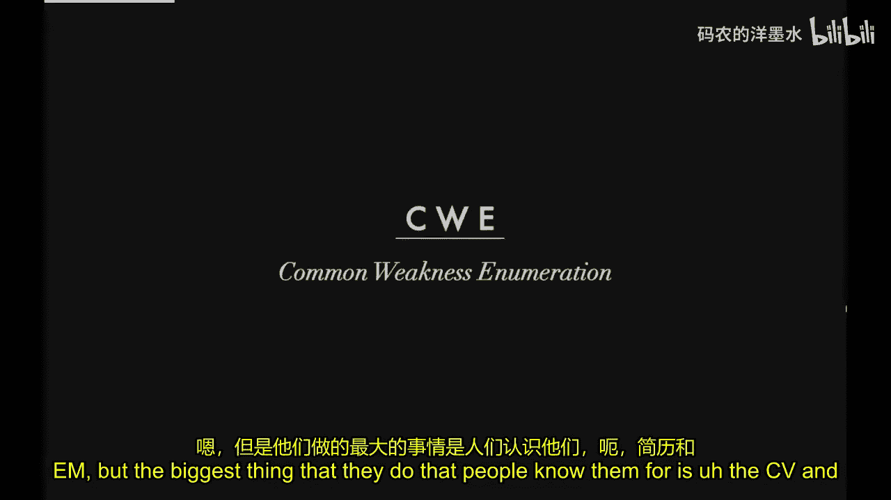

It thought it did。Sorry， bear with me for one second， y'all。Get this on the stream， too。

I can shop it out。I'll just tether。 It's taking too long。I you'll like the name of my network。嗯。

Her command。Really do have no service done。I don't have service down here。Fris。

 could you help me with this for a second，cause this will be。I checked everything but that。

 So Stanford visitor。Just try going to example。com so that little interect。Do you have， I know。

 I know what we need to do。So， speaking of security。There we go。 Oh， you were forcing into H TPS。

 Well， we have like all sorts of plugins on the browser。Okay， there we go。

 So C WE is the common weakness enumeration。 So like。

 if you've ever wanted to like just see like a massive long list of all of the types of vulnerabilities that there could be。

 CWE is a list。 we could go and search by like research concepts。

 development concepts or architectural concepts。 So we go and click here。😊。

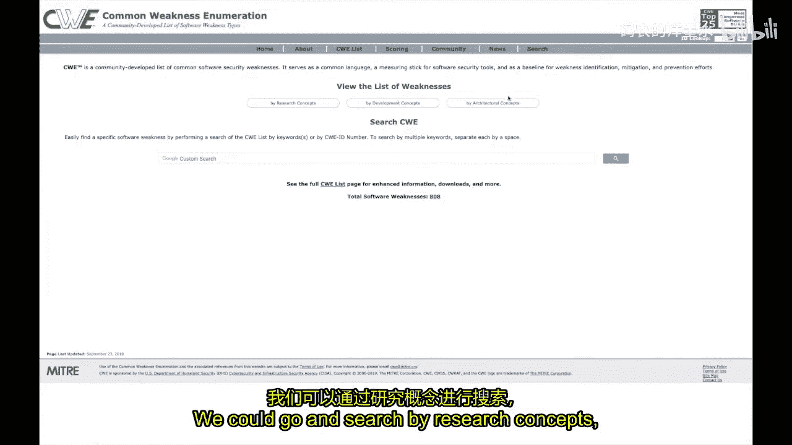

We can see there's a thousand of incorrect calculation， improper interaction。

 And then like we can click on this。 and it can you know。

 go in depth and explains a little bit more about like what CW E 4。

35 improper interaction between multiply correct behaving entities means。 This is like， for me。

 really interesting because it's a common language。That we end up having as researchers and it helps。

 you know， like when you're reporting something， you're able to say like， hey。

 this is the CweE that I think is is happening。 And and that brings us to a CE。

 which is a common vulnerability and exposures。 And so this is another program by MIter。

 And the CE is list of found CweEs and projects。 So you can go and look at the CE list And if we typed in。

 for example， here， like node JS in search， there's like far more than you'd maybe want to see。

 but the thing that becomes really cool with CEs is and let me see if I can find one that's a little newer。

😊。

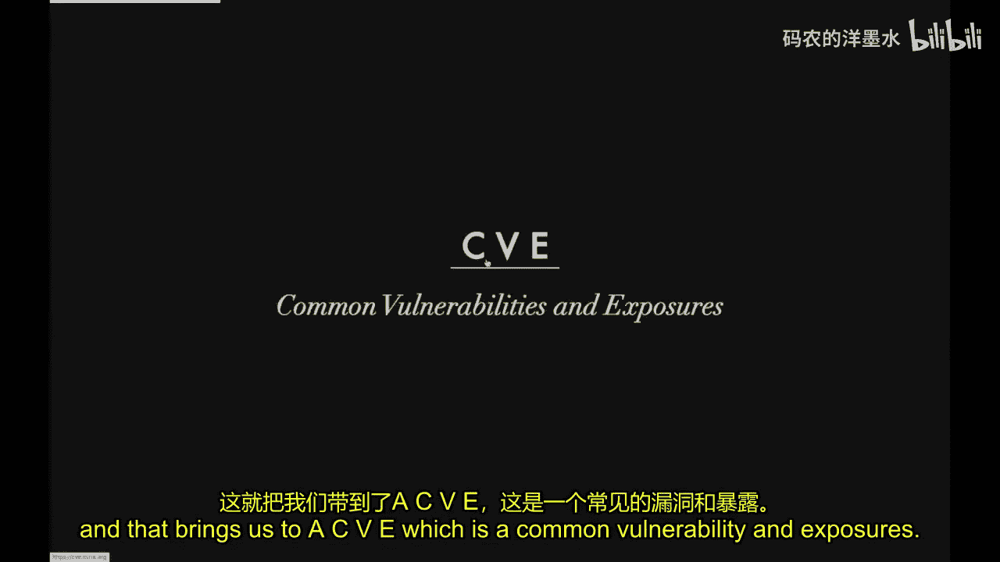

So here's one from a package， which is like a common injection in the PS package versions less than one for nodeGS allowed arbitrary commands to be executed when the attacker controls the PID。

 they have a disclaimer about it， They have the hacker1 report we'll talk about hacker one in a minute you can click through and we can learn more on this site which is not loading and we'll deal with later。

 but you can kind of follow through on all of the different things going on here to kind of figure out like what is the attack that we're dealing with。

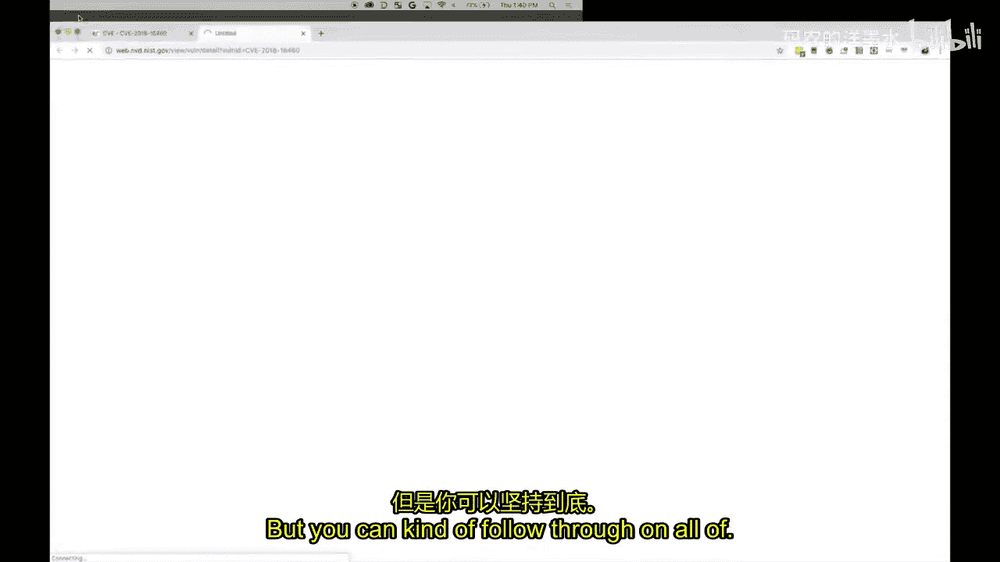

And this database can actually be used as well if you're an operations team to kind of scan everything that you have in production。

 compare the version numbers。 and you can know from this database like， oh。

 do we have anything in production that's vulnerable。

 And then we can cross reference that against the CWEs。

 and we can figure out how bad is that because depending on the environment that you're running。

 you create a threat threat model of that environment。

 certain things are going to be higher severity than others And we'll talk about threat modeling in a bit。

CNA is a CVE numbering authority， so those numbers that we saw。

 those CVE numbers are assigned by a CN MIR itself acts as a CN and most vulnerabilities that are reported usually get their numbers from MITR the node project used MITR as our CN for a very long time but in 2017 a group of people in the security team decided。

 hey， you know it's a lot of work going through MIR it can slow down our release process we don't want to have unpatched vulnerabilities and we don't want to like be waiting for a number from MITR to keep a zero down unpatched so we actually went through the work of becoming our own CN so the nodeGS project is a CN and every year we get a block of numbers that we can assign ourselves so we can actually assign those numbers to vulnerabilities before we've reported them to MITR to be added to the database。

And essentially like when we put out our security releases， we can say， hey。

 here's the CVE number that it will be， we give the information to MITR and they'll update it later so it might take time to end up in various international databases。

 but we're not blocked by MITR on getting fixes out。CVSS is the common vulnerability scoring system。

 There's a calculator that you can use。 that's a lot of fun。

 So let's say that you think you have found a vulnerability in some software well like is it a low risk vulnerability is it a high risk vulnerability This calculator helps you figure it out And when we talk about CVves and Cwes and CVSS these are all interconnected。

 So if you find a vulnerability， that vulnerability will be assigned a CveE that CveE we'll have a CweE for like what the actual vulnerability is and then it will have a score based on this And so we can take a really look quick look at the base scores So it's like what's the attack vector。

 I it network， adjacent network， local or physical and as you can imagine。

 something with a physical attack surface is going to be lower risk then something that can be done over the network I'm going try to make a really high risk of vulnerability here and we'll play here from there attack complexity is another angle。

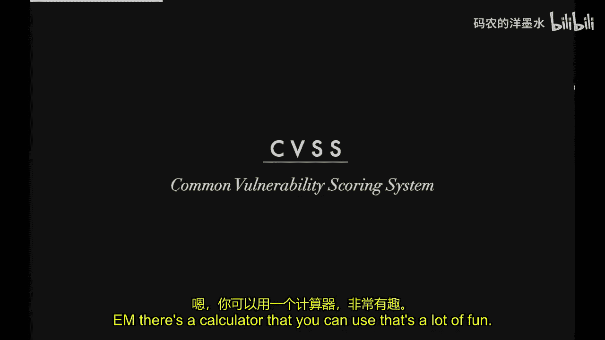

A really really simple attack to do like can I literally just send you like the word pi and your machine explodes like that would be like low complex a high complex vulnerability may require like the one that we were just looking at said hey。

 you need access to the PID already so like is it an escalating attack that requires a lot of work let's just say that we have one that's really low privilege required no lower high like how much system resource privileges do you need to do it none user interaction does the user need to do anything for this to happen or not scope does this change the scope of the actual system so like after this vulnerability have you escalated privileges let's say the scope changed。

Confidentiality impact。 So like is there access to data that shouldn't be exposed。

 We're gonna to say， oh， yeah， like we're getting your whole hard drive off this integrity impact。

 does it have the possibility of affecting that data。 This is a really important thing。

 maybe we'll have time later to talk about side channel attacks。

 But side channel attacks for exfiltration is a really great example of something that has a very high confidentiality impact and that you can exfilrate all sorts of data。

 but a very low integrity impact because it's not gonna affect the integrity of that data。

 But let's screw the data on this system anyways。 and then availability impact。

 So this would be something like a dos。 will your attack。

 be able to affect the availability of the machine。 let's say hi。

 this is a 10 out of 10 extremely high score。 They have other things that we can go into including temporal score metrics and environmental score metrics for the sake of time。

 We won't go through them。 But something that I find is like just like a fun exercise。

 especially when I start。going through this is go through and just look at a couple CVEs。

 if you're interested in learning about like the weird ways that people hack systems。

 it is literally the documentation of every publicly available hack。 go look at the CWEs。

 if you want to learn all the different ways that you could attack a system that's a list of them and if you think that you have a vulnerability you know put it through this calculator。

 figure out like is it actually。As big of a deal as you think it is。

 And it turns out like what's interesting is you may not consider it。 But like。

 let's say there's no integrity， no confidentiality， high availability chains， unchanged network。

 low complexity， no， no changes to privilege， no and user interaction required。 So like。

This would essentially just be like a dos that requires user interaction。 And it's still like a 6。5。

 So like the the metrics that they have here and how it's scored， there's an algorithm for it。

But it's also meant as kind of like a fairly general threat model where they're coming up with these scores。

 So just because something scores really high on this system doesn't mean that for your system that you're doing the threat analysis on that it is as high of a。

 of a risk。 just， you know， something to think about so。

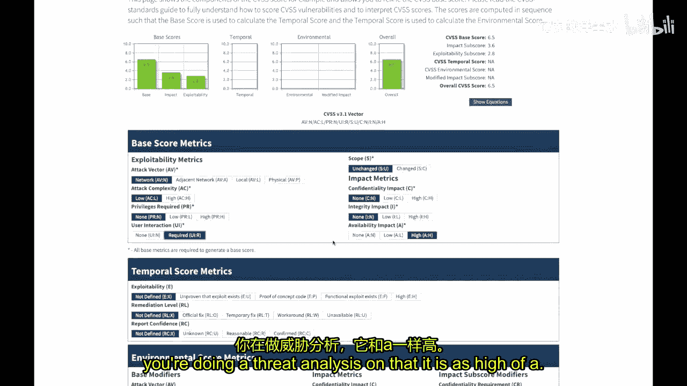

I mentioned the term zero day， zero days of vulnerability that has not yet been patched。

 arguably has not yet been disclosed， So it is the it is out there。

 it is in the wild and it can be taken advantage of zero days are dangerous because we don't know that they even need to be patched。

 White hat security researchers will discover zero days and report them to projects and at the point that they're reported is kind of like where the countdown is coming to disclosure and the countdown is coming to it becoming publicly available。

One of the challenges of being a project like node JS is we are a volunteer run organization。

So even our security team， our technical security team。

 no one is paid directly by the project or the OpenJS Foundation for the work that they do on the NoJS project a bunch of folks like myself are lucky enough to work in positions at companies where they're afforded chunks of time to work on the project so I get。

 you know between a quarter and three quarters of my time every week to work on kind of open source ecosystem related stuff of which note is part of it。

But everyone who's working on the project is a volunteer。 Our security team is also volunteers。

 Everyone who's managing all of the reports and the people who are patching the vulnerabilities themselves。

 This introduces a couple interesting。You could call them risks。

 I don't know if it's the best way to frame it。 but like one we need to like significantly vet all of the people who are coming in before they can be given access to this information。

 It really helps when someone works for like a Google or a Microsoft or a large company。

 not necessarily because the company gives them like a resume line。

 it's more that we know they can get fired if they screw with their stuff。

 So like that kind of bondability makes escalating trust easier。

 Also if they have coworker-s who can vouch for them that helps a lot。But you know。

 we do have vulnerabilities that have been reported to us that are still unpatched。

 either due to the complexity or due to the lack of resources in particular subsystems of node that remain undisclosed but unpatched and there is the risk of zero day attacks being disclosed by security researchers if the project itself cannot patch it in a reasonable amount of time。

A vulnerability， which we may have time to talk about later called the hashwick vulnerability was a hash seed vulnerability where a timing attack against a node JS server could be used to determine the hash seed that's being used for randomization on the server。

 but because V8 was baking that hash seed into node it could also be used to determine what version of node the project was using。

 so you could use something like that to like a do like a whole bunch of really weird dossses you could use knowing the like hash seed to cause a hash lookup vulnerability where you just throw everything into like you keep making requests that would cause the exact same key into a lookup table。

 which just causes a server to run super slow。V 8 fixed it。

 but it got disclosed before it could be fixed because V 8 needed to like completely reimplement the way in which they were doing hashing and the kind of hashing that they were doing。

 And that was like a nontrivial change。 And part of it still remains unpatched today。

People might not know what V 8 is。 Oh， V 8 is the jascript engine that's embedded in node。

 It's also the jascript engine that's inside of the Chrome browser。

 So when you think about nodes architecture， we are a jascript runtime。

 How many people are familiar with node Js。Okay， so node Gs is a serverside runtime。

 You can write jascript code and execute it inside of node。 The big difference， I would say。

 between like node and other javascript runtimes is that we embed our own system interface called Lib U V。

 So if you think about the browser as a jascript runtime。 you have jascript。 which is the8 inchrome。

 and then you have blink， which is like the render and all the additional APIs that are on top。

 So anything that isn't just a language feature。 So this would be network access or file system access。

 Anything that would be essentially eventually binding to a Unix API。

 All of those are heavily heavily sandboxed in the browser land。

 node implements a whole series of system APIs that are of our own design are not standardized other than via implementation。

So we run into a lot of these like really interesting edge cases with the way in which we give program system access。

 and when I'm talking about the use of V8 here is when you write code in jascript and hand it to node。

 V8 is the engine that is executing that in a virtual machine and then we have bindings into V8 that we create manually to give V8 system access the ja language itself as specified by TC 39 doesn't have any system interfaces there is some work being done to create kind of like a standardized system interface that could be used by jascript1 times and the WSm community called Wi if we have some time I'll dig into that after but it's a little forward thinking and tangential。

Embargo is a really important term in all of this。Confidential information is embargoed。

 I am on the Nojis security triage team。 Everything that is sent to us is under embargo until it's publicly disclosed。

 And I wear a lot of different hats。 and this can make these kinds of embargoes a challenge。

 So I wear a hat as a nogs release engineer。 I wear a hat as a Nogs security triage member。

 I wear a hat as a Google employee in cloud working with our runtime teams on our runtimes。

This embargo， when we have embargoes in node， scopes to my work within node。

 So it would actually be against the rules of our project and arguably illegal， although like。

 I'm not going to try to lawyercap that， but。I can't disclose the embargoed vulnerabilities to my peers at Google before they are publicly disclosed based on our current embargo policy。

 and we've actually had problems with this in the past where members of our security team leaked embargoed information to their companies。

 which arguably gives them competitive advantage over other vendors。

 we have discussed as a team trying to create an early access embargo program for people who run node Js runtimes。

 So， for example， whether it's AWS or Microsoft or Google， you know。

 like with independent of what cloud vendor I work for。

 I want people who are running node to have a secure environment to run their code。

 I would love us to have an early embargo program so we can bring in these runtime so they can patch and test and ensure that the security vulnerabilities。

Are patched to the time between zero day and everything being patched in production can be as low as possible。

But unfortunately， the， the politics behind this and even just like the。

 the technical ability to implement these。Makes it difficult。 So as it is today and node。

 everything that happens security wise is embargoed and embargoed to the project。

 And if I were to talk to my employer about any of the things that are disclosed to me。

 I could be removed from my position working on these things and people take it really seriously。

 And one of the last ones I'll talk about here is triaging。 I use the word triage before。

 triaging is a process that we do when vulnerabilities get reported to the project。

 And we do that through a thing called hacker1。And I'll show you hacker one in a bit。

 Has anyone used hackcker1 before。Haackcker1 is a website that you can go to and various projects have landing pages on there and so you can go to hacker1/ nodejS and if you have found a vulnerability and nodejS coreps。

 you can report it through hacker1 hackcker1 then acts as a management system for those vulnerabilities。

 they allow you to put your CVSS score in there， they allow you to put your CWEs in there。

 they allow you to keep track of how quickly we are responding and they actually give us a score based on a project as' how quickly we do things。

 hacker1 actually donates resources to the node project to help with managing these things so when new reports come in we actually have the hacker One team review these reports first and pre-triage before handing off to our team to ensure that our time is not being wasted by reports that are not really a problem。

This has bit us before。 It's kind of like touch and go。 The， the researchers are good。

 but they don't know the platform super well。 So we've had things kind of get mis characterized before。

 We also run a hacker one for the ecosystem。 So if you find a vulnerability a project like express or or。

Torrent Stream or any of the various modules that are in the ecosystem。

 We have a separate team that manages triage of those。

So stuff comes into hacker one and we'll get a little bit more into kind of the life cycle of a vulnerability in a minute and the last one I wanted to mention is the IDBB。

 which is the Internet bug bounty the Internet bug bounty is a really cool program that's run by hacker one and it's a fund of money that's used to pay bug bounties to security researchers who find bugs in what's considered core infrastructure of the Internet。

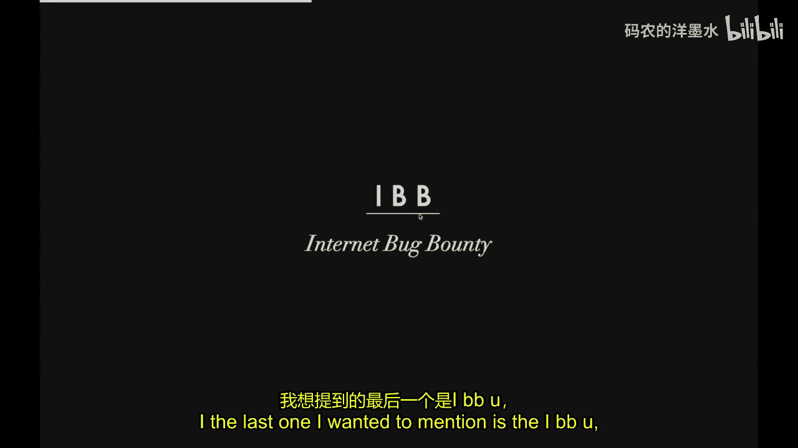

So a lot of projects run bug bounties。 and hackcker1 actually also acts as a way to pay out these bounties and record the bounties and have like hacker reputation。

 So these different projects that you can see here， open a cell， and X， Apache， pearl， PP。

 I guess the Internet。All of these projects participate in the IBB and the IBB is this large fund that will pay out bounties for open source projects。

 generally scoped to remote code execution is primarily what they're for。

 So node participates in the IBB program I am proud to say that we have not paid anyone out yet。

 not because I care about the money I just don't want us to have R Cs and node but it's a really。

 really cool program we have discussed about making kind of above and beyond program within nodecor itself so we can be giving some degrees of bounties to security researchers。

 but there is kind of like a high levell question here with bounties about like whether or not they create the right incentives and especially for a volunteer organization like ours。

 if we make too many bounties and there's people who can make a whole career off of bug bounties like if we have the resources to really manage the kind of traffic that could come in with them。

😊。

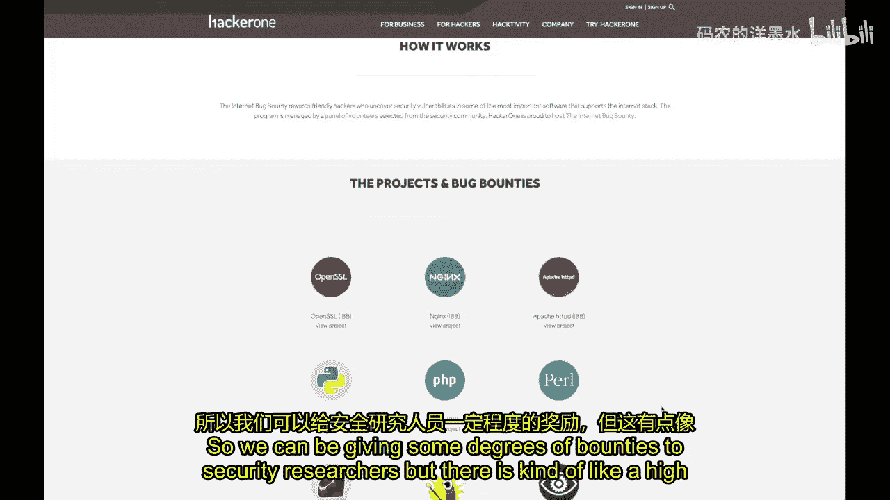

But so we're going to talk about a couple different types of vulnerabilities today。

 I've mostly been focusing on the first one and we will primarily focus on this。

 which are vulnerabilities to the core node JS platform。

 So node itself is a software project it's built of a whole bunch of different parts。

 And if there is a vulnerability in node itself， that means every single application on the Internet that is running on node is vulnerable that's bad。

 we don't want that to happen。But there's also vulnerabilities in the node JS ecosystem itself。

 you know， there's a massive package ecosystem and NPM of I think like a billion packages or something silly like that at this point。

 And a lot of this packages can have vulnerabilities in them and there's a lot of different vectors And if you're building applications。

 you need to worry about the infrastructure you're built on top of not just the platform。

 and finally， also vulnerabilities in your applications themselves。 Now。

 arguably these second to can become kind of conflated because the packages that you use from the ecosystem in your application are part of your application。

 But I do think that they are distinct to think about from a threat model perspective。

 And when you're thinking about kind of how do we avoid these bad scenarios。So in nodeGS core。

 there's a couple of different kinds of threats。 This is not all of the threats。

 but some of the threats I've seen us try to worry about buffer overflow attacks。

 denial of service attacks， data exfiltration， remote code execution。

 host names spoofing and vulnerabilities and dependencies as well。

 So it's not just the ecosystem that needs to worry about dependencies。

 node has a depth folder and we have a bunch of stuff in there including ICU and V8 LibUV ZlibB NGHtP2 we have a whole bunch of C+ plus code and other dependencies that are embedded in node itself。

 And if we ship that code and that code's vulnerable。

 well then nodes vulnerable and a non-trivial number of the security releases we've done over the last two years have actually been patching open SSL。

Because。People love to hack open SSL and we want HPS to be reliable。

 So I mentioned the lifecycl of a vulnerability。 So let's dig into that a little bit。

 So you're a researcher and you've figured out that you have a bug and you report that bug through hacker1 so it gets triage through hacker1。

 it ends up in my inbox and maybe I don't look at it in the morning because I'm in a meeting。

 but hopefully someone looks at it。 and eventually we communicate with the author if we need more information。

 we'll ask for more information well go back and forth。

 but eventually if it can be confirmed as an actual vulnerability。

 then it is considered triaged and being worked on。 It's also possible that it stops at this point。

 we had a vulnerability reported yesterday， for example that was neither a vulnerability nor a problem with node it was a really weird way that if you define things with let that like variables are not able to be used but it's arguably a spec bug but definitely。

Wasn't a security problem， but， you know， we triage that。 We respond to the person。

 point them at the right information。 and then you know， like say， hey， that's not a real bug。

 And then I think as far as hacker1 is concerned， you actually have like a hacker reputation。

 So if you file things that are not bugs like that， you get like-5 to your score。

 if you get like a bug that's actually triage， you get like plus 7。

 So like you can get reputation because points。We then work on identifying a solution。 And， you know。

 the hope would be that this is something that we can do rather quickly。

 But as I mentioned with that hash seeed vulnerability， you know， sometimes this can take months。

 sometimes like。Part of this is sitting in triage for over a year that's very。

 very rare and in fact a hasley vulnerability is the only one that's really been in that case。

 but we do try to do this as quickly as possible and we generally try to stay in touch with people generally on a weekly basis。

 but if possible like every 24 or 48 hours， especially if they're really。

 really high severity vulnerabilities。We create a security release。

 This part is the most painful part of the whole process。 As I mentioned。

 noted as a volunteer organization， Another part of our organization， which is all run by volunteers。

 is our build team。 So our C I infrastructure， which is absolutely ridiculous。😊。

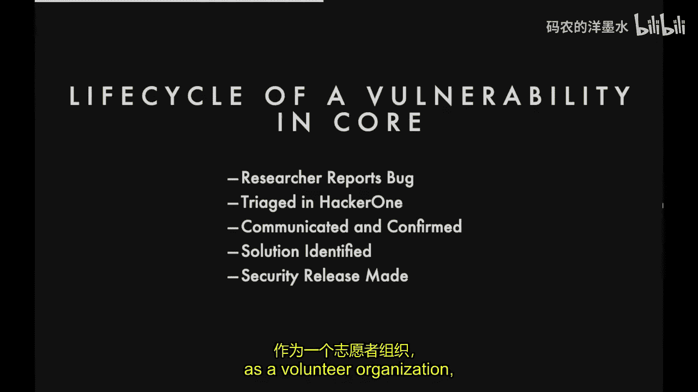

Oh， come on。Was was killing me。So this is our C。It is a jaie Jenkins with so many different workers。

 So like one of the things with node that's particularly interesting is we have so many different platforms that we support。

 So it's like every flavor of Linux that you can imagine。

 including like BSD as well as Sois We also support multiple builds of windows。

 multiple builds of Ox a whole bunch of different arm systems。 We do Z systems。

 we also do multiple power PC， and I think S390。 So there's all these different architectures that we support。

 So you can see like all of these are like different build bots that we have。

 some of which I guess are red， some of them are containers and we test in a whole bunch of different container things。

 including like Alpine and you know actually I'm gonna take a note because we can get back to this one later。

 but。There's weird vulnerabilities that can come just from system differences。

 there was one that I ended up having Ap a couple years ago where。FS dot呃。

God was is it it's like the symbolic link APIs， like when you're determining like cycles and symbolic links。

 real path is all implemented in ja in node because in 2008。

 when around the time that node was originally being written there was a buffer overflow attack and the real path implementation in UniX that was used to do remote code execution via FTP servers So instead of binding to real path3。

 they just implemented real path inside of node proper and when we eventually tried to fix that in node by binding against realpath3。

 it broke a whole bunch of stuff in the ecosystem because the order that you would get system errors。

 whether it be a real path error or makeDr error was totally dependent on the system so we broke a module called Gob and only broke it on like Darwin and BSD because of just like platform inconsistencies in the implementation of the UniX API。

And we had to do like a really weird patch to make sure that if somehow someone was running node on like an old version of Unix that had that vulnerability from 2008。

 my super naive hack there was like literally it just throwros during compilation。

 so you could never compile it to work on one of those systems and no one's complain。

 So I think we're good。But anyways， that was a tangent and a half。

 The reason I brought up the C stuff was that RCI has all of these workers。

 these workers are extremely specific and they are persistent。

 So it's not just like we're running something in a container if any of you use something like Travis。

 for example， your C is running in a container and then when your process is done。

 that containers killed so you don't have to worry about things living on between runs。

 because we have all of these systems， and because to a certain extent。

 but not totally our C is public ish， at least to like collaborators。

 but I believe you can click through and get access as long as you authenticate with Github。

 you can kind of go through and look at any of the things that we're running。

 you could look at the output from the console from any of the things that have been run。

 So if R CI was still public when we're testing the patches for our security vulnerabilities。

 someone could go through and look at the system and just through like the commit name maybe like figure out what zero days we're trying to patch。

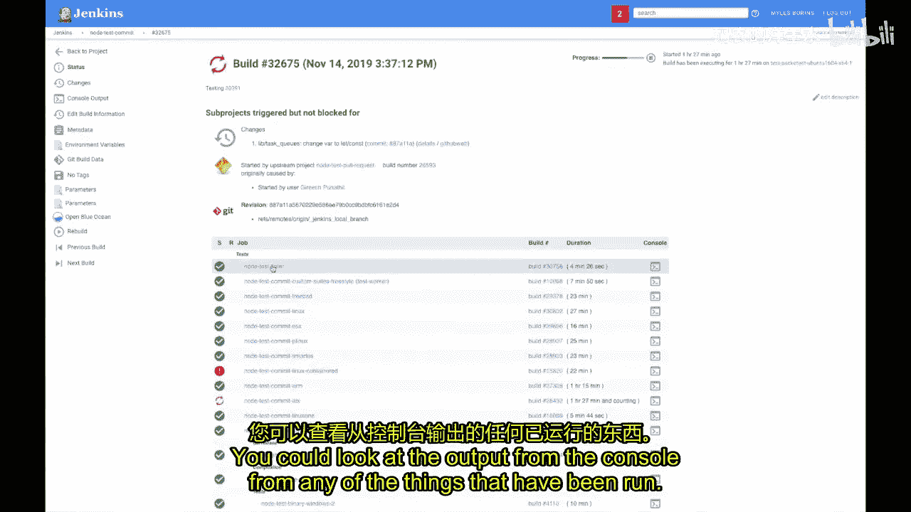

So when we actually get to testing against all of the different platforms。

 we need to shut down our entire C I for all collaborators。

 except for the triage team and the release team， which ends up being。

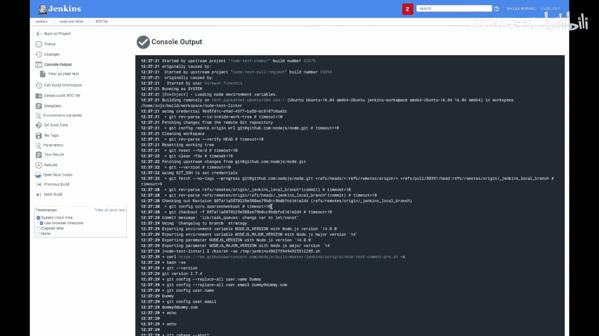

Quite disruptive。 but kind of like I went through that whole thing to talk about like when we talk about doing a security release。

 this isn't just like a thing that we could do at any time。

 We need to give the build team a heads up so the build team can go and lock down the infrastructure and make sure all the IAM ruless are set up so that the access management doesn't allow other people in who shouldn't be in we need to make sure that collaborators who have access are aware that like hey。

 don't run anything on C right now because we don't want to have any problems we need to make sure that collaborators know they're not gonna have access to C。

 So if you're planning to get work done， you won't be able to And then separately from all of that we have a whole other sandbox to C just for doing releases that we need to make sure is wired up to get things from embargoed repoos because we won't even be working on the main repo。

 we may be working in different forks and we need to make sure that our C is all wired up to have access to all these things。

 It's pain。 But once all of that is done， we can then finally disclose the vulnerability itself。

Isue a CV ecor， publish a blog post， we post on a message board about the security vulnerability itself and then often what will happen also with this is you know people around the Internet start updating their stuff or not。

So。

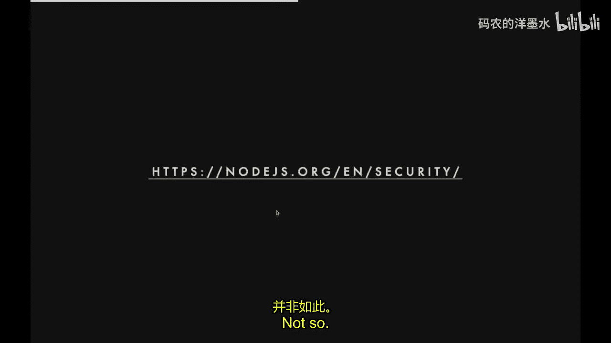

For a little bit more information on our security process， you can go to nodejs。

 org and click on the security tab， which kind of has a lot of what I've discussed documented。

 It tells you know like if you have a bug to report to node。

 you can click here to report through hacker 1 we'll acknowledge within 24 hours and give you an update within 48 and one of the things that's great about hacker1 is it actually tracks this and it gives us metrics。

 So if our security team is not keeping up with this SLA that we're offering that's the service。

Agreement I forgot what the L stands for I should know talks about our bounty program and it also talks about reporting third party bugs and about our general disclosure policy and that was what I was talking about regarding things being embargoed and when they get disclosed and if you want to have updates。

 we do have this Google group called Nejs sec it is a read only list that every time there is a new security release we post the update in here as well as like you know why we had to do the release and I'm kind of happy that if you look here you can actually see we've only done three security releases this year。

Which is far better。 We had a lot more in 2018。

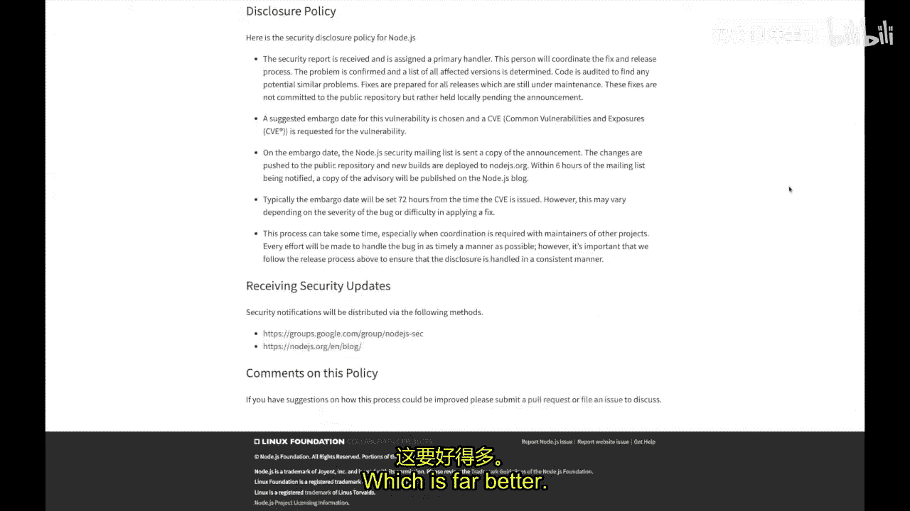

So going back here， the next one I want to show you really quickly was the NoJS hacker1。

 So if you were to report of vulnerability through hacker1。

 this is what the landing page would look like has a little bit more information about the policy and a little bit more information about hey。

 where do you go to report third party you could see that our average time to resolution like our average time for first response is one day。

 average time to triage is two days and we meet our response standards over the last 90 days。

 92% of the time， which is pretty good for a team of less than 20 volunteers you could see that we have this program bounty with a minimum bounty of 500。

 we've paid no bounties because we haven't had any RCEs but you can't see that we've had 12 reports received in the last 90 days with the last report resolved to three months ago with 10 reports resolved in 19 hackers thanked you can on any hacker one page look at the hack。

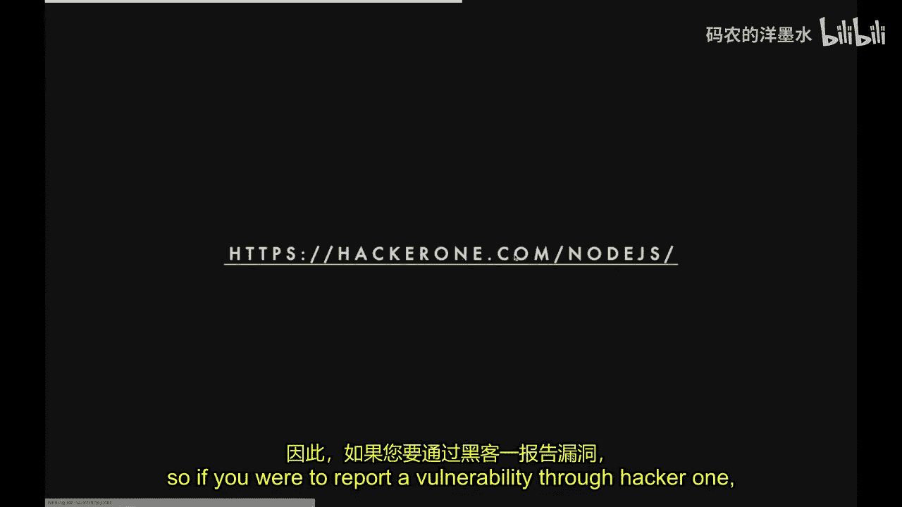

Wwhich will show you like what has happened。 you can see most of these are embargoed but some of them are available to be seen。

 This is one that is kind of fun。 was the registry nojs。

org domain takeover so this person found that there was an abandoned nodejsorg subdomain called registry nojs。

 org that was pointing to fastly and fastly doesn't require any proof of DNS ownership to register new distributions that use a given domain。

 so he did an effective takeover of registry nojs。 org which someone may decide so you know like point a package manager at which would be bad but so we worked with them。

 we fixed the cnames we deleted the CNname record and went through and it did an audit of our entire DNS stuff there but the reason I wanted to talk to you all about this because a couple things。

A， you would never think about this necessarily as a vulnerability to know JS。

It was not a software problem in the project。 This was a domain entry on our website。

But our project relies on that website being a canonical source of information。 So this was。

 in my personal opinion， like an attack vector to the node JS project。

 And this is when I talk about the idea of like threat modeling。

 like this is the kind of thing that you need to take into account。

 like what are all the different ways。That people can attack your project or take advantage of people who are relying on the services or products in which you're offering。

 If someone put something on registry do com and then tweeted about it or posted it。

 like they could have hacked a few people and gotten some important information before we could have reacted or known anything。

 Thankly， Doe was a good actor。They reported this to us。

 but they had arguably taken over a portion of the nodeGS domain and could have done some pretty nasty stuff with it。

So if you wanted to submit a report， you would click submit report。

 and then it will take you through a loginflow。 I'm not gonna log in because if I log in。

 then you're gonna see a whole bunch of stuff， which you shouldn't see。

 but if it is something you're interested in， you know， if you're doing security research。

 it's a really great way to kind of like build a bit of a profile for yourself。

 maybe make some extra cash on the side。 but also just similar to like going through the CE databases。

 all the vulnerabilities that have been reported on hacker one that have been disclosed。

 are able to be gone through。 And you can kind of look at the history of the conversation that's happening there。

😊。

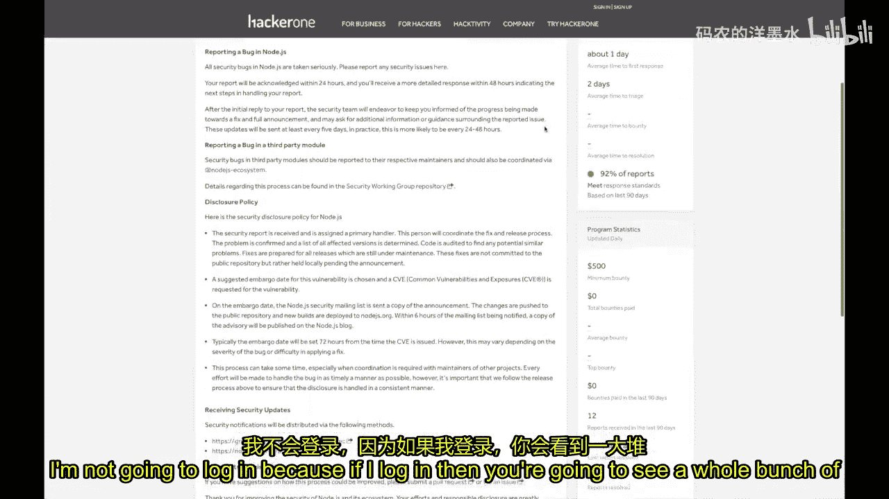

So I selected a couple of my favorite vulnerabilities from the last two years and thought that we could go through them really quickly。

 So this is CVE 2017-14919， which was an improper input validation so if we click through to the CVE itself we could see nodeGS before 4。

8。66。 x before 6。11。5 and 8。 x before 8。8 allowed remote attackers to cause an denial of service uncut exception and crash by leveraging a change in the ZlibB module 1。

2。9， making8 an invalid value for window bits parameter。

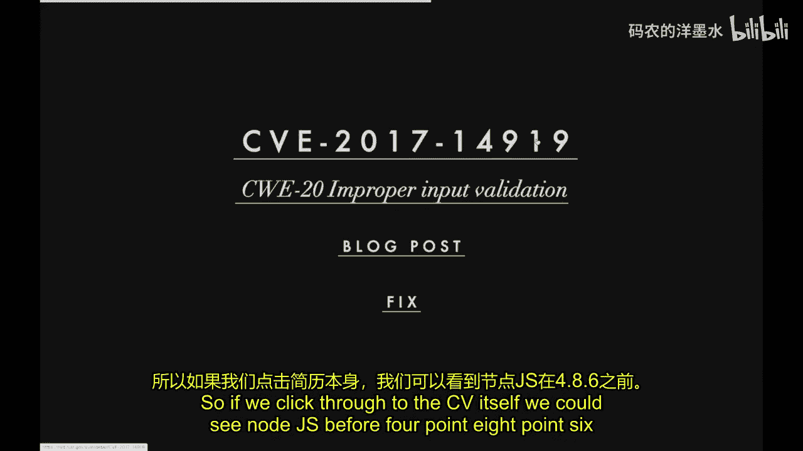

It's a bit of a mouthful。 If we look here， we can see it C W20 improper input validation。

 we can click through and see what what that CWE is and it talks about all the research concepts that it's relevant to an extended description。

 you could kind of go through here to see like all sorts of examples and whatnot in places where it's referenced in standards But let's let's go back here and we can look at the blog post to maybe get a little bit more information。

 So we could see here to yeah here it is。 nodegs was susceptible to a remote dosOS attack due to a change that came as part of the Zlib 1。

2。9 update， which by the way， was a security update to Zlib So upgrading dependency that we had to patch a security vulnerability In this dos into node。

8ight became an invalid value for window bits parameter in the nodeJS Zlib module。

 which would crash an exception when you were trying to create a raw defflat stream。

 which node was doing internally，8 was a valid value to passs to create deflatelate raw prior to this update。

 which just kind of hooks into Zallib itself。And this should have been， in my personal opinion。

 a severe major change for the interface of Zlib。But they didn't。 They did it as aem patch。

 which surprised us。 but window bits 8 worked before and inside of Zib。

 what they would do is if you pass window bit 8， they would just replace window bit 9。

 And it's because they don't actually have the way to encode an8 bit window deflate stream implemented in Zib bit all。

 I have a pull request that I sent that hopefully would fix that。 it never got a response。

 So that's kind of where we are。 But what would end up happening here that was that if you had code that was setting the window bit manually。

That would work on the versions of nodede prior to this patch。

It would cause no to crash because Zib through an exception when you passed8 as a window bits argument there。

 So if you had some sort of way to send something like。

 let's say you had a Zlib service and allowed people to pick the window size。

 they could create a denial of service attack and and heard of the availability of your service。

 So show you really quickly what the fix looked like。

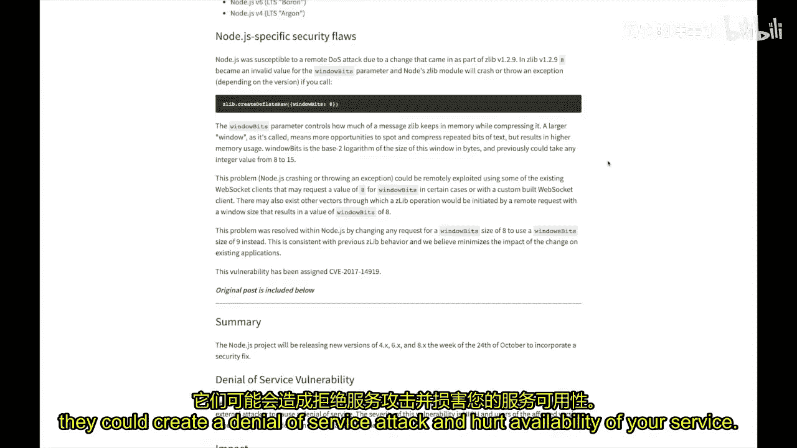

Cause it's super naive and fun。Maybe it will eventually load， come on。それぞれなこ。

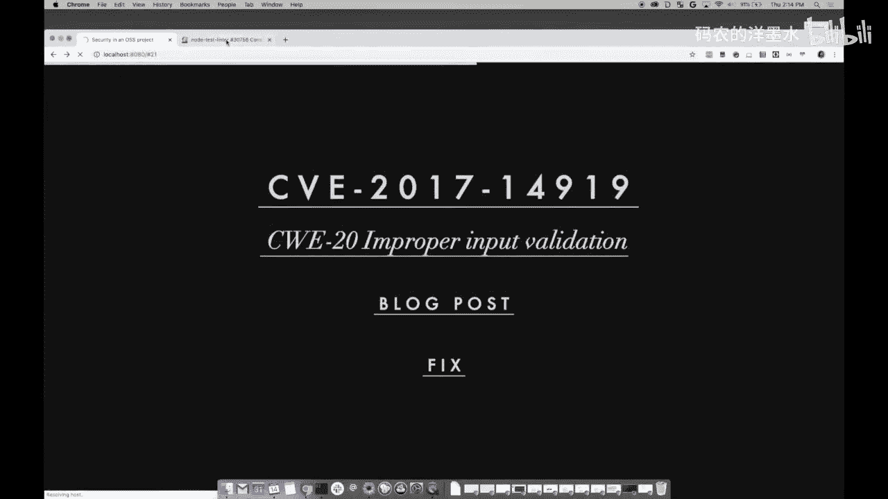

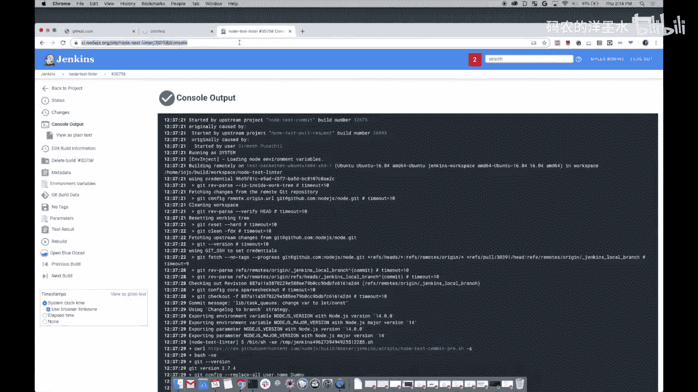

Oh， there we go。Okay， so。I wrote this patch that has a little bit more information in in the commit here on April 4 2017。

 nodegs versions 4。8。2 and 6。102 were released。 These versions bumped the vendor Zeb library from 1。

2。8 to 1。211 in response to what it describes as low severity cs in zeeb 1。2。

9 a changes made that caused an error to be raised when a raw defflat stream is initialized with window bit set to 8 in zealeb 1。

2。98 became an invalid value for this parameter and nodezeeb module will crash review call this on some versions this crashes node and you cannot recover from it while in some versions throw exception。

 The per message toflat library up to version 0。1。5 does make a call with no tricach。

 So if you are using that library inside of your package that would just cause your service to all of a sudden become unavailable once you updated。

This commit reverts the original behavior of Zeallip by gracefully change window bits 8 to window bits 9 in a ro F stream。

 so you could see， we document all of this in Zal itself， and then this is the fix。

And we also have a a test that we removed， which was confirming that that indeed worked。

 And then a new test that was added to ensure that we would never regress here。 And I think。

If I do this really quickly。If we take a look。At Zib。Gitthub。You could see。My attempt to fix it。

Which brings in， you know， like a little bit of an algorithm to allow 8 bit windows。

 but this has remained unreviewed and unlanded。 So we need to， for now keep that hack in node。

 unfortunately。

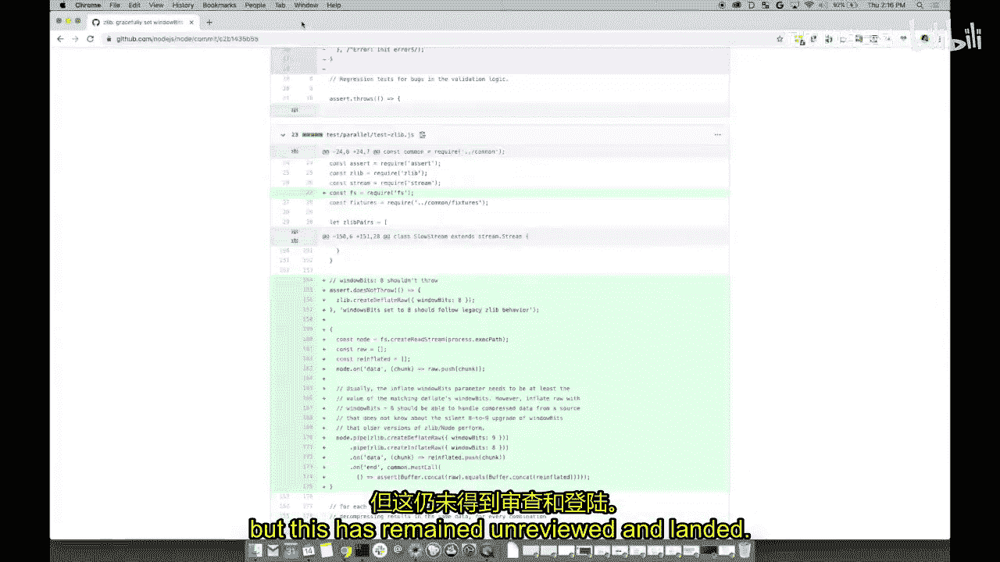

So that was a fun one。C V E 2018，71，60 was authentication bypass Boofing and reliance on reverse DN S resolution for a security critical action。

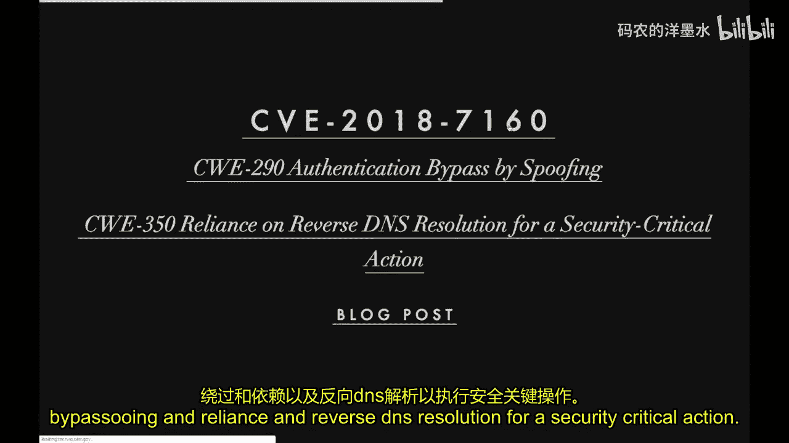

So this is a kind of fun one makes more sense when you read the actual vulnerability。

 the nodeGS inspector in 6。X and later is vulnerable to the DNS rebinding attack。

 which could be exploited to perform remote code execution an attack is possible from a malicious website open in a web browser on the same computer or on another computer with network access to computer running the nodeGS process a malicious website could use a DNS rebinding attack to trick the web browser to bypass same origin policy checks and allow HTP connections to local host or to host on a local network if a nodeGS process with a debug port is active is running on local host or on a host on a local network the malicious website connect to it as a debugger and get full code execution。

So if you've ever used nodes inspectspecor API， you do node dash inspect that lets you connect to node with the Chrome inspector。

 It's really great for debugging， but it turns out that like with this DNS rebinding attack。

 arbitrary websites could trick node into thinking that it was running on local host and execute things。

 So like let's say that you were running node on your personal computer testing an application or running a slide deck like I'm running right now and happened to be debugging your application and had the debugger open and then you were going through like the docs or something like that on the web and then oh you forgot you looked at Twitter and then you click a link like。

If your service was running on your local system， your whole local machine could have gotten boned by this attack。

Similar attacks were a problem earlier where we listened on star instead of local host and we didn't do kind of like an isolation to just local host so that if you are running a system in the cloud that had the inspector exposed。

 anyone could have connected to it， not just something on the same origin。 So， you know。

 these are just kind of small things that you may have to think about。

 like maybe you're throwing something up on a server of yours to debug and you have the debug port exposed。

 which is like 58，44。 Well， there's probably boss just crawling across the net constantly looking for systems that have 58。

44 open。And if you don't have it set up to like lock down with some sort of credential or cookie。

 you know， you could just have your system owned really quickly。

 If we look at the blog post for this one。 So the attack was possible for malicious website to open in a web browser on the same computer。

 the mitigation may affect some remote debugging scenarios。 For example。

 it may no longer be possible to debug a remote computer by using a host name。

 either connect using the I address or using an SSH tunnel to work around this additional security request。

 this change is therefore a breaking change。 However， as per the node release plan。

 where concluding it is including it as a security fix on all impacted release lines as a se minor rather than aem major。

 how many people are familiar with semantic versioning。

So when you see a software version that's like 8 do 10 do1。

 the first digit is what's called the S major。 the second digit， what's known as a S minorr。

 the third digit is a S patch。 And if you're using semantic versioning which some projects like node do in some projects like V8 don't the version numbers actually have a semantic meaning。

 the S major digit， which is the first digit means breaking changes。

 So if you do anything that breaks any interfaces in the software you are expected to increment that digit。

 The node project， we do every six months， a new s major version。

 So we have a master release line that everything just lands on when it's done then we have different release channels。

 So we have a separate branch for every one of our major releases。

 So right now we have version 13 version 12 version 10 and version 8。

 So four versions that are being maintained each their own independent branches。

 And when we cut new releases from each of those individual branches， we backboard。

Changes from master onto those specific release lines。

 but we do not backport any of the several major changes to any of those release lines。

The second digit S Minr refers to changes that are non-breaking， but add new features。

 so if you add a new API or if you extend the capabilities of an API in a way that doesn't change behavior or expectations。

 you're expected to increment the S Min number so we just unfllagged ECscript modules in node two days ago。

 it will launch next week。The way in which we implemented it does not change any software using the old common JS loader。

So that will be considered a December minor change because it is purely additive。

Sver patch are changes that do not add anything and do not break anything。 So these can be doc fixes。

 new tests。 It can be fixes to bugs。 It can be changes to experimental APIpis that aren't part of our S policy。

 Now， the thing that we mentioned here that's really important， though。

 is that we landed a breaking change as a S minor。 So this is part of our release policy that essentially we state。

Anything that is a security update， something that we need to patch because it is making our platform insecure can land as a s miner。

 even if it's breaking。 So in the case of this API， we broke。

 We just like hard broke the ability to remote debug via DNS using the domain name directly and not the I。

 which for cloud， this is a great example of something I may want to like broken the embargo and told our teams because we have like remote debugging tools that are relying on these interfaces。

 we have products that are that rely on this。 but I could not tell my team until it was embargoed but we broke it。

 and we broke it hard and we did not look back because you need to do what you need to do to make sure that things are safe。

A great example of something that's along the lines of that right now is node has a legacy。

Pser for HTP。 It's called HTP underscore parser。 It's written in C++。

It is a painful ball of C plus plus that no one really understands。 Fior and Dundney。

 who's like just。He was the one who came up with that hash vulnerability that I was talking about before he's one of the most brilliant hackers I know on the planet。

 He wrote an LVM compiler that can take Typescript and compile it like directly to bit code So it doesn't even like transp it to JS。

 It just like takes Typescript and then turns it into a binary and he rewrote the whole HTP parser in Typescript in a way that was completely like semantically equivalent。

 but like way easier to manage and because it's written in Typescript now rather than C+ plus there's more people that can help manage it in node 12。

 I believe we switch the default to this new Typescript parser but node 10 and node 8 are still using the old HtP parser。

 Now we are pretty sure that they are semantically equivalent。

 We're pretty sure that switching from one to the other wouldn't change anything。😊。

But we can't know for sure。 And node， all of nodes even releases are what we call L T S。

 long term support。 They get three years of support。

 But once they go into a long term support stream， we do not make。Wide changes。

 So like even if they were s minor or s patch， there can be s patch changes that change performance characteristics。

 such as refactoring for speed improvements。 We don't land anything on these branches that could potentially change the performance。

 even to make it better because you don't know if you change something to make it faster。

 that an extremely large system。 It breaks things in unexpected ways that maybe have， you know。

 expectations based on timing。So we are not right now switching the。

 the old H TP parser to the new H TP parser in node 8 and node 10。

 which are both kind of in a maintenance period now， because we don't want to risk。

Changing expectations， changing performance or breaking anything。

 But we did make it extremely clear that there are a bunch of vulnerabilities that may be discovered in that parser because we know that it has problems and that if in the future。

 vulnerabilities are disclosed， we may choose not to patch those vulnerabilities。

 but rather switch the default parser。And that would be arguably a severe major change that we would land in a s mine。

嗯。A lot of words。 Thanks for bearing with me on that。 But like。

 these are the kind of things that we need to think about as a platform when we're releasing when we offer stability and kind of finding the balance between stability。

 reliability， security and maintainability And that last one。

 maintainability is extremely important because as I said， you know。

 like we are a bunch of volunteers。 we do not have all the time in the world to work on all of these things。

 So we need to kind of be pragmatic and and choose when we can and can't fix things。

 which is the exact reason， for example， when note 8 goes end of life in December。😊。

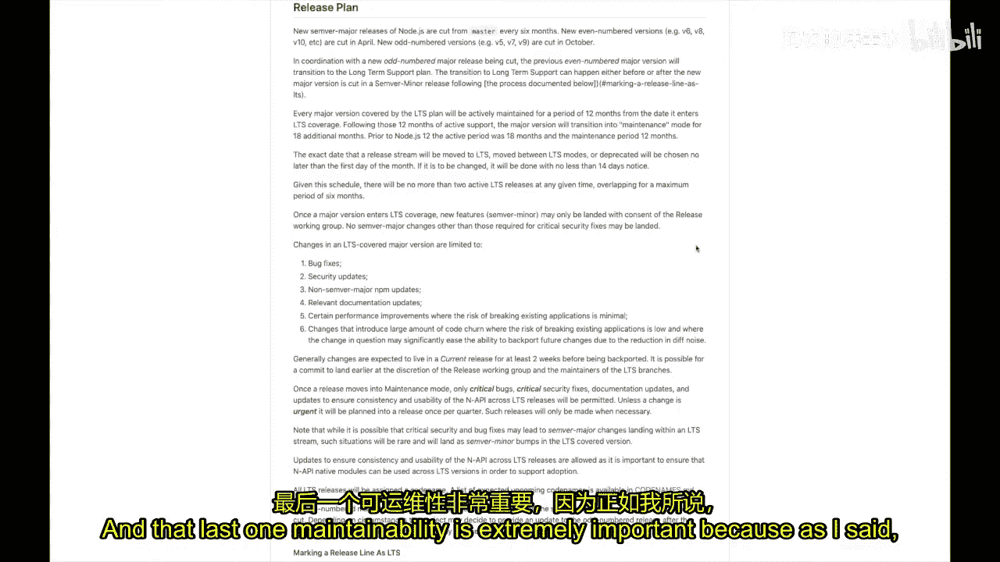

Like， we won't patch it again， even if people find vulnerabilities。

 and we're actually end of life it early because the version of open a cell that it relies on is ending life before you're going end of life that release line。

So rather than keep a version of node on a version of open SL that doesn't have security support。

 we're just ending it six months early， which I'm more than happy before， means less work。Okay。

 so one more C that will go over C V 2018，1，2，1，1，5 out of bounds， right。

So this was an interesting one in all versions of node JS prior to that when used with USC2 encoding recognized by nodeJS undername USC2 USC dash2 UTF 16 LE and UTF16 LE。

 buffer right can be used to right outside of the bounds of a single buffer rights that start from the second to last position of the buffer will cause a miscalculation of the maximum length of the bytes to be written。

This isn't good。This is an out of bound right。 You don't know what's existing in that other memory and out of bound rights could be used for all sorts of other escalations。

 And this is a thing that I learned over time that I found really interesting is that like often an attacker won't just be using one attack。

 It's like， hey， when I take three or four different attacks that I know about and tie them together。

 then we can do something like really interesting。 So like this out of bound attack could be used immediately as like a denial of service。

😊，Or it could be used for something like a remote code execution。

 If you knew that the place where you're writing out of bounds is where a reference to a function that's going to be called is。

You could potentially put a payout there。 so that wasn't good。And then this is like a fun one。

 If you just wanted one blog post to read through that's like going get the best bang for your buck。

 November 2018 was a doozy of a release。😊，So I told you about port 5858。

 So this was interesting after we fixed it in the inspector protocol。

 when we realized that our old legacy debugger actually had all of the same vulnerabilities as the new inspector based debugger。

 So we had to go back to old versions of node that were not patched because they didn't have the inspector and patch that。

 So like we actually created a zero day。 So this is like a cool thing like。😊。

We patched the inspector， and we stated， hey， this is a vulnerability。

 and this is a way that it could be escalated， but we completely ignored our legacy debugger that had all the exact same vulnerabilities。

 So an attacker totally could have gone and seen， oh， they like fix the inspector。

 I wonder if the same attack works against the debugger and then would be able to use that attack against older versions of node and legacy things that were in production。

We had a denial of service with large HTTP headers。

 so if you used a combination of many requests with maximum sized headers of 80 kilobytes per connection and carefully time the rate that you were sending the headers。

 it was possible to cause the HTP server to abort due to heat allocation failures。

It was possible that if you had proxy layers in front of your service and you weren't just exposing your service directly。

 that it wouldn't have caused a problem。 But like this was a really interesting bug because it was reliable and you could take down kind of like anything with the right timing。

 Slow Loris was another one that was somewhat similar， which was like。

A time out of 40 seconds was applied to the HTV headers because this kind of like slow request attack could be done and it caused like a memory leak。

That if you kept。If you made a request and it was a slow request and it kept the request open for a certain amount of time。

 and that at a certain cadence， you just kept them coming。

 you would slowly do resource leaks of the node process。

 and you could just essentially cause a process to start taking like orders of magnitude longer to process requests。

 And this one was like really， really nasty because there wasn't necessarily a good way for you to even tell that your system's performance was degrading over time。

 And if someone was doing this really slowly over time。 they could just kind of like really。

 really slowly degrade your service and just like you。Get it to the point where like， wow。

 nothing's working。 And then you restart it。 And then it works again。 And you're like， oh， okay。

 cool。 And then just it happens again。 So it's like one of those things。

 just like mess up your day in a way that would be really hard to know about。

Hose name Spoofing in the URL parser for the JavaScript protocol was another one that came out that day。

 there was an HP request splitting CVE that came out that day。

 and then a bunch of timing attacks against Open SSL。So anyways。

 if you want to learn about like a whole bunch of them all at once。

 I suggest the November 2018 blog post， there's a lot of fun vulnerabilities in there。

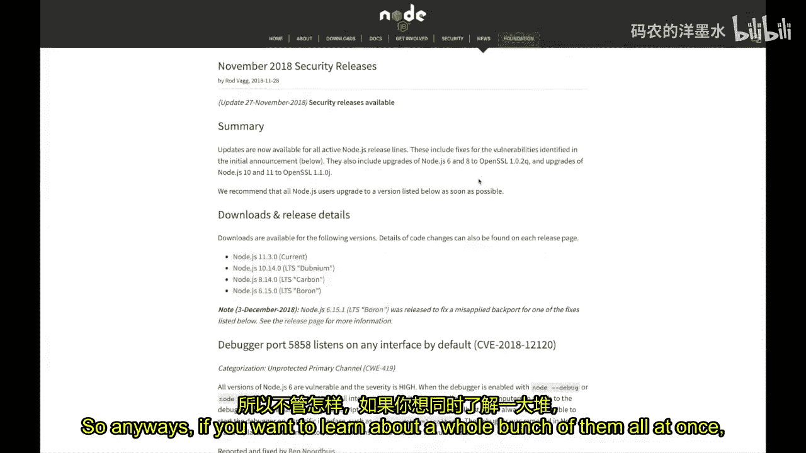

So we talked about threats to node， but what about like to your application or to the ecosystem。

 what are some things that you may have to worry about there Well everything from before。

 you don't have to not worry about those。 but you also now are susceptible to things like supply chain attacks。

 you're now susceptible to things like weak cryptography and to be honest。

 I'm actually being kind of arrogant to pretend that supply chain chain attacks and weak cryptography can affect node as well。

 but generally this is something more of an ecosystem problem。This last one， though， I think。

 is really important。 poor developer experience。嗯。So Ferris and I were talking a little bit earlier about like a transition I may be doing in my career right now towards Google's open source Program office。

 The Program office at Google is responsible for maintaining the policy for open source compliance at Google。

And one of the things that we've been talking about is like。

The compliance process at Google to open source a library or to patch upstreamream could be considered by some to be a little bit too aggressive。

 If you want to make your own repo， you can go and check up Google patching。

 all of this stuff is online。 but you have to go through like a whole launch process。

 if you want to make a repo in Github and there's a lot of people who don't agree with this policy or think it's too much work。

 And not me， but other people in response to this will just go and make their own repoos。

 And this is why policy and process needs to be thought of in a way that is balanced with pragmatism and velocity。

 if you make a whole if you are a security researcher on a security team of a company and you make a really really like robust and arguably like dogmatic process that it's hard it's hard for people to follow。

They're not going to。 They will find ways to skirt around it。

 People will value velocity over anything else。 So creating a poor developer experience through trying to lock down your systems。

Could actually make you less secure。 One of the ways and we'll talk about this in a bit that I've heard like getting around this is like。

 you know， keep development clusters that are isolated from everything else。

 let your developers run whatever the hell they want on those developer clusters so that the iteration of actually like building the solution happens in a sandbox and then do like a full review of all the dependencies before it promotes to production。

Highlight the things that are inside of that dependency tree that they can't ship to production。

 And at this point now you're not saying， hey， you can't use all these modules。

 try to figure out this from scratch。 Now， the problem that they have to solve is， oh。

 like these really three or four specific APIs that I understand and know their capabilities need to be replaced。

That's just one kind of pragmatic way of approaching this。 But in general。

 like if you are in the position to help pick security policies and process for an organization。

 do keep in mind that people will ignore you if you make it too much work for them to deal with it。

 and that is arguably like the highest vulnerability that you'll have as an organization。

 and malicious thirdpart code is also a problem and it's deeply tied to supply chain attacks。

 and queryed injections or another obvious place where you can get bit and applications。

 So I think we had sent out in the document to all this nodeec roadmap。 Mike Samuel wrote this。

 he was a security researcher at Google Google works on a giant mono repo and he had been there since before the mono repo doing jascript just to give you an idea of like how long this person had been doing jascript at Google。

 Some work that I had been doing internally is trying to get more。

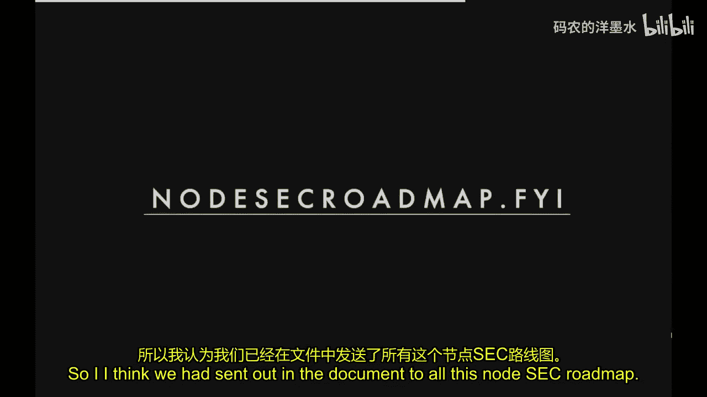

Internal adoption of node Js for Google products， which was not entirely blessed。

 although there are some ways to get it into production now。

 part of the process of doing that was a full review from our security team and this artifact is one of the things that came out of this if you are looking at creating you like a threat model threat environment and security process for a team that is building a node Js application I highly advise going through this document it goes through hey like what is the threat environment that we're talking about what's the difference between server and client side code。

 What are the classes of threats that we have， what are their frequency， what are theirities。

 at least for the model that they've created This is a really interesting thing to think about in creating a threat model is the severity for your threat model maybe different So at Google we have a whole bunch of serverless runtimes have any of you heard of like cloud functions or Amazon Lambda before。

Lambda and cloud functions allow you to just give like a single function that's written with a particular signature。

 We deploy it for you， we scale it for you。 It's just expressed in a container， but whatever。

 but like。It's really great from like a velocity standpoint of being able to get things out really quickly and great to not have to manage that infrastructure。

😊，But your security concerns become far different when you're running in that kind of environment。

 Like， first of all， with cloud functions， we update the node runtime from underneath you。

 We also patch Cs on the operating system from underneath you。 So we'll redeploy your functions。

 anytime like the base container image that we use for cloud functions is based on a Btu。

 I believe right now， and there's a whole bunch of system libraries that come out of the box on there。

 if any of those have Cs or if node does a new release。 we patch that and release that for you。

 So like some of the stuff that we talked before。 but like making sure that you have the latest version of node。

 that's not really a threat model for you anymore。 Another one that's not really a threat model there as much as dos or at least not in the same way。

Cloud functions run with one tenant per one function。

 At least that's the scaling model that we use at Google。

 So each cloud function will spin up a new instance of that cloud function for each request that comes in on the server。

 What this means is that if someone is trying to attack you with a denial of service。

They will take down that one instance， but it does not affect availability at all for other people who are trying to connect to your service。

 Now， what it can do， and this is a totally different kind of attack is it could do a resource attack。

You have a credit card attached to your account。 You pay so much for every single function that executes if someone knows a dos that can just like cause your cloud function to halt and just like not like run until the max length they could scale up a whole bunch of traffic against your cloud function and then kind of like just drain the resources of your account and cause you to spend a whole bunch of money。

 Your system will always be available。 but you waste a bunch of money。

 I mentioned this because this is a different threat vector。

 This is a different kind of thing you need to put in place to affect it。

 You can in cloud function set like max scale。 You can set different kind of observability warnings to see when your traffic spikes beyond a certain point。

 If you had a single VM that was running a node service。😊。

A dos on there will look very different than a dos in this other environment。 But just in general。

 like this kind of threat modeling is really important when you're thinking about where you're putting your stuff。

 how it's running， how it's scaling， how ten is being managed and how you have to worry about the availability of your service。

 So go through all of these different vectors， It talks about like dynamicism and node。

 why it's really easy and why dynamicism can be a problem。

 It talks about like knowing your dependencies and that workflow that I had suggested， for example。

 of like you know， working in a sandbox and kind of making it harder as you get to production with your dependencies comes directly out of this dock。

It talks about potential solutions and incident reports and how to run scripts locally。

 That's another potential threat vector with node。 When you run NPM install。

 there are post installt scripts that can run on every single module when you install them。

 So essentially， NPM install is a remote code execution environment。

Is doing that on purpose because you're saying， hey， do this。 In fact， just running NP PMM install。

Is executing code on your system， that all depends on where you want to like draw the line。

 So if you are deploying things to production。 Well。

 if you are running NPM install and building your docker container inside of a sandbox that's thrown away after you build your app。

 Well， that's fine。 But let's say you have a single living VM and you're running docker in that VM and running NPm install in in a folder before dockerizing the thing。

 and that's like directly on your VM and not in any sort of isolation。

 Like you are risking compromising your main system。 So these are just like you know things。

 things to keep in mind。 they get more into like solutions and sandboxing techniques in here。

I won't dig too much more into this， but just like another document that's just like really great to dig into has a lot of great information。

And I would even argue just beyond node， like think of it as a case study in node。

 but like this kind of way of like threat modeling and coming up with a security policy and program is a great way of kind of。

Clearly， identifying what needs to happen to have secure applications in production。

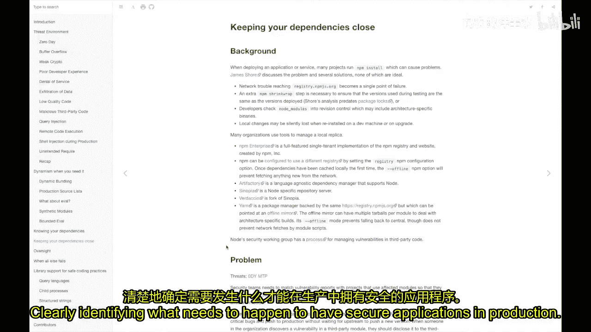

So。

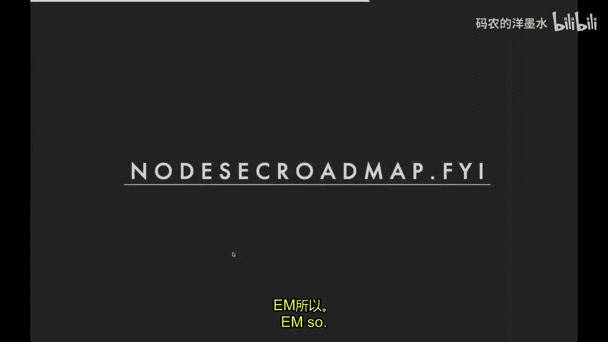

The ecosystem on Haer1 will look at this really quickly。

 but just another place where you can go through and see like a whole bunch of vulnerabilities。

 learn about like really weird stuff that's happened similar to the no Js hacker one that we were looking at before。

 You could see all of the vulnerabilities that have been disclosed。 And there's a lot of them。

 I think there's over 180 of them。 Some of them are really， really wild and weird。

 and like I don't know。 I'm always so impressed by the people whose brains work this way。

 Like I'm not the kind of person who's constantly thinking about how to break systems， but。

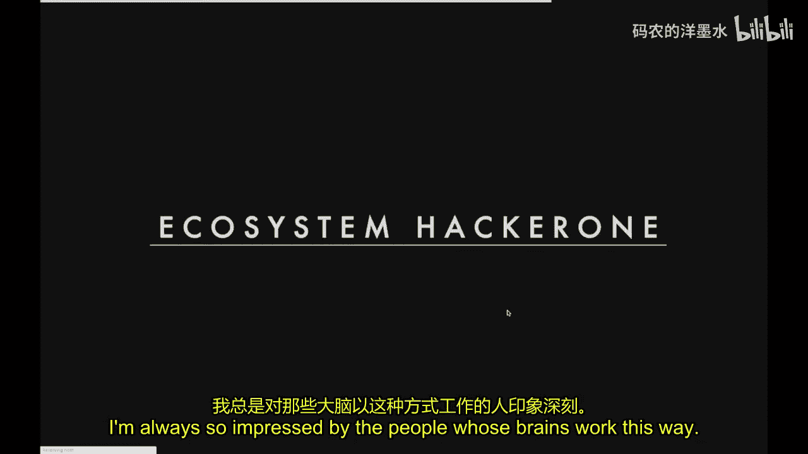

Like， oh God， like they're so creative。 Yeah， Ber arbitrary file right through imppartper validation of simlinks while package extraction。

 So like that's， that's not good。 That's not something you want in your package manager。😊，See。

Command injection in the ASCIA package。Let's look at that one really quickly。嗯。

So this was a severity， 8。6。 It was a generic command injection。Images， fonts tables。

 anty and compositing and that's about the module and the stats。 So it's not super huge。

 It's only like 1400 downloads a month。 that's pretty that's better。

 but it does not sanitize the target command line argument and subsequently passes it to the child process exact。

So that's not good。But yeah， like another place where you can go through and see like a lot of practical hacking and how it was done。

 And now with knowing the language of CWE and C VE and MIter。

 you'll maybe have a little bit of an idea of how to go through and if they mention on here。

 for example， like let's look at another type RM here's a SQL injection attack。 Well you could see。

 hey， well the weakness here is SQL injection。 So you know like you can look up Google's CWE SQL injection and see。

 hey， the history of SQL injection， what qualifies a SQL injection。

 what doesn't and you can kind of see like， hey， like this is how a vulnerability leaks into an ecosystem package which meant that if you are using this OM in your package in your application。

 you had a SQL injection in production， which is。

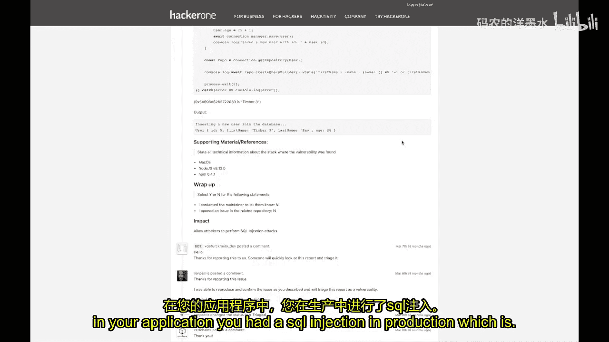

Not， not fun。嗯。

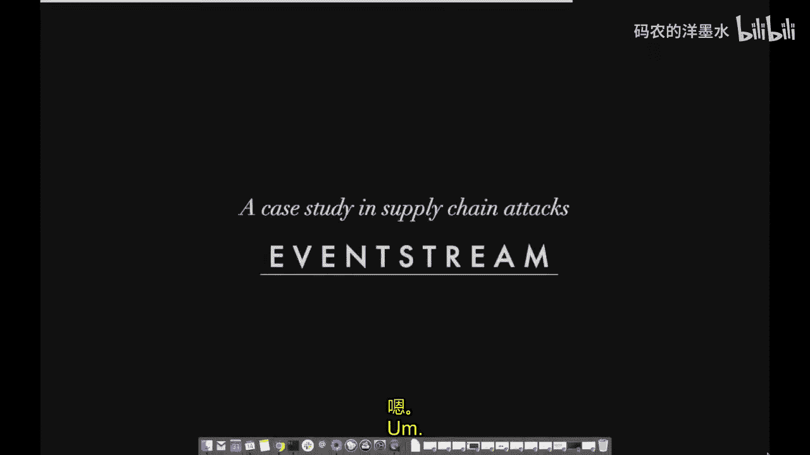

So。ThisThis was a quick 1 I wanted to go through。Supply chains。Are an interesting problem。嗯。NPM。

Apppt gett。Ruby gems， Pip， all of these ecosystems are built on a network of trust。

We are trusting that the people who are building the modules that we're using are trustworthy that we can use their code and we can even go through and review the code and ensure that like what we're reviewing is you know。

 going to work。The eventary module was hacked in a way that was pretty ingenious to hack Bitcoin wallets。

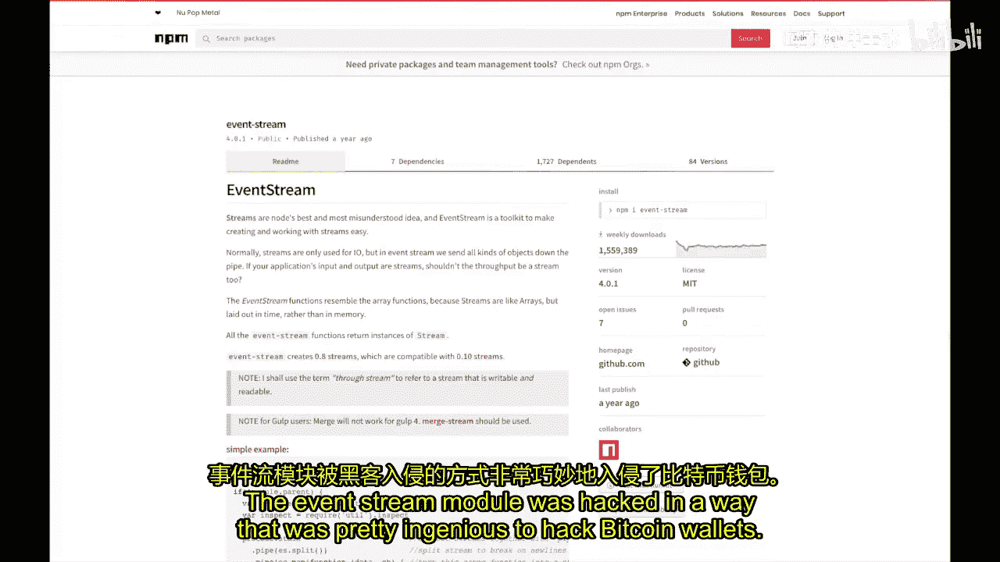

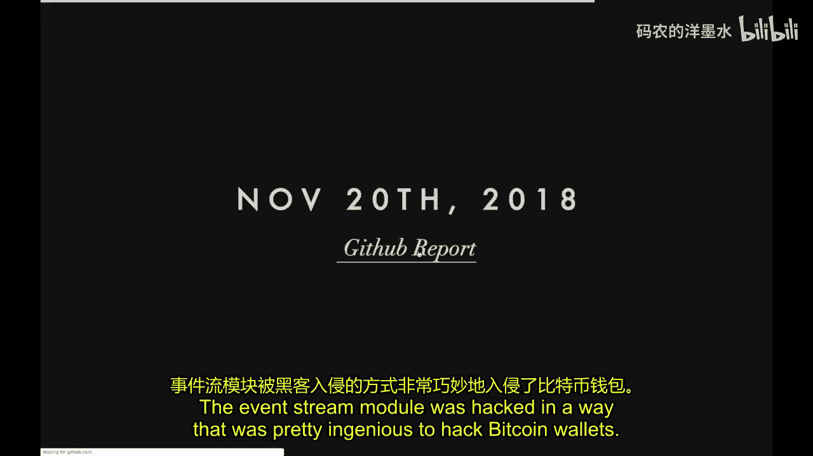

It was caught before it went out in production， I believe。

 because of a programming error because the person didn't understand how weird jascript is。

 but essentially。Someone got the rights， handed over to them to publish events stream。It was。

Unclear100% if the person who published the vulnerable version of events stream was。

Aware of the vulnerability or if they themselves had been compromised， you know。

 keep your keys close。 But essentially， what what it was able to do was。It had a payload and a test。

 in a binary format。It would check on the system to see where it was in the depth of your package。

 so if you were in a note application that was using a very specific package for a coin wallet。

They knew that the coin wallet had a vent stream 2。Depth down from it on the file system。

So the key that this binary was encoded with。Was the path。

Of a thing in the package Json of the module that it expected to be in。 So essentially。

 like when you ran NPM install for that crypto module， that if you had for that Bitcoin module。

 if you had that coin module in your path。It was guaranteed that you were going to have a hidden file。

On your system somewhere that would have the keys to your Bitcoin wallet。So。Basically， on install。

 it would grab the binary， it would try to decode it with the information it got from the package J on two levels up。

 And if it decoded， the payload was the string that would exfiltrate that data from your system and then send it over the wire。

 And I believe it also was doing something where like it only did it if the Bitcoin while it had more than like $20000 in it or something like that。

 It's like you know， regular day Robinhood。But this is a great example of like a supply chain attack。

 Someone got access to being able to publish the module。

 They scripted an attack that would be almost unobservable。 It was in the published package。

 but not in the tar ball that was pushed to Github and not in the source code that was on Github。

 So you needed to get the tar ball from NPM。 extract the tar ball from NPM。 Look at all the code。

 and the actual code that did the attack， for the most part， looked。😊。

Completely ambivalent because the actual payload was encoded and could only be decoded if it was inside of your dependency tree in exactly the right way that the attack would work。

Yes， so computers are bad。

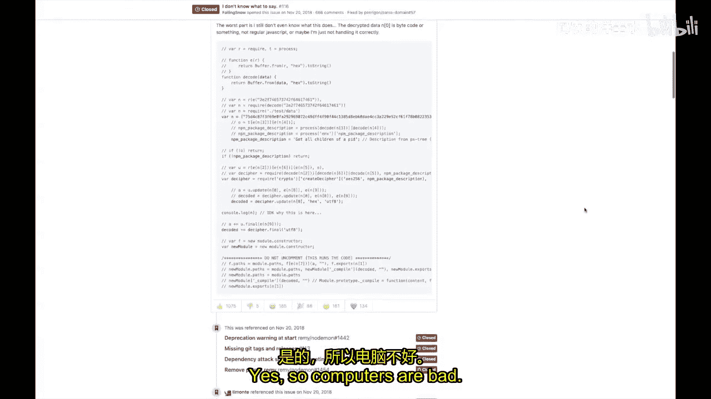

You can look this one up if you want to see more information about it。

 but I think like part of the reason why I like to bring this one up。

Is supply chain attacks are not a new thing。 I mean， they're literally named after supply chain。

 which was part of like an industrial process because they happened with like literal machines back in the day。

 Every single distributed ecosystem is。Vulnerable to these supply chain attacks。

 It could happen on Gitthub。 It can happen on P。 It can happen on node。

 node itself happens to have a very broad ecosystem， and packages tend to have a lot of dependencies。

 which make it more susceptible to these kind of attacks。

 But I would argue that it's arguably arrogant to pretend that node is the only one who has to worry about these things。

 You have to worry about these in every single supply chain you're in。 Further。

 you can do as much research and as much vetting as you want。

 odds are you are probably going to miss that vulnerability that I just pointed out。

You can't just solve this via looking at source code。

 something that could have protected against this vulnerability is if you had network policy inside of the container of the runtime of the thing that you're running。

 So if you only ran NPM install inside of a container and you lock down the network access of that container to only be able to hit like certain domains。

Well， then that attack never could have worked because it never could have actually broken out of the sandbox to get access to those other domains。

Not trying to scare you into running node only inside of a docker container on your computer。

 I promise you I don't have that much tinfoil on my head。

 but these are the kind of avenues that you want to think about because you really can't solve every single problem。

 but what you can do is create process that will protect you。So how do you protect yourself。

 you know， like one is to always use the latest version of node。

 There's a tool called NPM audit that can be used to make sure that your packages themselves are up to date。

 tools like Greenkeeper， a dependdoO， which was recently purchased by GiHub can be used to help protect your packages themselves and you can audit all your dependencies。

 but even beyond that， you know standboxing is something that you can think about as well。You know。

 in and that， that sandboxing can help you maintain velocity because if you。

 if you get too strict into the auditing side of things， you can hurt velocity。

 And then people just won't go through your audits。So， you know。

 where you run your code also plays a big thing in this。

 And I don't think I left time for questions today。You。 Okay， so yeah， like I talked for a bunch。

 I'll let you maybe talk a bit。 Thanks for listening。嗯。👏Thank you。

Could you like me one question Yeah， anyone。How many vulnerabilities come out of your team either to？

Like。Projects were like your dependencies where you discover something wrong with the dependency。

Because it got reported first to you guys or because you guys just heard your platform。

The team being like note itself。 So thankfully right now。

 with the way that hacker one triage is set up， there's like this pre triage that's run by hacker one。

 So very rarely actually do the ecosystem vulnerabilities make it to us。

 They get caught by the hacker one triage and triage to the third party first。

 But that's where there's actually been false positives where things that should have been reported to core got reported to。

😊，The ecosystem triage team。 but we， we do find vulnerabilities in V 8。

 We found like a handful of those vulnerabilities， even in node were found by like security researchers on our steering committee。

 But the node project as a whole is not actively doing a lot of security research。well， thank you。

 everyone。

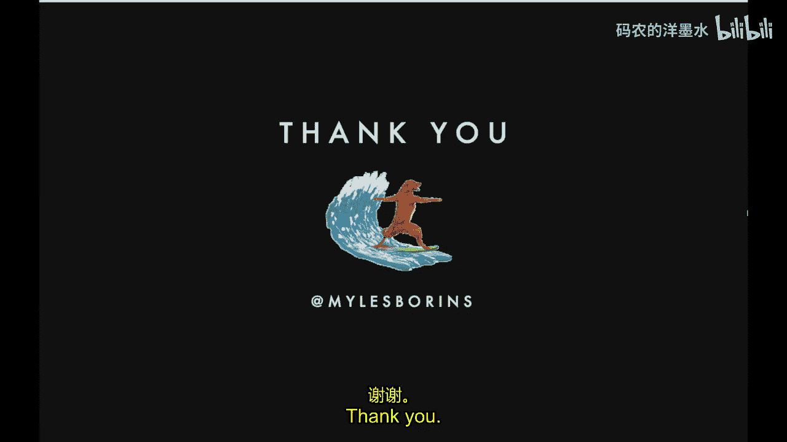