# 【全集】斯坦福大学 CS253 网络安全 中英字幕 1080P p16 Lecture 16 - 本地 HTTP 服务器安全 -BV1RemEBZEEM_p16-

All right， I think we should start。So let's finish up what we didn't get to last time。

 So just to remind everybody where we left off last time， we were discussing that API design。

And I mentioned a few examples of different types of suboptimal design decisions that one could make。

 So one of them was insecure defaults， requiring the user to go out of their way to set options to make an API work securely。

 The other one was confusing function signatures that do different things depending on the arguments that you pass to the function。

And lastly， there was behaving differently based on functionity。

 which is the number of arguments that a function takes and。We talked about Jque as an example。

 took all these different types and returned completely different objects， depending on the type。

 And then in one case， there was even。The case， the first and the fourth case。

 you see here that they both take in strings。 but this the last case is， is a H TL string。

 and it actually does something completely different based on whether the string you give it is H TML or not H TM L。

And then。We talked about this express example where depending on the number of arguments that you pass into the use function。

 you get completely different behavior。And then we came to the buffer class。

And this is this is where we left we， where we ended and。So just to review。

 the idea behind buffer was we need a type to represent binary data in node。And later on。

 the Javascript language ended up getting some built in features that allow us to represent。

Rraw data and manipulate it， but。呃。A node still kept its buffer class because there's all this code written that that assumes that buffer exists。

And so in node， you have buffer and you have type arrays and array buffers and。And so。

This was the API for buffer， if you recall。So we have a whole bunch of different types we can take in。

 We can take in other buffers。 We can take in arrays of where each element in the array is a single byte。

 So a number between 0 and 2，55。And you could also take in a string。And in the case of a string。

 it's basically just going to interpret each letter as as a bitete and then put put that into the buffer there。

Okay， and so。We showed a demo where we implemented a server。And if you recall。

The server looked quite reasonable。The goal of this server was to。

To take data in and convert it to some other type， some other representation。

 So hex Bay 64 or U TF 8。And if you recall， we， we made the API a little strange in that we。

 we made it actually take in the query string up there。 You see it takes。

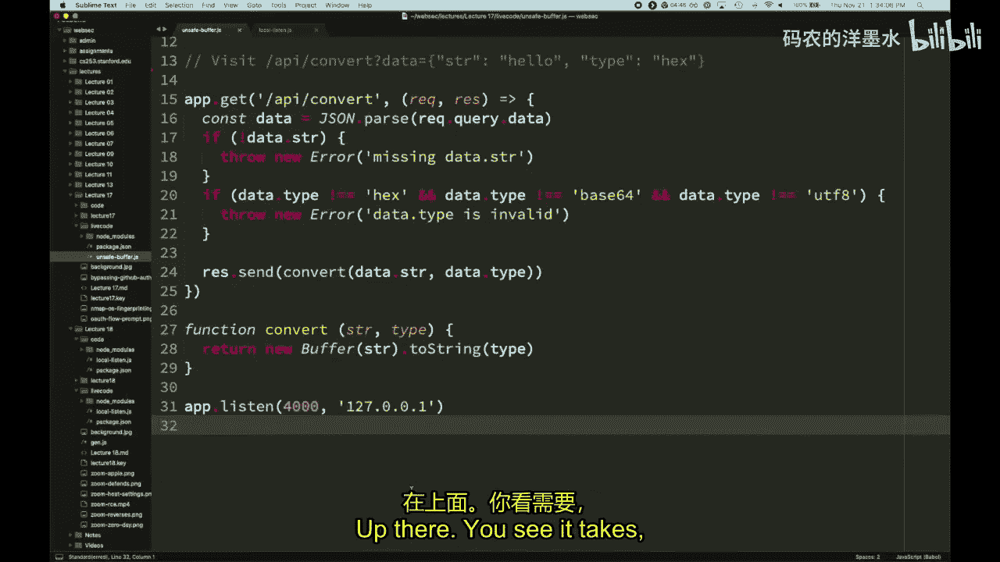

It takes， let's see here there it is。 Yeah， it takes a Json string。

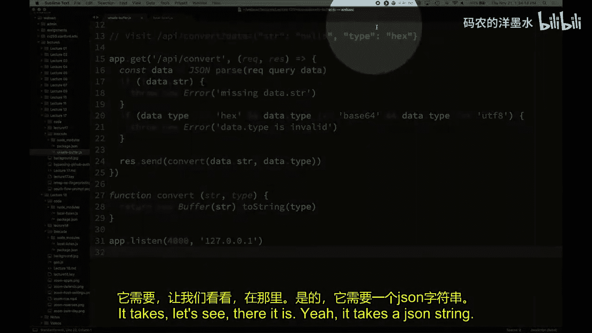

And then that gets turned into a JO object， and then we pull off the stir and the type properties and then use that to do our conversion。

 Does everybody remember this？Okay， cool。The conversion。Is done here。

 And all you do is you just pass the string into the buffer constructor。

 and then you call two string on it， and then pass in the type that you want to convert it into。

 So this can be Hex Space 64 or U TF 8。 and a couple of other things。 And then we just return that。

Right， and so。When we actually visited this server， we。We ended up doing something kind of like this。

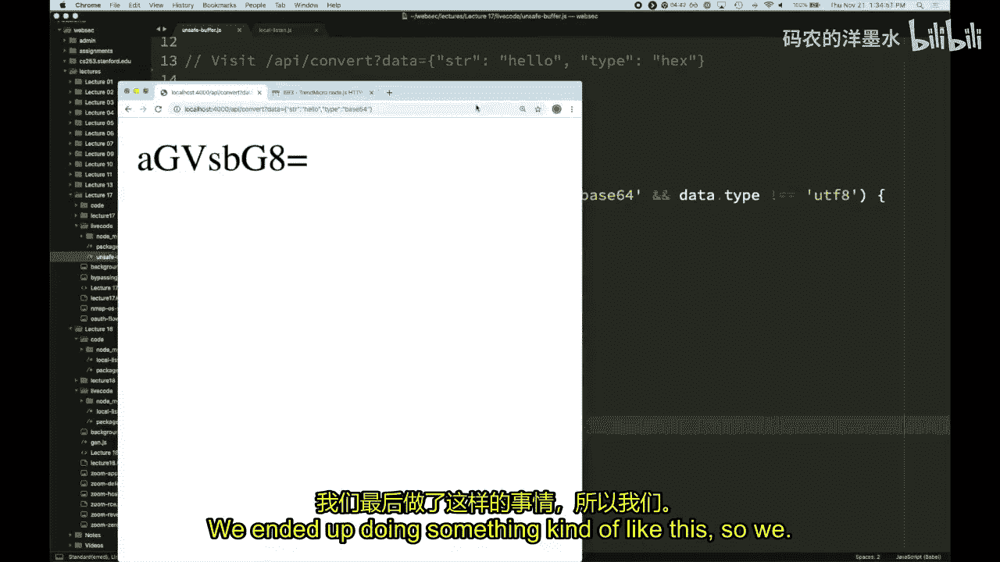

We typed in a string like hello。 and then we got the base 64 representation of it。

 We can change this to hex。 and so on and so forth。 And then， and then this is。

 this is the surprising part。 If you actually change the string to be a number。

 then you actually get back memory。😊，Uninitialized memory from the node process。And。

If you switch it to UTF， you can actually see bits of the memory。Right there。Cool， so。

I promised you that this time we would talk about how this happens and why this happens。

And I'll do that now。So this is the code we wrote。

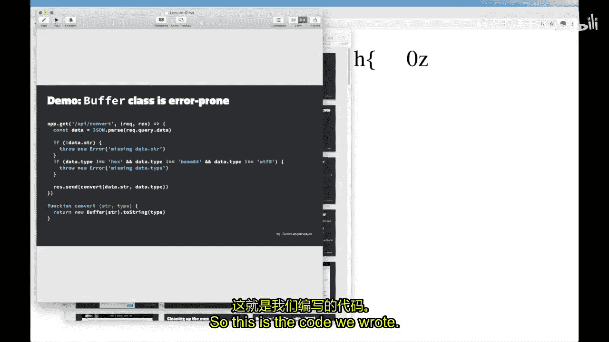

And。The important thing to know about the API， the buffer API。 This is the real， this is the problem。

 This is the crux of of the issue。 If you pass in a number， like I mentioned before。

 you're gonna get that many bys of memory。 So if you pass in 10。

 you're gonna get a buffer thats size 10 back。But for performance reasons。

 node doesn't zero out the memory before it allocates it to you。 So it's。

 you can think of it like it's literally calling Malck and just giving you the pointer to that memory。

 And it's your job to fill it with zeros if that's what you want to do。😊，Okay， so。

So you can see here， if we call new buffer and ask it for a buffer of size 10。

 and we do that three times。 We're getting completely different values each time because we're just getting whatever garbage was in the memory at that time。

And so。The correct way to use this responsibly is to zero out the memory before you， you actually。

Pass it back to the user。 So， you know， if you know that you're about to like fill this in with a string that's exactly length 10 and it's gonna override all this。

 then you don't need to  zero without out。 But if you're unsure that you're gonna do that。

 then you should definitely call fill 0 and make sure that's full of zeros。

 And then you can you you can safely sort of set a few of the bytes in there and not worry about the rest potentially being private data。

So the reason why our API had this problem though， is if we go back to the server code right here。

This stir variable isn't necessarily a string。We're in jascript。

 And so the types are sort of there's no type enforcement。

 And so the question to ask is what possible values can get passed in here and what what are their types。

 And if you look where we call convert， we're actually just passing in data dot stir。

And Datado St comes from the Json object that the user passes in。And so actually。

 the user controls the type。Of datadoster。So if the user were to were to， you know。

 pass in a number here instead of the string hello。Then when we call JSON dot parse。

We're going get back the test property is a number。 So the user' is in control of the type。

 And that's just one of the， And that's just the way that Json works， right。

 The user gives you an object and it can have strings and it can have nollles。 It can have numbers。

 It can have sub properties， which are objects， you know， sub objectsject and and so on。

Does this make sense， everybody？Yeah， okay， so yeah， so it seems like， okay。

 maybe one thing we could do to fix this is to just you know。

Ensure that the stir that we pass in is is actually a string is actually a string。 So we could say。

 like， you know， if the type of stir is not a string。Then make stir into string。Like this could work。

And if we do that， let's see what happens to the API。 did everybody， Did everybody understand this。

 It's just just converting it， just coercly it into a string。

 So if we go back now to the browser and we refresh。😊。

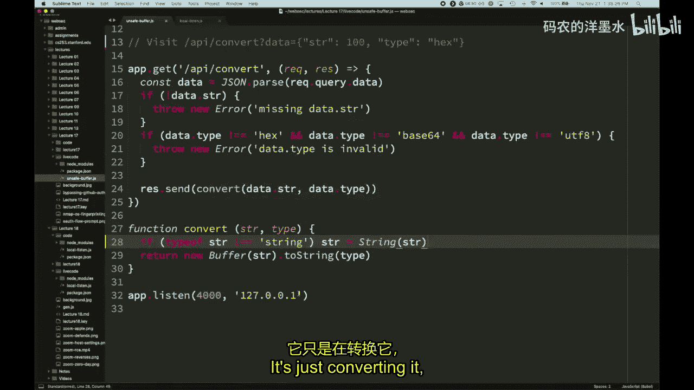

Then what we've done is even though we've tried to trick the， the server by giving it the number 100。

 the server said now we， we're gonna turn that into a string。

 We're not gonna let you make that a number。So this is like one way to fix this。😊。

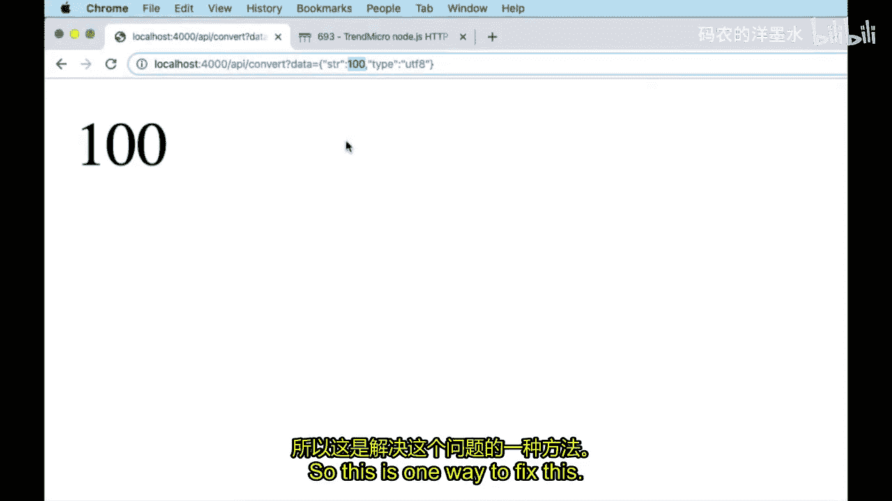

But the problem is just that。Oh yeah， so this is， is。So， there's an issue that。

There's an issue with this API design specifically Sward， I don't have a slide about it。

It's a bummer。Actually， no we can use this one。 Yeah， so anyway。

 the point is that if you look at all the different ways that you can， you can call new buffer。

 all of them are safe except for the the case where you call it with a number。

 So you can pass in completely untrusted user data into this construct。

 And it's basically just gonna take whatever that is and just allocate some memory and then fill in that data into that memory。

😊，Except for if you pass in a number， then you have this sort of unsafe behavior where now。

 now the data that the user， the user gave you actually causes you to produce this buffer full of like sensitive information。

 And the best way to see like how this is potentially dangerous is to look at。This package here。

 So the W S package is a very popular NPM package that implements a Web socket server。

So a web socket server is just。A way to accept sort of long lived socket connections from a browser and。

 and。I guess， yeah， we haven't really talked about Web sockets in this class。 Who's。

 who's familiar with Web sockets here。Okay， you can think of it it's similar to A TCP socket。

 So it's like the level below H TDP。 It's sort of like， you know。Computer A once talk to computer B。

 And so it makes a socket。 right， one of the computers connects to the other computer。

 But this is implemented actually on top of H TDP。So the browser can use it。

 So a browser can make a web socket connection to a server。 It uses H TTP。

 But what's different about it is normally in H T TP。

 you get you do a request and you get a response， and then you're done with a Web socket。

 You just establish a connection。 And now the connection stays open。

 And either side can send data whenever it wants to。

 And And that connection lives as long as you'd like it to live。 And so why do we do this because we。

 we want to have low latency communication。 We don't want to have to have all the overhead of making a new connection each time。

 And so we just keep the connection open so that that's what you use Web sockets for。 But anyway。😊。

That's besides the point。 the way you use the W S package is you create a new server。

And then you can listen for connections。 So this event will fire any time a browser shows up and connects to the server。

And。And then we're saying， okay， anytime that the browser sends us a message， we。

 we're gonna go ahead and parse the message。And then we'll echo it back to them。

So this is like the hello world of Web socket servers。 If you look up Web sockets。

 this is the first thing that they're going to have you build。 Basically。

 this is a server which receives the connections from browsers。😊，Whatever the client sends。

 the server just sends it back。But we're also like checking the message type。 So we're like。

 you know， the message can contain a type and it can contain data。 And if the type is echo。

 then we're gonna be like， you want us to echo this back to you。 So we。

 we call Socket dot send with data that the client send to us。So。So。Let's see here。

Let me just show you what this would look kind of look like。

 So if the client sent an object that looked like。Type。Echo。Data。Hello world， then。

 and send that to the server。 Then the server would send back this string， Hello world。

And that's basically what that server does。 Right， And so anyway， this looks quite safe， right。

 I mean， this is this is a hello world example。 This is extremely popular package。

 But it turns out if the client is able to make data be a number。😊，In this example。

 then what actually happens is this server， when the server calls send。Inside send。

 it calls new buffer and passes in this data into it。And if the client makes it a number。

 then it's gonna produce a buffer that's a completely uninitialized memory。

 And then send that back to the user。And so basically， what this server actually does is now。

 when I send it the message， if you go back to the thing I showed here。 So now。

 instead of sending it the data hello world， I'll send it the data 100。

What the server is going to do is internally， it's calling New buffer on 100。And then it's passing。

 it's doing some transformation to it。 And and then passing it back to me。

 And so what I actually get here is instead of hellello world， I get， you know，100 bys of of memory。

 whatever that happens to be。😊，And so I can just， I can just dump the service memory by doing this。

 right。And it was surprising that this existed， it's pretty bad。呃。The story here is I was looking。

 a friend and I were working on a node package together。We noticed that。

Our code was vulnerable to something like this。 And the the package we were specifically working on is one that does bit torrent。

 the bit torrt protocol。And so。Bittorn is a file sharing protocol。

 You connect to a bunch of random people that you don't trust。 They send you messages。

 You send them messages。 It's a very sort of it's a very networked and chatty protocol。

 And you connect it。 Like basically， anybody who wants to connect to you can connect to you and send you stuff and。

What we were doing was we were doing something kind of like this。 We had a bugged kind of like this。

 where if somebody sent you a message。 And it was a number instead of a string。

 then we expected it to be a string， then we would just go ahead and send back that many bytes of memory to the user who。

 who sent that to us。 And so random the people on the Internet could basically dump our processes memory。

 And we were like， whoa， this is bad。😊，It turns out it was actually kind of hard to exploit。

And you can only get 20 B of memory at a time。 But it was still bad。 And so we fixed it。

 And then we were like， this seems like a thing that a lot of other people might also mess up on。

 And so we started looking。 And then we found this one in W S。 And we found we found a bunch more。😊。

And so what we did was we me and Matas reported it to， to node after we fixed it in our own package。

 And oh yeah， I guess this is what I just said。 So， yeah。

 you could send send a message and get back 20 Bs from the process's memory and。

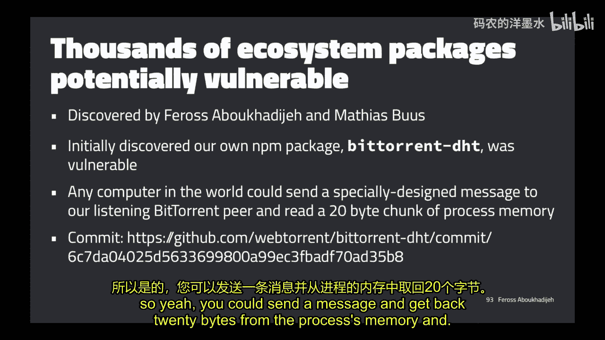

This is the commit where we fixed it。And you can see。It's quite easy fix， but basically。

We had this helper function here called， let me make this a little bigger。

So we had this helper function here called I D to buffer。 And this takes in like a peer I D。

 which is a string， although it might be a buffer。 And so what we were trying to do was like， okay。

 so we were trying to convert this potentially this string into a buffer。

 But if it's already a buffer。 So if buffer is buffer。

 then we just return it as is because it's already a buffer。 we wouldn't need to do anything。

 Otherwise， we assume it's a string， In which case， what we were doing was calling a new buffer。😊。

And taking that。Taking that string in and saying it's actually， it's， it's a hex string。

 And then this， this turns that hex string into a buffer， basically， right。So。

What we needed to do is make sure that type is actually a stringing before we do this。

 because if it's a number， then were， we we're vulnerable to this， to this issue。And then otherwise。

 we're just going to return null and then handle handle that case up there。

 Does this make sense what the fix is。Basically， we really have to make sure that a number isn't passed in here。

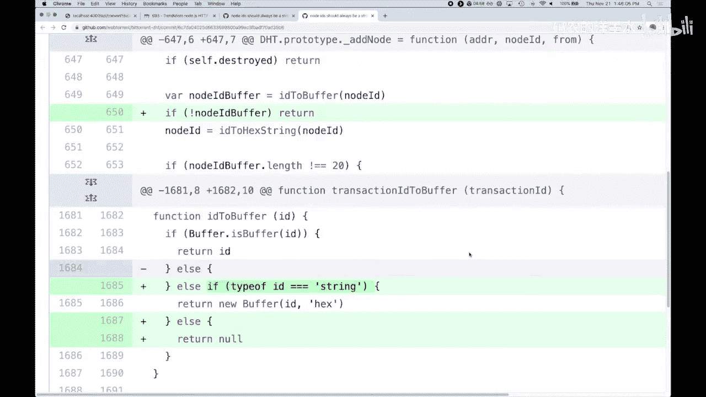

So， yeah， so we fixed that。 And then we found。Yeah。

 so we fixed this we privately told the folks who maintained WS about this issue。

 and they talked about it here and fixed it。

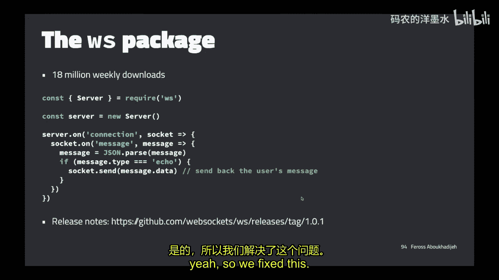

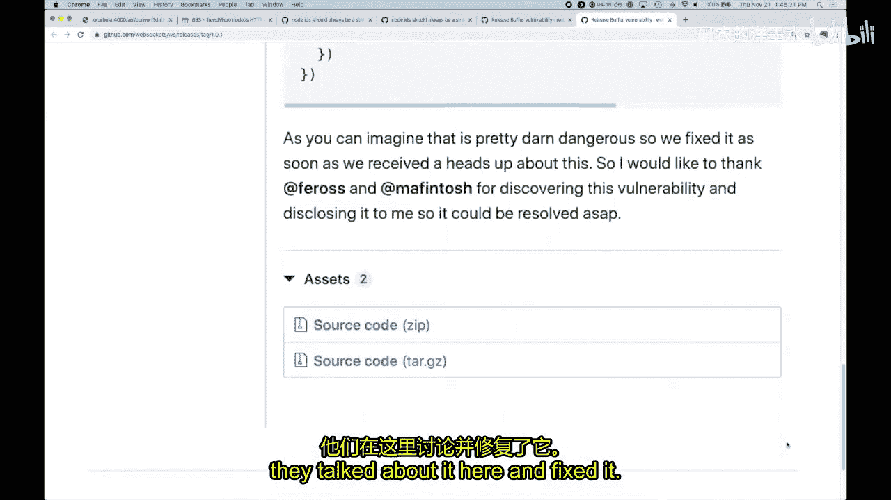

And then after we did this， a bunch of other people started looking for these bugs and found them like everywhere。

 There was this one guy who wrote like a static analysis tool as as a E S Li plugin。

 and he just went around and like running this on all of the packages he could find。

 And it was it was really kind of noisy。 It was printing out all these false positives。

 but he sorted through all of them and found a bunch of issues。

 And one of them was in the request package。

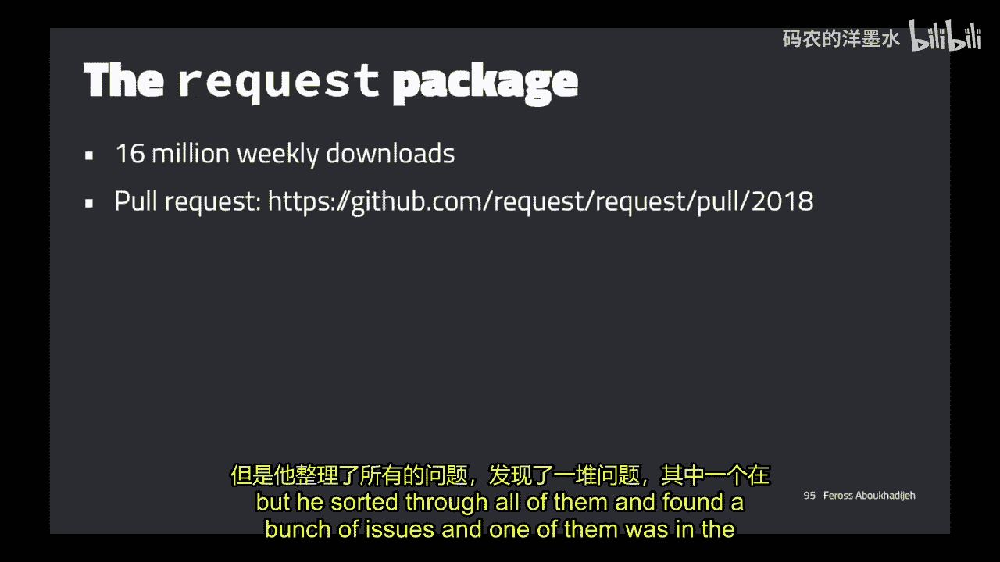

Which is incredibly popular。And。Actually， wait a minute。 I think I found this one。 Sorry。

 Some he found other ones。 Yeah， I think， I think， yeah， this one is me， but。Yeah。

 the way this one worked was basically。 So request is just a package that makes it a little bit easier to send H TDP requests。

 And so one of the things you could do is， is you could。Send like a post request to this URL。

 And you could attach。 This is like an attachment。 If somebody， you， clicks in their browser。

 they click， click to select a file， and then they submit a post with an attachment。

 This is kind of effectively doing the same thing。 It's。

 it's making making a post request with this like file attached。

 But if the file that you're attaching the data that you're attaching is a number。

 Then what's actually gonna happen is you're gonna attach 1000 bys of your own memory and send it to the。

 to the server。 And so。😊，You know， there's no proof that anyone was like using this wrongly and。

 and was vulnerable。 But it's a bad API design。 If you just pass in the wrong type and suddenly。

 you're just like owning yourself。 And so， so we， we open this issue and we give them an example of。

 of sort of how to。Cause the problem。And they fixed it。 And again， it was。

 it was a really simple fix。 So if we look at the files that were changed， it's like literally。

 you know， like， if it's a number， make it a string like。

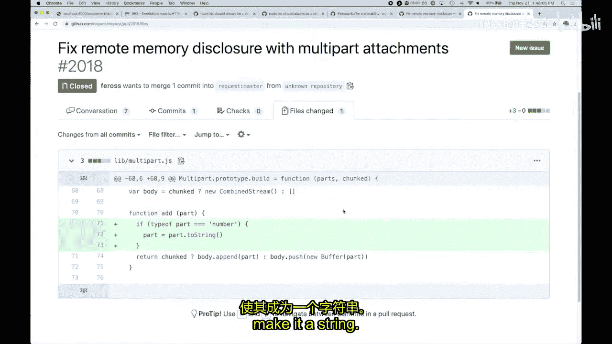

Yeah。And then this is a package that some of you might have used on the， on assignment 0 to handle。

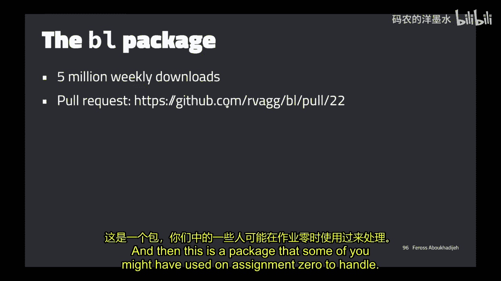

Binary data。 and this one also same problem。 It was vulnerable to the same thing。 And it had。

 you know， an easy fix again， just if it's a number make of a string。 So anyway， the point is。

 this was pretty pervasive。 So I wanted to talk a little bit about like ideas for how we could prevent this。

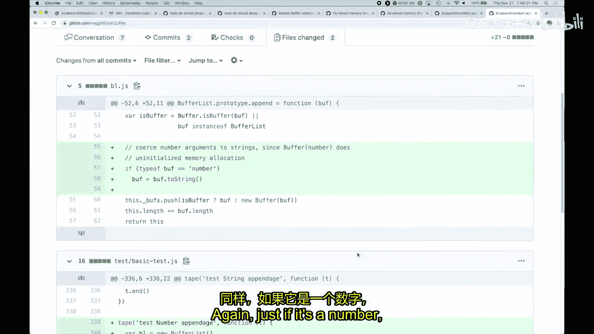

So obviously， we mentioned one is like you could just sort of reject numbers。 So buffer， It know。

 this is actually different， so。You could， you could say if you pass a number in to， to buffer。

 we're just going to， to say you can't do that。 Like， this is。

 this is not something we want to allow。So， we kind of。We kind of showed that here， except here。

 we just turned it into a string。 We could have just thrown an error。

 And then this wouldn't have happened。

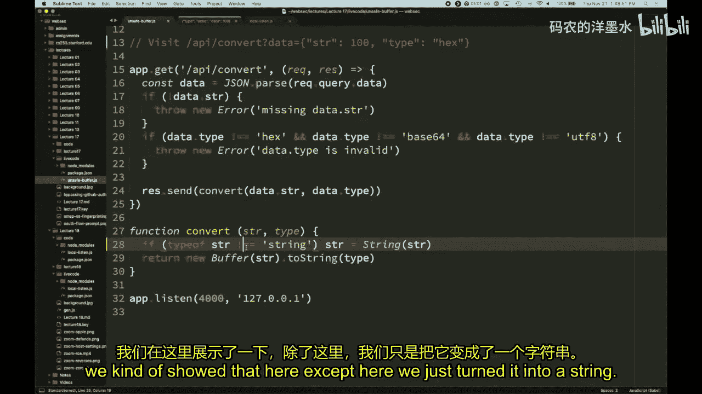

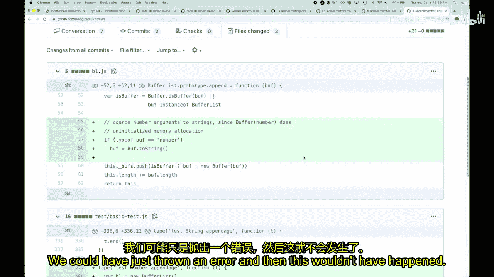

Another idea is we could validate the Json。 So theres a package that you can use called Json schema that's getting quite a lot of popularity。

 And there's a speck around it。 And the way it works is you sort of describe the shape of the Json that you want to accept。

 You say， like this field is supposed to be a number。 and this field is supposed to be a string。

 And this field is supposed to be an object that's supposed to have， you know。

 and so on and so forth。 And you can run an untrusted Json blob that the user gives you through that。

 And it'll tell you if it matches the correct shape。😊，So that's something you can do。

 The downside of a validation， though， like this is that if the user gives you an object with extra properties in it and you validate it。

 it's not going to complain that there's extra properties。

 So way the validation works is it just checks the properties that you ask it to check。

 And if there's extra garbage in there， then it's not going to check it。

 And so this can lead to issues where you let's say you add a feature to your， to your API endpoint。

So now， you expect the user to be sending you additional properties。

 and then your server code starts to use those properties。

 but you forget to update the the schema that you created。

now you have a problem where you're not validating that one field anymore because you forgot to update it。

So a better way to do this would be to define a class。 You can just make a class。

 like make a new class in in the， in the in your projects and then have it taken in the constructor。

 this Json object。 and then。😊，Basically， look at the types basically look at all the properties that you expect to be there and then ensure that they' correct type and then create like getters and setters on the class that expose the data and just the data that you want to expose。

 So that's， that's one option。 And then lastly， we could just fix buffer to be less errorprone。

 Like it shouldn't be designed like this。 It shouldn't be such a potential。😊，Hazard to the users。

And so。So。To summarize the main problem， it' that the data that gets passed in the buffer is often untrusted user input and。

And if it's a number， then you have this really bad information exposure and。

And we have this design where the default， the， the common thing is unsafe。

 So you're getting back this， this uninitialized memory as the default behavior and。

It be better if we0 the memory out for the user so that they。

 they can just pass in a number and not worry and， and。The the。

 the sort of argument against doing that by the No project was that this would be slow。

 It actually slowed， slowed down making buffers by like 25%。 And。

 and so that was unacceptable to them。 They're like， node is all about performance。 We can't do this。

And so I would also argue that the default should be safe。

 And if if a user wants to sort of opt out of the safe behavior and say。

 give me an initialized memory， I really know what I'm doing。 Trust me。

 Then they should be able to do that。 But the default should be the safe behavior。 so we。

 we argued for that。 But then another just even bigger issue is just that we have these two different kinds of functionality mixed into the same API like。

If you pass it any type except a number， then you're gonna basically be converting that data into a buffer representation。

But if you pass it a number， you're allocating a buffer with that much memory。

 and it's uninitialized。 And that's like just two types of different functionality。

 They should just be in different APIs。 Like， they don't need to be all jammed into this one constructor。

 And so I think that's， that's actually the best solution。😊，And so that's what we argued for。

 And that's what they ended up doing。Now， the way you create buffers is you， you。

 you use these three APIs。 So you do buffer dot from if you have any type and you want to convert it to a buffer。

You use aec if you want to allocate memory， and that allocates safe memory。 So it's zero filled。😊。

And then lastly， if you really know what you're doing。

 then you can do Ac unsafe and you'll get you'll get the old behavior of uninitialized memory。

 So anything that's performance sensitive where they don't want to  zero it out because they know that they're。

 they're gonna they're， they're planning to override it themselves with data。 They'll use a unsafe。😊。

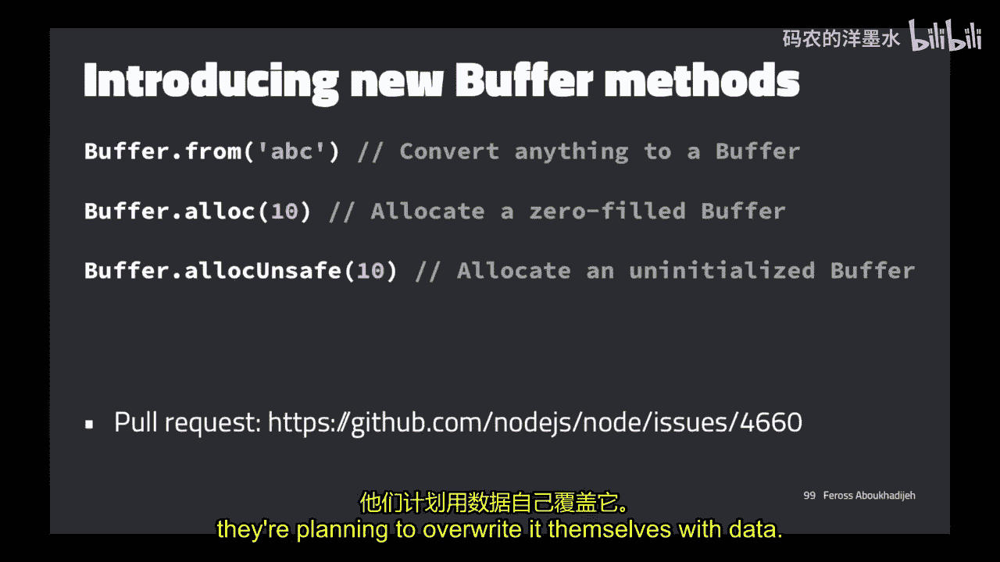

But yeah， this is a wild poll request。 We issue， I guess we opened this up and there was huge。

Discussion about it， like thousands of comments。And it's， it's just， yeah， it's。

 it took a little bit of convincing， but。

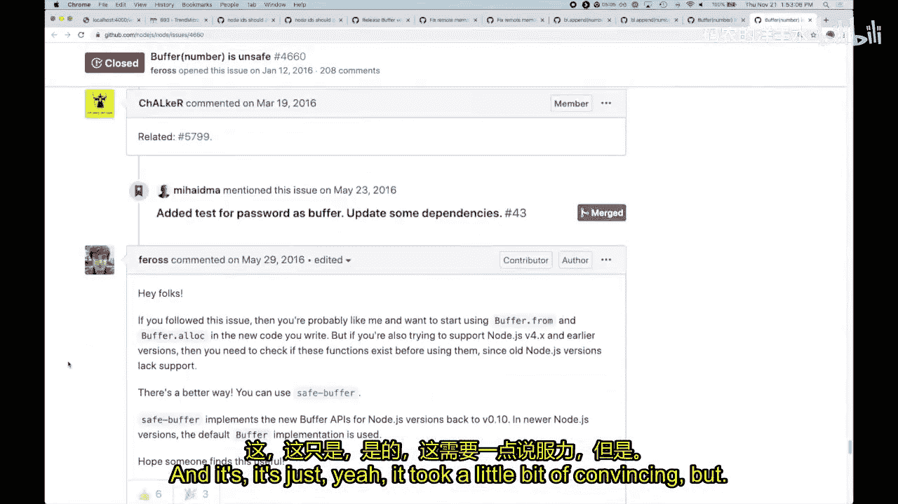

In the end， in the end， I think this is a much better design。

 They end up deprecating the old buffer design。 So if you use that now， you get a print out。

 a warning printout， which is discouraging people from using it。The problem was， though， for many。

 many years， since this happened， this was like， I guess， in 2016 or something or 2017。I mean。

 there's so many NPM packages that are using the old behavior。 Like。

 this is just a very common thing。 So every， pretty much every package was doing this in some way。

 And so it was not possible to like easily switch people over to the new， the new behavior。 And so。

And this was also complicated by the fact that a lot of times these open source packages want to support multiple versions of node。

 because if you're a library author。You don't know what version of node your users are gonna be using the developers who are using your library。

 You don't know what version of node they're gonna to be using。

 They could be using the latest one or。 they could be like two versions behind。

 And you want your library to work on as many versions as possible。 And unlike。

 unlike when're an app developer， you can just decide the version of node your app is gonna to use。

 And that's the version you use。 So because of this library authors were are sort of hesitant to use the new APIs because if they did that。

 they would be basically telling all those users on older versions that you can't use this library anymore。

 And so one solution to that was we created this shim library called Safe buffer。 which。😊。

You could use， you could basically import this package， and this package would give you the new APIs。

 even if you were in an old version of node by basically just simulating。

 doing the same thing that node is gonna do for you。 So you could serve safely， even in old versions。

 You could safely use buffer But yeah， this took took forever to percolate through the whole ecosystem。

 and。😊，Yeah， and at first， they， they wanted to print out this deprecation message right away to tell everybody like this old behavior is unsafe。

 But the problem with that was that literally， if you did that。

 every single time you ran any program in node， you would just get a deprecation warning。 like。

 like 100% of programs like， would just print this warning out because everyone is using new buffer。

 And so。😊，The decision was like， like， we shouldn't print this message out。 It's just too， it's。

 it's。People are going to be seeing this message for like two years in a row。

 like until it finally gets updated， we can't do this。

 And so they deprecated in the docks and not at runtime。And then we just like waited。

 basically for people to， to eventually update everything。

 And a bunch of people started sending poll requests to all the different projects。

 And it was a very slow process。But now you do get a duprecation warning。Anyway。

 so I think this is a cool， A cool little story of， of bad API design。😊。

And then I found one other one that I wanted to mention， actually， before I move on。

 Any questions about the buffer stuff。Cool， okay， so。

 so then there's one other example that I found when we were。

 we were talking about B cryrypt for the password and authentication lecture。

 And while looking at the docs， I noticed that they do the exact same thing that that the buffer was doing。

 And so even a security sensitive library like B cryrypt made makes a similar mistake。

 And so what we can look at is this function here。 So this is the function you use to hash a password。

 So the user gives you their password。😊，You're going to hash it before you store it in the database because that's what you do。

And。Remember， we have this this second variable called hash rounds。

 which is the number of times you want to apply the hash function。

 And we do it multiple times because we want to make it slower for an attacker to。

 to iterate through our database and， you know， try to basically undo the the hash function for our users。

 And so this is supposed to be a number like 10 or something， right。

But what happens if this is accidentally a string？It does a completely different thing。

 So if you make it a number， it's going to use that as the number of hash rounds， right。

 If you make it a string， it's gonna assume that。You've already selected a。For your password。

 and you want it to not generate the salt for you。So normally， internally。

 this thing is gonna generate salt， Add it to your password and then hash it 10 times， right。

 But if you make this a string， it's like， you don't want me to generate salt。 You already have a。

 And I'm gonna use that， Add to the password and then hash it， I guess the default number of times。

 maybe one time， right， And so。What you'll end up doing is if you accidentally make this a string in your code base。

 all of your users， all of your users passwords in your database will have exactly the same salt。

 It'll be like the string 10 as the salt， which completely eliminateums the value of assault。

 because the point of assault。 if you remember， was。

 what was it It was to make sure all of your users hashed passwords couldn't be sort of。😊。

Attack all at once。 You want to be able to。u。Basically。

 iterate through try to reverse the hash for a single user at a time。

 And that's what the salt lets you do。So you might ask， well， how could you， you know。

 this is your code， your readiness， You're the developer， Why would you pass a string into this。

 right， This isn't untrusted user input。 It's not exactly the same as the buffer case。

But I would argue that this is the kind of thing where it might be coming from like some configuration in your application。

 It's common to have important parts of your application configurable via like a config file or environment variables。

 who's used environment variables before。 knows what those are。

 So an environment variable is like sort of a variable you can set in your terminal。

 And then whenever you run a program。 And that program can just look at the environment variable and sort of change its behavior based off of that environment variable。

And it's often used to， to store sensitive information like keys to connect to AW S or whatever services you're using。

 And so you might put this in an environment variable。 And guess what。

 Enron variables don't have types。 They're all， they're all strings。

 Every environment variable is just a string。 There's no like differentiation of， oh。

 this is a number。 And so if you're using process dot end do hash rounds to get your。

 your hash rounds value。 Then you you'll now be passing a string into here。😊。

This is one example of how this might happen。Does make sense。Anyway， I just think in general。

 these types of things should be separated into different functions。 And that's， that's what this is。

It's supposed to demonstrate here。Cool， so just a few more。

 a few more little things you can do on your server。 One thing is you can hide errors。

 detailed stack traces from your users。😊，This is nice to do because when a user looks at a stack trace。

 if they're an attacker， they can figure out the exact paths that all your all your files are are are on and so they can figure out。

 like the user is named for us。 And oh， like the app is running inside of， this folder here。 And oh。

 look， they're using express。 And maybe they can figure out the version of Express based off of the name of the file that had changed in a different version。

 And so there's all this information they can learn about your application that you would probably rather than not no。

😊，So。Hiding this kind of information from users is is is a good idea。

 One way to do this is in your error handler， you can say if。We're running in production mode。

 Then we want to make our stack trace nothing。 And so don't print out any stack information on the air page。

 But otherwise， print out a full stack trace because this means we're developing our app and we would like to be able to see the stack trace。

😊，Another thing that you need a Oh question， yeah。Is there any way to malicious？And a remote。嗯。

I don't think so。And。What do you， what do you have in mind， Like， how would that happen。

 I'm just thinking like， how it would be more secure than。For example。

 because I suppose that if you like literally stored the key on the disc。

 then an attacker could just like go and grab it somehow。

Having it an environment variable would put it on。Hm。So I mean。

 if the attacker is running if they somehow can do like a code injection and actually run code on your server。

 then they can read the environment variable just as easily as they can read a file。So。呃。Yeah。

 I actually don't know how much better an environment variable is than a file。

Environment variables are standard practice for， for whatever reason。 I。

 that would be interesting to look into Like what， what exactly。

 why exactly is an environment variable better than than a file？ Well。

 one one reason why file is usually bad is because people check it into， into their source control。

 And so then the file will end up on Github。 And then now you have your key， like in a repo。

 And if you accidentally make that repo public。 or if it's an open source repo。

 then you have problems。😊，啊。Yeah。it's in the case where you're working。Yeah， that's a good question。

 So typically， I think people will will put the key directly into the interface for their hosting provider。

 They'll have some way of sort of like typing it into a website or something。

 And then the hosting provider will make that environment variable available。

 And it'll only be there in production。 So like your local developers will they'll have to use a completely different key for a completely different database。

 So that way， all the developers in the company don't have the key that is the key to all of your users' data。

 You know， if you don't want one person's stolen laptop to compromise everything。

 That's typically the way it's done。Okay， just like I think of like one or two more before。

 I'm gonna go on to the， the new stuff， the new topic for today。

 So one thing that servers will often do is they'll reveal the name of the server being used for vanity reasons。

 mostly。So if you use Express and you look at all the responses that the server sends。

 it attaches this header X powered by。 And so you can like。

 basically figure out any site that's using express by looking at this header。 And you might think。

 well， what's the big deal。 I mean， so what。 Everybody， A lot of people are using Express。

 It's not that big of a deal。嗯。And it probably isn't a big deal。 but in general。

Why make the attacker job easier， The less you can tell them about what you're doing， the better。 so。

 you know， you't want to rely on this like for security。 You don't want to be like。

 they don't know that I'm using Express。 Now I can， you know， but。It's still。

 it's still harder for the attacker to figure out what's going on on your server if you don't tell them the exact exact software you're using。

 And there's an even worse example of this， which is for En X， actually， it's not showing it here。

 But I think En X by default includes the version of En X that's being used as well as the the name。

 And so with that， you actually end up telling the the attacker。

 the exact version you're using in if they know that that version is vulnerable because say Engine X releases an update。

 And they say we fix a really bad bug。 everybody should update。An attacker can say， well。

 wait a minute， who's still running the old version。

 They can write a bot that just searches that scans websites。

 It just crawls the Internet like Google or any other search engine would do and look for sites that return a header that contains the vulnerable version。

 And they'll just do that until they find a server that's running the vulnerable version。

 So you don't，'t want to be advertising the version you're running。😊，And。

You can turn that off in Enng X with a parameter server tokens off。 And then you can also。

 the other thing to worry about is if you remember the way Express was advertising itself。

 So typically， youll run Enng X in front of a server like node or in this case， PhP。

 So you have like a proxy， basically， Enng X is a proxy。 And so what's going on here is the。

The N X server is advertising that it's N X。 But then behind the scenes。

 your actual app that's written in PP or node or whatever is also advertising itself as well。

 So you want to turn both of those off so that the attacker doesn't learn anything。

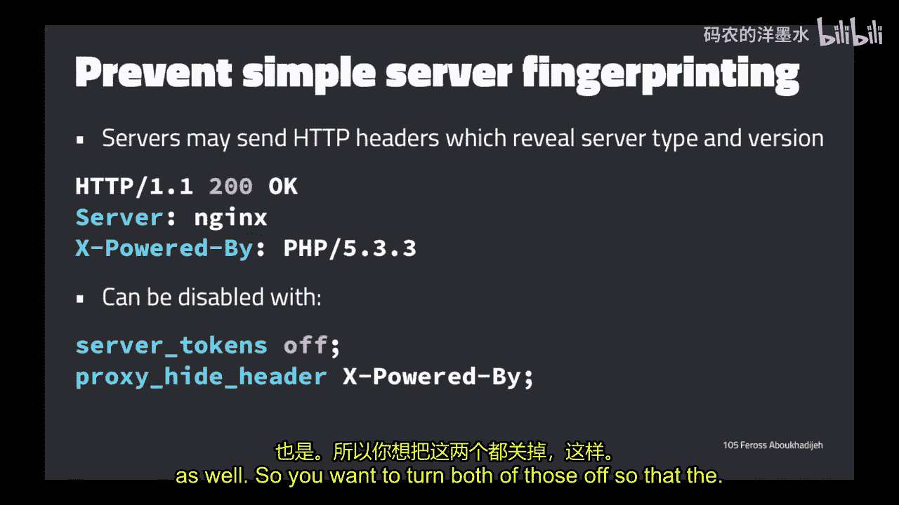

And one other kind of wild example of of fingerprinting is， So this is fingerprinting a server。

 You can actually fingerprint the operating system that the server is running on as well。

 And so even if you turn all this stuff off。😊。

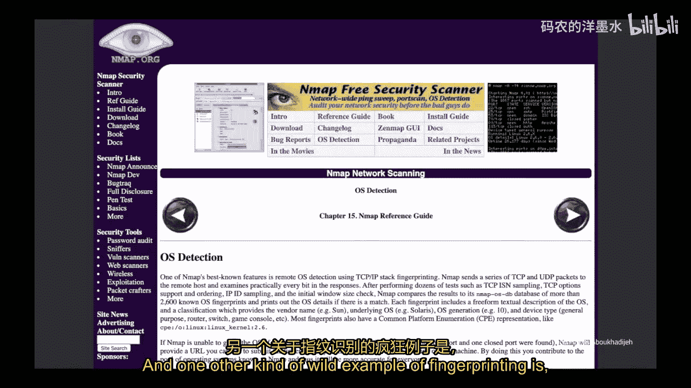

They might be able to figure out you're running Windows version， whatever， or Linux version。

 like bunchtu version， whatever。 And the way that an attacker can do this。

 and I I' I don't have any advice for how to prevent this。 But if you've heard of Nmap。

 endm is a network scanning tool。

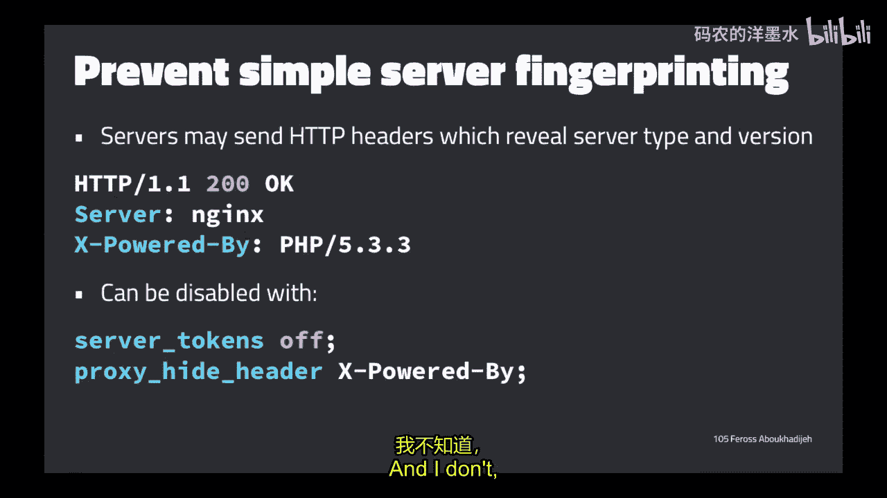

And you can point it at at a server that you want it to fingerprint。

 and it'll figure out what operating system that server is run that the computer is is running by sending it a packet。

 getting back like a response， and then looking at the white space in the response。

 So different operating systems will have like subtle things that they do differently that don't affect the behavior of the。

The network protocol， because it's spacing or something like this or ordering of headers or ordering of different things。

 And basically， they built in a giant rule set here where they can guess the operating system of a machine as long as they can get a packet。

 get that machine to send them a packet。 So you would run this on your computer。

 You would point it like a server。 And then it would send the server packet。 And， of course。

 the job of a server is to respond to clients that show up。

 So the server will send you back a packet。 And then this will analyze that and and predict make a good guess for the operating system that it's running。

 And so you can use this to basically find people who are running unpatched version。

 like if they can tell you， they're running this operating system in this version of it。

 you can you can use that to potentially attack that server。😊，So。Yeah， fingerprinting for servers。

 Who knew。Yeah， so I don't know actually， good defense against this。

 but I I thought I F throw this out there。 This is is not exactly Web security related， but。

 but it's， it's， it's quite interesting。

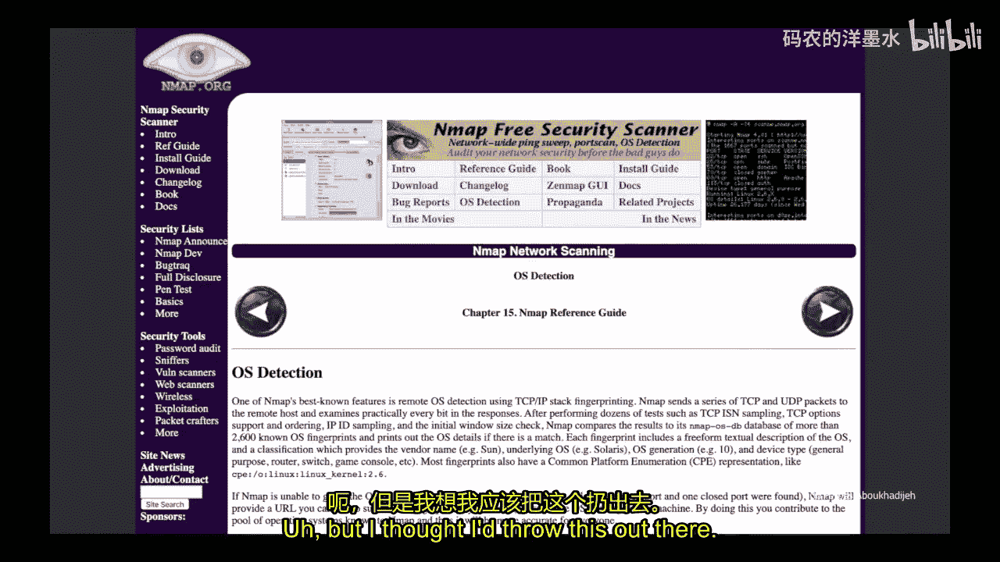

嗯。Yeah， so， so some， some some lessons just to review the lessons weve talked about before。

 complexityplexity is the enemy of security。Explicit code is better than clever code。

 fail early and code defensively。And now I'm going to go on to the new topic for today。

Which is local HTDP server security。So。So we're going to talk about servers that you run locally on your computer。

Either when you're developing an app。Or there are actually programs on your computer that are running local H TP servers right now。

 And there's a huge number of security risks that arise because of that。

 And we're gonna talk about one example of that in depth。 now。 So， but first。

 I was want to mention this is the most dangerous code that you run every day on on on regular basis。

 And I think I mentioned this last time。 But if you forget to pass and host name as a second argument to listen。

 then you've basically told your node server to accept connections from all interfaces。

So all interfaces means。Anybody who can send a packet to your computer？Your server will。

Get that packet， and then respond。 And so。What what this means is that if， if you call this。

 this means is that basically anybody on the same Wifi network as you can connect to your machine if they know that you're。

 you're running a server on this port， right， And so this is a common thing that all developers do。

 But it's actually， I think， surprise there have been more issues relating to this in the wild because。

If you're built， if you're working on some like super sensitive application for some company， right。

 and you just start up your little development server and you let anybody in the coffee shop connect to your server。

 They can learn it。 I mean， they can see the website that you're developing before it's ready to be released。

 right， and and so。😊，I mean， that's， that's bad。 And on top of that。

 if there's any vulnerabilities in that server， can they can use that to attack you， right。

 So you might be in the middle of developing something。 It's not quite finished。

 You haven't really added the security checks yet。 And while you're working on that。

 somebody in the same network as you send sends you you know an HP request that compromises your machine。

 And that's not something you're thinking about when you're developing a local app。

 So I just think it's it's surprising that this hasn't been more of an issue， but。Anyway。

 this is the correct thing to do if you're developing is just to say。

 I only want applications on my own computer to be able to connect to this server。And so that way。

 the browser that's running on your machine can connect。

 But and other applications on your machine can connect。

 but other people on other machines can't connect。Does that make sense。Okay。

That was just a little example。 But now this is the main thing we're going to talk about today， so。

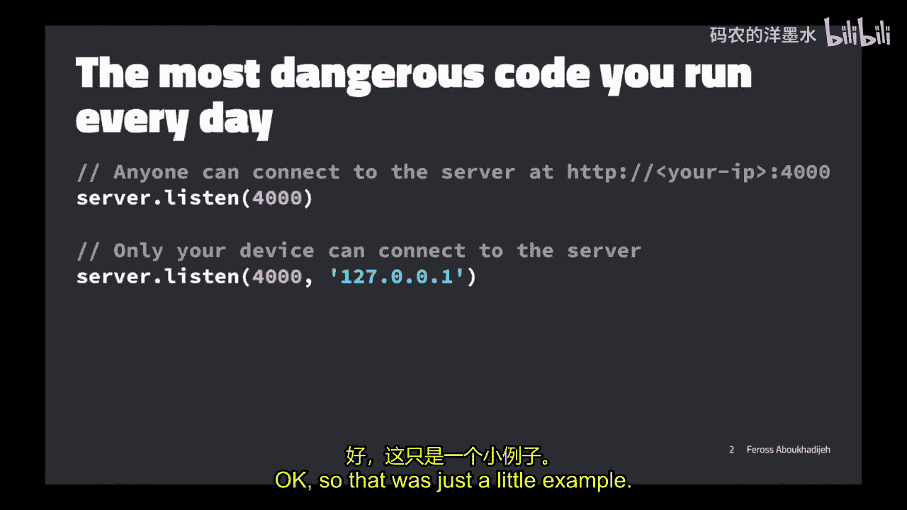

Who has heard of Zoom？ It's a conferencing application。Okay， so most people have heard of Zoom。

 Zoom meeting， it's， it's。Very popular， very popular video chat。

 application a lot of businesses use it。 And earlier this year。

This security researcher discovered a zero day in the the software that allowed any website on the Internet to turn on your webcam and just get a feed of you without you interacting at all。

 just by visiting a website and。😊，The way it worked was that the Zoom software。

It was running a server on your computer， and it allowed any site on the Internet to send it requests。

 And those requests。There was one request you could send that would basically turn on your webcam。

 join you into a meeting and and it would be the attacker's meeting room when attacker could just sit there and see who who's joining。

 you get like a ton of people joining。 In fact， in this blog post that they wrote about the issue。

 there was a link or they like yeah that's the other thing， too。

 they gave the company 90 days to fix the issue and they didn't fix it within 90 days So they just said。

 okay， they pushed publish on the blog post that explained exactly how to do it。

 And there's a link in the post that anyone could click and it would join you into this bloggers chat room。

 And so while this was like going viral when this post came out。

 there was just like hundreds of random people who were reading the article who click the link and there was like a big party chat room of like all these people who were like。

 who， it worked。 hi everybody。😊，So yeah， pretty funny。But you know。

 Zoom Zoom has like a ton of users， and。And I， I guess it was the Mac client only they said so it was only Mac users that that had the had the problem。

 But yeah， so they estimated it was like 4 million users who who were affected by this。

Yeah。So we're going to talk a little bit about it。These are some quotes from the post that he wrote。

 So He says the vulnerability allows any website to forcibly join a user to a Zoom call with their video camera activated without the user's permission。

On top of this， the vulnerability allowed any webpage to D S a Mac by repeatedly joining a user to an invalid call。

And additionally， if you've ever installed the Zoom client and then you've uninstalled it。

 you still have a local host Web server on your machine that will happily reintall the Zoom client for you without requiring any user interaction on your behalf。

 besides visiting a web page。 This reinstall feature continues to work to this day。😊。

So that's the worst part。 You could literally be like，'m fed up with Zoom。

 I'm gonna uninstall this garbage from my computer。 And then you wantinstall it。

 And it's secretly keeping the this local H T TP server running on your computer。 And this。

 this server is the thing that had the vulnerability in it。 So even if you're not using Zoom anymore。

 You got rid of it a year ago， you're still vulnerable to this issue because of the way they designed this。

😊，Yeah， so。Just a few more quotes from his post。 So let me start off by saying having an installed app that is running a web server on my local machine with a totally undocumented API feels incredibly sketchy to me。

😊，Secondly， the fact that any website I visit can interact with this web server running on my machine is a huge red flag for me as a security researcher。

Having every Zoom user have a web server that accepts H TTP get requests that trigger code outside of the browser's sandbox is painting a huge target on the back of Zoom。

So you' all catch this part here。 So the interesting thing about the way that these local HP servers work is it's not just that when you're listening that any app on your computer can connect or other users on your network can connect if you configure it that way。

 But it's also the case that to say say you're smart and you say， okay。

 I'm gonna to make this server so that only apps on my own computer can connect so other people in the coffee shop can't connect。

 Well， there's still a whole bunch of applications on your computer that might be able to connect。

 And one of them is a web browser。 Your web browsers visiting random untrusted websites。

 Those untrusted websites can send get requests to local host 4000 as an example。

 It's just another server。😊，It's on another origin。 Sure。

 So you have the same origin policy to contend with as an attacker。

 But we know there's all kinds of requests we can send。

 even though the same origin policy is in place。 it doesn't prevent all kinds of things like it doesn't prevent get requests。

 for example， right， so。Basically， this local server is accepting get requests from any site on the Internet。

 And so this server better be secure because any site can just send it a request。

 And if if that request triggers code execution or joins you to a meeting or whatever。

 then that's just going be that's going to be functionality that's accessible to any site that you visit。

Does that make sense？Yeah， so it's pretty wild。 So I was going to just do a little demo of of this inaction。

So this is a little server here that I'm going to make a server on my computer that listens for connections。

 and you'll notice thatve designed I've made the server so that it's only listening for connections from apps on my computer。

But。What I'm going to make it do is。I'm going to make a server which if you send in a request。

 it will open up the dictionary。So this is very similar to what Zoom was doing。But it's。

 it's a little bit more， well。It's kind of useless。

 but itll give us the idea of what we're trying to do。 So this is a server。

 So so here's the command I'm gonna to run。 And if I， if I just run this command in my terminal。

 you'll see that it just opens up the dictionary。So that works。Okay， so all I'll do is we'll。

Make a server that listens on the homep page， and it will。

Whenever someone sends us a get request to the homepage， we will execute the command。

And you'll notice I'm not taking any user input here。

 So this is relatively safe in the sense that I'm not like running the command the user sends to me。

 I'm just running this exact command here verbatim to open the dictionary。

And then once that finishes， either it succeeded or it didn't succeed。So we'll， we'll。See that if it。

 if it aired out， then we'll send， we'll send the status quo of 500， which indicates a server error。

 and then we'll send， let's just send the， the stack stack trace back to the user。

 Even though I just told you not to do that。 and then。otherwise， if there was no error。

 then we'll set the status to 200 and we'll send success。Cool。

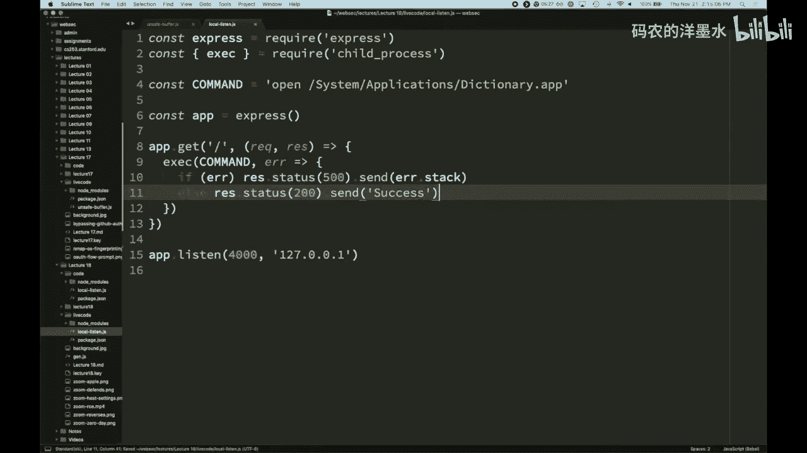

Okay， so now if I go to my browser。And I。Visit。Local host，4000。 Actually， I need to。

 I need to start this server up。 So let me just。

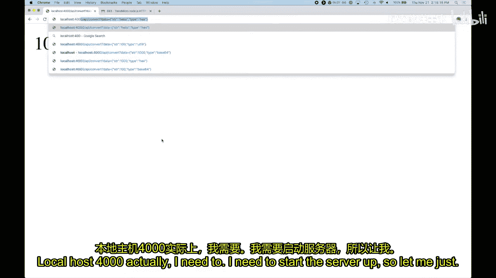

Go here and start the server up。 Okay， And then if I visit local host 4000， wow。

 it opened up the dictionary in my computer so。

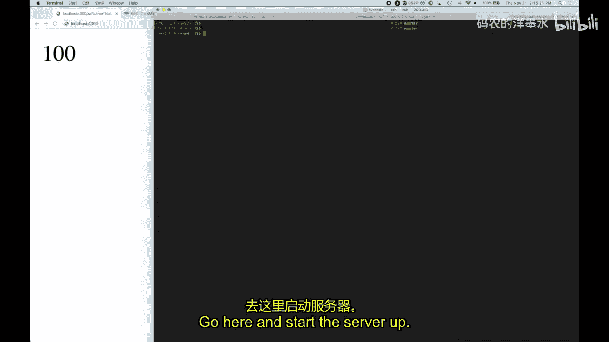

Basically， sending a get request。 So there's a server running on my computer。

 And if any app on my computer sends it a get request， the dictionary will open。

 Does this make sense。Yeah， so。So， so one question you might have is， okay。

 So who can send these requests， right， can So So， so who is allowed to send a request to the server on my computer。

 Let's go to example do com。And I'll open up the the console。 and this will simulate。

 This will simulate。 This is code running in the context of example do com。 And we'll see。

 can example dot com actually send a request to this server。 So if I just call fetchch。

 that will that will hopefully cause a get request to get sent。 And what do you know it does。

 So any side on the Internet now。As I'm browsing around。

 can just pop open the dictionary on my computer if， if they know that， that they can do this。

 they know that they can send a request to this server。Any questions about this。Okay。

 so one thing you'll notice is that the console is telling me that access was denied。

It's saying that access to the fetch at localho 4000 and from originiginexample。

com has been blocked by courserus policy。嗯。So why did it work。

 even though it's saying that it was blocked。Before you send this like get request。

 youd never even know if there's going to be an access control now ordered header。

 so like you have to send it anyway。If this header is not present， it just block the reading。

 but it's sending。That's exactly right。 So what's going on here is that the browser is denying me the ability to read the result of the request。

 but it still let me send it。So I sent the get to the server and the server sent back。

 what did it sent back。 It sent back the string success。 And I wasn't allowed to read that string。

 But， but it still had to send the request to the server， get the response back。

 inspect the headers and see， is this site willing to let anybody read its response？

 And the answer is， no， And so it's denying me the ability to read the response。

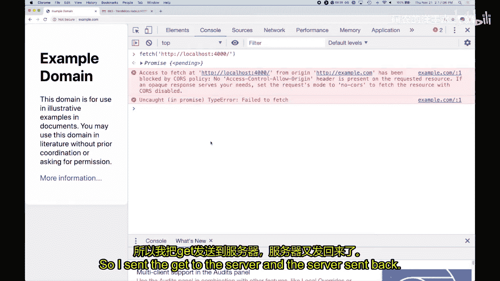

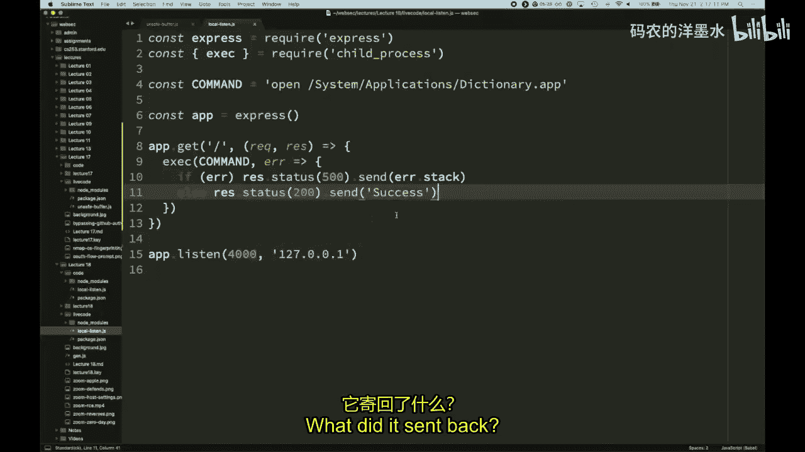

So so another way of putting this is if I were to make an image tag on the page and I were to make this source of that image be。

 be local host 4000。 then， of course， I'm not gonna get any errors。 but the things still gonna open。

 So basically， if I embedded an image in the site， the image would， would load with。

 I guess it wouldn't load because I'm sending back the string success， that's not really an image。

 But yeah， it would， would cause the get request to get sent in this this Apple open。

So we can fix the error by sending an additional header， so if we set access。

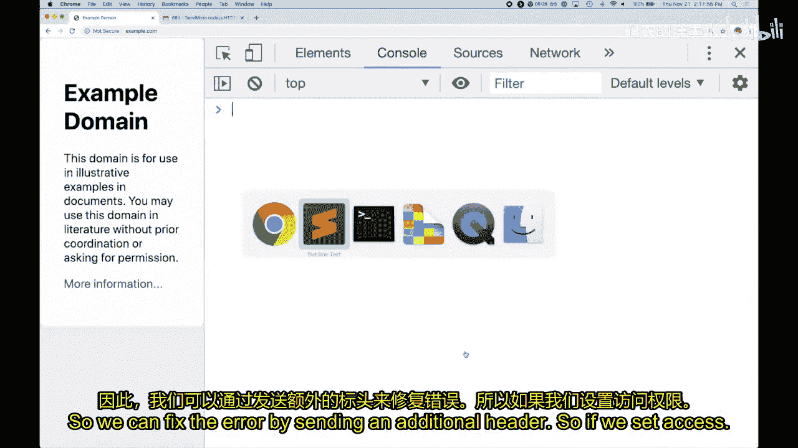

Control， allow origin。And we make the value star now we're saying that basically anybody can read back the response from this request and so now when I run that code。

 it launches it and there's no errors， and if I really wanted to could read I could actually read the response out by awaiting the result of this then getting the text value of it and awaiting that and there you go。

 so I got the response string success but it doesn't matter。

 the point the point is even if I can't read the response I can still cause the request to get sent and trigger this。

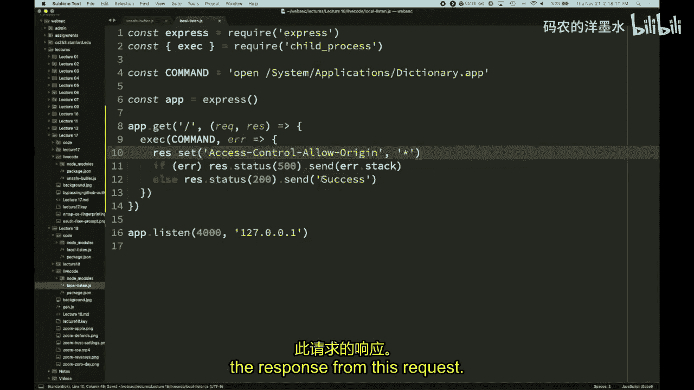

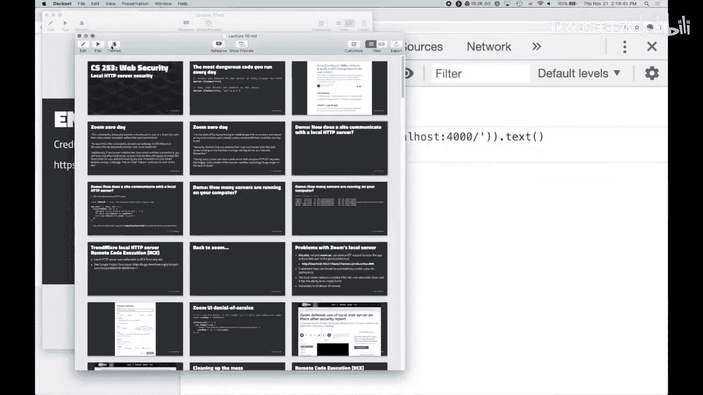

Okay。So， so that's how， that's how that's how， a server。

 a random server on a random site on the Internet can write jascript code that interacts with a local server on your computer。

 yeah。飲んでちゃんよ。No difference。 Yeah， no difference。 I'll show you right now。 We can do that。 So I'll。

 I'll do curl。

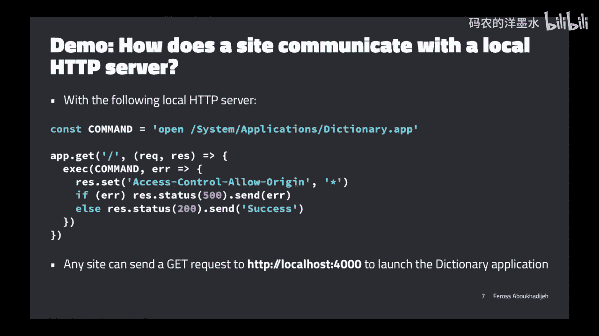

Can everybody see this curl local host， 4000？Same thing。 So any， any。

 any app on my computer that is allowed to use the network can send H TP request to this server on my computer and cause it to behave this way。

 So if you allow the access control origin。No， you can't read the。

 You can't read the response value back if you remove the header。 Yeah， but。

 but you still cause the dictionary to open because that happens regardless of， of the header。

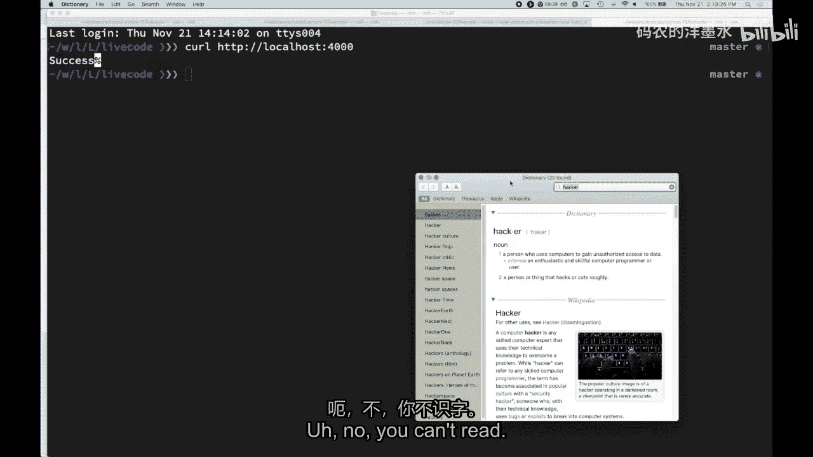

Any questions about this？Does make sense。Okay， so this is some。

 this is kind of like what the Zoom server was doing。Is running a local server。 Oh。

 and this is something kind of interesting。 So if you。

 if you want to see sort of how vulnerable you are of these kinds of issues。

 you can run So you can run this command here。 And what this does is it lists open file descriptors that are running on your machine sorry。

 itll， it'll list open file descriptors that the processes that are running on your machine are using。

 So if you've ever taken C S 110， you'll know about file descriptors， file descriptors are just like。

😊。

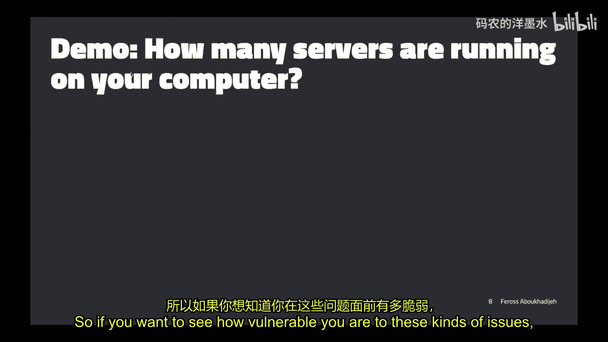

Handles to files or to sockets that processes are using。

 And so this is these are I filtered it by ones that are listening。

 So this is only going to show me listening sockets。 In other words。

 these are web servers running on my computer that are listening for connections from from from anyone。

 And so so you can see here， I'm running two servers at the very top there that are the processes is called report D。

 which I looked it up， its， it turns out that if you do man report D， it's。It enables。

Phone calls that go to my iPhone to end up ringing my computer。So。Basically， my。

 when my phone gets a call， it will connect to the server running on my laptop on port 5，5，2，2。

0 and tell my Mac that I have a phone call and it will forward like the voice data to it。

 Something like this。 That's what this server is used for。😊，There's also comm center。

 which I also looked that one up， and。I think it's related。

 So it says it provides functionality to allow phone calls to be made and received on a Mac。

 So basically， these three servers right here are running to support that feature of my Mac。

 And then lastly， oh， look， there we go， we have a node process that's also listening。

 That's the one that I'm using that I'm running right now。😊。

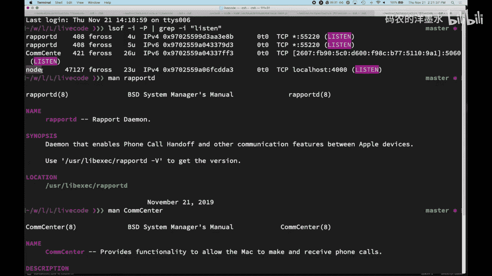

And you'll notice something。 So the。The handoff。Server is listening on star。

Colon and then Star colon， which means that that means that anyone on the local network can connect to this。

 So any of you can connect to this server。 So I hope that their security is good。

 and I hope that they're validating all the messages that you're sending to it because any of you can can send packets to my computer on this server right now。

 And it will be processed by the code that Apple wrote。 So there better be no bugs in it。😊。

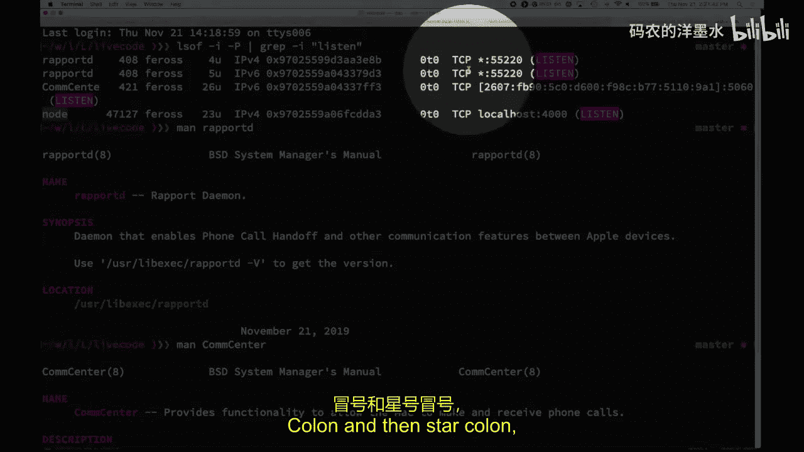

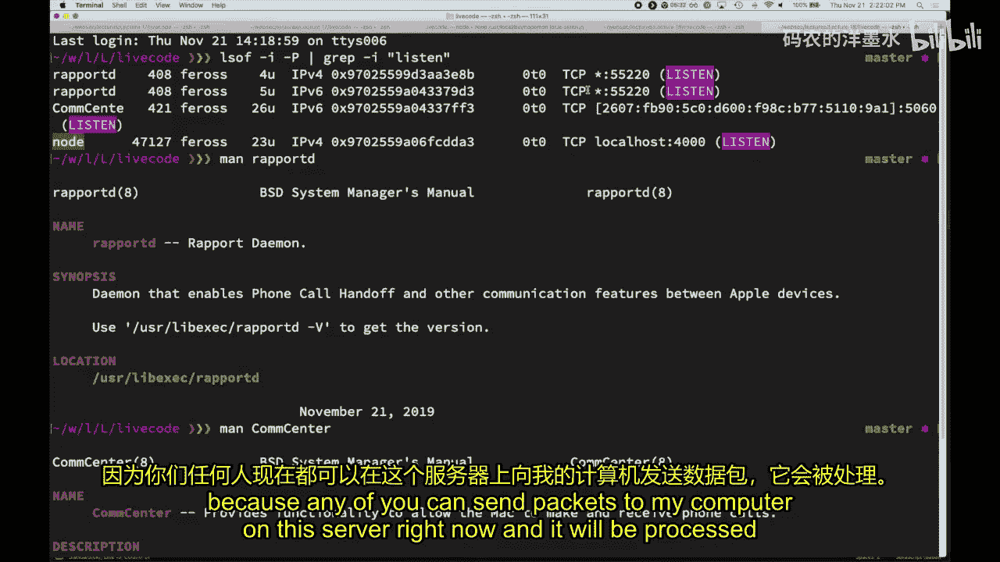

But you'll see here， the node server that we're listening to is only listening on local host。

 So you can't send packets to it。 But that's， that's what you tell how was。

 how those sockets were configured。

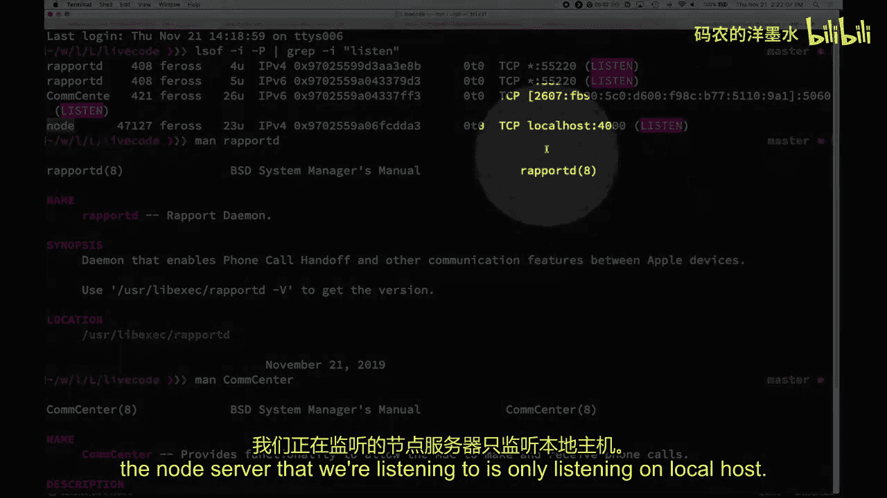

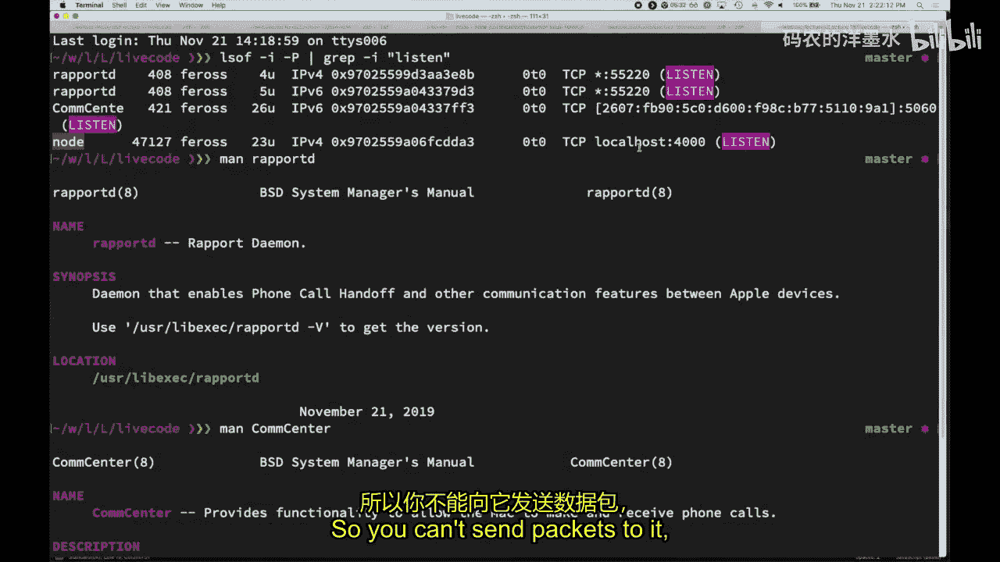

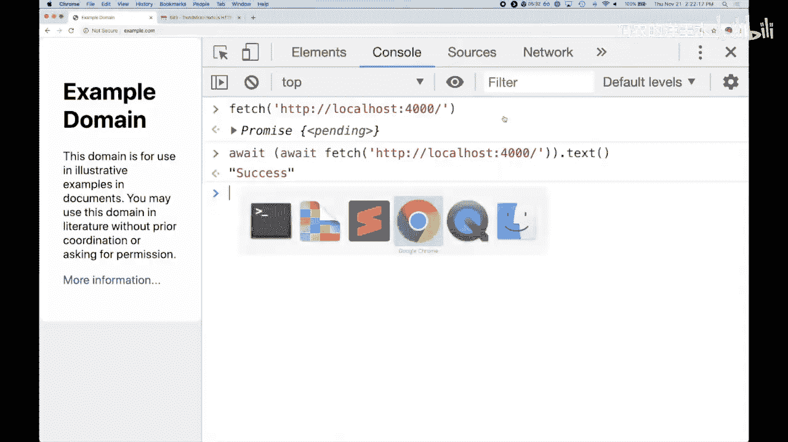

Okay。So there's a whole bunch of servers running on your computer。

 There was one really bad example of of a local server that was running on， on folks' computers。

 There's this antivirus company called T Miro。 And if you installed the antivirus on your computer。

 it would it would install a local H TDP server。 And this server was was vulnerable to R C E or remote code execution from any site on the Internet。

 So what this means is go to this issue here， we'll look at it。 it's a wild。

 this is a Google project 0 issue， which means that some security researchers at Google found this bug and notified the company。

 And。😊。

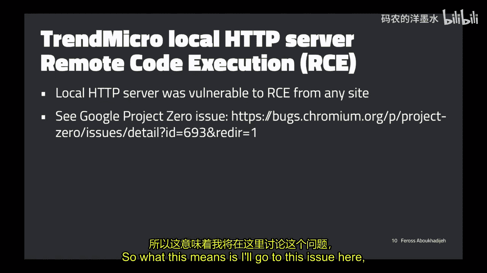

呃。So basically， with these three lines of code， actually。

 you could turn this into one line of code because this is just a fetch， but。

 he's using an older API that does the same thing as fetch。 But basically。

 if you can cause a get request to go to this URL。And you're running this antivirus on your computer。

 So any site on the Internet could just send a get request to this URL， local host 4，9，1，5。

5 slash API slash open URL in default browser， which is supposed to just。

 I guess pop open a tab to this URL。 But they made a lot of mistakes。

 One is they let any site send get requests to this。 Secondly。

 it turns out the URL can be a program on your computer and it'll just execute it。

 So the way that they show typically the way the security research demonstrate remote code execution is they'll just pop open your calculator on your computer to indicate that look。

 I could have open up anything。 but I'll just open up the calculator to be nice to you could have owned you。

 but I didn't And so yeah， this code here could could have been embedded in any ad or on any site that anybody visited running this antivirus。

 And they would have been instantly like the computer complete compromised。 So yeah。

 local HP servers are dangerous。😊，If you write one， you're basically。

Allowing the sketchiest ad and the sketchiest site on the sketchiest corner of the Internet to send you requests。

 And if you did it wrong， then all of your users are owned。 So。

 so try to avoid writing them if you can。嗯。And you can look through sort of the cool thing about Google Project 0 is that when they notify the company about the issue。

They posted into this this Google repo， basically， this issue tracker。

 And the company representatives can respond。 And this is all private。

 But then once 90 days have gone by， they just make it public。

 So you can see all the interactions between the researcher and the company。

 And you can get an idea about how seriously companies take security。

 And it gives you a sense for sort of their internal processes and how， how urgently they。

 they resolve these issues。 And so you can see I don't think we have too much time to go into it here。

 But。You can see the researcher like at one point he gets frustrated and he says， where' is it？

He said。啊。Hey， I just wanted to check if there's any update here。

 This is trivially exploitable and discoverable in the default install and obviously warmable。

 In my opinion， you should be paging people to get this fixed because they weren't going fast enough。

😊。

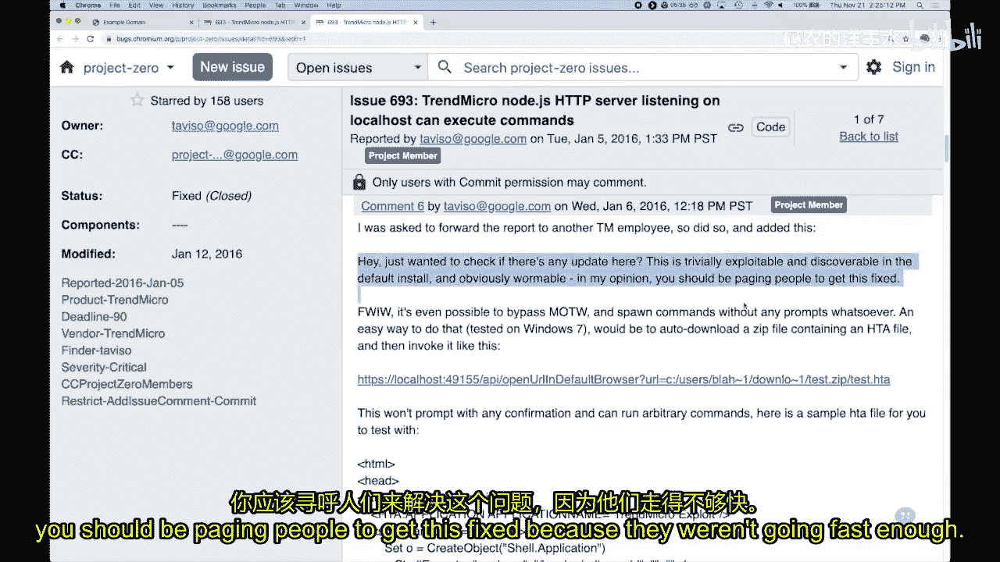

Yeah， and。Anyway， it it's fascinating you look， if you have time look through Google project 0 issues。

 you can learn a lot by looking through it。 Yeah， anyway so。😊，Back to Zoom， though。

 So there were problems with Zoom's local server， so。

The first problem was that any site on the Web could send a get request to the zoom server running on your computer and then join you into a conference room。

 And the conference room number was controlled by the attacker。

 They could join you into their their own room。 The other big problem was that they let the the conference host to decide the policy for whether the the participants cameras would be turned on by default or not。

 when they joined the room。So the attacker would just say， yeah， my， in my conference room。

 the rules are everyone who joins has their camera on when they join no， no permission prompt。

 and that would just be， that would be the policy。😊，On top of that。Like I mentioned before。

 if you uninstall Zoom， then the local server would remain installed on your computer。

 And the reason why they did this， they say is that if you uninstled Zoom。

 and then later on somebody sent you a Zoom link， you could click the link， and then it would。

Hit the local observer on your computer and tell it， go quickly reint Zoom for the user。

 And then so even if you unintalled it， you could click a Zoom link and it would just open up like it was never uninstalled。

 That was their idea。And then lastly， it was vulnerable to a denial of service where a site could just sort of make a computer completely unusable。

So we're gonna show you a little bit more about these things。 So this is the。

 the control that where the host of the meeting could specify whether the participants' video would be on or not when they joined。

 So it was just a U I control。 and then。This is the。

 this is the code to sort of basically freeze the user's computer。

 So the way this worked is you would， you would pick up。

 pick a conference room number that didn't exist。 And then you would send a get request to this URL。

 So the local zoom server。 And then you would say launch join a room。

 And then the room number would be that random invalid number。 And you would。

 you would do this in an interval like as fast as you can。 And every time you do this。

 the focus gets taken away from your browser and zoom sort of like launches and intercepts focus。

 And then when you do this again， it does that again。

 and basically doing this fast enough just causes your computer to be completely unusable。

 You can' you can't focus anything else。 You can't stop anything you can't do anything or stop it from running because this this is running too fast。

😊，That's pretty annoying。 But yeah， so after they。

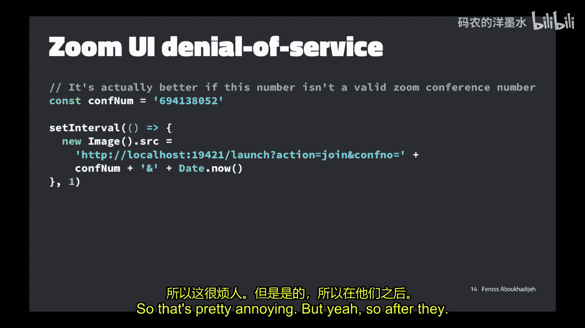

After this post was written， they were like， they， they， they were like this is actually fine。

 This is totally fine。 And they defended， the defended their decision。😊，Until the next day。

 when they admitted that they were wrong and decided to， to。Remove this local web server。

So I think they didn't realize the， the scope of the。

 the severity of it until the the researcher went public with it。

 And a bunch of their customers and a bunch of other people started contacting them。

 letting them know how serious issue was。

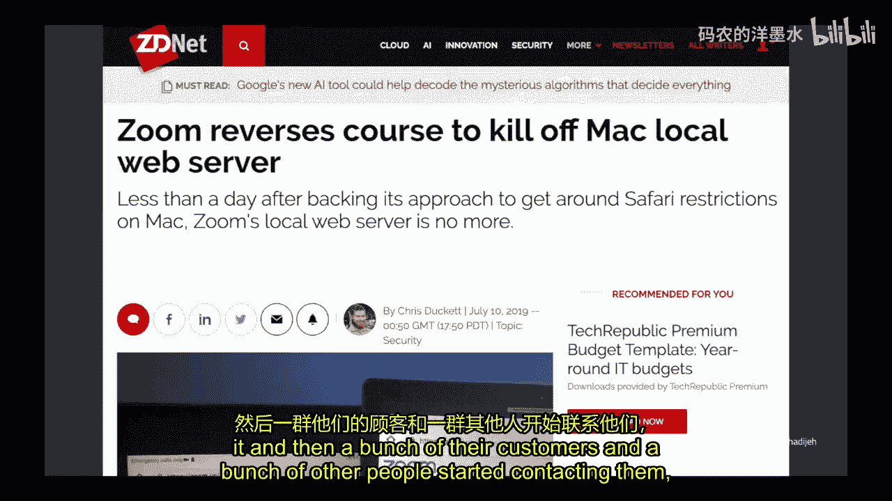

So， so this is how they tried to clean up the mess。 So they。

 they issued an updated version of the app， which when installed。

 would go and uninstall the local observer from your computer。

And they also added a U I prompt to confirm that you actually want to join a meeting before you join。

And problems with this are that users who didn't open up the app for a while wouldn't get the update。

 So they would still be running the local Web server。And be vulnerable to this。Until they。

 until they finally had time to open up the app and and let the install happen。 And then lastly。

 the users who uninstalled Zoom， they would have no way to even know that this。

 this was the thing because they already， you know， they're not using Zoom anymore。

 They're not customers anymore。 So， so they'd be running this vulnerable server and they'd be stuck with it unless they happen to hear the news。

 So this is really bad。 You know， there's millions of people who who who were affected by this。

 And so。Oh， and this is the best part。😊，All this， all this so far was just about sort of getting the user's camera to turn on。

 The researcher was like trying really hard to find if there was an RC E。

 like a remote code execution here where you a site could actually just like like the other example I gave with Tren micro。

 they could just run code on the computer。 And he couldn't quite find it。

 But a week after he wrote his post another security team said that they were working on a similar in a similar part of of the Zoom code base and they found RC E。

 So， so if you combined the two things together， you actually would have this remote code execution that affects millions of people。

 So yeah， it was a week a week after and then this other team basically wrote about it。

 And it was zero interaction remote code execution。 So this is what it looked like。

 if you went to to aious site。😊。

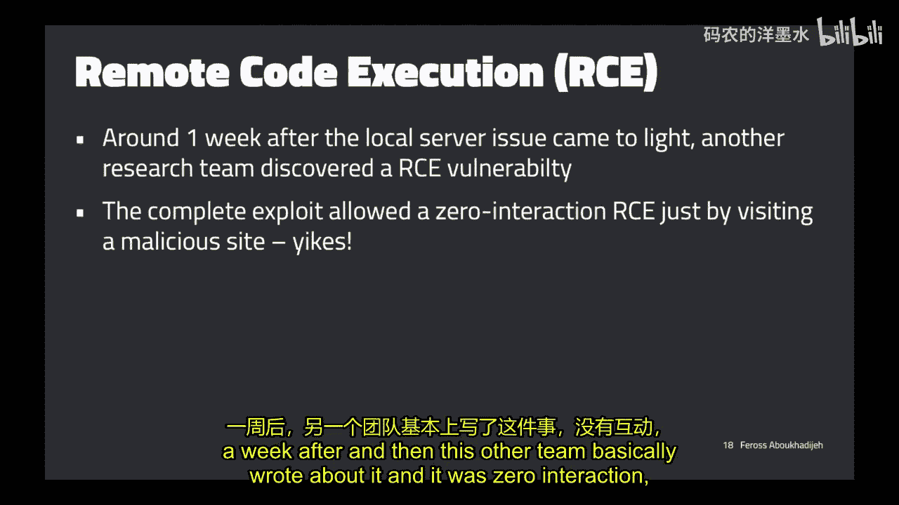

You just visit it。 And then it' your meeting will be joining。 will be starting soon。

 And then now they're running code on your computer。 And in this case。

 they just opened the calculator and and said hello to you。 But Li yeah。😊，You know， yeah。 And this。

 this is like every， every person who was running this on their Mac was was， was vulnerable to this。

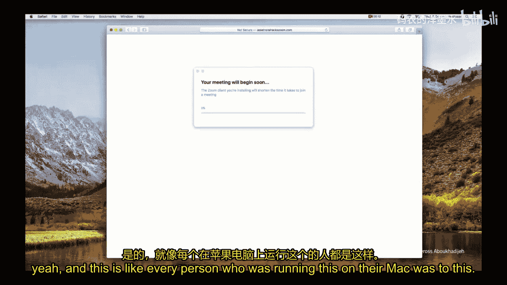

Yep， pretty wild。So then what happened， This is the story plot thickens。 So， so later that same day。

 after this team wrote about the R C E they discovered。

Folks realized that Apple was silently uninstalling Zoom， the Zoom server from everyone's Mac。

 And1 of， this is a little bit surprising because I think a lot of people didn't realize that this was even a functionality。

 It is a feature that that Apple， you know has。 But it turns out， yes。

 there's a thing called the malware removal tool that's built into all Macs。 And the way it works is。

😊，Periodically pings an Apple server and fetches a list of bad executable files。 So it has like。

Fingerprint effectively for executable files that Apple doesn't want any Mac to be able to run。

 And so it periodically fetches this list。 And if you have a program on your computer that matches this fingerprint。

 then it will kill it and it won't let it run ever again。

 And this doesn't require your operating system to be updated。

 like this is a thing that's periodically checking in the background。

 So if there's an an urgent program， you know， urgent piece of malware that is。

A piece of mal that is spreading fast。 They can sort of urgently stop it from spreading by just sort of basically blacklisting that program from running on anyone's Mac。

 even without an operating system update or restart。 And so that's what they did here。 They。

 they basically uninsalled it from everyone's computers。Yeah， no update required and。

It saves a lot of people because because I think someone must have told them that there was an R CE here。

 And so they， they were like， okay， this is worse than than the original security researcher thought。

 We need to basically kill this before， before it affects all of our users。So yeah。

 that's what Apple did。Yeah， okay。 so I guess I already showed this。But yeah。

 so one thing I wanted to mention too was was that。呃。Wait， that was out of order， okay， whatever。

Yeah， so this is， this is sort of the flow of how， how this all happened just just in case this helps to see it visually。

 So this is your browser。This is the server running on your local computer。

 So both the browser and the server are， this is your machine， Your laptop。 So you。

 you visit this join URL that's on the， that's Zoom dot US slash J slash 13 to join the conference room 13。

 It sends back a page。😊，Once the page is loaded， then the Zoom page sends a request to the local server asking it to launch the。

 the room。 And this request is initiated by the jascript code that's running on this page that came back from the Zoom server。

 And so that will cause the local server to launch the Zoom app and sends back， okay to your browser。

And I wrote opaque response here because this， this doesn't have a course header。

 It doesn't have that access control allowed origin header。 And so this page can't read the response。

 but it doesn't matter because the Zoom app was launched。 and that's all you were trying to do。

 So that's okay。 But that's， that's the flow。And one of the things they did that was kind of funny is they they did actually want to be able to have the local server indicate to the page here whether or not the Zoom app was actually launched or not。

 But because it was this opaque response。 this page wasn't allowed to read that value。

 and they seemed to not be aware of the fact that you can use this access control allow origin header。

 you know， to just say for the local server to say， hey， I'm okay with the zoom dot US。

oom dot US being able to read the response。 they didn't know this。

 it seems like so the way that they implemented this like hack around around the same origin policy is they had this。

 this response be an image。😊，And they would vary the size of the image based on the message they want to indicate。

 So if it was a one by one pixel image， then this page could look at this could sort of figure out the size of the image based on how it affects the layout of other items in the page and then be like。

 oh， the the app actually launched successfully。 And then if it was like one by two。 Oh。

 we have to go download the app。 you know， and all the different pixel sizes basically indicate different different responses。

 So I don't know why they that don't know about about cores。 But yeah， not。

 not a very encouraging sign。😊，Yeah， so basically， so this is what they could have done if they if they knew about cores。

 So then they basically the same flow。 The only difference is that when the request goes and the app is launched。

 the response just includes some Json saying， hey， it was successful。

 And then you just have to put a little header here saying。

 I'm okay with the Zoom dot US reading this response And so now。

 you know now now now they don't need to do that hack。 Of course。

 this is still this is still vulnerable to the main issue。

 which is that any site can still send this request。 So we haven't fixed the problem。

 We've just just removed this hack here。 they had。😊，And， of course， yeah。

 So we we're relying on the browser to look at the header here and then to compare it to the page that we're on and then to decide whether that the origins match and whether to allow the page to read it。

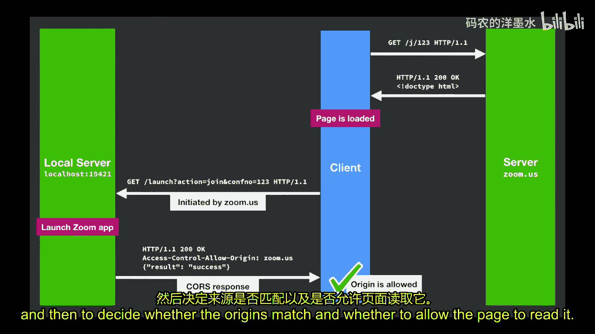

Okay， so， so this is the flow for for the attacker forced joining the user into a call。

 So the browser would visit the attacker site。 The attacker sends back some HTMLl code。

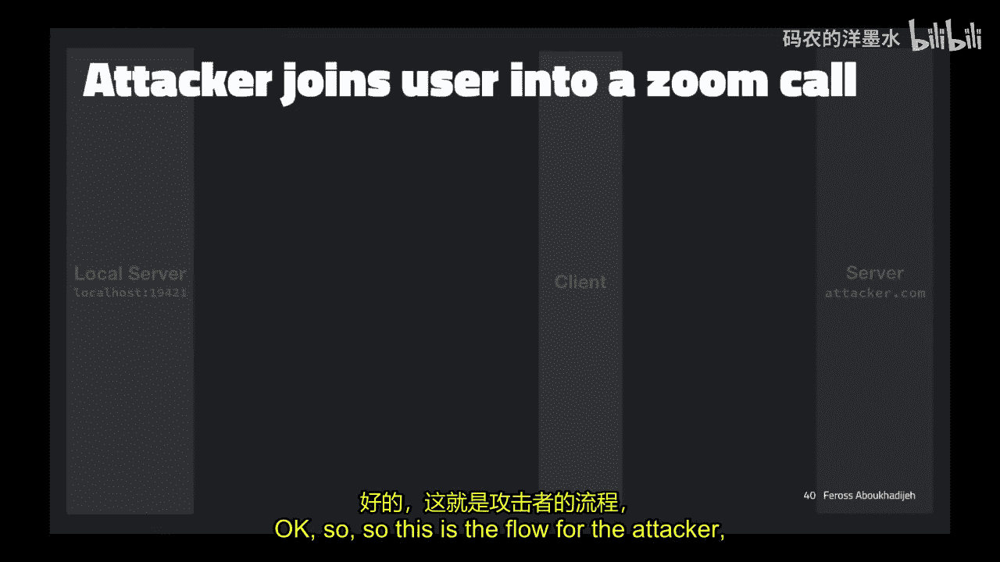

The attacker's page loads， the attacker sends the request to the local server。

 and the local server launches the zoom app and sends back this opaque response。 So so， and then。

 of course， yeah， So this is sort of the attacker flow。

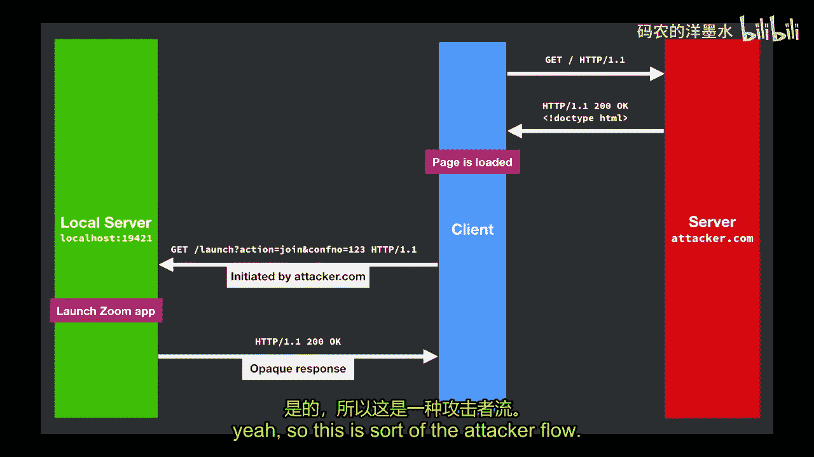

And if we throw in that cores endpoint。If we use cores， this doesn't solve the problem。

 I just want to emphasize this。 So， so if， if， if the response that comes back contains this access control origin header that says Zoom dot US。

The browser is gonna say， is the code that's running Zoom dot US。 And no。

 it's actually a attacker dot coms code that that's running here。 So it's gonna deny。

 it's gonna deny this origin from being able to read the response。

 but it doesn't matter because we still launched the Zoom app。Okay， the attacker can't read。

The result here， but it doesn't matter。Okay。So let's see how we can fix the issue。

The easiest and best solution to be they should just not do this。 There's a better way to to。

 to cause a website to open an app on your computer。 And that's to register a protocol handler。

 So Zoom can say we are gonna create the the URL Zoom Col slash s。

 And they can have their app register that。 And then when you click a link that starts with that。

 The browser will ask the user。 Hey， do you want to open up this app on your computer to handle this。

 That's the best way to do it。😊，So， but let's assume that for some reason。

 you have a good reason to actually keep a local HDP server。

 Let's say that there's no other way you can solve this problem。 You， you must do this。

 You must to figure out how to secure it。 So let's talk about， can we secure this。

 Can we figure out how to make this local HDP server actually secure。 So some ideas， what if we。

Let's see here。 Yeah， So we， we could say we're gonna require the user to interact before we join them into a call。

Okay， so， so when they go to a Zoom dot US link， we're gonna have a little button that says。

 do you want to join。And then on top of that， we're going to ensure that our local server only lets Zoom dot US communicate with it。

So now random ads and random sites you visit can't talk to the local server。 So how do we do this。

So let's have a local server inspect the origin header。

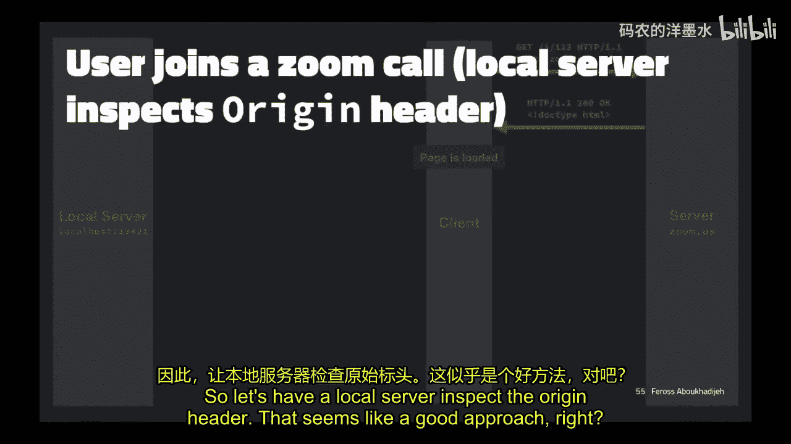

That seems like a good approach， right。Okay， so let's look at the flow now。 So。

 so everythings the same as before。 but now。When we make a request to the local server。

 I'm gonna include these extra headers that are that are attached by the browser。

 So the first one is host。 don't confuse host and origin。

 I'm putting them both here so that that you see them both， butre very different。

 So host is the way that you indicate what site you're trying to talk to。 Remember。

 So we're saying we， we're connecting to local host 1，9，4，2，1 here。 And， and indeed。

 that's who we're connecting to。 And then origin is which page， which origin triggered this request。

😊，Right。Okay， so because this was initiated by Zoom dot US， that's what you see in the origin header。

And then now the local server can have some logic that says is the origin Zoom。 And if it is。

 then it can launch the Zoom app and then go ahead and send back a response to the page。 And then。

 of course， yeah， we can read the response there。So this， this is， this is one one approach。嗯。

큰 white。Aer I just lie about the origin or。Yeah， so that's a good question。

 So the origin header is one header that you can't control as a， as a jascript code running in。

 in a site。 So that is always set by the browser to the true origin that initiated the request。

 There's no way to live about it。 Yeah now。If we were using the terminal and we were writing a curl command。

 of course， we could put whatever we want in there。 right。

 But because this request is coming from our web browser。

 our web browser is guaranteeing that this is set。ToTo the true origin。

So the attack is still avoidable。Yeah， if some， but the thing is， yeah， that's correct。 So if。

 if you're running an app on your computer that wants to talk to the Zoom server， then it can。

 But presumably that app could already just own you because it's already installed on your computer。

 So we're not worried about that case。 But yeah， that's， that's a good，'s a good point， yeah。😊，Okay。

 so， so let's see how if an attacker tried to join us into a call with this。

 with this approach protect us。 So now were we're getting our page from the attacker。

 the attacker sends the request to the server。 And because this is initiated by the attacker。

 the origin header set to the attacker origin。 And so when the server checks， it won't be。

 it won't match。 And so it will just close the socket， it won't even send a response。 It'll just。

Act as if the server is not there。 Let's just close the connection。

 So this page can't learn anything at all about， about our， our local server。Does that make sense？

Okay。So that that that that kind of works。 There's some problems with it， though。

 So one is that browser doesn't always add this header。 and this is so frustrating。 but so。

If you're sending what's called a simple request， which is the kind of request that will be triggered if you are using an image tag or an iframe tag。

To load an image or an iframe from another URL。 Then the browser is like， this is a simple request。

It's a get request and it's for an image and you're not even going to look at the response。

This site doesn't care about the origin， so it doesn't attach the origin header。

The idea is that any site can send these requests and your， your server doesn't。

Doesn't care to distinguish which origin initiated it。 That's， I think that's the idea。

 And so anyway， you can't learn the origin in in this， in this case。Also。

 if you're using the fetch API and you're， you're making a requests to your own server。

 then that's also considered a simple request because。

It's site talking to its own same origin server。It doesn't even bother to tell the server the origin。

 It's just assumed that that it it must be the same site， making the request。Okay， so。

 so this is not good。 So what， what is the solution potential here， Well maybe。Let's just say， look。

What if we。We say if the， if the request doesn't have an origin header。

 we'll just block it and we'll force。Will force the user to。

We'll force the page to include the origin header by making the request a complex request。And then。

 if we require that， then we we can just just basically look for the origin header and check it。

Does that make sense。O。Another idea is you can change the endpoint to require a prefed request。

 We'll talk about that in a second， what that is， but。If you do that。

 then you can basically force that， force the origin header to always be sent。

 So let's talk about this for second。 So just， just to emphasize the simple H TDP requests are requests that are gets。

 heads or posts。And they must have， they must be。 They must have no custom H T TP headers set。

And if it's opposed post， it has to be one of these three types here。Okay， so what is。

 what is the big idea here， This is all a lot of details。

 But like the way to think about this is very simple idea， okay。

What are the types of requests that a site can make without JavaScript。

So a site can embed an image to another site， right。

 that that will make a get request to the other site。A site can submit a form。

 You can make a form in H T L， No javascript required， right， So I can make a form。

 And when you click submit， it's gonna go to this other site。Okay， and those types of requests。

Fit this criteria， right。get request。 That's simple。 A post that is a form submission。

 And these are the three types of you can change the way the form is encoded， but it doesn't matter。

 The point is this is these the three types of ways you can send a form to a server。 So if it's。

 if it's a form or it's an image or something like that。 the browser is like， this is simple。

 Like could， you could do this without jascript there's no harm in letting this。

 this go to the server。 There's no damage this request can do because this is the way the web has worked from day one。

 sites have always been allowed to do this。 So it doesn't bother to even attach a origin header or to do any kind of extra checks。

Right， so that's the idea。 That's a simple H GDPP request。 So what is a non simpleim one。

 We call those prefed requests。And the reason why we。

 we call them that is because before we can send these， these more complicated requests to a server。

 we actually have to ask the server for permission before we send the request。And。

Does anyone can even think of why， Why we need to do this。So say， okay， here's an example。

 say have a delete。 And then the method is delete。 You know， it's one of the H TDP methods。

 There's get post， bla， blah bla， one of them is delete。 So when the server gets this delete request。

 it's gonna delete some item that is specified in the URL， right。

 So if the browser were to let that request go through。And then the response comes back。

 and the response says， this origin is allowed to。Do deletes。It's too late。

 Like the browsers already sent the request。 The servers already processed the delete。

 and your response asked the browser to please not like， let that happen。 It's too late。

 We need to actually。As we need the browser to sort of prevent this request from even going through until we've told it that it can。

Does that make sense。 certain requests are so destructive that we， we can't let them happen。

 We have to actually ask for permission before we even send them。 So that's what's going on here。 So。

 so let's look at what would happen if the browser did not pref these requests。 So。

 let's say you visited an attacker's site。The attacker sent back an the attack page。Okay。

 so now the page loads， and now they're gonna to send a delete request cross origin to another to a site victim dot com。

 okay。And because of the way cookies work， blah， bh， bla， A cookie is attached。

 And so the server is gonna say， okay， time to delete item 42。

 That's what this request told me to do。 And then it'll send back a response and say the page is deleted。

And say that we try to enforce。That only victim dot com can send these requests by including an access control allow origin header。

That's not gonna quite do the job， because。Sure， I mean， yeah， this， this。

 this header will prevent the attack page from reading the response because it's gonna this is saying only let victim dot com read the response。

 And， of course， it was the attacker that initiated this。 So it can't read the response。

 But the damage was done。 The server saw this， deleted the item。Damage is done， right。

 so that we can't do this。 This is not， this is not an acceptable design。And so what we need is。

The options request。So this is another H T TP method like get post， put， delete， etc ceter。

 It's called Op。 And the way it works is the browser sends options first to ask for permission before it it sends a prefed request。

 So a complicated request。So if the server doesn't know about options and it just， it does。

 it gets an options request and it says nothing， then it it will be den the browser will interpret that as it being denied the request being denied because the server doesn't even know what an option is。

Or if the server doesn't want to support prefed requests。

 then it can also just not respond or send back an error。

 And then the browser will go ahead and deny that request。

 So let's see how we can use this to protect our local server。So remember when the user。

Is joining a Zoom call。 We're going to now， we're going now make our local server。

 instead of checking for the origin header， we're going to use this pref technique to protect our server。

Okay， so what are we gonna do， So the client。It goes to the Zoom site， gets back to the Zoom page。

 And now the zoom。It's T L。Is going to send a request to the local server and say。

 please open up the app and join the meeting。And。

What we're doing though is we noticed when I made the H TP method。 I made it put。 Did we see that。

So put is one of the ones that is not simple。Put is it's not get or it's not post。 So it's。

 it's not simple。 So this is a prefed request。 When the browser sees this， it's going to say。

 wait a minute。This server might not want a random site on the Internet to send it a put。

 So let's ask if this is okay first。 And so what's going to happen is the browser before this request goes out。

 the browser blocks it。 And well， first， it asks the question。

Is this request going to the same origin？ And， of course， because this request is coming from Zoom。

 it's the Zoom H T L Zm dot US H T L，s that's active here。 And we're connecting to local host。

 which is a completely different origin。The browser is like wait a minute。

 this is a cross origin request。So it's gonna say this is not the same origin。

 So we have to ask for permission before we send this request。 Okay， so I。

 I couldn't fit all this here。 So this is the same browser is up there。

 So now what the browser is gonna do is on its own， you didn't write any code here。

 This is not written by the developer of the Zoom site。 This is the browser on its own。

 It's sending an extra H TPP request。 and。Asking the server， is it okay for me to send a put？

Will you， will that be okay， So the way it does that is it sayss options。

And it says the origin that's sending this put is the the Zoom origin。And we would like to put。

 please。Okay， so this request hits the server。 And if the server knows what sees it and knows what to do。

 it it'll say wait， so do I want to let this origin put to me。And because it's zoom US， well。

 we'll go ahead and allow it。 And so we send back an empty response。

 It doesn't matter what we send back in terms of the， the content。 All that matters is that we say。

 allow， put。And so now the browser is going say， okay。The servers fine getting puts。

 So let's go ahead and let let the request go through。 So it'll。

 it'll go ahead and actually send that put up there that it didn't send the first time。

 then and then when the server gets that now it has a much greater guarantee because it knows， okay。

 puts can only get sent if they were prefed by the browser first。

 And the browser had to check with me first。 And so this server is like very confident now that it got this put。

 it doesn't even care what the origin is because it knows previous options request must have happened and it must have validated the origin at that point in time。

 else the browser wouldn't let this go through。😊，And so now we launch the Zoom app and we send back our success response。

 And， of course， we let the page read it， by using that header。😊，Does this make sense。

So this is called pref requests or options requests。

 And this is what we do for anything that's a complicated request。嗯。

Thanks for bearing bearing with me。 This is complicated。 I know it's it's coming at the end of class。

 So you're all probably kind of tired， but。But yeah。

So last thing I want to go through is just what would happen if the attacker tried to tried to pull this off。

 what would actually happen， how the local server protect us。 And as you can guess。

 it will once once the attackers code actually starts to run and it sends this put。

 The browser is going to do the same thing as before it's gonna say wait a minute， this is a put。

 This is not a simple request。 So I need to ask the server first。

 So it's not a simple request it's not a simple request and it's also not going to the same origin。

 So it has to check first。 So it produces an options request sends it to the server。

 the server says is this coming from Zoom and it's actually coming from attacker com。 So no。

 and so it sends back access forbidden to the browser。

 And now the browser it doesn't even try resending that request up there。

 it's gonna deny it because it knows it didn't get permission from the server。Yeah。

 so how much do we have left here。 we have， I guess we have like two slides。 I'll just go through it。

 So anyway， so this has protected our local server。

 It's allowed our local server to distinguish requests from Zoom dot US and those from other random sites。

 however。Other native apps running on our computer can still talk to local server， as I mentioned。

 So curl anything running in your terminal apps on your computer。

 they can obviously set whatever headers they want。

 And this is because the browser is is enforcing that sites don't tamper with the origin header。

 But a native app， like a node script or Python script or something like that can obviously just make a request and set the header to whatever they want and pretend that they're coming。

 from Zoom。 of course， so。Okay， so， so now you understand this， this concept， I'm glad we all。

 we all talked about pref requests because it would be。

 it would be sad if you made it through Web security class without knowing how this works。But。

And so this is actually really useful。 This lets you protect your， your site in， in the real world。

 But because we're using this on a local server。😊，I'm sad to say that there's actually another problem that means that our server is still vulnerable to every single。

Webs on the Internet that wants to attack it。 I'm sorry to end class on such a disappointing note。

 But next time， we'll discuss an attack called DN S Rebinding that。

ItBaically lets any site on the Internet pretend like it's the same origin as the site that it wants to talk to。

So attacker dot com can basically pretend that it's zoom do US and talk to this local server。

 This only works against local servers。 And so， so unfortunately， all of our defenses。

 all this stuff is still vulnerable to DNS rebind。 So we have to learn about DNS rebinding。

 So I told you， local servers are really complicated。

 And you should be very scared and paranoid if you're making one。 And this is why。

 even after all this， We're still vulnerable。 It's very sad。 But。Yeah， so next time， come back。

 we'll talk about DNAN rebinding。Thanks。

