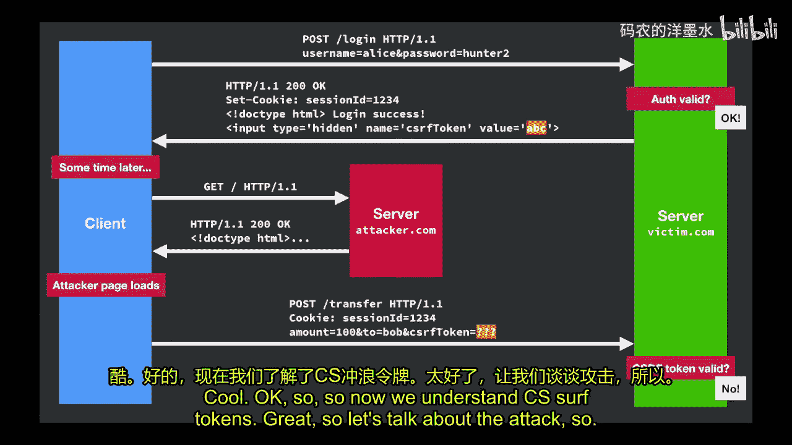
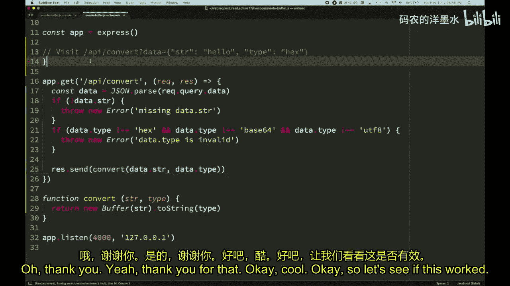
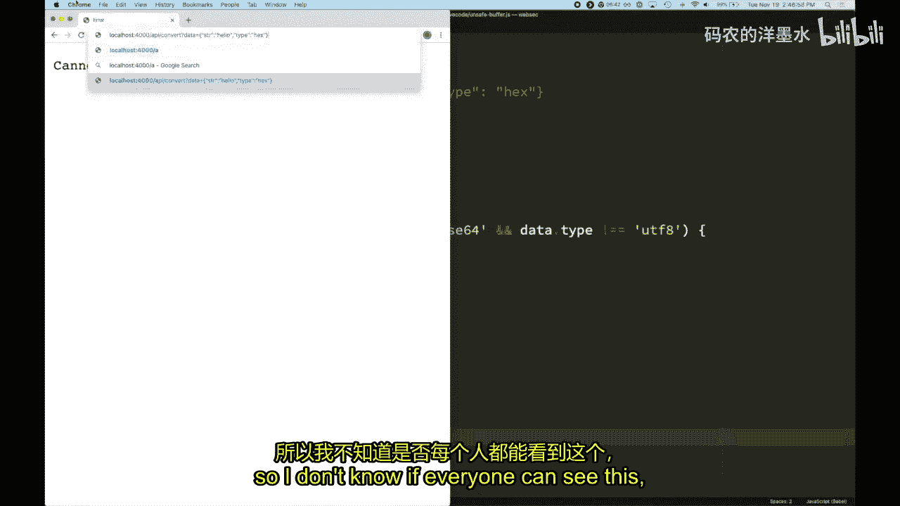
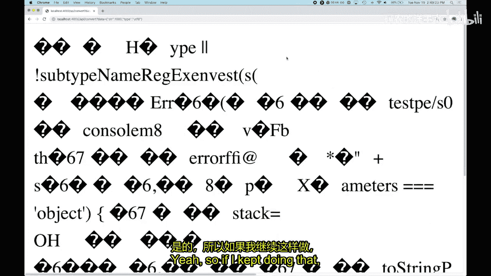
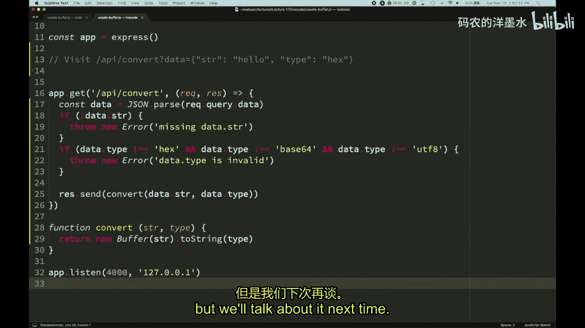

# 【全集】斯坦福大学 CS253 网络安全 中英字幕 1080P p17 Lecture 17 - 服务器安全：安全编码实践 -BV1RemEBZEEM_p17-

Okay， let's get started。Hope everyone had a good weekend。 So， this week。

 we're gonna to do all stuff about server security。 We talked a little bit about SQL actually。

 we talked a lot about SQL injection before。 and， and we also talked a little bit about。😊。

How to handle users who are maybe hitting your site too frequently and trying to log in too many times and have to deal with rate limiting and captions and stuff like that。

So today is gonna be sort of an extension of that。 just more kinds of ways you can mess up on the server。

 different kinds of attacks and things you can do to defend against attackers。

And mostly focused on safe coding practices。Things that。

 things that you might be doing wrong that will encourage sort of security issues that you know。

 to come up。呃。Or。Stuff like that， basically。Yeah， so let's get started。 So first some admin。

There's gonna be a hands on workshop with Pete Snyder from Brave， who's our first guest lecture。

 if you remember。 And the Stanford Applied Cybersecur Club is going to be hosting that。

 And that's going to be， I guess， Thursday， it's 6 to 7 in Gates 1，74 and dinners served， right。

 Yeah， also， we have some new students in class today in the very back。

 the two people in the very back are some new students。 my parents。😊，They were in town。

 they're here to watch me lecture year。So be nice to them。Cool， allright。

 so I also wanted to mention there have been three students so far who have found security issues and reported them。

 And so they' they've received extra credit。 I just wanted to call out a couple of them that were kind of interesting。

 There was an XS S found in access And since access is part of the Stanford bugg bounty program。

 this student， I don't know if I want to say who was you can volunteer your own name if you want to。

 anyway， was was able to report the bug to the bug bounty program and was given 100 for that from Stanford。

 which is pretty cool。😊，And another student found an XSS and a CS course website。

And actually LED to potentially being able to change assignment scores。

 which is not definitely not good。 And then lastly。

 someone else found an insecure design that allowed the test cases in a coding challenge for a job interview to be revealed。

 So you can sort of see the test cases they were gonna test your code against the the latter ones didn't receive any kind of a bug bounty reward because they weren't covered by as far as。

 far as I'm concerned aware， the C S course sites aren't covered by the bug bounty program。

 But maybe the coding challenge one will get get a reward。😊，Yeah， just a reminder about this。

 you have a couple weeks left。 If you're interested。 It's completely optional， but it's kind of fun。

 so。😊，Remember， you， you can do this if you want。Cool， so， so first， let's start with a story。So。

One weird trick to make 25K security teams hate him。There's， there's a story a couple weeks ago on。

 on all the tech news sites that's super relevant for the the stuff we're gonna be talking about today。

 So I thought I'd just go through what this security researcher was able to do。😊。

So this is the title of the post， bypassing Githubs O off flow。

 And what this person was able to do was basically， they can make a Github application。

 which is able to read a user's Github data。😊，And typically， there's， there's a prompt that says。

 do you want to， you know， do you agree to， to give this application access to your data And the the user is to supposed to click this button saying that they know what what the permissions are that this application wants and to give their consent。

He was able to find a way to， without any user interaction at all to send a request to Github with the user's cookies attached that granted his application。

 Any permissions he wanted on the user's Github account。 So just by visiting this attackers site。

 your entire Github account is just completely owned。 and the attacker can access all of the data。

 all of the private repositories， all of the company secrets， everything。

 And this is the highest bounty that Githubs ever paid out to anybody。 So it pretty bad really bad。

 It also affected all of the enterprise Github deployments， which are used， you know。

 by companies internally for， for super secret code。😊，The cool thing is。

 we know pretty much from the stuff we've learned in this class so far。😊。

Any one of you could have found this bug。 like it's， it's really。

 there's just a couple of extra things I'm gonna explain for you to get the whole picture。

 But this is the kind of stuff that you could do if you wanted to。

 Some people do just spend full time looking for bugs and and and make a living from just finding bugs。

 That's actually how this person found this bug was。😊，He decided， he was curious。

 could I make a living just looking for bugs。 And so he decided to spend。

 I think it was either a week or a month just looking for bugs in Github。

 And this was the result of that， so。You know， and it is first。

 his first time trying to do such a thing。 So， so it's pretty cool。 I think， I think， yeah。

 I think it's an inspiring story。😊，Because， let's before we go into how it works。

 let's recall cross site request forgery。So hopefully everyone remembers this。

 So cross set request forgery， the idea is， this is an attack where an attacker can force a user to execute actions against a Web app that they happen to be currently authenticated with or logged into。

So the way the attacker does this is， well， the authentication mechanism that the browser uses is cookies and cookies have this what we call ambient authority model。

 Who remembers ambient authority。 Some want to remind us。😊，What's ambient authority again。Come on。

 This is sad。Okay， allright， that's fine。😊，Did you want to give it a shot， Yeah。

 referring cookies attached request？Yeah， it's a fancy word for basically。

 once you have this authority that you've gained by logging in and proving yourself to the site that you're logging into。

 all future requests to that site automatically have that authority that you proved once at the beginning by logging in。

 So all future requests have that same authority as that user。

 And that's because the cookies are attached automatically to those requests by the browser。

 This is the same thing we've been talking about。😊，All quarter， just a fancy phrase for it。Okay。

 so what does this mean， This means that if if attacker dot com is able to cause an H T TP request to get sent to victim dot com。

Then the browser automatically attaches the victimim。com cookies to this request。Right， so。

I don't think I ever showed a picture pictorial version of how this attack works。

 So I went ahead and whipped one of those up just a review。 So we have the client in the server。

 This is the victim server here。 And the way CSRF works is the user visits the site and decides to log in so a login request is sent。

 you can see there there's a username and a password in that request。

And then the server checks whether the username and password is valid。Let's assume that it is。

 And so the server will send back a response。And this response contains a set cookie header that sets cookie sessionession I D equals 1。

2，3，4 and tells the user you logged in successfully。😊，Now， some time passes。

 the browser is holding on to this cookie。 And so maybe a day goes by or maybe the user opens another tab while they're while they're still logged into the site or or something like this。

 And now they happen to get sent a link to an attacker's website。 So they go to that site。

They make a request to the attacker's site。 So the H T gets sent back。

 and inside this H Tl is whatever javascript the attacker wants to include。

 And so once that page loads， that page is gonna send a request not to back to the attacker server。

 but to the victim server。And this request is going to be to some sensitive endpoint。

 like say to transfer money。 and they're going to include the parameters that they happen to know that this endpoint is expecting。

 So $100。 and let's send it to Mallory。And the browser helpful attaches the cookie header to that。

 And then the server， as far as the server is concerned。

 it looks like this came from from a legitimate form because all it can see is this request。

 and everything checks out in that request。So hopefully， this is review。

 and any questions about this。This is sort of standard CSRF， okay。Cool， okay， so recall。

 the way we fix this is same site cookies。 So same site cookies allow you to say。

 I only want my cookies to be attached when the request is initiated by my own site。

 So if a request is coming from victim dot com to victim dot com。

 then the browser will include the cookie header。😊。

But if the request is coming from attacker com to victimim do com。

 then the browser doesn't include the cookie header。

So you'll see the same site comes up all the time。 It's a really great cookie feature。😊，Okay。

 so now let's talk about a new thing we haven't talked about before。

 And I actually wasn't planning to discuss this at all in this class。

 but I'm gonna mention it here because its， it's a requirement to understand the attack that that this this attacker found in in Github。

So， so the reason why I wasn't gonna bring it up is because C。

 S or if tokens are actually kind of unnecessary these days。

 They are a way to effectively get the behavior that we get from same site cookies。

But but before same site cookies is worth a thing。 Before browsers actually supported this whole concept。

So。One thing we might ask is， what if， what did websites used to do before the same site cookie attribute existed。

 Because for， for a long time for， for probably the majority of the web's existence。

 because same site cookie is actually a really new feature for the majority of the Web's existence。

 there was no way to say that you wanted your cookie to be same site。So that mean。

 what does that mean， That means that basically， it was possible for most of the Web's existence that attacker dot com could send a get or a post request to your site。

 victim dot com。 and your， your cookies would be attached。So the browser allowed this。

 and sites had no way to opt out of this behavior。And yet。

 we need some way to prevent any any random site from from being able to submit forms to our server with cookies attached。

 So what did sites do。Any ideas， anyone。If you already notice CSRF token is okay。😊，Yeah。

 I know you know。Anyone have any ideas of how， how we could detect how we could differentiate whether a request is coming from from our site or from an attacker's site。

Yeah。A they able to look at this site origin like the URL？

Look at website So you could look at the referer header。 which give you some idea。 That's right。

 Not perfect。 for some of the reasons we talked about in that in that lecture about referers or sort theres some ways that the attacker can kind of disable the referer header。

 But it is， it is something。 But there， it was really no good way。

 no no built in mechanism in the browser。 or in any web standards to enable a site to say they wanted their cookies to behave in the same site way until that spec was created until browser implemented it。

 And so so the answer to how how we solve this problem is that every single site had to implement this thing called CS SRF tokens。

😊，So let's talk about how that works。So basically， a CSR of token is a Nonce。And remember。

 a Noance is just some secret， unpredictable value generated by the server and transmitted to the client。

And the way we use the CRF token is that the client must include the CS SR F token in all subsequent H TDP requests that they make to the server。

In order for the server to recognize that as a valid request。

So if you send a request to the server and you don't include the CS SRF token。

 the server is gonna say。This is an invalid request。 If the token is missing or if it's wrong。

 it's gonna be an invalid request。 So it's basically some， some。

 some the server is gonna give some value to the client and say。

 all your requests that you send in the future must include that value。 or I' I'm gonna reject them。

Okay。So far so good。Okay， so。This is how you typically include a token。 So you， you。

 you would include an input element in your page。 and there's a type hidden， which is kind of cool。

 So you can include a hidden form element in a form。

 And let's give it the name C SRF token and give it the value of the， of the actual token。😊。

And so because this is an an input field， when our form is submitted。

All the inputs get sent to the server as part of the form。

And this is going to get included as one of the of the form fields as if the user had typed this into a form field。

 But of course， they， they don't have to do that because it's going to be included automatically for them。

And so how does the server actually generate these tokens。

So there's two approaches you might use one is you can just sort of randomly pick up pick a value。

 an ounce And so， you know， pick it randomly， turn it into a string。

 and then let's use that as the value。 or you could generate it based off of。

Some information in the request itself， like the session I D。嗯。Okay， so now we have this token。

 The question is。How do we use it， What does it actually give us。

 How does it actually protect us against CS SRF。So let's look at how how CSRF token works。 This。

 This should hopefully make it clearer。So we have a client。 They show up to our server。

 And this is similar to the force。 So they're gonna send a login request with a username and a password。

The server checks that it's valid。 Let's assume it's valid。 So the server sends back。

 This is very similar to before。 It sends back a set cookie header giving the user a session。

 and it tells them that login was successful。😊，But you'll notice that also included here in extra。

A bit of H TML， which is the CSR F token that it chose for the user。 In this case。

 we chose a really insecure 1 ABC， but I need to save space on my slides， so。So。

 so now this page includes this token。 And so what's going to happen is if the client interacts in any way with the page that was sent back。

Let's say it submits another form now to do at bank transfer。 right。

 This token is going to be included in that request。 right， So， so sometime later。

The client decides to actually submit a transfer。 And so you'll see here that the browser attached attached the cookie like usual。

 And now we have the same form feels as before。 So we have 100 going to Bob。

 But now there's a CSRF token field included， which is it's basically the client echoing back the same token that it was given at the beginning。

😊，Now， the server checks that and says， is that the same as the one I gave you before。If it is。

 then it's going say this is a valid request。And send back a page saying the transfer was successful。

Right。So so far， so good， right？Okay， so now how does this protect us against an attacker。

 You can imagine。 So this is the same situations before we。

 we user logs in with a username Alice and a password。 It's valid。 We get back the same pages before。

And now， sometime later， they happen to visit an attacker' site。 The attacker sends back some H TM L。

And when that page loads。That that attacker page sends a request to the server。

 And this request is coming from this attacker。 attacker controlled this。 and so。The question is。

What does the attacker put in here for the CSRF token field。

It should be the ABC that it was sent from before。But because this form submission that's happening here。

 this post request is coming from the attacker's jascript。

The attacker actually has no way to read this input out of the victim dot com page。

In order to do that， it would need to be able to reach into the dom of victim dot com。

 which is a violation of the same origin policy。Okay， so basically this server here， the victimt。

com server， when it looks at this request。If it sees that the C Ser F token is the same as before。

 it knows that this request must have come from， from the H T L and the javascript that it's sent down in the original page and not from some other website that the user happens to be on。

Right， so even though the cookie is here is valid， right。

 So this attacker happened to send this request， right， and the browser attached the cookie。

 So if the server just to look at the cookie， would think that this is actually the user because they are La logged in here。

 But the CS F token is wrong。 And so it's gonna reject the request， right。😊，Yeah。So。Usually。

 would this be handled？比。Or in terms of the session。

 because I'm imagining if you did it like per page or per request。

 like if the user hit the back button， things So that's right。

 So if the server sees a CRf token coming back from the client and it has ever given that token out to the user before。

 we need to remember that and treat it as valid。 Like I could open up 10 tabs on a site。

 So it's not enough for the server to remember the last token it sent out。

 it has remember all of them And so typically what we actually do is we we don't want to we don'tan to just generate a random value。

 So if I go back to that slide where we were showing the code here。

 this is not a very good approach because it means the server has to basically remember every single CSR token that it's ever sent to the user for some reasonable amount of time。

 and better way is you can just say， look， whatever session idea I gave the user。

I already set that in a cookie。 The user has that in their browser， right。

And so when they send it back to me。If I just can compute what the token should be based off of that and I combine it with a secret that only the server knows and use this Hmac function。

 which is you can think like a hash， It's basically hashing the session I D with some。

 some secret that the server has。 And what's great about this is all the server has to remember is that this one secret。

 And the client is going to provide them a session I D。😊，In the request， as well as a token。

 And as long as the server runs the same function when it's verifying the token as it did when its sent down the token。

 which is this function here， then it should check out。 It should be， It should be exactly the same。

 And so the server can actually be completely stateless。

 It doesn't need to remember any of these tokens。 And it can still verify that theyre。嗯。😊。

Does it affect anything whether we use this here the same？For the whole session。You potentially may。

Yeah， that's O。 Yeah。 So， so it's true。 It's not completely random from， from page to page。 It's be。

 the user is gonna be getting the same CSR F token as long as they have this session I D。 It's okay。

 though， because we're assuming here that。The user is not gonna share this with anybody。

 and the attacker can't guess it。 And that's all we care about。Yeah。I understand。

Heres to be the same。Thes that we talked like a no that we talked about so what is the difference between a CSR？

And don。It's， it's， it's similar。 you know， is， is a very similar concept。

 The difference is just where we're using it。 So the non field that you're talking about is from CP。

And that's where the the server was telling the browser in a header。

 don't run any scripts unless they contain this nonsenses as an attribute。

 And here it's actually the server that's saying the server is basically saying。

 I won't accept any form submissions unless they include this value that I previously told to the client。

 Yeah， but it it's a very similar concept。 Yeah。Cool， are there any questions about this。

 This is important to understand the Github attack， which is really cool。So yeah。

 ask questions if you， if you missed anything。So， so the reason why， okay， question， yeah。

Seems like cookie had。でそでな。That's correct。 Yeah， so if the same site cookie header was sent。

 then then this attacker request right here that the attacker sent wouldn't even include the cookies。

 And so this wouldn't do anything。 Yeah， so you could use both together。 if you're like one。

 actually one use case for still using this is if if you have users that are on really old browsers。

 like maybe you're building an enterprise app or something like that。 and you care about this。

 the other place where you might see this is if you're using a web framework like Ruy on rails or I guess。

😊，I don't think Express builds it in， but it's a， it's a popular package that people include because like I said until recently。

 there was no way to protect against this。 So literally every site out there on the Internet had to implement this。

 this protection at their in their own app code， basically。

 although the framework might give you some affordances for you to make it easier， but。Yeah。

 the browser didn't help you at all here。 So if， if you're looking at code like a company or at an internship or when you get a job after after college。

 you very well might see CS S or F token still because it's just probably in a lot of code basis still。

 Yeah， So C SR。Like what things like if you introduce just to kind of like Stan？croper。

So CS SR F tokens are are perfectly effective。 Yeah， they completely like this。

 basically as long as you're choosing this token from a big enough range and you're choosing it completely randomly。

 then it's impossible for the attacker to guess it， right， They can't like send like a you know。

20 billion requests with all possible tokens。 It's not， it's not feasible。 So this is very。

 very effective defense。 Sam site cookies are just introduced as， as a way of saying， wait a minute。

 Why do we have to have all this logic for the server to generate this。

 this Nos and then check it and， and everybody's doing it separately and。

 And if you forget to do it on one end point。 Then your whole app is vulnerable。

 Why don't we just say， add one attribute to the cookie when we said it and just say same site。

And we're done， you know， like， it's a much simpler solution。Much less airplanepro。Yeah。TheVm。

com server we're defending against this by using a really crappy check refer headdress。The attacker。

com server could be like just bypass it super easily by setting like refer equals victimtim。com。

 right？I don't think that the attacker can control their header to that degree， but they can。

 They can omit it。 They can cause it to be omitted。

And then the server would have to decide what to do。 Is it omitted for malicious reasons or did it。

Did it get omitted for it becauseuse the browsers trying to be more private like。

It's unclear what the server should do。Does that answer your question。Cool。Cool， okay。

 so so now we understand Se surf tokens。 Great。 So let's talk about the attack， so。😊。

I think we have everything we need for now to explain it。Okay， so。

 so this is the prompt that a user sees when they're being asked if they would like to give an app permission to access their Github account。

And if they decide they want to give the permission， then they can click this authorized button here。

 And for this demo， he only chose to get like a very minimal set of permissions。

 But this could have contained like a lot more prompts， potentially。For more access。Okay。

 so what is the flow like when you're actually authorizing an application。

 So say that some third party app wants access to your Github account for some legitimate purpose。

 The way it works is it's gonna redirect you to this URL here。

 Github dot com slash login slash oath slash author。

And it's going to include some information in the query string， saying what app。

Is owned by that developer。 So you're gonna get a prompt for that app saying this app your wants access to your account。

And so you， when you go there， you're gonna get this authorization page。

 That's the page we saw before。 It's this page。Okay。If the user chooses to grant access to the app。

 then they click the big green button author on the page。

And then the user gets redirected back to the third party application and GitHub。

 when it does that redirect back， it includes a query something in a query string。

 which is basically a Github token that the application can use to then access your data by sending requests to GiHub。

Like out of band， right， So this token is basically like the password to your account effectively for。

 for this app， right。O。So that's the flow。So how is the authorized button implemented。

So it turns out that you just did it as a form。 So the entire button is just an HTMLL form with one button in it。

When you click the button， you submit the form。And。

That form also happens to contain a hidden form field with a CSRF token inside of it。Okay。

 so this this， this again， this ensures that a random attacker can't just effectively click the button for you。

 Click the authorized button for you by， by sending a post request to this URL。

So when the server receives these posts， it's going to validate that the CSRF token is correct。

 And then if it is， it's going to assume that the user must have click this button by visiting the page directly。

 and this request could not have come from some attacker site。That's what the CSRF token gives us。

One interesting detail is the form actually submits to the exact same URL that the page is loaded from。

Does that make sense。So the app redirected the user to this URL。

 and that loaded this sort of form with the big green button on it。

 And then when you click the big green button that also sends a request to the same URL。

 the only difference is that the first request was a get request。

 And the form submission is is a post request。 so the server can look at the H T TP method and then just do different things depending on what the method is。

So that's an interesting detail to keep in mind。Okay， so this is the full flow， so。

We go to an app example co that we want to authenticate with or log in with log in Github with。

 And it's gonna send us back a page with a login with Github button。

And say the user clicks the button。The button goes to this URL here。 Loin， O authorize。

 and that request goes to Github。There might also be。

 like I said some query parameters here that specify exactly what app we are trying to give access to our account。

 But I， I didn't have room in the slides。 And you'll notice here the cookies attached， right。

 because this is a get request。 The browser navigated there。 So， of course。

 the cookies are gonna get attached， right。Okay， so we're logged into Github。

 So Github is now gonna be like， okay， hi for us。 would you like to authorize this app。

 So it sends back that page， And that page includes the CSR F token。

So say the user clicks authorizedize。Now we're going to post。

The form is going to get submitted via a post request to that same URL。 Cook attached。

 CSR F tokens attached。Right。And so the server Github can check is token valid。 Look it is。 Okay。

 great。 So we will send back a successful response to the user and we'll redirect them with this 302。

 which is a H TP redirect。 We'll redirect them back to example com the app and will include a Github token X。

 Y， Z that the app can use to access this user account now。

 And so then the user gets their browser gets redirected to the to the。😊，To the same page。

 but now with this little parameter attached。And that's the whole flow。

 So that's how you log in Github。 This is actually how you log in most apps。

 Like if you ever see log in with Twitter log in with， it's something like this。 Basically， right。

 This is an effective idea。 So this， this token is sort of the key to your account that the app can use。

😊，Okay， so this seems fine， right， Like， where's the problem， Where's the bug。

seems like there's no problems here， as long as we're actually checking the token。Okay。

 so let's see what actually what they did。 So， so this。

 this security researcher was able to get a copy of the Github source code by doing an enterprise trial。

 So he like pretended he was a company downloaded their source code。

 And then it's very it's sort of obfuscated。 but he found some code online。

 which unofffuscated it to quite a degree。 So he's able to sort just like look at the Ruby code that they wrote。

 And he found this section in there。 And。😊，So this is a section that implements that authorization flow。

 So let's see what it's doing。So it says we have this URL here。 login O off authorize。

 and anytime a request comes in to that URL， and it's a get or it's a post。

 Then we want it to go to this controller。 And you can think of controllers similar to handlers in Express。

 So it's just the function that's gonna run to handle this request。 And so。

And so all getss and all posts to that URL are going get handled by this function here。

 And so this particular function happen to have an if else check where we checked if the request is a get request。

 then we're gonna serve them back to H TML with the big green button on it。

 And if it's a post request， then we're gonna check the CSR F token and。If it's all valid。

 then we're gonna grant them permission to use， to use the application。Again， so far， so good。

 I don't see any problems with this。 Does anyone see any problems with this。No problems， right？Yeah。

 I I don't。 I don't think any of this is， is bad so far。Okay， one more thing I need to talk about。

And then you'll， you'll see what the problem is， so。There's this thing called an H T TP head request。

So a head request is basically like get request。 The semantics are。

 if you send a head request to the server， the server is supposed to treat it like a get request。

 It's supposed to go and get whatever resource you ask to get。

 And then before it sends back the response to you， it just omits the body。It sends all the headers。

And it just doesn't send you the actual page that you asked for。So why is this useful？

You'll typically see head requests used if like your browser before it downloads a file。

 Maybe it wants to see。 I this a huge file。 What's the size of this file。

 So it could send a head request And then it'll get back to the headers and not the file And itll look at the the content length header and be like。

 oh， this is a gigabyte file。 Okay， maybe that changes my strategy for how I'm gonna download this or something。

 So that's， that's a common thing。 But it is relatively niche and relatively obscure。

 Most people aren't using head requests on， on a regular basis。 And so because of that。😊，Ruby on Ras。

 which is the framework that Github used。 It knows that most people aren't gonna bother to implement a head request。

 And so it's like， well， we can just do that for you。 Basically。

 we know what to do when when there's a head request。

 We basically just want to run the code that we were gonna do for get requests。

 And then when that code is ready to send back the response。 We'll just tweak the response。

 We'll just get rid of the body for them and send back just the headers。

RightAnd so the framework is basically like， we can help you out that。It's so similar to get。

 So why not， why not just handle it for the developer， right。

 Most developers would forget to do head otherwise， right。

This is the idea that head there's no equivalent for。

But because those at all like potentially change。Yeah， that's great。 Yeah， yeah， exactly。

 So the reason why we can do this for head is because a get request isn't supposed to change anything。

 It's not gonna make any， It's not gonna be。Modifying the database。

 it's not gonna be destructive in any way。 You can repeat a get request as many times as you want。

 and nothing is gonna happen。 So， so it's no big deal to send it to send a head request。 whereas。

 yeah， you could not do that with a poster with any other method。Cool， any questions about head。Okay。

 so that's how that's how that request works。 Cool。 So， so Ru on railils， like I mentioned。

 it automatically is gonna handle head head request for us。

 So it does that by routing any head request that comes in to the same place as it as it would route Get requests。

 and， and Express actually does this， too。 So this' is not just the rub on rails thing。😊。

And so it it's going to run the same controller code that it would， it would run for get requests。

 And then it's just gonna go ahead and delete the response body when it sends back the response。

And so this is a time saving feature for developers。 It's usually the right behavior。

 It's very handy that the framework does this for you。 There's one problem with it。

 which is that it's a slightly leaky abstraction。A leaky abstraction is just an abstraction that doesn't perfectly hide the complexity from the developer。

 So most of the time， the developer doesn't have to know this exists except for in this one case here where。

In the controller， which is， again， the handler the function that's running。

The happen to check request dot get question mark， which is that's a ruby way of basically saying。

 this is a boolean。 Anything with a question mark on the end of it is Boolean and Ruby。 It's like。

You're ask， it's sort of like is yet， basically。 anyway。 So。

 so that actually returns false for head requests。嗯。

This is kind of unexpected because the developer said that they wanted this controller to only run for get requests and post requests。

 And so。They may made an assumption that。I'm only gonna ever get a get request for a post request。

 And so if they have an if statement in their code like。

 like this code happened to and it's checking this。 then there in this case。

 there's gonna be a third value。 There's gonna be head requests coming through that same code path。

 And so let's see what goes wrong when we do that。 So look at the code again。Again。

 the developer said， I only want get requests and post requests to go to this function。

 And so they thought， oh， okay， so this is gonna handle the gets and then the else is gonna handle the posts。

 right。But the head requests ended up in here as well， right。Does everybody see that。Okay。嗯 yeah。

And two routes， one get one post in the hole if else had been a necessary。Yes。Yeah， so yeah this is。

 this is only possible because they decided to sort of handle get and post in one controller function。

 Basically， that's a really good point。 Yeah， this wouldn't have happened otherwise。

 So one important point is you might， okay， so what's the big deal。

 Sore gonna somebody makes a head request to the server。 Okay， so we end up in this case。

 there's still gonna be there's still not gonna be a valid CS SR F token， right， Because remember。

 the else case， this is the case where we're about to authorize an app。

 So this is definitely gonna check that the C SR F token was included。

 So an attacker still can't find out what the token is because it can't it can't violate the same origin policy and go and read that input with the token in it。

 right。So， so how does this actually turn into an attack。So。

What happens is the CS SRF token handling wasn't actually done directly in this else case。

 A common thing that frameworks will do for you。 And in Ruby Unres is is a prototypical example of this because it sort of tries to handle as much as possible for the developer。

 What it does is it says， okay， we know that the user wants to validate CS SRF tokens。

Anytime there's a post request coming through。 So what it does is basically before any of this controller code even runs。

 there's another function that runs in rails that says， is this a post request， If so。

 check the C SR F token。 If it's invalid， return an error page。Before this code would even run。

 right， And that's how you get CS SRF token checking in rails。

 And so the problem was when a head request comes in。

That's not going to trigger that CSRF token checking code。Right， it's a head request。

 not a post request。 So that's that gets bypassed。 Then we end up in the controller here。

 And then head doesn't match this， if case， So it runs this code。 And then at this point。

 we're not checking the CR of token。 We've assumed that's already happened。

 that rails took care of that for us。 And so literally， you can omit the C SRf token。 and。

 and Gitthub is gonna say， oh， that looks legit to me and authorize the application。😊，So yeah。

 and it basically， you just send a head request with to the app you want。

 And then that user just automatically accepts that app on their account。 One request， very， very。

 very elegant。Yeah， so let's see what that looks like in action。 So this is， is now fixed。

 This was two weeks ago。 Gitthub actually responded to the hacker1 report。 Remember Haer1。

 that was what Miles talked about last time。 That's where your poor bugs。

 They responded in 8 minutes and acknowledged it。 And they were like， yeah， y， y， y， we confirmed it。

 It was very easy for them to test it。 They just like sent ahead goes， oh， crap。😊。

And then they acknowledged it right away。 and then they had it fix out in three hours。 Like。

 it was a very， very severe issue。 So they were， they were on it right away。

 But props to them for being so fast。Yeah， so this is fixed as as of like two weeks ago。

 But this is how how the attack would have worked。 So you visit the attacker server。 Again， remember。

 this is really easy to do。 you just click a link right， You end end up on a attacker page。

 You get back some H TM L。 And that H T M L causes a request to go to Github。

 It's a head request to authorized。 And then there's an app I attached here to to the URL。

 and your cookies are sent and there's no C F token in sight。

 and the server just doesn't doesn't bother checking。 It just sends you back you're authorized。😊。

And then， of course， that's going to redirect you to the， oh， I guess I messed this up。

 This should say attacker dot com。 So it it redirects you to the attacker do com server with the Gitthub token。

Just like that。Yeah， pretty crazy。So would an automated buzz or vulnerability scanner like ever try sending head requests and seeing it like the behavior is different？

Interesting， yeah， I mean， it should。I I'm not too familiar with with the kinds of stuff that people are using like in production in the real world on their。

 on their applications， like cause all kinds of， there's like hundreds or thousands of security vendors。

 I'm sure some vendor claims that they can do this。 I don't know how effective it is。 I would。

 I would guess the hard part about that is like it would need to。

You'd only catch this if you were actually sending it with a valid cookie so that the。

 the fuzzer would have to be smart enough to， to to like figure out how to send like a mostly legit request。

 If it could。 Yeah， we catch this。Yeah， it a question，So it sounds like there's two problems。来知。

Does the chat。So I guess does explain。是的。So express is very much modular。

 So it doesn't actually do any CSRF checking out of the box。

 but there's like a common set of like five or 10 packages that everybody who's using Express pretty much also installs。

 And one of them is called CSerf， which is， I don't know， some weird pun on CSRF。

 And and so that that package would if you used it in this way。 it would。

You would configure it usually to only check against post requests。 So you'd have the same problem。

 Yeah， if you were purely relying on like， you know， on that check， on post requests now。

Well get to it in a sec。 But there's other way。 there's actually other reasons why this would be less likely to happen in express。

 I'll mention。 I'll try to mention it at the end of。The next slide。

So let's think about how Github could have prevented this。Does anyone have some， some ideas， yeah。

If you go back to the conclusion。呃对。Else。Else if。It said like else if request posts。Yeah。

That's a super easy way to do it。 Yeah， that's like a great way to code defensively。 Basically。

 don't assume that， you know that the two options are get and post。 Just be like， I'm paranoid。

 I don't know what's gonna get called here else else if request post。

 And then I would actually suggest also throwing in an else at the end。

 I't know if there's actually code after this this section here。

 But you wouldn't want that you wouldn't want to just skip both of these cases and then just run like other code afterwards in the in the head case。

 So I would actually say， I would say do this if it's a get this if it's a post throw an exception if it's anything else。

 This is， this is a very sort of common。😊，Paradm will see if you're coding defensively。

 you'll basically want to say， I expect this to be the case。 if it is not。

 And that would be really bad for some reason， Like if this is not not what I assume to be the case。

 then you want to just sort of bail out as soon as you can。

 you want to just abort crash the process because the nice thing is you crash here， Sure。

 that means now that some attacker has now figured out if they send a head request to your server they can cause it to crash。

 right， that's still much better than the bug that Github ended up with by not doing this。

 And the nice thing about crashes is typically in production， right。

 you have like hundreds or thousands of instances of your app running。

 And if an attacker can crash one of them or many of them。

Sure they affect the availability of your site in some way。

 But you're gonna get an email or some kind of an alert right away saying there was an exception in production。

 And you're gonna look at it。 And you're gonna say this case was never supposed to run ever。

 And it just did。 Okay， one of our， like my assumptions were violated in a very serious way。

 and you'll immediately sort of debug it and be like， oh， head requests can come to this code。

 and you immediately then you know， figure out the problem and fix the root cause。

 So asserting that your assumptions are true is really good idea。嗯。😊，Just use like instead。的な？

Cs rep and checked。Like check to see if it actually got validated。 if there's not good C to then。

Yeah， I don't know if if Rails is gonna expose that in enough detail to youca it is being handled at like another level。

 But yeah， if it did， you could do that。Yeah。And the other ideas， there's other。

 there's many other ways we could have let me go back to the code， actually。 And the other ideas。嗯。

 yeah。I'm just going to sketch out by the idea that anytime there's opposed post。

 it takes care of the CSRF for you， like I would like to see the block of code that validates the CSRF before I grant permission to the app。

Every time。Those lines have to go before。because it's such a sensitive thing。

 This is like your entire Github account。 Yeah， there's something to to that。 I mean。

 you're basically suggesting being explicit and less magical。 And I'm a fan of this as well。

 in general， I mean， it's a trade， it's always a trade off like。😊，If you。

 if you require the user to be explicit and they forget in one place， right， or you。

 you have a new developer on your team who just joined and they don't know they're just learning rails for the first time they've en codingd in something else。

 they're gonna， you know。You're more likely to make a mistake， maybe on the other hand。

Relying on magical behavior that you don't fully understand can bite you as this case has demonstrated。

 So it's， it's a trade off， yeah。嗯哼。😊，Yeah， another thing you do。Yeah， exactly。 Yeah。

 So I wouldn't have tried to be so clever and be like， oh， I mean。

 the nice thing about what you're suggesting is what you're suggesting doesn't even require them to to use two different URLs。

 They could still do this thing where theyre they're using the same URL for both。 But they。

 they could tell rails that they want a different controller for get and than for post。

 So they have two different functions， One forget get one for post。 And。

 and that would have that would have solved the problem。 yeah。😊。

So one of the nice things about Express， I'll mention it now since this is actually totally relevant。

 But with Express， you usually say app dot get app dot post。

 you register your method up front and you can only pick one。 You can't do this like， oh。

 get and post and whatever。 You can't mix the two。😊，The exception is。

 there's this thing called app dot use in Express。 And with that， you're basically saying。

 I want all H TDP methods to come to this function and get handled by this function。

 at which point you now like all bets are off， you have to basically handle every method。

 So an express would either handle every method or you handle one method。😊，And even though it。

 even though it is automatically sending head requests to the get handler。嗯。

There's nothing that can go wrong in that case， because there's no post code in that same path。

If that makes sense。Okay。Keep going。Did anybody have any other ideas for how GiHthub could have prevented it before we move on。

Okay， so yeah， we talked about most of these。 Oh yeah， And then obviously， the most。

 obvious one of all that no one said is we could just have used same site cookies instead of C SR F tokens。

 And then we wouldn't have had to deal with any of this complexity。But yeah。

 so using a separate controller would have worked using separate URLs for the authorization page and the form submission endpoint would have prevented this issue changing else to else if request post to be very explicit and ensure that head or any other unexpected methods would wouldn't be treated as post would have worked。

 Yeah， those are the things I came up with。So yeah， this is how you would do the explicit check。

 You just， we already kind of mention this， But I would。

 I would recommend throwing an exception if it's， if it's not a get or a post and just crash the app。

 It's a catastrophic case or're not a You're not。 You don't want to try and。Recover from this。

 the same site approach I is great。Like the。Ting all together because the third party act is trying to like。

The third party Japanese to send the cookie to like Giub right that's a good question。 So， yes。

 let's look at that。 Let's look at the legit case。Okay， so this is the legit case。

 So you're saying that basically， your concern is， let's see at the point where the user clicks the login button and this request goes to Github。

 Your concern is that the cookie wouldn't be attached if it was a same side cookie。 right。

 Do you remember same site has two modes。They was strict and lax。 Yeah。

 so if you were using the strict mode， then you're correct that because this request was。

 so strict basically says， I don't care。What kind of request it is if the user ends up on my site and they came from anywhere。

 don't include the cookies。 It's like extreme paranoia mode， right。

 the lax mode says if it' if the entire browser is getting navigated to the page。

 like the top level page is is changing， which is what's happening here。

 The user clicks the login button and the whole browser just goes to Github， right。😊。

Lack says it's okay to attach the cookie in that case。H。

And that actually means that this would work still， yeah。

So that would be why if you're logging in with OA， like Google or Twitter or。

Permission prompt that say like you have to click authorized。To。

But don't they always throw up permission prompt。 Maybe I don't understand the question。Oh， I'm just。

I think usually even if the app requires no permissions。

 they'll still redirect you to their own page and have you like click it there。

 so I figured maybe that was to work。Around the same site。Oh， yeah。

 there is no way to grant permission at all without going to going to a top level Google page。 Yeah。

 you're right because the cookie wouldn't be included。 Yeah， I think you might be right。Okay。

 so let's go back to where were we， we were here。 Yeah， Okay。

 so now let's think about ways that rails could have prevented this。 So we talked about how Github。

 what Github could have done。 What could the framework have done。

 What could they designed differently to prevent this kind of an issue。

I feel like they kind of laid a trap for their， for their users in a way。Thank ideas ideas。

The requests are just like basically just。Check。Token check for。I'm sorry， I forget get。

Seems like it's only logical to do it。Oh， interesting。So。

So if you did a token check for head requests。That means that。

That would mean that that no one could send a head request to a URL。

Unless they had first loaded a different URL and gotten a token out of that response， right。

So you could require that of your users， but it is changing the semantics a little bit。So。I was like。

 normally， I could say， I could send a head request to get the homep page of the site。

 and I don't have to know anything about this site。 I could just say， give me the homepage。um。

And if you， if you require a C or F token in that case， then I would first have to like。

 do a get request for the homepage， get the response， find the token， include it。

 and then send the head， which defeats the whole point of sending the head。Right， yeah。

 but it could work。 It's just a completely different like set of assumptions you're making， yeah。

No so this case reminds me of the parse HTML unsafely never do this function。

 so I forgot like the framework this was， but what it was like question marking what you could have is you have a field being why are you doing this and you have to like。

50 characters。Yeah， so you， you think that you think checking get directly is。

 is such a uncommon thing that we should just discourage it。 Yeah。

 I don actually don't know how common it is。 I mean。

 in from my experience writing code and note and in express。

 I do sometimes check the method like for legit reasons。 So I would be。

Maybe a little bit annoyed if I had to always be like dreading knock caps or something to like do it。

 but it would certainly， it would have prevented this case。 Yeah， you're right。 I agree with you。😊。

Yeah， did you have， you have another one。No， guess I just。

Think about like witness this eventually croppped up just as。

Like a course pref header or something like like doesn't the browser to know header requests just for things it might have to visit。

The browser， the browser can send head requests for， like its own reasons。

 like for before downloading a file or another site can just cause a head request to get sent similar to get。

 so it can just。Cause。It T， did I did that that answer your question。

 guess because it's like a very specific route。 I was just wondering how like no head request ended up。

Because it seems true。Co crude blood things and on。Oh。

 good I guess there wouldn't be before the post that you actually do when you click in。Yeah。

 maybe after we talk after class but， I'm not understanding the question。Okay。

 we' talk about it after class， yeah。Okay， so I had some ideas for ways rails could prevent this。 So。

 I mean， one thing you can imagine is just don't handle this automatically for the user。

 force them to handle head requests themselves。 That's one option。 I think that if you do this。

 then probably no one is gonna be supporting head requests in their sites。 So you kind of lose。

 lose that benefit。 But that's an option。 Another idea is you could set。Request do get to true。

 even if it's a head request。And。This is lying to the developer。 Basically。

 the framework could lie to the developer and tell them it's a it's a get request。

 even though it's a head request。I would argue this is actually fine in a way because。The developer。

 when they wrote this controller， said I am prepared to handle gets and posts in this controller。

So we should assume their code is only going be checking for gets and posts。

 So sending them head is kind of a violation of， of the abstraction that we've created here。

 It's like。Leakking out some random implementation details that we don't want to leak out。

 So if it instead pretended that the head was a get， then the now。

 we know the developers code is gonna run correctly because we're only giving it gets and posts like we like they asked for。

 right？ And then after we sort of get the response。

 we could then delete the body and handle it for them。 And now the abstraction isn't leaky， right。

 It's just， does do people know what I mean when I say leaky abstraction。

 Who's heard that term before。Who doesn't， Who doesn't know。 I can explain。Okay， so。

The idea of the reason why we make abstractions is because we're trying to hide some complexity away from from the developer。

 we're trying to simplify the amount of state they have to have in their head in order to program。

 something。 It's like like the less sort of complexity that they need to keep in mind。

 the more likely they are to write correct code。 And so ideally abstractions they eliminate unnecessary complexity and they only expose the very essential complexity that that can hide too much。

 you can be like you can have class which or library which just has one function。

 It's like do the thing And then that doesn't like you configure anything What if I want to do the thing differently there's no options to。

 So you want to expose some complexity， but you don't want to don't want to。

To expose any sort of extra complexity that doesn't is irrelevant for the developer to solve the problem that they're trying to solve。

 And so a leaky abstraction is one where it like mostly works。

 It mostly hides the unnecessary stuff away。 But then in some places。

 like bits of the implementation or bit bits of。Details that the developer ideally wouldn't need need to know about leak out in in small ways and then violate the like break the abstraction。

 make it less make it a less useful abstraction because now the developer has to keep these edge cases in their head in order to use it correctly。

 that's what happened here。 Like this abstraction was like， oh， it's just， know， we're gonna。

 gonna do this clever thing that the developer won't need to think about。 And then whoops actually。

 they need to know about it。 They need to know about head request。

 So you didn't actually make their life simpler。 In fact。

 you just cost them 25 k and potentially a lot of know user data lost。 So， yeah。

 that's leaky abstraction。Okay， so another idea。Right， okay， so yeah， basically， yeah。

 I already mentioned this。 And then here's a crazy idea。

 You could use a more strongly typed language like Haskell or something。 It's part of the reason why。

 I mean。You could argue part of the reason why this issue happened is because there was no way to enforce that every case that could possibly get。

Givenive to this developer's code， there was no way to enforce that they handle each of those cases。

In a more strongly typed language， you could actually have a compiler error if they only said case。

 get， case， post， and they forgot one of the cases that you might call their code with。

This slows down like development arguably a lot。 And， you know， people don't like it。 people。

 people usually use these， these looser languages for a reason。 But that is one solution。Yeah。Oh。

 I see， look at the function and see if it's in。I mean， in Ruby。

 I guess you could that you might have some kind of introspection。 I know in Java。

 you can literally two string the function。And then you have a string version of the function。

 And then you could parse it yourself with your own jascript parser and see if it actually you know。

 accesses request dot head or something like that。 don't recommend that。 There may be。Yeah， I mean。

 other than that gross approach， I can't think of a way to sort in advance。

 know that it's going handle it。Yeah。Okay。Some lessons that I think we've based on the different possible solutions that we've proposed。

 I think there's some lessons we can sort of glean for how to。

 how to sort of prevent these kinds of problems in our code or in our libraries that we write。

 One big common theme that you'll see all the time in security context is that we want to try to reduce complexity。

 complexityplexity is the source of， of so many。Security issues。And。

When we have abstractions that we're trying to hide complexity from the developer and， and， and so。

Yeah， I guess I already said this。 The more edge cases than an abstraction has the leakier that it is。

 so。The more complexity you have， you also have the more sort of interactions between different components in a system and it sort of you get like this multiplicative effect where like。

If you introduce a new component， you might think， oh， I'm just adding one thing to this system。

 right。But if the question is not how many things that I add to the system， The question is。

 how many things did the thing I just add， how many things can I interact with in the system。

 The system has 500 other components。 And I added this one in a way that it could potentially interact with any of the 500。

 right， Then I've actually it's not it's a much sort of scarier change than than something that I just add in a very isolated way。

 And I know it's only talking to this one other thing。 So complexity can come from like lots of。

Places， and its， it's usually the enemy of security。Also， explicit code is better than clever code。

I think this is the kind of thing that you get， you get better at over time in your career。

 At least that's how it's been for me， where。Like at first。

 it's really fun and exciting to like try to like write like a really clever one liner and like。

 look at all the functionality I packed into this line。 Like， I'm such a good coder。

 I'm gonna impress all my coworkerers and my classmates like because they're gonna look at it and they're not even gonna know what it's doing。

 Are't I so I'm so cool， right， I I must be more， you know， elite than everybody else。 And as you。😊。

Go through your career。 and then you come back to code and you're like， this is terrible。

 Who wrote this。 and then you look at the git history and you realize you wrote it。

 and you were too clever so that literally yourself can't understand it like a month later。

 Then you sort of after this bites you enough times。 you just start saying like， okay， no， no， no。

 no， no， I'm just gonna unroll this code and make it much more verbose and much more like dumb。

 You know， just much simpler。 It's gonna do this than this than this。

 And it's gonna look uglier but it's gonna be understandable。So， yeah， I think， I don't know。

 Just the thing that。I I think most people tend to write less clever code as as their career goes on。

 That's what I've noticed。Yeah， and then the other， another idea is to fail early， so。嗯。

If an assumption that you have is， I guess this is mixing a two up。 fail early。

 the idea is basically if if something is in a state that you don't expect it to be in。

 then just crash or throw an exception。 don't try to like， go onward don't， don't try to。

 to handle it and。呃。Like one example where this comes up is you can。

You can you can do this thing in No Js， where you can say when an unc exception happens in my program。

 I want this function to run to handle it。 And so what you can do is you can sort of say， a handle。

 it's sort of like a top level trica。 You're like any exception anywhere。

 Just go like if it's not handled at a lower level， I want it to run this function。

 And what people used to do is they would just log out the error and then not crash the process。

 They would just keep it running， right。😊，An idea is like， oh， well， you know。Like。

 it's probably fine。 Like， maybe that， that was an exception that wasn't a big deal。 Like it was。

 let me just log it。 I'll fix it later。 Keep the process running。

The problem is you don't know where the error happened。

 You don't know what like multi step process you were in the middle of。

 and you threw an exception in the middle of it。 And now some state that you set up and were expecting to get cleaned up later。

 you didn't， you're not gonna get around to doing that now because you。

 you bailed out halfway through。 So rather than try to resume。sorry。

 rather than assuming it's fine to to keep going， you should just crash the whole process because you don't know what state it's in now。

 And so crash the process。 And then usually you have some other process on the system that will just reboot the node process or whatever server process and start it from scratch。

 And you can if you have more than one of these， you can handle handle crashes without any downtime for your users。

😊，Yeah， so that's。It's a good idea。 And then lastly， code defensively。

 So assume your assumptions are gonna be violated and verify them up front and， and。Alright。

Don't assume that your your function is going be called with the correct arguments。 for example。

 right， It might not be。So any questions about these lessons。Did make sense to people。 if you。

 you can disagree if you want。 I mean theyre， they're not， they're not like hard and fast rules。

 It's a lot of it is taste and just like trade offs。 Everything is trade offs。 But these are。

Some things that I think are useful。嗯。😊，Then the oxide is that the tarrco is not。いい。😀は。😊。

I guess yeah， that's true。嗯。Yeah， we call that security through obscurity， though。

 and we don't encourage it。Yeah。Okay， so I'll skip this。 I was just gonna。

 this is gonna go through the sort of the， the things we talked about and try to。

Associate them with each of the lessons， but I think that's not necessary。嗯。Okay， so yeah。

The next thing I wanted to， oh yeah， question。Is it better to。F sava。Weゃ an errorて。Yeah， so。

 so that's a really good question。 So I guess， yeah， what I said before is is not complete， so。

If the error that happened is expected， like you say， here's an example， I'm going to。

Make a query to the database for a particular user with a certain I D number， right。

 And then I may get a user back。 I may not， because maybe that I D doesn't exist。As a developer。

 I'm actually expecting that this may fail sometimes because say that the I D number that I'm looking up is provided by the user。

 The user goes to some URL， You know slash users slash 25。 That could be， know。

 the user could type in make a typo and go to a URL where that user I D doesn't exist。

 So if I'm writing code to go get that user out of the database。😊，And。

And the idea I'm looking up is provided by the user。 Well that user might not exist。 So I should。

 in my code， expect that that may return an error to me and say there is no user with that I D in that case。

 because I was expecting that error， it's totally fine for for me to return like return an error code to the user。

 give them a4 or4 error and say no one with that I D exists and to keep the server running。

 I shouldn't crash。 you shouldn't crash the server in that case。

 because that was an error you were expecting and you wrote code to handle it the difference between that and what I was talking about before is if an exception happens and you didn't expect it to happen。

It's not appropriate to， to just like log that out and then keep going。Because it could。

 anything could have gone wrong。 You don't know what。 you weren't。

 You actually did no code to sort of clean up and handle that exception。 You weren't expecting it。

 right。Does does distinction make some sense。Okay。Cool。Cool， O， so yeah。

 so let's talk about the next topic， which is bad API design， so。😊，This is a fun one， so。

The idea with this is just that there's， there's so we。

 we mentioned all these different ways that we could， we could try to write better code。

 clean code and avoid tricking ourselves and and being defensive and all this stuff。

 But sometimes an API that you're using is just badly designed。

 and it's set up in a way that is likely to。Milead you， right。

 some ways this can happen is say that the default parameters that the function that you're calling。

Assumes are insecure。 And the only way to use this function securely is to actually pass in a bunch of options to make it work the way you want。

 I would argue this is like。This is bad because most users， you know，re。

 they're gonna just call it without any options， and then they're gonna be running it in an unsafe way。

 And so we want the defaults to be secure。 We want the defaults to be reasonable。So this is one。

 one way that an API can be can be poorly designed。

 You'll notice that it's possible to use it correctly。

 You might actually pass all the correct options， but you're just encouraging。

 you're making the easy path the， the unsafe way。 Another thing you might see is polymorphic function signature。

 So this is where a function takes in。😊，Multiple。Different types of parameters。 And effectively。

 this one function is doing like one or two or three or four different things。

 And it the way that it decides which， which one of those things to do is based on the type of the parameter。

 Like maybe you pass in a number， It does one thing。 you pass in a string。 It does something else。

 Or if you pass in an extra argument。 It does a completely different thing， right。

You don't want to bundle too much functionality into one function。 I I would argue。

 because it's it' harder for the user to use correctly。

 and especially in a loosely typed language like jascript。 we'll talk about some examples。

 And this is a really， really wild one。 I've seen this before。 Actually Express does this。

 You can actually have functions where they do a different thing based on the number of arguments in the callback function。

 I'll show an example of it。 It's called functionality， okay。So here's a really common example。

 If you've ever used JQury， this is Jquery is kind of old these days。 It's not cool anymore， but。

It's actually still really， really widely used， though， still growing， I think， too。 But anyway。

 it has it's a very good example of a very polymorphic function so。Depending on what you pass in。

 the type of what you pass in， it does a completely different thing。

 So if you pass in a string that is happens to be a CS selector to select an element on the page。

 like in this case button， then this will return you the。

It will return you a G query object that wraps that dom node that matches that， right， Actually。

 it could be， oh， it could also return to you an array of like multiple nodes if there's multiple buttons on the page。

You can also pass in an H T L element， and then it will wrap it with the Jquery wrapper。

 You can pass in another jquery object。 and then it clones it。 So this as a copy operation。

 or you can pass in some H Tl。 And then it will parse the H Tl and create a doode with that H Tml inside it。

😊，You'll notice here， this is really wild one because this is actually a string。

 And that's also up there string。So we're actually doing two different things。

 even though it's exactly the same function prototype。

 We're actually deciding whether it looks like H Tl to us or not and doing a different thing。

 That's pretty wild。😊，Also happens to be really insecure in practice。

 And then the other last case is， you can pass in a function。

 And then what this does is this actually runs this function when the whole page is finished loading。

😊，So they've packed all this behavior into this like $1 sign function。And it's。

 it's handy for prototyping stuff。 I mean， it's really fast。

 It's like the1 letter type it's a dollar sign。 You know， it's like convenient。

 but it's doing like five different things， depending on what you pass it。😊。

So this is what I'm talking about when I say polymorphic functions。So。Oh， yeah， here's the。

 here's the express case I was talking about。 So this is really wild， so。So this is a middleware。

 A middleware is， I guess I haven't explained this yet in the course。 But basically。

 we've been using app dot get an app dot posts and then having these functions that run to sort of handle a get or a post to a particular URL。

 There's this thing called the middleware， which is sort of a more generalized version of that。

 where what we're saying here is just call this function for every single request。

 get posts head all of them， all the methods and all the URLs。 Just always call this function。

 And this is actually where you would do your CSRF token validation as an example， right。

 You would check if it's post and then do your validation or whatever。😊，And。

What's really useful about this， too， is you can call next if you don't want to actually handle the request here。

 So typically what the way these middle wars are used is you'll， you'll do some logging。

 you'll do some useful operation， and you'll call next。 And then eventually， your。

 your different handler will get run like get or a post for a different URL path。

Am I confusing people。Basically， this is just a way to run a function before every request。

 It's a really useful way to do that。 But if you pass in a fourth argument。To the function。

Then this is a completely different thing。It then becomes an air handling millware。

 And what this does is if an exception is thrown in any of your handlers for any URL that you handle。

 then Express looks for the first。Time you call the app dot use with a four argument function。

 and calls that。And then that's supposed to handle the error。 right？ So basically。

 reason why this is bad is like in this case， look， I sent back a response to the user。

 and I didn't even use the error object， right， So maybe。

Maybe a developer who's going through the code base will look at this function and be like。

 wait a minute。 Next isn't used。 erroror isn't used。

Maybe we'll just delete these these arguments because they're not used， right。So you delete them。

 And then now you've changed this from an error handling middleware to a normal millware。

So literally， the unused argument is is important here to get expressed to treat this as an error handling middleware。

 So that's， it's just a overly fancy API design。 It's bad。 They should have just made it explicit。

 I opened an issue about it。 And they want to fix it。 But it's they haven't done it。

 It's been like years。 So yeah。😊，Yeah， anyway。Okay， how much time do we have。O。

 we might have to get to this next time， but I'll start it。 We have 10 minutes， Okay， so。

This ones really cool。 So this is something I。😊，Worked on。It's， it's， it's。

I'm personally invested in it， I guess so。So there's this thing called the buffer class in。No J S。

 And the idea is， is a server often needs to allocate memory。

 All programs need to allocate memory for various purposes。 And at the time。

 Javascript didn't have a way to do this natively。 There was no all you had was strings， basically。

 You couldn't。Make an arrays。 you couldn't make like a， you can say give me a megabyte of memory。

 And I want to put whatever I want in in that megabyte of memory， right。

 And so node introduced buffer。 Later， the Javavascript language itself eventually got native support for this。

 And they introduce these other things called typed arrays and array buffers。

 which give you the same same functionality。 And so the browser has these。

 and then eventually node also got these because it's part of the Javascript language now。

 So node is now has this redundant。 It has two ways of doing binary data now。 unfortunately。

 But that's just the way it is。😊，So this is how you use buffer。

 So there's a couple ways you can use it。 One is you can pass in an array of。

 of bytes of byte values。 And then you get a buffer containing like 1，2 and 3 B。

 So this is three Bs of memory， right with， with three，s the three Bs。😊。

You can also pass it a string， and then it will parse this， look at the ASI values。

 and then it will fill the buffer with the ASI values for each of those letters。

 You can give it a number， and then it will make a buffer that's 10 long，10 B long。

And you can also give it another buffer， and it'll copy the buffer。

So this is looking a little bit like the Jquery API， right， It's a little bit of many。

 many different things you can pass into the buffer constructor and you get different behavior。

 So this should be triggering some alarm bells。 Maybe。 Did you have a question。Okay， so。Okay。

 maybe we can end on the demo because I have， I have a demo and we have 9 minutes。

 So I think we'll have time。So I want to show just how it can go wrong， I guess。So， here we have。

I can order that first bit。 So here we have a server， and。What we're gonna do is some live coding。

 Okay， so， so we just imported Express。 We created an express app and we're listening on 4000。

 By the way， speaking speaking of APIpis， which are not safe by default。

 you know the listen API that actually causes us to listen on 4000。

 if you don't pass in an I address as the second argument to it。

 then you're listening for any connections to your computer on port 4000。

 So what that means is like your laptop。 if I didn't include this。

 any of your laptops in this room right now。 if you knew my computer's I address。

 which you could probably find because it's just on the Stanford network。

 you could you could connect to my server。 right So really what this is doing is it's saying basically only browsers on my same machine that connect to 4000 actually connect。

 don't listen for connections from the outside world， basically。😊，That's an。

 that's very unsafe that the fact that that's not the default。

 especially because I'm trying to code insecure servers right now。But， yeah。Anyway， okay， so let's。

 let's see what we can do here。 So I'm gonna make an API endpoint that just takes a string and then converts it to。

Hexencoding or base 64 encoding。 We'll let the user specify what they want。 But basically。

 we'll take in some askI text and we'll convert it to Hex or base 64。

 So let's make an endpoint called slash API， slash convert。And this is the function that we' run。And。

So let me make a comment。 So this is the way I want to use this。 I want the user to visit slash API。

 slash convert。And I want them to pass in。A data query。

So it'll look like that slash slash question mark data equals。

 And then I want them to pass in a Json object。 So it'll be like。JaOson will be like a stir。嗯。Hello。

 and then。Type。Hs。So if they visit this URL， then we're going to basically parse this。

 figure out that they want us to convert the string hello to Hex。Okay。Okay， so。So let's do that。

 So basically， the main thing we need to do here is to get the data off of the request query object。

 So that gives us the， that gives us this string right here。Great。

 And then now we want to actually parse it as Json because right now， it's just a string。

 And I want to turn it into a Json object。 So I'll call Json dot parse。😊，And now。Now。

 this data variable is literally an object that's gonna have two keys。 stir and type。Perfect， okay。

 so， and just to be safe here， I will， I will just confirm that this actually worked。 So yeah。

 by the way。If this string is not valid Json， then this Json parse function is gonna throw an exception。

 And that's okay。 Express will actually just deliver an error to the user in that situation。

 So I'm just gonna， I'm not even gonna try。 I'm not gonna put a tri cache around that I'm just gonna let it fail if。

 if it fails and the user will see an error message。 So great。 So， so now。😊，If we get to this point。

 we actually have an object。 So what I want to do is let's see here， I'll say if。😊。

They didn't provide me a string。 Then I'm gonna give them an error。So I'm going to throw。

An error missing data dot stir。Also。I only want the type to be hex or。Pase 64。Let's see here。 Oh。

 sorry。 So if it's not hex， if it's not hex and it's not base 64 and it's not。Oops。

 I'm doing this wrong， sorry。This， okay， and it's。Not。UTF 8， which is just a plane。

 a plane like a normal string。 Then I'm gonna throw a new。E。诶。Data dot type is invalid。 Okay。

 so now if we get here， I have an object with these two things。 And I think that they're。

 I think they're in the right state。 So I'm gonna actually go ahead and send the user response。

 and I'm gonna convert the string。To the type。And I'm gonna send this back to them。

 And convert is not a real function。 So I need to implement convert。

 So convert is going to take a string and a type， and it's going convert that string to the given type。

 And this is very easy to implement。 What I do is I turn a new buffer。

 So new new buffer will take this string。 turn it into a buffer。

 And then buffer has has a two string method that takes a type。Okay。

 so all I'm doing is I'm taking the string the user has given me。

 I'm turning into a buffer like raw bites。 And then I'm converting it into the string form that I want。

Okay， and so then that's what I sent back to them。Does this code make sense， everybody。

Any obvious security issues。Okay。Well1。Oh， thank you。 Yeah， thank you for that， okay。

Cool， okay， so let's see if this worked。So I'll go to local hosts 4000 slash。

 I guess I already have an example here。 So I don't know if anyone can see this。 but basically。

 I'm just going to slash API slash convert。 And then my data query value is just stirs。 hello。

 and the type is hex。 So let's see if this gives me back a hex value of hello。

 I don't know if that's correct。 It looks correct to me。 Let's just go with it。 Let's try。😊。

Base 64， that looks right to me。 Let's try changing this to a longer string。Okay。

 it looks like it's working。What happens if I don't give it valid Json。

 So let's say I add like an extra some extra braces here。 So it's not valid Json。 Cool。 It。

 it handled the error。 The server didn't crash， right， the server。😊。

The server just printed a warning， but it didn't crash， okay。Whatever， so this looks good。Okay。

 so what is the problem？What if I told you that changing this parameter here？

From a string to a number。Would be disastrous。Like， absolutely catastrophic。 Okay。

 I will change this to the number 100， and it's not in quotes。 You'll notice the 10 is not in quotes。

 It's actually a number。 when I do that。I I'm getting back。 This is raw server memory。

So any what this is doing is。If you're familiar with Malck in C， this is calling Malic。

 and it's not zeroing out the memory。 So what what this means is it's giving me memory that was potentially used for other things by this process earlier in time。

 And so this could， could potentially include sensitive user data like。You know。

 the user's password or anything that was ever in memory in the process at any point in the past。

 So it's pretty wild。 And if I， if I actually， let's see， let me。😊，Let me refresh this a few times。

 Actually， let me， let me change this to U TF 8。 So U TF 8 is is basically normal human readable。

 like Uniiccode text。 And so if I do that。Most of the bytes you're going to look at are not valid。

 like they're just garbage memory， but occasionally you'll get a string of like user data or some string that looks like。

 this was。This was in the memory， in memory of the process at some point in time。

 So if I refresh this a few times， let's see。 so far， nothing that interesting。Qu。

Was it increase his eyes shirt， yeah。Oh， yeah， let's make it bigger。 Yeah， sure。Okay。

 so this is looks， I mean， okay， this is interesting。 There's an an Arabic characters。

 but there's there's also like code and some， something that was in memory at one point in time。

 Yeah。 So if I kept doing that， Oh， whoa， what is this， This is， this is a code from express。

 it looks like。😊。

Yeah， okay， so see， basically， there was some memory of some point in time that contained code。

 and then it got freed。 And then we malled it， and it wasn't zeroed out so。😊，This is。

 this is a bad API design。 Basically， this code looks totally benign， right。

 And it turns out we were were running a server which completely just print out any。

 any user data that was ever in memory at any point in time。 This is， by the way。

 very similar to heartbleed。 Have you ever heard about the heartbleed attack。😊。

It was an attack where you could send a request to a server and it would just print out random memory。

 And eventually， if you did it enough times， you would get the secret key that is used for the TL S handshake。

 So you'd literally have the server's secret key and you can man in the middle all the users of that service。

 So anyway， we don't have time to actually go into exactly。 how this works。

 But we'll talk about it next time。 And we'll see you all on Thursday， thanks。😊。

