# 【全集】斯坦福大学 CS253 网络安全 中英字幕 1080P p18 Lecture 18 - DNS 重绑定攻击 -BV1RemEBZEEM_p18-

Alright， Hi everyone。 Welcome back from Thanksgiving break。 Hopefully everyone had a great break。😊。

So today we're going to focus all on DNS rebinding。

 So the whole class is just going to be about that attack that I left you hanging with before a break。

 if you remember。So， but before we start just some admin stuff。

 So there's gonna be no more assignments in the class。 So the。

 the last assignment isn't gonna be a thing， so。It was sort of hard to pull it together。 The。

 the assignment didn't really come together in the end。

 So hopefully you just enjoyed the extra time for。Preparing for your other classes and studying for the final in this class I'm gonna release a sample final this Friday so you can see what the final exam is gonna to look like。

 It's going to be a written exam。 It's going to be kind of similar to assignment to so just sort of questions like you saw an assignment to and I'll give you a sample exam so you can get an idea of what it'll be like Also course feedback is open on access now so feel free to submit feedback about the course。

 it's completely anonymous so I can't see what anybody says or I can't see who said what but I obviously can see the feedback。

😊，And it's incredibly helpful because this is a brand new class。 So I really want to know what you。

 what you truly think about， you know， both， you know， the just the format out of the class。

 the way that I've been lecturing the content of the class， just anything like that， you know。

 even just like order of topics， just whatever you。

 whatever you feel like it would be extremely valuable to me， I really would appreciate that。😊，Cool。

 any questions before we start。Cool， alright， so let's， let's do it so。

So there's a bunch of stories about dry binding in the news。 This is one。 So this is。

This is one of the earliest articles about the industry binding。

 It it was is an attack that was discovered by this guy named Dan Kainsky。 He presented it at。

 I think it was black hat。 Maybe it was Dcon。And。It was really an underappciated attack when。

 when when， when it was first discovered。 I mean， you， you， you can see that。

You buy this headline it's， it's pretty dramatic headline。 But despite the fact that， you know， it。

 it seems like such an extreme when it was first presented， it seemed like such an extreme attack。

 People sort of ignored it for like the next 10 years。 And so it's still actually a pervasive issue。

 even today， even though you can see that， you know， this is from 2008。嗯。There's。

 this is a more recent article there， there was。There were vulnerabilities discovered in pretty much every single I O T device that were related to DN S rebinding。

 So some of the the vendors know， Google， Roku Sonoos。

 basically any device that that like connects to the Wi-fi hotspot in your house was vulnerable to DN S rebinding And so know。

 that's what I mean when I say that it was really underappreciated when when it first came out。

 And even today， like it's actually really hard to describe。

 That's why I'm like devoting this entire lecture to trying to explain it。

 I'veve Iveve tried to explain it in the past to to other people and struggled and like you gotten all mixed up。

 I'll explaining it。 it's it's sort of subtle and tricky。😊，Also， fun。

 fun fact in some of the open source code that I've written， I actually wrote a DN S rebinding bug。

 and it was， my own code was vulnerable to it。 And then when somebody pointed this out and I added a fix for it。

😊，It turned out that for like the next six months， that fix actually wasn't doing anything。

 even though everybody who tested it thought that it would actually， you know。

 would actually solve the issue， it was still vulnerable to the industry binding for the next， like。

 you know， many months。 So yeah， it it's it's a really kind of tricky issue。

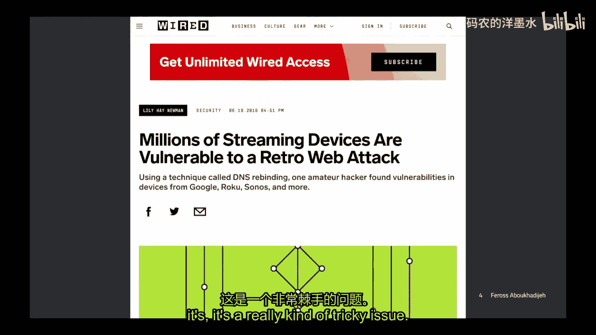

But yeah， so， so yeah， like I said， pretty much every Io T device is currently or was vulnerable to this。

 every local server， you know， either is or was vulnerable to this。

 when I say was basically when when you know， it's not too hard to fix。

 but if if you're not aware that this is even a thing。

 then you're probably vulnerable to it is is is the lesson here。😊，Yeah， so。

Heres some stats just from from some security researchers， just a get idea of the scope of this。

 you know，66% of printers are vulnerable to it。75% of I P cameras。 So there's are like， you know。

 Internet connected cameras。 you know， that like you like see your house when you're on the go from your mobile phone or whatever。

😊，77% of of phones，57% of smart TVs，87% of switches， routers and access points。

 this is a really bad one， because I mean， if you， if your routers vulnerable to this。

 it means that an attacker can know， basically get onto the router and change the settings of your router。

 they can maybe set up a proxy intercept all the traffic going through your router。

 So it's really bad。 and routers have some of the buggiestt and crappiiest software on them for whatever reason。

 And so， yeah， theyre the highest number that that were vulnerable this。

 And then78% of streaming media players in smart speakers by Apple， Google， Rokuus and Sonos。

 So yeah。😊，Very stunning numbers here。Yeah， so this， this is one one such device。

 I just picked a random device。 But this one was pointed out by there was actually a recent。

 like I think it was a year ago。 Some just sort of was like， hey。

 everybody remember DN S rebinding that thing that we was discovered like 10 years ago。

 I'm gonna go and look at all the devices that are on the market today that do their I T devices and see you know。

 which ones of them now are vulnerable to this。 And this， this thermostat was， was。

 was one of the ones that was vulnerable。😊，And so basically。

 what what could happen is you could be browsing the web in your web browser and you know。

 you go to an attacker website or an attacker， you know， buys an ad， the ad loads in your browser。

 It's a very easy thing to do， right， And that code。

 the Javavaso code makes a request to your thermostat。

 which has a server in it and is listening on your local network。 So it。

's it's just like your laptop is connected to the network。

 the thermostat is connected to the network。 And so this ad makes a request to the thermostat using the thermostats I P address and。

😊，This request is completely unauthenticated， and it was literally just a get request。

 So you could send send a get request and change the temperature。

 and it went up to like 95 degrees so you could sort of。

Change the temperature in the person's house up to 95 degrees， which， you know， you know。

 maybe not not such， such a bad thing。 But there's， there's some， you know。

 things I hadn't thought about like the， the so the person who discovered this was writing about you know。

 potential things that you could do with this， You know。

 it could be dangerous or deadly in the summer months you know， in， in， in certain climates and。

 you know， if you have an elderly or disabled occupant。 It could。

 you can imagine it being really deadly。 so。Also， yeah， if you， if you。

 if you're targeted while you're on vacation， then your。

 your bill will be really large when you come back and and， and so on and so forth。And of course。

 there's， it's also possible for a device to be like。You know， not。

 not just a request could not just， you know， be able to change the temperature of the thermostat。

 but perhaps it might actually， you know， run the code that you include in the request。 if。

 if the server is just that buggy， right。Yeah， so， so that's， that's not good。So if you remember。

 we talked about the， the way that Zoom， the Zoom server was。

 was vulnerable to basically websites could， could cause the Zoom program installed in your computer to join you into a Zoom call without any interaction。

And so we went through a sort of series of like， you know steps。 if you remember last time。

 and we got to a point where it seemed like we should be able to， by making a certain set of changes。

 make this Zoom server secure。 And then I told you the very end， like actually know DNS rebinding。

 But let's， let's review what we went through last time。

 And then we'll see sort of how to take the next step to make sure that it's secure against DNS rebining。

 But I just want to make sure everyone's on the same page because Thanksgivinggiving break was was a week long And you probably all forgot。

 So。😊，Yeah， so， so if you remember。We have， we have this server running locally on our。

 on our laptop because we install this， this Zoom video conferencing software on our computer， right。

 And it's listening for connections on that port right there，1，9，4，2，1。 And here's our browser。

 And we visit。😊，TheZoom server， we go to some URL and the， the server turns us a page。

 once the page is loaded， that page fires off a get request using the fetchch API to this URL。 And。

 and particular， in particular， it's， it's directed to the local server on our computer。

And the local server just responds by launching the Zoom app， and then it returns， a response here。

Back back to the page and then browser says， yeah， that's fine。

 can you can read that because this request was initiated by Zoom and this header here says that Zoom is allowed to read the response。

 So even though you know this is a cross domain request because it's a request from Zoom to a completely different origin。

 we're going to be able to read the response because of this header。Okay。Right， okay。

 so does this make sense， everybody should all be review。Okay， cool。

 So now we said obviously that the problem with this is an attacker can join you into a call。

 How does the attacker do that。 Well， the attacker sort of follows a similar similar set of steps as the legitimate case。

 So the attacker gets you to go to their page。 The page loads。 the fire off a request to the server。

 The server launches the zoom app。 the server， everything is exactly the same up until this point。

 the only difference is that this time because request was initiated by attacker com And this header is saying that only zoom US can read the response。

 The browser is not gonna let us read this result success Json response。

 But who cares we were able to launch the app we were able to join the user into into our chat room and and turn on their camera。

 So really bad So again， this is review。😊，Okay， so let's fix the issue。

 So I mentioned that probably the best solution be if Zoom didn't have a localized GDPP server at all。

 because there， there's a way to register what's called a protocol handler。

 and native apps can do this。 It's basically a way that a native app can say， hey。

 I'm gonna invent this new protocol called let's say Zoom call in slashlash。

 And anytime somebody goes to one of these URLs。 please launch the app。😊。

And so an application installed on your computer can ask the O S to do this。 it can say to your O S。

 this app is is capable of handling these types of URLs。 And so if they did that。

 then all they would need to do to sort of get this user experience where the user can click a link and end up in a call is they would just redirect you to this Zoom URL。

😊，And then your browser would say， hey， don't know what to do with this URL。

 browser only handles H TTP。 So the browser would say， hey。

 I can open up this app for you that this app says it can handle protocol。

 would you like me to open this app for you。 And if the user says yes， then they're in the app。

 So that's probably the safest straightforward way that they could have solve this。

 But let's assume that for some reason， this approach wasn't acceptable to them And let's say that you really want to do a local H TTP server。

 even though it's probably a bad idea how can you do this securely。😊，The reason why I say that。

 it's probably about it is because there's all these， these things you have to worry about。

There are some cases where it's legitimate。 There are some cases where you want to do this。So。

 I'll mention a few。In a bit， I actually， I think at the end， I mentioned a few few few cases。

 But yeah， so say say they wanted to keep the local local server。 So so one idea is they could。

 they could require user interaction before joining the user into a call。 So say， you know。

 say that they， they didn't， they didn't solve this problem here。

 They let the attacker caused this request to go through to the server。

 What if the app were to just pop up a little dialogue here and say， you know， hey。

 you're about to join a call。 Do you want to join a call。That's an acceptable solution。

 It's still a bit strange that this server is letting requests come in from random origins。

 but you know they would have solved this issue。So another idea is if we could find some way to ensure that only Zoom dot US。

 which is their， their origin， is is able to communicate with the local server。

 then then we don't have a problem anymore either。So last time we talked about how to do this。

I mentioned。This concept of simple H TDP requests and pref H TDP requests。 There' are two types。

So if you remember simple ones， the， you know， the easiest way to remember。

 there's like a bunch of things up here。 But the easiest sort of heuristics to keep in your mind of how to distinguish these two。

 Does anybody remember from last time I said there was like a really easy way to remember whether request is is simple or if it's a pre light。

Anyone remember。It's okay。 Thanksgiving was was a long time， so。Okay， I'll just tell you。 So。

 so basically any， any request that you could create with just H TM L。Is simple request。

So pretend you can't write jascript。 You're not allowed to write jascript。 You can just write H Tm L。

 And yeah， let's forget about CS S S for a second。 Just with H Tm L。

 What kinds of requests can you cause the browser to make。So obviously， you can cause get requests。

 right， You can include an image tag。And the browser is going to see that and make a get request to that URL。

 And so that's why you see get up here。嗯。Post is also possible with a form， right？

 So H an H Tl form when the the submit button is clicked will cause a post request to get sent。

 But when it does do post， the the form is actually only able to cause posts that have one of these three content types。

 And this is sort of configurable in the form and the Hl of the form。So if， if， if it's， if， if。Yeah。

 yeah。 So if， if， if the， the content type is not one of these three。

 then it's not a simple request because it wouldn't be possible to create such a request with pure pure H T L。

And lastly， obviously， with， with these types of requests。

 there's no jascript codes so we're not able to sort of configure the H T TP headers or。

 or like you know， add add custom H T TP headers to the request。

 there's just gonna be some default headers that the browser attaches to these requests。Okay。

 so this is what we call simple requests。And then。Prefed requests are basically anything that that that goes beyond that。

 So， So so say that， you know， we， we go ahead and write some javascript and we say， oh。

 we want to add this， this extra header to the request。 Well， then that's gonna be。

's gonna be a prefed request。Same thing with， if I wanted to say， for example。

 send a put or delete as my HP method。 These are not methods that are listed here in the simple case。

 So that's going to be a prefed request。Okay， so whenever we attempt to do a prefed request。

 the browser is going to check to see that it's safe to do that。

 because it doesn't know in advance that the server is expecting such requests to be able to to happen。

 and so。The way that it checks is it sends another type of request called Op to the server。

 And that's basically a request to be able to send another request later。 And in that options。

 the browser is going to include all the relevant information。

 like basically the details that make this request， not a simple request。Okay， so， so say， say。

 for example， the request is a put。It's not a post。 It's not a get。 It's a put。

So the browser will say in that request， hey， can I， am I allowed to do puts？And by the way。

 this is the origin that's asking。And depending on how the， how the server responds。

 this will either be allowed or denied， right。So， and then， and then， of course。

 we have to think about the case of what happens for all the servers that were on the Internet before this standard was created because this is a relatively recent standard。

 There's all these servers that were you know， written in the 90s that are still on the Internet。

 How are they gonna respond when somebody shows up and starts sending them options requests well。

If they don't support options， then they're gonna to respond with some response that presumably won't include the exact headers that we need to sort of tell the browser。

 hey， this is okay。 And so the browser will interpret anything that doesn't explicitly say， you know。

 this is allowed as this is not allowed。 And so it will， it will， it will you know。

 basically deny the default here is deny。So that's the idea of prefed requests。嗯。Yeah。

 I guess the other thing。 only last other thing I would add is just that this is。

 this kind of if this， if this seems arbitrary to you， it is kind of arbitrary。 Like this， this is。

 you know， the fact that we chose these methods and the fact that， you know this。

 this is really arbitrary。 This is like a lot of the things in the way in the Web and the way the Web is designed。

 It's sort of a very pragmatic decision。 The reason why these things were chosen is because basically for a。

 a long time。😊，People had to assume， basically from the beginning of the Web。

 people had to assume that a web page can send these kinds of requests， right。And then later on。

 when， when new types of things could be sent using jascript， we servers that had made assumptions。

Might be surprised。By the new types of requests that that can come to them， right。

 things that they thought couldn't， you know， couldn't be generated from page。 And so。

Rather than just letting those servers get owned， we， we sort of said， okay， you know， we， we should。

 we should introduce this new method。 we sort of ask for permission before going and doing doing this without。

 you know。Yeah， with we should ask permission before we。

 before we do this thing that the server might not be expecting is possible。Okay， so。

So so we we we went ahead and said， okay， so， so let's let's。

 let's solve the problem of our server getting these getting these random requests。

 If you remember here， it was a get that was causing the the app to launch。 And so what if we say。

 hey， let's make this not a simple request， because this currently is a simple request。

 that means any page can send these requests without a pref happening without that options request going out first to ask the server for permission。

 right？ And so maybe if we change the method。 So we say that we get rid of this get here。

 we we make this local server expect only put and it won't do anything if it gets a get。😊。

Maybe we can solve this problem。 And so last time we went through that。 And what we saw was， So yeah。

 the flow is all the same up here at the beginning。 We just， we get this page from， from the server。

 And then once the page， once the zoom dot US page is loaded， we， we call fetch。 But this time。

 we specify put as our method。😊，And and so now the browser is gonna say， hey， wait a minute。

 This is not a simple request。 This is a prefed request。

 So I need to check first with the server to see if it's okay。 And so how does it do that， Well。

 and I'm representing the browser know， the browser here is sort of this like middleman like not letting the request go through until it' it's asked this is the server if it's okay。

 So so it's gonna say， yeah， this is not， this is not same origin。

 And also this is not a simple request。 And so therefore， I need to check first。

 So the way that it checks is， it sends an options request。And it includes， in particular， the。

 the method it would like permission to， to use。 And it also tells the server， hey， by the way。

 this is jascript code that's running on Zoom dot US。

 So maybe that factors into the decision you know， that the server is gonna make。And so the server。

 you know， in this case， we would be very concerned with what the origin is here。

 And we would say if it's zoom， well go ahead and allow it。

 And so we we we we indicate that by responding with an empty response。

 But the important point is that we included this header here that tells。

 tells the browser that it's okay to do puts。And so then the browser says， okay。

 looks like it was looks like it'， it's fine。 And so now that request up here that was initially sort of held in limbo is now allowed to go through。

And then， and then now the the server， the server just goes ahead and sort of blindly launches the。

 the Zoom app because it knows it's relying on the fact that the browser wouldn't allow a put to go through unless this process had happened before。

 So we're leaning on the browser to do that。And then the rest is the same here。Okay。

 so does that make sense。So for， it's still pretty much our review。Yeah。That can get cached。 So yeah。

 that's a great question because you can imagine this adds like a ton of overhead every single request。

 So yeah， there's a way to indicate in the response how long to cache that for。

 then and then the browser will just like， yeah， we'll skip the options requests in the future。😊。

Cool， any other questions？Okay， so it seemed like we solved the problem here。

 right because I don't know if I have a slides。 Yeah， So yeah， have the slides here。

 So this is like if an attacker tries to now now attack our server， what's gonna happen is， well。

 you know， the code you that the attacker is running generates this， this put。

 And and then the browser， it's gonna notice， okay， this is a nonsimple request。 And also。

 the bigger problem is that it's yeah， it's not same origin。 It's not a simple request。

 So we we have to go ahead and pref it。 And so we we go ahead and send that that pref request。😊。

And this time， you'll see the origin is set to attacker。

 So the server is gonna say this is not zoom US。 So no， you're not allowed。

 and it'll send back you know， basically anything it sends back that doesn't include allow will be treated as as a deny。

 In this case， I'm just using the H T TP code 403 because that's actually a code that specifically means you are forbidden is just kind of like nice documentation to include that method。

 that response， but it doesn't actually matter。 And then the browser will deny the request。

 And so that request that was held in limbo won't actually be allowed to go through。

Does that make sense？Should， right， okay， cool。Great， so， so， so yeah， so， so basically。

 it seems like we solved the problem。 but but， but yeah， we'll see， we'll see why not。

 why it's actually not quite solved in a second。 But but first。

 we should also remember that theres still certain cases where the app can be launched by。😊，Others。

 by， but others， besides， besides the Zoom dot US server。 So one example is that。

A native app running on the same device can send a put request。

 and it doesn't have to follow all these rules that the browser is enforcing， right。

So we're relying on the browser to say， hey if there's jascript code running on attacker do com。

 don't let put don't let it send a put request unless you've done options first。

 But if you have an app just like running on your computer。

 like a Python script or something or another piece of software that you've installed。 You。

 we can go ahead and create H TTP requests to wherever at once。

 It doesn't have to follow these rules。 This is like the browser just has code to follow these rules。

 But but of course， a script that you write doesn't have to do this。

 a script that some code that's already running on your computer might not be following these same rules。

 And so it's just important to remember that yeah， we don't have this options process is totally enforced purely by the browser。

😊，Does that make sense。Okay， cool。 Yeah。 So let's see here。

 Anything else someone to mentioned pref request allowed the local server to prevent。😊，Yeah， yeah。

 exactly。 That's， that's the main point。 It just just keep in mind， you know， this is。

 is is a thing the browser is doing for us。Okay， so yeah， the DN S rebining attack so。So。

 so all all of the work we put in to make this local server secure。

 It still hasn't amounted anything because you can still。

 you can still send a request through from any origin on the Web。

 And the way that you do that is the is a DN S rebinding attack。 So the idea with this is you can。

 you can basically trick。😊，The browser into thinking that the request that's being sent doesn't need to be prefed。

So you can make it。 You can make the browser think that this request to the local server is actually a request to。

From the attacker to the attacker。The browser will see a request from attacker do com going to attacker do com And it's gonna say。

 hey， this is actually a same origin request。 So it doesn't matter how complicated。 you know。

 it doesn't matter if it's a put。 It doesn't matter if there's custom headers。

 It doesn't matter how customized the request is。 It can be any request because it's from the same origin to the same origin。

 So it's gonna be allowed by the browser。 And that's that's the key。

 Thats sort of why the attack works is a way to trick the browser to thinking that this request is not actually crossorin request。

Okay， so let's talk about like how， how it actually works。 So， well。

 I guess first some of the capabilities of it。 So it allows the attacker to basically bypass the cross origin rules。

And and also， another thing you can do with it is you can bypass the victim's firewall so you can basically use their browser as a proxy to communicate directly with vulnerable servers that are on the same network as them。

 So this is sort of beyond just attacking local servers on your computer。 You can actually use this。

 this approach to attack vulnerable I O T devices that are on the same network as you。😊，And。

One thing to keep in mind about how this works is that it's， it's， it's。

 it's so the same origin policy is actually not being violated here。 So this is， you know。

 remember the same origin policy we talked about it。 it's， it's， you know。

 one origin can only talk to the other origin。 and the origins are defined as protocol plus host name plus port。

 right？ And so this is actually being followed perfectly you know， exactly。

 the attack doesn't involve a violation of the same origin policy。

The the problem here is is that the same origin policy doesn't actually care about the I P address of the server in question。

 That's not part of what defines an origin。Right， so we'll get into exactly what this means in a second。

 But， but that's sort of that， that's something to keep in mind。 that's gonna be the。

 the crux of this attack。So let's see here。 Yeah， I have a demo of it。

 So we're gonna actually see it in action。 And hopefully， that makes it。😊。

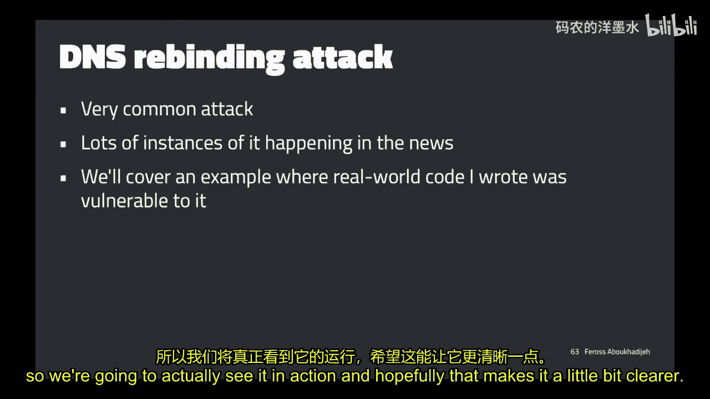

A little bit clearer。Okay， so。I have some code here。Can everybody see this？Okay， nice。Okay。

 so we have two servers and。I remember， if you remember from last time this server on the left here is this is this is the one from from before。

 So I remember I wrote sort of a vulnerable server where if you send it a request。

 then it will open up the dictionary on my computer。

 And we showed that any site that any site that wanted to could send a get request to this server and this server is running on port 8080。

 And so anybody can literally just make an image tag and point it to 8080 and then this will cause the dictionary to open。

 and we can actually just see that in action。 So the server is already running。

 So if I if I literally just visit if I go here and I refresh this page。

 you'll see that the dictionary is opened just like that。😊，And actually， I noticed。

 I noticed later when I was looking at this that they have this Wikipedia has this image here where they they claim that the popular culture image of a hacker operating in a darkened room is rarely accurate。

 I don't know if that's actually true。 It seems it's pretty accurate。 a lot of the time。 But anyway。

 okay， so， and then I also showed last time that if you go to a site like。😊。

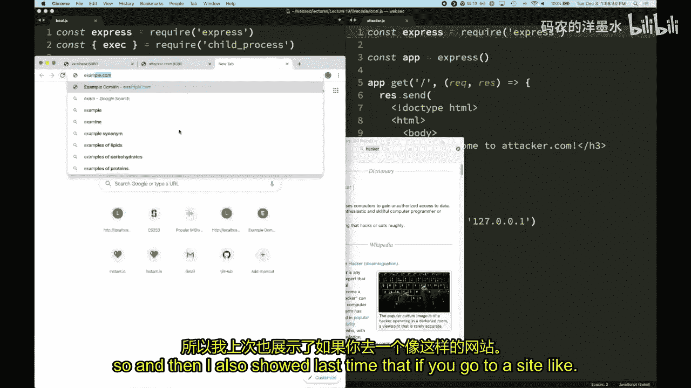

Example， and then you do something like， you know， you make an image that points to。Local host 8080。

 And you just like you know， create this image in the context of， of example Com。 You know。

 you can see there that that side is able to pop open the dictionary on my computer because， again。

 this server is just gonna accept get requests from from anywhere。

 And the browser is not gonna stop it because it's a simple request。Did everybody follow this？

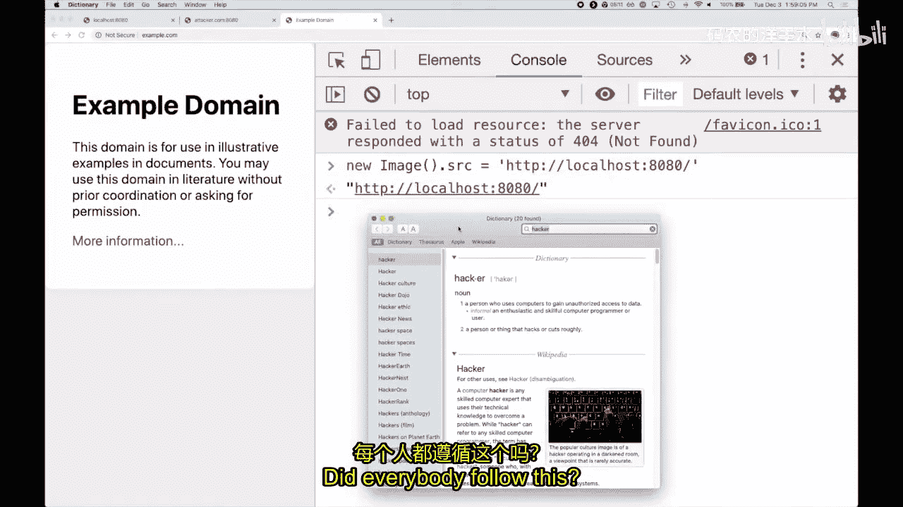

So this is a simple request。Okay， so what I wanted to show， I wanted to show a few things。 So。

 let's see here。 So， yeah， So yeah， we can actually just do that right here in line， so。😊。

So I have here is another server。 And this is gonna represent the the attacker's website。

 And what I want to show here is that the attacker can just write some code that's gonna trigger this。

 this server。 And I guess I kind of already showed it， but I'll just。

 I'll just write it here to be absolutely clear。 so I can basically add an image to this page and make it send a request to local hosts 80。

80。 And just like that。 if I visit that now here in my browser this， oh， sorry。

 what I actually should do is make this。😊。

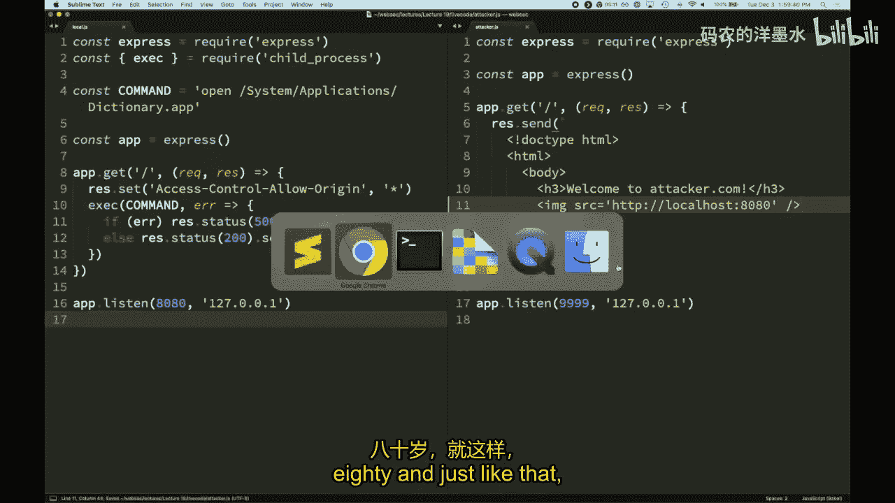

Attackcker。com 8080， that's what I meant。Yeah， okay， yeah。 So， so just like that， we actually have。

 have the， the same thing happening。And， you know， if I open up the inspector here。

 what we see is that。I'm on attacker dot com。 And when I， when I load this up。

 attacker dot com is actually making， wait， where's the request it's making。

It's supposed to be making a request to。The local server， but I don't see it here。Interesting。

How is the dictionary opening then。

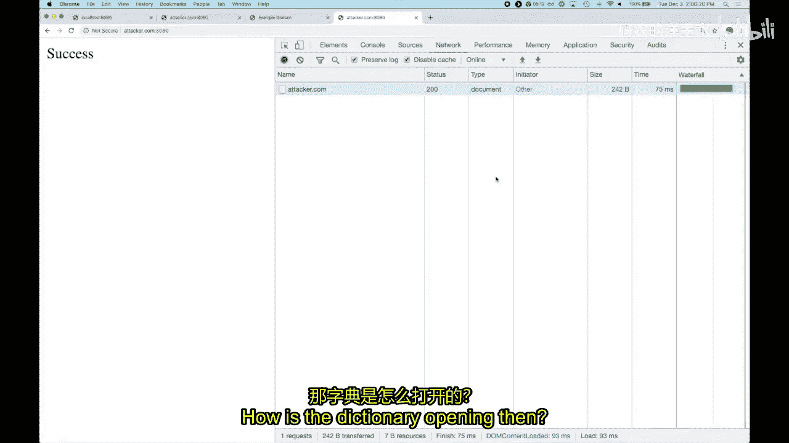

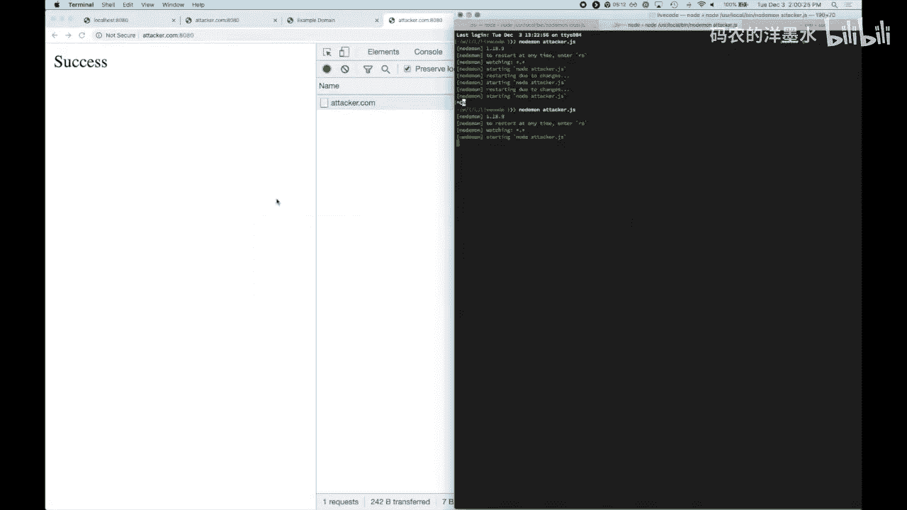

， if I refresh。好。

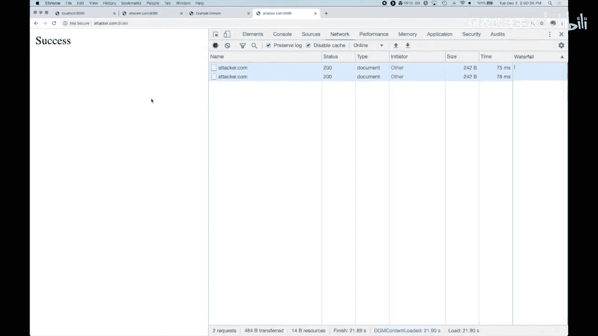

That's weird。嗯。😊。

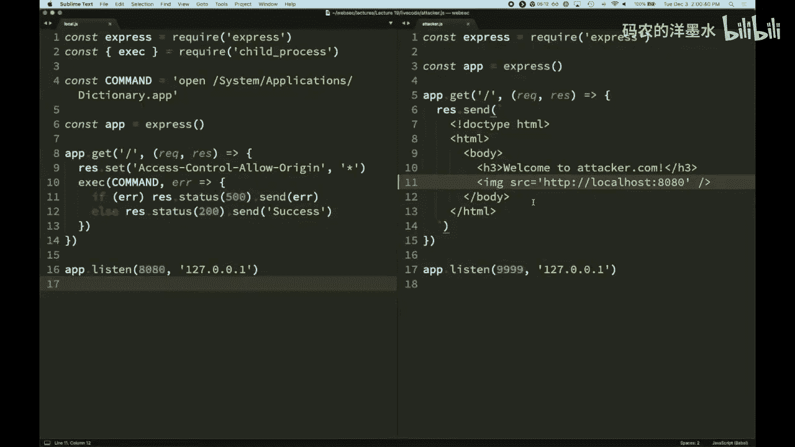

Oh， I'm visiting 80，80。 Sorry， I'm on the wrong port。 Yeah， thank you。😊，Yeah， okay， sorry。 Yeah。

 So's cause it's， it's it's an alias。 Okay， there we go。 That's what I wanted， okay。Gotcha， okay。

 so I'm on I'm on attacker dot com port 9，9，9。 And if you look at the H T L here， it's。

 it's literally just including an image that's pointing to this local server on my computer。

 And so when the browser makes that get request， It causes the， you know。

 you can see the request being made right here。 local host is's going to local host。

 and and you'll notice the response is， is like。😊，Some。

 some garbage that's actually not a valid image。 And that's why you see a broken image there。

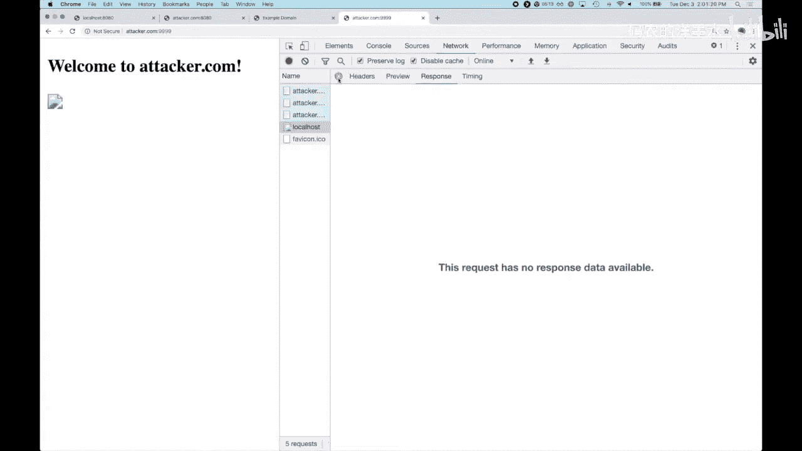

But the dictionary still opens。Okay， so what I want to show now is if I change this to。Use fetch。

 We can get a little bit more detail about。The request。So if I change this to。Fetch local host 8080。

 And then I get the response， and I turn it into text， and then I take the text， and I turn it into。

Let's see here。 I will take the text。 and what I want to do with it。 I will。Do you document dot。

 body dot。Inter H TM L。Plus， equals。呃。How about I just add the text to the page。

 This is extremely unsafe because this could contain H TM L。 and we'd have a cross8 scripting attack。

 But that's， that's another issue。 It's okay for now。 And then if there was an error。

 I'm gonna catch the error， and I will， I will add the error to the page in a similar。Fashion。

 so we can see what the error is。 And I think one of the thing I want to do here is。I want to。Had。

A line break just so that I can。See this a little bit easier。Like that， okay。Okay， alright。

 I think that's right。

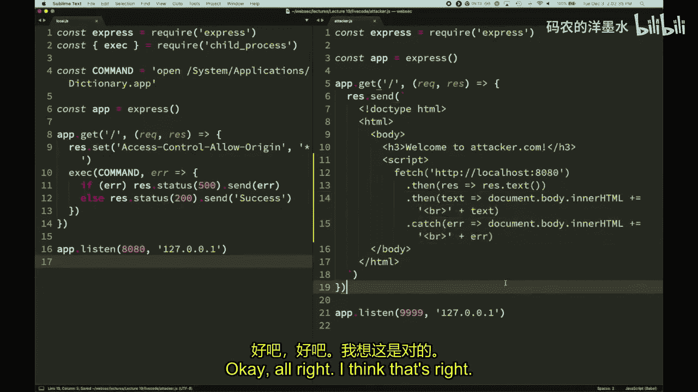

Okay， so now all I all I'm showing here is that， is that now if I refresh。With the inspector open。

 I should see what happens here。

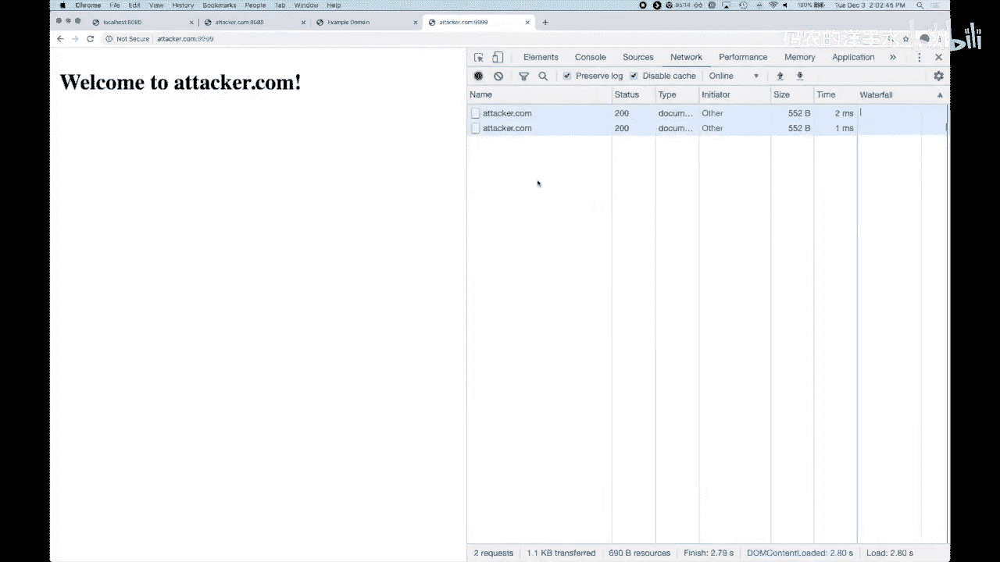

好。I didn't close the script to。 oh， thank you。 Thank you。

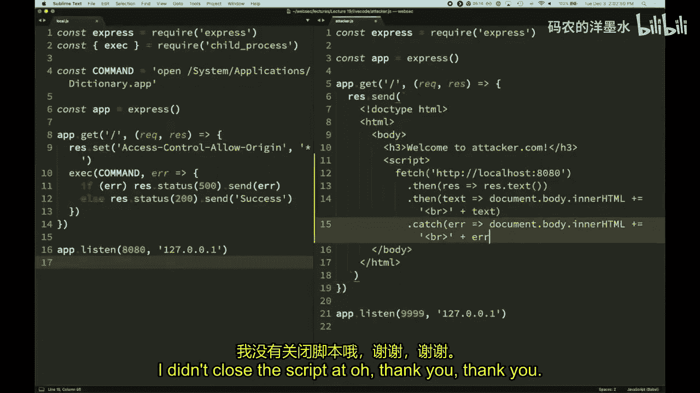

Thanks to those of you who are paying attention。Okay， yes， perfect。 Okay， great。 So yeah， So。

 so you can see what happened here is， again， it worked And and the main difference。

 the main difference here is that now the response that the server sent back， which is success。

 were able to take that and include it in the page。😊。

And the reason why we're able to do that is because on the request itself。

 when you look at the headers， you'll notice that the server， for whatever reason。

 this local server decided to send in the response。 Let's see， where is it。 No， no。

 It's like they click the local host one。 Yeah， this is the request I want。 Yes， so we， we， we。😊。

We tried to load local hosts， and。The， the response contains this header here。

 access control allow origin， which is set to star。

And what this means is that any page is allowed to read the response out。

 And so that's why I was able to， to take this， this text success。

 read it out of the response and include it in a page， even though I'm an attacker， right。😊，Okay。

 so we can fix that problem pretty easily。 If we just go here to our local server and we delete the access control La origin star header that we're setting。

 then you we can go ahead and and now prevent the attacker from reading the response out。

 So now if I refresh， we'll see is that again， the dictionary is still still opened。

 but you'll notice is that this time the response is sort of opaque。 The page can't see it。

 It's blocked here and you look at the headers and you'll notice that that header is not being set。

 And so as far as the JavaScript turning in the page is concerned。

 It's not allowed to see the contents of the request。

 And so it gets this error saying that it failed to fetch。

 But the truth is that the get request actually got sent to the server。 right， because the way。

 if you remember the way that this enforcement happens with this header is the request goes out。

 it comes back。😊。

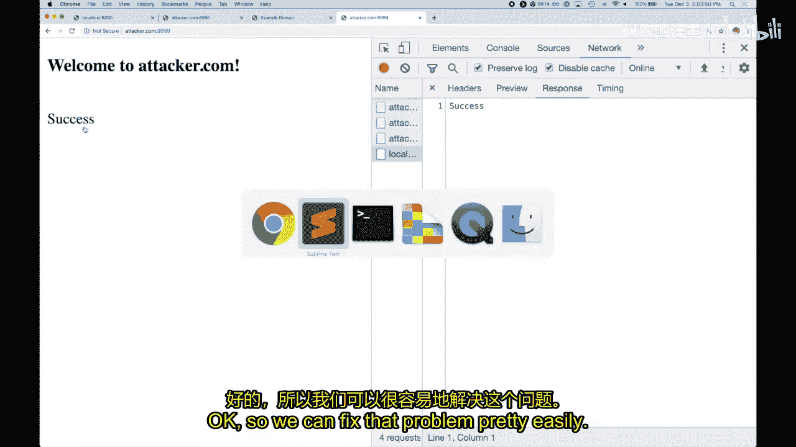

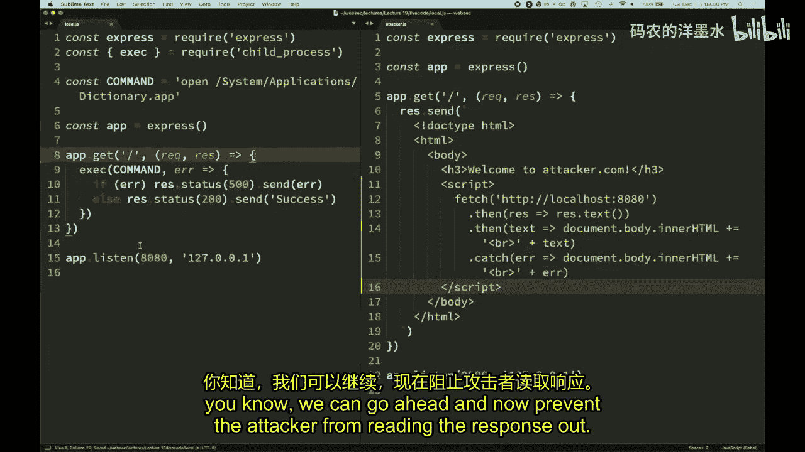

And then the browser looks at whether this page is allowed to read the response。Okay。

 so because this request is not a prefed request， the browser doesn't need to check first before it sends it。

 It just sends it。 It goes through。 the response comes back。

 and then it decides whether it's going to let this page see it or not。

That's distinct from a prefed request where it actually asks for permission before even makes the request。

 right， So just keep those two those two cases in mind。

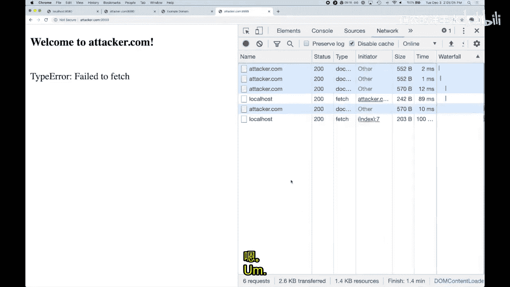

Does that make sense to everybody。Okay， cool。 and then。What I want to show now is。嗯。Let's see here。

Yeah， so had one of the thing I wanted to show， need to pull up。You know what， actually。

 I'll just pull it up here。嗯。Okay， I think that was actually it。 So for now。

 and I have another thing in a second。 So yeah， we showed basically basically we showed how to use the browser to make to make requests to local servers and reviews the browsers as a proxy。

 like this attacker code is running on our browser and it's talking to this local server。

 And we saw how we could remove the access control origin header。

 But that actually doesn't stop the attacker from sending the request。

 it just stops them from reading the response。 oh yeah。

 the last thing I wanted to show was what we actually talked about as our defense So we mentioned that we mentioned that a way that we thought we could we could change our server to prevent this is by changing changing it from a get request to a put request。

 So if you see here this one word get here。 I'm gonna swap it out with put。

 And And then you know now the attacker has to send a put request。

 And so if they try to do that by adding a little option here method put。So right here。

 everybody we see this。 I just add a little extra parameter to the fetch call。

 And now it's gonna attempt to make the method a put。 And so now know， the attacker， like， okay。

 I guess this is gonna work， right， But when you we refresh， we see that this time it。

 it still says failed to fetch。 but it's， it's even worse than before。

 before we couldn't read the actual response。 But here the response didn't even happen。 sorry。

 the request never even happened。 And if we look at the network tab， we can actually see this。

 So this is the request that actually got sent to local host。 But you'll notice it's not a put。

 what it actually is is an options。😊。

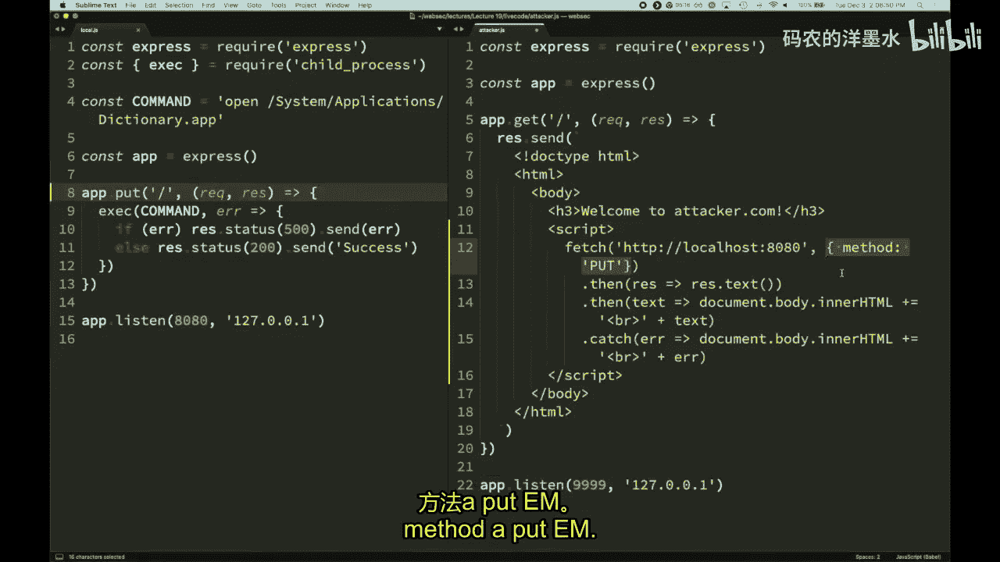

Because put is a prefed request。 So the browser didn't actually send put。

And it actually sent options first， task for permission。And one thing that's kind of weird。

 You might notice is the server is actually saying puts fine。

 which doesn't seem to actually match with what the behavior we saw because we saw that didn't actually send the put。

 so。What what what I think is happening here is that express， for whatever reason。

 just defaults to allowing all methods。 But it's okay。

 It's still getting denied in this situation because。The。

 the response doesn't include a line that's explicitly allowing this origin。So。Basically。

 the attacker。 what's going on here is this is a cross origin request from attacker do com to local host。

 And the response didn't say that that's okay。 And so what ends up happening。

 if you look at the console is you get the error thats saying access to fetch to fetch at local host from origin attacker dot com has been blocked by course policy response to pref request doesn't pass access control check。

 There was no access control All allowed origin header。 So this origins not allowed。

Because that header was missing。And so， you know， even though the server said， hey， put are fine。

 the browsers still not happy because the server didn't say that this request can go through from this origin。

 And so anyway， the point is we were able to basically defend our local server by saying we want we're gonna require this request to be a put in order to actually treat it。

 you know， treat it as a， as a real request and actually open up the dictionary。

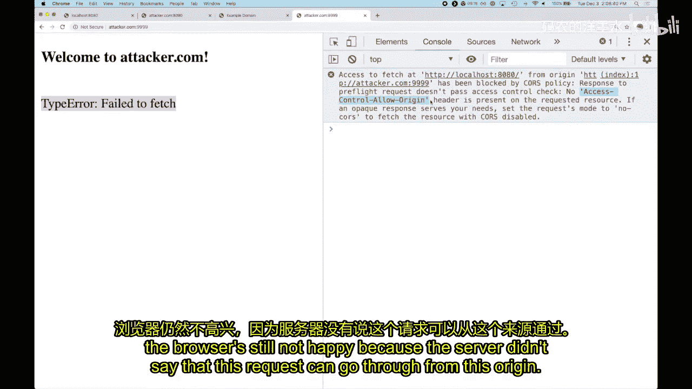

So it， we seems like， it seems like we've prevented the attacker from being able to open up the dictionary at this point。

With this simple change。I was a lot to digest。 I know。 Any questions。Yeah。

The error so that you can add something to the request to get around though。

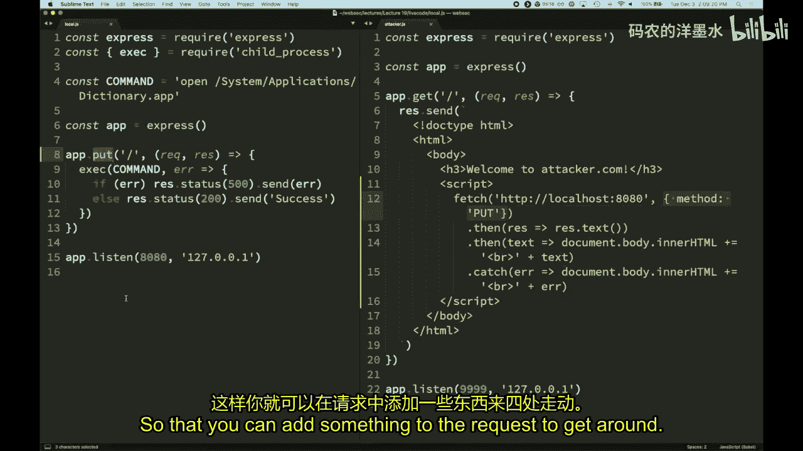

Oh， it's， it's actually wrong。 This error message is wrong。

It's saying set the request mode to no cores， blah， blah， blah，Yeah， that's。

 that's a complicated feature of the fetch API。 And this， this error message is actually incorrect。

 That often is a useful thing to know。 But in this situation， it doesn't help you。 Yeah， you。

The idea behind no courses， I'll just quickly say is its it's a way to sort of remember I mentioned you can can simple requests are fine。

 You can send simple requests to any any place you want。

 And generally the way you do this is you put an image tag in the page or something like that。 Well。

 for a long time， there was no way from jascript to actually create a simple request because the assumption。

 if you're making this request in jascript， It's probably using some additional features that you couldn't use from H TM L。

 And so those were just always blocked by default。 This is a way where you can say sort say no actually I'm gonna I'm I promise you browser that this is actually gonna be a real simple request。

 even though I'm creating it in jascript。 I'm not gonna use any features that I'm not allowed to use But that doesn't help us here because we're doing a put And by definition of put is not a simple request。

 So that wouldn't help us。😊，Yeah， so what's the。Response。Options request。would allow。

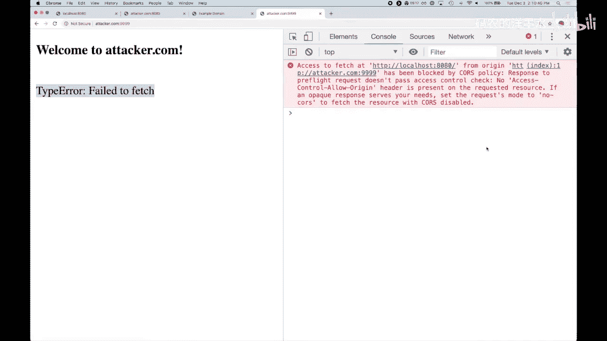

Yeah， great question。 So if we just send this header right here。

 along with the allow that this server is already sending。 So if we did， if we did res dot set。

That header to attacker dot com。9，9，9，9 like that。 So that， combined with the。

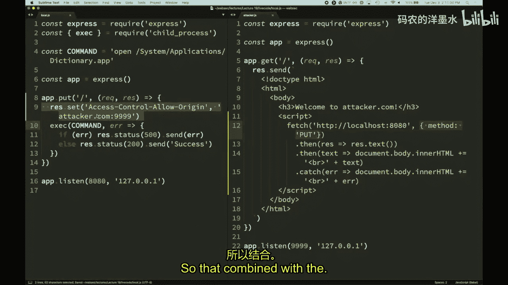

The other header that the express is already sending should make it work。 So if I refresh。

 we'll see if it works。

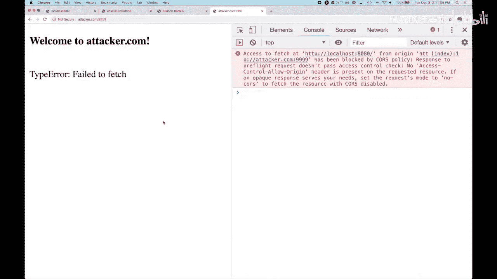

嗯。

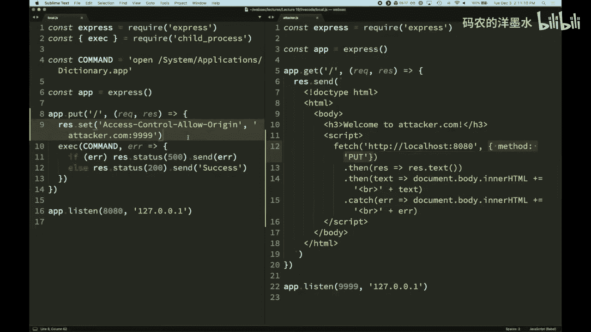

You'll see what what actually got set。It's not being sent。Oh， yeah。

 The problem is we have to actually support options。 We don't even support。 We have to do this。

 We have to add a completely new handler to say we want to handle options requests， right， And。

 and then in there， we need to， we need to say， okay。

 we want to allow that origin and we w to allow puts。

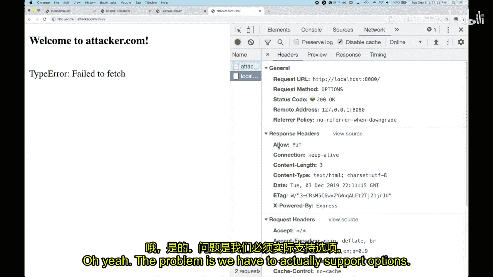

Like this。And then I actually haven't tested this， but presumably this， this would work。 Let's see。

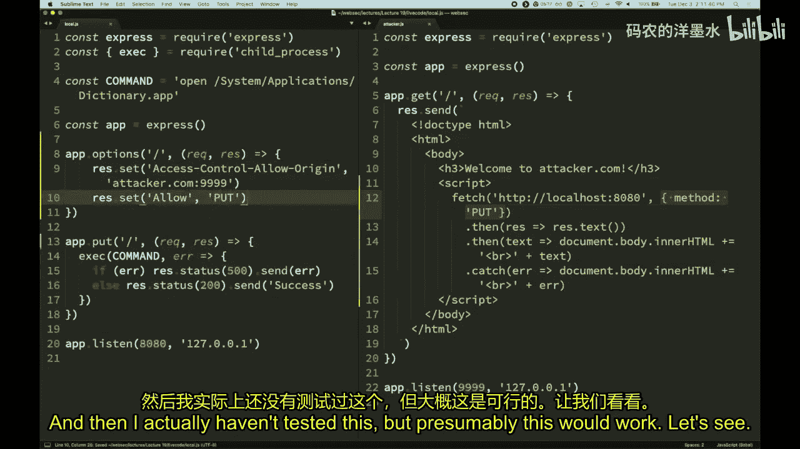

H now。😔，What happened。What kind of request is this？

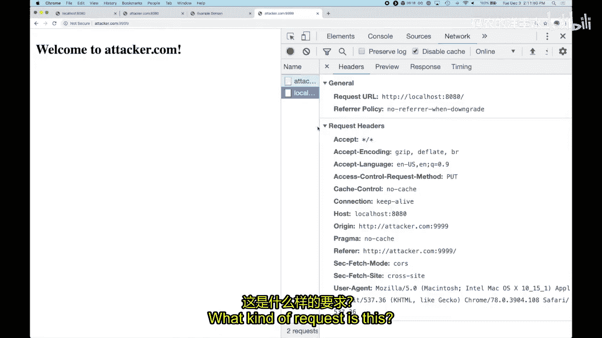

Does doesn't even see a method。嗯。

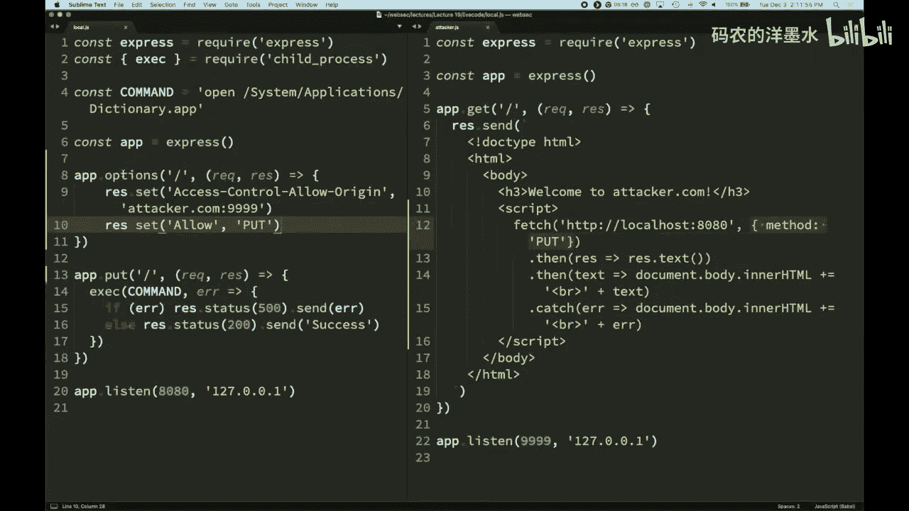

Maybe I shouldn't do this live。

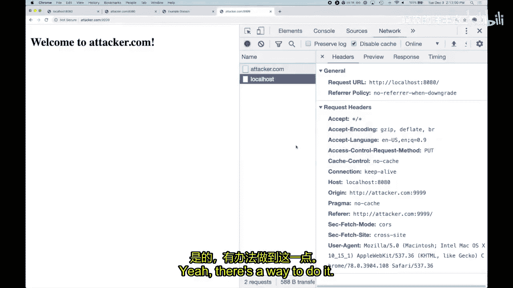

Yeah， there is a way to do it。 I'm not sure off the top of my head what they Oh。

 I didn't actually send back a response。 We need to do Res dot， send。

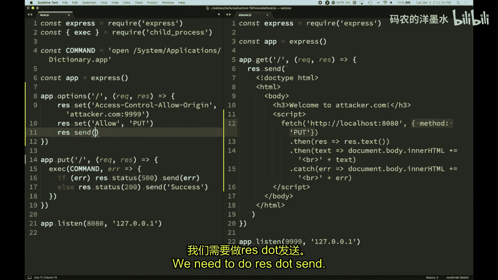

Okay， something like that。So now we said put， and we said， allow attacker。

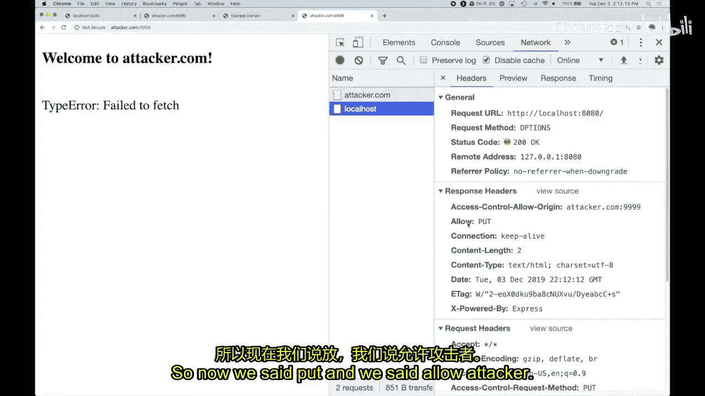

Oh， and sorry， that's not actually an origin。 I need to add protocol to it for it to actually be an origin。

 Okay， this should work。

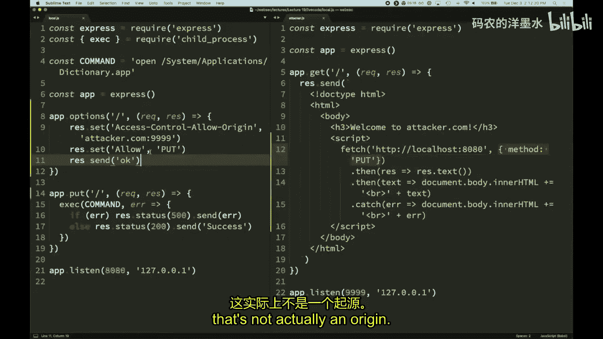

No， it's not working。What's the problem？Oh， see， access to fetch host from origin。

 some blockly cores method put his on allowed。By access control allow methods。

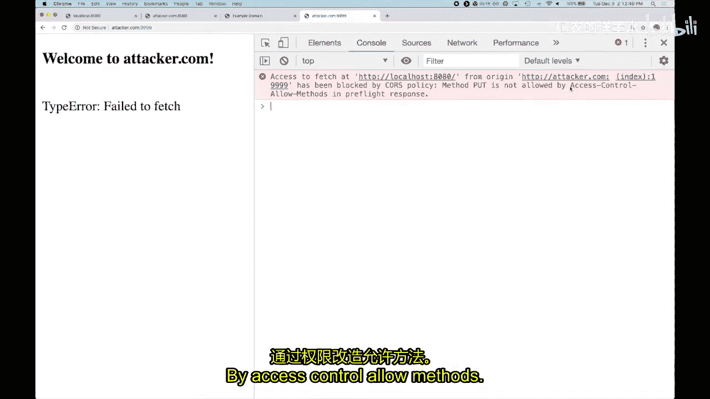

Oh。Oh， okay， I don't know what this allow is。 then。 Okay， let's switch it to that。

 And then there we go。 Okay， alright， so that's some live debugging for there。 But yeah， so。

 so basically， if I do that again and we look the the actual headers that are going on here are。

 So options gets sent to the server。 The server says put is allowed and attacker dot com 9，9。

9 is allowed to go ahead and do this put。 And then the browser follows up with an actual put right here。

 And then。😊。

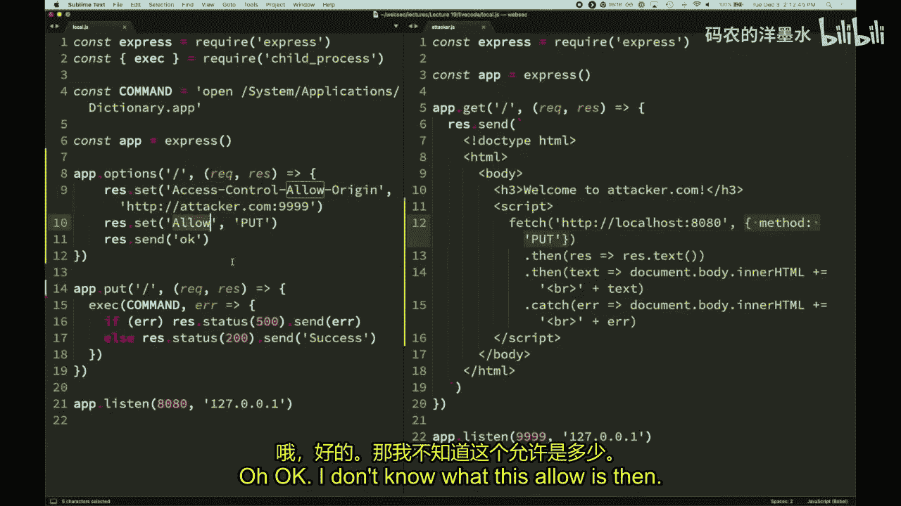

The dictionaries opened。Okay。こう。Alright， so， but again， this is still vulnerable to DN S rebinding。

 And we'll talk about that in a second， but。

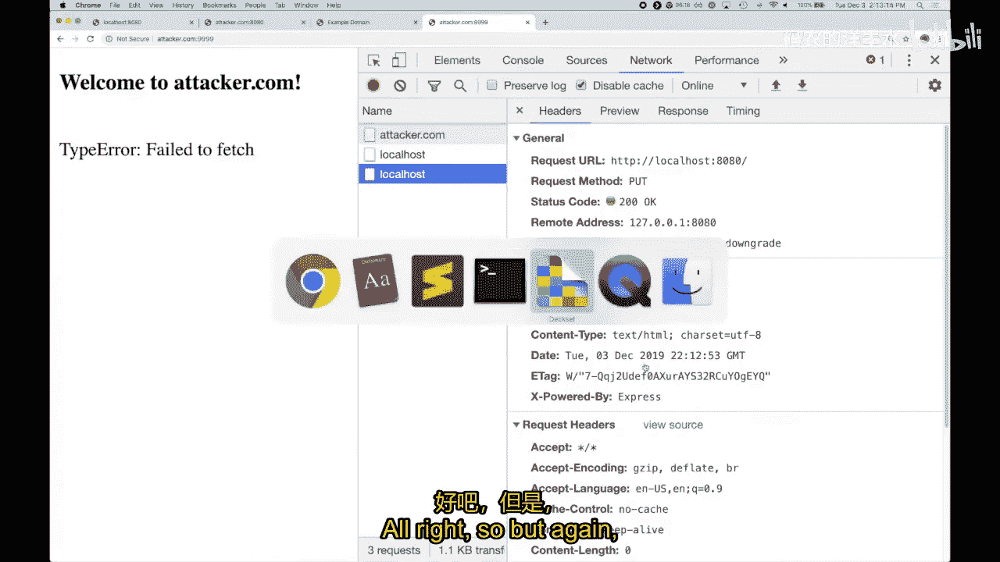

The first I wanted to mention。呃。Where is it？Yeah， so firewalls。So。Firewalls， enterprise firewalls。

 very common。 Your house has has effectively has a firewall in， you know。

 when you have a router in your house， that's acting sort of as a firewall。

 your O S has a firewall in it。 And So let's talk just a little bit about those to understand like what additional power this。

 this type of attack gives us to get around firewalls。 So normally。Without any firewalls in place。

 you know， your your browser and the Internet are sort of like， like free。

 freely communicate with each other。 So you can make connections to the Internet and the Internet can make connections to any servers running on your computer。

 So if you're listening for connections and some other computer on the Internet wants to connect to that server。

 then that's gonna be allowed。😊，So we introduced firewall because the idea is this firewall can help us do the right thing in more situations。

 It can help protect us in cases where the local server on our computer is insecure just outright blocking requests from even coming in。

 And so in the normal case when your browser connects to the Internet。 The firewall sees， oh。

 this is a request coming from a browser on the network。

 And so because it's initiated from inside the network， the firewall says， yeah。

 let's go ahead and allow it。 is just the user probably visiting a website or doing something totally normal。

 But the reverse is not allowed by default。 So if if some random computer on the Internet wants to connect to your I address and know they know the port of a server running on a computer。

 the firewall is gonna see that and say wait a minute。

 like this is this is not okay and it's gonna block it。

 particularly because it's an unsolicited communication。

 there was no indication you were expecting this connection。 And so it's just gonna block it。😊。

So this is really great because there's all kinds of devices on your network that are very。

 very insecure。 The I I O T devices that I mentioned earlier。😊。

There's all kinds of things now that have like computers inside them。

 like refrigerators and Tvs and printers and， and， and， and you know， Internet connected webcams。

 And a lot of this software was written with an assumption that。You know。

 other devices on the same network may want to communicate with that device。 in particular。

 think of like a Chromecast right or an Apple TV that's on your network。

 It's very common that you know， it's expected that other devices that are on the same Wifi network would be able to make connections to that Apple TV directly。

 but。A lot of these devices assume that the devices。

 the other devices that are allowed on your Wifi are devices that you yourself own or devices that you trust。

 or else you wouldn't allow them onto your Wifi， right。

And so the fact that random computers on the Internet aren't allowed to make connections to these devices is really。

 really good because oftentimes， the devices just assume that anyone who can make connections to them is trusted。

Which is definitely not true， right， if， if you're getting a connection from the random， you know。

 the the public Internet， from a random person。And so this is really great that the firewall does this for us。

 And so like this would be really bad if anyone on the Internet could send packets to your printer。

 you know， bad things would happen。 they'd be able to create print jobs if there were any vulnerabilities in the printer。

 in a server that's listening in the printer。 the attacker would be able to try to attempt to exploit those know maybe there's some kind of an injection。

 command injection or something on the printer and an attacker would be able to attempt to exploit that。

 the other thing that makes this really pernicious is that these devices often never get updates。

 these I devices are like sort fixed that factory time when they're produced。

 And then people rarely if ever apply updates to their printers or to their refrigerators or I recently saw a tweet from somebody who literally got a new toilet。

 And the first thing it told them was they needed to apply firmware update to it before they could use it。

 And but yeah， like at least at least it notified then that the toilet needed an update。

 a lot of these devices don't tell you that there's updates available and there's no way to know。

 And so。😊，You know， you'll just have a vulnerable device on your network for a really long time。

 But yeah， isn't it a wonderful world world that we live in now with all these Internet connected devices everywhere。

 but。😊，Yeah， so， yeah， anyway。 So， so yeah if anyone could just send packets to your printer to any of the devices in your network。

 you know， they' probably be very quickly owned And， then， and then from there， you know。

 once you own a printer， like you know， it's not that useful to be able to print pages out on some random person's printer。

 But you can， you can use that as sort of a point from which to pivot and to traverse horizontally through someone's network because now basically your attack code is running as a device that's on the network。

 And it can can communicate with all the other devices。

 And so you can sort infect a bunch of devices that way。😊，And so， so yeah。

 the fact that we have everything going through this this firewall， either in our， in our router or。

 or or you know， our enterprise firewall or something like that is really good。😊。

And I mentioned that your O S has a firewall built into it。 And if you。

 if you've ever seen any of these before， that's the Mac O firewall settings。

 And this is like an alert that pops up frequently on Windows。 This is sort of the O S firewall ina。

And I， I'll mention a little bit more about how， how those work later。 But， but yeah， so basically。

 so what do we mean when we say we can use the browser as a proxy。 What is going on here？ Well。

 what's going on is that if。

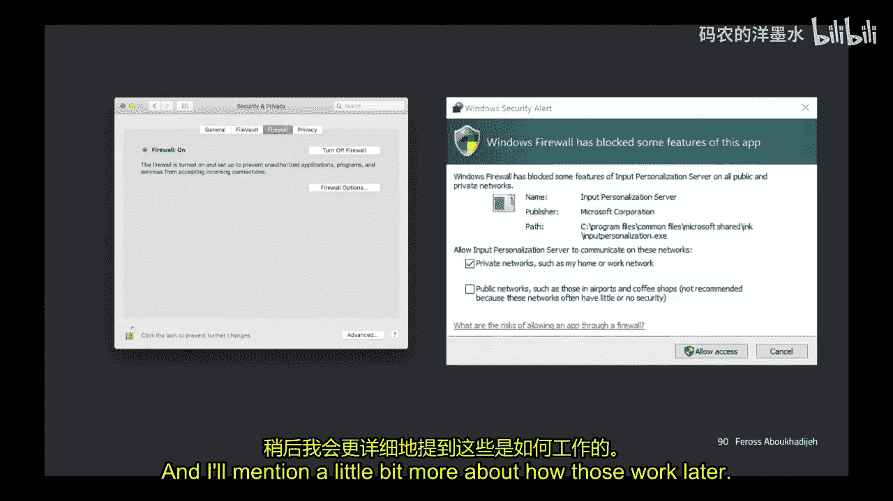

If you have a farwell place and the Internet， people on the Internet can't talk to any of your devices。

 there's still a way that they can get， they can talk to the devices。

 And that's by using your browser as a proxy。 So what they do is。You go and visit a website， right。

 You， So you make a request。 The firewall sees that you made a request to some website。

 And then that site responds。 and the firewall allows that responds through because it knows that that's the response to the request that you sent。

 And obviously， you would be really upset if you couldn't view the website you just visited。

 So that's allowed the website loads in your browser。

And then jascript running in that attacker's website makes a request to a local I P address， like 1。

9，2 do1，68 do1 dot 100， which is a local I P， which is the I P address of your printer。 Let's say。

 And， and and of course。Again， like， like I said， the printer and all these Io T devices often assume that these types of requests can't be sent except by devices that are on the same network。

And so the fact that， like random jascript code running in an ad can make a request to your insecure I O T devices is quite concerning。

Now。We have a few things that can protect us here。 Hopefully， we。

 we already know the same margin policy applies。 So an attacker， you know。

 they can't send a non simple request to your printer， hopefully， right。And。

And so they can only they have to， they have to suffice with get requests and you know。

 and posts with you know form posts， basically， but they would be allowed to send those to your printer。

 which is， which is， you know， still kind of concerning because I don't know how secure that code is。

 right But yeah， if if they can， if can， if they can send a request that manages to infect your printer。

 then you're back into the situation where you now have an infected device on your network that can that can you know。

 do who knows what， right if it's a camera。 It can。

 it can watch you and send video frames off to some attacker， know， if it's。

 if it's a toaster or something， it can launch a tax against。😊，enemy states or whatever。 Like。

 here's all kinds of stuff that these， these I T devices are doing。 It's seriously true。 yeah， so。

Okay， so， and then， of course， like this is not just about I T devices。

 It's also about local servers。 So the same thing applies to any local servers that are running on your computer。

 So if you are， again， you're browsing the internet， you make a request to a site。

 you get back a response。The code on that site can make requests to any local I addresses at once。

 And if it knows like， hey， this is your local I address。 or if it just uses local host。

 then you know， in some port， it can just guess like， oh。

 you're probably running your development server on port 4000 or whatever。

 or it can iterate through a bunch of ports。 Then it can make requests to these local servers on your computer。

And if they're vulnerable， then you have sort of the same， same issue as before。 And this is。

 this is basically the the Zoom attack。 This is just another way of representing the Zoom attack that we've already talked about。

Okay， so， so yeah， we did。 We， we tried to defend against this by， by， by。

 by making all the sort of sensitive functionality in our Zoom server。😊。

We tried to make it require a put request， and we were hoping that that would make it harder for。

 for a code running in an an attacker page to be able to actually send that request。

 because it requires a pre flight and all the things we just talked about。 And so we're thinking。

 okay， you know， now there's nothing that can can happen。 But， of course。

 now we're gonna talk about how to actually do DN S rebinding because this， this is still。

 we haven't fixed DNS rebinding yet。 so。

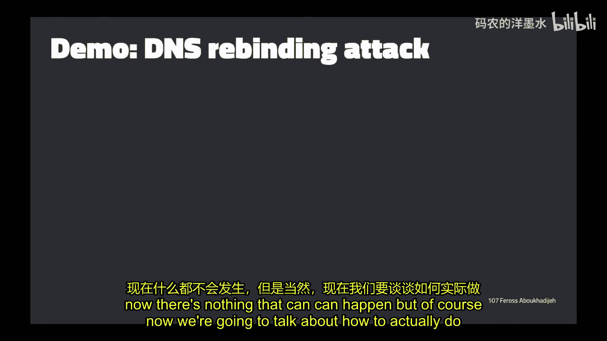

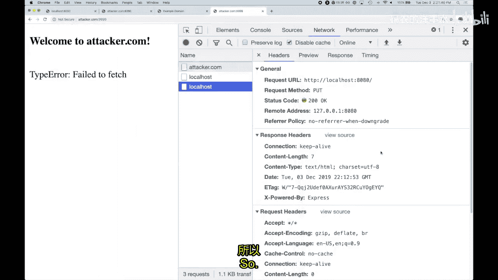

Let's go ahead and look at the code again。And let's see here。

 So what I want to do is I'm gonna change up。I'm going change up the code in this page a little bit。

 And so instead of。Immediate calling fetchch， what I'm going do is I'm gonna make a button on the page。

And I'm gonna， I call it。 I'm gonna make the text in it say， send a put to。

AndSo this is the attacker。 The attacker site is going to have a button that says send a put to。

 And you would think I would want to send the put to the local server， local host。 But actually。

 the way this attack works is I send the request to attacker dot com。And instead of 9，9，9。

 I'm going to make it 80，80， which is the same port as the local server。Okay， so。H。

 hang with me for a little bit。 This will all make sense in a second。

 So that's what this button is gonna do。 So now I'm gonna do is I'm gonna have code that doesn't run this until I click the button。

 So I'm gonna say document do。Query selector。I'm gonna select the button， and I'm gonna to say。

Button， and I'm gonna say when the button is clicked。 So add。

And me make this bigger for you so you can see it。 sorry about this。 Okay， add event listener。

What I'm gonna do when the button is clicked is I'm gonna run this fetch code like I was gonna do before。

 But the only difference now is， instead of making the request go to local host 8080。

 it's gonna go to attacker dot com，8080。With a put。Okay， so， you know。

 this doesn't seem like we're attacking the local server anymore。

 We're just sending a put to ourselves as the attacker， which isn't gonna do anything。

 It's not gonna pop open the dictionary， right？ But we'll see there's one more step we need to do here to make to actually pull this off。

 And so。Oh， first step 2， I should probably onm a local server。

 I should delete the the the extra option stuff we added from before。

 So we go back to to our supposedly secure state before。And， and so now， let me see what happens。

 So if I load up， let's see here， what I want to do is。

I'm going to move this code quickly to an actual remote server。Where is that？Did I do that。

 they don do that。 Oh， you're right。 Thank you for that。Yep， add event listener， click。

 that's the what code I want to run。 Okay， now what I'm gonna to do is。

I'm actually going put this on a real Internet server because I can't have two servers running on the same port。

 And so I actually need I need this to be on another another an actual separate computer。 And again。

 the port should be 80，80 there， okay。Alright， so now if I save this。And I run the server。Okay。

 so now I have this code is running on a real server。 And then what I've done here in。

My Etsy hosts file。 This is a way where I can sort of override my my DNS settings。 So normally。

 when you connect to a site， the first thing the browser does is it says。

 what is the I P address for this host name And it asks the DN server and gets back an I P address。

 And what I want to do here is。😊，I want to， I'm not gonna go and buy a domain for this demo。

 So what I've done is I've， I've just told， I've hard coded here that I want any time before the the browser actually does the true DN S request。

 It's gonna look in this file。 And this file is gonna take precedence over the true。

 the true DN S response。 And so what I've said is I want attacker dot com to map to the I P address of that server that I just put the code onto。

 Okay， so this is simulating。This is basically simulating what would happen if an attacker just bought a domain。

Pointed the domain， you know， made a DNS entry to point the domain to their to their server。

 This is like very standard the way that you deploy a website， Nothing magical going on here。

 All I'm doing is I didn't want to actually buy a domain。 So I'm， I'm locally hard codinging that in。

Does that make sense。Okay， so now when I go to attacker dot com  8080。

 that request is going actually go to this server。And that code that we wrote here should actually run。

 and。Let's see what happens。 Okay， so I'm going refresh this。

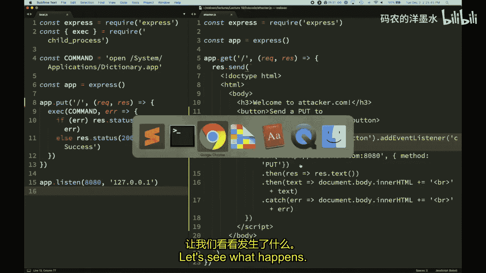

Oh yeah， and， here's how you can tell that it works Before I refresh。

 Not when I visited attacker dot com 9，9，9 before that it says the remote address that it actually sent the request to was my own computer。

 Now， when I refresh， it's gonna actually be。😊，Nothing， okay， great。 Oh no。

 I need to change it to 80，80， right。Okay， now it still doesn't work。

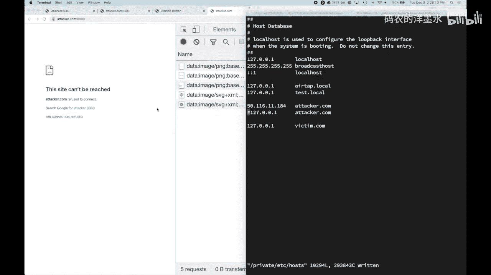

Oh， thank you。 I'm so glad you're here， John。😊，You keep， you keep catching all the mistakes， Okay。

 all right。Now I need to update the code on the server， Give me a second。This is actually。

 there's no， simpler way to demo this。 It's actually a very super complicated。

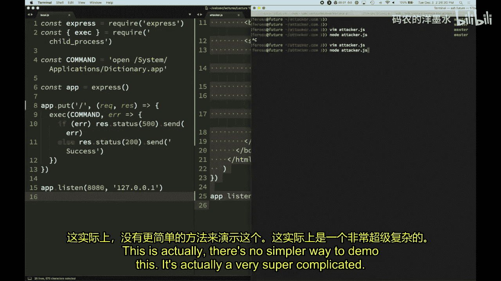

Attack to demo。 Sopologies in advance。 There we go。 Okay， so now I visited this attacker dot com 80。

80， and the code that we just wrote is running now。

 And you'll notice that it actually connected to a remote server to load this page， okay。😊，Great。

Okay， now， if I click this button， then， I mean， nothing is gonna nothing interesting is gonna happen。

 We just sent a put to ourselves。 And， you know， this is this， this is the server that we wrote。

 and this server is literally doesn't do anything in response to a put。 Like you can see here。

 all we've implemented is a get on the attacker end。 So this is useless， right， but。

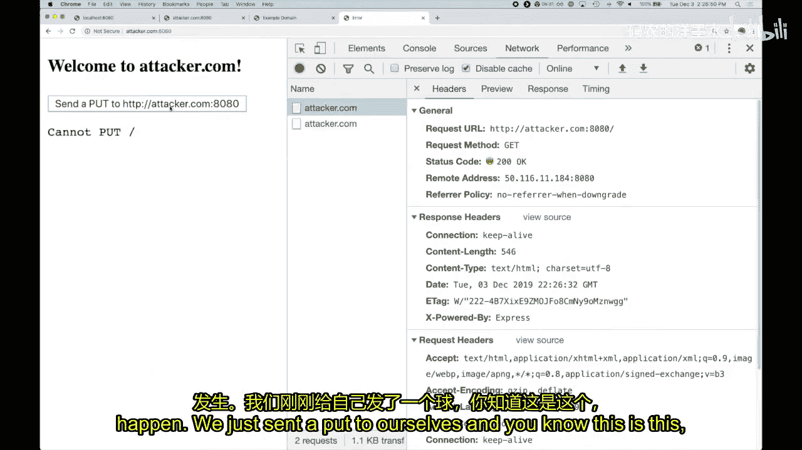

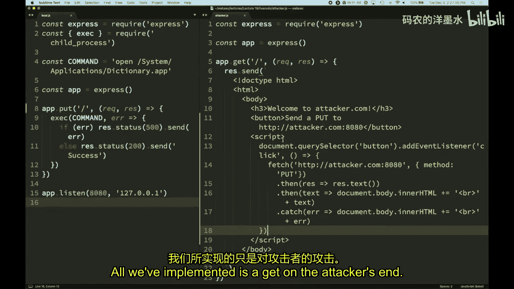

Here's where the， the cleverness comes in， Okay， so。What I'm gonna to do is I'm going to， I load。

 So this is the attacker sites loaded。 And what's going to happen now is when the attacker sees that we've landed on their attack page。

They're gonna have code in the background that goes and changes their DN S entry。

And instead of it pointing to the true like server where their code is running。

 they're going to point it to a local host I P address。Okay， so check this out。

 Here's how we're gonna simulate this。 I'm gonna go to the， the Etsy hostss file。

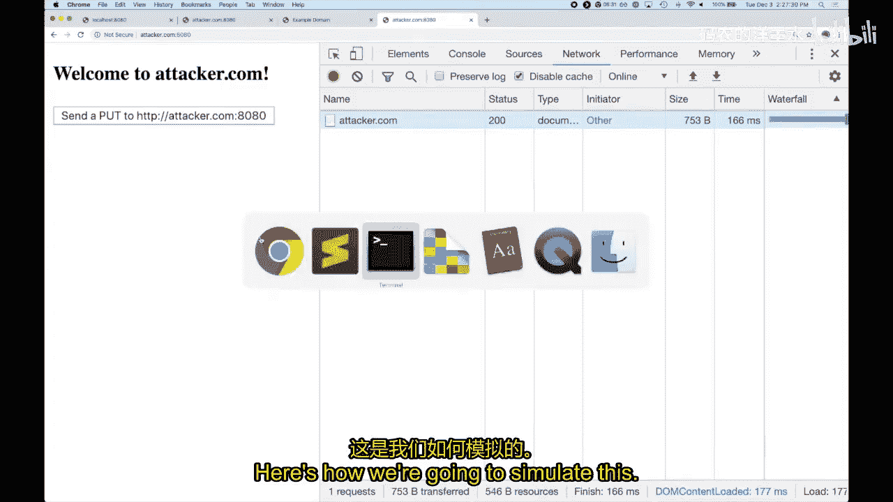

And I'm gonna to say， all right， instead of pointing to 50， you know， whatever 1，1，6。

 we're gonna comment that line out， and I'm going replace it with。That line。And so now。

 notice we're still on this page。 We're still on the attackers' page。

 but the attacker has has basically updated their DN S。Which is， you know。

 anyone who controls a domain can do this。 You know， you're basically just saying， you know。My。

 my server is no longer at that I。 It's actually at this I。

 But the weird thing is this is actually local host。

 This is not a real I that the attacker server is actually at。 but they're allowed to do this。

 They're allowed to say， they basically are telling the browser now， hey。

 whenever you make a requests to attacker dot com。 and you and you look up the DN S。

 I'm gonna give you local host。 And then you're actually gonna connect to a local host。

 when you send that HP request。 And so this actually， this request， I was gonna go to。😊。

The local server that opens the dictionary on our computer。

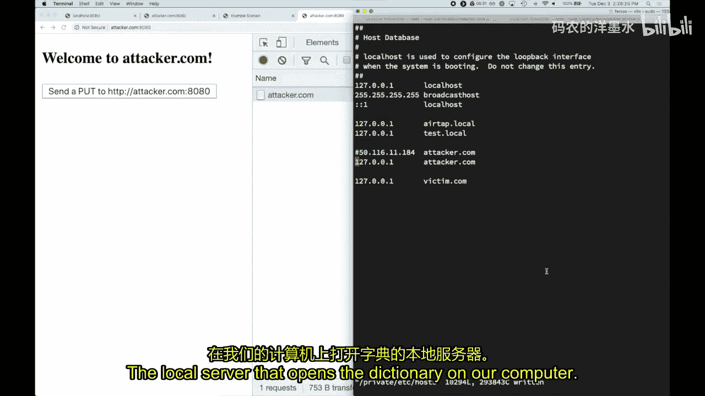

And so now when I click this button。The dictionary opens again。And so。Oh my gosh， like。

 even though we made it a put， the attacker was still able to。Send a put。

 and they sent this across origins。 like they actually seems like they broke。

 It seems like they violated the same origin policy because they literally sent this。

 This is code running on attacker dot com。 They sent jascript to us。

 And then it made a request to a server on our computer， which is a completely different origin。

 right。But。That's actually not true， so。What's going on here is。From the browser's perspective。

We are on attacker do com，80，80。And we just made a request to， you know。

 HDP at attackcker dot com 80，80。So that's the same origin request。It's allowed， right， You can。

 we can send whatever kind of request we want to ourselves。

 as far as the same origin policy is concerned， this is a same origin request。

 because the three parts that make up an origin are exactly the same in the request as they are on the page that we're on。

 And so this is a same origin request。 It's totally fine。 But the key， the key， I guess problem here。

 if I could point it out is you'll notice that the the put that we sent that went to the local server。

 It's connecting to 1，2，7 do do do 1。 And then but the initial page was loaded from a completely different server。

51，1，6，1，1，1，8，4。😊，And that sort of DN S change happened in the background。

 And the same origin policy has no conception of I P address。 It doesn't care。

 It doesn't care about the I P address。 That's like not part of the same origin policy。

 It's not relevant。In determining。Whether two things are the same origin or not。So呀。

That's the answer binding。 Any questions， yeah。attackcker。com able to know what。ここする。

Like an arbitrary。😔，Like if an arbitrary。Website visits such actually dot com。

 will they be able to pool。Because if they're connected to a different port。

 they won't be able to execute it。Yeah， so in way this would work in practice is attacker would probably have a particular device in mind that they want to attack。

 And that device would like have a particular port that it uses。

 And they would know to like make their server just to use that same port。

 but even if they didn't want to do that， they could also just try all the ports because there's not that many ports。

 There's only 65000 ports。 And you， if you have ever kept a tab open in your browser for a week like I have。

 you know， that tab could just be trying all the ports。

 that's plenty of time to try all the ports and find find the one that your application happens to be using because 65000 not a very big number for computer。

😊，Yeah， so when we change the like the routing in ET hosts。

 is that like actually how the industrybin is done or is that kind of just like a fill in for what like an attacker？

Would do is there is that actually No， that's a great question。

 That's a fill in for what the attacker would do。 So the way that you would experience this as a like person who's getting attacked is that you would just visit attacker dot com。

 And as soon as you visit that initial page， the attacker knows that you just visited it。

 And so they're gonna go now and swap the DN S。 And they're gonna make it  point to 1，2，7 dot dot 1。

 which is local host。 And and then。😊，Also， they're not gonna have you click a button to own yourself。

 That's just gonna be like a thing that they just continually pull in the background。

 like every 10 seconds， they'll try sending a put to that to that address。

 And the reason why they need to try multiple times in the real world is because the browser may be caching the DNS response。

And so say it's cache for like a minute or something like that， then。

The first time they send that put， it's gonna be going to the to the attacker's actual server instead of the local server they're trying to attack。

 And so they have to actually just keep trying until they eventually until the the cache entry expires。

 But the good news is， good news for the attacker is that you can set that to be really short。

 You can say， basically， don't cache this for very long。 you can put it in the order of seconds And。

 and so you know， in practice the cache。😊，Isn't really an issue。But yeah。

 the way you would experience this as a person getting owned is you would just visit the site and you'd be on it for like 10 seconds。

 And then this request would get sent to the server on your computer or your vulnerable I O T device。

 And that's it。 You even。Even even experience anything。 It's sort of an invisible automatic attack。

 just happens。 So I guess like how， how does the attacker actually have access to change like the DNA binding on your device。

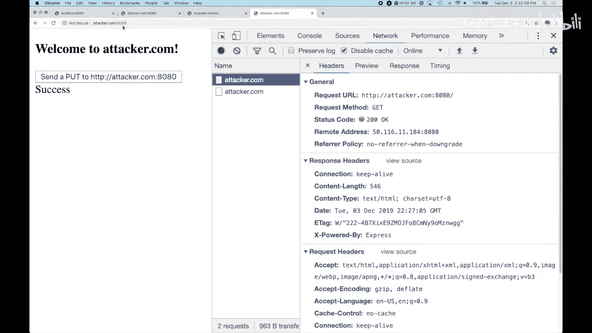

So that's a great question。 So they're not actually changing this DNS binding in this Etsy hostt file on your own computer。

 where is that happening Yeah， so so when when when the attacker registers their domain name。

 they actually specify they tell the company they register the domain with， this is the server。

 I want you to use whenever your whenever anybody asks， does a DNS lookup， basically。

 whenever a DN query comes in。 And so they basically point it to some DN server that they have control over as an attacker。

 And so because they have control over it， they can just change the I that gets returned in the answers any time they want。

 They can literally they can change on the order every second。

 like they can just keep swapping back and forth between the attack I and then the local host I and just do that as much as they need to。

😊，Yeah。The only sort of unpredictable part of this is like they don't。

 They don't know for sure how like how long the the entries are gonna be cacheed by your browser。

 But like， it's， it's relatively short。Is there a way as a client to say like don't？Any if possible。

 Im just like use one TCP session。嗯。That's a good question。

 So you're referring to this thing called keep alive。

 So the browser has an optimization when you're repeatedly talking to the same server。

 One thing that it might do is it might just keep the TCP connection open and send multiple H T TP requests over the same connection。

 And if it decides to do that。 then we're in trouble because we actually want it to disconnect。

 And we want it to do a new DNS lookup to get the new I address。

 And we wanted to create a new TCP socket to the new I address in order for the attack to work。

 And so so so。😊。

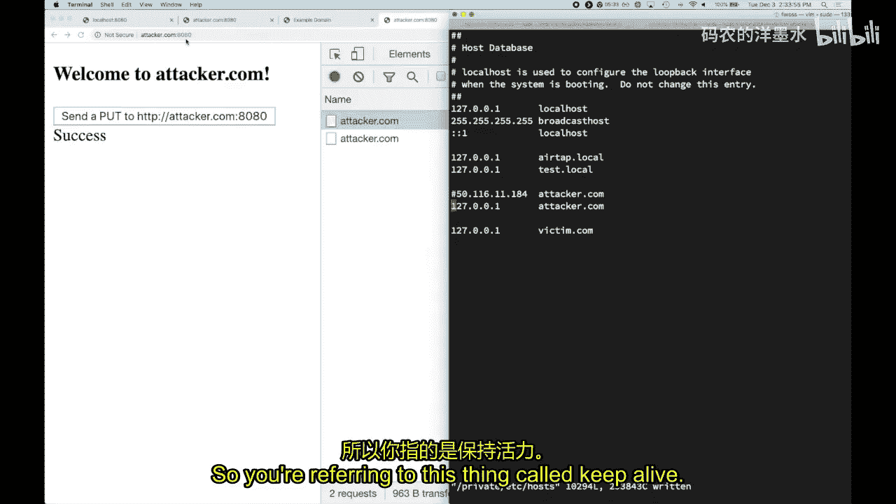

Fortunately， since the， mean， I， again， I keep saying fortunately。

 because I'm thinking from the perspective of an attacker。 But yeah， fortunately for the attacker。

 they have a way around that， which is they can just include a header。

 And I don't know if it's included here。 Okay， no yeah。

 So the the wrong headers being included right now。 The attackers， including connection， Keep alive。

 which is actually specifically asking the browser to keep the TCP socket open。😊。

I think the reason why it's not listening is because I'm， I'm in dis cache mode。 and it's probably。

 it's probably not using that。 Or maybe I was， were on the page too long or something。

 But you can change this to say close。 And then the browser will just close it every time。

 And then this makes the attack more likely to work。 Yeah。

 you just say connection close to opt out of keep alive。 Yeah。😊，They have idea。

That is a good question。I guess there's some legitimate use cases for it， sometimes。I don't know。

Yeah， I mean， if， if， if， if。Well， okay， I don't think the， the。

 the correct place to fix this wouldn't be like in the DN software itself because the attacker can always like modify their DNAN software to return you know。

 whatever I P they want。 But you could， you could imagine。

The DNS resolver running on your laptop or the DNS resolver running like that your ISP is running for you。

 They could refuse to accept responses that point to local host if if they wanted to。

 and that would completely kill this attack。 Yeah， in fact。

 I think I think some enterprises actually just do that because they know they're running a bunch of vulnerable printers and other kinds of random garbage devices on their network that they they are worried about。

 And they don't want like， you know， they don't want random website Javascript to be able to try to attack it。

 So yeah， that would fix the problem。I don't know why。 I don't。Johnang金 know。My friend， John is here。

 by the way， today。 So I I， I he was the one who kept point at my mistakes。

He might know the answer to this。O。Okay。I local host。It's problem。It's still pointed at your printer。

I reallyally。To fix it you'd have to block everything like。Oh it's a good point。 Yeah， that thing。

 it's not enough to just block like 127。01 because。

 because there's a whole entire range of I addresses which are mapped to the local devices on your network。

 like you get given a 1，21，9，2 do 1，6，8 dot 0 dot 1， some kind of I P like that that starts with 1，9。

2 dot 1，6，8。 And those are all local device Is。 So they could also just iterate through those。

 So you have to block all those2。😊，Yeah。I don't know。 It's。The， the one， before I。

 before I ask hear your question， I just wan to and also mention one， I guess。

 kind of legitimate case where I've seen this used is。There's a， yeah。

 and I don't even know why they needed to do this。 But there's， there's a server。

 a local server built into Spotify。 when you have the Spotify app on your computer。

 And it's similar to Zoom。 You know， it's again， another one of those things where it's like。

 why are they doing this， Why are they running a local server on my computer just to's a music player。

 like， it doesn't need this functionality。 But， but yeah， there's a local server on your computer。

 And it's listening on like some port， some high numberered port。

 And they bought a domain called spotty local dot com。😊。

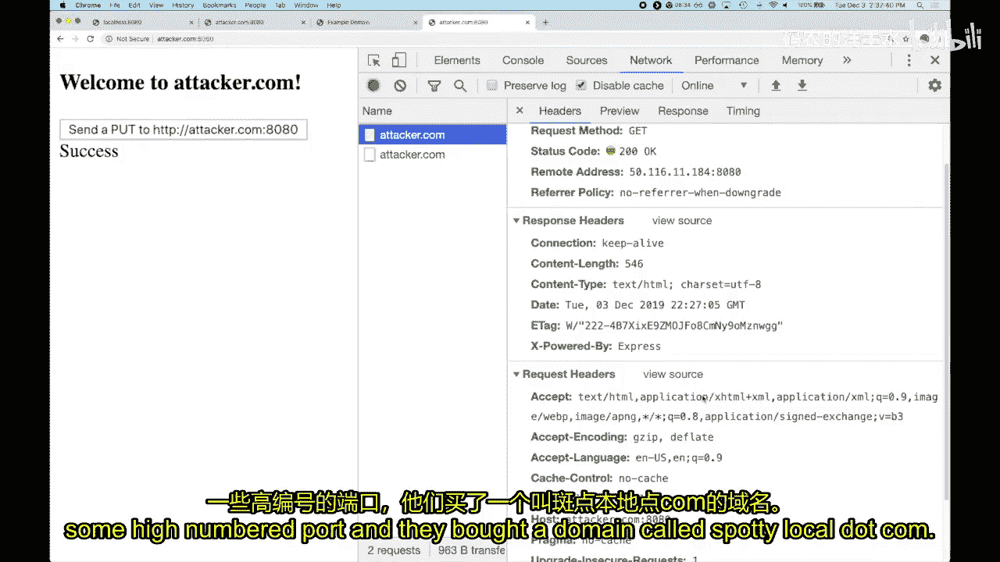

And if you do a DNS look up on that， we can just do it right now here。 you'll see that。

It's spotpoty local。Let's see here。Why is it， It says a， but then it doesn't。

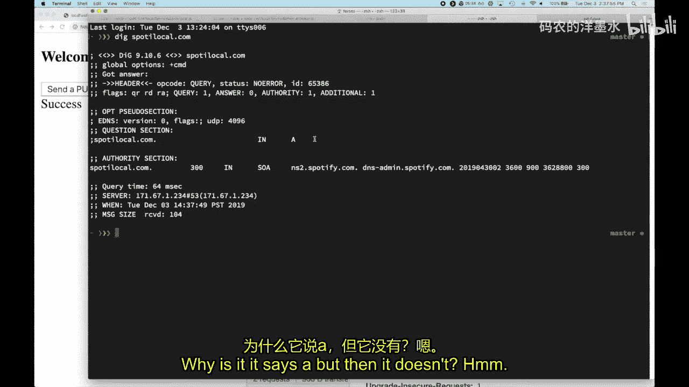

嗯。Let just go to a DNS lookup website。We can see it'， it's pointing to a local host。

 I believe not found。 Maybe they don't do it anymore anyway。 Well， at one point。

 Spotify used to run a local server on on on your computer。

 and then they had this domain that they registered called Spotty local dot com。

 And they would they would use that。 They would basically make， they would send requests to that。

 And would would those requests would control the Spotify player。 But they。

 but in order for the requests to actually get directed to the local server， they。

 they did the same DN trick where they mapped it to the local host I P。

 And I don't know why they didn't just hard code like 1，2，7 dot dot1 or whatever。

 But that's what they did。😊。

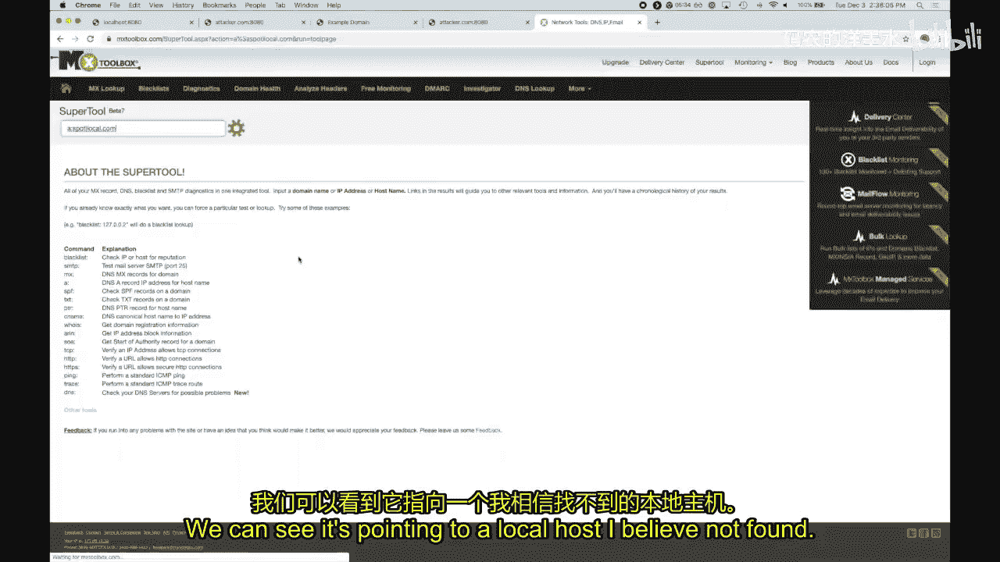

Maybe there's a reason。 I， you know， there may be a reason。てけます。Some time for the change for the DNS。

in the logo。Yeah， that's a good point。 Yeah， so what you're referring to is because DNS is is like this hierarchical thing。

 It may be that the attacker updates their DNS on the server that they control。

 But then when you actually go to look it up that goes through your ISP's DN server and eventually the request goes to the real server。

 But IP server may cache it for some period of time that is like longer than what the attacker requested。

 But if if if the attacker says like don't cache this for more than you know a few seconds。

 then you would hope that the ISP as an attacker， you would hope that the ISP would obey that and not actually cache it But I have heard of DNS servers that actually have like a cap on they won't actually obey like one second cache time。

 they'll still cache it for like10 minutes anyway。 And if they were doing that。

 then this attack would take 10 minutes to succeed。 So yeah。

 it's possible that it doesn't work all the time。Totally呀。Yeah。Just pretty much。

Is there reason they talking。

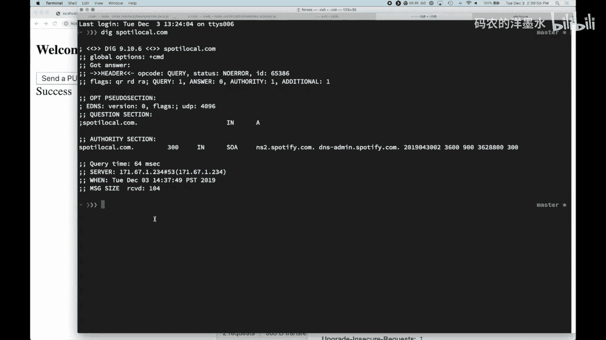

Register 236 subs for all the。You know， for the destinations on your local network。

 like that would no longer be seen。Yeah， exactly。 because the same origin is protocol。

 host name and port and。And。I mean， it is actually kind of interesting point。

 Like an I P address isn't really a host name， but the browser kind of treats it like a host name for purposes of same origin policy。

Every different I is a different would cause a different origin。To be created。Cool。

 any other yeah question。t come to some bank website and then read your credit card number。 Okay。

 yes， I was gonna I was gonna ask this at the end。 I'm so glad you mentioned it。 Yes。

 so so this attack seems like if you can break the same margin policy in this situation。

 isn't it really bad Can't I now like basically use this trick to like instead of updating my I to be 1。

2，7 do1。 I update to the bank servers I P。 And now I can send requests to it。 Yeah。

 that's totally doable。 But why is the damage limited in this situation。

 It's actually not really a big deal。😊，It's much， much less of a big deal than it is in the local server case。

 Does anyone， Can think of like。The difference between those two scenarios。It's kind of subtle。

Okay so。So let's， let's actually， let's like， mentally walk through like what would。

 what you're suggesting。 So you're suggesting I visit attacker dot com。And once I've done that。

 the attacker goes and updates their DN S。 But instead of updating it to 1，2，7。

 Where is it right here， instead of updating it to 1，2，7， they update this to the bank I P。

 They change it to， you know， whatever that the bank is4，4 out，4， something like that。

Okay， and then， and then they， and then when they， when this button is clicked or when they。

 you know， when， when they cause the next request to get sent， you know， this is now。

 this is now gonna go to the， to the bank， right。嗯。Question for you。

 when this request goes to the bank， the bank， it's going to the bank's I P， right？

 But from the browser's perspective， what origin are we on， We're on， we're on this origin， right。

 H T TP， Col slash slash attacker dot com， whatever the port happens to be， right。

W send the like certificate for the bank itself， but not。With the take。Yeah， that's that's。

 that's exactly right。 So the bank is gonna the bank is gonna there's many things the bank could do。

 But one of the things the bank could do is what you suggested。 So it will say， oh。

 a client has shown up， let's do a T S handshake， bla b。 we' gonna have encrypted connection。

 And the certificate that it sends is gonna be for Bank of America com And then your browser is gonna say What is this。

 I'm talking to attacker do com Why am I getting back the certificate for Bank of America com I'm being in the middle。

 and it's gonna block this。 so that will cause H T TPS error。😊，Another， another issue。

 say was say you're attacking a site that's not H T T P S。 So now you don't have that problem。

 There's still another way。 There's another reason why this is not a big deal。 I'm arguing。Yeah。

The cookies。 Yes， again， the browser thinks you're talking to attacker dot com。

 So it's not gonna to send the cookies for the bank， even though you you。

 you did trick the browser to connect to the bank， It thinks it's talking to attacker dot com。

 So it's gonna helpful attach attacker dot com's cookies。

 And so you won't actually be authenticated as yourself。

 And so all the requests you're sending to the bank won't do anything。😊，And so， you know， it's not。

 it's not， it's not really a big deal。You have to remember， from the bank's perspective。

 anyone can send them a put request by writing a Python script or a node script on their computer。

 And so it's not a big deal if you can just make someone's computer like send a put to to the bank。

 Like you could the attacker could have done that themselves。

 the real the real power of the attack would be if there was a way the attacker could cause the user's cookies to get attached。

 So you get that ambient authority that we talked about where you can take actions on behalf of the user。

Yeah， okay， yeah。And that wouldn't necessarily happened because of things like same site。

 for example， sea surf tokens。 Exact， that would prevent it as well。 Yep， yep。Exactly。So yeah， it's。

 it's much less of a， of a big deal。But so the reason why it's a big deal with local servers is because the local server。

Usually is making an assumption that anyone who can send requests to that local server must be on the same network as you and therefore trusted。

 Think about how your printer operates。 Anyone who can send packets to the printer can print That doesn't ask you to authenticate yourself。

 It just prints， right， Well， maybe not Stanford。 But in general， that's the way printers work。

And so， yeah， it's the same thing。 It's the same idea here。

 So the local service is making this assumption that is inaccurate。Okay， so we are。

Almost out of time。 So let me wrap up here。 So， yeah， this is a visual version。

 this is a visual of like sort of what is going on in this attack。 If。

 if what we've talked about so far doesn't make sense。 Hopefully， this makes it clearer。

 So this is every step involved in pulling off a DNS rebining attack， so。We have a browser。

 We have a local server that we want to attack。 We have a DN server that is controlled by the attacker。

 What do we do， Well， the attacker gets us to visit attacker dot com。😊。

First thing our browser does is it， it does a DN S lookup to figure out what the I address is for attackcker dot com。

Say， it's 9，9，9。now the browser is actually going to make a TCP connection to that server and then send the HtTP request over it。

 and then we get back the attackers' website。So far， everything is normal。At attacker site loads。Now。

 the attacker' site is going include jascript code in it that causes a fetch to happen。

 And this fetch is going to be to the back to the attacker's origin。

 So the browser is going see this request and say， hey， this is the same origin request， right。

 So let me just go ahead and allow it。 I don't need to do any kinds of checks because it's the same origin request。

 so。It it goes ahead and now here were relying on the fact that enough time has passed that the DNS response。

 that 9，9，9 answer has expired。 And so the browser actually doesn't have it cache。

 and it has to ask again， has to ask the server again for the I P address。

 And so when this time when the DNS server gets that query， it doesn't respond with 9。

99 and it responds at the local I P instead。And so， now。When the browser actually goes to do the put。

 instead of it going to the 999 server， it goes to the local server。Instead。

And one other thing is the browser is going to go ahead and ask a question because remember this。

 actually， wait a minute。 let's see。 Yeah， exactly。 it's， it's the same origin。 So。

 so it's gonna say this is a request initiated by the code on a attacker dot com。

 And the request is going to attacker dot com。 And so there's no need to do a pref or anything like that。

 It's the same origin request。 And so it allows it to sort of just go right on through to the local server there。

 And and then you know， we go ahead and interpret it。 And you know， in the case of the dictionary。

 it would open up the dictionary in the case of Zoom， it would pop open the the chat application。

 And we vulnerable。😊，So let's talk about how to prevent it in the last five minutes we have。

 So how can the server protect itself and how could browsers potentially do something to protect both servers that are vulnerable or unaware of this attack and the users who've bought these cheap I T devices that are insecure and。

 you know and there's really no way to update them at this point。 So let's think about that。 So。Yeah。

 I guess I was gonna， I was gonna open it up to questions， but we don't have time。

 So I'll just go on straight on head and I'll show you。

 I'll show you the the way to basically defend against this。 It's really quite straightforward。

 If you know about DN S rebining attacks。 The first step is to understand the attack。

 which is it takes a whole class to explain。 But once you understand it， the fixes one line。

 So this is how you fix it。 you， you basically need to in your server， check。😊，A particular header。

Actually， let me just ask， does anyone know what header we might be able to check。Okay。hostst header。

 yes， so host header， what does that do that tells us， that tells the server what site。

The request is intended for。So if I go and open up the browser and we look。

So， remember that。We we。The browser thinks that we're trying to talk to attackert com， right。

 And so what it's gonna to say is it's gonna include this host header here that says， hey。

 this request is intended for attacker do com。 And if you remember。

 I mentioned like one of the reasons why this header is really useful in general is because it's possible that a single server might be serving like multiple different websites。

 So if a server is serving site A and site B。 and it gets a request from somebody。

 And this part if this header was omitted， then there would be no way for for the server to know what site the request is intended for because because you'll notice that no other part of the request actually includes well。

 okay， this is misleading。 It's showing like the URL here。

 But if you remember the format of HP requests。 They're formatted like know get space slash space。😊。

Whatever HDP。 And that slash is just the path。 It doesn't actually tell you the site。

 And so this host header helps the server to figure out what site。

 what actual site are we supposed to serve here。 And so what if we just looked at that host header。

 And if we see that it's not local host， but actually。

 it's coming from attack attacker or any other origin， then we know that this is， this is this is。

 is not normal。 This is a DN rebinding attack。 So that's all we're gonna do here， I could put。

 I could put the code right here。😊。

Directly in the， in the put handler。 But then I would need to remember to， to put that this。

 this code in every single handler that I add in my server。

 And so instead of putting it here and having to copy paste it， you know。

 throughout all the other handlers I might add in the future。

 What I'm gonna do is I'm gonna add a middleware。 It's called the middleware。

 And I mentioned this a little bit before， but。😊，Basically。

 what this middleware is gonna do is it's gonna run first before any of these other handlers that I may add in the future that look like this。

 And this is gonna run。 this is all is gonna run first because I it's。

 it's in the code literally first。 Like I calling this function before I'm calling this one。

 And so that function is gonna run first。 And what that function is gonna do is it's gonna check if the requests。

😊，The requests host header is not exactly equal to。Local host。What the port is want to get 8080。

 I think that's， that's host， right。Kimber， if the port is included or not， let's include it and see。

 So if the request， if the host header is， is not that， then I'm going to。

I'm going to throw an error。DNS rebinding attack。Otherwise， I will call next。

 What next does is it says， basically， just move along to the next potential。

Handr that might match this request。And so just like， just like that with a couple lines of code。

 now if I go and I。I go ahead and try。The attack again， it shouldn't work。Let's check that out。Okay。

 so what I'm gonna do is I'm going to。

Okay， I'm going to set it back to the to the public I P address。I'm going to refresh。And now。

 we'll just confirm it made the request to the to the public server that's on the Internet。

 And then now the， the DN S is gonna get swapped to the local I P。 This is the attacker doing this。

 And then now， if I click this button。

The requests got， got sent。 but what you'll notice is。

That the， the server， that code ran in the server that we wrote before right here。

 and it actually refused to process the request because it noticed that the host was a attacker dot com instead of local host 80。

80。 And so it's like， okay， this is not valid。 this is not a valid host header。

 I know that this must be code running on on a attacker。

 And they've done this sort of DNS rebinding trick。 to try and trick trick the server。 Yep， so。

啊。Oh man。 Next time。 So yeah， that's DNAtry binding。 It took a whole class to explain。

 It's really complicated。 You should pat yourselves on the back for understanding it now。

 And if you ever in your careers， write a local server， Be very， very careful。 Don't do it。

 arguegue really hard not to do it。 If you must do it。

 then go back and look at these slides and be very afraid about doing it because you're probably gonna get it wrong。

 I did I got it wrong。 Everyone gets it wrong。 So be very careful。😊。

Thank you。 See you next time。