# 【全集】斯坦福大学 CS253 网络安全 中英字幕 1080P p19 Lecture 19 - 浏览器架构，编写安全代码 -BV1RemEBZEEM_p19-

Alright， we should get started。Welcome to lasts day class。Let's。

Let's talk about browser architecture and writing secure code。We have two topics。

But I want to start with the last little bit from。The last lecture on DN S rebinding。

So if you recall， we have。A DNS rebinding attack that works like this。The browser。嗯。

Gets navigated to an attacker's website。The browserrower does a DNS look up for attacker。com。

And the attackers set their response to be the actual server that they control。

 So the browser goes ahead and makes an HTTP request to that server。AndIt sends back a page。

The page loads。And then at this point， the attacker actually goes and changes their DNAN S entry。

Such that it returns a local host IP P address。And then the code that's running in the attacker page makes a request to the same exact or similar URL as it did the first time。

 So it's the same origin URL。And。The DNS lookup happens again。

And this time we get the local host I P returned。 And because of that， we are when we。

 when we actually send the H TDP request， the server that it goes to is the server at this I instead of the server at 9。

9，9。 And this happens to be the server that's running locally on our machine。

And so the browser is going to go ahead and realize that this is the same origin request。

 and it's going allow it to go through。And so that's how the attack is pulled off。

And so we talked a little bit about how to defend against this。 And I we showed some code here。

 But the crux of it came down to adding。

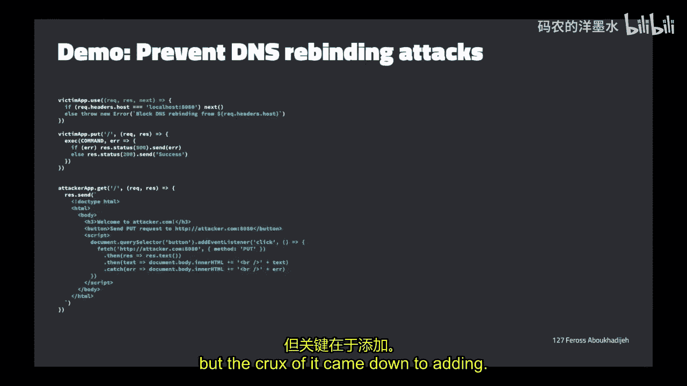

Adding a little bit of， it's very， very few lines of code where you basically check that the host header is a local host。

Value。 And if you see that， then you know that somebody hasn't done or D rebining attack because if they had。

 that would be set to the。

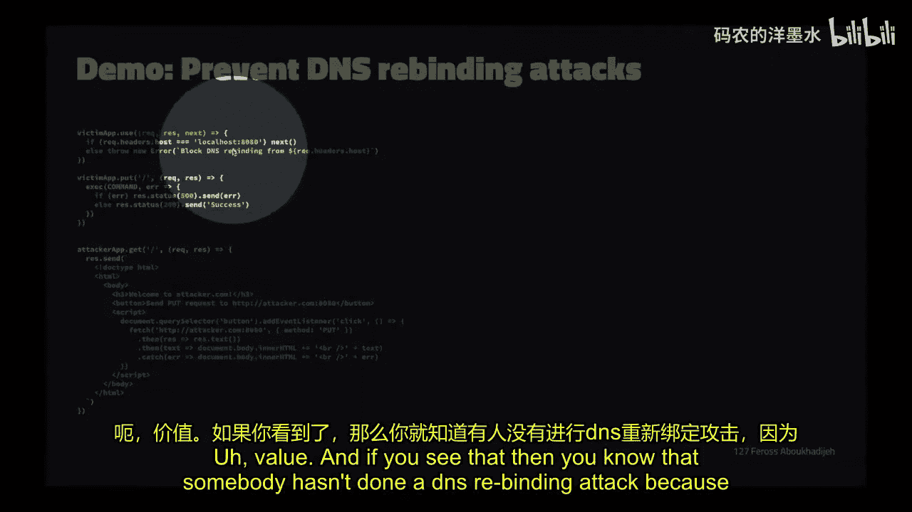

Origin that the browser thinks it's talking to， which is attacker do com， right。

So we can look at that and tell。Yeah， we talked about this。 Okay。

 so let's talk a little bit about just the attack surface of local servers in general just to sort of tie it all together。

 so。In general， when you're starting a local server on a machine， you bind it to the local I address。

 That's what we see there。 That's what I mentioned a couple times before。

 By adding that second argument when you call listen。

 you're basically saying don't allow people who connect to this server don't allow any connections to the server from other machines on the same network as me just allow applications running on the same computer to connect。

 And it gives you a little bit of reduce the attack surface。

But even if you forget to do that in general， when you bind to all interfaces。

 you actually still oftentimes can't get incoming connections to the local server because your operating system has a built-in software firewall that will actually look at all incoming connections and decide whether to allow it to go through or not。

 And so typically it will be blocked as well， just by the operating system。And。And then also。

 we have to think about the DN binding in general， you。

 you're vulnerable to this unless you take proactive measures by checking the host header。

 So don't rely on the operating system to protect you because like even even if even if know。

 does this。 You're still vulnerable to attacks from your own browser。

 That's the whole idea of this DN you're binding。 Remember。

 the idea is your browser becomes a proxy for the attacker。

 So their code is running job is running in your browser and it's able to make requests to these services。

 either your I O T devices or local servers that are running on your machine。

 And so you can't rely on those。Defenses。 Now， this is the software firewall I was talking about is what it looks like in mac OS。

 You，'s，'s hopefully it's on on your computer。 If it's not you should turn it on。 it's a good idea。

 If you click the little options button you get this little page that pops up that shows you all the applications on your computer。

 which you have allowed incoming connections to。😊，And one thing that's interesting is this box is checked by default。

 which allows any software that has a signature。 So the software is signed by the developer。

 and that developer signed it with a key that Apple has， has seen and has also signed。 And so that's。

 that's part of the certificate。 And so the idea here is that。😊，your。

 the default is that you're basically saying if this developer has sort of identified themselves and Apple has not yet revoked their certificate。

 then I'm willing to just let them listen for connections from any machines so。

What this means is that if some other device on the network or on the Internet tries to connect to this locally running server on your computer。

 if it's signed by the developer， it will be allowed。

This is just like the policy that Mac has gone with。 I question。 So first point on the last slide。

 iss there anything that are going for that？Is there anything special that the would back it after？

Like you asked by Netx， is there anything that。System will say like we're probably not the answer to query I don't think there's anything like that。

 Yeah， you might be able to customize something on Linux or something like that。

 but that I know of But yeah， this is what it looks like on Windows。

 So if you've I'm sure many of you have seen this prompt if you've ever used a Windows computer before。

 to be honest， it's extremely confusing。 And I didn't understand what this was asking for a really long time。

 I just hit allow。 And then my game or whatever I'm trying to play works。

 But checkbox is actually there's a distinction between private networks and public networks。

 And what's going on here is Windows is trying to protect you from local servers that the software that you're running has started up。

 So say in this case， what is some kind of input。Whatever input personalization server。

 I don't know what that is。 But this could be a game or whatever you've started on your computer。

 And it's， it started up a server。 And that serves waiting for connections。

 And until you click allow access here， no connections are going be allowed from other devices。😊。

On the network。 So it means other computers in the public Internet or other devices on your home network。

 Now， if you click allow with this private box checked， what you're saying is。

If I'm on a home network。 So every time you connect to Wifi network， you can say， is this my home。

 am I at home， Is this a network I trust or am like a public wfi hotspot。

 So every Wifi network is categorized as one of the other。

 And so then when you see a box like this and you say allow on private networks。

 what it'll do is if you're actually on one of those networks that you said you trusted。

 then any other device on that network can make connections to your computer and to to this particular app that's listening for connections And so the default is that you wouldn't check that on public networks because you don't necessarily want this application which may not have the best coding practices and may not be secure to just start getting connections from other devices on the network。

 So this could be like other Stanford users or other Starbucks Wifi users that' are trying to connect to。

😊，And so that's their， their sort of approach to， to defending， your local servers from attack。 Now。

 of course， remember， all this has nothing to none of these actually defend you against a DNS rebining attack。

 This is defending you against sort of other malicious devices on the network connecting to a local server。

 but you're still vulnerable to to DNS rebining because， again， your browser has become this proxy。

 And it's on the same device。 So it actually doesn't go through this this firewall。Stuff at all。

 right。So keep that in mind。Yeah， okay， so that's that's local servers。

 That's sort of the tax service of local servers。 Now， let's quickly talk about I T devices。

 So Io T devices generally they're bound to all interfaces because they're running a server intentionally expecting connections from other devices on the same network。

 That's like a Chromecast or a Google home or whatever。

 These are expecting connections from other devices。 And usually。

 they have no firewall configure because they want these incoming connections to go through。😊，And。

 and these are vulnerable to， you know， to， if you have a malicious device。

 it can make connections to it。 And， you know， these I O T devices will be vulnerable。 And， you know。

 in general， any webage can make connections to these Io T devices if they're listening for H T TP requests。

What DNS rebinding gives us is it allows us to upgrade those requests from simple requests that all web pages are allowed to make to any origin。

 like you know， get requests for an image or something。

 we can upgrade that using DNS rebinding so that the browser thinks it's the same origin request and therefore lets us make the request more complicated。

 Lets us make it know put， delete all these other methods and add headers and make know potentially open up new avenues for attack。

 So that's what DNS rebinding。Let's us do。 Let's us upgrade the the attacks we can do。Yeah， and then。

 of course， these are hard to update you know， after they shipped to the customer， because。

 there's a lot of price pressure and consumers don't really。

Check for the security of their devices when they're buying。 They're looking for the cheapest price。

 And they they say the the， the S in I O T stands for security。 So， yeah。

 so theres one kind of cool story。 Well， interesting story of this na bonnet who's heard of Muai。

 this bonnetnet before。😊。

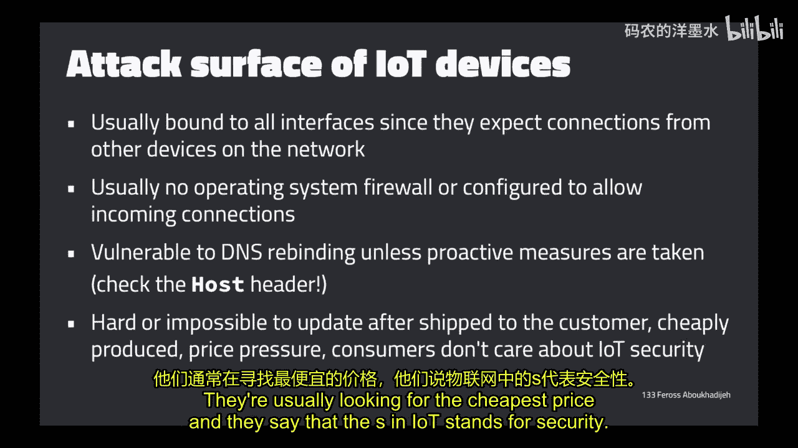

Okay， yeah， so。This is， this was like a huge story few years ago。 Sun teens were。

They basically managed to take over so many I O T devices， like a huge number all across the world。

 And the way that the reason why they did this is because they were they were in some kind of a feud with some other teenagers who were running a competing Mincraft server。

 And so they were like trying to take down the hosting of this Mincraft this Mincraft server。

 they were trying to take down the host eventually they started going to attack the DN S provider of of the Mincraft host。

 And I think in general， I don't know if they were actually looking for profit in this case。

 But this is also the thing that like these Mincraft hosts to do because they want to sort of make the the servers of other host go down so that the players will just switch over to paying a different company。

 So it's like competitors attacking each other。 But in this case， these were literally like。😊。

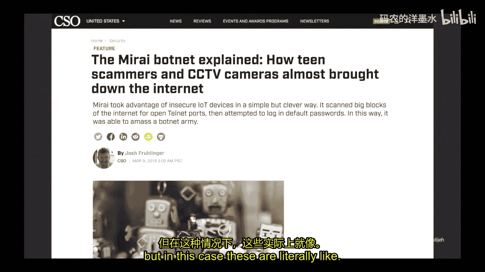

Teenaggerers who did this。 and they managed to amass like a huge bonet army that they used then to direct a bunch of traffic to these Minecraft hosts to try to take them down。

 And they did this using people's I O T devices。 So things like， you know。

 your toaster or your thermostat could be could have been part of these teenagers attacks against。

 you know， this Minecraft server that they're trying to take down。 Yeah， it was very， very。😊。

Ammusing and。Yeah， and so this was partly enabled by， you know， you know， in this case。

 I don't think they necessarily used DNS rebinding because a lot of these devices happen to just be listening directly to connections from any device on the Internet。

 Like there was no firewall at all here。 There was no need to use DNS rebinding。

 The attackers were literally able to just connect directly to the devices， and they were。

 they were vulnerable to， you know， take over。And the other thing， too， is。

 even if they weren't vulnerable to take over a lot of these devices come with default passwords like admin is。

 you know， admin or something， and attackers know that these passwords。

 and they can try them and and get into the devices that way。But yeah。

Other thing that the teenager was kind of funny is they included Russian language strings in inside of their their malware because they wanted to sort of make anyone looking into this。

 think that it was like， know， theyre sort of trying to divert attention over to other people。

 which is pretty， using。 And they also tried a little bit to avoid like attention from law enforcement and from large companies。

 So they had like I P blocks included in their Maware that basically they wouldn't attack any I T devices on like the Department of Defense network or Hewlett Packard and G E。

 So they。😊，yeah， they were still kind of amateurish， but it's。

 it's kind of funny They tried to do this。Anyway， so， so yeah， so that's， that's O T devices。 Now。

 you know， even if the devices are secure， you still have to think about this DN rebinding thing。

 and you have to check that host header。 And so， you know， these devices need to do that on top of。

 you know， all of this basic stuff like not having default passwords and not having the device listening to the whole network。

Yeah， and I wanted to just mention a couple of， of actual。

 like real world cases where D re binding became you know， was an issue。

 So one is all blizzard games come with this piece of software called the Blizzard update agent。😊。

And this is installed alongside the blizzard game that you happen to be installing。 And what it does。

 it starts up an H TTP server， a local H T TP server。 So that's already like red flag right there。

 And then it it happens to accept commands from， you know， anyone who can connect to that server。

 And those commands will， will tell this software to go and download。😊。

Binaries from the Internet and install them or run them， execute them。And so the idea here is like。

 you know， it， it's a way for a game， you know， a game can sort of maybe hit this updates， you know。

 hit the update server with a request and cause it to update the game or update some component that the game happens to be using。

 but。The server was vulnerable to DN S rebinding。 They didn't check the host header。

 And what this meant was that any website on the Internet could send a request to this server and then and tell it。

 heres the file I want you to download and execute。

 And your computer will happily go ahead and download that file and execute that。

 So if you're browsing the web with this software installed in your computer。

 You're basically letting any website execute whatever code it wants on your computer。

 assuming it knows， you know that it can do this。 And so， yeah， it was really bad。😊，And yeah。

 it allowed， you know， RC E， which is like the worst possible type of attack to， to have。

 And this was reported by， by this thing called Google Google Project 0。

 which finds a whole bunch of really interesting bugs in and other companies' products。

 And so they reported it， to blizzard。 and they got to fix out for it。 But yeah， that's。

 that's a real huge example of DNS rebinding。😊，Another one that happened is transmission。

 Who's heard of transmission。 It's a bit torrrant client。 It's popular on Mac。 I think it。

 it's on all the platforms not too。 anyway。So when you install transmission， the way they， they。

 they developed their application is they split up the code such that the U I that you see in the application。

 it's a native application。 So it's， it's running on your， it's installed on your computer。

 It's running on your computer。 The U I for it is。Its kind of， it's just really simple。

 All it is is a bunch of buttons。 And the real logic of the bitn protocol is implemented in a separate process。

 So you have two processes， one for the U I and one for actually talking to the torrent network and connecting to peers and doing all this kind of stuff。

 And the U I would basically just send little messages to the， to the。😊。

We call's it's just a client server model。 So the client would be the UI and the server would be the process that actually talks to the network。

 And the issue was that server was listening for connections from the UI。

 But it turns out anyone could connect to the server， not just the UI of the transmission app。

 And so because they didn't defend against DNtry binding。

 They didn't check the host header that meant that again。

 any site on the Internet that you're browsing on could send a request to this transmission server that's listening on your computer and cause it to know you'd think it would maybe just allow you to download a torrent or something like that。

 But， in fact， there were certain endpoints on this server， which would just execute code。

 So anyone who could send a request could just basically run run a shell script on your computer。 So。

Really bad。Again， this was found by the same same person at Google Project 0 and reported the transition。

 and then they they fixed it。But when， so when this happened， so I I actually。

 I developed a bit tor out myself called Web Torrent that that I think it's a cool project。

 it's a thing I've worked on for a few years。 But when I saw that this industry binding attack happened to transmission。

 The first thing I thought was， am I doing something like this in my own code。

 Let me check very carefully for this because this would be really embarrassing know。

 and especially it's such a bad bug， It's R C E， right， I was really worried。

 So I started looking through the Web torrent code。😊，And yes， we had DN rebound bindinging。

 We had DN re vnerability as well。 The good news was that ours didn't allow the attacker to just send a command that our server would just run。

 So it wasn't R C E。 It wasn't you know， the worst type of attack。 But。

 but we were running a local server that an attacker could send a request to to learn what content the user is torrenting。

 So they could basically they could fetch， like actually pieces of the torrent and and view it and sort of see like know what is this user looking at。

😊。

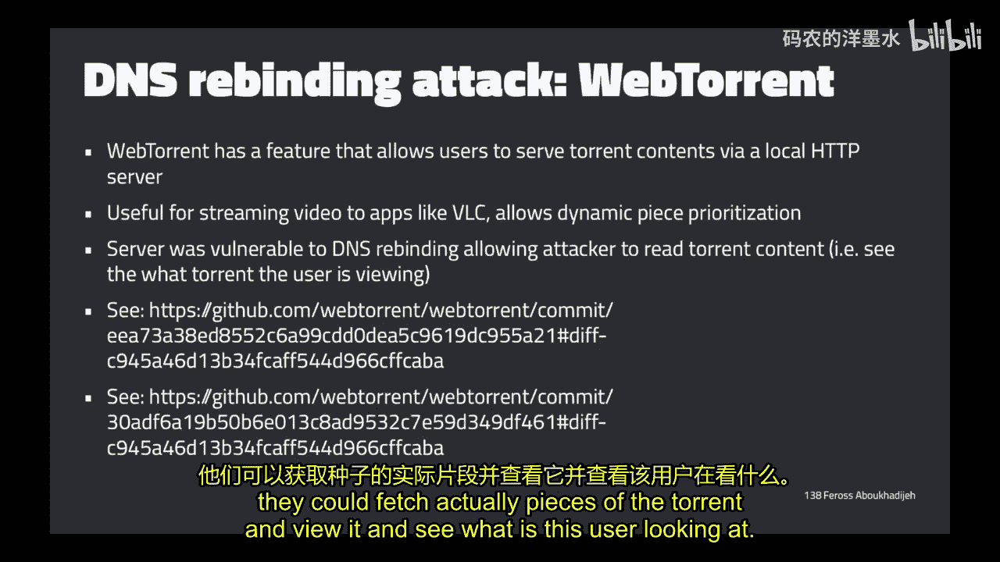

Yes， so that's the idea。 And I have the actual dip here that fix the issue。

 which is maybe interesting to see， so。The way we fixed it was。

We added this little check here that all it does is it says when。

 I should probably just quickly give a little bit of context about like， what。

What why were we running a local server。Thanks， for indulging me here while I show you this。

 So there's a command you can run on the command line that you give it a torrent link。

 and then it will go ahead and actually start to download that torrent for you。

 These are all peers that it's connecting to right now。 This is a legal torrent。

 It's creative Commons a piece of creative Commons content。 But you'll notice here。

 it created an HP server。 And if I copy this URL and visit it in the browser。

 it'll actually start to play back this video for me。😊。

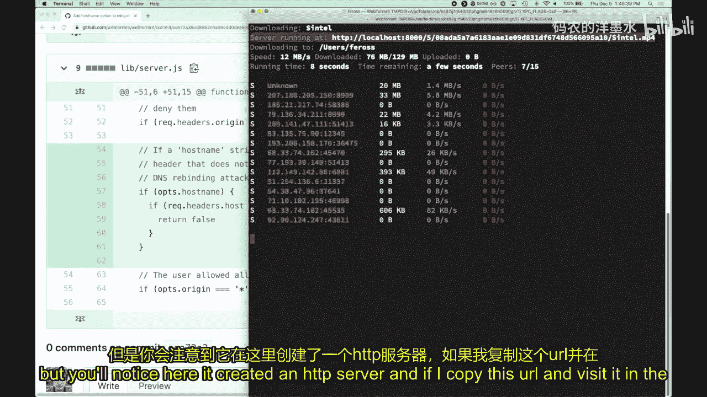

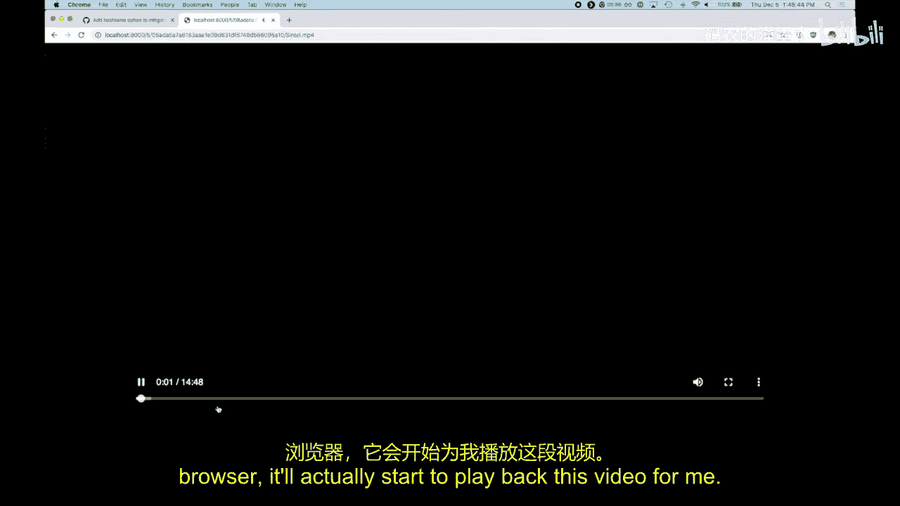

Whi is， which is pretty cool。 And so that's why we create the HP server。

 Its it enables this use case of basically this， this content is now being sort of served by the torrent program to the browser。

 and it supports this use case where I can actually seek to different parts of the video and it's gonna dynamically like make a new request for that part of the video and the torrent app can detect it sees this request because it's getting the request。

 And it can be like， oh， I should go start to fetch that part of the file because that's the part that the user wants。

 So anyway， there's kind of ill legit reason for for the local server。😊。

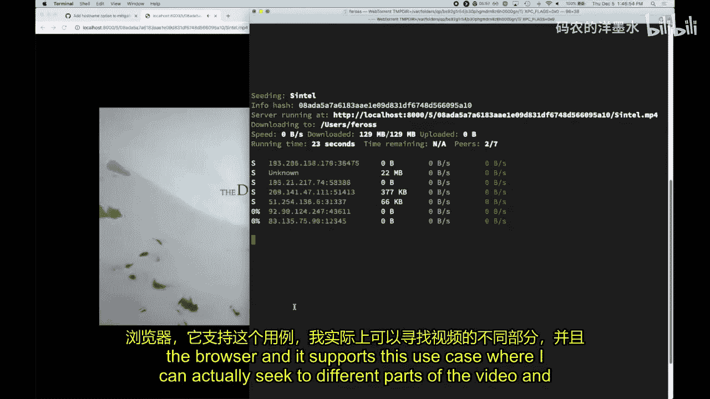

You know， but again， local servers are hard to get right。 And so， so yeah， so， so what。

 what ended up happening was。

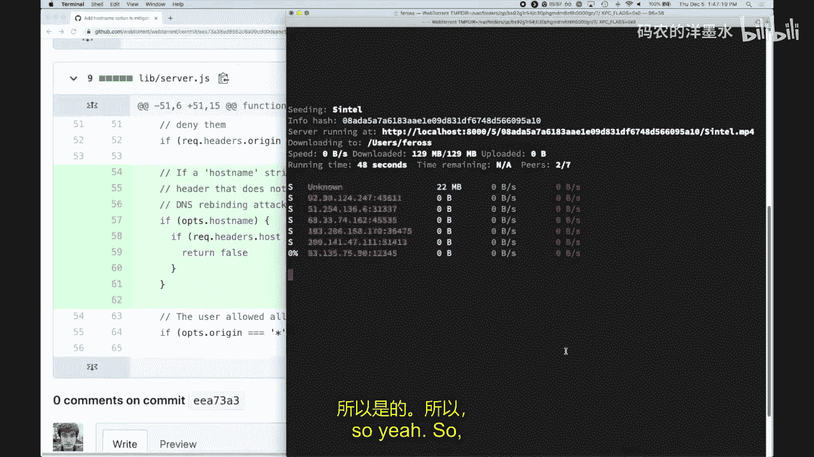

We didn't check the host header， and。So this is the fix。 When you go to start this， the server。

 you can tell it this is the host name。 So you give it an option。

 You say this is the host name that I want you to check。

 And if any requests come in and and the host header doesn't match this option。

 then just close the connection。 That's the idea。 that's how you defend against the NS binding。

 So that's what we did here。 We check the host header。 If it's not the same。 Then we return false。

 And we， we thought that would actually fix the issue。 And。😊，It turns out。

This didn't fix the issue because this fix what is just wrong。 It doesn't actually work。

 We tested it， and it looked like it worked。 And so this was actually vulnerable for a whole another。

 like six months。After it was fixed， because if you expand the code here。

 I'll show you exactly what went wrong。 It's pretty wild， so。😊，So， let's see here， there's。

Right here， This is the code that runs whenever an H TTP request come comes in。

 You can think of this like it's the handler for for any requests that come in。

 And one of the things we check is we say we there's an origin header。

 you know that's saying which side is making this request to us。 And we check that and see。

 is this origin allowed to make the request。 And if it is。

 then we're gonna set this access control allowed origin header。

And so when we went to go fix the DN S rebining issue， we put the code inside of is origin allowed。

 So if I scroll back up， you'll see that function is， is right here is origin allowed。

 This is where we put this code。😊，And so what does that mean， That means that when。

 when the host doesn't match， we return false instead of closing the connection。

 we just return false。 And that causes what does that cause to happen。

 It causes this header to not get set。That doesn't actually stop the issue， right。

So there's a distinction。 This is really important。

 There's a distinction between the origin header and the host header。 Don't get them confused。So。

 the origin header。That's attached to a request。 And it tells the site this is the origin。

 This is the page， basically that， that is making this request。 So this would be， you know。

It would be whatever， yeah， whatever site， whatever page we're on that's making the request。

 And then host is that's， that's the， that's what site we're trying to connect to。

So it has nothing to do really with the page that we're on。 It's like。

 I'm trying to talk to this server right now。 And that's the host header， right。

 And the way you detect DN S rebin is you look at you look at the host and you see。

 is the host not local host。😊，It's like attacker dot com or something。Okay， so anyway。

 the fix here was in， in a later poll request， we moved the code。And some person。

 some lucky person found this bug and got like hundreds of dollars of bug bounty for it because this is code。

 this code is included in in the brave browser。 And so they actually have a bug bounty program and paid out this person for finding this。

 But I was like， we fix this issue。 What is the issue and。😊，Anyway， so you can see here， basically。

 the fix was we just deleted the code from the， from that function and moved it to the very first piece of code that runs when you get a request。

 And we just say， if a host doesn't match， then just close the connection。

 like destroy the socket and just don't talk to them because this is a D rebtting attack。😊，Yeah。

 so anyway， the， the links are there， you can take a closer look if you want later。 But yeah。

 so remember the difference between origin and host review that。 I think it's。

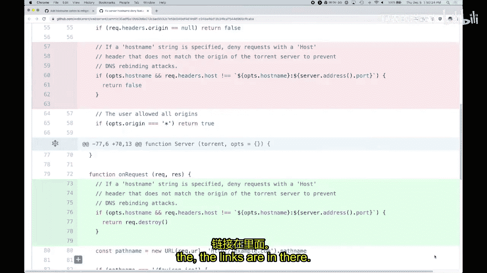

It's， it's， it's important to know the difference。 And then， of course。

 just try not to ship a local server to your users if you can because it's， it's just， it's risky。

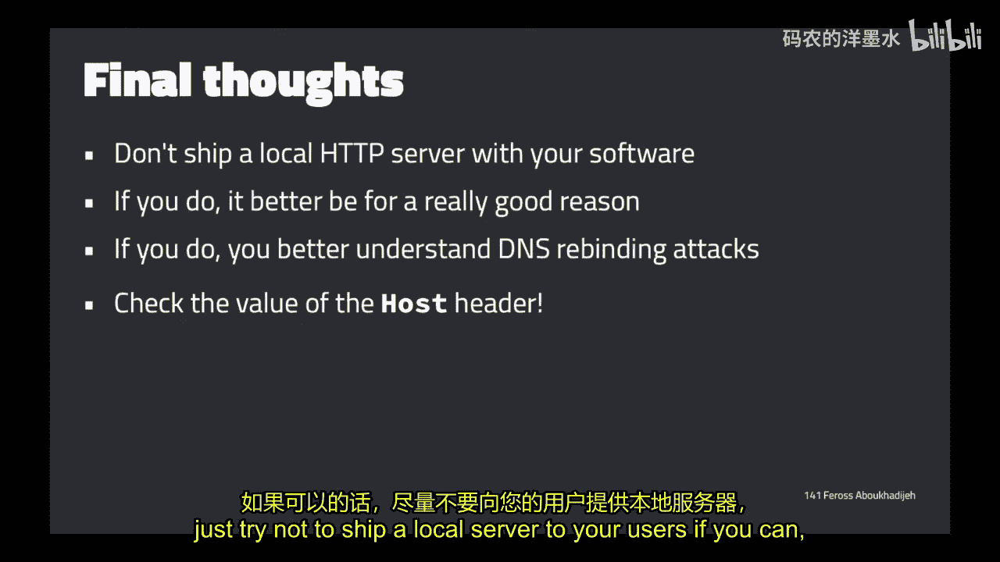

Co， so now。

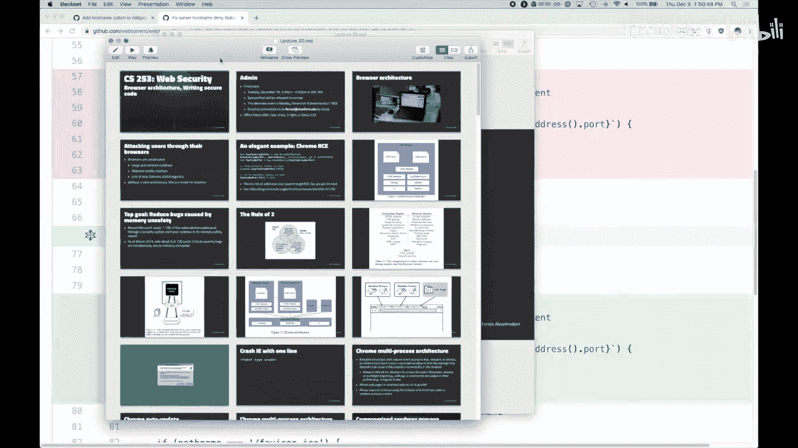

We will move on to today's topic。 We have two topics。

Browser architecture and some tips on writing secure code that I'm going to leave you with。So。

Oh yeah。 But I guess an admin first。 So yeah， some， some important details。

 The final exam is gonna be on Tuesday。 That's the time。 That's the place。

 I'm gonna release a sample final tomorrow so you can see the format of the final。😊。

And get an idea about it。 There's one person who asked for an alternate exam。

 So we're gonna do an alternate exam on， on Monday。

 If you also can't make the exam time for some reason， then you can let me know。 And you can。

 we can add you to the， to the Monday Al exam。 It's probably gonna be in the afternoon or the evening。

And if you have any accommodations， email me by today。

 and I'm gonna have office hours after class today。

 If you have any questions about any of the content in the class as you。

 as you're preparing for the final。Cool。Any questions about this？Cool， okay。

 so let's talk about browser architecture， so。One thing we should ask ourselves is。

 how does the browser defend us as we're browsing around the Web from， you know， you know， all kinds。

 gives all kinds of crazy sites that we visit， there's ads。

 There's all kinds of untrusted code that's constantly running in our browser。

 So we've already talked about the same origin policy， a whole bunch。

 We know that the browsers trying really hard to you know。

 isolate sites from interfering with each other and all this kind of stuff。

 But there's still like this other question of like。

 how does the browser actually take some untrusted code and run it securely。😊。

And what happens when that goes wrong， What happens when the browser is trying to run some javascript。

 And it turns out that javascript manages to trick the interpreter that is interpreting the jascript and get it to do something it's not supposed to do。

 You know， get it to do something that Javascript on the Web is not supposed to be allowed to do。

 Like， say read a file on your computer or open a socket to some service it's not supposed to be able to do or to execute。

 you know， native code。 These are all things that javascript can't do because there's a sandbox that it's running in。

And so。Yeah， we should ask ourselves that。 And we should think about， like。

How it it's actually interesting if you look at what browsers have done to ensure that even when they make bugs and they make mistakes in executing this untrusted jascript。

 that they can still protect your computer against， you know， total， you know。

 onage the sort of worst thing that can happen， which is that a site has managed to， to completely。

 you know， just start running code on your computer。So， yeah， so。

 so does everybody understand what I'm basically， we're talking about attack。

 this is attacking users through their browsers。 So how。

 how is your computer protected while you browse around the wild west of the Web and。

 and you visit all kinds of untrusted sites。So， so there's like a whole。

 this is a whole topic that you know， we're not gonna get super deep into。

 But I just want to talk about high level architectural decisions that the browsers have made that help。

 help ensure that， that you know， you'， you're protected as， as you browse around。

So first thing though is is that the reason why this is even an issue is because browsers are extremely complicated。

 There's they're huge code codeb and they're also network visible， which means。

 you know not only is it really complicated tricky code。 but it's actually connected to the Internet。

 So it's people constantly sending this code， you know， untrusted input and trying to break it。

 like this this is what attackers do。 And so a combination of like a really large complicated code base。

 plus， it's connected to the Internet。 And plus it's often written in in an unsafe language like C plus plus。

 that's a really dangerous combination。 And then， of course。

 we also have constantly new features getting added to the browsers， there's all this code churn。

 So yeah， without a solid architecture， this is basically a recipe for disaster。 And's and actually。

😊，Before Chrome sort of innovated on the browser architecture。

 browsers were constantly getting attacked with these sort of R C Es where you could。

 you could go to a site and your， your entire computer is owned just by visiting a URL。

 That still happens today， But it happens a lot less because the architecture of the browser itself has improved a lot。

 So we'll talk about that， so。But first， here's like an example of jascript code。

Doing something it's not supposed to do to completely own your computer。

 This was discovered by somebody in 2014。So its this is just， this is just plain jascript。

 This is just running on a random site that you happen to visit。 like it's not。

Privileged or trusted in any way。 It's just， you know。

 random javascript that could could be running in your browser。

 And what this attacker was able to figure out。Is you can make a buffer in jascript that allocates like 32 by by of memory。

And then you can define a getter。 So， so these buffers have this property called by length。

 which is supposed to just return however big the buffer is。 It turns out jascript know。

 has this feature called Def getter， which lets you say， like， I'm gonna， set this。

 I'm gonna change this property into a getter function。

 And whenever somebody tries to get the property。 This function runs and returns whatever it wants to return。

 And in this case， it's gonna return a gormous number。😊，And， and， okay， so， you know。

 that seems like， you know， okay， that's kind of sketchy。

 It turns out the C plus plus code that interacts with this buffer。

 So this is the code that the you know， Chme engineers have run it's running in Chrome。

 It when it looks for the byte length， it'll actually invoke the getter and get this as the by length of the buffer。

 And so。😊，Even though it's allocated 32 B of memory， it's actually when it's， when it's。

Later interacting with this buffer。 it's gonna get the new length that the attacker has set it to。

 And， of course， this memory isn't actually allocated to this buffer。

 this is just whatever memory happens to be in memory。 And this is a classic buffer overflow attack。

 If you've ever taken you should take C 155。 you'll learn all about buffer overflows。

 But this is a buffer overflow know， this is， this is in jascript from a completely random site that you visited。

 And so once you have this， you can literally do is here's an example。

 So we're going 100 Bs into this buffer， which is only 3032 long。

 And we can just print out whatever is there。 And what we're gonna get is whatever happens to be in memory at that location。

😊，Similarly， we can write whatever memory we want。 And so now， by reading and writing。

 we can literally take over the entire Chrome process and make it do whatever we want。So really bad。

 right， Does everybody follow this？Cool， yeah， so this is。

 there's a lot of extra code to actually get full remote code execution。

 But this demonstrates the fact that you can read and write whatever memory you want。

 And you can imagine from there reading， you know， figuring out the way the memory is laid out and figuring out how to get R C from that。

 And there's actually code here It's， it's not that many lines of code。 But， this code would。

 It's right here。 It's like， yeah，6 kB of jascript。 It's really not that much code。

 But like this this like 200 lines here would basically run whatever commands you wanted to run on the user's computer you would put in the command you want to run somewhere one of these lines is the command you want to run。

 And then that jascript would own them。😊。

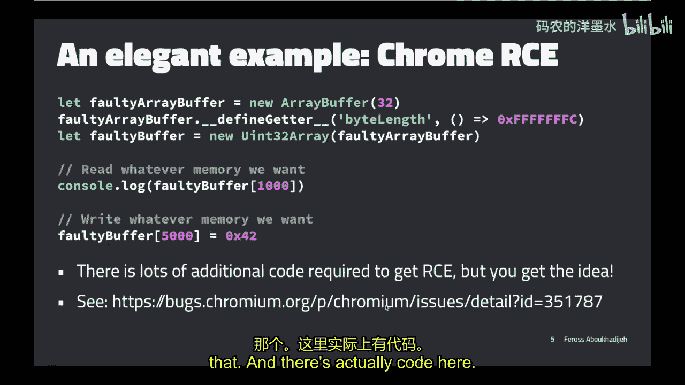

Yeah， so that's， that's， that's that's sort of what we're trying to defend against， yeah。ちやさか。しますと。

To know that this would be either a value or a function。Like the bike length。That just sort of。

My guess is that there's some abstraction that the browser has implemented so that for these types of objects。

 which are shared between the C plus and the jascript side。

 they have some unified way of like when they go to get when they go to get a property。

 it will do the right thing。 If it's a getter or if it's a property。

 It'll just give it'll give back the value that would be visible from the jascript side。

 That's what the C plus side would see。 So it's probably handled。Yeah。

 I don't think you wouldn't see it in the buffer code at least， yeah。Yeah， so， so so if youre。

 if you're building a browser the， the typical way browsers are built for a long time。

 really long time ways like this。 So you you'd have all these different modules。 know。

 because you're a good programmer， you separate your code in different files and you have different modules with different responsibilities。

 Blalah， blah， blah。 And so you have this process。 And it's gonna have all the things that the browser does inside it。

 And you know， they may be abstracted nicely。 But at the end of the day。

 they're all getting built into like one binary and it starts up one process。

 and everything is in that process。 and。😊，Yeah， and this is just the way things were done for a long time。

 Now， if you're worried about， if you're worried about。Bugs where。The so this。

 this jascript engine here， what it's doing is it's taking strings of jascript and figuring out how to interpret them and how to。

 you know， it's basically updating some sort of state machine that represents the state of the jascript world。

 If this thing gets tricked and like we just saw in on the last slide with this buffer overflow attack and and now the code that's running the jascript engine is now like doing what the attacker wants and running instructions from the attacker。

 this entire process is basically under the control of the attacker and everything is in this one process。

 right。😊，And so， so， so yeah， the issue is now that now。

 now the attacker sort of taken over this and can can access all the all the capabilities of this process。

 And typically when you start up your browser， you're starting it up as the user as your user。

 whatever user you account you have on your operating system。

 That's the same account that this process is running under。 And so this process now， know， it has。

 has the ability to read and write all the files that you interact with on on a day today basis。

 everything in your documents folder， you know， everything that you that you care about， basically。

So it's， it's really bad。 So， and， and this， these are some stats about sort of this。

 this type of memory and safety bug。 Its it's actually like the main type of vulnerability that that we still see today。

 So recent Microsoft study showed。They found 70% of the vulnerabilities that they addressed through through a security update in each year were were memory safety issues。

And then this is from Chrome here， this， this is a Chrometatt。

 So from out of all the bugs that they've ever had in Chrome that were critical severity。

 They've had 130 of those。 Only five of them had nothing to do with memory corruption。

So this is the primary way these that you attack a browser today， basically。Yeah， so。

 so Chrome has this nice rule。 They called the rule of two that。

Has motivated a lot of their thinking around how to architect the browser。

The rule of two is that you you have these three things and you can pick any two of them。

 If you do all three， then you're in trouble。 So what are the three things。 So one is。

 if you have code that processes untrustworthy input， then that's one of the things。So untrustworthy。

 the input is just。It's defined as， like。Input that comes from a source that you don't trust。

 But if if the input is like super trivial， it's like very easy to parse it and to look at the code that parsees it and be like really confident that it's that it's correct。

 then maybe you wouldn't consider this as big an issue。 But in general。

 when you're dealing with the browser， you're parsing H TMl。 you're parsing C S。

 you're pars these really complicated grammars。 And so the code is it's really hard to just look at it and know that it's correct。

 And the inputs come from untrusted sources。 So the web definitely meets this criteria。 okay。😊。

The next one is code written in an unsafe language。 So that's like anything， assembly， C。

 C plus plus Sa languages are things like go， rust， Javascript， Java。

 anything where it's impossible for the user to you know， if the system's working correctly。

 it's impossible for them to sort of run over the end of a buffer。

And so Chrome itself is completely written in C++， so it meets this criteria as well。And so。

What's the third criteria。 The third criteria is any code that is that has privileged permissions。

 So this means， you know， it， it's a relative thing you can can it's relative it's relative because obviously。

 there's there's certain things that you have like the utmost privilege on your computer。

 the bootloader， the firmware， the operating system kernel itself。

 these are all extremely privileged。 But in the case of the browser。

 this is running as your user account that you created on your O S。

 And that's also privilege from browser context because like I said。

 it can delete all your files it can read all your files， it can do all kinds of damage。

 So that's considered privileged And then anything like less than that would be low privilege。 So。😊。

Anyway， so， so any code that sort of can can do whatever it wants to your computer。

 we consider that to be a high privilege code so。In general。

 any code in Chrome should only do two of these things， Not all three。 If it does all three。

 then it's really bad。Did that make sense。Yeah， so it turns out that's actually what they do。

 So in Chrome itself， they've separated out all the complicated parsing stuff。

 the stuff that takes untrusted input into this one side over here and all the stuff that is， well。

 it's not a completely precise separation because there's some， there's some overlap， but。😊。

But you can see here that， like。Typically， a lot of the bugs that that get found in the browser happen to be in these components。

 So like， do they have image image decoding is on here。

 So image decoding is a huge source of bugs because image formats are really complicated and images come from the user and the user can craft a special image such that when the when the decoder goes to like read the image。

 It ends up like tricking the decoder into into having one of these buffer overflow issues。 And so。😊。

This is like， if you just look at the number of security issues that come from the different components in the browser。

 It's like the image decoder is way up there， right， so。All these stuff。

 all these ones that are that are more likely to have issues are put over here into this left side。

 And that's what we call the rendering engine。 And then the right side is the browser kernel and。So。

 let's。Yeah， so what's the idea here？The idea is， if we can put all this sketchy sort of like not sketchy。

 but like like。Aero prone code code code where it most likely the security issues are gonna come from into a separate process and all the stuff that involves like really sensitive。

 privileged stuff like reading files from the disk， talking to the network。

 looking at the user's cookies and so on in a completely different process。

 Then if these two processes work together， you can actually get all the same functionality that a browser needs。

 But if anything goes wrong in one of these processes。

 this process can be denied the ability to read files。

 can be denied the ability to do any of these things。

 and the only way it actually gets to do those things is by talking over an IC channel。

 which is an interprocesed communication channel， just think of it like a socket between the two processes and they sort of worked together to do whatever the browser needs to do。

 But this one is not trusted。 it's assumed that it could go wrong。

 And if an attacker actually gets control of this process， not that much can happen。😊。

So let's look at a picture。 This is what comes from the Chrome paper where they introduced this idea。

So the browser kernel， when it wants to， when， this is actually， by the way， where the。

 the U I of the browser itself is， is controlled。 So the， the， the URL bar， the， the tabs。

 everything that you interact with is， is in this process。 So when the user goes to a URL。

This process will actually go download all of the resources。 H T L C assess jascript that the。

That the renderer is going to need to actually produce a picture of what you see on the page。

 And it's going send that over this IP PCC channel to the rendering engine。

 which is in a separate process。 And that is going to take all that and produce basically an image and send it back to the the browser kernel。

 which just shows it on the page。And so you end up with this an architecture like this where you have basically every different。

tabab in your browser is a separate rendering process。

 And then you have the one process that controls the browser's U I。

 talks to the network and talks to it and controls， you know， reading and writing files on your disk。

 And these rendering processes can't do any of that stuff。

 They have to basically ask this process to do it for them。And so the idea is。

 if an attacker takes over this process by breaking out of the jascript engine or finding a bug in the H T L renderer or the image decoder。

 then the damage they can do is limited。And the other side benefit of this is that if one of these tabs happens to crash。

 not because of a malicious issue from an attacker， but just because there's a bug。

 then that render process crashes， but the entire browser doesn't crash because the renderer process is just responsible for a single tab。

 And so that's if you've ever seen the On thing in Chrome that's because that render process has crashed。

 but the entire browser and all the other tabs are okay。😊。

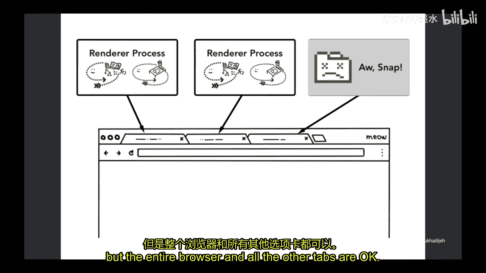

Of course， the way things used to be before was that。

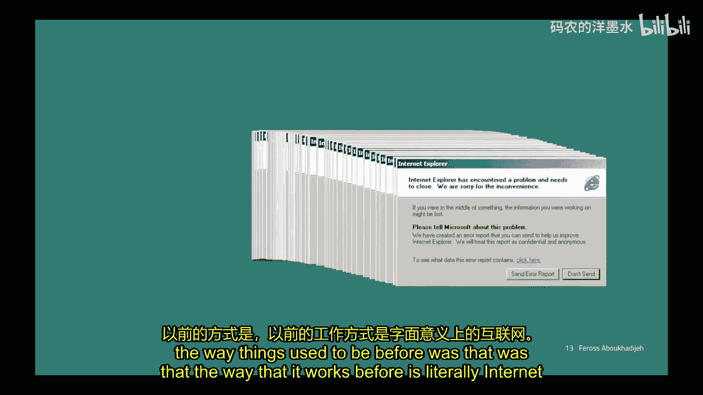

Was that you， the， the way that it worked before is literally in Internet Explorer and every other browser would literally have a single process for the entire browser。

 So if there's a bug in a single tab， then。😊，Sorry， hadphone with this。

 there's a bug in a single tab then that would take the entire browser down。

 you'd lose all your work and all your tabs。😊，ItActually， there was， was for a while。

 There was literally， it was possible to crash Internet Explorer with a single line right here input type crash。

 And that would that would just take down your whole browser。 So if you wanted to be mean。

 you'd put this on your blog， and then user would just lose all their all their work。

 And they didn't have like restore your session or any of that kind of stuff in those days。

 It was just gone。 So yeah， the multi processces architecture is just good for other reasons。

 besides security。 It's just good for like robustness。😊，So yeah， again。

 just to reiterate render processes can't access the disk network or devices and Chrome runs in a restricted sandbox to limit the damage that attackers can cause and。

It also has the side benefit of allowing web pages to run in parallel because now you have parallelism via the multiple processes。

 And also， the browser can continue to run if a tab crashes and the user doesn't lose their work。So。

 that's great。The other big thing that browsers did， again， Chrome was the innovator here initially。

 but now all the browsers do it is auto update。 So before this was the thing software generally didn't auto update。

 It usually prompted and nagged the user to update。 And then Chrome just said。

 we're not even gonna have an option for the user to sort of say yes or no。

 We're just gonna update their browser for them。 And they can't turn it off。

 And that was extremely controversial at the time。 But now it's considered standard practice。

 And nobody thinks it's a bad idea。 And this is actually。

 this is really kind of cool idea that initial version of the browser was。😊。

When they started the project up， they started with an auto update and nothing else。

 So they literally had a white。A window that popped it was a white screen that had nothing in it。

 but all it had was the auto update code。 And the idea was that all the people in the company and the open source people who were following the development of this project。

 they could install this。You know， fake was non non working browser， but it had an auto update。

 And then over time， as they， as they opened it up， it would develop into a browser。 You know。

 start to do more things。 And so， so that， yeah， that's， it's kind of cool。

 It started as a blank window and sort of over time， became and grew into a browser， yeah。😊，頑なるだやつで。

哎。That's a cool idea。 I don't know。 So typically， they delete the。The binaries。

 you can't even find old versions of Chrome online anymore。 But like there。

 I think there are third party sites that try to save them。

 And but I do think it would probably like skip ahead a lot。 It might not just like go， you know。

 one version at a time。H。There are cool videos on YouTube of people installing like Windows 3。

1 or something like the very first version of Windows and then updating it to like Windows 95 and then to Windows 98 and then to Windows 2000。

 And they go all the way up to Windows 10。 And like， it works。 That's what that reminded me of。 But。

 but yeah， I I don't know if you could do that with Chrome。😊，Yeah， so。So there are some limitations。

 though， of this architecture。 So one issue is that。

Chrome would like to be able to place pages from different origins into different render processes。

 but it's difficult to do that。 So what ends up happening what ended up doing was every tab is a separate process。

 but tabs can be composed of content from many different sites， right？

 You can have a site with an iframe in it。Comes from another another site。

 So you actually end up having like three or four different sites。

Javascript all running in the same process。Right， this isolation。Is giving us， you know。

 it's giving us it's separating the browser kernel from the tabs that compose the sites。

 But within a tab， you still have multiple sites in the same process。 Does that make sense。

Because a site， a site might load resources and images and different things from different sites。

Okay， I don't know people， I see confused faces。 people are people getting this。

Maybe a picture helps。 Yeah， I'll do that in a second。Actually， no， let's just， let's do it now。 So。

 so the idea is。So the what the architecture gives us is if you have a renderer process that talks to the browser process over I PC。

 And this is now loading up evil dot com。 Okay， great， you know， this is， you know。

 now if evil dot com manages to break out of the jascript sandbox and now take over this entire process on your computer。

 It can't read files on your disk and it can't know。

 can't do stuff like that because it has to go talk to the browser process。

 which will presumably not let it do what it wants to do。 but。😊。

There's still a lot of damage that the site can do。 For example， say that it loads an eyeframe。

 that's victim dot com。 Now， this means that in order for this renderer process to actually do its job。

 which is to draw the page， this， this this process now needs to load the cookies for victim dot com。

 because that's part of。What it needs to actually draw the page。 It's gonna need to know。

 It's gonna to need to see that， right This content you know， came from victim dot com。

 And so therefore， this process has access to it。 Now。

 if the javascript sandbox is working correctly， you know， the same origin policy will be enforced。

 So evil dot com won't be able to talk to won't be able to read these cookies because all that that same origin policy is enforced within this process right the damage happens if evil do co manages to find a bug in the browser itself and break out of basically now it has control of the entire process。

 And now it doesn't have to follow the same origin policy anymore。 right。

 And so the damage is here that it can read the cookies。

 It can read anything that manage to get into the render process memory because now it it's basically owned this process。

 sure it can't like read files on your disk， but that's still quite bad right。Okay。

 so the other issue is that we few years ago， people discovered I don't。

 actually know how long ago it's been。 But there's a thing called Specter。

 which we definitely don't have time to talk about here。 but it's a。Essentially。

 it's an issue that breaks down the boundaries between processes。

 So it turns out an attacker can read memory from other processes and sort of completely violate the the process model of。

 of modern operating systems and。It turns out that what we have going on here within this render process is even。

It's， it's also vulnerable to spec because we don't even have a process boundary here between evil dot com and victim do com。

 These are actually in the same process。 And we're relying on code， you know。

 that's written to actually keep the boundary between them separate。's， you know。

 the jascript V M is basically trying to keep this， this boundary here。

 But it turns out an attacker an attacker can do is。

So there's this render process that has all this sensitive information in it。

 and it also has it needs to run the code from evil dot com。

 And so what evil dot com does is it writes some jascript that takes advantage of these specter issues in in CPUs。

And what it does is it can using completely valid javascript， using no sort of it's not， it's not。

 it's not taking advantage of a bug or security issue in Chrome。 It's literally valid jascript。

 but they can basically read memory from other parts of the process that they're not supposed to be able to read。

 And that's one of the things that Specter。Enables， okay， so that's really bad。

 So one of the things that Chrome wanted to do to fix this， does this make sense， by the way。Okay。

 cool， so。So there's a solution to this。 The idea is it's called site isolation。

 And so the idea is that what if instead of isolating just isolating every tab in a separate process。

 what if we took every single different site and put it in a separate process。So if a。

 if a tab happens to load content from five sites， then we're gonna have five processes。

 and they're all gonna be responsible for loading their part。

 And then we're gonna stitch together and， and draw as， as sort of one one final result。

So then the cool thing is， if we do that， then now the browser knows that when it sees a renderer。😊。

Yeah， so here's here， let me go back to this really quickly。 So in this situation。

 this render process， the browser doesn't know what resources this may need to load because。

 you know， there could be an iframe that loads something from victim dot com and it might load something from another site。

 So basically， when this， when this render asks the browser to go and download stuff from victim dot com or to give it the victim dot com cookies。

 this browser process has to do it because it doesn't know whether this render process is like compromised or not。

😊，ItIt would ask it potentially might ask for the cookies for victim dot com in a legitimate case。

 right， That's， that's totally fine because we're relying on the same margin policy inside the renderry process to keep the two separate。

So， from the browser's perspective， it can't treat， It can't。 It can't know whether this。

 if this if this process is compromised， it can't know sort of how to behave。 But if instead。

 what we do is。We basically， what we say is we take every site and we put it in its own separate process sandbox。

 Then what we can do is， so evil do com is gonna load over here。

 and evil do com is gonna I frame this victim site。 But it turns out that。

The victim sites actually loading over here。 And nothing from evil com is loading over here。

 And and what happens is the browser process can sort of take the results of the sort of the pictures that each of these drew for their part of the page and stitch it together itself。

 And and so that means that now the browser can know this renderer should never get content for any other site except for evil do com。

 So it will literally label this like IPC pipe right here。

 itll label as belonging to evil dot com and it will label this one is belonging to victim do com。

 And now these are not allowed to ask for anything that are not related to their own site。 So。

 for example， if if this render process said， hey， I need the cookies or victim dot com and ask the browser process that。

 the browser process would say， no， I'm not gonna give that to you。 You're the render for evil com。😊。

Okay， and then so， of course， now， it can access evil dot com data and it can。

 it can load scripts from other sites。 So that's the thing to keep in mind。

 this evil dot com still should be allowed to load images from other sites and other kinds of content like that。

 And it should be able to load。😊，Well， it shouldn't be able to load data like cookies， but it may。

 if the headers are right， be able to load the data。 if the headers say that， that， like。

 for example， if there's a course header then on this response， it's possible that， you know。

 that that the browser should actually allow it to go through because。

That response is tagged as being allowed to be readable by anybody， right。

 So that's enforced now in the browser process instead of within the render process。 So basically。

 if these get compromised， they can't， they can't read data from other sites。 That's。

 that's the sort of T LDR here。Cool。So。I wonder if I should just skip this。 It's kind of。

Let's see here。Oh yeah， I'm gonna to skip this。Well， okay， maybe I'll show the picture for it。 And。

 and you can get an intuitive idea for this， so。So like I mentioned。

 like evil dot com should be allowed to load images from victim dot com， right？ I mean。

 that's a thing it's allowed to do。 And so what happens here is that so if evil dot com decides to do a fetch from evil dot com that's allowed because it's the same origin。

 right， That's fine。 If it tries to load an image from another site， to victim site。

 we should allow that as well。 So if if this render asks the main process for an image from another site the browser should actually allow it。

 that's totally allowed， right， But what happens if it asks for an H TM L page。😊。

And tries to put in an image tag。Now， this is not gonna to load。You know。

 this is not gonna load as a valid image。 And， of course。

 the same margin policy is not gonna to let the page actually read。

Read the contents of this page out。But。It would be bad if it could ask the main process for this information。

 because now that data gets into the render process memory。And we're concerned about specter。

 and we're concerned about the render becoming completely compromised。

 And so we actually don't want this data to make it into the renderer process。

So the browser actually has to have some smarts about like， oh this is actually an HTML page。

 this can never load in an image and it's gonna to error out anyway。

 so rather than sending the data into this renderer process which may be compromised and then be able to read the data。

 we're going reject this request。That's the idea。So this thing is called。

 it's called Corb cross origin reblocking。 And it's， it's kind of subtle。

 So the details aren't that important。 but this is the main idea。Yeah。Okay， cool， so。

Let me see how much time am I on track？I'm not on track， wow， okay， you're going to have to go fast。

So I want to switch to a， a new thing。 So we're gonna talk about secure coding。

 And I'm gonna try and leave you with just some tips to think about as you enter the world and keep。

 you know， start writing apps and working at companies and writing a much of code that is going into production so。

😊，One thing we didn't focus too much on。 But I mentioned at the beginning is Javascript itself has a lot of rough edges as a language。

 Everybody likes to make fun of it。 It's mostly fair， sometimes not fair， but mostly fair。

 And so just a few of these issues just。You've probably seen some of this stuff， but。

So one issue in the language itself is that the double equals operator is actually not doing like the kind of equality that you would expect。

 It does this weird coercion using an algorithm called abstract equality comparison algorithm。

 which is very not intuitive。 You can go read the spec。 It's。

 it's not possible to remember what it actually does。

 So if you try to write a function called is 0 here and see if the argument is 0。

 You'll actually find out that all those are 0， which is not what you want。 Probably。

And so the solution to this is to always use triple equals in your code。And。If you do that。

 then you get what you expect， right， you get it actually checks that the type is the same first before it checks the value。

 whereas before， what it was doing was sort of turning this into a string and then comparing it because one side was a string and one side was a number。

 which is not what you want。Another really terrible issue is that if you duplicate the function arguments。

 like you have two arguments that are named a。This should probably just be a syntax error or something。

 But instead， no， actually， the second a will take precedence over the first one。

 And this is probably a bug。 but you won't know until I don't know until it causes some problem in your code base。

 And so the solution here is you should， there's this thing called strict mode that you can enable in your code。

 And you do this by just including a string at the top of your file that's。😊，It contains the。

 the words use space strict。 And if you do that， then the。Entire jascript language actually changes。

 and it， it gets a little bit stricter and it fixes some of the rough edges of jascript itself。

 So in this case， what it would do is as soon as you， you wrote this code。

 you get a syntax erroring that duplicate the parameterm name has been duplicated。

So it's probably worth doing this in your code。 So yeah， you。

 you add that string and then you sort of opt into a more restricted version of javascript。 It。

 it's not a subset。 It actually， it actually has different semantics。 So， for example。

 silent errors like what you saw before on the previous slide become errors that actually throw exceptions。

 and it also fixes some sort of。Performance issues。

 So the other thing you can do to fix this is use a Li。 E S Lnt is the most popular jascript Li。

 and it has like all these hundreds of configurable rules that you can use to sort of say like anytime I do this in my code。

 please yell at me so that I don't do it。 And if you don't want to like define all these rules yourself。

 you can install a preset。 There's a whole bunch of different options of sort of pre defined configurations that you can just install。

 And I recommend standard。 I'm biased because I made standard。 but if you install standard。

 it will you can just run one command standard and then it will sort of。😊。

Has a reasonable set of things that it will warn you about， both sort of formatting things。

 but also like errors in your code。 It also has an automatic fixer that you can run that will attempt to sort of fix whatever issues it can for you。

 So it will switch the double equals to a triple equals， for example， and fix。

 save you from that error。 Here's another thing。 So this is you can have an object of duplicated keys key names。

 which is silly because the second one is gonna take precedence anyway。

 Here out this is actually not fixable by using use strict。

 You actually have to use a li to catch this。 because。😊。

It turns out that they added a feature to jascript that lets you sort of dynamically at runtime。

 set a key name by by using a variable。 And it's possible that this will end up resolving to bar。

 which will be duplicated And it can't know that until it runs the code。

 And so And so basically there's no way that they can that they consider they can't consider that an error for that reason。

Here's another one that actually can crash servers a lot。

 So if youre getting getting JO objects from the user。

 it's possible that the user will name one of the properties in the object。

 the same as a name that's actually on that's on all objects。

 So all objects in jascript have this thing called hasone property。

 which lets you basically ask if this is if this is a property on the object。 Like， does this exist。

 It's going return true or false。 But if they put hasone property in their own object。

 then that will actually take precedence over the the sort of hasone property that's being inherited from the the object superclass。

 And so they'll actually crash your server by doing that。😊，Yeah， so that's not good。

 So you can catch that by， again， using a Li。 But another。

 another sort of solution to this is you can just use the has on property directly from the object。

Superclass。 and then call it。With the object itself as the sort of first argument。

Then you're sort of， you're guaranteeing that you're running this function。Yeah。

 and this is actually， it looks much a grossocer， but it actually will be more robust。

Here's another one。 So JavaScriptscript has a sort of anti feature that you may have heard about called automatic semi colonlon insertion。

 And the idea behind this was it's a。A featureature meant to help beginner programmers like have their code work。

 even if they they forget to terminate their lines with semicolonons。

 And so what will happen is in most cases， if you just hit a new line， you need to make a new line。

 you hit enter， that will actually be fine。 It will insert a semicolon for you there。

 except in these cases。 So it's not a perfect solution。 So， for example， here， what we'll do is。😊。

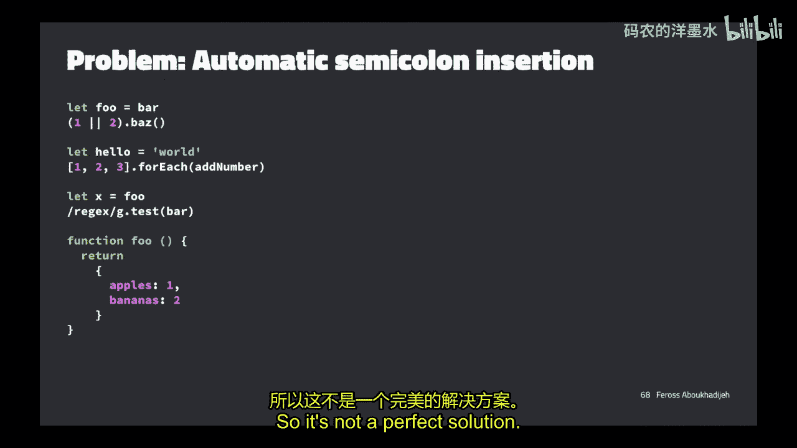

see if I can use this instead。 Yeah， there we go。 So here what it'll do is it'll actually interpret this as a function invocation。

 So it's gonna call a function called bar with that with the number one as an argument。

 So it actuallys like， no， we can't put a semi in there。

 That actually is a continuation of the previous line。 And that might surprise you。😊。

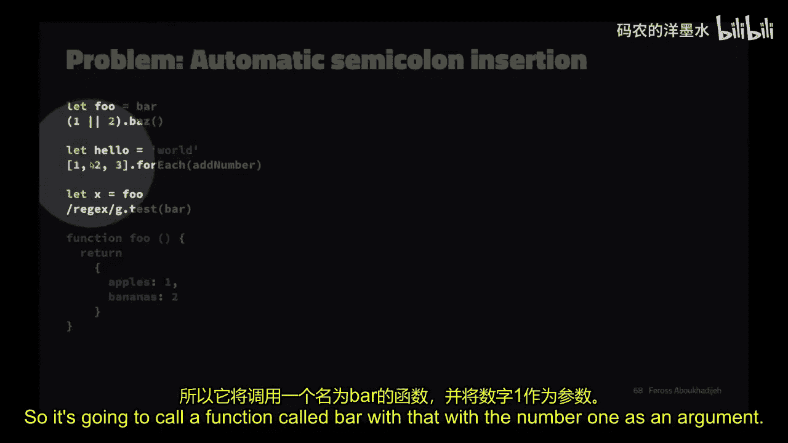

Same thing with this one， with this one up being an array index right here of of the string world。

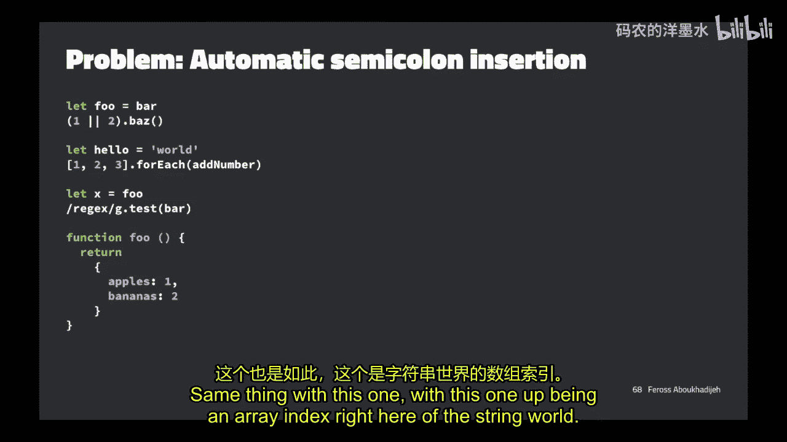

This will end up being food divided by rex。

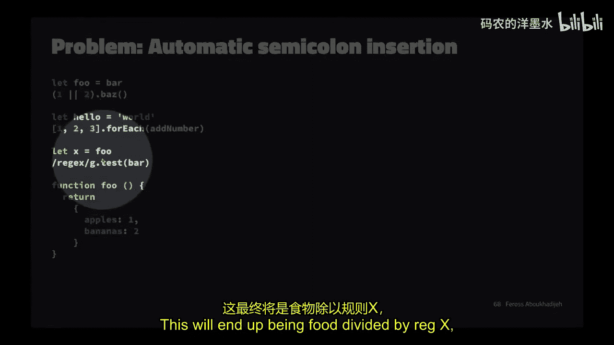

Which is not what she wants。 And then here， So by the way。

Inserting semicoons on the end of every line doesn't actually protect you。 You might think， well。

 I'm not gonna rely on this feature。 I'm gonna insert semicolons everywhere。 and then I'll be good。

 right， turns out， So if you wrote this line right， this function right here。

 where would the semicolon go， go here， right， because that's the end of the the statement。😊。

Automatic semi colonlon insertion is gonna say， wait a minute。 you hit enter here。

 I'm gonna stick a semi colonlon right there for you。

 And so you end up getting return and then an object afterwards that does nothing。😊，So。It turns out。

 yeah， inserting semies everywhere doesn't actually protect you。 You have to understand the rules。

 which is just， it's just that。 it's， it's a mistake。 They shouldn't have included in the language。

 The creator says it was a mistake。 Everyone agrees it was a mistake。 Yeah， so， so yeah。

 if you actually fix you actually put semis everywhere。 Youll get you'll get owned in the situation。

 It's not actually a perfect solution。 The only the only guaranteed solution is you have to use alin。

 A Li can help you catch this because what it'll do is it'll say wait a minute。

 I know a semi Col is gonna go here and I see that you have unused code that is never gonna run afterwards。

 And it can warn you about this。 So you have to always use alin in the real world。😊，Yeah， okay。

Let's see Yes，'s， I'm just showing standard would warn you in both of those cases。

 whether you insert semis or you don't， It's gonna catch it And so you have unreachable code。

Let's see here。Yeah， okay。嗯。Like the example about insert semi column is that like object will be actually treated as a block and Apple are going to be like labels there。

 Yeah， actually， so I lied a little bit。 that turns out this will。 Yeah， yeah， yeah。

 So that's exactly what happened here。 This is gonna be。A block。 And that's a label。

 And then that's the number one。 It's like。Yeah， it's like you can go to Apples now。

 You can add a go to statement if you want and'll jump in there。 But yeah， anyway， actually。

 doesn't have go tos， but。Yeah， same idea， okay。Yeah， okay， so。What of the things like it turns out。

 yeah， you can add leading zeros to numbers and that actually turns them into octal numbers instead of decimal numbers。

 So like that's 8， and that's 9。 And except for if you use a digit like 9。

 which happens to not be a valid digit in octal， then it ignores the 0 and gives you 99。 So anyway。

 this is dumb。😊，You should should use a link to catch this if you accidentally do it or。

Use strict mode because strict mode also prevents ocal numbers from working。嗯。Yeah。

 another thing that happens again， This is like another thing where it was a decision that was made to make the language easier for beginners。

 It turns out to be a mistake is if you forget to include a declaration before you define a variable So you don't say like you forget let or const。

 Then what will happen is itll， itll make X and Y a global variable。😊，So if you call foo here。

 then this function runs。 And then when Fo is finished， X and Y still exist because they're globals。

 And so this will actually print out 5 and 10。😊，Okay， so that's， that's just bad。 So if you can。

 if you， if you use strict mode or you use a Li， this will be caught。

 The difference is if you use a if you use strict mode， you need to actually， it's a runtime。

 It'll be a runtime error because it won't know until it calls this function that until it gets to this line。

 And then it'll be like， wait a minute， that's not valid。So if you use a Li。

 you can actually catch this before even run your code， which is kind of nice。Oh， yeah。

 this is really fun。 When this used to be valid， You could actually， in the past。

 you could do undefined equals true。 And then every program would break。😊，This doesn't work anymore。

 But if you try to do something like that， you'll get，'ll get a type or if you， again。

 if you use strict mode or you use a L。 So I'm just trying to give you the idea that like there's all these edge cases。

 It's all these like gross things。 And it's not， know， it's not just JavaScriptvascript。

 A lot of languages have these kinds of sort of， tricky little edge cases and using a L or some kind of a static analysis tool to catch issues is really。

 really valuable。😊，Oh yeah， another similar one。 we can can maybe I'll just show you really quick。

 You can do like， you can try to add a property to， to a primitive like true or to a number。

 And that won't work。 By the way， the reason why I'm putting a semico here， Does anyone know。It's。

 it's ridiculous。 So in， in the no semicolon style。

 you can either write semicolons in your code or you cannot write semilon。 If you dont。

 if you don't write them， Then you， when you do something like this where you have the parenss。

 remember I mentioned what the per will do， they'll be treated as a function invocation on the previous line。

 So the way that you can fix that issue is you add a semicolon。 But in a no semicolon code style。

 you don't want to put semicollonons at the end of lines on some lines and not on other lines。

 So you do， instead is you prefix the semicolon。😊，Only when。

 only when you have only when you have one of these， these weird characters starting a line。

 It turns out there's only a handful of them。 So you just memorize， oh， paren and square bracket。

 I'll just remember to put semi Cols basically。 But yeah， it's， it's， it's， it's not good。

 So use a winter。Yeah， so， so you'll end up if you strict mode or use alinnt。

'll again catch this as you're trying to add a property to to a primitive。 You can't do that。

 So basically use a Li， you can use standard or you can use E S Lt。

 but I don't recommend coding without one of these one of these and standard just uses E S Lint under the hood。

 So E S Lt is what you need to use。To to be safe。Yeah， and then， of course。

 the general advice I've been giving serve all quarter is to not be too clever for your own good。

 because code is for humans and not for computers， so。

Like this is some code that I've seen people write， and I've written it myself。

 but I now no longer think this is good code。 So what we you have here is is fo is a boolean。

 you have a function bar。 and then you can sort of do this take advantage of short circuit Boolean evaluation and can you can basically rely on the fact that if this is false。

 then the interpreter doesn't bother running bar because it knows the entire Boolean is going evaluate a false or to false。

 So if this is true than this will run。 And like you can do this。

 this's not the end of the world in this case。 but like in general。

 this type of programming is like I think trying to be too clever and this is much like simpler to understand if you just write a foo bar。

 like everybody who sees this who's ever programmed before will understand this。

 whereas this relies on understanding the rules of the logical operators and short circuit evaluation。

 So you know you could argue good programmers should know this。 maybe that's true。

 But if you're working on a team。HaveBeners on the team。 You know。

 this is the code that that everyone on your team will understand。 This is code that you know。

 some percentage of your team may not understand or will have to look up stuff。 this is。

 this isn't the worst example。 So I wouldn't begd you too much if you did this。 But theres like。

 theres this stuff is all over。 if you， you know， you start to look at real world code people are really always trying to be really clever。

 Like this is something that I've seen。So this is I didn't。 I had to like， I had to go in like。

 Id spent like 15 minutes trying to understand what this did。

 Like it's too clever that just means it's too clever in my opinion。

 So what this is doing is it's helpful if you add par。 So first of all， I didn't expect the par to。

 to go that way。 I thought the。 I thought that the dot dot dot would attach to this。

 And then this would be separate。 But it turns out， no， this is actually how it binds， which is。

 which is not expected。 And then what's actually going on here is it's basically。😊。

So if the condition turns out to be false， then the whole， this whole statement becomes false。

 and you get this。 And then if it， if it turns out that this is true， then you get this as the value。

 And so you get dot dot， dot。 and then the right hand side。

 And then what do do dot does is it sort of expands。 If this is an object。 It expands。

 It sort of takes all the。呃。Ks takes all the properties off of the object and assigns them to this object with this value。

 So， basically， this is the code this is this left and right。 So that's what they wrote。

 This is what they could have written。 So basically。

 what they should have written is just make an object。 If the condition is true。

 assign value to the prop property。Instead they do with that， which is like。

 requires understanding a bunch of features and knowing how where the pars go and all this kind of stuff。

 So， you know， I think it's too clever。Yeah。あい。Even nowadays， I try to avoid that。

 but it's a preference issue。I wouldn't do it。Cause I'm like relentlessly trying to just like go back to like using just the very basics of the language whenever I can。

 unless there's like some really good reason not to。 But yeah， that's， that's a taste thing。

 This is like a very， very bad example。 you can't justify this one。 The first case。

 the program is clearly flexing and trying to like show off like， oh。

 I know how function prototype collar works。 And you know。

 all this stuff they should have just written this。 Oh。

 we're just gonna map over some names and trim off the extra white space on both sides。

 You know what I mean， So， yeah。😊，I don't know。 That's like。

 this is just no justification for this kind of could。Yeah。So don't be really clever。

 Readability is much more important than brevity。 I think and like don't in general。

 Try not to write code that requires like all of your intelligence to write because like when you come look at it later。

 you're not gonna necessarily have all that same context that you have now。

 So if you are as clever as you possibly can be in this moment to write like this code。

 like later on when you're tired or later on when you have less context。

 you're not even gonna understand your own code， let alone other people who who， who you know。

 are coming along。 So。So yeah， I don't I， Id say， don't try to go out way to use esoteric features unless you're really getting bang for your buck in using them and definitely don't rely on like obscure edge cases in the language。

 if you can。And I think it's actually similar to writing where like， you know， I don't know what。

 what， again， it's like a taste thing。 So I' I'm hesitant to be so， to sort of be alo about it。

 But like。Personally， when I read writing， that uses like really flowery words。

 like when they could have just used a simpler word and and been understood by more people。

 I'm a little bit annoyed。 Like， unless I'm going， unless I'm trying to read writing for the art。

 Like if'， if you're trying to communicate a message。

 like the more complicated words you throw in there， you're just losing more of your audience。

 So it depends on where your goals are。 But and some people do really think that that coding。

 you know， they are coding for art reasons， like they're just trying to have fun。

 And like that's fine。 I've seen people， I've seen somebody do has anyone heard of reverse indentation。

😊，It's hilarious。 Basically， you start the first line starts at the most indented that you're gonna use in your program。

 And every time you normally indent to the right， you indent to the left so that it's an inverted like。

 its， it's ridiculous。 don't do it。 But if you're trying to like， you know， I mean。

 like you can do whatever you want。 Like if you think it's programming art。 You know。

 like have go at it。 You know what I mean。😊，But yeah。Yeah， and then last thing is， I think。

Writing test is super critical because if you don't test your code。

 it probably almost certainly doesn't work。 Untested code is broken code。 So write tests。

 You you just write it and look at it and think it's good。 It's probably not good。

 Like test it for sure。Cool。😊，So， last。I guess the。

 the last thing I want to talk about a little bit is， So， yeah， so we've talked about writing tests。

 We've talked about not being clever。 We've talked about sort of using alin。

We've talked about all the different Web security things over the quarter。

 The last thing is we end up when we're writing programs。

 we end up using a lot of code written by other people。

 We pull in a bunch of code that's open source that's written by other people。 the typical NPM app。

 I mean， if you install a few dependencies， you end up with like100 packages in your dependency tree very quickly。

 and each of those might be worked on by several contributors。

 And so you end up implicitly depending upon thousands of individuals that you've never met that you you know。

 you're running code that you haven't read。 And you're just hoping that it all works。 And honestly。

 it's kind of amazing that most of the time it actually works as well as it does because I mean。😊。

We've talked about security the whole quarter。 But all of you every day when you run NPM install are literally just giving Shell to like 1000 random people。

 you have no idea who， you know， And like on the same computer that has all of your like tax information and private information。

 it's all on there。 And like， I mean， I do this every day， too， It's ridiculous。

 I can't believe we all do it。 But that is literally how it works。 right now。 So， yeah。

 there's this it's called the open source supply chain。

 It's like this idea is like when you're building a product。

 you actually depending upon all these vendors and people who supply the sort of raw materials that you end up producing using to produce a final product。

 And in the case of open source，'s。😊，The these supplies are produced by by these open source contributors。

 These volunteers， often unpaid， often， you know， like in other countries。

 you don't know who they are。 And so the types of risks that can come from building applications this way are I think I put them into these three categories。

 you can have accident accidental mistakes that the open source developers make。

 you can have just like a lack of resources like have often know volunteers who don't have enough time to actually actively maintain their packages。

 So you end up with unmatained packages， literally code that's just been abandoned that no one is no one is looking after and no one is there's no one you can email to sort of say。

 hey， I found a security issue in this。 Please fix it because everyone who's using it is vulnerable。

 if you email the person they're not there。 Like theyve moved on to other things maybe they're not a program anymore。

 Maybe they died like there's all kinds of things things happen right So those are unmaed。

 and there's also undermatained packages， which are just packages that where the maintain doesn't have enough time to devote to regularly。

 they're still around。 but they're not。Atively working on it and giving it the love and attention that it needs。

And then lastly， there's this analysis， like either a maintainer。

 an open source maintainer goes rogue， which has happened in NPM ecosystem。

 somebody literally just deleted all their code and then everything that depended upon it instantly broke。

 And like no one got work done that day because literally。

 there's like packages that were depend upon that were just missing。

 And then there's also just like people get their accounts hacked and stuff like that， so。😊。

Just a few， few examples just to give you a taste。 So this was a， you know。

 actually forget what the project did。 But there was it It's calledble Bumblee。 okay， yeah， yeah。😊。

Yeah， so this， this was， this was an install script that ran that ran， I think， at the time。

 you installed the package。 And you'll notice there's a space here。

 And what does RM do when you have multiple arguments。😊。

It treats them as separate folders to be deleted。 And so this install script would literally just delete your entire s user folder。

 which is where like all your binaries are and like a bunch of operating system files。

 So everybody who installed this update， just like their machines got hosed。 Yeah。

 and this was not malicious。 This was literally an honest mistake that the maintain made。

 But like tons of users computers just got completely destroyed And hopefully they had backups。 Yeah。

 like one one character like he I have that。 He would feel if you did this。😊，Yeah。

 and then the comments are always the worst on Github when people start piling on and like， you know。

 like， I mean， these are kind of funny。 But sometimes they can get really nasty。😊。

And then this is another big one， Harp lead maybe you've heard of it。 turns out Open SSL。

 which is the library that I think the majority of of T L S packages used。

 So this is used a lot of browsers and a lot of servers to actually negotiate the TL S handshken to do all the T S protocol。

 This was actually maintained by one person， most of its life。

 And after so there was this huge bug that everyone discovered like in 2017 called hap lead。

 And when this happened， people started looking at the project and saying， how did this happen， know。

 what was what was the issue。 And then it came out that like open SS L maintainer said that they received $2000 in donations every year。

 And there's one person who works on it full time。 So yeah。

 and this is the code the powers the majority of every TL S connection on the Internet。

 Like this is ridiculous。 Like this is really ridiculous。 And now after this happened。

 all the companies sort finally came in and were like， okay。

 I guess we'll give you money to like maintain this thing that like we all use for our billion dollar businesses。

😊，Anyway， sorry I feel very passionately about this。😊，And then there's another example， curl。 mean。

 you've all used curl。 Cur is built into like every Linux distribution。

 It's in like most Io T devices。 It's in like a lot of TVs and smartphones。 It's in a lot of stuff。

 And turns out there's like one guy who's been working on it for 20 years as a hobbyist。

 And he just recently went full time working on it now。 So he quiz job。 But yeah， Cur。 I mean。

 it's actually maintained by a person who just like works on it and powers like everything。

 It's pretty wild。 And he's now accepting donations on Github So you can support him。 Yeah， and then。

😊，So that's what I'm talking about。 I want to talk about sort of under maintaineded packages， right。

 So you have the， you have the accidental problems。 You have the undermaed packages。

 And then here you have the actual malice， so。What happened here was there's a guy named Dominic who maintains and wrote and maintains a whole bunch of packages in the node ecosystem。

 he think 700 packages that he's written。 a lot of are not maintaining it's just too much for one person。

 But he's very experimental person publishes a lot of work。

 And turns out one of his packages that got really popular。 he's not using it anymore。

 So you can see here he moved on to another thing and moved on to another thing。

 And he doesn't use this code anymore in his own projects。

 But a lot of companies continuing to use it， even though hes like moved on past it。

 And so somebody emailed him。 And this is very common in the open source world。

 Some will email maintain and say， hey， I noticed that know you haven't been merging the poll requests that people are sending you。

 I happen to be a user of the software。 do you mind I help out。

 And then if they help out a bit eventually somebody like this who's completely overwhelmed with will just give that person the ability to commit to the project and to publish new versions of the package。

 And that's how the that's how the open source world works。 on a lot of trust。

 And if you show up and you do work。 you're。😊，Be given responsibility and permission to publish。

 And so that's what happened。 Some emailed him and said， hey， you know， I'm using this。 And he。

 you know， he hasn't used it for four years。 And he So he said， yeah， sure。 you can publish to it。

 The person ended up adding Maware to it。 It was very sneaky。 So it was， it was。

It was an encrypted string。 So it didn't look like code。

 It was just an encrypted string that got decrypted at runtime and then evaluated。

 And it it would actually， well， the really tricky thing was the decryption key to decrypt it。

Was based on the parent package that it was within。 So for most people。

 when you're just installing this on your computer。

 it would look up one level in the tree and then take whatever it would take the description of the package above it。

 and then use that as the decryption key。 But for most of us。

 it would that would be invalid decryption key and it would do nothing。 But in one particular case。

 were targeting a Bitcoin wallet。 and this Bitcoin wallet。

 They knew exactly what package was above it in in the dependency tree。

 And so they made that be the decryption key。 And so because of that， no one noticed this。

 it was very targeted。 It was only targeting one particular user， which is this bit wallet。

 and what the code did was it would look at the balance in the wallet。 And if it was over。

 I think like some huge amount of Bitcoin， then it would send the keys off to the attacker。

 And so they stole a whole bunch of bit by doing this。Yeah， and I mean， this person was like。

 you know， you know， obviously didn't intend to give the code to。

 didn't intend to give their package to this malicious actor。 They were just overworked。 And like。

 you know， this could have happened to serve any maintainer。 It's very possible。 Yeah。

 but I recommend reading this post。 This is sort of his statement afterwards where he talks about。

 He's a very interesting person。 He talks about how he used to be a dishwasher at a restaurant and how。

 you know， anyway， it's very interesting person。😊，This also is true in the case of the browser extension ecosystem。

 So you see similar dynamics as the open source world。

 So all the browser extensions that you use oftentimes they're written by individuals。

 And what happens is there are these sketchy actors that email people who created popular Chrome extensions and say。

 you know hey， I noticed that you wrote this extension that a million people installed。

 And I noticed that you're not really actively working on it anymore。

 what do you say if I sent you 50k would you give it to us where a company we gonna develop it further。

 And somebody who is like， oh， I wrote this thing in my free time and like oh，50。 Yeah， sounds good。

 And so they'll give the rights to the extension to this company and the company will turn around and malware or collect data about your browsing activity and so on and so forth。

 So the owner of the extension changes the behavior it can change dramatically。

 And this is just because it's really hard to monetize Chrome extensions。

 And so you get this acts of desperation almost in a way where people will sort give。😊。

Over control of it to someone who will pay them for it because they're making nothing from it。

So yeah， this is a big sort of problem in both open source and the browser extension ecosystems。

In my opinion。Okay。That was a lot。 So to conclude， I just wanted to highlight a few of the key ideas we talked about in the class over the quarter。

😊，So these are the big ideas。 Think like an attacker。 Hopefully when you're writing code。

 you're not thinking that everything is going to go well and you're going to be given exactly the inputs that you expect。

Think like， how is this going to be broken and also think this way when you're reading other people's code。

 people on your team or your teammates， or just code you find online。

 It's a mindset that will serve you well through your career。Of course， never trust user input。

 always sanitize it。 Use defense and depth。 So be redundant。

 assume that one of your security controls is gonna fail and think about what will happen in that situation。

 Plan ahead。 Salt and hash your passwords。 If you don't want to bother doing it yourself。

 Just use be crypt。 That's the good advice。 Just use B cryrypt。 Beware of ambient authority。

 So that's the that's， that's the。The way that the browser will helpful attach cookies to requests that are destined for a certain site。

 you can solve this with same site cookies。 be sure to use those。 Don't be overly clever。

 It's better to be explicit than to be magical when you're writing code。 So I will take boring。

 plain， repetitive， explicit code any day over magical code。

 even though magical code is fun sometimes， but like for security， explicit code is usually better。

 dangerous code should look dangerous。 So if something is very risky to use。

 make sure it has a scary name。 make sure it's properly documented。

 don't combine it with functions that do benign things， don't put those two things together。

 And then of course， you can never be too paranoid in security a paranoid mindset is actually very valuable asset。

 So be constantly vigilant。😊，Cool， so。I wanted to。Well， yeah。

 I guess questions about any of anything。Yeah。Thanks for关。Somebody。て番て。

Or something and we just forgot the solution or is like the scale just totally different now or like yeah。

s so there's a several things that have changed。 We can I talk about this forever。

 It's a really interesting issue。 But like one big thing that's changed is that the size of packages that people produce are a lot smaller because modern programming languages like NM is made relatively recently and didn't have a package manager and no didn't have a package manager until I don't know。

 five years ago or something。 Rus is also just created a new package manager。

 All these new ecosystems have sort of solved the traditional dependency hell that happens in other ecosystems。

 So I don't know if you've ever tried to install Python package。 And then it says， oh。

 you have a dependency this conflicts with And it turns out you know this package needs version 1 of this one and this one needs version 2 of this one。

 you can only have one installed in your system， so。

MPM and and Ru's package manager have basically switched to the local dependency model where you can just install everything in a folder。

 And then it's okay if you have conflicting versions。

 And that's meant that people are free to sort of produce smaller units of work。

 like sort of smaller units of functionality。 And so packages have gotten a lot smaller。

 And so dependency trees have gotten a lot bigger。 And so there's lots more people involved in the ecosystem now。

 There's just like lots more code coming from lots more places。 That's one really big difference。😊。

Also， you have Github， which has changed the way that people collaborate。

 So it's a lot easier to things move faster。 It's lot easier to get code is just flying around all the time。

 In the old days， every different open source project had its own process。 It own mailing list。

 You had to sign up for its own， know， version control。 people didn't all use Git back then。

 Now everyones standardized on Github。 So you have all these more people coming on。

 And the scale is just completely different than it was in the old days of open source。 Yeah。

 there's those other reasons， too， But those are the big ones that come to mind。😊，Hang。Okay。

 so I just wanted to recommend a few classes that you might take if you like this class and if you want to do more security。

 So next quarter， there's a class called C S 2，55。 It's intro to cryptography。

 It's a really great class。 I think it's taught by Dan Vananek quarter。😊，It's。

 if you liked the T S part of the lecture， you liked。

 you know signing and encrypting and this kind of stuff， Great class to take。 There's also C S 1，55。

 which is more similar to this class。 It's more about sort of implementation and less theoretical。

 And it's a great class。 I really highly recommend that one。 And then 3，55 is the continuation of 2。

55。 So if you like 2，55 in winter， you should take 3，55 in spring。

 This is a graduate level class where you read papers and you do do you don't read papers。 you。😊。

You you go really deep into crypto and you it's a Pet class just like 2，55 is really good class。

 I really recommend that one。 And then these ones are， you can't take them until next year。

 So 251 is， is cryptocurrencies in blockchain， which is really fun and has a whole bunch of security aspects to it。

 because， of course， the blockchain is this trustless， know thing。

 And there's all kinds of security implications in everything in blockchain。

 And then this one is in the winter。 But the deadline to apply for it has already passed。 So C。

 S 190。😊，I's not strictly a security class， but I highly recommend only 18 people get into it。

 You have to apply， and the deadlines already passed for this year， but you can apply for。

 for next year。 It's taught by John Osterhowut。 And this is like。😊，Really cool class。 It's like。嗯。

So first of all， it's， it's like， it's almost like a writing class。 You， you literally。

s like put code up on the， on the whiteboard that the students have written in everyone in the class。

 It's like a discussion section。 and you sort of talk about the code。

 and you talk about how it could be could have been designed better。 It's like a writing class。

 But for code， you literally learn how to like write beautiful code code that like is understandable and works well And you talk about all kinds of design and architecture issues。

 So it's really great。 But the prere for is C S1，40。 So。😊，It's a， it's a。

 it's a writing class that you have to take operating systems first to do， basically。 But yeah。

 it's really good。 It's 18 people。 I recommend applying for it if you're interested。 Yeah。

 so these are， these are some classes maybe think about taking。😊，And yeah， I just wanted to end with。

 I want to say thank you so much for a great quarter。 It's been an honor to get to know all of you。

 And thanks for being adventurous and taking this class with me。 And yeah， I， I I don't know。 Thank。

 Thank you。 Just really appreciate it。😊，Yeah thanks。

