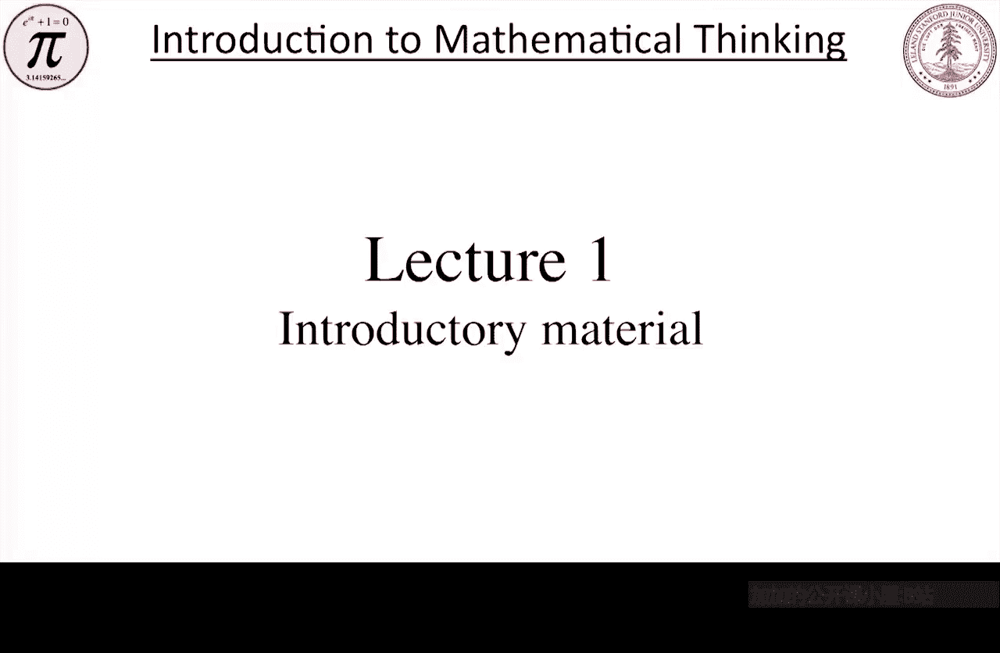
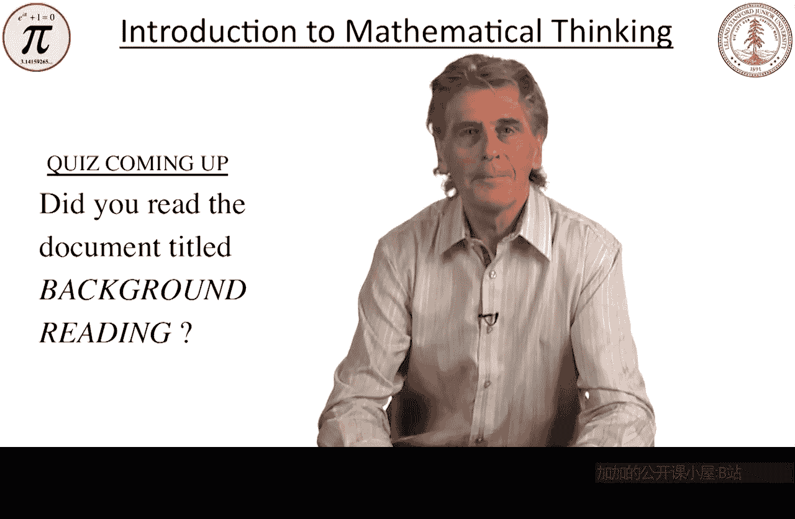
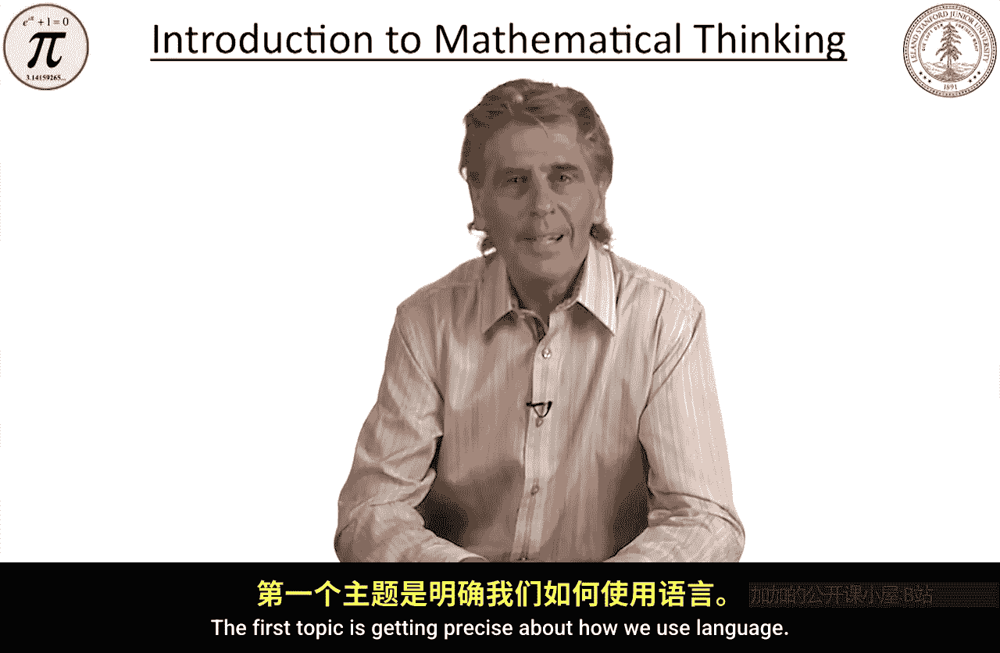
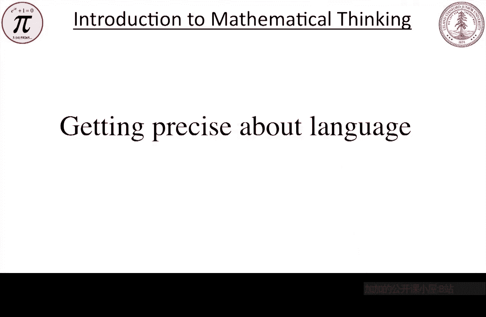
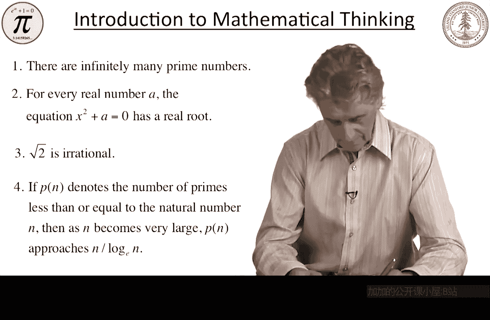
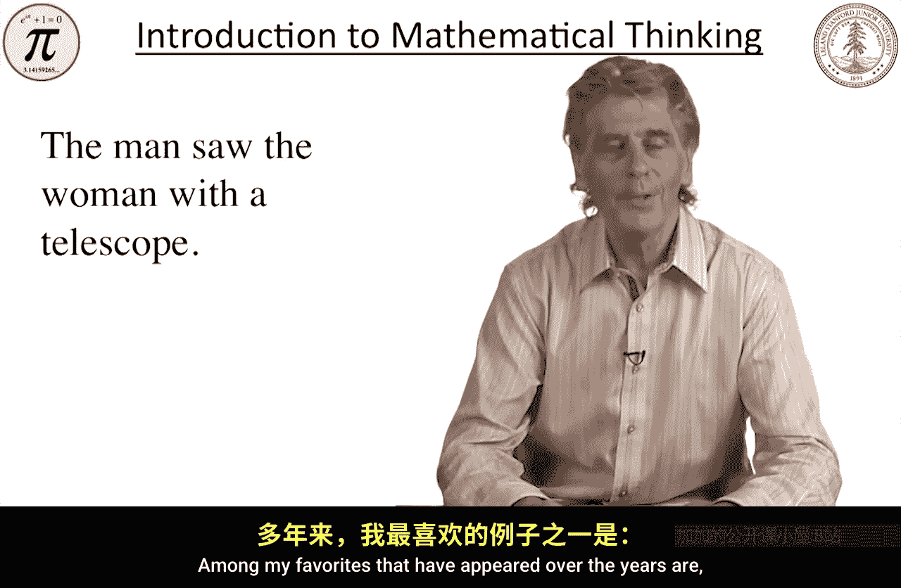
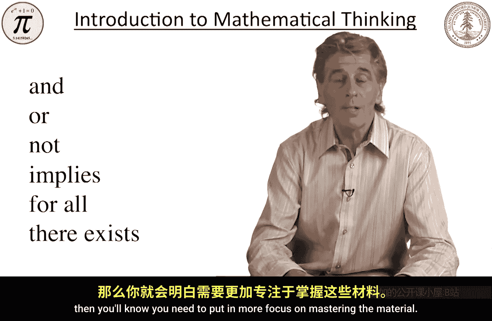
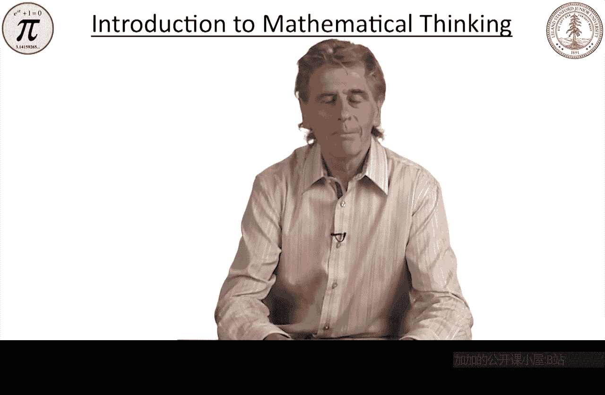

# 002：引言材料

## 概述
在本节课中，我们将要学习数学的本质是什么，以及现代数学思维的核心特点。我们将探讨数学如何从计算转向对关系的分析，并理解为什么在数学中语言的精确性至关重要。

## 什么是数学？
我将从一个问题开始。什么是数学？

考虑到你可能已经学习了几年数学，这个问题可能显得很奇怪。尽管学校投入了大量时间教授数学，但几乎没有时间试图传达这门学科的本质是什么。相反，重点在于学习和应用各种程序来解数学题。

这有点像通过说“足球是一系列为了把球踢进球门而执行的技巧”来解释足球。两者都准确描述了各种关键特征，但它们都遗漏了宏观图景中的“是什么”和“为什么”。

如果你只想学习新的数学技巧以在不同情况下应用，那么不了解数学的真正本质或许也能应付。但如果是那样，这门课程可能不适合你。

你应该认识到的一点是，许多学校数学可以追溯到中世纪，几乎所有内容最晚也来自17世纪。过去300年的内容几乎没有进入课堂。然而，我们所生活的世界在过去10年（更不用说过去300年）已经发生了巨大变化。

几个世纪以来，数学的大部分变化只是扩展。但在19世纪，数学的性质发生了重大变化。首先，它变得更加抽象。其次，主要焦点从计算和遵循程序，转向了分析关系。这种重点的转变并非随意，它是随着我们所熟悉的世界变得越来越复杂而产生的。

程序和计算并没有消失，它们仍然重要。但在当今世界，仅有它们是不够的，你需要理解。在我们的教育体系中，数学重点的转变通常发生在你从高中过渡到大学时。

在20世纪80年代，我和一些数学家提倡用一个新短语来概括当今的数学：模式的科学。根据这个描述，数学家识别和分析抽象的模式。这些模式可以是数字模式、形状模式、运动模式、行为模式、人口中的投票模式、重复随机事件的模式等等。它们可以是真实的或想象的模式，视觉的或思维的，静态的或动态的，定性的或定量的，实用的或娱乐的。它们可以来自我们周围的世界，来自对科学的追求，或者来自人类思维的内在运作。

不同类型的模式产生了数学的不同分支。例如：
*   算术和数论研究计数和数字的模式。
*   几何学研究形状的模式。
*   微积分使我们能够处理运动的模式。
*   逻辑学研究推理的模式。
*   概率论处理机会的模式。
*   拓扑学研究接近性和位置的模式。
*   分形几何研究自然界中发现的自相似性。
*   等等。

19世纪数学日益抽象和复杂化的一个主要后果是，为解决重要现实世界问题而开发的方法，其后果可能是反直觉的。

让我给你一个例子。它被称为巴拿赫-塔斯基悖论。它说，理论上，你可以取一个球体，并以某种方式切割它，然后重新组装成两个完全相同的球体，每个都与原来的球体大小相同。这还不是唯一的惊喜。数学家们不得不学会信任数学高于我们的直觉，就像物理学家在发现相对论和量子力学时所做的那样。

当然，如果你要信任数学高于直觉和常识，你最好确保数学是正确的。这就是为什么19世纪和20世纪初的数学家发展出了我称之为数学思维的精确思维方式。这正是本课程的内容。

## 课程小测验
现在进行我在课程介绍中承诺的小测验。

你读过那份名为“背景阅读”的简短文档吗？如果没有，我建议你现在暂停视频，看完后再回来。

第一道题的正确答案是“钱”。人们确实测量土地，并使用各种尺子，但他们没有使用数字；他们当然计算季节，但你可以不用数字来计数，可以用木棍上的刻痕，或者用石子等等来计数。我们的祖先发明抽象数字是为了处理金钱，至少这是我们目前掌握的最佳证据。我们认为这发生在大约一万年前。

对于第二道题，拓扑学研究的是接近性的模式。如果你认为是地理地形，那你就是把拓扑学（topology）和地形学（topography）混淆了。

对于这一题，19世纪的主要焦点变成了概念和关系。这是一场发生在德国的数学革命。

对于这一题，至少根据我和我的许多同事（我应该指出），当今主要的数学能力是能够调整旧方法或开发新方法。是的，技术的使用很重要；是的，你需要掌握基本技能；但在当今世界，关键的能力是调整旧方法或开发新方法。

你在那个测验中做得怎么样？是的，我知道这不是一个数学测验。它实际上只是为了让你习惯课堂测验的形式。我在第一次测验中就给出了这些测验的基本原理。正如我在那里写的，测验的目的是让你觉得答案显而易见。如果你做到了，这表明你足够投入，并且没有试图推进得太快。如果你发现你需要在测验问题上花时间，我会回去再看一遍讲座。那么你就会知道你没有足够专注地参与，需要放慢速度。

整个课程的秘诀是反思，而不是完成。由于没有教师或助教的定期反馈（这对于拥有成千上万学生的课程来说是不可能的），学生必须监控自己的进度。测验虽然简单，但在这方面被证明非常有用。你应该尽量在观看讲座后尽快完成测验，因为这将帮助你判断自己的进度是否合适，对于本课程来说，这意味着不要太快。

我们专业数学家对学校系统感到绝望，因为它们对完成数学测试施加严格的时间限制，并鼓励快速工作。真正的数学需要时间。

## 课程预期与学习方法
在我深入第一个主题之前，让我谈谈进入课程后的几点预期。

主要要认识到的是，我们所做的很多事情可能看起来不像在做数学，因为重点是**如何数学地思考**，而不是如何应用标准技术来解决问题。对于你们大多数人来说，如果你接受过相当标准的高中数学教育，这是一个巨大的转变。

其次，即使我们做的数学看起来你很熟悉，你也会把大部分时间花在思考上，而不是写东西上。如果可能的话，你应该与其他人或小组一起工作。学习一种不同的思维方式比学习一种新技术要困难得多，我们很少有人能独自完成。如果你发现需要帮助，或者你认为我所说或所写的内容有错误，首先要做的是与你的学习小组或在课程讨论论坛中讨论。如果讨论后，你的小组认为有错误，可以在论坛上发帖看看其他人的想法。

好了，现在我们已经让你了解了方向并处理了预备事项。让我们正式开始工作。

## 第一个主题：精确使用语言
第一个主题是精确地了解我们如何使用语言。

美国黑色素瘤基金会在其2009年的事实说明书中声明：“几乎每小时都有一名美国人死于黑色素瘤。”像许多数学家一样，我忍不住觉得这种说法很有趣。不是因为我们数学家对生命的悲剧性损失缺乏同情，而是因为如果你从字面上理解这句话，它完全不是AMF（美国黑色素瘤基金会）想要表达的意思。

这句话实际声称的是：存在一个美国人（我们称他为X），他很不幸（更不用说拥有几乎瞬间复活的神奇能力）每小时都死于黑色素瘤。AMF作者应该写的句子是：“几乎每小时，都有一名美国人死于黑色素瘤。”你看出区别了吗？

像这样的语言误用相当普遍，以至于它们实际上不再是误用。每个人都把第一句话理解为第二句话所准确捕捉的含义。这样的句子已经成为修辞手法。除了数学家和其他需要语言精确性的专业人士，几乎没有人注意到第一句话从字面上看实际上提出了一个荒谬的主张。

当人们在日常语境中使用语言谈论日常情况时，他们共享着对世界的共同认知。这种共同认知可以用来确定预期的含义。但是当数学家在工作中使用语言时，往往没有共享的共同理解。此外，在数学中，对精确性的需求是至关重要的。这意味着当数学家在做数学时使用语言，他们依赖的是字面意义。他们必须这样做。

因此，数学家必须意识到他们所用语言的字面意义。这就是为什么大学数学的初学者通常会接受关于语言精确使用的速成课程。考虑到语言的广度，这听起来可能是一项艰巨的任务。但由于数学中语言的使用受到极大限制，这项任务实际上相对较小。

## 数学陈述与证明
现代纯数学主要关注关于数学对象的精确陈述。数学对象是诸如整数、实数、集合、函数等事物。

以下是一些数学陈述的例子：
1.  存在无穷多个素数。
2.  对于每个实数 `a`，方程 `x² + a = 0` 有一个实根。
3.  `√2` 是无理数。
4.  如果 `π(N)` 表示小于或等于自然数 `N` 的素数个数，那么当 `N` 变得非常大时，`π(N)` 趋近于 `N / ln(N)`。

数学家不仅对这样的陈述感兴趣，他们最感兴趣的是知道哪些陈述是真的，哪些是假的。每种情况下的真或假不是像自然科学那样通过观察、测量或实验来证明的，而是通过**证明**。

在本课程中，我们将学习一些不同的证明陈述的方法。在我的四个例子中，第一、第三和第四个是真的，但第二个是假的。

让我向你展示第一个真陈述的证明。它来自古希腊数学家欧几里得，他生活在公元前350年左右。

我们想证明，如果我们列出素数 `p₁, p₂, p₃, ...`，这个列表会永远继续下去。假设我们已经到达某个阶段 `n`，即我们已经列出了 `p₁, p₂, p₃, ..., pₙ`。我们能找到另一个素数来继续这个列表吗？如果我们总能找到另一个素数，那么这个列表就会永远继续下去，我们就证明了存在无穷多个素数。那么，我们能找到吗？

这里有一个欧几里得在其公元前350年的著名著作《几何原本》中描述的巧妙技巧。看这个数 `N`，定义如下：设 `N = p₁ × p₂ × p₃ × ... × pₙ + 1`。显然，`N` 大于 `pₙ`。所以如果 `N` 恰好是素数，我们就找到了一个大于 `pₙ` 的素数，我们可以继续列表。如果 `N` 不是素数，那么它将被某个素数 `p` 整除。现在，`p` 不能是 `p₁, p₂, p₃, ..., pₙ` 中的任何一个，因为如果你用这些素数中的任何一个去除 `N`，该素数将整除乘积部分，但会留下余数 `1`。所以 `p` 不能是它们中的任何一个。因此 `p` 大于 `pₙ`。这意味着我们找到了一个大于 `pₙ` 的素数。无论哪种情况（`N` 是素数或不是素数），我们都证明了存在一个大于 `pₙ` 的素数，这意味着列表总是可以继续下去。这就证明了存在无穷多个素数。

让我们再看一下我们做了什么。我们从一个素数列表开始，试图列出所有素数。我们必须证明我们可以一直这样做下去。假设我们已经到达某个阶段 `n`，我们证明总能找到另一个比最后一个更大的素数。我们通过构造数 `N = p₁ × p₂ × ... × pₙ + 1` 来实现。如果 `N` 是素数，那么它就是一个大于 `pₙ` 的素数。如果 `N` 不是素数，那么它有一个素因子 `p`，而 `p` 不能是列表中的任何一个（因为除以它们余数为1），所以 `p` 也大于 `pₙ`。无论哪种方式，我们都找到了一个更大的素数，列表可以继续。

这就是使证明成立的巧妙技巧：以那种方式定义 `N`，以确保任何能整除 `N` 的素数都不会等于列表中已有的素数。

我们证明了第一个例子：存在无穷多个素数，这是真的。

第二个例子呢？它说对于每个实数 `a`，方程 `x² + a = 0` 有一个实根。结果证明这是假的。要证明它是假的，你只需要找到一个实数 `a`，使得该方程没有实根。例如，取 `a = 1`。那么方程 `x² + 1 = 0` 没有实根，因为任何实数的平方都是非负的，加1后为正数，不可能等于0。因为存在一个实数 `a` 使得方程没有根，所以“对于每个实数 `a`，方程都有根”这个陈述是假的。

第三个例子呢？结果证明是真的，我们将在课程后面证明它。

第四个例子，这个关于素数分布的相当复杂的陈述，是一个在19世纪末（大约100多年前）被证明的著名结果，被称为素数定理。所以这个也是真的。

## 数学语言的精确性
显然，在我们能判断一个陈述是真是假之前，我们必须能够精确地理解该陈述说的是什么。最重要的是，数学是一门非常精确的学科，需要表达的准确性。

这本身就带来了一个困难，因为词语往往是模糊的，而且在现实生活中，我们很少精确地使用语言。特别是，当我们在日常环境中使用语言时，我们经常依赖语境来确定我们的词语传达了什么。例如，一个美国人可以真实地说：“七月是夏季月份。”但如果一个澳大利亚人说这句话，那就是假的。单词“夏季”在两个陈述中意思相同，即一年中最热的三个月，但它在美国指的是一年中的一部分，在澳大利亚指的是另一部分。

在日常生活中，我们利用语境、对世界和生活的一般知识来填补书面或口头信息中缺失的信息，并消除因歧义而产生的错误解释。例如，我们需要了解一些语境才能正确理解“The man saw the woman with a telescope”这句话。谁有望远镜，男人还是女人？

报纸标题中的歧义（通常写得很仓促）有时会导致 unintended 但有趣的第二种解读。多年来出现的一些我最喜欢的例子有：
*   Sisters reunited after 10 years in checkout Line at Safeway.
*   Large hole appears in high street; city authorities are looking into it.
*   Mayor says bus passengers should be belted.

为了使英语语言系统化地精确，以便人们能够有效沟通，通过精确定义每个单词的含义将是一项不可能完成的任务。这也是不必要的，因为人们通常依靠语境和背景知识就能做得很好。

但在数学中，情况不同。精确性至关重要，并且不能假设所有参与方都拥有相同的语境和背景知识来消除歧义。此外，由于数学结果经常用于科学和工程，因歧义导致的沟通不畅的代价可能很高，甚至是致命的。

起初，要使数学中的语言使用足够精确，似乎像是一项艰巨的任务。但幸运的是，事实证明这是可行的，尽管在某些地方有点棘手。使其成为可能的是数学陈述的特殊、高度受限的性质。

几乎每一个关键的数学陈述（公理、猜想、假设和定理）都是以下四种语言形式之一的肯定或否定版本：
1.  对象 A 具有属性 P。
2.  类型 T 的每个对象都具有属性 P。
3.  存在一个类型 T 的对象具有属性 P。
4.  如果陈述 A，那么陈述 B。

或者，该陈述是这些形式的子陈述的简单组合，使用我们称为连接词的词：**和**、**或**、**非**。

例如：
*   `3` 是一个素数。或 `10` 不是一个素数。
*   每个多项式方程都有一个复根。或并非每个多项式方程都有一个实根。
*   在 `20` 和 `25` 之间存在一个素数。
*   除了 `2` 之外，没有偶数是素数。
*   如果 `p` 是一个形如 `4n + 1` 的素数，那么 `p` 是两个平方数之和。

在他们的日常工作中，数学家经常使用这些陈述的更流畅的变体，例如“并非每个多项式方程都有实根”或“除了 `2`，没有偶数是素数”。但这些只是变体。顺便说一下，最后一个关于形如 `4n + 1` 的素数的陈述，是19世纪初数学家卡尔·弗里德里希·高斯的一个著名定理。

古希腊数学家似乎是第一个注意到所有数学陈述都可以用这些简单形式之一来表达的人。他们对所涉及的关键语言术语进行了系统研究，即：**和**、**或**、**非**、**蕴含**、**对所有** 和 **存在**。希腊数学家提供了这些关键术语的普遍接受的含义，并分析了它们的行为。

当这种研究以数学形式化的方式进行时，它被称为形式逻辑或数理逻辑。数理逻辑的研究是数学的一个成熟分支，至今仍在大学数学、计算机科学、哲学和语言学系中研究和应用。它比古希腊亚里士多德及其追随者以及斯多葛派逻辑学家所做的原始工作要复杂得多，但这远远超出了我们目前的兴趣。

## 另一个小测验
让我强调一下我在第一次讲座测验中写的内容。测验的设计使得，如果你以能够完成整个课程的方式进步，你会发现测验很容易。在大多数情况下，答案将是显而易见的。它们的作用是，如果你发现有些测验题做错了，或者你必须在回答前回头查看讲座内容，那么你就知道你需要更专注于掌握材料。

所以，这里有一个测验。古希腊人开始了对语言和推理的形式研究，这后来成为被称为形式逻辑的数学分支。

## 总结与下一步任务
这把我们带到了第一讲的结尾。

你的下一个任务是完成课程作业1。你可能会发现打印出PDF文件并在有时间时完成会更容易。很难说你应该为课程作业留出多少时间，因为人们的工作速度差异很大。第一个作业应该相当轻松，所以我猜对你们大多数人来说，一个小时左右应该足够了。但我真的不能确定。

如果你对讲座、阅读材料或作业中的任何内容不确定，请与你的学习小组讨论或去课程讨论论坛。事实上，即使你不觉得不确定，你也应该定期与其他学生讨论课程材料。许多学生在高中时独自学习也能做得很好。事实上，最好的学生通常一直这样工作——我上高中时就是这样。但当我进入大学时，我很快发现独自工作是最糟糕的策略。大学数学的重点不是学习解决问题的程序，而是以一种特定的方式思考。掌握一种新的思维方式最好通过小组合作来学习。在一门没有教师或助教定期检查你进度的慕课中，与学习小组一起工作几乎是必不可少的。

课程讨论论坛提供了一个起点。但你应该使用你喜欢的任何媒介与其他学生保持联系。在Facebook、Google Groups、Yahoo等上组建小组都是显而易见的方法。你可以在Google Docs上共享文件并一起工作，并通过关注论坛上的活动与班上其他同学保持联系。

祝你好运。下次见。