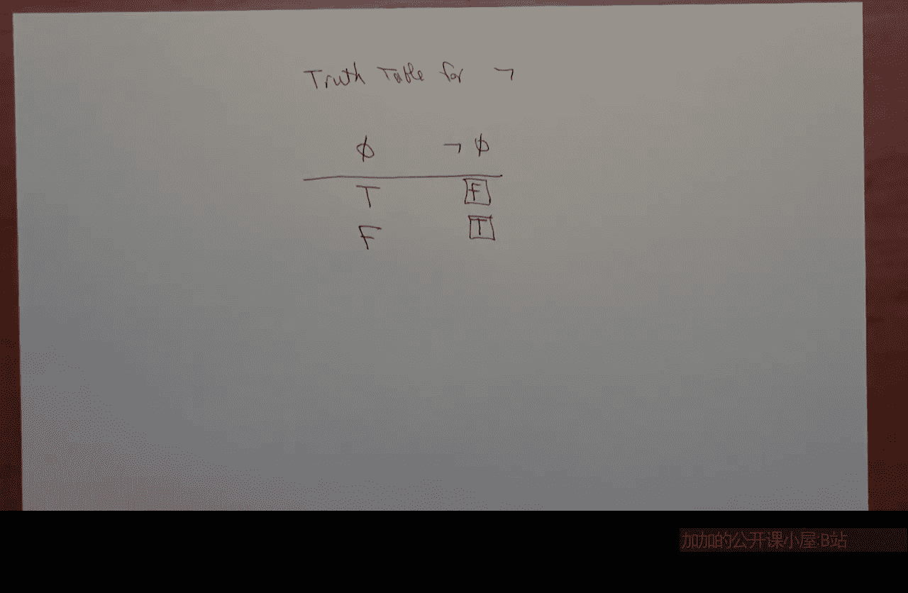

# 003：逻辑组合子

## 概述

在本节课中，我们将学习如何精确地定义数学语言中的三个核心连接词：**与**、**或**、**非**。我们将通过定义、符号和真值表来理解它们，并探讨这些定义与日常用语的区别。

---

## 与（And）

我们经常需要使用“与”这个词将两个陈述组合成一个陈述。因此，我们需要分析“与”的运作方式。

数学家使用的标准缩写是一个倒置的“V”形符号，称为楔形符号（∧）。例如，我们可以说“π大于3且小于3.2”，写作：π > 3 ∧ π < 3.2。

**定义**：给定两个陈述 φ 和 ψ，**合取式** φ ∧ ψ 意味着 φ 和 ψ **同时为真**。构成合取式的 φ 和 ψ 被称为**合取支**。

以下是判断合取式真伪的条件：
*   如果 φ 为真且 ψ 为真，则 φ ∧ ψ 为真。
*   如果 φ 为假、或 ψ 为假、或两者都为假，则 φ ∧ ψ 为假。

这个定义可以用**真值表**清晰地表示：

| φ | ψ | φ ∧ ψ |
|---|---|-------|
| T | T |   T   |
| T | F |   F   |
| F | T |   F   |
| F | F |   F   |

根据这个定义，在数学中，合取是**可交换的**，即 φ ∧ ψ 与 ψ ∧ φ 含义相同。但这与日常英语中“and”的用法不同，日常英语中的“and”有时隐含时间或因果顺序，并不可交换。

---

## 或（Or）

接下来，我们看看如何用“或”来断言陈述A或陈述B为真。

在日常英语中，“或”是**模糊的**，它可能表示“二者之一”（排他性），也可能表示“至少一个”（包容性）。在数学中，我们必须消除这种模糊性。出于便利，数学选择采用**包容性的“或”**。

数学中表示包容性“或”的符号是“∨”，称为析取符号。

**定义**：给定两个陈述 φ 和 ψ，**析取式** φ ∨ ψ 意味着 φ 为真、或 ψ 为真、或**两者都为真**。构成析取式的 φ 和 ψ 被称为**析取支**。

因此，在数学中，φ ∨ ψ 意味着**至少有一个析取支为真**。例如，陈述“3 < 5 ∨ 1 = 0”是**真**的，因为其中一个析取支（3 < 5）为真。

以下是析取式的真值表：

| φ | ψ | φ ∨ ψ |
|---|---|-------|
| T | T |   T   |
| T | F |   T   |
| F | T |   T   |
| F | F |   F   |

析取式为假的唯一情况是**两个析取支同时为假**。

---

## 非（Not）

最后，我们来看“非”。如果 ψ 是一个陈述，我们希望能够断言 ψ 是假的。

数学家使用的标准符号是“¬”（一个带钩的否定符号），称为否定符号。我们称 ¬ψ 为 ψ 的**否定**。

**定义**：
*   如果 ψ 为真，则 ¬ψ 为假。
*   如果 ψ 为假，则 ¬ψ 为真。

在特定情况下，我们常使用特殊记法。例如，写作 **x ≠ y**，而不是 ¬(x = y)。但应始终追求清晰，避免歧义。

否定看似简单，但有时会产生反直觉的结果。例如，陈述“所有外国汽车都质量差”的否定**不是**“所有外国汽车质量都好”，也**不是**“所有国产汽车质量都好”。要找到正确的否定，需要仔细的逻辑分析，这将在后续课程中通过更精确的语言工具来解决。

否定的真值表非常简单：

| ψ | ¬ψ |
|---|----|
| T |  F |
| F |  T |

---

## 总结

本节课中，我们一起学习了数学逻辑中三个基本连接词的精确定义：
1.  **与（∧）**：表示两个陈述同时为真。
2.  **或（∨）**：表示至少一个陈述为真（包容性）。
3.  **非（¬）**：表示对一个陈述真值的反转。

我们通过**真值表**这种工具清晰地刻画了它们的含义。这些定义是构建精确数学语言的基础，它们依赖于陈述的**真值**而非其具体含义。掌握这些概念对于后续理解更复杂的逻辑关系至关重要。