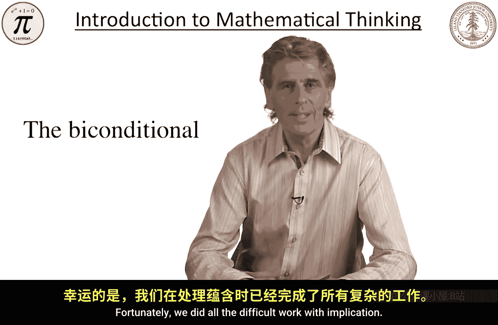
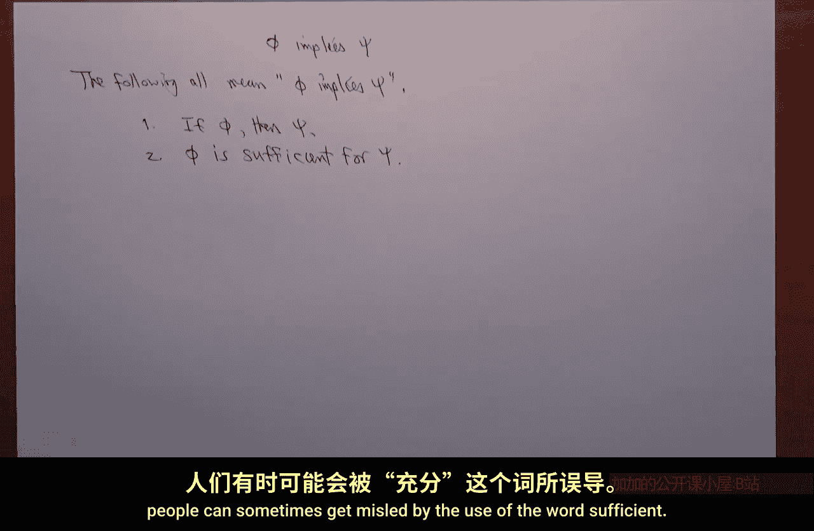

# 008：逻辑等价关系 🔄

在本节课中，我们将要学习逻辑等价关系。这是数学中一个核心概念，与上一节讨论的蕴含关系紧密相连。我们将探讨其定义、形式化表示、相关的术语，并通过实例和练习来加深理解。

## 逻辑等价关系的定义

上一节我们介绍了蕴含关系，本节中我们来看看与之密切相关的逻辑等价关系。

两个陈述被称为**逻辑等价**，当且仅当它们互相蕴含。也就是说，如果陈述 **Φ** 蕴含陈述 **Ψ**，并且陈述 **Ψ** 也蕴含陈述 **Φ**，那么 **Φ** 和 **Ψ** 就是逻辑等价的。

在数学中，等价关系扮演着核心角色，正如方程在算术和代数中的地位一样。许多数学成果正是证明两个陈述是等价的。

## 双条件句：等价的形式化表示

正如我们为蕴含关系引入了形式化的“条件句”以避免因果关系的复杂性，我们也需要为等价关系引入一个形式化的版本，称为**双条件句**。

双条件句用双箭头符号 **↔** 表示。形式上，双条件句 **Φ ↔ Ψ** 是 **（Φ → Ψ） ∧ （Ψ → Φ）** 的缩写。

由于条件句是根据真值定义的，因此双条件句也是根据真值定义的。以下是双条件句的真值表：

| Φ | Ψ | Φ ↔ Ψ |
|---|---|-------|
| T | T | T |
| T | F | F |
| F | T | F |
| F | F | T |

从真值表可以看出，**Φ ↔ Ψ** 为真，当且仅当 **Φ** 和 **Ψ** 的真值相同（同为真或同为假）。

## 通过真值表证明等价

证明两个陈述等价的一种方法是证明它们具有相同的真值表。让我们来看一个例子：证明 **（Φ ∧ Ψ） ∨ （¬Φ）** 等价于 **Φ → Ψ**。

以下是证明步骤：

1.  列出 **Φ** 和 **Ψ** 的所有真值组合。
2.  计算 **Φ ∧ Ψ** 的真值。
3.  计算 **¬Φ** 的真值。
4.  计算 **（Φ ∧ Ψ） ∨ （¬Φ）** 的真值。
5.  计算 **Φ → Ψ** 的真值。
6.  比较两列结果是否一致。

具体真值表如下：

| Φ | Ψ | Φ ∧ Ψ | ¬Φ | （Φ ∧ Ψ） ∨ （¬Φ） | Φ → Ψ |
|---|---|-------|----|------------------|-------|
| T | T | T | F | T | T |
| T | F | F | F | F | F |
| F | T | F | T | T | T |
| F | F | F | T | T | T |

由于 **（Φ ∧ Ψ） ∨ （¬Φ）** 与 **Φ → Ψ** 两列的真值完全相同，我们证明了它们是逻辑等价的。

需要指出的是，通过真值表证明等价只适用于特殊情况。在更一般的情况下，证明等价需要深入理解陈述的含义并进行逻辑推导。

## 与蕴含相关的术语

掌握与蕴含相关的各种术语至关重要，这些术语在数学、科学和日常分析推理中广泛使用。以下所有表达方式都意味着 **Φ 蕴含 Ψ**：

以下是常见的表达方式及其含义：

*   **如果 Φ，那么 Ψ。** 这是最直观的表达。
*   **Φ 对于 Ψ 是充分的。** 知道 Φ 为真就足以推出 Ψ 为真。
*   **Φ 仅当 Ψ。** 这个表达容易引起混淆。它意味着如果 Φ 为真，那么 Ψ 必须为真。注意，这里的“如果”关联的是 **Ψ**，顺序与直觉相反。例如：“一个人能参加环法自行车赛，仅当他有一辆自行车。” 这并不意味着“如果你有一辆自行车，你就能参加环法自行车赛”。
*   **Ψ，如果 Φ。** 此时顺序翻转，但 **Φ** 仍是前件（条件），**Ψ** 仍是后件（结果）。它仍然表示 **Φ 蕴含 Ψ**。
*   **Ψ，每当 Φ。** 同样，顺序翻转，但逻辑关系不变。
*   **Ψ 对于 Φ 是必要的。** 这意味着如果 Φ 为真，那么 Ψ 必须为真。例如：“拥有一辆自行车对于参加环法自行车赛是必要的。” 但拥有自行车并不“充分”保证你能参加。

理解这些术语的区别对于准确理解数学和逻辑陈述至关重要。

## 与等价相关的术语

类似地，等价关系也有其常用的表达方式。陈述 **Φ 等价于 Ψ** 本身也等价于以下说法：

以下是表达等价的常见方式：

*   **Φ 对于 Ψ 是必要且充分的。** “必要且充分”这个组合在数学中非常常见。
*   **Φ 当且仅当 Ψ。** 这同样非常常见，它结合了“仅当”（Φ → Ψ）和“如果”（Ψ → Φ）两种含义。
*   **IFF。** 这是数学家常用的缩写，代表“if and only if”（当且仅当）。

## 概念测验与练习

为了巩固理解，让我们进行一个小测验。考虑自然数 N 是 10 的倍数这一命题。

以下是针对“N 是 10 的倍数”的不同条件：

1.  N 是 5 的倍数。（必要）
2.  N 是 20 的倍数。（充分）
3.  N 是偶数且是 5 的倍数。（必要且充分）
4.  N 是 100 的倍数。（充分）
5.  N² 是 100 的倍数。（必要且充分）

*   **必要性**：条件 1, 3, 5 是必要的。因为如果 N 是 10 的倍数，这些条件必须成立。
*   **充分性**：条件 2, 3, 4, 5 是充分的。因为如果这些条件成立，可以推出 N 是 10 的倍数。
*   **必要且充分性**：条件 3 和 5 既是必要的又是充分的，它们等价于“N 是 10 的倍数”。

## 数学实践中的用法

最后，需要指出的是，虽然在定义上我们区分了日常的“蕴含/等价”与形式化的“条件句/双条件句”，但在实际的数学工作中，数学家们通常不那么严格区分。

我们经常用箭头 **→** 作为“蕴含”的缩写，用双箭头 **↔** 作为“等价于”的缩写。虽然这起初可能令初学者困惑，但这是数学实践演变的结果。

原因在于，条件句和双条件句与日常的蕴含和等价，其区别仅在于那些在正常数学实践中不会出现的边缘情况。在任何真实的数学上下文中，条件句实际上就是蕴含，双条件句实际上就是等价。因此，在指出了形式概念与日常概念的区别之后，数学家们通常会转而关注其他内容。

形式化定义的行为本身，就帮助我们建立了对蕴含和等价的理解，使我们能够安全地使用日常概念。当然，对于编写关键系统（如飞行控制软件）的程序员来说，他们必须确保所有概念在所有情况下都有明确定义。

## 总结

本节课中我们一起学习了逻辑等价关系。我们了解到：
*   等价意味着两个陈述互相蕴含。
*   其形式化表示是双条件句 **Φ ↔ Ψ**，定义为 **（Φ → Ψ） ∧ （Ψ → Φ）**。
*   掌握与蕴含和等价相关的各种术语（如“如果…那么…”、“仅当”、“必要且充分”、“当且仅当”）对于理解数学语言至关重要。
*   在实际数学工作中，形式符号 **→** 和 **↔** 通常被直接用来表示蕴含和等价。

蕴含和等价是数学思维的核心。掌握这些概念及其相关术语是进一步学习数学的基础。掌握它们的唯一途径就是：练习、练习、再练习。建议你留出专门时间，认真完成相关的作业，以巩固对这些核心概念的理解。