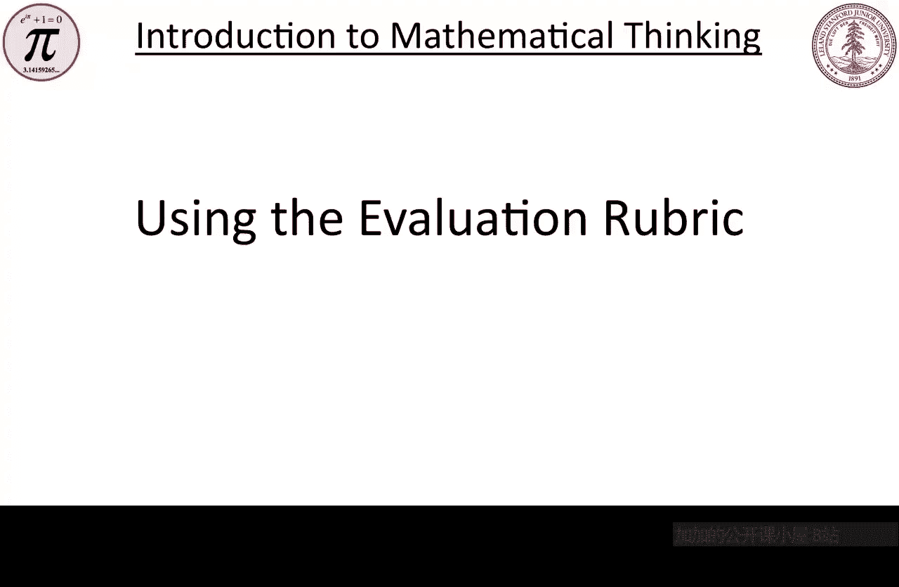
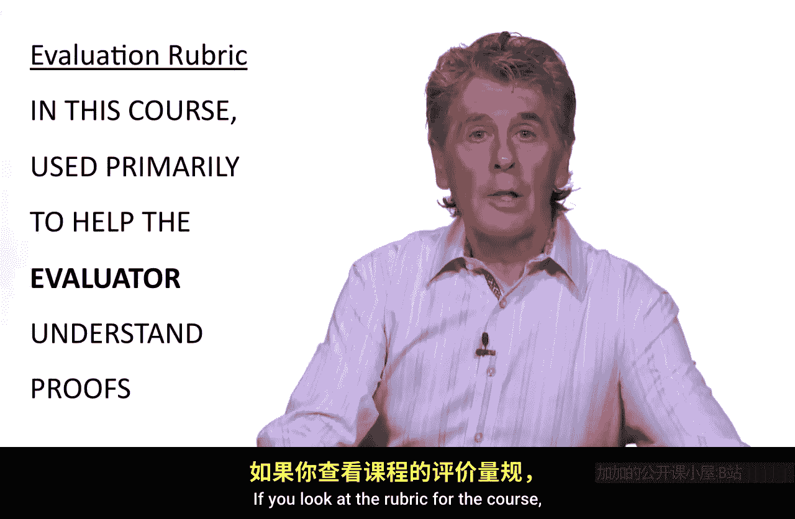
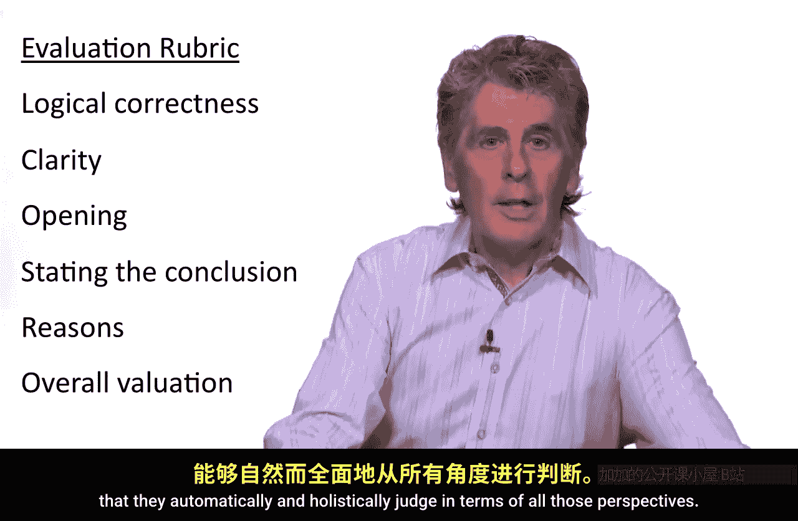
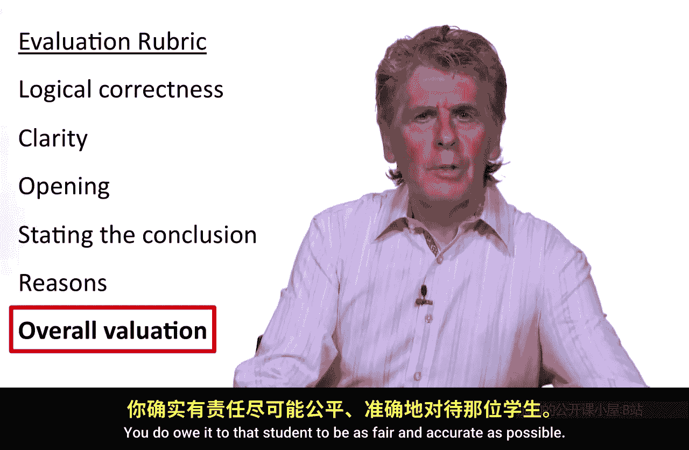
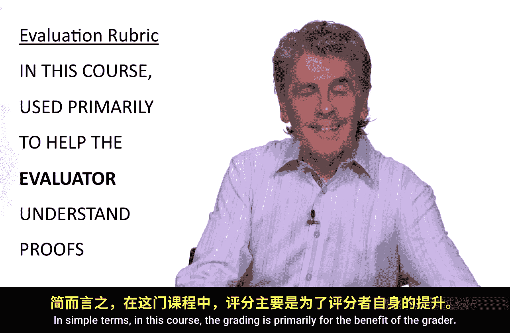

数学思维导论：P9：课程评估量规使用指南 📋

在本节课中，我们将学习如何使用课程评估量规来分析和评价数学证明。评估量规通常用于确保评分的统一性，但本课程将用它来帮助初学者理解和学习证明的构成要素。

上一节我们介绍了证明的基本概念，本节中我们来看看如何系统地评估一个证明的质量。

评估量规要求你从五个不同的维度来审视一个证明：**逻辑正确性**、**清晰度**、**开头**、**结论陈述**以及**理由**。稍后我们还会提到第六个类别。这五个方面对于证明来说都至关重要，并且出于教学目的，它们被赋予了同等的重要性。

之所以如此，是因为正如我在课程中反复强调的，证明的作用远不止于确认某个陈述为真。实际上，在实践中，它们更多的是为具备足够背景知识的合理人士提供令人信服的证据。如果我们审视证明在数学中的作用，会发现与逻辑正确性同等重要的，是证明对于目标读者的**可理解性**。事实上，从实用角度看，可理解性比逻辑正确性更为重要。现代数学中，几乎没有超过几页的证明在最初不包含一些隐藏的逻辑漏洞。证明之所以有用，是因为其他人不仅能发现错误，还能根据证明中提供的信息尝试修正它们。因此，证明既是确立真理的工具，也是一种**沟通**方式。

由于我们必须使用简单的例子来培养证明评估技能，在你看到的大多数例子中，量规中的一个或多个标准可能只以非常简化的方式适用，甚至完全不适用。但在更复杂的例子中，所有这些标准都将变得重要。这就是为什么五个标准具有同等权重。当你评估论证时，你应该平等地、依次从这五个量规标准的角度来审视它们。

诚然，专家很少使用量规。他们对证明概念非常熟悉，能够自动地、整体地从所有这些角度进行判断。但对于初学者而言，量规将“判断证明整体质量”这个复杂任务，分解为依次判断这五个方面。其中每一个任务都比整体判断要简单得多。

即便如此，你可能仍会觉得困难。在你根据这五个证明特征评估了一个证明之后，量规要求你将它们综合起来，为这个证明给出一个单一的分数。这个分数对应着专家在不使用量规时会给出的评分。本课程的量规旨在帮助你作为初学者，最终得出那个综合评分。

顺便提一下，当你评估另一位同学的作品时（例如在测试飞行中），你确实有责任尽可能公平和准确。但没有人会期望一个刚刚开始学习证明的人能做到绝对准确。因为每个人的作品都会由三位同学匿名评估，最终报告的成绩由这三个成绩加上个人的自评成绩计算得出。事实证明，大多数时候最终的成绩是相当不错的。

然而，测试飞行评估过程的真正目的，在于它能给评估者带来巨大的好处，帮助他们更好地理解什么构成了一个好的证明。简而言之，在本课程中，评分过程主要是为了**评分者自身的利益**。

本节课中我们一起学习了如何使用课程评估量规来分解和评价证明的各个关键方面。通过依次关注逻辑正确性、清晰度、结构、结论和理由，你可以更系统、更有效地理解和构建数学证明。记住，这个过程的核心目标是提升你作为学习者的证明鉴赏与构建能力。