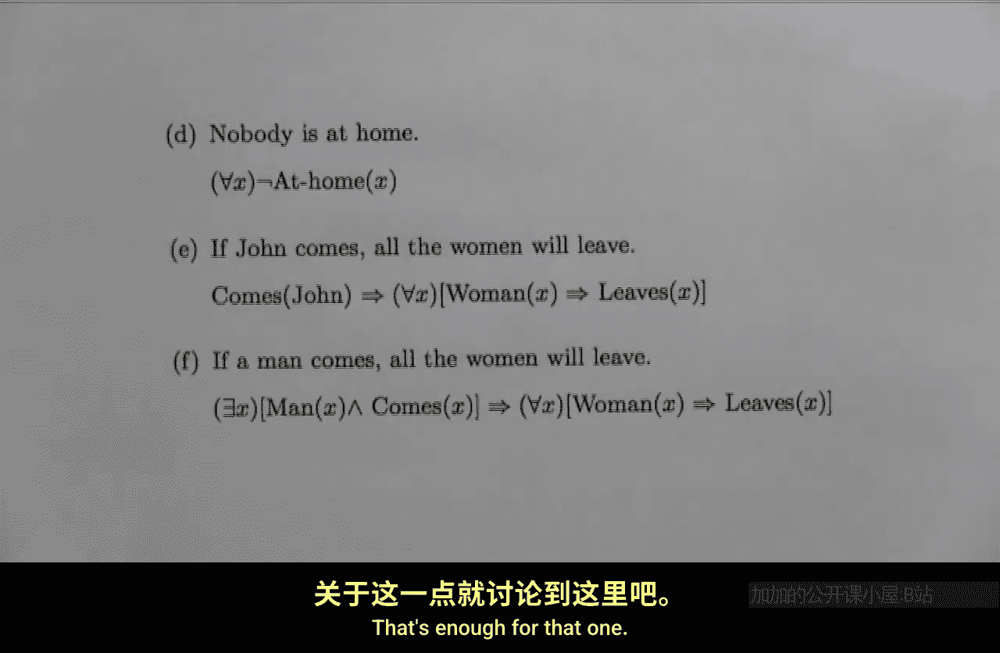
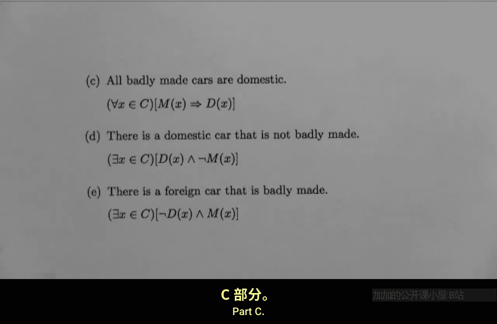

# 015：作业5指导教程

在本节课中，我们将一起学习如何将自然语言中的陈述，精确地转化为使用量词和逻辑连接符的数学符号语言。我们将通过分析一系列具体问题，掌握量词顺序、逻辑结构以及如何消除日常语言中的歧义。

## 问题1：将陈述转化为存在量化形式

上一节我们概述了课程目标，本节中我们来看看第一个具体问题：将三个关于自然数的陈述，用存在量词“∃”和逻辑符号表达出来。

以下是三个陈述及其符号化表达：

1.  **方程 x³ = 27 有一个自然数解。**
    *   **公式**：∃x ∈ ℕ (x³ = 27)
    *   含义：存在一个自然数x，使得x的立方等于27。

2.  **一百万不是最大的自然数。**
    *   **公式**：∃x ∈ ℕ (x > 1,000,000)
    *   含义：存在一个自然数x，它大于一百万。

3.  **自然数n不是质数。**
    *   **公式**：∃p ∈ ℕ ∃q ∈ ℕ ( (p > 1) ∧ (q > 1) ∧ (n = p × q) )
    *   含义：存在两个都大于1的自然数p和q，使得n等于p和q的乘积。

在数学中，我们严格从左到右阅读公式。逻辑符号有优先级：等号、大于号等关系符号最先计算，然后是合取（∧）、析取（∨），最后是条件（→）和双条件（↔）。量词（∃, ∀）会“绑定”紧随其后的表达式，因此使用括号来明确范围至关重要。

## 问题2：使用“对所有”断言表达陈述

上一节我们处理了“存在”陈述，本节中我们来看看如何用全称量词“∀”来表达否定或普遍性的陈述。我们的目标是将陈述转化为“对所有...”的形式。

以下是三个陈述及其符号化表达：

1.  **方程 x³ = 28 没有自然数解。**
    *   **公式**：∀x ∈ ℕ (x³ ≠ 28)
    *   含义：对所有自然数x，x的立方都不等于28。这等价于说“不存在满足方程的自然数x”。

2.  **0小于每一个自然数。**（注意：此处自然数集ℕ定义为从1开始的正整数）
    *   **公式**：∀x ∈ ℕ (0 < x)
    *   含义：对所有自然数x，0都小于x。

3.  **自然数n是质数。**
    *   **公式**：∀p ∈ ℕ ∀q ∈ ℕ ( (n = p × q) → ( (p = 1) ∨ (q = 1) ) )
    *   含义：对所有自然数p和q，如果n等于p和q的乘积，那么p等于1或者q等于1。也就是说，n的任何因数分解都必然包含1和n本身。

## 问题3：量化人际关系陈述

现在我们将量词应用到更生活化的场景中，量化“所有人”和“某人”。这有助于理解量词顺序如何影响含义。

以下是三个关于人的陈述及其符号化表达（设变量x, y的取值范围是“所有人”）：

1.  **每个人都爱着某个人。**
    *   **公式**：∀x ∃y (x爱y)
    *   含义：对每一个人x，都存在某个人y，使得x爱y。y的具体人选可能因x的不同而不同。

2.  **每个人要么高要么矮。**
    *   **公式**：∀x (x是高个子 ∨ x是矮个子)
    *   含义：对每一个人x，x是高个子或者x是矮个子。虽然日常中“高”和“矮”有模糊地带，但此公式强制进行了精确划分。

3.  **要么所有人都高，要么所有人都矮。**
    *   **公式**：(∀x (x是高个子)) ∨ (∀x (x是矮个子))
    *   含义：这是一个析取。要么“所有人都是高个子”成立，要么“所有人都是矮个子”成立。注意，这里需要括号，因为量词“∀x”只绑定紧接其后的单个谓词（如“x是高个子”）。如果要让它绑定一个更长的复合表达式（如一个析取），就必须使用括号。

## 问题4：更多量化表达练习

本节我们继续练习将包含“如果...那么...”等复杂结构的句子符号化。

以下是几个陈述及其符号化表达：

1.  **没有人在家。**
    *   **公式**：∀x (x不在家) 或等价地 ¬∃x (x在家)
    *   含义：对所有人x，x都不在家。或者，不存在一个在家的人x。

2.  **如果约翰来了，所有女人都会离开。**
    *   **公式**：约翰来 → ∀x ( (x是女人) → x离开 )
    *   含义：如果“约翰来”这个事件发生，那么对于所有x，如果x是女人，那么x会离开。

3.  **如果有男人来，所有女人都会离开。**
    *   **公式**：∃x ( (x是男人) ∧ (x来) ) → ∀y ( (y是女人) → y离开 )
    *   含义：如果存在一个x，x是男人并且x来了，那么对于所有y，如果y是女人，那么y会离开。

## 问题5：关于汽车的量化陈述

现在我们将量词应用到一个具体集合（所有汽车的集合C）上，并使用谓词D(x): x是国产车，M(x): x质量差。

以下是六个陈述及其符号化表达：

1.  **所有国产车质量都差。**
    *   **公式**：∀x ∈ C ( D(x) → M(x) )
    *   含义：对所有汽车x，如果x是国产车，那么x质量差。

2.  **所有外国车质量都差。**（外国车即非国产车）
    *   **公式**：∀x ∈ C ( ¬D(x) → M(x) )
    *   含义：对所有汽车x，如果x不是国产车，那么x质量差。

3.  **所有质量差的车都是国产车。**
    *   **公式**：∀x ∈ C ( M(x) → D(x) )
    *   含义：对所有汽车x，如果x质量差，那么x是国产车。

4.  **有一辆质量不差的国产车。**
    *   **公式**：∃x ∈ C ( D(x) ∧ ¬M(x) )
    *   含义：存在一辆汽车x，x是国产车并且x质量不差。

5.  **有一辆质量差的外国车。**
    *   **公式**：∃x ∈ C ( ¬D(x) ∧ M(x) )
    *   含义：存在一辆汽车x，x不是国产车并且x质量差。

**规律小结**：全称量词∀通常与条件语句→搭配使用（表示“如果...则...”），而存在量词∃通常与合取∧搭配使用（表示“有...并且...”）。

## 问题6：实数与有理数的性质

本节我们用量词描述实数集的一个深刻性质：有理数在实数中的“稠密性”。我们使用谓词Q(x)表示“x是有理数”。

**陈述**：对于任意两个不相等的实数，它们之间总存在一个有理数。
*   **公式**：∀x ∀y ( (x < y) → ∃z ( Q(z) ∧ (x < z < y) ) )
*   含义：对所有实数x和y，如果x小于y，那么存在一个有理数z，使得z在x和y之间。

## 问题7：林肯名言的量化分析

这是一个经典的量化顺序练习。设F(p, t)表示“你可以在时间t欺骗人p”。

以下是那句名言的三个部分及其符号化表达：

1.  **你可以一直欺骗某些人。**
    *   **公式**：∃p ∀t F(p, t)
    *   含义：存在某些人p，在所有时间t，你都能欺骗p。

2.  **你有时可以欺骗所有人。**
    *   **公式**：∃t ∀p F(p, t)
    *   含义：存在某些时间t，在那时你能欺骗所有人p。

3.  **但你不可能一直欺骗所有人。**
    *   **公式**：¬∀t ∀p F(p, t) 或等价地 ∃t ∃p ¬F(p, t)
    *   含义：并非在所有时间t对所有的人p，你都能欺骗他们。即，总存在某个时刻和某个人，你无法欺骗。

注意，第一部分和第二部分中量词顺序的调换，完全改变了陈述的含义。

## 问题8：新闻标题的歧义

最后，我们通过一个类似“美国黑色素瘤基金会”的例子，来看量词顺序如何制造巨大歧义。设A(x, t)表示“司机x在六秒时间段t内发生事故”。

*   **歧义标题**：“一个司机每六秒就卷入一场事故。”
    *   **错误解读（字面/数学式）**：∃x ∀t A(x, t)
        *   含义：存在一个特定的司机x，在每一个六秒时间段t，他都发生事故。这很荒谬。
    *   **正确解读（日常意图）**：∀t ∃x A(x, t)
        *   含义：对于每一个六秒时间段t，都存在某个司机x（t不同，x可以不同）发生事故。

这个例子鲜明地展示了，在精确的数学语言中，量词的顺序是逻辑含义的核心，不能随意调换。日常语言依靠语境消歧，而数学语言则通过严格的语法规则来保证无歧义。

## 总结

本节课中我们一起学习了如何将日常语言陈述转化为精确的数学符号语言。我们重点掌握了：
1.  使用存在量词∃和全称量词∀进行表达。
2.  理解并正确使用逻辑连接符（∧, ∨, →, ¬）及其优先级。
3.  认识到**量词顺序**对陈述逻辑含义的决定性影响。
4.  通过大量练习，熟悉了如何用形式化的语言捕捉“所有”、“存在”、“如果...那么...”等概念。

掌握这套形式化工具，是进行严谨数学思维和推理的重要基础。它帮助我们剥离模糊性，清晰地看到逻辑结构的本质。