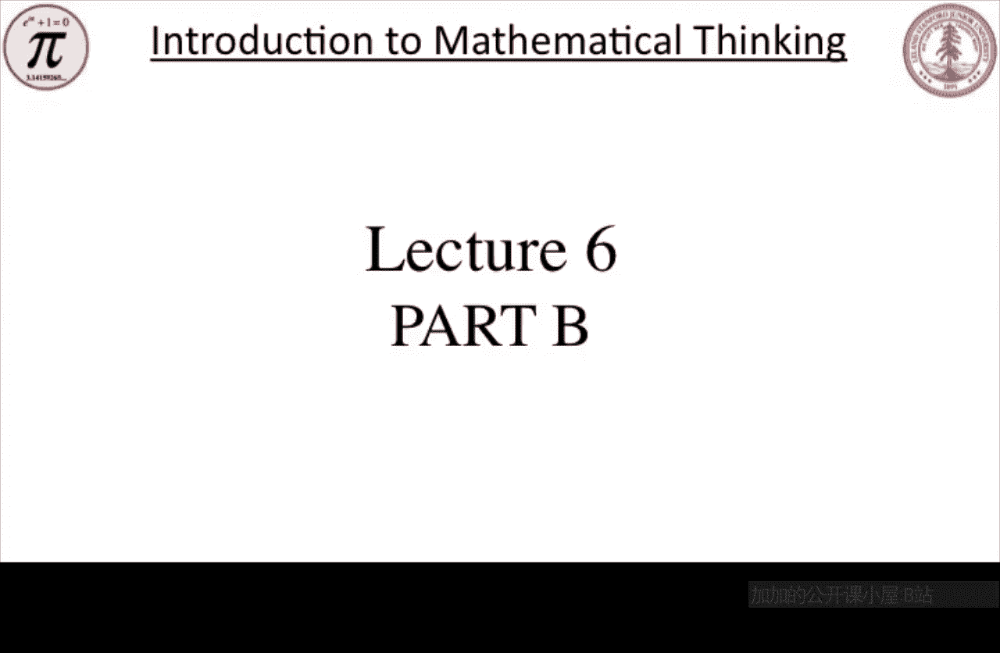
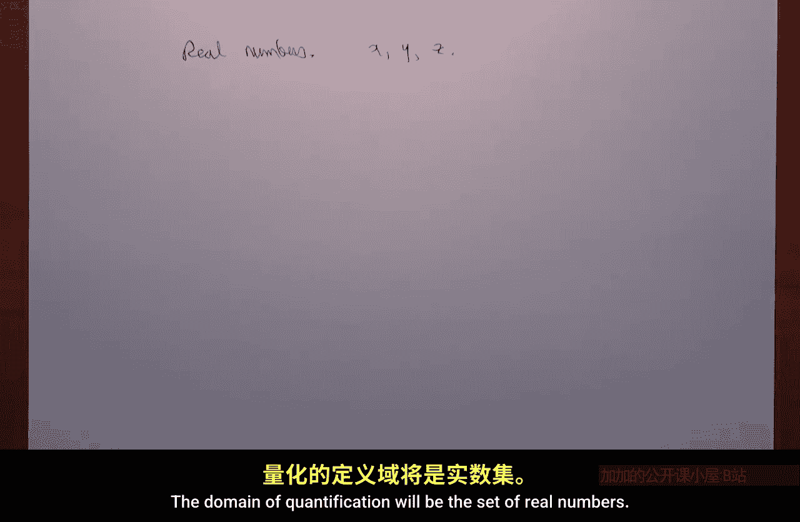

# 018：量词运用2 🧮

在本节课中，我们将继续学习量词的运用，重点探讨如何否定包含量词的陈述，理解量词与逻辑连接词（如“且”、“或”）结合时的行为，并明确量化域的概念。我们将通过具体例子，一步步解析背后的逻辑。

---

## 否定全称量词陈述

上一节我们介绍了量词的基本概念，本节中我们来看看如何否定一个包含全称量词 `∀` 的陈述。

考虑一个陈述：“所有质数都是奇数”。我们知道这个陈述是假的，因为存在一个反例：数字2是质数但不是奇数。让我们从逻辑上分析这个结论。

*   令 `P(x)` 表示 “x 是质数”。
*   令 `O(x)` 表示 “x 是奇数”。

原陈述可以符号化为：
`∀x (P(x) → O(x))`

这个陈述的否定是：
`¬∀x (P(x) → O(x))`

根据逻辑规则，这等价于：
`∃x ¬(P(x) → O(x))`

进一步，蕴涵式 `P(x) → O(x)` 的否定等价于 `P(x) ∧ ¬O(x)`。因此，整个否定的最终形式是：
`∃x (P(x) ∧ ¬O(x))`

用语言描述就是：**存在一个质数，它不是奇数**。

为了证明原陈述为假（即证明其否定为真），我们需要做的就是展示这样一个质数。数字2满足条件：`P(2)` 为真（2是质数），且 `¬O(2)` 为真（2不是奇数）。因此，否定陈述为真，原陈述为假。

在这个简单例子中，逻辑推理看似繁琐，但在更复杂、我们不熟悉结论的情况下，遵循这种逻辑推理模式是唯一可靠的方法。

---

## 量词与逻辑连接词的结合

现在，我们来看看当量词与“且”(∧)、“或”(∨)等逻辑连接词结合时需要注意的事项。以下是几种常见组合及其等价关系分析。

### 全称量词与合取（且）

考虑以下两个表达式是否等价：
1.  `∀x (A(x) ∧ B(x))`
2.  `(∀x A(x)) ∧ (∀x B(x))`

**答案是：它们等价。**

**例子**：设论域为所有运动员，`A(x)` 表示“x高大”，`B(x)` 表示“x强壮”。
*   表达式1：“所有运动员都高大且强壮”。
*   表达式2：“所有运动员都高大，并且所有运动员都强壮”。

显然，如果所有运动员都同时满足高大和强壮，那么自然所有运动员都高大，并且所有运动员都强壮。反之亦然。

### 全称量词与析取（或）

考虑以下两个表达式是否等价：
1.  `∀x (A(x) ∨ B(x))`
2.  `(∀x A(x)) ∨ (∀x B(x))`

**答案是：它们不等价。**

**例子**：设论域为自然数集 `ℕ`，`E(x)` 表示“x是偶数”，`O(x)` 表示“x是奇数”。
*   表达式1：`∀x (E(x) ∨ O(x))`。意为“每个自然数要么是偶数，要么是奇数”。这是一个**真**陈述。
*   表达式2：`(∀x E(x)) ∨ (∀x O(x))`。意为“所有自然数都是偶数，或者所有自然数都是奇数”。这是一个**假**陈述，因为两个部分都不成立。

因此，不能随意将全称量词分配到析取符号内部。

### 存在量词与析取（或）

考虑以下两个表达式是否等价：
1.  `∃x (A(x) ∨ B(x))`
2.  `(∃x A(x)) ∨ (∃x B(x))`

**答案是：它们等价。**

**例子**：设论域为某球队的球员，`A(x)` 表示“x是优秀进攻者”，`B(x)` 表示“x是优秀防守者”。
*   表达式1：“存在一名球员，他是优秀进攻者或优秀防守者”。
*   表达式2：“存在一名优秀进攻者，或者存在一名优秀防守者”。

如果存在一名球员满足条件A或B，那么至少A或B之一为真，因此表达式2为真。反之，如果存在优秀进攻者，那么该球员自然满足“是优秀进攻者或优秀防守者”，故表达式1为真。

### 存在量词与合取（且）

考虑以下两个表达式是否等价：
1.  `∃x (A(x) ∧ B(x))`
2.  `(∃x A(x)) ∧ (∃x B(x))`

**答案是：它们不等价。**

**例子**：使用上面偶数和奇数的例子。
*   表达式1：`∃x (E(x) ∧ O(x))`。意为“存在一个自然数，它既是偶数又是奇数”。这是一个**假**陈述。
*   表达式2：`(∃x E(x)) ∧ (∃x O(x))`。意为“存在一个偶数，并且存在一个奇数”。这是一个**真**陈述。

因此，也不能随意将存在量词分配到合取符号内部。

**核心规律总结**：可以将 `∀` 想象为“所有”的合取（一个大大的“且”），将 `∃` 想象为“存在”的析取（一个大大的“或”）。当量词与同类型的连接词结合时（`∀` 与 `∧`，`∃` 与 `∃`），通常可以安全分配。当类型不同时（`∀` 与 `∃`，`∃` 与 `∧`），分配则可能导致不等价。

---

## 量化域的重要性

量词 `∀x` 或 `∃x` 的含义依赖于变量 `x` 的取值范围，这个范围称为**量化域**。

考虑这个陈述：
`∀x (x > 0 → ∃y (x * y = 1))`

这个陈述的真假取决于 `x` 和 `y` 的量化域。
*   如果域是自然数 `ℕ`，陈述为假（例如，对于 `x=2`，在自然数中找不到 `y` 使 `2*y=1`）。
*   如果域是有理数 `ℚ` 或实数 `ℝ`，陈述为真（对于任何正数 `x`，取 `y = 1/x` 即可）。

为了避免歧义，我们应该明确指定量化域：
`∀x ∈ ℚ (x > 0 → ∃y ∈ ℚ (x * y = 1))`

有时，数学家会使用**隐式量化**。例如，他们可能写：
`如果 x ≥ 0，那么 √x ≥ 0。`
这通常被理解为 `∀x ∈ ℝ (x ≥ 0 → √x ≥ 0)`。虽然专业人士经常这样做，但初学者应尽量避免，始终明确量化域以防止混淆。

---

## 在论证中使用多个量化域

在讨论中，我们可以引入多个量化域。例如，在以实数 `ℝ` 为背景的讨论中，我们可能想说：
`∀n ∈ ℕ (n > 5 → ...)` 或 `∃q ∈ ℚ (q^2 < 2)`
这是可以接受的，因为自然数、有理数都是实数的子集。

然而，需要谨慎。假设我们的主题是“动物”。我们不应该为每种动物（如豹子、老虎）设置不同的量化域。相反，我们应该保持量化域为“动物”，然后使用属性来描述特定种类：
*   **不推荐**：`∀x ∈ {豹子} (x有斑点)`
*   **推荐**：`∀x (如果 x 是豹子 → x 有斑点)`

后一种方式保持了讨论主题（动物）的一致性，逻辑上更清晰。

---

## 总结

本节课中我们一起学习了：
1.  **否定全称陈述**：`¬∀x (P(x) → Q(x))` 等价于 `∃x (P(x) ∧ ¬Q(x))`。证明一个全称陈述为假，通常就是寻找一个反例。
2.  **量词与连接词的交互**：`∀` 与 `∧` 可分配，`∃` 与 `∃` 可分配；但 `∀` 与 `∃`、`∃` 与 `∧` 的分配会改变原意。理解其语义（“所有”对应合取，“存在”对应析取）有助于判断。
3.  **量化域的关键作用**：量词的含义完全取决于变量的取值范围。为避免误解，应明确指定量化域。
4.  **量化域的使用策略**：在论证中，保持核心讨论主题的量化域不变，使用条件句来指代子类，通常比引入多个子域更清晰、更合理。

掌握这些关于量词的细微之处，是进行严谨数学推理的重要基础。建议你通过完成相关的习题（例如作业6）来巩固这些概念。