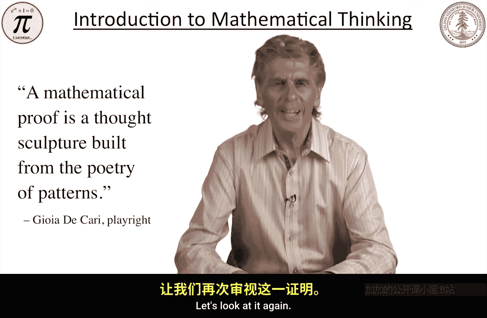
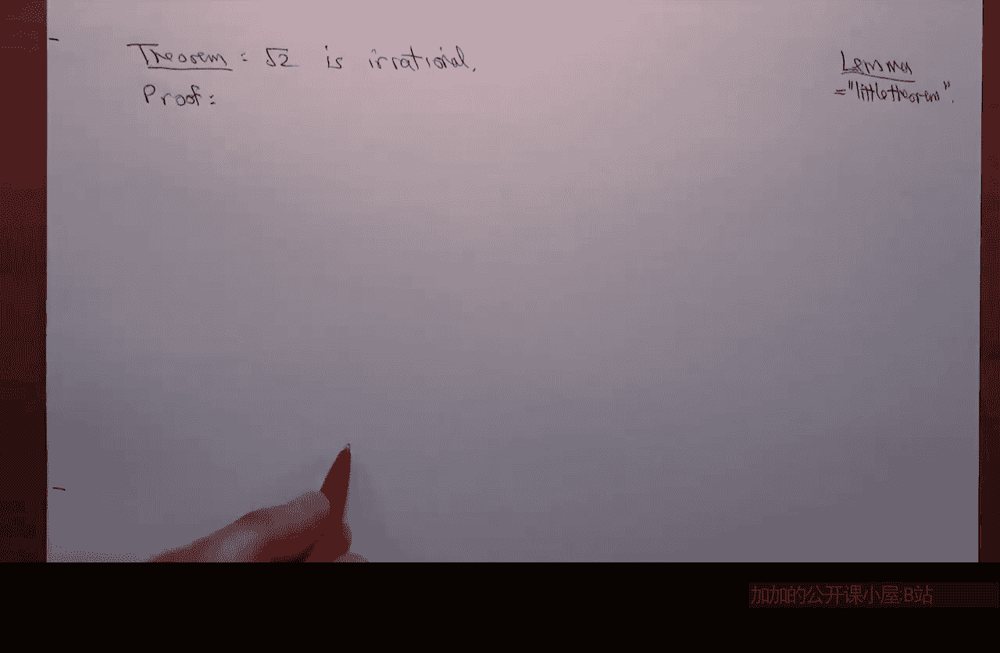

# 021：证明方法1 🧠

在本节课中，我们将要学习数学证明的基本概念、目的以及一个经典证明的实例。我们将探讨什么是证明、为什么需要证明，并通过分析两个著名的证明来理解其逻辑结构。

---

## 什么是证明？为何需要证明？🤔

上一节我们介绍了数学陈述所需的语言精确性。本节中我们来看看如何将这种精确性用于建立数学真理。

在自然科学中，真理通过经验手段建立，涉及观察、测量和实验。在数学中，真理通过构建**证明**来确定。证明是一个逻辑上严谨的论证，用以确立陈述的真实性。

这里的“论证”一词并非日常的争吵之意，而是指一个能预先、明确或隐含地反驳读者可能提出的所有反对意见的推理过程。专业数学家阅读证明时，其方式类似于律师盘问证人，不断审视和寻找漏洞。

学习如何证明是大学数学的重要组成部分，这需要数年时间才能掌握。本课程的目标是帮助你在短期内理解证明数学陈述意味着什么，以及为何数学家如此重视证明。

首先回答第二个问题：证明的目的决定了其性质。构建证明主要有两个目的：
1.  **确立真理**：通过构建或阅读证明，我们说服自己某个陈述是真实的。
2.  **与他人交流**：证明必须向他人解释为何该陈述为真。

对于第二个目的，证明除了逻辑严谨外，还必须以读者能理解的方式进行沟通。即使是仅供个人使用的证明，也需要具备良好的沟通性，以便日后自己能理解。

有些证明非常深奥复杂，只有少数领域专家能理解，例如安德鲁·怀尔斯对**费马大定理**的证明。然而，数学中的大多数证明都能被所有专业数学家理解，尽管可能需要花费大量时间。

---

## 证明的本质与要求 📝

证明一个数学陈述不仅仅是收集支持它的证据。一个著名的例子是**哥德巴赫猜想**：每个大于2的偶数都可以表示为两个素数之和。尽管计算机已验证了海量数据，但该猜想至今未被证明。要反驳它，只需找到一个反例。

证明没有固定的格式。其绝对要求是：
*   它是一个**逻辑上严谨的推理过程**，能确立某个陈述的真实性。
*   它必须**表达充分**，以便目标读者（可能需要付出一些努力）能够理解推理过程。

构建证明需要你能够确定什么构成一个不仅能说服自己，也能说服目标读者的逻辑论证。这无法简化为一系列规则。构造数学证明是人类思维最具创造性的行为之一。虽然很少有人能做出真正原创性的证明，但通过努力，任何有合理智力的人都能掌握其基础。

---

## 证明实例分析：无穷多素数 🌌

欧几里得关于存在**无穷多素数**的证明是一个需要非凡洞察力的好例子。让我们再次审视它。

**证明思路**：通过证明，如果我们按递增顺序列出素数，那么这个列表可以无限延续下去。

**证明过程**：
1.  假设我们已经列出了前 `n` 个素数：`p1, p2, ..., pn`。
2.  构造一个数 `N = p1 * p2 * ... * pn + 1`。
3.  显然，`N` 大于列表中所有素数。
4.  现在考虑两种情况：
    *   **情况一**：如果 `N` 是素数，那么我们就找到了一个不在原列表中的新素数 `N`，因此列表可以继续。
    *   **情况二**：如果 `N` 不是素数，那么它必然有一个素因子 `q`（根据算术基本定理）。这个素因子 `q` 不能是列表中的任何一个素数 `p1, p2, ..., pn`，因为用它们中的任何一个去除 `N` 都会余 `1`。因此，`q` 必然是一个不在原列表中的新素数。
5.  无论哪种情况，我们都能找到一个新的素数。因此，素数列表可以无限延续，即存在无穷多个素数。

这个证明包含两个创造性想法：
1.  通过展示素数列表可以无限延续来证明无穷性。
2.  巧妙地构造数 `N`，其性质保证了总能找到另一个素数。第二个想法堪称天才之举。

---

## 证明实例分析：√2 是无理数 🔢

现在，我们以数学家撰写论文的典型方式来证明**√2 是无理数**。我们将陈述一个定理，然后给出证明。

**定理**：√2 是一个无理数。

**证明**：
1.  **（反证法）** 假设相反情况成立，即 √2 是有理数。
2.  那么，存在两个没有公因子的自然数 `p` 和 `q`，使得 √2 = `p / q`。（有理数定义及最简分数形式）
3.  将等式两边平方，得到 `2 = p² / q²`。
4.  整理得 `2q² = p²`。
5.  由此可知，`p²` 是偶数（因为它是 2 的倍数）。
6.  因为只有偶数的平方才是偶数，所以 `p` 本身也必须是偶数。
7.  设 `p = 2r`（`r` 是某个自然数）。
8.  将 `p = 2r` 代入 `2q² = p²`，得到 `2q² = (2r)² = 4r²`。
9.  两边同时除以 2，得到 `q² = 2r²`。
10. 由此可知，`q²` 是偶数，因此 `q` 也必须是偶数。
11. 现在，我们推导出 `p` 和 `q` 都是偶数。但这与第 2 步中“`p` 和 `q` 没有公因子”的假设矛盾，因为如果它们都是偶数，则至少有公因子 2。
12. 我们通过一个逻辑上有效的推理，得出了一个不可能的结论（矛盾）。
13. 因此，我们最初的假设（√2 是有理数）必定是错误的。
14. 故，√2 是无理数。∎（证明结束）

这个证明是一个极好的例子，因为它简短、精炼，每一步都是简单的算术步骤，易于理解。通过这寥寥数步，我们证明了一个重要的结果。这个结果在古希腊被毕达哥拉斯学派的数学家发现时，极具戏剧性，因为它表明整数的比值不足以度量所有几何长度（例如边长为 1 的等腰直角三角形的斜边长度），从而改变了希腊数学乃至整个数学的进程。

数学家谈论证明的“优雅”或“美丽”时，指的就是这种逻辑结构之美：每一步都不可或缺，结果被牢固确立，且每一步都清晰易懂。其复杂性不在于涉及深奥的概念，而在于其精妙的逻辑结构。

---

## 总结 📚

本节课中我们一起学习了：
*   数学**证明**的核心目的是**确立真理**和**进行沟通**。
*   证明没有固定格式，但其**逻辑必须严谨**，并且**表达必须清晰**，足以让目标读者理解。
*   我们分析了两个经典证明：
    *   **欧几里得对无穷多素数的证明**，展示了创造性构造（数 `N = p1*p2*...*pn + 1`）的力量。
    *   **√2 是无理数的证明**，这是一个使用**反证法**的典范，通过假设结论不成立，推导出矛盾，从而证明原结论必然成立。
*   这些例子表明，一个优美的证明在于其清晰、必然且高效的逻辑结构。

理解这些基本证明方法，是迈入数学严谨思维世界的第一步。