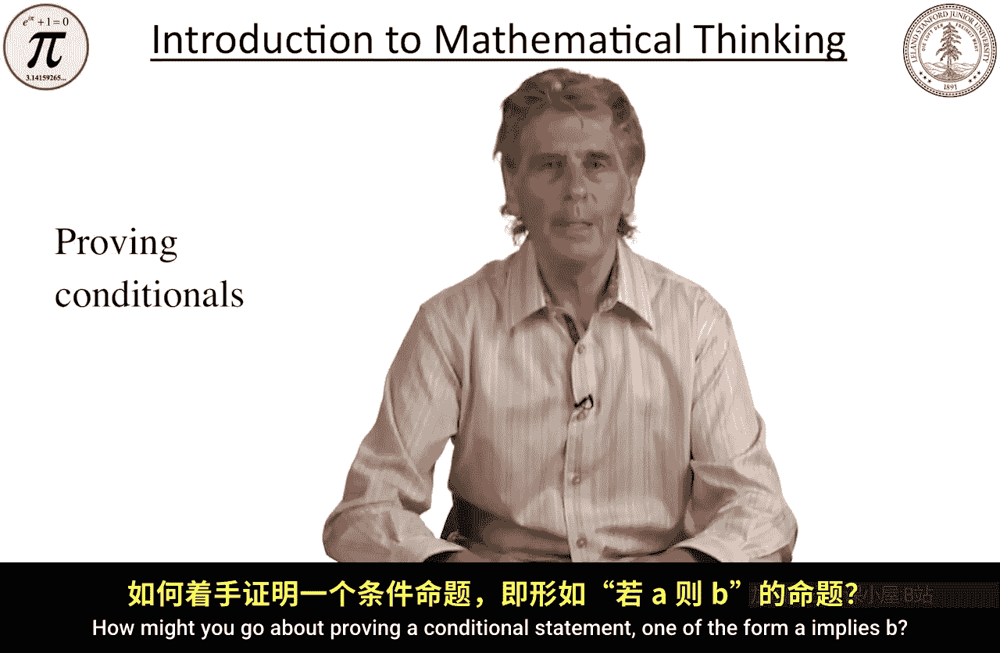

**数学思维导论：7b：证明方法2**

在本节课中，我们将深入探讨一种重要的证明方法——反证法。我们将通过分析一个经典例子（证明√2是无理数）来理解其逻辑结构，并学习如何应用它来证明不同类型的数学陈述。

---

### **概述：反证法**

上一节我们介绍了证明的基本概念。本节中，我们来看看一种非常强大且常用的证明技巧：反证法。

反证法是一种通用的证明方法，其运作流程如下：
1.  你想要证明某个陈述 **φ**。
2.  你首先**假设** **φ** 不成立（即假设 **¬φ** 为真）。
3.  从这个假设出发，进行逻辑推理。
4.  在推理过程中，你最终会得出一个**错误**的结论（一个矛盾）。
5.  由于一个真实的假设不可能推导出错误的结论，因此你最初的假设 **¬φ** 必定是假的。
6.  所以，原陈述 **φ** 必定为真。

用逻辑符号可以简洁地表示为：若 **¬φ ⇒ (ψ ∧ ¬ψ)**，则可推出 **φ**。

---

### **反证法的逻辑基础**

为了更清晰地理解为什么反证法有效，我们可以借助真值表来分析。

考虑一个蕴含式：**θ ⇒ ψ**。在反证法中，**θ** 是你开始时做出的（与待证结论相反的）假设，**ψ** 是你最终推导出的那个错误结论（矛盾）。

我们知道 **θ ⇒ ψ** 的真值表如下：

| **θ** | **ψ** | **θ ⇒ ψ** |
| :--- | :--- | :--- |
| T | T | T |
| T | F | F |
| F | T | T |
| F | F | T |

当我们完成一个反证法证明时，我们实际上证明了 **θ ⇒ ψ** 这个推理是**有效**的（即这个条件句为真）。同时，我们知道结论 **ψ** 是**假**的。

观察真值表：在 **θ ⇒ ψ** 为真的行中（第1、3、4行），只有第4行满足 **ψ** 为假。而在第4行中，前提 **θ** 恰好也为假。

因此，从 **（θ ⇒ ψ）为真** 且 **ψ 为假**，我们可以必然地得出结论：**θ 为假**。这正好意味着我们最初的相反假设不成立，从而原命题得证。

---

### **反证法的适用场景**

反证法之所以在数学中广泛应用，主要是因为它提供了一个清晰的起点。

要直接证明一个陈述 **φ**，你必须构建一个以 **φ** 为终点的论证链。起点可能有很多，但目标只有一个，这有时会很困难。

然而，使用反证法时，你有一个明确的起点：假设 **¬φ**。并且，证明的完成标志是推导出**任何一个**矛盾。由于“矛盾”这个目标范围很广，任务往往变得容易得多。

反证法特别适用于证明“某个对象不存在”这类陈述。例如，证明某种方程没有解。你首先假设这样的解存在，然后利用这个假设的对象推导出一个错误的结论或一对矛盾的陈述。

证明√2是无理数就是一个绝佳的例子，因为它本质上是在断言不存在两个整数 **p** 和 **q**，使得它们的比值等于√2。

---

### **证明条件语句**

现在，让我们看看如何证明条件语句，即形如 **A ⇒ B** 的陈述。

我们知道，要证明一个条件句 **φ ⇒ ψ**，一个标准方法是：**假设 φ 为真，然后推导出 ψ 为真**。这证实了条件句确实捕捉了日常推理中的“如果…那么…”关系。

以下是一个简单的例子，用以展示证明条件句的标准结构：

**命题**：如果 **x** 和 **y** 都是有理数，那么 **x + y** 也是有理数。

**证明**：
1.  **声明假设**：假设 **x** 和 **y** 是有理数。
2.  **展开推理**：根据有理数的定义，存在整数 **p, q, m, n**（其中 **m, n ≠ 0**），使得 **x = p/m**， **y = q/n**。
    那么，**x + y = p/m + q/n = (pn + qm) / (mn)**。
    由于 **pn + qm** 和 **mn** 都是整数，且 **mn ≠ 0**，因此 **x + y** 可以表示为两个整数的商。
3.  **陈述结论**：所以，**x + y** 是有理数。

这个证明虽然简单，但清晰地展示了三步结构：声明假设、清晰推理、陈述结论。遵循这个结构，不仅是为了说服他人，也有助于自己理清思路。

---

### **一个小测验：无理数的运算**

设 **r** 和 **s** 为无理数。判断以下哪些结果**必然**是无理数？（请先自行思考推理过程）

以下是五个选项：
1.  **r + 3**
2.  **5r**
3.  **r + s**
4.  **r × s**
5.  **√r** （假设r非负）

**答案与分析**：
*   **必然为无理数的是：1, 2, 5**。
    *   对于 (1)：若 **r+3** 是有理数，则 **r = (r+3) - 3** 也是有理数（有理数减有理数仍为有理数），这与 **r** 是无理数矛盾。
    *   对于 (2)：若 **5r** 是有理数，则 **r = (5r)/5** 也是有理数，矛盾。
    *   对于 (5)：若 **√r** 是有理数，设 **√r = a/b**，则 **r = a²/b²** 也是有理数，矛盾。
*   **不一定为无理数的是：3, 4**。只需举出反例。
    *   对于 (3)：令 **r = √2**, **s = -√2**，则 **r + s = 0**（有理数）。
    *   对于 (4)：令 **r = √2**, **s = √2**，则 **r × s = 2**（有理数）。

这个练习的重点在于为每个判断提供一两行简洁的逻辑推理，而不是仅仅记住答案。

---

### **证明条件句的其他技巧**

对于包含量词的条件句，有时证明其**逆否命题**更为简便。

一个条件句 **φ ⇒ ψ** 的逆否命题是 **¬ψ ⇒ ¬φ**。我们已经知道原命题与其逆否命题在逻辑上是等价的。

**例子**：证明“若 **sin(θ) ≠ 0**，则 **θ** 不是 **π** 的整数倍”。
*   **逆否命题**：“若 **θ** 是 **π** 的整数倍（即存在整数 **n** 使 **θ = nπ**），则 **sin(θ) = 0**”。
*   证明逆否命题是显然的，根据正弦函数的性质即可得证。这样就间接证明了原命题。

此外，要证明一个双条件句（充要条件）**φ ⇔ ψ**，通常需要分别证明 **φ ⇒ ψ** 和 **ψ ⇒ φ** 这两个方向。

---

### **总结**

本节课中我们一起学习了：
1.  **反证法的核心逻辑**：通过假设命题不成立，推导出矛盾，从而证明原命题必然成立。其有效性可以通过真值表得到严谨解释。
2.  **反证法的优势**：提供了明确的证明起点和更宽泛的证明目标（任何矛盾），尤其适合证明“不存在”类型的陈述。
3.  **证明条件句的标准方法**：采用“假设前件，推导后件”的三段式结构，并注意清晰表述。
4.  **其他证明技巧**：利用逆否命题证明条件句，以及通过证明两个方向来证明双条件句。

记住，这些是指南而非模板。面对新的证明问题，关键仍在于仔细分析陈述本身，并思考何种论证能够建立它。请务必完成相关的练习，在尝试和思考的过程中深化理解。