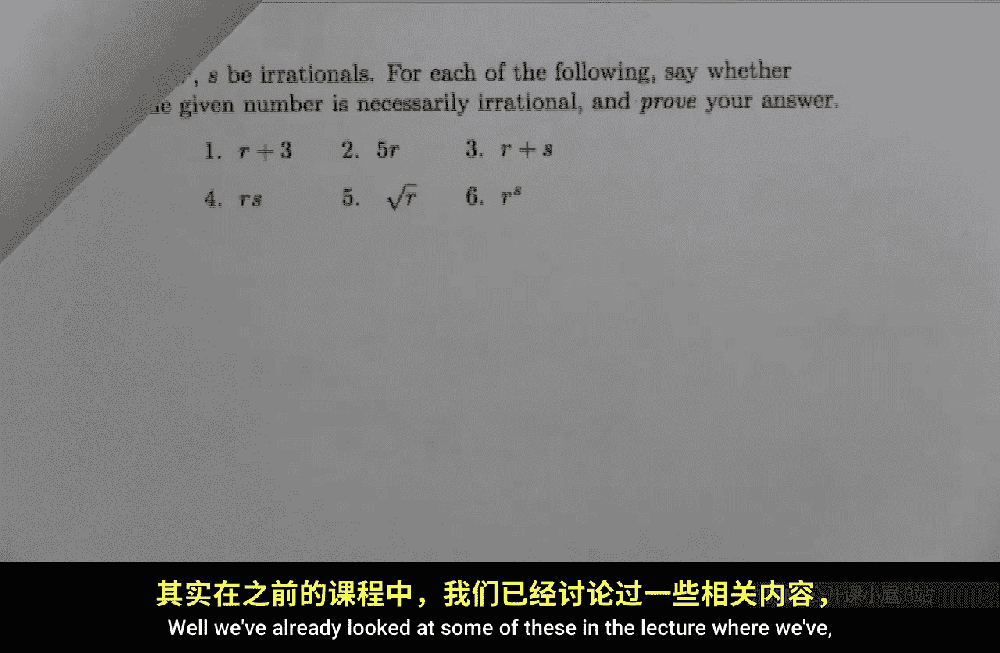

# 023：作业7指导教程

在本节课中，我们将一起完成斯坦福大学数学思维导论课程的作业7。这份作业包含多个关于证明、反例和逻辑推理的练习。我们将逐一分析每个问题，学习如何构造证明、寻找反例，并理解逻辑概念如逆命题和逆否命题。

---

## 1️⃣ 问题1：反驳陈述

上一节我们介绍了课程概述，本节中我们来看看第一个问题：反驳陈述“所有的鸟都会飞”。

要证明一个全称量词陈述为假，只需找到一个反例。

以下是具体步骤：
*   陈述“所有的鸟都会飞”是一个全称量词陈述。
*   要证明其为假，需要找到一个不会飞的鸟作为反例。
*   鸵鸟是一种不会飞的鸟，因此它是一个有效的反例。

---

## 2️⃣ 问题2：证明或反驳

在找到了一个反例后，我们来看看第二个涉及两个全称量词的问题。

证明或反驳以下陈述：对于所有实数 `x` 和 `y`，`(x - y)^2 > 0`。

这个陈述同样是假的。要反驳一个带有全称量词的陈述，找到一个反例即可。

以下是具体步骤：
*   该陈述声称对所有实数 `x` 和 `y` 都成立。
*   一个明显的反例是取 `x` 和 `y` 相等。
*   例如，令 `x = 1`，`y = 1`，则 `(1 - 1)^2 = 0`，而 `0` 并不严格大于 `0`。
*   因此，原陈述为假。

---

## 3️⃣ 问题3：有理数的稠密性

上一节我们通过反例反驳了陈述，本节中我们来证明一个正面的性质：任意两个不相等的有理数之间，总存在第三个有理数。

设 `x` 和 `y` 为有理数，且 `x < y`。因为是有理数，我们可以将其写为 `x = p/q`，`y = r/s`，其中 `p, q, r, s` 是整数。

一个自然的想法是取 `x` 和 `y` 的平均值。

以下是证明过程：
*   考虑数 `(x + y) / 2`。
*   计算 `(x + y) / 2 = (p/q + r/s) / 2 = (ps + qr) / (2qs)`。
*   由于 `ps + qr` 和 `2qs` 都是整数，因此 `(x + y) / 2` 是一个有理数。
*   显然有 `x < (x + y)/2 < y`。
*   因此，我们证明了在两个有理数之间存在另一个有理数。

---

## 7️⃣ 问题7：证明 √3 是无理数

在证明了有理数的性质后，我们转向一个经典的证明：证明 √3 是无理数。我们将使用反证法，这与证明 √2 是无理数的方法类似。

假设 √3 是有理数。那么我们可以将其写为 `√3 = p/q`，其中 `p` 和 `q` 是自然数，且没有公因数（即分数已化为最简形式）。

以下是证明步骤：
1.  将等式两边平方，得到 `3 = p² / q²`。
2.  整理得 `3q² = p²`。这意味着 `3` 整除 `p²`。
3.  因为 `3` 是质数，如果它整除 `p²`，则它必须整除 `p`。所以，`p = 3r`（`r` 是某个整数）。
4.  代入 `3q² = p²`，得到 `3q² = (3r)² = 9r²`。
5.  简化得 `q² = 3r²`。这意味着 `3` 整除 `q²`，从而 `3` 也整除 `q`。
6.  现在，我们得出 `3` 同时整除 `p` 和 `q`，这与我们最初假设 `p` 和 `q` 没有公因数矛盾。
7.  因此，最初的假设（√3 是有理数）是错误的，故 √3 是无理数。

这个证明与 √2 的证明逻辑完全相同，只是将“被2整除”（偶数的性质）替换为“被3整除”。

---

## 8️⃣ 问题8：逆命题

证明了无理数后，我们来看一个逻辑概念：逆命题。一个条件语句 `P → Q` 的逆命题是 `Q → P`，即交换前提和结论。

以下是几个例子及其逆命题：
*   原命题：如果美元下跌，日元上涨。  
    逆命题：如果日元上涨，美元下跌。
*   原命题：如果 `x < y`，那么 `-y < -x`。  
    逆命题：如果 `-y < -x`，那么 `x < y`。
*   原命题：如果两个三角形全等，那么它们面积相等。  
    逆命题：如果两个三角形面积相等，那么它们全等。

这个练习的关键在于观察：一个真命题的逆命题，有时为真，有时为假。例如，第一个例子的原命题和逆命题都为真；而第三个例子的原命题为真，但其逆命题为假（面积相等的三角形不一定全等）。这与逆否命题总是与原命题同真假的特性不同。

---

## 1️⃣1️⃣ 问题11：涉及无理数的运算

现在，我们应用反证法来证明一些涉及无理数的陈述。例如，证明：如果 `r` 是无理数，则 `r + 3` 也是无理数。

假设 `r + 3` 是有理数。那么可以写为 `r + 3 = p/q`，其中 `p, q` 是整数。

以下是推导过程：
*   由 `r + 3 = p/q`，可得 `r = p/q - 3 = (p - 3q) / q`。
*   由于 `p - 3q` 和 `q` 都是整数，因此 `r` 是有理数。
*   但这与已知条件“`r` 是无理数”矛盾。
*   因此，假设不成立，`r + 3` 必为无理数。

其他类似问题（如 `r + √3` 等）的证明方法完全相同：假设结果为有理数，通过代数变形推导出 `r` 为有理数，从而引出矛盾。

---

## 1️⃣2️⃣ 问题12：奇偶数的性质

最后，我们处理一个关于整数奇偶性的基础证明问题。解决这类问题的核心是使用以下定义：
*   整数 `n` 是偶数，当且仅当存在整数 `k`，使得 `n = 2k`。
*   整数 `n` 是奇数，当且仅当存在整数 `k`，使得 `n = 2k + 1`。

例如，证明部分（a）：如果 `m` 和 `n` 都是偶数，则 `m + n` 是偶数。
*   证明：设 `m = 2k`, `n = 2l`（`k, l` 为整数）。
*   则 `m + n = 2k + 2l = 2(k + l)`。
*   因为 `k + l` 是整数，所以 `m + n` 是偶数（符合 `2 * 某个整数` 的形式）。

再如，证明部分（d）：如果一个数是偶数，另一个是奇数，则它们的和是奇数。
*   证明：设 `m = 2k`（偶数），`n = 2l + 1`（奇数）。
*   则 `m + n = 2k + (2l + 1) = 2(k + l) + 1`。
*   因为 `k + l` 是整数，所以 `m + n` 是奇数（符合 `2 * 某个整数 + 1` 的形式）。

其他部分的证明思路类似，都是根据定义进行设元并完成简单的代数运算。

---

本节课中我们一起学习了作业7的全部内容。我们实践了如何通过寻找反例来反驳全称陈述，如何构造关于有理数和无理数的证明，理解了逆命题的概念及其真值特性，并掌握了基于奇偶数定义进行基础证明的方法。这些练习巩固了数学推理的核心技能，为应对更复杂的数学问题打下了基础。