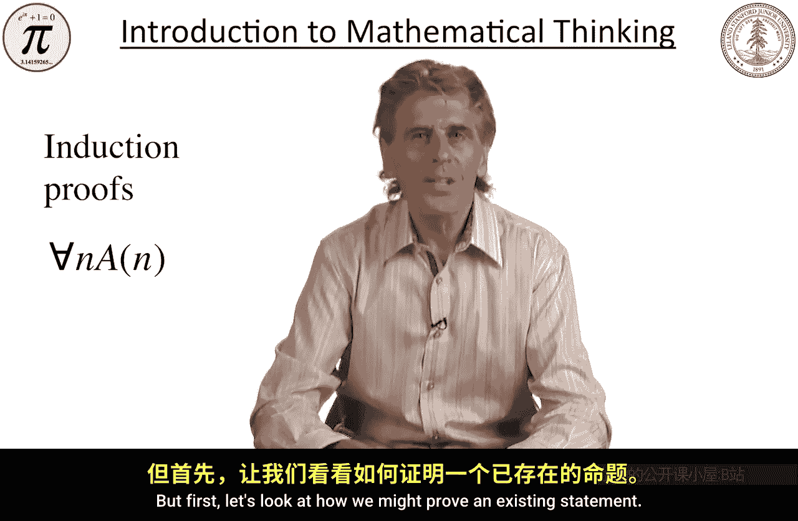
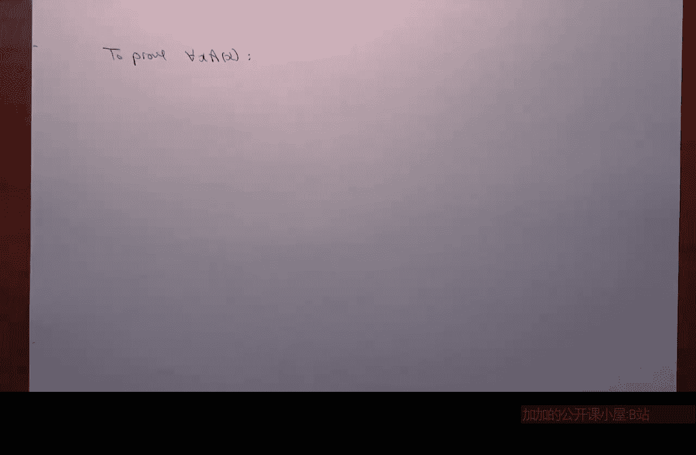

# 025：带量词的证明方法1 🧮

在本节课中，我们将学习如何证明涉及量词的数学陈述。几乎所有数学定理都包含量词，因此掌握这些证明方法至关重要。我们将重点介绍证明存在性陈述和全称量化陈述的几种基本方法，并深入探讨一种针对自然数的特殊证明方法——数学归纳法。

## 证明存在性陈述

上一节我们提到了证明涉及量词陈述的重要性。本节中，我们来看看如何证明一个存在性陈述。

要证明一个形如 **∃x A(x)** 的陈述，最直接的方法是找到一个具体的对象 **a**，使得 **A(a)** 成立。

例如，要证明“存在一个无理数”，只需证明 **√2** 是无理数即可。

然而，直接构造对象的方法并非总是可行。有时，我们需要使用间接证明。

例如，在之前关于三次方程的问题中，我们假设曲线上存在一个与X轴相交的点，从而证明了方程有解，但我们从未实际找到那个解。

以下是一个精彩的间接证明例子，它证明了存在无理数 **r** 和 **s**，使得 **r^s** 是有理数。

这个证明需要考虑两种情况：

**情况一**：假设 **√2^(√2)** 是有理数。
*   令 **r = √2**， **s = √2**。
*   根据假设，**r^s = √2^(√2)** 是有理数。
*   由于 **√2** 是无理数，我们找到了满足条件的无理数 **r** 和 **s**。

**情况二**：假设 **√2^(√2)** 是无理数。
*   令 **r = √2^(√2)**， **s = √2**。
*   那么，**r^s = (√2^(√2))^(√2) = √2^(√2 * √2) = √2^2 = 2**，这是一个有理数。
*   同样，我们找到了满足条件的无理数 **r** 和 **s**。

综合情况一和情况二，由于 **√2^(√2)** 要么是有理数，要么是无理数，这两种情况已涵盖所有可能性，因此定理得证。

这个证明的巧妙之处在于，我们实际上并不知道 **√2^(√2)** 究竟是有理数还是无理数（尽管它很可能是无理数），但我们不需要知道。我们只需分析两种可能性，在每种情况下都能找到满足条件的 **r** 和 **s**。这种方法被称为**分情况证明法**，在高等数学中经常使用。

## 证明全称量化陈述

接下来，我们探讨如何证明形如 **∀x A(x)** 的全称量化陈述。

一种方法是选取一个**任意的** **x**，并证明它满足 **A(x)**。

例如，要证明“对于所有自然数 **n**，都存在一个自然数 **m** 使得 **m > n^2**”。

证明过程如下：
1.  令 **n** 为任意自然数。
2.  令 **m = n^2 + 1**。
3.  显然，**m > n^2** 成立。
4.  由于 **n** 是任意的，因此原命题对**所有**自然数 **n** 都成立。

在这个简单的例子中，逻辑推理是这样的：为了证明一个形如 **∀n ∃m (m > n^2)** 的陈述，我们通过选取一个任意的自然数 **n** 来“消除”全称量词。然后，我们进行推理（这里是通过构造 **m**）来证明剩余部分 **∃m (m > n^2)** 成立。因为这个推理对任意选取的 **n** 都有效，所以原全称陈述成立。

另一种证明全称陈述的方法是使用**反证法**。

要证明 **∀x A(x)**，我们假设其否定形式 **¬∀x A(x)** 成立。这个否定等价于 **∃x ¬A(x)**。

这个存在性陈述告诉我们，存在某个（特定的）对象 **c**，使得 **¬A(c)** 成立。然后，我们以 **c** 和 **¬A(c)** 为起点进行推理，最终推导出一个矛盾。这个矛盾表明我们最初的假设 **¬∀x A(x)** 是错误的，从而原命题 **∀x A(x)** 必须为真。

具体的推理过程取决于陈述 **A** 的内容，但总体模式是固定的。

## 数学归纳法

现在，我们来看一种用于证明涉及自然数的全称量化陈述的特殊方法——数学归纳法。这是本节的核心内容。

假设我们要证明以下公式对所有自然数 **n** 成立：
**1 + 2 + 3 + ... + n = n(n+1)/2**

在尝试证明之前，先验证前几个情况是个好习惯，这有助于理解公式的含义。例如，当 n=1, 2, 3 时，公式都成立。但必须注意，**验证有限个案例并不是证明**。历史上有一个著名的反例：多项式 **P(n) = n^2 - n + 41** 在 n=1 到 40 时都产生质数，但 n=41 时，**P(41)=41^2** 不是质数。这警示我们不要仅凭有限个例就草率下结论。

数学归纳法依赖于**数学归纳原理**。要使用归纳法证明陈述 **A(n)** 对所有自然数 **n** 成立，需要完成两个步骤：

1.  **基础步骤**：证明 **A(1)** 成立。
2.  **归纳步骤**：证明对于任意自然数 **k**，如果 **A(k)** 成立（归纳假设），那么 **A(k+1)** 也成立。

直观上，这就像推倒一列多米诺骨牌：基础步骤推倒第一块骨牌；归纳步骤保证如果第 k 块骨牌倒了，第 k+1 块也会倒。这样，所有骨牌都会依次倒下。

现在，我们用归纳法严格证明求和公式。

**定理**：对于任意自然数 **n**，**1 + 2 + ... + n = n(n+1)/2**。

**证明**（使用数学归纳法）：

*   **基础步骤** (n=1)：
    左边 = 1。
    右边 = 1×(1+1)/2 = 1。
    因此，当 n=1 时公式成立。

*   **归纳步骤**：
    *   **归纳假设**：假设公式对某个自然数 **k** 成立，即 **1 + 2 + ... + k = k(k+1)/2**。
    *   **需要证明**：公式对 **k+1** 也成立，即 **1 + 2 + ... + k + (k+1) = (k+1)((k+1)+1)/2 = (k+1)(k+2)/2**。

    从归纳假设的等式两边同时加上 **(k+1)**：
    **1 + 2 + ... + k + (k+1) = k(k+1)/2 + (k+1)**

    对右边进行化简：
    **= (k(k+1) + 2(k+1)) / 2**
    **= (k+1)(k+2) / 2**

    这正是我们需要证明的、当 n = k+1 时的公式右边。

因此，根据数学归纳原理，该公式对所有自然数 **n** 成立。证明完毕。

## 总结

本节课中我们一起学习了证明涉及量词陈述的核心方法。
*   对于存在性陈述 **∃x A(x)**，可以通过直接构造对象或间接的**分情况证明**来证明。
*   对于全称陈述 **∀x A(x)**，可以通过处理任意对象或使用**反证法**来证明。
*   当全称量词作用于自然数时，**数学归纳法**是一种极其强大且常用的工具，它包含验证基础步骤和完成归纳步骤两个关键环节。

理解并熟练运用这些基本证明框架，是培养严谨数学思维的重要一步。