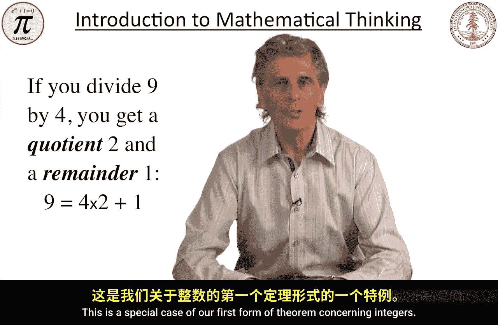
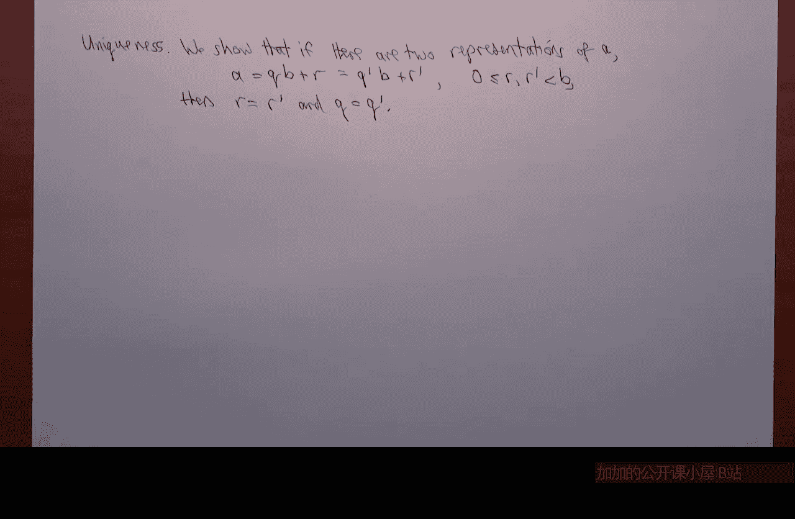
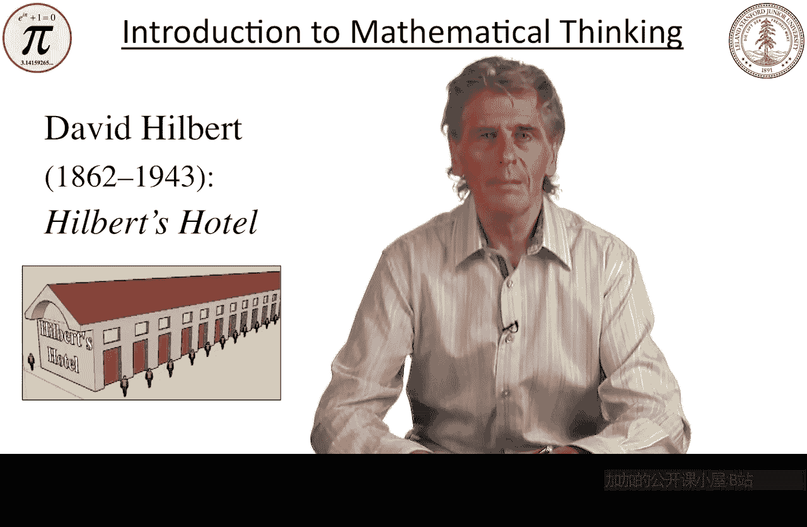
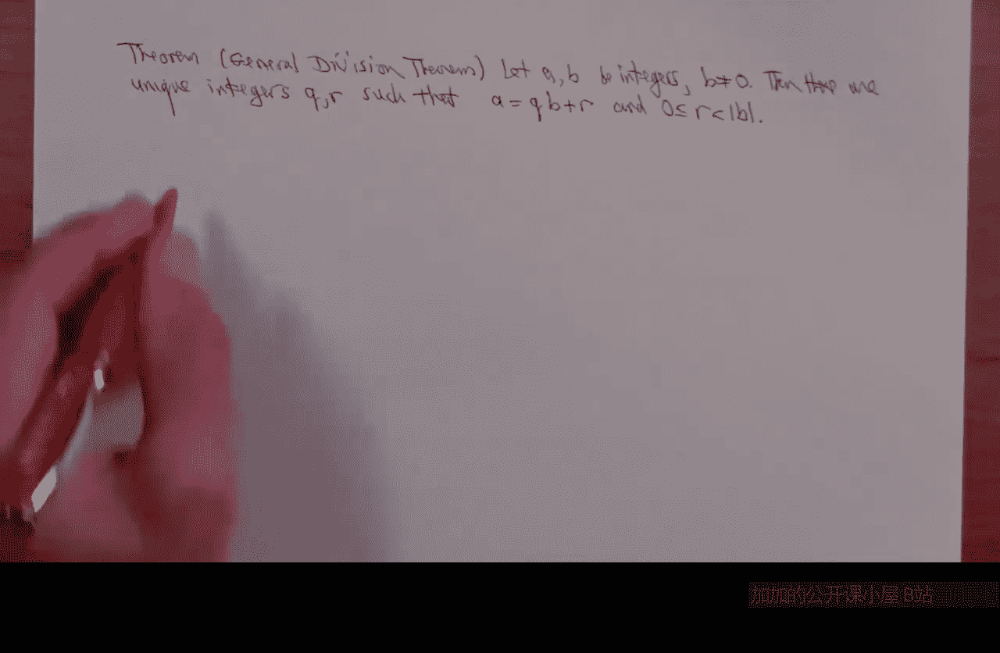
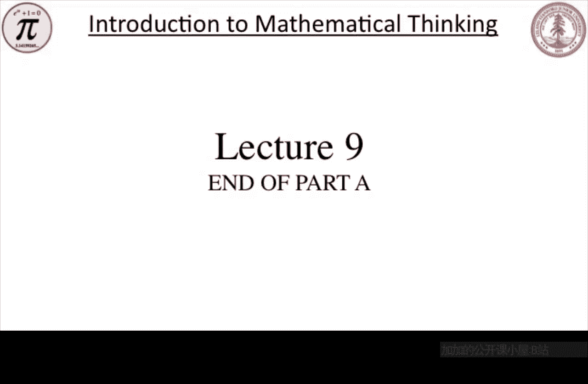

**数学思维导论：9a：数论基础1**

在本节课中，我们将学习数论的基础知识，特别是关于整数的除法。我们将从一个核心定理——带余除法定理——开始，并通过严谨的数学证明来理解它。此外，我们还将探讨一个关于“无限”的有趣思想实验，以展示数学证明在处理非直观概念时的重要性。

---

**整数与数论**

本课程的重点是一种特定的思维方式，而非具体的数学内容。实数和整数为我们提供了方便的数学领域来展示数学证明。这些领域就是数论和初等实分析。使用这些领域的主要优势在于，每个人都对它们有一定的熟悉度，但很可能尚未接触过它们的数学理论。

我们先从整数开始。大多数人对整数的经验来自于初等算术。然而，对整数的数学研究——超越单纯的计算，关注这些数字所展现的抽象性质——可以追溯到公元前700年左右现代数学的萌芽时期。这项研究已发展成为纯数学最重要的分支之一：数论。许多大学数学专业的学生发现，数论是他们学过的最迷人的课程之一。

这个学科不仅充满了诱人的问题（这些问题易于陈述，但需要极大的巧思才能解决，甚至很多至今仍未解决），而且其部分结果对现代生活有着至关重要的应用，互联网安全可以说是其中最重要的应用之一。遗憾的是，在本课程中我们只能浅尝辄止。但如果你在本讲座中看到任何激起你好奇心的内容，我建议你进一步探索，你不太可能会失望。

**整数的除法**

对整数的数学兴趣不在于它们在计数中的用途，而在于其算术系统。给定任意两个整数，你可以将它们相加、相减或相乘，结果总是另一个整数。除法则不那么直接，而这正是事情变得特别有趣的地方。

对于某些整数对，例如5和15，除法是可行的：15除以5得到整数结果3。对于其他整数对，例如7和15，除非你允许分数结果（这将使你离开整数的范畴），否则除法是不可行的。如果你将算术限制在整数范围内，除法实际上会产生两个数：商和余数。例如，9除以4，商为2，余数为1：`9 = 4 × 2 + 1`。

这是一个关于整数的第一个正式定理的特例。

**带余除法定理**

带余除法定理陈述如下：设 `a` 和 `b` 为整数，且 `b > 0`。则存在唯一的整数 `q` 和 `r`，使得 `a = qb + r` 且 `0 ≤ r < b`。

这个定理包含两部分：存在性部分（存在具有此性质的整数）和唯一性部分（这些整数是唯一的）。在证明这个定理时，我们将分别处理这两部分。首先证明存在性，然后证明唯一性。

**证明存在性**

证明开始时，最好先说明你将采用的方法。在这种情况下，我会说：我将先证明存在性，再证明唯一性。我没有使用任何标准方法，所以无法声明我使用了归纳法之类的方法，但这样说明可以引导读者：证明的第一部分处理存在性，第二部分处理唯一性。

好，我们来处理存在性。考虑所有形式为 `a - kb` 的非负整数，其中 `k` 是整数。定理说的是，在整数 `a - qb`（即整数 `r`）中，存在一个满足 `0 ≤ r < b` 的数。因此，我将查看所有可能的 `a - kb`（或 `a - qb`）候选值，并证明在这些候选值中，有一个满足该条件。而满足该条件的 `k` 值，将成为定理中的 `q`。

首先，我需要证明存在这样的候选值。例如，取 `k = -|a|`。由于 `b ≥ 1`，`a - kb = a + |a|b ≥ a + |a| ≥ 0`。既然通过给出一个 `k` 值证明了存在这样的整数，我可以选择最小的那个。令 `r` 为最小的这样的整数，并令 `q` 为使其发生的 `k` 值，即我们有 `r = a - qb`。

以这种方式定义 `r` 和 `q` 后，我确实会有 `a = qb + r`。如果我能证明 `r` 在0和 `b` 之间，那么我就证明了存在性。

为了完成证明，我们需证明 `r < b`。假设相反，即 `r ≥ b`。换句话说，我现在将使用反证法来证明 `r < b`。如果 `r ≥ b`，那么 `a - (q+1)b = a - qb - b = r - b ≥ 0`（基于此假设）。因此，`a - (q+1)b` 是一个形式为 `a - kb` 的非负整数。但 `r` 是此类中最小的？然而，`a - (q+1)b` 小于 `a - qb`（即 `r`）。这是一个矛盾，因为如果 `r` 是最小的，我们不可能找到一个更小的。这个矛盾是在假设 `r ≥ b` 下得出的，因此 `r < b`。这就证明了存在性。

如果你以前没见过这样的证明，它看起来可能非常复杂。实际上它并不复杂或深奥，只是结构上有些精巧。其思路是查看所有可能使此式成立的候选值。首先，我们必须证明存在可能的候选值，我们实际上通过展示一个来做到这一点。然后，为了得到一个满足这个额外要求的候选值，我们选择使 `r` 最小的那个——它是给出这些值的最小 `r` 值。接着，我们利用其最小性来证明它必须满足这个要求。每一步都只是初等代数，只是推动论证的过程有些精巧。数学中有很多这样的论证。不涉及深奥的数学，只有初等算术和一点代数，但需要一点精巧的结构来使证明成立。如果你以前没见过这种论证，可能需要读几遍，看几次才能开始理解。

**证明唯一性**

好，这证明了存在性。然后我们需要转向唯一性。为了证明唯一性，我们证明如果 `a` 有两种表示法：`a = qb + r` 和 `a = q'b + r'`，且 `0 ≤ r, r' < b`，那么 `r = r'` 且 `q = q'`。所以，除法定理的第一部分（我们已经证明的存在性部分）表明存在这种形式的表示法。我们现在要做的是证明如果存在两种这样的表示法，那么它们实际上是相同的：`r` 相同，`q` 也相同。顺便说一句，你现在可能已经意识到，字母 `q` 表示商，字母 `r` 表示余数。我们还没有正式定义商和余数，所以我还没有写下类似的内容。但我使用了熟悉的符号，因为我们正在为关于算术的熟悉知识提供数学基础。

好，我们这里有一个等式：`qb + r = q'b + r'`。重新排列，得到 `r' - r = b(q - q')`。我们将其标记为方程（1）以供后续参考。现在我要对这个方程取绝对值。这样做时，我得到 `|r' - r| = b|q - q'|`，将其标记为方程（2）。记住 `b` 是正的，所以取绝对值时，`b` 保持不变。但 `-b < -r ≤ 0`，且 `0 ≤ r' < b`。所以 `-b < r' - r < b`。如果 `r' - r` 在 `-b` 和 `+b` 之间，那就意味着 `|r' - r| < b`。因此，由方程（2），`b|q - q'| < b`。两边除以 `b`（`b` 为正）得到 `|q - q'| < 1`。但这里所有都是整数。要使一对整数的差的绝对值小于1，唯一的可能是该绝对值为0，这意味着 `q` 必须等于 `q'`。然后，由方程（1），`r` 必须等于 `r'`。这就证明了唯一性。随之，我们证明了定理。

同样，如果你以前没见过这样的论证，它可能看起来相当令人生畏。但当你逐步进行时，这实际上只是非常基本的算术不等式论证。一步一步来，你应该能够跟上论证直到结束。

**理解证明的重要性**

好，祝你好运。如果这是你第一次遇到像这样的完整、严谨的定理证明，你可能需要花些时间仔细研究它。结果本身并不深奥，这是我们都很熟悉的。我们这里的重点是用于确凿证明除法性质对所有整数对都成立的方法。现在花时间确保你理解这个证明如何运作、为什么每一步都至关重要，将在以后你遇到更困难的证明时带来回报。通过获得像这样简单结果（这个结果是显而易见的）的数学证明经验，数学家们对证明方法建立了信心，并能接受那些完全不明显的结果。

**希尔伯特旅馆：一个关于无限的思想实验**

作为一个不明显结果的例子：在19世纪末，著名的德国数学家大卫·希尔伯特描述了一个具有奇怪性质的假想旅馆。希尔伯特旅馆，正如其名，是终极旅馆，因为它有无限多个房间。像大多数旅馆一样，房间用自然数编号：1, 2, 3, ...。一天晚上，所有房间都住满了。这时又来了一位额外的客人。“抱歉，”前台职员说，“我们所有的房间都住满了，您得去别处。”这位客人是位数学家，想了一会儿说：“有一种方法可以给我一个房间，而不必赶走任何现有客人。”在我继续这个故事之前，你可能想暂停视频一会儿，看看是否能看出这位数学家客人想到的解决方案。

职员持怀疑态度，但他请数学家解释如何能在不赶走旅馆里任何人的情况下腾出一个房间。“很简单，”数学家开始说，“你把每个人都移到下一个房间。所以1号房的住客搬到2号房，2号房的住客搬到3号房，依此类推，贯穿整个旅馆。一般来说，第 `n` 号房的住客搬到第 `n+1` 号房。当你这样做后，1号房就空了，你把我安排在那个房间。”职员想了一会儿，然后不得不承认这个方法会奏效。确实有可能在一个完全客满的旅馆里容纳一位额外的客人，而不必赶走任何人。数学家的推理是完全合理的。因此，数学家得到了当晚的房间。

希尔伯特旅馆论证的关键在于旅馆有无限多个房间。实际上，希尔伯特构思这个故事是为了说明无限的几个令人惊讶的特性之一。你应该思考一下上述论证。你不会学到关于现实世界旅馆的新知识，但你会对无限有更好的理解。而理解无限的重要性在于，它是微积分的关键，而微积分是现代科学和工程的基石。当你满意地理解了希尔伯特的解决方案后，试试以下变体：

**变体一**：希尔伯特旅馆场景如前，但这次有两位客人来到完全客满的旅馆。如何在不赶走任何人的情况下，为他们安排单独的房间？

**变体二**：这次，前台职员面临更棘手的局面。旅馆已满，但一个无限旅行团抵达了。每个成员都戴着一个徽章，上面写着：“你好，我是 `n`”，其中 `n` 是每个自然数：`n = 1, 2, 3, ...`。职员能找到一种方法，在不赶走任何现有客人的情况下，为所有新客人各自安排一个房间吗？如果能，怎么做？

像希尔伯特旅馆这样的例子展示了严谨数学证明的重要性。当用于验证像除法定理这样明显的结果时，它们可能显得琐碎。但当同样的方法应用于我们不熟悉的问题时，例如涉及无限的问题，严谨的证明是我们唯一可以依赖的。

**推广的带余除法定理**

现在回到除法定理。我陈述除法定理的方式只适用于除以一个正整数 `b`。现在我将给出一个更一般的版本。

**定理：推广的带余除法定理**
设 `a`, `b` 为整数，且 `b ≠ 0`。则存在唯一的整数 `q` 和 `r`，使得 `a = q × b + r`，且 `0 ≤ r < |b|`。

所以，推广的除法定理几乎与我们之前证明的除法定理完全相同，只是不再要求 `b` 严格为正，而是说 `b` 非零，并且这里我们有 `b` 的绝对值。其证明相当直接地由前一个结果推导出来。

**证明**：如果 `b > 0`，这就是之前的定理。如果 `b < 0`，则 `|b| > 0`。之前的定理告诉我们存在唯一的整数 `q'` 和 `r'`，使得 `a = q' × |b| + r'`，且 `0 ≤ r' < |b|`。现在，我们简单地令 `q = -q'`，`r = r'`。那么，由于在这种情况下 `b` 为负，`|b| = -b`，我们得到 `a = qb + r`，且 `0 ≤ r < |b|`。这就是定理。因此，我们只是将其归结为前一个结果。

随着推广的除法定理的确立，我们可以正式地给这两个数 `q` 和 `r` 命名：数 `q` 称为 `a` 除以 `b` 的商，`r` 称为余数。这样，我们现在完整地回到了你在小学学到的关于除法有时有余数、有商和余数的知识。好的，我们以某种复杂的方式做到了这一点，并证明了一切都是定义良好的。怎么样？

---

**总结**

在本节课中，我们一起学习了数论的基础，重点是带余除法定理。我们详细地逐步证明了这个定理，理解了其存在性和唯一性两部分。我们还通过希尔伯特旅馆的思想实验，探讨了无限的概念，并看到了严谨数学证明在处理非直观问题时的力量。最后，我们将定理推广到了除数为任意非零整数的情况，并正式定义了商和余数。这些基础概念和证明技巧是进一步学习数论和更高级数学的基石。