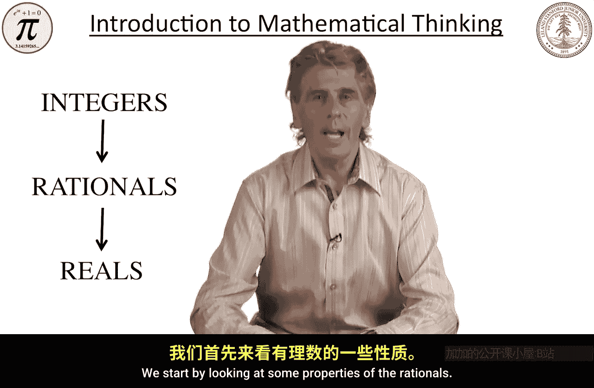

# 033：实分析基础1

在本节课中，我们将应用数学思维来研究实数。我们将探讨有理数的性质，理解其局限性，并初步了解实数系统是如何被构建以克服这些局限性的。

## 数字的起源

数字源于对人类两种认知概念的形式化：计数和测量。根据化石记录，人类学家认为，在这两种概念被引入数字之前，它们已经存在并被使用了数千年。

早在三万五千年前，人类就在骨头（可能还有木棍）上刻下凹痕来记录事物，例如月相或季节。他们很可能也使用木棍或藤蔓长度来测量距离。

然而，数字本身，作为代表骨头上凹痕数量或测量设备长度的抽象概念，出现得要晚得多。用于计数的离散计数数字大约在一万年前首次出现。

这些活动产生了两种不同的数字：用于计数的离散计数数字，以及用于测量的连续实数。直到19世纪，随着现代实数系统的构建，这两种数字之间的联系才最终被牢固地确立。

之所以花费如此长的时间，是因为需要克服的问题相当微妙。虽然实数的构建超出了本课程的范围，但我们可以解释其中一些问题。

## 从整数到有理数

两种数字概念之间的联系是通过展示如何从整数出发，首先定义有理数，然后利用有理数定义实数来建立的。

从整数出发，定义有理数是相当直接的。毕竟，有理数就是两个整数的比。

然而，从整数构建有理数并非完全平凡。目标是定义一个更大的系统——有理数，它通过为每一对整数 `(a, b)`（其中 `b ≠ 0`）提供一个商 `a/b` 来扩展整数。

但如何定义这样一个系统呢？特别是，如何回答“商 `a/b` 是什么？”这个问题？在有理数被定义之前，你无法用实际的商来回答。如果你感兴趣，可以在许多书籍和互联网上找到从整数构建有理数的说明。但需要再次提醒，对互联网上的数学内容应保持谨慎。

关键在于，从整数构建有理数虽然有一些微妙之处，但相对直接。然而，从有理数构建实数则要困难得多。

## 有理数的性质

有理数系统足以满足所有现实世界的测量需求。这由有理数的以下性质所体现，我们将其表述为一个定理：

**定理（有理数的密度性）**：如果 `r` 和 `s` 是有理数，且 `r < s`，那么存在一个有理数 `t`，使得 `r < t < s`。

这个性质被称为**密度性**。有理数线是稠密的。这意味着，在有理数线上任意两个不同的有理数之间，总能找到另一个有理数。

**证明**：
设 `r = m/n`，`s = p/q`，其中 `m, n, p, q` 是整数，且 `n, q ≠ 0`。
取 `t = (r + s)/2 = (m/n + p/q)/2 = (mq + np)/(2nq)`。
由于 `mq + np` 和 `2nq` 都是整数，因此 `t` 是有理数。显然 `r < t < s`。证毕。

密度性意味着有理数非常适合进行测量，因为它告诉我们，我们可以找到任意接近特定长度的有理数。如果某个有理数比目标长度略小，另一个略大，我们总能找到更接近的有理数。

然而，密度性并不意味着有理数线上没有“空洞”。

## 有理数线的“空洞”：以√2为例

有理数线存在“空洞”的一个例子是 `√2`。

让我们更精确地描述这一点。定义集合 `A` 为所有满足 `x ≤ 0` 或 `x² < 2` 的有理数 `x` 的集合。定义集合 `B` 为所有满足 `x > 0` 且 `x² ≥ 2` 的有理数 `x` 的集合。

这样，我们将有理数线 `Q` 分成了两个集合 `A` 和 `B`。`A` 中的所有数都小于 `B` 中的所有数。然而，关键点在于：**集合 `A` 没有最大元素，集合 `B` 没有最小元素**。

在有理数线上，`√2` 本应存在的位置留下了一个“空洞”。正是通过考虑类似这样的情况，19世纪末和20世纪初的数学家最终找到了构建实数系统的严格方法。

这告诉我们，有理数对于进行数学研究是**不充分**的。因为在有理数 `Q` 中，我们无法解方程 `x² - 2 = 0`。有理数对于测量、木工、几何、建筑、天文等实际应用是足够的，只要我们满足于一定的精度（例如小数点后10位）。但如果我们想要求解方程，有理数就不够用了。

## 历史进程与实数构建

解决这个问题的出路，即19世纪末20世纪初的工作，是认识到我们拥有多个不同的数字系统：自然数用于计数；整数引入了负数，用于处理像银行账户这样的负值情况；有理数是整数的商，用于测量。而要进行数学研究，我们必须再进一步，到达**实数**。

从自然数到整数，再到有理数，最后到实数，这在很大程度上是一个历史进程，目的是为了获得更强的表达能力。

从有理数得到实数，19世纪末的数学家所做的是找到一种方法来“填补”有理数线上的这些空洞。实数是通过填补这些空洞而构建的。

然而，这其中包含了一些令人震惊的因素。一个事实是，无论你如何计算，有理数线上的“空洞”数量都远远多于有理数本身的数量。有理数已经是无穷多的，但这些空洞的“无穷”在无限尺度上远远超过了有理数的“无穷”。这是一种“超无穷”的空洞。

这意味着，当这些空洞被填满后，得到的实数系统所包含的数字数量，在无穷的意义上，是**不可比较地多于**有理数的数量。虽然两者都是无限的，但数学家不得不发展出计数无限集合的系统来处理这个问题。

## 区间符号

在详细介绍实数构建之前，我们需要引入（或重新引入）实数线上区间的概念。

设 `a, b` 为实数，且 `a < b`。
*   **开区间** `(a, b)` 是集合 `{x ∈ R | a < x < b}`。它不包含端点 `a` 和 `b`。
*   **闭区间** `[a, b]` 是集合 `{x ∈ R | a ≤ x ≤ b}`。它包含端点 `a` 和 `b`。

这个看似细微的差别（是否包含端点）实际上至关重要，它与有理数为何不足以进行数学研究，而实数却可以的原因密切相关。

还有一些变体：
*   **半开（半闭）区间**：
    *   `[a, b)`：左闭右开，`{x ∈ R | a ≤ x < b}`。
    *   `(a, b]`：左开右闭，`{x ∈ R | a < x ≤ b}`。
*   **无穷区间**：
    *   `(-∞, a)`：`{x ∈ R | x < a}`。
    *   `(-∞, a]`：`{x ∈ R | x ≤ a}`。
    *   `(a, ∞)`：`{x ∈ R | x > a}`。
    *   `[a, ∞)`：`{x ∈ R | x ≥ a}`。

**注意**：我们**不能**将无穷大与方括号连用（如 `[a, ∞]`），因为无穷大 `∞` 不是一个实数，因此不可能成为区间的元素。

## 关键性质：完备性

有了这个符号，我们现在可以前进，看看如何从有理数过渡到实数。我们可以从深刻、精确的意义上审视有理数出了什么问题，并了解如何纠正有理数线的缺陷。

实数拥有而有理数没有的关键性质，被称为**完备性**。简而言之，完备性性质使得实数非常适合进行数学研究，而缺乏这一性质则使得有理数不充分。

构建一个满足完备性性质的数字系统，乃至完备性性质本身的表述，是19世纪末数学的辉煌成就之一，为20世纪的数学奠定了基础，而现代科学和技术大多依赖于此。

以下是相关定义：
给定一个实数集 `A`，如果一个数 `b` 满足对于所有 `a ∈ A` 都有 `a ≤ b`，则称 `b` 是 `A` 的一个**上界**。
如果 `b` 是 `A` 的一个上界，并且对于 `A` 的任何其他上界 `c` 都有 `b ≤ c`，则称 `b` 是 `A` 的**最小上界**（或上确界）。

最小上界的记号为 `lub(A)`。

实数系统的**完备性**表述如下：
> **完备性公理**：每一个非空的、有上界的实数集，都在实数集中存在一个最小上界。

这个简单而优雅的陈述，是实数系统的关键，也是大多数现代数学的关键。

在继续深入学习之前，强烈建议你查看并尝试完成作业10.1。你需要熟悉关于上界和最小上界的背景材料，因为我们即将接触大多数大学数学初学者认为极其困难的内容。这就像学骑自行车，在掌握诀窍之前似乎不可能，但一旦掌握就会觉得非常简单。我们正面临这样一个转变。

---

**本节课总结**：
在本节课中，我们一起学习了数字从计数和测量概念中的起源，回顾了从整数构建有理数的思路。我们重点探讨了有理数的密度性，并通过√2的例子揭示了有理数线上存在“空洞”，说明有理数对于解某些方程是不充分的。接着，我们介绍了填补这些空洞以构建实数的历史需求，并学习了实数区间的基本符号。最后，我们引出了实数系统最关键的性质——**完备性**，即每个有上界的非空实数集都有最小上界。这是实数区别于有理数、并能成为现代数学坚实基础的核心所在。在接下来的课程中，我们将基于这些概念进行更深入的探讨。